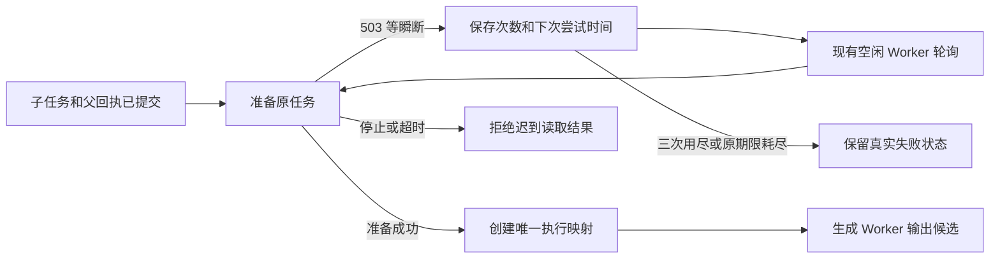

# T-915：已提交任务准备失败后的自动恢复

论点子任务提交成功后，首次准备发生明确瞬断，无须重启应用即可由现有调度循环重新准备原任务并生成候选。补偿不新建任务，不重放父模型调用，不重置原 requestedAt、工具键或模型预算。

实现与边界：

- 新服务只接受 planning.thesis 的真实原子提交：子任务账号、服务端 attempt、父聊天映射、冻结工具声明、模型调用绑定、输入摘要与成功回执中的真实 taskId 全部核对。
- 在原 ai_tasks 私有 runtimeData 中保存准备次数、nextAt、deadlineAt 和规范错误码；最多三次纯准备，瞬断复用现有分类、Retry-After 与抖动退避。原期限按 requestedAt 和既有 Worker 预算计算；重建服务不重置。
- 现有模型调度器领取循环启动后台 single-flight 补偿，每轮最多 20 条，游标轮转。空闲进程在另一进程长请求期间仍能触发；正常任务领取不等待补偿。不同回读共用原任务的准备。
- 旧启动准备扫描排除 hostTaskSubmission，避免绕过持久次数和期限。模型仍只由原有 execution 映射和 Worker 启动；重复轮询不创建新任务。
- 结构化准备的纯读取支持停止等待，迟到返回不能继续 bind；实际生产准备接收原期限信号。已经进入映射事务的工作可能等待事务提交，不能将此情况说成“任意数据库事务都能中断”。停止调度器仍禁止随后新启动模型。
- 底层纯读取未必支持主动取消网络请求；本批保证上层停止等待及迟到结果不再产生映射，不声称所有底层 I/O 都已被强制中止。

当场验证：

- 真实前端装配故障红测：首次准备 503 后，子任务持续 queued，无法读到 awaiting_confirmation。修复后同一测试通过；正常论点工厂、一次瞬断自动恢复和旧同键派发共 3 项通过，故障场景不重启应用，子任务只调用一次测试模型。
- 独立评审发现挂起准备阻断领取与停机。补全有效 Skill fixture 后，当场红测证实停止未收口；修复后实际 business.prepare 的 stop/deadline 两个用例通过，迟到读取无映射。初始无效 fixture 导致的非目标失败不冒充该红测。
- 后端原子链路文件 25 项通过：含持久次数/退避、跨账号/损坏来源/错误回执/错误 attempt、期限、并发回读、停止以及上述挂起场景。次数和停机细项属于实现后补充回归，不补称前置红测。
- 真实模型调度文件 10 项通过，含补偿挂起时普通任务仍完成、另一长请求期间持续补偿。Agent/浏览器调度回归三文件 10 项通过；原结构化审核与目标生成两文件 6 项通过。
- 完整聊天文件 3 passed / 1 failed，仍缺其余 15 项工具，模型请求为 0；没有裁减工具清单或更改失败断言。
- backend/frontend 类型检查通过，boundary 仍为既有 5 项，orphan 为 0 errors / 100 warnings。独立只读复核确认原阻断已修复，没有独立重跑测试。

本批为本地测试模型与真实 Worker/数据库路径，不是商业供应商或双平台分发包验收。T-915 的其余工具迁移、公开入口切换、完整 R-05、性能基准和发行验收仍未完成。

最终对账：pmem sync 已执行；reconcile 为 211 errors / 1 warning，与原全局基线一致，仍未通过。精确文件复杂度记录已重绑当前哈希，未放宽门卫。
