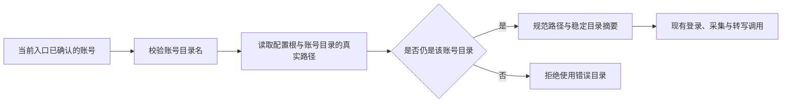

# T-915：抖音目录解析收口到应用入口

应用组合根不再直接把账号 ID 拼成浏览器目录。登录、状态检查、热点宝、采集、转写、staging 采纳与旧默认登录态迁移使用同一个异步解析器；保留原有账号来源，账号所属用户仍由原 backend service 校验。

空账号仍使用 `_default`。目录未创建时只解析最近存在的祖先，不创建目录；创建前后的摘要一致。配置根本身可以是符号链接，别名与真实根归一；账号子目录不能通过链接指向另一账号或根目录外，悬空链接不能冒充尚未创建的空目录。非目录文件和真实文件系统错误不被当成新账号目录。

生产组合根改为等待解析结果。绑定后的旧登录态迁移保持先迁移再触发采集；其异步初始化异常显式捕获。已有取消信号的转写和采集端口继续传递取消，其他未提供 signal 的旧入口保持原契约。解析过程只读，不替代账号授权，不宣称具有操作系统级隔离。

验证：Worker 目录解析 6 项、前端抖音/取消/staging 138 项通过；frontend 与 Worker 类型检查通过。首次新增模块缺失红测与迁移过程中类型错误均保留真实日志，不冒充旧系统行为红测。文件系统测试只写删自身 mkdtemp 创建的隔离根；Windows 使用路径语法单测，不冒充 Windows 真机验收。

重启缺口已只读核对：现有壳的组停止与 Windows Job 机制没有持久宿主启动代次/停止回执；macOS kill_confirmed 还存在根进程退出即返回成功的分支。其独立修复正在隔离工作树推进，本文件不计为已实现。没有停止证明时，不能用 TTL、旧 PID 消失或删除 Chromium 锁释放历史租约。

未完成：目录摘要尚未绑定生产宿主的持久租约领取；宿主停止证明、重启回收、抖音 Worker 完整转写以及正式聊天和其他 R-05 入口仍需继续。此批完成的是现有应用路径收口，不是完整 Agent 重构交付。

全局对账：本批 pmem sync 已执行；reconcile 实际退出 1，仍为 211 errors / 1 warning（T-916 既有全局欠债），不记录为全绿，也不完成 T-915。
