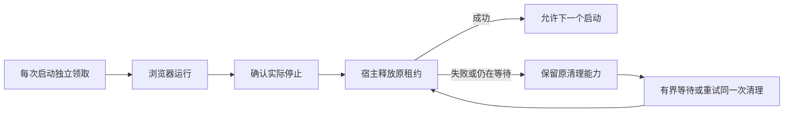

# T-915：浏览器停止证明与宿主租约释放联动

浏览器启动守卫新增 onStopped。正常关闭、真实 close 事件及确认启动失败后才调用；关闭失败不调用，启动超时或取消后迟到资源仍保留占用，实际关闭后才结算。回调成功前本地队列不放行。

清理失败不靠新建任务或换凭证重放。无返回 context 的启动失败携带 retryCleanup；超时后迟到资源的清理能力保存在原启动队列节点中。retryBrowserProfileCleanup 只执行已确认停止的清理，不关闭活 context，不添加第二套锁。重复调用复用在途结算，等待超时只退出等待，原结算仍可完成。

网页登录实现新增 acquireLaunch 工厂，每一次真实 openContext 各领取一次。存量迁移可能先开关一个 context，后续状态检查再开另一个，二者不能共用已释放的回调。重新登录先重试旧清理再领取；否则新领取会被旧释放失败阻塞。Chromium 模块加载与准备也进入启动守卫，保持现有浏览器选择、代理、沙箱和窗口参数。

新增停止回调的四项测试先失败后实现。独立复核发现共用回调与无 context 清理不可重试两处缺口，已改为逐次工厂及同一次清理恢复，并补迁移/探针、重复登录和迟到释放失败覆盖。随后补在途清理等待超时，避免提前新领或重复结算。未伪造历史红测。

验证：Worker 生命周期 15 项，前端相关 48 项，后端真实内存数据库租约 15 项，共 78 项；Worker、frontend、backend 类型检查通过。后端组合测试真实调用同一守卫和数据库服务，仅浏览器/进程清理端口为替身。前端测试从 openWebLoginWindow 到取消再到再次登录，验证清理先于新领取。全部测试未启动真实浏览器，未使用用户媒体或数据库。

范围仍未完成：应用 persistence 装配尚未启用新增宿主数据库租约；必须继续接宿主实例的实际进程停止/重启清理、受控路径授权、抖音登录与采集启动，以及完整转写和正式聊天迁移。本批代码提供实际停止与逐次启动的联动能力，不代表这些生产入口或完整 T-915 已交付。

工程对账：reconcile 仍为 211 errors / 1 warning，保留 T-916 历史漂移；提交环境缺少 lefthook，不计为已执行钩子。
