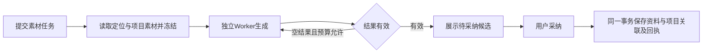

# T-915 素材生成执行链路迁移证据

`research.gather_material` 的生产入口现已接入既有持久 Worker，移除宿主 `runGatherMaterial` 模型生命周期。它本来就是纯创作素材生成，没有真实联网调用；迁移保留此事实，候选冻结 `grounding=model_memory`，引用与 URL 继续按原规则清洗。

后台只准备上下文并验证项目归属；共享的四类素材投影、伪引用清理和聊天 `runResearchNode` 保留。固定协议在 Worker 的生成修复循环内校验清洗后是否还有有效素材，避免无效对象先持久成功、后台投影才报错。

采纳经过任务锁。知识、知识首版、项目关联、采纳回执及成功状态在同一事务内完成，领域服务均绑定该事务。旧任务的逐项采纳键继续兼容；成功回执重放不会恢复用户删除的关联或已归档知识。资料使用现有 `sourceType=ai` 与 `sourceNote=模型生成，未联网核实`，不把模型自报出处当联网证据。

实际验证：

- 后台回归 21 PASS，Worker 与原聊天节点回归 65 PASS，真实 fork 4 PASS，共 90 个不同测试。
- 真实本地 HTTP + 构建后的 Worker 子进程：正常生成恰好一次模型请求；首次空结果后合法输出恰好两次；空/全伪引用在预算内失败且零候选；重复 prepare/drain 无新增模型调用。
- 真实 PGlite 组合覆盖并发确认、关联失败回滚、跨账号拒绝、无项目采纳、历史部分采纳及用户删除后的重放。
- 采纳旧行为曾实际 3 FAIL；Worker 缺失固定 schema 曾实际 1 FAIL。真实 fork 首次运行即绿，没有宣称发生未执行的红测。初次类型检查的新测试 fixture 缺字段已修为完整输入，最终三个包及前端类型检查通过。
- boundary 仍为基线 5，无新增；orphan 0 errors / 100 warnings；任务范围检查为空。

证据日志与精确文件 SHA 见同目录 `research-migration-evidence.json`。本记录不代表真实供应商、UI、安装包、30 样本耗时和完整 T-915 已通过。热点选题的现存搜索与提取链路见 `topic-trend-runtime-inventory.md`。

独立只读审查 PASS（`research-independent-review.md`）。本次 reconcile 实测 211 errors / 1 warning，与此前全局基线一致；T-916 仍承担历史工程对账欠债，未将失败写成通过。T-915 保持进行中。
