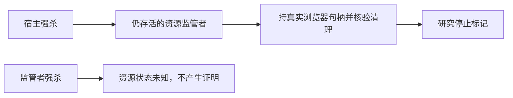

# 浏览器宿主崩溃后的资源监管研究

主宿主死后，仍活着的资源监管者可以收尾；监管者也死了就不能宣称资源已停。当前只验证候选机制，不改变生产契约或发布标准。



```research-first-gate/v2
{
  "schema": "research-first-gate/v2",
  "task_id": "T-915",
  "research_task_id": "T-915",
  "status": "validated",
  "problem_statement": "主宿主崩溃后丢失实际浏览器句柄，不能安全释放profile。验证独立纯资源监管者能否在宿主死亡后清理。",
  "failure_family": "browser-owner-lost",
  "observed_invariant": "不能把根进程退出或锁超时当作整棵浏览器树停止证明。",
  "trigger_kinds": [
    "high-impact-uncertainty"
  ],
  "paused_actions": [
    "further-production-changes",
    "broadened-workaround",
    "repeated-full-system-runs",
    "irreversible-operations"
  ],
  "validation": {
    "timebox_minutes": 30,
    "max_experiments": 2,
    "acceptance_criteria": [
      {
        "name": "宿主死亡后清理",
        "target": "已观察浏览器进程存活数=0且停止标记在核验后产生",
        "measurement": "真实SIGKILL与ps身份/状态采样，现有树终止函数验证",
        "observed": "7进程→0",
        "verify_key": "t915-resource-guardian-probe",
        "evidence_path": "docs/research/evidence/t915/resource-guardian-host-kill-probe.json",
        "evidence_sha256": "7d9281bfc6b56f47db5f310c249b696bd8c57af80e24bdcb03bd52fb0ed0b9dd"
      },
      {
        "name": "监管丢失不假报停止",
        "target": "浏览器仍活时没有停止标记",
        "measurement": "SIGKILL监管者，观察浏览器进程与停止文件",
        "observed": "4进程仍活；无停止标记",
        "verify_key": "t915-resource-guardian-probe",
        "evidence_path": "docs/research/evidence/t915/resource-guardian-guardian-kill-probe.json",
        "evidence_sha256": "c30414b46fbe5b30fda784438cfc2efe837e53443101caa856f49540f708d686"
      }
    ],
    "resume_criteria": "两项限定实验通过可恢复既定范围实现；本卡不代表签名回执、数据库解锁、Windows或安装包验收。"
  },
  "decision_impacts": [
    "none"
  ],
  "evidence": {
    "authoritative": [
      {
        "kind": "approved-spec",
        "ref": "docs/superpowers/specs/2026-09-04-agent-runtime-refactor.md",
        "claim": "R02允许桌面提供受控浏览器资源适配，不承载业务选择；R04要求重启资源回收。"
      },
      {
        "kind": "source-code",
        "ref": "backend/src/modules/execution/worker-process-tree.ts",
        "claim": "现有终止函数依赖仍存活的实际ChildProcess并逐个冻结核验后代。"
      }
    ],
    "local": [
      {
        "kind": "source-code",
        "path": "frontend/src-tauri/src/lib.rs",
        "locator": "process_group/killpg/kill_confirmed",
        "observation": "sidecar进程组清理不能覆盖实验中另起PGID的Chromium。"
      },
      {
        "kind": "source-code",
        "path": "frontend/src-tauri/src/win_job.rs",
        "locator": "assign/shutdown",
        "observation": "已有JobObject但停止等待只看根句柄；本机未运行Windows。"
      }
    ],
    "experiments": [
      {
        "question": "宿主被SIGKILL后，独立资源监管者是否仍能持实际浏览器句柄清理？",
        "command": "T915_RECORD_RESOURCE_PROBE=1 pnpm --filter @creatoros/backend test src/modules/execution/browser-resource-guardian.probe.test.ts",
        "environment": "macOS darwin；真实fork/Chromium/页面；无用户数据、无外部网络",
        "result": "host强杀后7个已观察浏览器进程均不再存活，再生成研究停止标记。",
        "artifact_path": "docs/research/evidence/t915/resource-guardian-host-kill-probe.json",
        "artifact_sha256": "7d9281bfc6b56f47db5f310c249b696bd8c57af80e24bdcb03bd52fb0ed0b9dd"
      },
      {
        "question": "监管者自身被SIGKILL能否误当停止证明？",
        "command": "同一限定测试的guardian-kill用例",
        "environment": "macOS darwin；独立新建浏览器进程组；结束后夹具定向清理",
        "result": "监管者退出后仍有4个已观察浏览器进程存活，未生成停止标记，证明必须保持未验证状态。",
        "artifact_path": "docs/research/evidence/t915/resource-guardian-guardian-kill-probe.json",
        "artifact_sha256": "c30414b46fbe5b30fda784438cfc2efe837e53443101caa856f49540f708d686"
      }
    ]
  },
  "options": [
    {
      "id": "reuse-sidecar-group",
      "outcome": "不采用其作为跨崩溃解锁证明",
      "tradeoffs": "代码少，但Chromium独立进程组不被覆盖",
      "scope": "现有侧车退出",
      "falsified_by": "实际browserPgid不同于guardianPgid，根停止无法证明浏览器全树停止"
    },
    {
      "id": "guardian-candidate",
      "outcome": "进入受控资源适配实现候选，禁止据本实验直接解锁生产profile",
      "tradeoffs": "额外纯资源进程；仍需持久身份、认证回执、启动握手、Windows验证和监管者死亡处理",
      "scope": "不调度任务、模型或数据库，仅持资源并收尾",
      "falsified_by": "若在持真实浏览器句柄时宿主死亡仍无法核验清理，则不接入"
    }
  ],
  "recommendation": "guardian-candidate"
}
```
