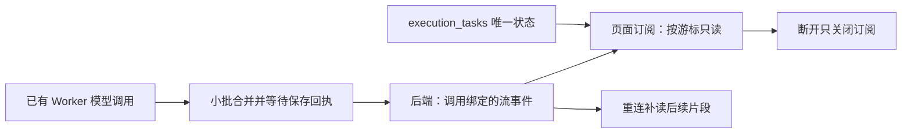

# T-915 流式执行事件通道证据

2026-09-05。承接 R-02 / R-05，完整任务仍在实现中。本批不是 `/api/chat` 完整迁移验收。

当前 `/api/chat` 仍直接把 `req.signal` 传给模型运行，并依赖 HTTP 流消费回调保存消息。因此“断开订阅不取消后台执行”的完整产品行为尚未达成。本批建立其必需的持久事件通道，并接入现有 `model.generate` 独立 Worker。

## 已实现

新增 `0083_execution_stream_events` 迁移。事件按同一执行连续编号，按真实调用和调用内索引唯一；归属于既有 execution_tasks / execution_calls，不增加执行状态来源。JSON 事件仅表示流内容，不是候选采纳或任务完成授权。

后端追加端口在同一租约锁和事务中检查真实调用、当前 attempt、开始状态和连续索引。重投返回同一回执；缺口、改写、跨任务和旧 fence 被拒绝。取消/暂停请求后只允许结算当前已在途的片段，终态后不新增。回读逐次校验用户和账号，按游标分页，任务状态从 execution_tasks 读取。

Worker 以短时间窗口合并相邻文本，单路 IPC 顺序写入，并在缓冲达到阈值时施加背压。结束前排空尾部。保存失败或异常回执向生成层传播，不能静默丢失片段或换索引重放未知请求。现有真实 `model.generate` 路径已使用该写入器，进度事件不代替持久事件。

只读订阅迭代器不持有任务取消端口；订阅 AbortSignal 仅结束读循环。任务控制仍由既有显式命令负责。

## 本批实测

- 后端服务 **6 PASS**：并发重投、JSONB 内容比较、连续索引、分页、权限、旧 fence、取消后在途保存、终态拒绝、订阅断开与补读、磁盘 PGlite 关闭重开及重复迁移。
- 真实模型调度宿主 **7 PASS**：包括真实构建的 Worker 子进程、SDK、本地 SSE 模型服务与真实数据库；429 自动重试后事件与候选一致；供应商尚未结束时片段已可读取；断开只读订阅后实际请求未中断，Worker 继续完成，重连游标只得到后半段，总请求数为 1。
- Worker supervisor **11 PASS**，Worker 生命周期及写入器 **30 PASS**，私有契约 **2 PASS**。
- 合计 **56 项不同测试**，重跑不重复计数。全部供应商端使用本地 fixture，不代表真实商业模型、UI 浏览器或桌面安装包验收。
- Backend、Frontend、Worker、Contract 类型检查通过；boundary 5 条既有 / 0 新增；orphan 0 errors / 100 warnings；scope `[]`。全局 reconcile 单独据实际结果登记在相邻 evidence JSON。

## 如实记录

服务和写入器的首次红测因实现文件不存在，未进入行为断言，不称为行为红测。实现后首次服务运行暴露 JSONB 键顺序变化和未导出的 gt；修复后通过。新增端口使旧测试宿主缺少保存回执，真实子进程因此报告 unknown_result；补齐测试端口并断言真实流内容后通过。原始日志保留。

本批未取得新的独立评审回执，不标为评审 PASS。未完成项仍包括 `/api/chat` 的完整 Worker 输入装配、工具调用与卡片证据绑定、授权续接、消息提交、显式停止与刷新恢复 UI；也未完成完整 T-915 的其他入口、生产浏览器资源清理、真实供应商、性能样本与双平台包体验收。不把本通道测试推断成这些功能已完成。
