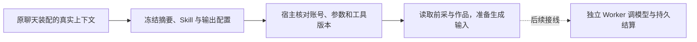

# T-915：结构化聊天生成输入与前采准备

日期：2026-09-06。基于 `baa883d5`。本次仍属 T-915 BUILD，未完成整任务。

将选题补全、定位生成所需的五项创作上下文、专属输出配置和原账号 Skill 绑定到现有持久聊天宿主快照。新的准备宿主已可由 `createChatTaskToolHost` 装配，但 Worker 的命名生成端口和候选结算尚未接通，不宣称生产入口已迁移。

## 行为与边界

- `prepareDurableChatTurn` 显式开启 structuredGeneration 时才声明 `worker.structured-node`，工具使用独立版本；没有节点 Skill 时拒绝。默认旧路径不切换。
- 只冻结实际消费的 positioning/accounts/learnings/signals/knowledge brief。不存在模型实例、凭据或宿主执行闭包。
- 新宿主重新读取原任务账号与快照，比较完整工具定义，校验参数和节点 Skill，只提供授权与 `prepareGeneration`，没有模型 execute。
- 选题仍优先选中候选标题，保留 candidateId、原 verifiedBrief 清洗和未核实提示；模型提供的文本没有升级为外部已验证事实。
- 定位前采准备从旧原生工具提取为共用函数。宿主通过真实账号读取会话，保留状态验证、服务端 revision/sourceMode、候选 ID 和原 brief 拼接；缺失会话拒绝。scratch 跳过作品读取，其余沿原数量规则。
- 准备输入在异步前复制；异步资料读取前后检查取消。首次准备结果的持久化调用方、真实子模型回执及候选投影仍待连接。

## 当场验证

- 新宿主测试先运行，因模块尚不存在失败，原始日志 `structured-host-red.log`；这是缺实现的红测，不冒称运行行为红测。
- 首轮实现测试的两处失败是 fixture 共享 owner 引用、断言误命中防旧定位提示；新装配测试一次失败是 fixture Skill 未排序。修正测试数据后再次运行，没有记录为产品回归根因。
- 六份共享准备/宿主/原聊天/定位/工具定义测试：**400 passed**。
- 真实独立 Worker 开场回归：**14 passed**。其中能力缺失测试仍证明真实 Worker 不广告尚未实现的 chat.structured。
- frontend 完整真实装配测试：**4 passed、1 failed**；仍是 `CHAT_WORKER_INPUT_UNAVAILABLE`，模型请求 0，未接 13 工具清单未变。没有删工具、改成功断言或隐藏失败。
- backend TypeScript 通过；`git diff --check` 通过。
- 独立只读审查 `/root/worker_review`：未发现本批具体 blocker；审查者未运行测试。其明确要求后续从真实父模型账本取参数并持久化首次准备结果。
- boundary 剩余 5 条既有违规；orphan 0 error / 100 warning。pmem sync 已执行；全局 reconcile **211 errors / 1 warning**，与上一批基线数量一致，退出码 1，未声明全绿。既有对账债务保留在 T-916。

## 完整验收仍未完成

尚需连接共享生成的 prepare/reserve/start/settle/complete/fail/restore 协议、首次准备持久化、专属凭据及父工具候选结算；之后完成其余 R-05 入口与旧路径退役。完整聊天仍未迁入生产 `/api/chat`。性能样本、真实商业上游、macOS/Windows 分发包仍待验，不以本批局部测试替代。
