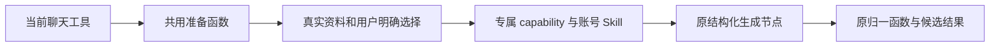

# T-915：选题补全与定位生成共享节点

当前真实聊天工具入口已复用独立的准备与生成函数，chat-runner 移除两段内联业务闭包。准备结果只有 capability、facets 和已有候选 ID，可以序列化；不携带模型实例、凭据或执行闭包。

保持的实际行为：

- topic.enrich 选中候选时使用 selection 标题，采纳目标为原 candidateId；没有选中候选则为 null。保留 verifiedBrief、未核实提示和反编造约束。
- positioning.generate 的 scratch 不调用作品 reader、不注入旧定位和账号；显式模式保持 12 条作品上限，没有模式保持旧默认。既有明确路径标记只落实用户选择，不新增语义猜测。
- 两项生成分别解析原 capability，经原 runWithSkillSnapshot 执行；原 normalizeCard 和 normalizeSuggestion 保留全部候选字段。
- 准备在第一个 await 前复制输入；等待期间外部改变选区、资料或指令不会串入本次准备结果。

当场验证：旧聊天及工具回归 356 项通过；共享准备及原定位回归 26 项通过。后者包含真实结构化节点调用本地 HTTP 测试模型，两次请求分别使用 topic.enrich 和 positioning.generate，回读原 candidateId、缺失评分 null、定位 facets 和下游约束。不是商业供应商验收。输入隔离等专项用例是重构后的回归，不补称前置红测。

完整 Worker 文件仍为 4 passed / 1 failed，仍缺 13 项工具；测试未裁减工具或改变失败断言。本次只收敛业务实现，尚未把这两项模型调用接入独立 Worker，也不代表持久子模型协议已完成。独立只读复核未发现具体阻断，评审者未运行测试。

backend 类型检查通过；boundary 为既有 5 项，orphan 为 0 errors / 100 warnings。

最终对账：pmem sync 已执行，reconcile 为 211 errors / 1 warning，与既有全局基线一致，仍未通过。精确写集预检通过，未放宽规则。T-915 继续进行中。
