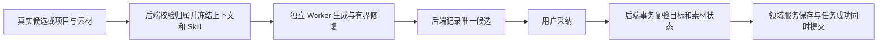

# T-915 选题补全与素材匹配迁移记录

本记录只覆盖 `topic.enrich`、`material.match` 后台任务。两者已从宿主内调用模型迁入已有结构化 Worker；没有新增规划模型轮次。聊天内联选题工具仍为后续迁移项。

## 变化与证据

- 删除两处旧生产分派和两个旧 runner 的模型执行生命周期；保留聊天共享的选题提示、宽容解析与选题卡归一。
- 选题候选目标来自冻结宿主输入；素材允许 ID 与模型看到的素材上下文来自同一次真实读取。素材相关性、角色、理由仍由模型判断。
- Worker 在保存生成结果前验证可用选题卡或至少一个真实素材 ID，避免无效输出到宿主投影才失败后反复重放。部分合法素材保留，空 ID 或伪造 ID 不物化。
- 采纳锁定任务，经同事务领域服务写入并提交状态；重复确认只返回成功结果。真实项目、资产账号归属与 active 状态在采纳事务内重新核对。第二项失败时首项写入回滚。
- 未映射旧任务保留真实逐项 `adoptedKeys` 回执，用户删除已采纳关联后恢复不会重建。`outputId` 仍只在候选内透传，不悄悄改成 output 级关联。

最终定向回归 77/77：`target-verified-regression.log`。包含真实 fork Worker + 本地 HTTP 模型夹具、真实 PGlite 事务与原 AI 服务回归；不是供应商实网或界面 E2E。类型结果见 `target-verified-types.log`、`target-frontend-typecheck-final.log`。独立只读审查通过；之前发现的回收素材和旧采纳回执问题均已修复并有回归。

## 真实失败记录

- adapter 首次红是缺模块导致收集失败，不冒充行为红测。随后冻结 Skill 测试夹具缺 skills 字段、缺必需 positioning 类型依赖，均已纠正。
- 采纳真实旧行为红 3 FAIL；回收素材和旧部分采纳恢复另有真实 2 FAIL。见 `structured-target-adoption-red.log` 与 `structured-target-adoption-legacy-public-red.log`。
- 扩大回归发现旧 partial 夹具沿用 `script.draft` 名称却缺现行脚本专用输入；后续独立 fixture 不允许创作 partial，又被正式注册表拒绝。最终使用正式 `script.storyboard.segment` 与可用正文，仍断言 partial、单次调用和公共采纳禁止领域写入。没有放宽产品完成策略。
- 新无效输出测试曾误读旧业务行 queued，后改为执行权威 DTO；映射任务的运行状态由 execution 记录负责。测试参数化曾有 taskId 未同步的夹具错误，已修正。所有中间日志保留，不记为最终通过。
- 初次 reconcile 发现新组合测试放在业务模块下引入跨域 repository 导入；测试迁至 `backend/src/integration` 组合层，生产边界未放宽。

## 完整任务仍未结束

R05 仍有生成、搜索编排、聊天、多模态、后台蒸馏等入口；浏览器宿主崩溃的生产资源监管、真实供应商矩阵、30 次延迟对照与 macOS/Windows 安装包验证仍待完成。既有 `r05-current-inventory.json` 保留其历史时点，本记录将其中两项更新为已迁移，不宣称整个清单完成。

最终工程对账：`target-reconcile-final.log` 为 211 errors/1 warning，与既有 T-916 基线一致。首次 213 中新增的两条组合测试边界违规已消除；没有降低基线或把全局失败写为通过。
