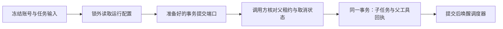

# T-915：子任务与父回执共用事务的提交端口

新增 AI service 内部 prepareTaskCommit。配置准备在锁外完成，返回仅供宿主 service 使用的 commit(tx, binding)。提交通过原 createTask 写入任务及引用，并将父 executionTaskId、callId、inputDigest 写入私有 runtimeData.hostTaskSubmission。同 attempt 的既有任务必须具有相同来源；公开 API 预建的任务不能被接管。外层事务失败时，子任务及引用随事务回滚。

图中父租约核对、父回执写入和唤醒调度器是下一步实际接线要求，本批仅实现前三项与 commit 数据库行为。该端口尚未绑定真实聊天工具，不代表完整恢复链已完成。

证据：

- 四项当场红测先因 prepareTaskCommit 方法缺失失败；实现后通过。随后与原任务提交、执行回归合跑，三文件 28 项通过。
- 验证准备不建任务、外层事务回滚、同来源重放、其他来源和公开预建任务拒绝、外部账号/正文/配置引用变化不影响首次准备、非法来源与保留字段拒绝、DTO 不泄漏 runtimeData。
- 真实临时持久库与 Worker 的聊天论点入口回归通过：并发同键提交一个任务、一次本地 fixture 模型 HTTP。该回归验证旧入口未受新模块相互引用影响，不能作为新事务端口已经接入真实父账本的证据。
- backend 类型检查通过；中途测试 nextId 参数漏类型已修正。独立只读评审未发现阻断；评审者未独立重跑测试。
- 开工时门卫发现 ai.service.ts 和 persistence-client.ts 的复杂度哈希仍指向旧文件，暂停修改；重新核对已批准范围后更新精确哈希与原因。ai.service 的 native 标记为既有 daemon 注释，未新增本机运行能力；前端登记仍为既有宿主配置。没有删除或放宽检查。

后续必须：在父执行 admission 行锁内提交子任务与父工具 settled 回执；仅对冻结声明为纯事务提交的工具允许提交前崩溃恢复；验证取消先发生不建任务、提交后 ACK 丢失直接回放、已创建未派发的任务重启可恢复。脚本入口若需要创建 artifact，必须也纳入事务边界，不能在准备阶段产生不可回滚写入。普通 host 的未知副作用规则保持严格。

本轮未调用真实商业模型、未运行双平台安装包，公开聊天仍未切换，T-915 保持进行中。

前端类型检查通过；边界保留既有 5 条、无新增；orphan 0 errors / 100 warnings。pmem sync 完成，全局 reconcile 本轮仍为 211 errors / 1 warning，未报全绿。
