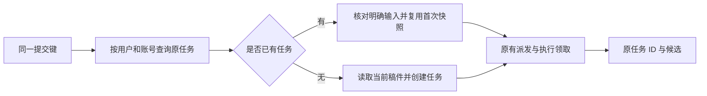

# T-915：聊天任务提交复用首次输入

后端新增任务提交协调服务，使用原有 ai task attempt 和账号隔离查询。首次输入中的动态稿件快照保存后不再重新读取；相同提交键的明确输入发生变化仍拒绝。并发首次准备读取不同版本时，回读第一个成功落库任务，继续原提交与派发入口。未知响应不在此层自动重试。

实际装配已接入 planning.thesis 和 asset.generate 两个回调，支持调用方提供稳定 attemptId；旧调用方不传时保留新任务行为。未给 publish.package 或其他未迁移回调新增不生效参数。此服务未新增 HTTP 端口，未改变供应商重试或任务截止时间。

当场证据：

- 后端账号隔离回读测试先因方法缺失失败；真实聊天论点测试先因两次提交创建不同 taskId 失败。
- 后端两文件 24 项通过，包含响应丢失后原输入恢复、并发快照、修改或删除明确输入、取消和调用期间外部修改上下文。
- 真实论点入口使用临时持久 PGlite、实际装配与独立 Worker，本地 HTTP 模型 fixture；并发重复提交返回原 taskId，改变主题拒绝，生成到 awaiting_confirmation，全程一个任务、一次模型 HTTP。
- 中途测试使用内存库固定 2026-06-13 时钟，与独立 Worker 当前时钟不一致而过期；改用隔离持久库后通过，没有放宽生产 deadline。
- backend 与 frontend 类型检查通过；独立只读评审未发现新增阻断，评审者未独立重跑测试。
- 素材首次快照在真实任务 CRUD 上验证；实际素材供应商未调用，不能视为素材执行迁移或计费故障恢复验收。

本批仅是稳定任务提交基础。聊天工具还需绑定持久父调用与可恢复提交回执；公开聊天入口未切换，完整聊天缺失 16 项工具的既有红测仍待解决。本轮未重跑该完整测试，不沿用其为新的当场证据。T-915 保持进行中。

边界检查保留既有 5 条、无新增；orphan 0 errors / 100 warnings。pmem sync 完成，全局 reconcile 仍为 211 errors / 1 warning，属于已登记的全局欠债，未报全绿。
