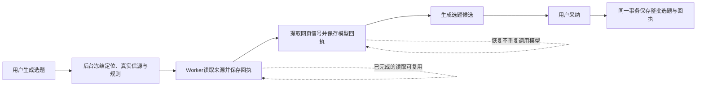

# T-915 完整选题任务执行链路迁移证据

基于 `3130b209` 实现。`ai.tasks.create → topic.generate` 的四种依据均已路由到统一持久 Worker。热点依据包含搜索、网页或 RSS 读取、逐源模型提取和最终出题；普通依据仍只调用一次出题模型。

## 实际行为与边界

- 后台 prepare 只读真实上下文，验证项目归属并冻结原质量画像和计算时刻；热点同时冻结 `topic.generate`、`trend.extract` 的 Skill 快照。模型凭据不进入业务快照。
- Worker 用同一调用账本执行所有模型调用；外部读取有独立 `topic.read.v1` 回执，不伪造 Agent 模型工具调用。host 从冻结目标派生查询、URL 和请求摘要，Worker 不能自选源外目标或自报账号。读取上限、每源最多 8 项、网页提取正文上限 40,000 字及原四依据语义保留。
- 明确临时读取失败最多尝试两次；每次消耗已有总预算。未知读取不能普通结算成成功，不能直接重发。登录/验证码/浏览器环境阻断进入等待用户；明确恢复认可旧回执后才开启新轮，预算和成功槽不重置。
- 网页读取复用真实研究浏览器适配器，登录态经同事务 vault 端口与 CAS；宿主取得 profile 租约后再复验。清理继续要求现有停止证据，不凭超时释放。模型 Worker 退出等待其资源关闭；浏览器库按需加载，普通生成不初始化浏览器。
- `candidate_list` 采纳使用任务锁和同一事务的候选/定位领域服务，整批创建、采纳回执和任务成功一起提交。历史 `${taskId}#有效序号` 保留，成功回放不重建用户删除项、不覆盖人工修改。完成步骤 `已生成 N 条选题` 与候选同事务保存。

## 真实验证

- Backend 最终回归 **156 PASS**，Worker 回归 **81 PASS**，真实浏览器 **2 PASS**，私有契约 **2 PASS**，桌面 Worker staging **3 PASS**，共 **244 个不同测试**。
- 真实构建的子进程与本地模型 HTTP：四依据完成；普通出题各一次调用。热点最终生成遇到真实 HTTP 429 后恢复，抽取模型只调用一次，最终出题共两次；搜索/网页已有回执数量不增，只有一份候选和一条完成步骤。
- 上项 fork 的搜索和网页事实由真实私有读取服务预置 fixture，不冒充实际联网。另两个测试使用真实 Chromium、本地 HTTP、真实 `readUrl`，验证新会话接口、全文传递、Cookie 保存及请求期间取消后进程退出；没有访问用户网站或登录态。
- 真实红测：热点 Skill 快照原只含一个 Skill；私有读取的 unknown 覆盖和非临时错误扩大重试；旧信源 hostname 与 canonical domain 不同造成误拒。均修复后通过。新采纳首次导入失败和若干缺字段 fixture 修正不标成业务行为红。
- fork 初次构建失败暴露浏览器依赖需要 external，修复为与现有 Agent Worker 相同依赖方式；随后只有 trend 断言误读兼容 `status=queued`，按真实 `runtimeStatus=retry_wait` 修正后四项通过，不放宽生产状态规则。
- 三个包和前端类型检查通过；boundary 仍为基线 5，无新增；orphan 为 0 errors / 100 warnings。独立定向复核 PASS。

## 生产入口盘点

| 范围 | 新 owner / 当前事实 |
| --- | --- |
| `ai.tasks.create → topic.generate` | `topic-business-adapter` 准备，`topic-worker-pipeline` 执行，`execution-topic-read.service` 保存读取事实，`topic-candidate-adoption.service` 原子采纳 |
| 旧 `runTopicGenerateV2` | 已删除生产分派及函数，无运行调用者 |
| `buildTrendQuery`、brief 和质量画像渲染 | 共享纯实现移到 Worker；原后台接口重导出，聊天和每日选题消费者保留 |
| 聊天与每日/定时选题 | 仍存在旧共享宿主调用，未宣称已经迁移 |

本轮不是完整 T-915 验收：真实供应商兼容、安装包双端退出与重启、完整 UI 旅程、30 样本延迟指标、生产浏览器资源守护及其余 R-05 入口仍待实现或实测。此前 `topic-trend-runtime-inventory.md` 是迁移前的调用链证据，不代表当前已迁移入口仍留在旧分派。

本次 reconcile 实测 **211 errors / 1 warning**，与此前基线一致。该全局失败仍由 T-916 跟踪，不代表本任务已完成；T-915 继续保持进行中。
