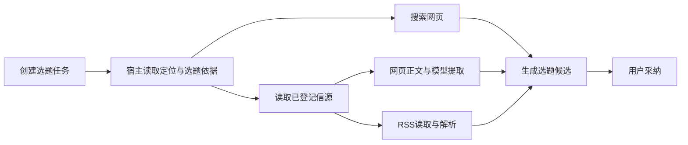

# T-915 热点选题运行边界盘点

本记录是现存调用链事实与迁移约束，不代替已批准 SPEC，也不代表热点链路已迁移或通过验收。

当前 `topic.generate` 的慢点不仅在最终生成：选择热点依据时，准备上下文本身会搜索、启动浏览器读取信源、调用模型提取，再进入选题生成。仅把最后一次模型调用移进 Worker，仍会把前面的失败和恢复问题留在宿主。

代码证据：

- `frontend/src/server/persistence-client.ts` 的 `dispatchCreatedTask` 仍调用 `runTopicGenerateV2`，注入 `searchWebPort`、`trendSourceSignalsPort`。
- `backend/src/modules/ai-runtime/topic-task-adapter.ts` 的 `assembleTrendBriefDetailed` 并行执行搜索与信源读取；`runTopicGenerateV2` 先完成这些步骤，再调用 `runTopicTask`。
- `backend/src/modules/ai-runtime/trend-source-signals.ts` 的 `collectTrendSourceSignals` 按来源处理网页/RSS，`createTrendExtractPort` 仍在宿主调用 `modelFor` 和 `runStructuredNode`。
- 根装配 `trendSourceSignalsPort` 使用 `readWebUrlSidecar`、`openPooledReaderContext` 读取真实网页；RSS 使用真实 fetch 与 `parseFeed`。现有每源上限、正文长度上限应保留。
- 同一准备函数还有聊天和每日选题采集使用者，迁移单个任务不能宣称这些共享宿主入口已经退役。

后续实现必须在现有批准范围内覆盖完整链路：后台只冻结真实数据库上下文、启用信源的 ID/URL/类型以及两个 Skill 快照；Worker 持久记录外部读取、逐源模型提取与最终生成，所有模型调用进入同一预算和取消机制。恢复应复用已落盘的正文和提取结果。

现有研究 Agent 的读取回执绑定真实模型工具调用，不能直接拿来伪装确定性热点准备步骤。需要为冻结信源提供明确的外部读取执行记录，并校验任务、来源、请求摘要和尝试归属。单个来源已知失败可以保留现有空结果降级；取消、预算耗尽和执行结果未知不得被通用 catch / allSettled 吞掉并继续执行。

验证仍缺：真实完整热点 Worker、读取及中间模型结果的重启恢复、取消传播、全调用计费、最终选题采纳事务与公开调用链回归。本次素材生成迁移不能作为这些事项的通过证据。
