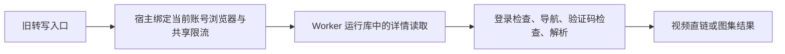

# T-915：转写详情读取复用 Worker 实现

抖音转写的登录校验、作品页导航、验证码检查、详情取流与解析已经从 frontend 的 douyin-cdp 大文件提取到 ai-worker/runtime。现有生产入口继续调用同一实现；导航重试与取消关闭 helper 也统一重导出，不复制第二套逻辑。登录错误类保持唯一身份，旧 instanceof 消费者继续兼容。

这张图表示代码归属，并不表示生产进程已经切换。浏览器启动仍由宿主注入；Worker 函数只接受已授权的 openContext 与 channel 窄端口，不接收任意 profile 路径，也不自建共享限流网关。

修复一个取消窗口：页面等待期间任务取消后，旧实现仍会发起 body evaluate；现在在等待结束后检查 signal，禁止继续观察或取流。以提取后的实现临时恢复原缺检查行为，新增用例现场失败，再恢复检查通过；这属于本次对旧行为的复现，不冒充历史红测或完整迁移前红测。

验证：Worker 全套 96 文件 / 873 项通过，随后相关 3 文件 / 28 项定向通过；前端 3 文件 / 140 项通过；Worker 与前端类型检查通过。覆盖视频、图集、无登录、验证码、预取消、等待中取消、迟到 context 清理。测试使用替身，不调用真实浏览器、凭据或媒体迁移 API。独立只读复核未发现明确回归。

下一处生产接线已核对：现有 user+domain 租约不能直接代表抖音按账号保存的 profile；需在同一资源租约机制表达真实资源与宿主/Worker 持有者，绑定真实退出再释放，不用伪造执行任务借用租约，不改变已有登录数据归属。本批尚未实现这些接线，也未完成转写后处理与落稿、正式聊天及其余 R-05 迁移、性能和双平台验收。

工程对账：pmem sync 完成；边界扫描无新增违规，保留基线 5 条；reconcile 退出 1，211 errors / 1 warning，与上一批一致，T-916 历史欠债继续保留。未宣称完整 T-915、真机或发布验收通过。
