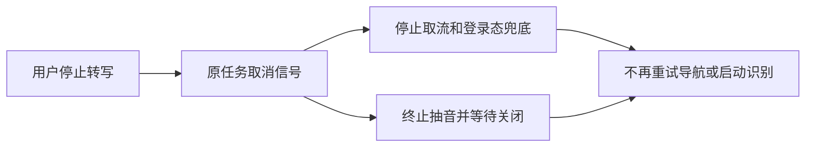

# T-915：生产转写取流与抽音取消贯穿

本批将 ffmpeg 抽音的唯一实现从前端移入 ai-worker。旧生产入口保留薄错误映射，默认路径、16kHz、单声道、64k MP3 和抖音 Referer 保持一致。新 Worker 编排可直接复用运行时模块，不需再调用前端抽音实现。

runner 将同一个信号传给首次与重试取流、抽音；persistence-client 真实装配消费它。匿名 fetch 合并原 30 秒超时与用户取消；排队取消立即退出，晚到许可不能执行请求，取消不记作上游风控失败。登录态上下文取消与 finally 共用一次关闭，导航取消不再触发退避重试。抽音取消等待 close；kill 失败时本次返回取消，同时禁止同实例启动新进程，直到旧进程关闭，不声称资源已退出。

验证共 232 项：frontend 取流/网关/取消三文件 153 项，backend runner 28 项，Worker 抽音/Whisper 三文件 51 项。三端类型检查退出 0。整链测试使用真实 runner、前端兼容入口和运行时抽音实现，进程为可控替身：停止后只启动一次抽音、没有第二次取流、没有模型调用或落稿。没有访问真实账号、浏览器、媒体目录或供应商。

当场失败证据：runner 信号透传断言 1 项失败；取流取消初测 4 项失败（包括等待超时）；新增导航取消断言证明旧逻辑重复导航，修复后 6 项取消测试全通过。抽音隔离实现保留 5 项行为红测与最终绿测。提交钩子缺少 lefthook，未将其记为通过；测试与类型检查均由命令实际运行。

未完成范围：本批不是完整 transcribe.douyin Worker 切换。持久任务准备、受管凭据与实际识别身份绑定、后处理模型节点、最终落稿与下游幂等提交仍需接通。正式聊天、其余 R-05 入口、旧路径退役、性能基准和双平台分发验收仍保留全部范围，T-915 继续进行中。

工程对账：pmem sync 已执行；reconcile 退出 1，仍为 211 errors / 1 warning，错误诊断行与上一批一致。历史工程欠债保留 T-916，本批不宣称全绿。
