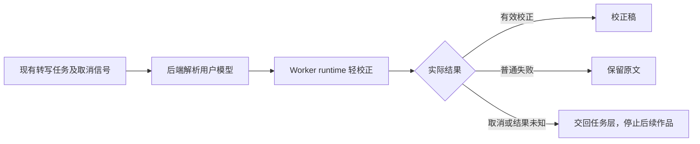

# T-915：逐字稿后处理执行迁移与取消传播

生产后处理现在使用 ai-worker runtime 的模板、结构化模型执行和保真校验；backend 保留当前用户模型解析与兼容导出。旧未配置、普通调用失败、输出为空或越权改写仍保留原文。该批不宣称完整转写已切到独立进程。

后处理 signal 通过生产组合根传给结构化调用，解析和调用后均检查取消。runner 各级 catch 穿透原有 ASR 控制异常和真实 GenerationFailure unknown_result，不把未知账本结果记成成功跳过。取消后的迟到校正不落稿，也不继续下一作品。

runtime 保留 callStructured 注入，增加同一 signal 与 maxOutputTokens 参数；独立执行装配可直接注入现有 durable model，默认实现不会另建裸模型绕过它。该接口不宣称已启用持久模型账本，预算与调用回执接线仍需继续实现。

验证：backend 后处理及转写 runner 46 项通过；Worker 默认结构化执行路径 3 项通过，覆盖信号、输出上限、预先取消和注入模型不绕过。backend、frontend、Worker 类型检查通过。新增取消行为先执行红测，真实失败日志保留；中途测试相对导入路径错误已修复，不作行为红测。测试全部 fixture，无真实模型调用、真实媒体目录或数据迁移操作。

独立只读复核未发现阻断；后补的模型注入由直接执行路径测试验证。未验证：独立转写进程公共链、后处理冻结输入/结算恢复和双平台包，T-915 保持进行中。

全局对账已执行 pmem sync 与 reconcile，实际退出 1，保留 211 errors / 1 warning 的 T-916 全局欠债，不记录为全绿。
