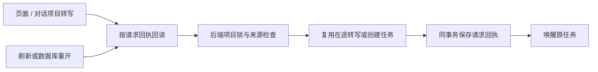

# T-915：项目转写提交统一与持久请求回执

承接 R-03/R-05。生产 projects.transcribe 来源与任务创建已下沉后端，宿主仅提交和唤醒；ASR 长执行还没有迁入 Worker。

## 行为与边界

- 新增 0089 project_transcription_requests，只保存 user/account/attempt/project/aweme/task 引用，不复制执行状态、不删除旧数据。唯一请求键为 user+account+attempt，任务被删除后回执仍保留，旧请求不能重新创建它。
- 同项目锁覆盖任务去重与回执提交，多个不同请求复用同一在途转写；跨项目争用同请求键时，失败方任务与回执整体回滚。
- 已映射任务按执行状态投影去重，unknown_result、waiting_user、paused 保留原任务；未映射旧任务失败后的新操作可以创建新任务，原请求仍返回旧任务。
- 配置解析位于数据库事务之外；提交时重新检查当前来源。来源在准备期间改变时拒绝，避免将旧准备绑定到新作品。
- 同请求回读优先于“已有正文”检查。旧单请求任务可接入回执；原项目后来清空来源也不改变该请求的原任务事实。
- 宿主沿原任务 attemptId/inputData 唤醒；映射任务与非 queued 任务不送入旧唤醒包装，持久调度器继续负责它们。
- frontend 原来源/分页查重/提交业务装配移除，改为 backend projects 的事务目标端口和 AI 提交服务。原只读 hasCurrentTranscriptForAweme 仍有 draft-workbench 消费者，因此保留，未误删。

## 验证

- 新后端提交 12 项通过，含并发、异请求共享、回执失败事务回滚、跨账号、跨项目同请求冲突、结果未知/等待/暂停、来源变化、原任务删除、旧任务兼容、迁移重复运行。
- 其中真实关闭/重开独占临时磁盘 PGlite 后，第二个请求仍返回第一个任务；仅该测试自身临时目录，未访问媒体目录。
- frontend 包装 5 项通过：原键与原任务唤醒、唤醒失败重发、后端拒绝、其他操作透传、映射任务跳过旧唤醒。
- 邻接整稿提交 6 项、转写原子落稿 8 项通过。该次合跑还有一项新迁移测试因测试文件路径写错失败，原日志保留；修正路径后新提交文件 12 项全绿。不是把初次合跑报告成全绿。
- 最早新测试因模块缺失未运行断言；首次实现另有错误类导入错误。独立复核指出“旧任务来源清空后无法回读”，已真实红测复现并修复。没有补造前置行为红测。
- backend typecheck 和 frontend tsc --noEmit 均真实运行、退出 0。CodeGraph 刷新并 impact 核对 wrapper 的生产消费者；类型检查验证生产服务装配。本批未运行完整 CreatorOS 生产启动转写旅程、真实抖音或计费 ASR。
- 独立只读复核提出的历史来源及映射唤醒风险已处理。完整 write-set preflight 通过；更新了改动文件已有 complexity hash，没有扩大复杂度授权。

## 未完成

ASR 抓取、ffmpeg、云端转写与后处理的 Worker 执行、provider 提交未知结果恢复、onTranscriptReady 重建提交仍需迁移。正式 /api/chat、其余 R-05、旧出口退役、基准与双平台验收仍保持原范围。T-915 不标完成。

pmem sync 已执行。全局 reconcile 退出 1：211 errors / 1 warning，物理边界仍为 5 条；与上一批 transcript-atomic-reconcile.log 的 212 条 ERROR/WARN 诊断集合一致，无新增或消失。既有欠债继续保留 T-916，不宣称全绿。
