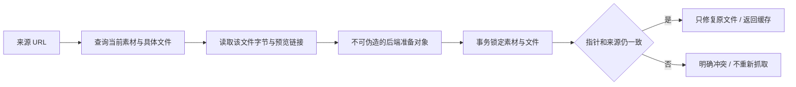

# T-915 绑定文件版本的网页缓存

原网页缓存先查素材、再按素材读取当前文件、再按素材修复正文。用户在这些步骤间换版本时，旧正文可能被写进新文件。本批将它收敛为 assets 领域的准备与事务确认，并替换正式 `readWebUrl` 的缓存装配。

- 来源条件下推 SQL，限定账号、用户、document、pending/active 和有效当前文件关联，按既有顺序取一条。不会把全部文档正文读入内存后再筛选。
- 字节与预览 URL 均绑定同一 `storageKey`。准备对象冻结且在服务内部 WeakMap 绑定，不能复制字段或跨账号确认，不能作为 Worker 输入自报素材。
- 确认时锁素材及文件，重新核验归属、当前指针、来源、storageKey/checksum/fileSize/mimeType；修复只更新该文件正文和状态，保留 metadata。checksum 是前后数据库身份比较，**没有宣称实际字节摘要完整性验证**。
- 查询/字节不可用仍为缓存未命中；取消、版本冲突或修复失败上抛，不退回重新抓取创建重复素材。确认可加入外部执行事务，使未来的父回执失败一并回滚修复。

## 验证

- [首轮红测](web-document-cache-red.log)：新服务不存在导致测试文件加载失败，没有运行测试；不把它算作竞态行为红测。
- [后端回归](web-document-cache-green.log)：75 项 / 4 文件通过，包含 9 项新缓存验证、当前来源规则与既有素材服务/仓库回归。
- [正式入口回归](web-document-cache-frontend.log)：3 项通过，隔离 PGlite 与真实临时 LocalFS，实际读回之前写入字节；验证缓存命中零新增网页读取、素材保持一份、原文件修复。
- 测试补齐两处夹具事实：旧来源测试没有设置 currentFileId；旧前端存储替身 getObject 固定空字节。分别补真实指针、切换隔离临时 LocalFS；未放宽生产判断。
- 新故障覆盖字节读取期间换版本、存储身份变化、伪造/跨账号准备对象、取消、修复 SQL 失败，以及真实事务锁等待/UPDATE 返回后取消与外部事务回滚。故障注入均断言命中及正文未写入。
- backend/frontend 类型检查通过；独立只读复核及补充复核均未发现阻断。
- 已执行 `pmem sync` 和 `reconcile`；全局仍为 211 errors / 1 warning，与前基线一致，未通过。boundary 为既有 5 项，orphan 为 0 errors / 100 warnings；未将既有工程欠债表述为通过。

网页任务的缓存事实与父账本原子结算尚待接入，Worker 网页适配器和生产迁移尚未完成。T-915 全入口、性能、商业供应商及双平台验收继续保留完整范围。
