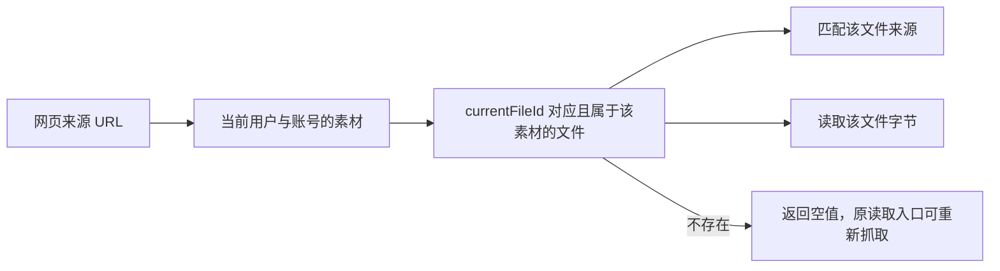

# T-915 网页缓存当前版本一致性

本批只修正迁移网页读取前发现的当前文件错误，不代表 `web.read` 已迁入 Worker，也不代表正文提交已具备幂等恢复。

## 实际问题与改动

`findAssetBySourceUrl` 原来匹配素材任意历史文件的来源；`getAssetBytes` 原来读取版本列表末项。用户切换当前版本后，命中的来源和实际读取的正文可能不是当前文件。

现在来源匹配与字节读取均使用 `currentFileId`，并保留用户、账号、素材归属与缓存状态限制。缺失或指错文件时返回空值，旧网页读取入口仍可重新抓取；不把其他版本冒充当前正文。

## 当场验证

- 修改产品代码前运行新增测试：4 failed / 2 passed，见 [红测日志](web-read-current-source-red.log)。后续增强了同账号交叉指针、空指针和独立状态用例，未伪造这些新增用例的历史红测。
- 最终新增 12 项与原素材服务 30 项合计 **42 passed / 2 files**，见 [回归日志](web-read-current-source-green.log)。覆盖历史来源误命中、回到旧版本、缺失文件、同账号及跨账号交叉指针、较早有效缓存、pending/active/archived/deleted、跨用户与账号、未完成文件装配。
- backend 类型检查通过，见 [类型检查日志](web-read-current-source-typecheck.log)。测试使用真实隔离 PGlite 与可控字节存储，不是商业浏览器或供应商验收。
- 独立只读审查：`worker_review` 未发现本批阻断；其建议的同账号交叉指针及 null 指针测试已补齐。
- boundary：基线 5，无新增；orphan：0 errors / 100 warnings。本轮全局 reconcile 为 **211 errors / 1 warning**，仍与既有失败数量一致，不把本批测试通过写成 T-915 全量通过。`pmem sync` 已运行；T-915 保持进行中。

## 尚未解决的边界

分别调用来源查找与字节读取之间，仍可能发生并发切换版本。本批没有声称跨调用快照一致性。Worker 网页读取接入时，需冻结实际正文及来源事实，并由 backend 受控服务完成提交与回执恢复。

独立审查确认原 `createGeneratedAsset` 的写字节、asset/file 插入、当前文件指针、来源 annotation 与抽取正文是多次写入，没有可直接复用的稳定键与原子回执。旧 execution 产物采纳也记录了素材创建与 journal 之间的崩溃窗口，不能作为幂等证明。下一步仍按既有 SPEC R-03/R-04 实现可恢复的 pending 正文提交，并保持登录、blocked/alternates、正文分页、不可信内容包装与用户确认行为；正式 `web.read` 入口本批尚未切换。
