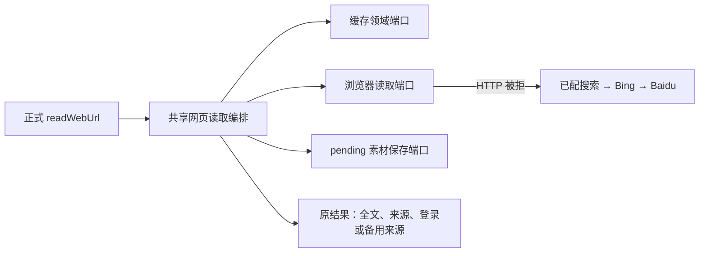

# T-915 正式网页读取共用 Worker 所属编排

本批将旧 `readWebUrl` 的缓存/读取/登录/备用来源/结果组装迁入 `ai-worker` 的 `web-read-workflow.ts`，正式 `persistence-client` 已调用它。宿主保留真实浏览器池、搜索配置、登录态、素材领域 service 的注入。装配文件净减少 121 行，备用来源的旧 frontend 文件与测试已迁移至 Worker，没有保留第二份实现或空兼容出口。

## 保留的行为与实际修复

- 缓存查询/字节缺失允许真抓；缓存来源及全文投影修复失败上抛，不再创建另一条素材。
- 原 URL 是来源和缓存键；finalUrl 仅用于空标题时的素材命名。保留全文、280 字 excerpt、fromCache、extractor、turnCount 与 SSR/DOM 诊断。分页与不可信内容包装仍由原 `web.read` 工具负责。
- 登录墙返回真实 domain，不搜索；HTTP >=400 时才寻找备用来源。维持已配真实 provider、Bing、Baidu 的顺序；候选交回模型，不自动访问替代页面。全部搜索失败保持空数组。
- 原 fallback 没有取消信号，catch 会在取消后继续下一路。现在共享信号贯穿搜索器构造、每路搜索、读取、缓存与保存准入，取消不再被普通失败降级吞掉；迟到读取结果不启动保存。
- 当前旧保存回调仍是原来的生成素材、来源、全文三次写入。已进入的写入不会因取消原子撤销；共享流程只阻止成功结果继续返回。本批**不宣称取消后无任何落库**，也没有把旧路径伪装成已完成幂等接线。

## 本轮证据

- [真实红测](web-read-workflow-red.log)：修改前原 fallback **3 failed / 7 passed**。覆盖调用前取消、首路取消后异常、取消后迟到结果。
- [最终回归](web-read-workflow-green.log)：Worker 共享流程与迁移 fallback **22 passed / 2 files**；原 chat-tools/chat-runner **358 passed / 2 files**；正式装配 **2 passed / 1 file**。
- 正式装配测试调用 `getChatRuntime().readWebUrl`，真实隔离 PGlite、原素材领域服务，回读 pending、原 URL、完整 extraction；已取消调用不新增素材。浏览器读操作使用受控替身、存储为原测试装配，不冒充真实外网、独立 Worker 进程或商业供应商验收。
- [类型检查](web-read-workflow-typecheck.log)：ai-worker、backend、frontend 全部通过。frontend 新增装配测试之后补跑过类型检查。
- `worker_review` 独立只读复核通过，无本批兼容阻断；其指出的旧保存取消边界如上保留。
- 按 DEC-RUNTIME-055 原授权范围重新绑定现有 persistence-client 复杂度条目哈希，没有新增凭据保管、工具链或本机执行能力。边界基线 5 无新增；orphan 0 errors / 100 warnings；`pmem sync` 已运行。本轮全局 reconcile **211 errors / 1 warning**，与既有失败数量一致，T-915 保持进行中。

## 剩余接线

当前编排文件归属 Worker 包，但旧正式入口依然在宿主进程调用它。独立执行所需的冻结 URL、持久网页观察、命名端口、浏览器会话、pendingDocument 回执与检查点恢复尚未全部接入。R-05 全场景尚未减少剩余入口数，不把本批复用写成完整 Worker 迁移完成。
