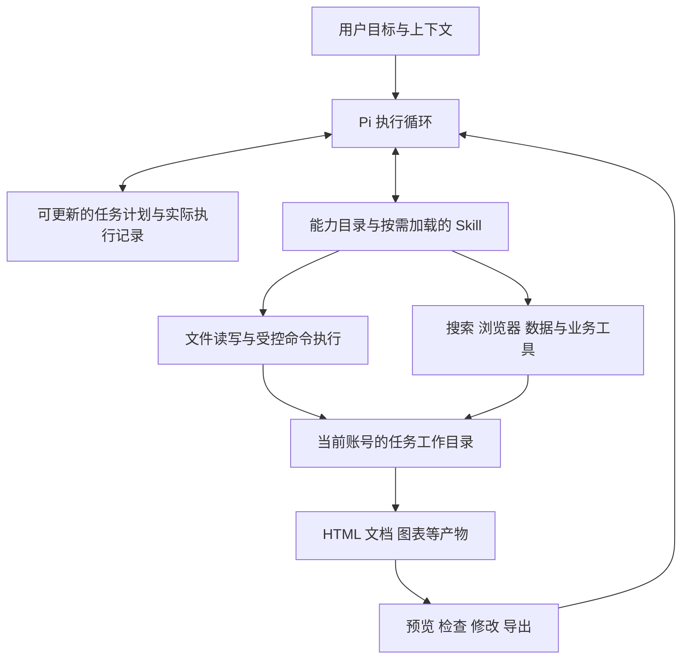

# T-1002 Agent 规划执行与通用工具扩展

## 请求与范围

用户希望理解 CreatorOS 为什么缺少规划后执行、创建文件、生成报告与 HTML 的能力，以及如何复用 Pi 插件。本次为代码与官方文档调研，以下架构为建议，尚未实现或通过架构实施评审。未调用真实模型验证这些功能。

## 代码事实

- AI 助手：`ai-worker/src/execution/chat-worker-run.ts` 调用 `runtime/chat/chat-pi-loop.ts`，由 `chat-pi-core.ts` 加载 `pi-agent-core`。它有真实模型/工具循环，不是单次 API；不具备 coding-agent 的 ResourceLoader/ExtensionRunner 自动装配。
- 另一条 agentic 执行路径：`runtime/agentic/pi-engine.ts` 使用 `createAgentSession`，显式设置 `noTools: builtin`、排除 read/bash/edit/write/ls/grep/find，并设置 noExtensions/noSkills/noContextFiles。目的是避免任意本机资源和外部工具进入受控会话。
- `backend/src/modules/ai-runtime/chat-tool-definitions.ts` 的登记表包含本机读取、工作目录查询、技能读取、业务生成与研究工具，未登记通用文件写入、编辑、命令执行、HTML 产物交付或任务计划工具。
- `chat-local-tool-host.ts` 的 local.workspace 查询授权目录，不创建任务工作目录。`chat-planning-task-host.ts` 的 planning.thesis 生成项目论点骨架，不是通用任务计划执行器。
- `chat-worker-run.ts` 已有 checkpoint、工具回执、恢复与审批逻辑。不能因 Pi 内存会话就断言整个产品没有持久化，也不能把历史 maxSteps 配置直接当作当前聊天六轮限制。
- 产品已有日报与分享图等专用能力；缺的是助手可调用、跨任务通用的产物制作能力，不是所有报告功能都没有。

## 判断

主要缺口在宿主能力装配和产品交付链，Skill 只负责方法，不能凭空获得文件写入与进程执行权限。原有账号、业务数据与执行回执边界应保留；隔离临时产物不应照搬“所有写入都必须逐项采纳”的业务实体规则。用户明确要求生成文件后，在该任务工作目录创建、修改和预览文件应可直接完成。

## 建议的整体结构

继续使用现有 Worker 和执行账本，不新建第二套任务调度真相。计划是用户目标、步骤、依赖、状态与产物引用的投影；完成状态绑定真实回执与产物验证，不能凭模型说“完成”标记。模型负责拆解和改计划。简单任务直接执行，多步任务展示简短计划；无需每步确认，只有扩大授权或对外发布等动作另行处理。

## 工具和工程分工建议

| 能力 | 建议职责 | 交付要求 |
| --- | --- | --- |
| workspace | 每个账号/任务独立工作目录、输入引用、版本与文件索引 | 重启后可找回，不泄漏其他账号文件 |
| files | list/read/write/edit，支持文本、CSV、Markdown、HTML、JSON | 路径校验防越界和符号链接逃逸，原子写入、失败不覆盖旧产物 |
| execution | 在受控环境执行 Python/Node/已安装工具 | 文件边界由 OS/沙箱落实，cwd 不是沙箱；限制进程树、网络与资源，可取消与恢复状态 |
| artifacts | 注册文件、预览 HTML、输出图片/PDF、导出目录 | 模型引用真实文件 ID；HTML 在隔离源中预览，不获得应用登录凭据或任意网络能力 |
| plan | 创建/更新步骤、展示执行进度与依赖 | 复用原任务生命周期，步骤中断后接着执行，避免重复外部操作 |
| skills/extensions | 按场景加载方法和经过适配的功能 | 固定版本、声明依赖/权限/平台，缺依赖可解释，不隐藏工具失败 |

建议在 contract 定义能力与产物引用；backend 的 workspace/artifacts 服务负责归属、索引、保存和导出授权；ai-worker 下的 capabilities 执行文件/命令/浏览器操作，extensions 层适配插件；frontend 增加聊天产物面板与计划进度。目录名称为提议，需要实施时结合现有 assets/execution 归属做复用评审，不能直接再建一套重复服务。

Skill 用于报告方法、内容研究、图表叙事与 HTML 设计。Extension 用于工具注册、事件钩子与运行时能力。Plugin/Package 用于把 Skill、Extension、模板和依赖一起安装。不要为每类报告新增一个业务专用工具；模型应能用少量通用工具制作新文件。

## Pi 生态如何接

官方 SDK 支持 ResourceLoader、自定义工具和扩展；官方 plan-mode 是可参考的扩展示例，不是安装 core 后自动存在的工作流。当前助手 core 路径不能直接接收依赖 coding-agent ExtensionAPI 的任意插件。应评估两个真实选项：保留 core、适配所需插件能力；或统一迁到 coding-agent 会话宿主。以能否保留当前流式对话、账本、取消、恢复、模型计费和桌面兼容作为选择依据，不能默认全量迁移更好。

受信任的内置 Extension 可以走统一工具宿主；第三方任意代码插件不能仅靠包装 execute 就视为隔离，因为其模块初始化和事件钩子同样可以做 IO。它们需独立进程与实际权限约束，或明确作为经过审查的受信任代码。不要直接开启扫描用户的 ~/.pi 来获得功能。

参考（调研时核对官方主线，实施仍需与项目固定的 0.80.7 API 对齐）：
- https://github.com/earendil-works/pi/blob/main/packages/coding-agent/docs/sdk.md
- https://github.com/earendil-works/pi/blob/main/packages/coding-agent/examples/extensions/plan-mode/index.ts
- https://pi.dev/docs/latest/extensions

## 用一个完整任务验收

输入：“结合我的定位和近 30 天作品，生成带图表的 HTML 运营报告，保存到我选择的目录。”

验收完整链路：模型列出必要步骤→读取真实数据并标明累计值口径→计算图表数据→生成 HTML 与资产文件→隔离预览→检查图表与数字对应→按用户反馈修改原文件→用户选择目录后导出。中途停止、重启、缺指标、网络失败都保留已完成文件和清楚状态；失败步骤可继续，不能假装整单完成。还需跨账号隔离、Mac/Windows 安装版运行时、命令取消及插件依赖测试。

核心产品体验：聊天中直接看到计划进度与文件卡片，点开预览并继续修改；底层长任务仍可异步运行，但用户不需要跳到另一张任务表手动追结果。

## NomiFun 实现与迁移建议（用户补充）

用户明确要求参考自己参与开发的 NomiFun 工具与 browser_use 实现。已读取本地 `/Users/zyongzhu/Workbase/nomifun-desktop`，HEAD 为 `e27bd5de`；以下为静态审查，不代表迁移编译或真机验收通过。

| 源码 | 已看到的实现 | CreatorOS 迁移方式 |
| --- | --- | --- |
| `apps/pi-sidecar/src/nomifun-gateway.ts` | MCP listTools 注册到 Pi，统一调用、进度、取消、错误与会话关闭 | 复用协议桥接模式，工具执行仍经 CreatorOS 回执与账号授权；助手 core 需自己的注册适配器，不能直接加载 ExtensionAPI 文件 |
| `apps/pi-sidecar/src/tool-result-adapter.ts` | 长结果落盘分页，媒体与进度分别限量 | 与现有 tool.result.read 统一；迁移分页与媒体处理测试，避免第二份结果索引 |
| `crates/backend/nomifun-gateway/src/caps_files.rs` | 文件读写、目录浏览、元数据、系统打开，依赖文件服务和路径授权 | 复用工具契约与路径处理思路，映射当前账号任务目录；不照搬整个 GatewayDeps |
| `crates/backend/nomifun-gateway/src/caps_agent_execution.rs` | 显式步骤、依赖、自动计划策略、重规划接口 | 迁移计划模型到现有执行账本，不能引入第二套任务状态数据库 |
| `crates/backend/nomifun-browser-platform` | Hub、Lane、身份、调度、租约、取消与资源管理；Cargo 仅依赖通用库 | 适合抽取为共享 Rust 包并锁定版本，优先保留经过现有测试覆盖的实现 |
| `crates/agent/nomi-browser-engine` | 自有 Rust CDP 引擎 | 有 net/process-runtime/common/redact 等内部依赖；需整理完整依赖闭包，不能只复制一个 crate |
| `crates/agent/nomi-browser` | Browser 工具门面、站点记忆、视觉回退与平台适配 | 还依赖 nomi types/config/protocol/tools；抽离宿主端口，保留引擎及测试，替换产品配置与授权 |

### 浏览器边界

NomiFun 的 browser_use 是自有 Rust CDP 平台，不能当成一个 Python browser-use 包安装。文档与 Hub 接口显示：同 Lane 串行、不同 Lane 可并行，一个 Host 可容纳多个 Lane。Primary 共享实时身份、Anonymous 用临时身份、Authenticated Replica 使用只读时间点副本、Isolated 为独立身份。多 Lane 不等于 cookie 隔离；CreatorOS 必须把抖音账号映射到独立的身份域，不能让所有账号共用同一 Primary。

建议由 CreatorOS 桌面 Rust 宿主承载共享浏览器服务，通过本机受限 RPC 供 Worker 调用。CreatorOS 后端签发账号与任务身份，worker 执行模型循环，浏览器服务拥有进程与 profile 的唯一生命周期。模型只拿任务范围句柄。长期采集不按总时长强杀，但每次导航/网络等待有可解释的失活检测、进度与取消；NomiFun 桥接里 120 秒且随进度重置的超时不能不加区分地照搬。

当前 Playwright 采集器不会因接入 Rust 引擎自动兼容。对每种登录身份，只允许一个生命周期所有者；旧采集器必须通过适配器使用受管连接或在完成对应操作迁移后交接，不能让新旧管理器同时启动相同 profile。公开检索可以先使用独立匿名身份，但不能因此宣布采集占用问题已经解决。

### 依赖复用与工程落点

优先从 NomiFun 抽出版本化共享库，双方引用固定发布版本或提交；避免跨本机目录依赖，避免两边拷贝后独立漂移。共享包保留来源、许可证与测试；协议适配层负责 CreatorOS 的账号、任务、凭据、文件和进度。具体源码迁移需要独立 SPEC/架构评审后实施。

建议结构：`contract` 定义能力协议，`backend` 保留业务数据与执行真相，`ai-worker/capabilities` 对接通用工具，桌面 Rust 宿主承载浏览器能力服务，前端提供计划与产物面板。先以现有 SYSTEM_ARCHITECTURE 核对实际路径，不凭建议新增平行模块。

验收应同时覆盖：AI 查网页后生成并修改 HTML；两个独立任务并行浏览；同账号采集与 AI 浏览协调；跨账号登录隔离；取消旧任务不关闭新任务页面；浏览器重启后旧元素引用失效且可重新观察；Mac/Windows 安装包无需 NomiFun 另行安装。当前仅提出迁移设计，未修改这两款产品的运行时代码。
