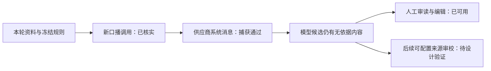

# T-1032 · 脚本事实约束机制核查

```research-first-gate/v2
{
  "schema": "research-first-gate/v2",
  "task_id": "T-1029",
  "research_task_id": "T-1032",
  "status": "validated",
  "problem_statement": "三轮真实脚本生成包含未提供的经历、比例和效果，新增提示词没有恢复事实约束。",
  "failure_family": "script-unsupported-factual-claims",
  "observed_invariant": "候选不能把未提供的亲身经历和效果指标写成事实；事实不足仍应交付可编辑方法稿。",
  "trigger_kinds": [
    "unsuccessful-intervention-churn"
  ],
  "paused_actions": [
    "further-production-changes",
    "broadened-workaround",
    "repeated-full-system-runs",
    "irreversible-operations"
  ],
  "evidence": {
    "authoritative": [
      {
        "kind": "source-code",
        "ref": "ai-worker/src/execution/script-worker-pipeline.ts",
        "claim": "initialVoiceover 决定新 compose 调用或旧口播复用；后续分镜逐字保留口播。"
      },
      {
        "kind": "source-code",
        "ref": "ai-worker/src/prompt/effective-skill-runtime.ts",
        "claim": "冻结 methodSystem 进入模板 system。"
      },
      {
        "kind": "source-code",
        "ref": "ai-worker/src/runtime/pi-provider.ts",
        "claim": "实际调用经过 Pi 供应商消息序列化。"
      }
    ],
    "local": [
      {
        "kind": "runtime",
        "path": "docs/verification/evidence/t1032/frozen-task-context.json",
        "locator": "tasks[0..2]",
        "observation": "三个 payload 全部没有 initialVoiceover；后两轮 compose v3 的系统事实约束存在、无覆盖。"
      },
      {
        "kind": "test",
        "path": "ai-worker/src/execution/structured-worker-generation.test.ts",
        "locator": "script.draft 新口播的事实范围送达供应商系统消息",
        "observation": "原生与文本兼容两种公开 Worker→Pi→HTTP 捕获系统约束，各两次阶段调用并保存口播。"
      },
      {
        "kind": "runtime",
        "path": "docs/verification/evidence/t1032/generation-metadata.json",
        "locator": "generationSkills/generationAttempts",
        "observation": "三个实际结果都记录 compose+storyboard 两次初始生成，与冻结版本一致。"
      }
    ],
    "experiments": [
      {
        "question": "新版任务是否实际新写口播，还是只复用旧稿？",
        "command": "独立验收库停服后只读 owned ai_tasks/execution_tasks payload；随后公开 ai.tasks.results.list 读取生成阶段，脱敏存档。",
        "environment": "独立 PGlite 验收库、本机已配置模型；不读取原用户作品。",
        "result": "三轮均未带 initialVoiceover；第一轮旧 v10/v2，后两轮新 v11/v3，均记录两次生成阶段。",
        "artifact_path": "docs/verification/evidence/t1032/frozen-task-context.json",
        "artifact_sha256": "511a51b962751992eea0eda85b5d064a1203fd0bff0e533d9034cc6518c01047"
      },
      {
        "question": "冻结系统约束能否经真实 Worker 和 Pi 到达最终 HTTP 消息？",
        "command": "pnpm --dir ai-worker exec vitest run src/execution/structured-worker-generation.test.ts --retry 0 -t \"script.draft 新口播\"",
        "environment": "真实供应商适配、本地 SSE HTTP fixture；不调用外网模型。",
        "result": "2 PASS / 37 skipped；两模式均含事实系统正文。旧 HTTP fixture 按 Pi 流协议修正。",
        "artifact_path": "docs/verification/evidence/t1032/worker-message-capture.log",
        "artifact_sha256": "eb1760433aa2198f8d4470f5a174dc80e6d285bee2d6b6854b85813011a28ead"
      }
    ]
  },
  "options": [
    {
      "id": "OPT-1",
      "outcome": "结束重复加长提示词，继续既有工作台可用性验收，保留候选审读与编辑。",
      "tradeoffs": "不能保证模型稿事实准确；真实第三轮反例仍保留。",
      "scope": "不新增模型阶段、不变更成本与恢复合同；只是确认机制。",
      "falsified_by": "供应商最终消息丢失系统约束，或任务实际复用旧口播。"
    },
    {
      "id": "OPT-2",
      "outcome": "单独设计可配置 AI 来源对照审校，给出带原文/来源引用的最小修改候选。",
      "tradeoffs": "新增调用、成本、检查点和 UI 状态，需要实施 SPEC 评审与相应决策；审校也不等于事实保证。",
      "scope": "候选始终可查看、编辑、显式采用；审校失败不能反杀已生成稿。",
      "falsified_by": "审校无法对照冻结来源、不能减少无依据主张或会取消合法候选。"
    }
  ],
  "recommendation": "OPT-1",
  "validation": {
    "timebox_minutes": 120,
    "max_experiments": 2,
    "acceptance_criteria": [
      {
        "name": "新口播与版本证据一致",
        "target": "三个任务无旧口播；后两轮新版 compose 约束存在，实际阶段一致。",
        "measurement": "现场执行脱敏证据结构断言。",
        "observed": "三轮全部符合；来源空时的模型扩写属于语义反例。",
        "verify_key": "t1032-frozen-context",
        "evidence_path": "docs/verification/evidence/t1032/frozen-task-context.json",
        "evidence_sha256": "511a51b962751992eea0eda85b5d064a1203fd0bff0e533d9034cc6518c01047"
      },
      {
        "name": "最终系统消息传递",
        "target": "原生/兼容两模式最终供应商请求保留完整事实约束。",
        "measurement": "现场执行公共 Worker HTTP 捕获测试。",
        "observed": "2/2通过；不能推断真实模型遵守。",
        "verify_key": "t1032-worker-message",
        "evidence_path": "docs/verification/evidence/t1032/worker-message-capture.log",
        "evidence_sha256": "eb1760433aa2198f8d4470f5a174dc80e6d285bee2d6b6854b85813011a28ead"
      }
    ],
    "resume_criteria": "机制已区分，现有工作台验收可恢复；事实准确性未通过，不得再盲目追加提示词或宣称质量全绿。新增审校另走实施评审与成本决策。"
  },
  "decision_impacts": [
    "none"
  ],
  "decision_ids": []
}
```

## 人能懂的结论

新版规则确实被带进了新写口播，模型仍会补写未提供的经历和数字。刷新和采用的代码缺陷已修复，但事实质量不能靠规则存在或消息送达宣称保证。下一次质量改进应使用来源对照的候选审校，并单独验证效果。



完整 Worker 文件另发现 3 项前置输入错误被误判未知，已进入独立 T-1033。研究的传递回归通过，不代表该文件当时全通过。
