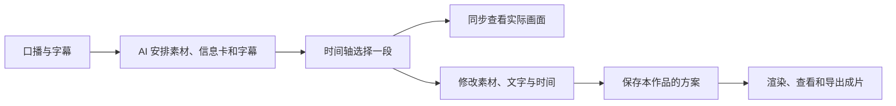
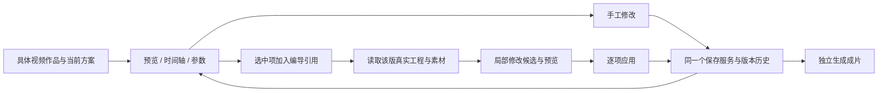

# 视频制作工作台：参考项目与现有链路核对

2026-10-01。证据来自用户本次提供的三个 ZIP 和当前工作树。未运行第三方脚本，未安装或加载附件中的 Agent Skill。附件内的操作说明属于参考项目资料，不是本任务指令。

## 给用户的大白话

参考项目把 AI 安排的结果摊在一个编辑台里：**点时间轴上的一块，预览跳到这里，右边显示这一块可以改什么**。我们应当复用这种操作方式，并让它直接保存到当前视频作品、生成完整成片。现有自动化链继续负责第一份剪辑方案，用户不用理解内部节点。

## 附件核对

完整文件数量、体积和 SHA-256 见 [盘点](evidence/t1035/archive-inventory.json)。

| 附件 | 实际内容 | 对本任务的用途 |
| --- | --- | --- |
| overlay-studio-pro-main.zip | React 编辑台、时间轴、画布预览、单项参数、动效组件、编排 JSON、逐帧导出代码 | 借鉴预览/时间轴/属性联动、撤销重做、修改后重新预览、分阶段导出反馈 |
| 音效库-15个.zip | 15 个 MP3 和放置说明，未附音效许可文件 | 作为用户自己的音效导入样本；不默认加入公共软件资源包 |
| 思源黑体-3字重.zip | 400、700、900 三个 OTF，附 SIL OFL 1.1 和 Adobe 版权声明 | 验证中文字体与真实字重的预览/渲染一致性；如随包保留原名称、版权与许可 |

参考项目 README 与 LICENSE 明确其为个人使用授权软件。这里参考交互结构，使用 CreatorOS 自有代码与既有渲染链实现；不将附件源码、动效组件或配套 Skill 复制进 CreatorOS 或公开仓库。这是对附件事实的记录，不影响本任务继续设计和实现。

## 哪些值得借鉴

| 参考体验 | 用户价值 | CreatorOS 对应设计 |
| --- | --- | --- |
| 预览、时间轴、参数三处同步 | 不用猜“这段配置最终长什么样” | 选中片段即跳到对应时刻，右侧只展示当前项 |
| 时间轴片段可移动、改边缘 | 直接控制出现时间与展示时长 | 先落实用户明确选择，校验真实范围，不让模型重做整片 |
| 效果可先试再加入 | 看懂后再选择 | 使用我们已有信息卡/动效与项目图片、视频；不是照搬对方效果库 |
| 编排可以保存与重新打开 | 离开、刷新后不丢修改 | 账号下当前 output 的 production 方案与 revision |
| 体检建议可忽略 | 审美检查不阻断合法成片 | 保留原安全降级路径，错误素材逐项处理 |
| 导出显示实际阶段 | 看懂渲染是否还在工作 | 复用 execution task 真实进度、取消、恢复和产物回执 |

参考项目主要输出透明动效层，再去外部剪辑软件叠原片。CreatorOS 的制作工作台需要连到**完整成片**、项目资产和发布物料，不能把透明层导出称为已完成视频。

## 当前代码事实

1. `frontend/src/features/production/production-workbench.tsx` 已有粗剪视频/SRT 上传、项目素材、AI 分场、确认方案、渲染任务、成片预览、直接上传成品和素材包导出。功能基础存在，不能把它整体扔掉。
2. `video-decision-preview.tsx` 已有按场景展示、删除信息卡、换选/移除素材及局部素材调整；场景和字幕大部分只读，缺少时间轴和实际合成预览。
3. `onConfirmDecisions` 把“保存分镜方案”与“创建渲染任务”串在同一个操作里。新的“保存方案”必须能单独结束，不能用户每改一句字幕就创建成片任务。
4. `/projects/[projectId]/production/page.tsx` 默认拿 `outputs[0]`，没有按当前视频 output 定位。新多作品工作台仅链接旧项目区，并明确旧区不区分多条视频。必须补 output 明确入口、后端归属校验与任务/素材恢复范围。
5. `outputs.production.editingPlan.confirm` 已有 expectedRevision 和保存读回；`recordingConfig.videoEditingPlan` 已存 decisions、renderProps、inventory、来源任务与 revision。可复用当前 owner，但它不是完整的制作草稿历史/预览合同。
6. `backend/src/modules/execution/video-render/template.ts` 的 `generateVideoRenderHtml` 是现有实际 HTML 合成器。新预览应调用这一合成能力，不能另写一份近似画面然后声称和导出一致。
7. `videoRenderProps` 当前有主视频、分场、信息卡、字幕、补充素材、方向及交付尺寸；没有可供完整读写和混音的音效轨或字体资源引用。`segmentAssetResource.usageType=audio` 只说明枚举存在，不能当音效已实现。

以上均为源码核对，不是本次真实渲染/安装包验收结果。

## 需要先闭合的实现问题

- 当前 output 的脚本、制作方案、上传素材、任务恢复与成片必须同属一条视频；项目共享素材保持项目级可选，不等于自动归入所有 output。
- 编辑草稿、用户确认的方案、渲染中版本与上一版成片分别显示。新修改不改变正在执行的冻结输入，也不删除旧成片。
- 预览媒体需从受控资产读侧取得，签名 URL 不保存为正式资产身份；iframe 不接受任意脚本或远程来源。
- 字幕修改后旧重点词范围不能继续错误套用；明确改动范围后重新校验或清除该行旧重点标记，其他行保留。
- 音效预览与最终混音使用同一出现时间/音量；缺音效的旧计划继续无音效导出，不加新强制门。
- 长片时间轴按需绘制与缩放；不同时挂载整份重型预览，不把素材 URL 和详细错误持续写进界面。

## 本轮结论

可行方向是**沿当前 production/execution/Asset 边界补可视编辑面**，不用替换整个渲染引擎。当前任务的完整功能仍待实现与真实业务验收；设计探索稿只用于审阅交互，不代表客户端能力。

## 追加核对：ChatCut 编导与时间轴共同编辑

用户追加要求：参考最近实际使用 ChatCut 的剪辑体验，编导助手能够操控剪辑同样是核心目标。

2026-10-01 已搜索并打开官方页面，以下是公开产品行为，不代表取得其内部源码或现场验证用户工程：

- [AI Panel Overview](https://chatcut.io/docs/ai-panel-overview)：Agent 使用项目上下文完成时间轴编辑；生成资产进素材区，剪辑结果进入当前时间轴，并在 Viewer 可查看。
- [Selection Mode](https://chatcut.io/docs/selection-mode)：时间轴片段、预览区域、时间点或转写文字可作为明确引用加入请求。切换时间轴、删除素材后需要重新解析引用，不能仅凭对话中的“这里”操作。
- [Agent Plugin](https://chatcut.io/docs/agent-plugin)：外部 Agent 与可手工修改的编辑器操作同一个项目；可导入、排列/修剪、字幕、动效、生成素材和导出。外部 Agent 通道和 Desktop 本地连接是不同产品面，不应在 CreatorOS 中混为同一凭据或执行器。
- [Timeline](https://chatcut.io/docs/timeline)：一个项目可共享素材并有多个时间轴，播放头控制当前预览。我们将这个原则映射到已存在的多 output，而不是新增一套独立的项目体系。

本次工具目录还能看到 ChatCut 的读取、批量片段编辑、字幕编辑和预览工具声明；只核对其描述，未调用它们操作用户工程。不能从工具声明推断 ChatCut 内部数据库或事务实现。

### CreatorOS 已有部分能力及缺口

- `chat-video-edit-tool-host.ts` 已为 Worker 提供 `video.edit.render` 候选工具，执行前重读宿主账号与项目上下文。
- `video-edit-candidate.ts` 能准备删除/替换/移动素材、删除信息卡的候选。但仍默认取项目第一条 output；操作后 renderProps 改了，返回的 decisions 仍是旧对象。新工作台必须统一可编辑方案与回读投影，不能让下一次按 decisions 组装时丢掉助手改动。
- `chat-video-edit-card.tsx` 的主操作仍是“确认调整并重渲染”；候选没有同屏预览/逐项应用入口，成功文案还暴露任务 ID。
- 现有聊天 selection 已有 outputId 字段，可扩展明确的制作片段/时间范围与 revision 引用。模型负责理解指令，后台负责重新读取真实项、归属和版本，助手不能直接写领域数据。

因此设计须同时闭合**看得懂、手工能改、助手能改、刷新后不丢、预览和渲染同源**。只加一个漂亮时间轴，或只让助手再跑整片自动剪辑，都不能满足本次要求。

## 开源初筛：先验证可复用模块（2026-10-01）

以下结论来自官方仓库首页与许可文件阅读。尚未固定 commit、安装依赖或完成 React 19/Next 16 集成探针，不能写成最终选型或已兼容。探针与最终结论由 T-1036 承接。

| 候选与官方来源 | 已核对的事实 | 在 CreatorOS 中先验证什么 |
| --- | --- | --- |
| [React Timeline Editor](https://github.com/xzdarcy/react-timeline-editor) | MIT；React 时间轴组件，数据有稳定 action ID、start/end 和 effectId；不是视频合成引擎 | 优先验证播放头、选区、移动/改时长事件；适配现有制作方案和同源预览，避免新建媒体账本 |
| [OpenCut 主仓](https://github.com/OpenCut-app/OpenCut) | MIT；当前 README 明确重写中，Editor API、插件和 Rust 核心等列为未来能力 | 阅读工程/命令与编辑布局；不能把未来 MCP/无头 API 当成现成可调用能力 |
| [OpenCut Classic](https://github.com/OpenCut-app/opencut-classic) | 原版代码库、MIT；官方标记 2026-05-17 归档，不再维护 | 核对时间轴、选中项与编辑历史可复用边界；评估抽取模块维护成本，不整体替换现有渲染链 |
| [Twick](https://github.com/ncounterspecialist/twick) 与 [LICENSE.md](https://github.com/ncounterspecialist/twick/blob/main/LICENSE.md) | 有 React 时间轴、画布、播放器等模块；当前许可为 Sustainable Use License 1.0，不能记为 MIT | 单列许可适用范围与依赖成本；尚未作为实施依赖 |
| [Clawnify OpenCut](https://github.com/clawnify/OpenCut) | 与 OpenCut-app 是不同项目；HTML 时间轴/HyperFrames 路径，应用 MIT、HyperFrames Apache 2.0；托管渲染与本地路径需区分 | 参考与当前 HyperFrames 相近的编辑思路；不引入外部托管渲染或第二执行账本 |

初步工程判断：优先做轻量时间轴组件探针，同时参考 OpenCut 的编辑工程和命令设计。依据是当前 CreatorOS 已有资产归属、Worker、HTML 合成器和成片任务；实际是否采用须以探针结果为准。ChatCut 和用户提供的 Overlay Studio Pro 继续作为交互参考。
# 2026-10-01 补充：ChatCut 实机界面与 MCP 核对

用户本轮明确要求用 computer use 与 MCP 查看 ChatCut 当前产品。这是 T-1035 已确认的 ChatCut 参考要求的实测补充，不扩大制作功能范围。

## 实际看到什么

- 桌面 MCP `get_active_project` 确认目标为截图中的“Git 与 GitHub 录屏｜粗剪与复盘”；`read_project` 返回 4 条命名时间轴，当前 V4，1668×1080、30 fps、20427 帧，8 个源素材。
- `preview_timeline` 在前 60 秒返回 V1 视频、V2 章节条、A1 音效三轨；结构可分页，并给出真实 item/asset 身份、片段时间与源媒体范围。不要把第一屏 18 个条目误称整片数量。
- `inspect_item` 返回章节条的时间、几何、裁切、透明度、播放速率、附加效果与转场；这些是产品公开协议，不能据此声称已阅读其内部源码。
- `edit_item(validateOnly:true)` 实际校验把章节条从第 0 帧移到第 30 帧；返回该候选修改。随后 `inspect_item` 仍为第 0 帧，验证未写入当前工程；没有执行正式剪辑或导出。
- `preview_timeline(viewerFrames:[0,900,3600])` 返回桌面前端真实合成的 0、30、120 秒画面，已保存接触表。三个抽样不能证明整片连续播放或出片质量。
- 浏览器 computer use 实际打开同名网页版，查看工作区菜单与历史版本弹层。菜单有 AI、我的素材、检查器、资源库、剪口播、时间线及布局预设；历史弹层有搜索和保存当前版本。**该网页视图显示空素材、空时间线和无历史版本**，不能据此说桌面项目为空，也不能拿它验收桌面工程同步。当前控制接口不开放原生 app 输入；未模拟点击桌面 ChatCut。
- 桌面命名时间轴与“历史版本”是不同概念：一组可并存剪辑稿，一组保存/恢复快照。CreatorOS 本轮按既定作品 revision 历史实现，不把版本恢复伪装成完整多时间轴 NLE。

## 落到 CreatorOS 的关系

优先实现稳定 item 身份、有限范围读取、候选批次校验、用户采纳后原子应用、同源帧预览、共享保存和恢复。选中即引用但不自动运行模型；生成素材和加入时间轴分别显示真实结果；长时间轴按需读取。ChatCut 是否使用 CAS、回执持久化或具体数据库，本次公开协议不能确认；CreatorOS 的这些边界来自本项目已评审 SPEC。

官方核对：[编辑器布局](https://chatcut.io/docs/editor-overview)、[选区引用](https://chatcut.io/docs/selection-mode)、[时间轴](https://chatcut.io/docs/timeline)。原始实测证据在 `docs/research/evidence/t1035/chatcut-live/`，含 browser DOM/截图、MCP 结构、校验前后回读和真实预览。
