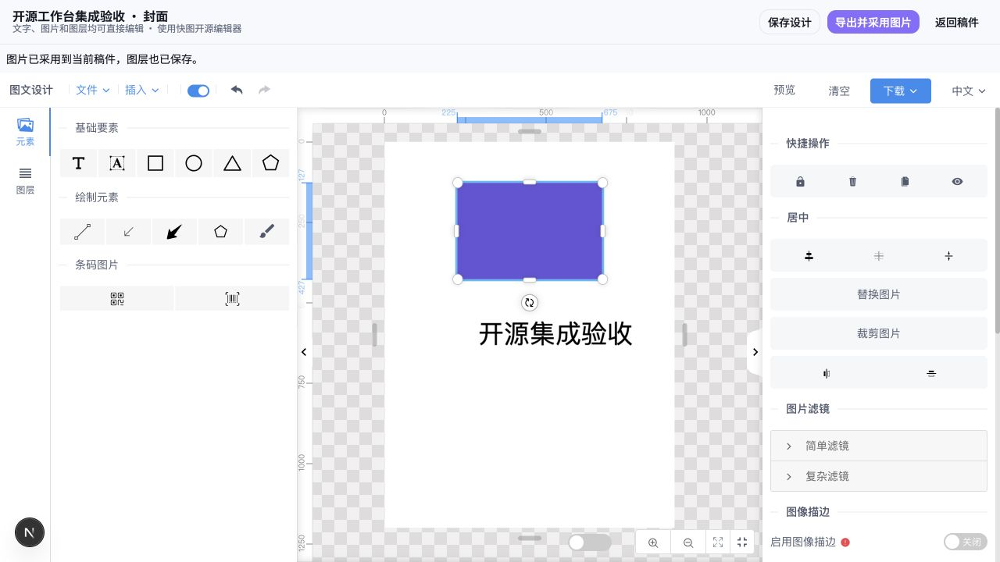

# 已采用的完整开源工作台

视频采用官方 OpenCut classic，图文采用快图，均已接入 CreatorOS 开发工作台并走原作品保存/Asset/成果服务。完整结果与限制见 [验收记录](evidence/t1042/complete-editors/verification.md)，源码、提交、许可、可重建命令与产物hash见 [参考工程](../../reference-editors/README.md)。保留完整脚本工作台；首份内容完成后再按需扩展表达。

