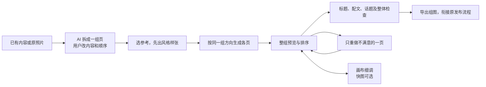

# 小红书图文应该围绕“做成一组图”

2026-10-02，按用户纠正重新调研。图文工作台的主任务是把一份内容做成一组能连续阅读、视觉统一的图片。快图保留在“调整这一张”里；现有画布负责参考素材、生成、并排比较和局部修改。不是进入图文就先打开单图设计器。

这张图是 CreatorOS 建议流程，不是声称所有小红书作者都使用同一流程。照片分享可以先选图再写配文；知识卡片可以先拆内容再出图。首图/页数/比例由用户选择或模型建议，不设置未经证实的平台硬门。

## 本轮核实了什么

官方[分享SDK](https://agora.xiaohongshu.com/doc/android)把图文表示为图片列表、标题和正文；[官方FAQ](https://agora.xiaohongshu.com/doc/qa)对分享器自动填标题/文案有额外限制。因此产品要交付整组图片和可编辑配文，不能把打开分享器当作已经发布。文档里1–18张仅对应该Android SDK，不泛化成当前桌面限制。作者平台及创作百科实际需要登录，未假称已实测登录后的发布页面。

可优先复用MIT的[baoyu-xhs-images](https://github.com/JimLiu/baoyu-skills/tree/1567581c26ec29f4216c6e6835415bf30343b0e3/skills/baoyu-xhs-images)工作法：先逐页规划，再出首图作为风格参考，后续按页生成；某页重做保留其余页和旧候选。它是生成Skill，不是另一个图文编辑器。关键词自动选风格不能照搬，生成后禁止改字也不能成为我们的产品限制；语义取舍仍由模型和用户负责。另一MIT实现yy-text2-xhs-img有任务清单/共享样式，但缺逐页语义和首图引用链，不作为核心规划引擎。

## 我们已有能力和真正断点

现有画布已经有文生图、参考图生图、候选确认、并排比较、精确文件血缘及回到原作品。原图文已有cardId、文字图卡、图片采用、版本和审核，按cardId替换图片的作品素材服务也存在。

当前断点有源码证据：页面点“生成图卡”没有提交cardId，后端把整篇正文再次交给单图Skill，采用时追加图片也未绑定具体页。现模板还是“单张无字说明配图”，因此连续点击并不能形成连贯组图。详见[现有能力审计](evidence/t1047/canvas-audit.md)。

建议在原作品里串起以下行为：

| 用户动作 | 需要落实的关系 |
| --- | --- |
| 确认整组内容 | 每页稳定cardId、页意图、来源内容和顺序 |
| 确认风格样张 | 同组参考文件、色板、字体层级、人物/品牌依据和版本 |
| 生成整组 | 每页有自己的要求与候选，沿现有任务执行，不循环整篇单图Prompt |
| 重做第3页 | 只产生该页新候选；第1、2、4页和原候选保留 |
| 在画布调整 | 从具体页进入，明确采用回这页，免再手工找作品/槽位 |
| 排序或删页 | 页ID不变；模型提示内容衔接和配文的受影响部分，经采纳再改 |
| 交付前检查 | 同时看全部图片、封面、标题、配文和话题，绑定当前稿与真实文件 |

一致性包括三个实际问题：事实和观点不漂移、页与页读得连贯、画风与人物品牌保持一致。共享参考能改善视觉一致性，不能保证模型一定成功；版本校验也不能代替内容/图片审阅。文字密集卡片应允许“AI策划主视觉 + 稳定排版真实文字”，以便改字不必整图重生。

本轮完成的是有来源的方向研究，未替换生产图文主流程、未运行付费组图生成或发布。完整[外部核验与来源](evidence/t1047/t1047-external-research.md)保留官方实际页面、固定上游提交及许可核验；设计建议与已实现能力分别标明。
