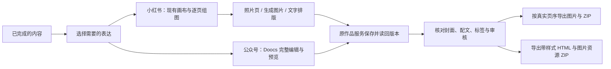

# T-1049 开源工作台运行与适配核实

2026-10-03。承接已确认的“先完成一份内容，再自然扩展表达”。本轮完成参考源码、原构建与部分原有代码测试核实，尚未接入 CreatorOS 产品代码。T-1048/T-1046 仍待真实界面和安装版验收，T-1049 保持待办；独立选型准备不代表跳过当前任务。

## 当前结论

公众号优先选择 **Doocs/md 完整 Web 编辑工作面**，复用正文编辑、主题、自定义样式、移动预览和公众号排版处理。Vue 工作面通过同源独立页面接入，不为迁就 React 重写编辑器。正文、配图、版本与审核仍由 CreatorOS 原服务保存。

小红书不能把文字卡片生成器当作全部组图工作台。**现有画布与 T-1048 逐页图片流程保留为主工作面**，照片页、生成图片与文字页可以组合。rednote-cards 可作为可选文字卡片模板与排版来源；MarkCardStudio 的多页 Markdown、预览、排序和输出更完整，但宿主适配与分发许可尚待核实，未选定为产品依赖。两者都不能凭原构建通过就声称能承担真实 AI 出图、图片采用和作品保存。

## 固定来源与真实运行

| 参考项目 | 固定提交 / 根许可 | 当场验证 | 实际复用判断 |
| --- | --- | --- | --- |
| [rednote-cards](https://github.com/huanjuedadehen/rednote-cards/tree/9c675f08681188838e6857c59bb0cd08be662a68) | `9c675f08681188838e6857c59bb0cd08be662a68` / MIT | 冻结锁文件安装、原 `tsc -b && vite build` 成功；启动静态服务，HTML/脚本 HTTP 200 | 有富文本、多页模板和 PNG/ZIP 输出代码；适合文字卡片，缺图片编辑、稳定页 ID、正式保存和页排序 |
| [Doocs/md](https://github.com/doocs/md/tree/a7c17fc4cda92e3c13aa7e24f06615cfa4219b31) | `a7c17fc4cda92e3c13aa7e24f06615cfa4219b31` / WTFPL | 冻结锁文件安装；补正常 WXT 类型生成后原 Web 构建与 `vue-tsc` 成功；原渲染与排版/导出逻辑 5 文件 59 项通过；静态 HTML/脚本 HTTP 200 | 完整工作面可复用；须替换文章保存、素材和模型接线，保留账号及具体作品隔离 |
| [MarkCardStudio](https://github.com/pangxiaobin/MarkCardStudio/tree/23522d57dcce56c7299ce364323727d27f918f10) | `23522d57dcce56c7299ce364323727d27f918f10` / GPL-3.0-only | 冻结锁文件安装、原 `vite build` 成功；未启动参考页面、未做真实交互或输出 | 有多页、页排序、配图预览与图片/PDF 输出代码；包含浏览器回退，但文件夹、本地图片与字体依赖 Tauri 端口，不能整包无接线嵌入 |

三个 checkout 的源文件与锁文件未改，`git status` 均为空。安装使用 `--ignore-scripts --frozen-lockfile`；Doocs 按其声明使用 pnpm 12.6.0，另外两项使用本机 pnpm 10.32.1。没有通过跳过类型检查、改测试断言或替换构建器消除失败。根许可已从固定源码读取并归档；所有传递依赖、字体与最终分发的许可核对尚未完成。

Doocs 第一次默认 Web 构建真实失败：忽略安装脚本后缺少 WXT 生成的类型声明。读取 `wxt.config.ts` 后运行原 `wxt prepare`，再运行相同默认构建成功。准备命令只生成扩展类型，没有启动浏览器或安装扩展。失败日志与重试日志均保留。其源码构建含大块警告；rednote 主 JS 约 713 KB，MarkCard 主块约 3.62 MB，不能因此推断桌面首屏性能已合格。

完整命令、原日志、锁文件及关键源码 SHA-256 见 [来源与证据索引](evidence/t1049/source-provenance.json)。参考服务启动与静态读取不执行浏览器 JS，不证明控件、保存、导出下载或产品内集成有效。Doocs 的 59 项为原模块代码测试，含 jsdom/模拟接口，不能代替真实导出文件与微信使用测试。

## 公众号适配的实际边界

源码核实：`apps/web/src/types/post.ts` 的 Post 主要是标题、Markdown、历史与日期；`stores/post.ts` 经本地文档仓库存储，`stores/theme.ts` 另存主题。`PreviewPanel.vue`、`services/export/html.ts` 和 `clipboard.ts` 具备移动预览、带样式 HTML、公众号排版处理。直接用上游 Post 覆盖 CreatorOS ArticleDocument 会丢掉稳定 `sectionId`、来源、事实项、配图计划及精确图片文件绑定。

具体接线须进入现有文章/素材/版本服务合同并独立评审，以下为源码核实后的适配要求，不是已实现接口：

| 接点 | 复用内容 | 必须补齐的产品接线 |
| --- | --- | --- |
| 打开与编辑 | CodeMirror、主题、选区、撤销与预览 | 从当前账号、项目、output 与正式版本读取正文；原生 Markdown/样式绑定源版本；原稿及稳定段落身份保留，无法保真时明确限制 |
| 保存与恢复 | 工作面编辑状态、历史操作体验 | 走现有 articles owner 与 CAS；排版附件保存位置/版本关系需合同明确；账号/作品草稿隔离，未知回执恢复原请求，不能另起上游正式文章库 |
| 插图与封面 | 图片呈现与排版处理 | 选择原 Assets 精确文件和真实段落槽位；封面与正文图片分开；不能把临时 URL 当永久素材引用 |
| 助手 | 当前正文与明确选区 | 现有 Worker、模型配置与候选采用；不导入上游另一套模型凭据或云账户流程 |
| 输出 | 原排版 HTML 与公众号 CSS 处理 | 绑定保存读回版本，打包实际图片与相对路径；目标平台图片尚不可访问时明确状态，本地 HTML/ZIP 仍可交付 |

上游 Web 默认 `vite.config.ts` 包含 Google Analytics `VitePluginRadar`。产品接入时移除该参考站点统计，并核对可选外部字体、公式、图表与图床依赖；当前探针没有执行它们。云同步、上游登录和模型设置不作为新用户前置操作。公众号复制不等于自动发布，也不等于本机图片可以直接在微信使用。

## 小红书适配的实际边界

rednote 的 `CardData.pages` 是 HTML 字符串数组；`buildPages` 分配已写好的页面，不做创作语义规划或自动分页。富文本只启用 StarterKit/Placeholder，未配置图片扩展。页面预览固定 414×552 且隐藏溢出，长正文是否截字必须真实验证。导出代码抓取当前 DOM，缺页元素会跳过、错误仅写控制台，也未冻结导出快照。接入时需稳定 cardId、真实状态、溢出降级、导出完整性和保存读回，不直接复制这些限制作为产品行为。

MarkCard 有 Markdown 图片插入、页面排序和自动适配预览尺寸。页排序通过重新组织 Markdown 标题/分段实现，不能据索引把它等同于 T-1048 的稳定 cardId；本地图片、字体、目录导出有原生 invoke，也有部分 Web 回退。原构建只证明 Web 资源可生成，照片导入、失效图片恢复、排序保真和实际多图输出仍待运行核实。其 GPL-3.0-only 与另外两个参考的根许可不同，暂未复制源码为产品依赖。

下一步集成以用户的真实组图为主：整组缩略图和选中页始终可见，页面可以采用原照片或模型图片；文字卡片复用选定排版；画布承担视觉编辑，快图保留单页细调。现有生成、单页重做、候选采用、共享参考、精确图片和审核绑定继续走 T-1048。不能为开源模板增加另一套内容 owner，也不能把所有图片重新生成作为改文字的必经步骤。

## 当前评审与未验内容

需求 SPEC 两项歧义已独立复核销账：失败/冲突后的正式真值，以及两类最低实际交付物。[规格回执](../features/t1049-open-source-publishing-workbenches.review.md)为 `PASS[REV:ce967af81708]`，只代表规格评审。全仓 `reviewctl audit` 仍报告其它既有任务回执问题，原结果见 [日志](evidence/t1049/review-audit.log)，没有冒充全仓通过。

尚未通过：CreatorOS 保存和图片接线、真实中文/图片编辑、三页整组导出、公众号 HTML/图片 ZIP 解压读回、真实画布往返、冲突恢复、900×600 与 1440×900 操作、正式前端回执及安装版。此前浏览器策略阻断保持，未换浏览器、CDP 或间接执行绕过。当前客户端公开 API 的模型配置只提供脱敏信息，隔离环境真实图片生成仍需既有待答的本机配置备份路径；本轮未读取私有凭据、修改客户端作品或调用付费模型。
