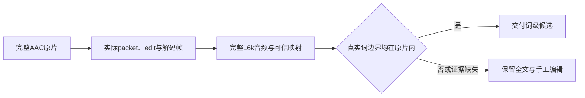

# T-1062 · 默认本地词级时间码交付研究

已确认当前AAC先回退MP3，时间关系证明缺失。修复保留完整音频，只有全部真实词边界落在原片内才开放词句粗剪；偏移或证据缺失时仍可读全文和手工编辑。

```research-first-gate/v2
{
  "schema": "research-first-gate/v2",
  "task_id": "T-1062",
  "research_task_id": "T-1062",
  "status": "validated",
  "problem_statement": "已定位前置AAC只支持旧MP3抽音，缺mappingReceipt时Worker不传timingAudio；标准零起点AAC物理packet/edit/frame完整证明可用，需内部兼容实现，真实模型词边界与原18仍待验证。",
  "failure_family": "t1062-local-word-timing-delivery",
  "observed_invariant": "词句粗剪必须有真实、完整且可验证的时间码；不能把全文成功或伪造切点代替词级验收。",
  "trigger_kinds": [
    "high-cost-feedback-loop",
    "external-capability-unknown"
  ],
  "paused_actions": [
    "further-production-changes",
    "broadened-workaround",
    "repeated-full-system-runs",
    "irreversible-operations"
  ],
  "evidence": {
    "authoritative": [
      {
        "kind": "approved-spec",
        "ref": "docs/features/t1062-consolidated-local-client-acceptance.md",
        "claim": "ChatCut粗剪验收要求真实时间码和同轨采用；缺有效时间码可诚实手工降级，不能声称词句粗剪通过。"
      },
      {
        "kind": "source-code",
        "ref": "ai-worker/src/runtime/multimodal-whisper-local.ts",
        "claim": "默认adapter只有物理wordTimingValidated和真实样本数一致时才交付timing。"
      },
      {
        "kind": "source-code",
        "ref": "backend/src/modules/production/production-asr-pcm.ts",
        "claim": "旧入口只接受PCM，AAC直接return null，后续MP3缺可信映射。"
      },
      {
        "kind": "official-doc",
        "ref": "https://ffmpeg.org/ffmpeg-resampler.html",
        "claim": "aresample默认swr且async0，无timestamp补偿；first_pts会填充/截断，因此不强制设0。"
      },
      {
        "kind": "official-doc",
        "ref": "https://ffmpeg.org/ffmpeg-filters.html#ashowinfo",
        "claim": "ashowinfo提供实际输出帧PTS、rate、nb_samples和checksum；WAV重新分帧只独立验证总样本。"
      }
    ],
    "local": [
      {
        "kind": "test",
        "path": "docs/research/t1062-local-word-timing/attempt13-observation.json",
        "locator": "actual_failed_assertion/public_requests",
        "observation": "22浏览器20通过，2真实词级ASR返回text；全部795源无漂移且原Worker恢复。"
      },
      {
        "kind": "public-read",
        "path": "docs/research/t1062-local-word-timing/public-root-cause.json",
        "locator": "public_evidence/actual_audio_evidence/chain",
        "observation": "两真实word请求执行succeeded/候选待确认，实际MP3且aggregate timing缺失；不是下游映射丢弃已有timing。"
      },
      {
        "kind": "physical-witness",
        "path": "docs/research/t1062-local-word-timing/raw-evidence.json",
        "locator": "files",
        "observation": "73 exact私有副本含失败stderr、成功9命令、700解码/701重采样/234WAV帧、完整ISO edit和原媒体hash；不执行模型或真实库。"
      },
      {
        "kind": "static-design",
        "path": "docs/research/t1062-local-word-timing/aac-v2-design-r5.json",
        "locator": "admitted_family/mapping_invariants",
        "observation": "参数化窄族、每次实际工具链身份/完整物理证明、all端点精确换算及音视频双域，未知回退全文；不依赖Homebrew版本白名单。"
      }
    ],
    "experiments": [
      {
        "question": "真实word请求在哪一步失去timing？",
        "command": "读取Attempt13隔离库副本的公开ai/task/result/execution服务并核实际音频bytes，不新模型调用",
        "environment": "隔离DB副本；source795/originalDB2133不变；当前用户库未打开",
        "result": "实际AAC变为MP3 unverified，无mappingReceipt，前置Worker不传timingAudio；真实全文仍成功",
        "artifact_path": "docs/research/t1062-local-word-timing/public-root-cause.json",
        "artifact_sha256": "e69cb4750be148b955c95ed70a2728238e9f01d942306bdf50c697d34848ca6b"
      },
      {
        "question": "标准AAC解码后的有效源样本与16k真实输出能否建立不猜测的原点和有理数映射？",
        "command": "既有记录的ffprobe packets+frames及ffmpeg aresample=16000,ashowinfo；原无效枚举失败和成功校准均保留",
        "environment": "固定中性normal/offset/PCM；FFmpeg9.0.1仅实际实验实例，不是产品版本白名单",
        "result": "normal standard priming edit与skip/decoded0闭合，S716393/N238798含17 flush；offset有empty edit与非零起点继续text/manual。完整输出尾端N映射源716394超S，必须拒绝不能pin/trim。",
        "artifact_path": "docs/research/t1062-local-word-timing/physical-experiment.json",
        "artifact_sha256": "bf3021053cc65132e31eca83f08150d2b4991243b84b055ef26fc766e40d28bd"
      }
    ]
  },
  "options": [
    {
      "id": "OPT-1",
      "outcome": "新增独立严格内部v2支持经每文件证明的标准零起点AAC，并逐实际provider端点机械映射；旧v1保持。",
      "tradeoffs": "只覆盖已定义窄族；未知、偏移或任一词端点不合法回退全文与手工；需独立SPEC/精确scope及真实公共回归，研究恢复不等于词级验收。",
      "scope": "原AAC媒体物理协议内部兼容，无新API/归属/SQL/语义策略/费用；全输出保留。",
      "falsified_by": "现场packet/edit/frame/actual工具链证明或实际provider全端点校验失败。"
    },
    {
      "id": "OPT-2",
      "outcome": "继续仅旧全文与手工剪辑，词句粗剪记待验。",
      "tradeoffs": "保留可用性，但普通AAC词级目标不满足本次完整粗剪验收。",
      "scope": "现有MP3/text回退，不改候选和用户采用边界。",
      "falsified_by": "同一原AAC真实词级回执通过新增严格映射且完整公共旅程通过。"
    }
  ],
  "recommendation": "OPT-1",
  "validation": {
    "timebox_minutes": 120,
    "max_experiments": 2,
    "acceptance_criteria": [
      {
        "name": "定位前置映射机制",
        "target": "真实word输入和plan两项均word、task成功但无timing，实际输入MP3与源证据链对应；无新模型/真实库写入",
        "measurement": "readonly verifier逐hash读actual公共结果、MP3魔数/plan身份和11原源码副本",
        "observed": "2项成功全文/0 timing，1公开诊断PASS/0skip，source795与原DB2133无漂移；不是模型报错或已有timing映射被拒",
        "evidence_path": "docs/research/t1062-local-word-timing/raw-evidence.json",
        "evidence_sha256": "96c96802174c1dbf50ab388009edb9ded23dd54819cb61449f1cdcba6218c2b6",
        "verify_key": "t1062-aac-delivery-cause"
      },
      {
        "name": "物理机制与安全窄族定义",
        "target": "完整packet/edit/decoded/ashowinfo/WAV连续样本闭合，n*3任何越源/视频域不pin/trim，offset拒绝；保留失败历史",
        "measurement": "readonly verifier核73份hash及9原命令exit，直接ISO字节、逐frame连续和WAV data大小；独评R4/最终R5静态",
        "observed": "700/701/234三种帧来源，S716393/N238798，offset非零/emptyedit；方案仅内部兼容，真实word/Original18/安装未PASS",
        "evidence_path": "docs/research/t1062-local-word-timing/raw-evidence.json",
        "evidence_sha256": "96c96802174c1dbf50ab388009edb9ded23dd54819cb61449f1cdcba6218c2b6",
        "verify_key": "t1062-aac-delivery-physics"
      }
    ],
    "resume_criteria": "真实恢复仅执行登记的只读证据校验；恢复后先独立评审SPEC/DEC/精确模块并安全换lease，再修改内部实现。普通AAC真实词级和offset完整手工旅程、原18与安装仍须当场执行。"
  },
  "decision_impacts": [
    "none"
  ],
  "decision_ids": []
}
```


