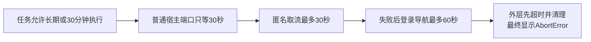

# 全系统超时限制审计（T-1065）

**结论：当前源码去重复用后，核实到211条超时控制/默认规则，另外10条预算装配声明和1条契约上界。30秒固定、默认或封顶规则共33条：15条在产品运行时，18条在构建、验收和开发工具。** 这些数字的单位是独立控制规则或独立覆盖位置，既不是超时关键词次数，也不是211种用户任务。一个共享规则可以覆盖很多调用；同一常量及其消费没有再次计数。浏览器两个独立API使用相同30秒仍各计一条。

| 范围 | 实际控制及默认规则 | 纯预算/契约声明 | 30秒规则 |
| --- | ---: | ---: | ---: |
| 产品运行时（前端、后端、Worker、桌面、CLI） | 138 | 7 | 15 |
| 构建、CI、验收、项目技能与治理工具 | 73 | 4 | 18 |
| 合计 | **211** | **11** | **33** |

其中5条30秒来自实际安装的Playwright默认，另外28条由第一方代码显式指定固定、默认或封顶值。产品运行时15条中含1条只在导出调试模式执行的辅助截图；2条网页登录导航超时会被忽略并继续等用户，不是15条都会杀任务。库默认启动180秒也已计入，不能误称30秒。

## 本次 AbortError 已关联到真实任务

用户确认账号为“月明水清深”。只读公开CLI绑定 `acct-ae1a8346-9` 后核实：截图中王温特“做数字人，你到底要不要花钱”作品为 `intelligence-item-db19e969-156`，抖音ID `7693214050070596898`。执行任务 `execution-task-db19e969-419` 与 `execution-task-db19e969-580` 都归属于该作品，终态 `failed`，错误码 `TRANSCRIBE_FAILED`、错误提示 `AbortError`。最新一次创建到失败31.044秒。

本机安装版1.2.0的Worker普通端口等待为30秒；提取实际安装版函数的隔离模拟，在正常心跳、任务无总deadline、宿主准备需31秒时，30.003秒发生 `HOST_PORT_TIMEOUT`。素材准备清理随后abort。真实日志没有内部异常栈，所以中间机制来自安装版代码和模拟，不能声称真实日志直接打印了HOST_PORT_TIMEOUT。

当前共享源码仍保留同一问题：内容雷达 `intelligence-transcript-bridge.ts` 和 `claimed-asr-stage.service.ts` 的 `prepareTranscribeItem` 包含取流、登录回退、抽音、保存音频，外层仍只等30秒；普通转写Worker的取流迁移没有覆盖这两条链。

## 会影响正常使用的主要问题

1. **外层30秒包住更长的合法操作。** Worker普通端口上限不可配置，正常心跳不延长它。雷达素材准备的匿名请求30秒、登录详情导航60秒，再加抽音和保存，正常慢路径可能根本没有完成机会。豁免端口在continuous模式也只有10分钟等待，continuous不意味着每个环节无限。
2. **模型连接测试和embedding的30秒包含排队、进程冷启动和实际请求。** `request-io.service.ts` 超时后发cancel，1秒没有确认会杀复用进程，另一条在途请求也可能被影响。参数可调整，但0不能表示禁用。
3. **前端停止等待被显示成业务失败。** 稿面创建6秒race、知识库提取至少60秒等待、多类AI候选卡约225～720秒轮询结束，都有后台请求继续而页面显示error的路径。应保留原任务ID和实际状态，不能把“尚未完成”当作“执行失败”。
4. **单次模型调用与整个任务不是同一个预算。** 结构化节点默认90秒，传入值被夹在15秒至15分钟；脚本管线覆盖150秒、其他调用还有自己的预算。模型请求超时可以先于10/30分钟业务预算。
5. **视频供应商的循环次数也是等待限制。** MiniMax默认60轮×5秒，实际素材Worker覆盖120轮约10分钟，H3为240轮约20分钟；OmniHi为120轮约10分钟。网络请求时间另外累加，这不是严格墙钟上限；停止本地轮询不等于取消供应商任务，已知job应按原ID恢复。
6. **仍有构建/验收上限。** 当前主共享源码11个CI作业都有5～340分钟的显式上限，另有30秒Worker/TLS/混淆/工具探针。它们影响出包与验证，与用户作品的业务超时分别统计。

## 本次不应误判的限制

- `setTimeout`、`waitForTimeout`或30,000这个数出现，不自动等于超时。延时、搜索debounce、心跳、轮询间隔、退避、缓存TTL、授权租约、音频分块30秒均已排除。
- 原作品374秒、受管ASR配置 `maxDurationSeconds=300` 属于**输入音频长度**限制，未混入等待统计，也未将其当成这次AbortError的根因。当前Worker受管Qwen链未见该字段的直接执行校验，供应商实际限额未在本次重发验证。
- Rust停机5秒后强杀属于退出资源清理；CLI用户显式指定等待timeout只结束等待，不取消后台任务，默认无限等待。
- 同一个持久deadline在ledger、lease、Worker、supervisor、入口被复查或执行，不当作多个新默认预算。所有继承点可在原始候选清单继续定位。

## T-1063 流水线分支与本机的区别

本次主要源码基线为共享工作区 `125bc864d79f64891694ed0d630b6462fc7d7e26`，不是把已提交但未推送的分支当作正在运行的产品。T-1063的 `d514e90d8f314e8958bea6d67f2e364d9a8b497e` 已移除desktop-release的5个job上限、Node 5秒、HyperFrames 20秒和TLS 30秒显式探针，并在build-only跳过若干验证；独立RAT和非build-only验证仍保留上限。

**本次还发现一个遗漏：`execution-worker-runtime.mjs` 的依赖解析探针仍有30秒。T-1063只给一个调用点加了build-only保护，`bundleWorkerExternalPackages` 的另一个调用点仍未保护。Windows分层runtime可以走spawn30秒，扁平runtime走同步解析而不受该spawn限制。** 本次只读审计没有改它。这是T-1063待重跑前需要处理的真实剩余项，不能声称所有打包30秒已取消。

这些分支变更尚未进入本机安装版1.2.0。用户此前流水线任务的推送授权仍未收到；本次账号确认及审计请求不是推送/发布授权。

## 范围、证据与限制

扫描2155份第一方源码/配置文件，检出1010行词法候选；3个只读辅助分区加主会话交叉核对，最终222条审阅记录来自112个文件。候选包含引用、注释、配置和延时，不把1010当作超时数量。检索覆盖显式timeout/deadline、定时reject/abort/kill、Rust时长、进程等待、手写elapsed循环、轮询次数×延时及当前调用者覆盖；检查Playwright1.60.0实际依赖默认值。

完整数据见 `timeout-inventory.csv`、`timeout-inventory.json`；包含ID、位置、数值、类别、效果、风险和备注。`search-candidates.json`保存检索命中与被审源码hash；`scan_timeouts.py --verify`确认2155份文件hash、引用行、唯一ID及统计一致性。静态结果不等同真实供应商或完整系统E2E。

未计入测试源、fixture、历史输出和node_modules内部全部计时器；测试配置的Playwright webServer300秒、Vitest test/hook20秒及治理命令的testTimeout仅单列，不混入产品限制。SDK/操作系统/反向代理/远端服务仍可能有额外默认超时，本次没有调用它们来测试所有默认，不能声称这些层不存在限制。本仓库无真实MCP Client.callTool链，未把SDK通用60秒默认硬套到产品。

未修改生产代码、安装版、真实任务或数据，未重跑采集/生成/CI；仅更新审计文档与任务控制记录。此前同一隔离树的全局reconcile仍有234项既有失败（历史manifest/任务/Gate及教训债务，由T-916/T-1015等跟进）；本次静态审计通过不代称全局质量门全绿。

## 全部30秒规则

| ID | 范围 | 文件:行 | 30秒性质 | 效果 |
| --- | --- | --- | --- | --- |
| TO-006 | 产品运行时 | `ai-worker/src/execution/redfox-client.ts:16` | 30秒每次Redfox请求 | 中止fetch；网络/限流失败有限重试 |
| TO-014 | 产品运行时 | `ai-worker/src/execution/worker-runtime.ts:63` | 30秒固定 | HOST_PORT_TIMEOUT；丢弃pending等候，宿主可能仍在执行；上层failed/unknown并清理中止 |
| TO-026 | 产品运行时 | `ai-worker/src/runtime/browser/web-reader.ts:63` | 30秒每次网页正文导航 | page.goto超时，可能换页面/登录态读取或返回失败 |
| TO-029 | 产品运行时 | `ai-worker/src/runtime/browser/web-session.ts:259` | 30秒登录页面初次导航 | 忽略导航超时，用户可在登录窗口手动导航 |
| TO-030 | 产品运行时 | `ai-worker/src/runtime/browser/web-session.ts:330` | 30秒登录页面初次导航 | 忽略导航超时，用户可在登录窗口手动导航 |
| TO-033 | 产品运行时 | `ai-worker/src/runtime/douyin-transcribe-source.ts:159` | 30秒单次匿名取流 | iesdouyin fetch中止；归一net-timeout后可回退登录详情 |
| TO-043 | 产品运行时 | `backend/src/modules/ai-runtime/request-io.service.ts:7` | 默认30秒，涵盖排队+启动+模型/embedding | REQUEST_IO_DEADLINE，给子进程cancel，1秒未ACK则整进程kill影响其他在途请求 |
| TO-102 | 产品运行时 | `frontend/src/server/ingestion/douhot-cdp.ts:337` | 库默认30秒（Playwright 1.60.0） | 输入/回车动作超时向上传播、榜单采集失败 |
| TO-103 | 产品运行时 | `frontend/src/server/ingestion/douhot-cdp.ts:338` | 库默认30秒（Playwright 1.60.0） | 输入/回车动作超时向上传播、榜单采集失败 |
| TO-106 | 产品运行时 | `frontend/src/server/ingestion/douyin-cdp.ts:692` | 库默认30秒（Playwright 1.60.0） | 扫码导航超时被catch忽略，再继续登录检查 |
| TO-108 | 产品运行时 | `frontend/src/server/ingestion/douyin-cdp.ts:713` | 库默认30秒（Playwright 1.60.0） | 扫码导航超时被catch忽略，再继续登录检查 |
| TO-119 | 产品运行时 | `frontend/src/server/ingestion/douyin-cdp.ts:2683` | 库默认30秒（Playwright 1.60.0） | 仅DOUYIN_EXPORT_DEBUG=1调试截图；超时catch吞掉 |
| TO-131 | 产品运行时 | `frontend/src/server/ingestion/douyin-cover-backfill.ts:43` | 30秒 | 中断单张封面下载；DouyinCoverDownloadError；整批其余作品继续 |
| TO-134 | 产品运行时 | `frontend/src/server/ingestion/douyin-traffic.ts:29` | 30秒 | 单作品流量来源详情页导航超时向上失败 |
| TO-135 | 产品运行时 | `frontend/src/server/ingestion/douyin-traffic.ts:32` | 30秒 | 流量页面异步状态未就绪则失败；慢加载亦触发 |
| TO-146 | 构建与开发治理工具 | `.agents/skills/guizang-product-video-skill/scripts/check_environment.py:17` | 默认30秒 | 依赖版本/FFmpeg/Node/浏览器探针超时后杀子进程并记ok:false |
| TO-170 | 构建与开发治理工具 | `ai-worker/scripts/browser-runtime-probe.mjs:31` | 30秒 | 中止浏览器运行时探针子进程 |
| TO-171 | 构建与开发治理工具 | `ai-worker/scripts/t829-model-compatibility.ts:59` | 30秒 | 中止模型列表探测请求 |
| TO-182 | 构建与开发治理工具 | `frontend/scripts/desktop/execution-worker-runtime.mjs:42` | 30秒 | 分层Worker外部依赖解析超时导致打包失败 |
| TO-185 | 构建与开发治理工具 | `frontend/scripts/desktop/obfuscate.mjs:824` | 上限30秒 | 浏览器导航超时抛错、冒烟失败 |
| TO-186 | 构建与开发治理工具 | `frontend/scripts/desktop/obfuscate.mjs:827` | 上限30秒 | 读DOM超时抛错、冒烟失败 |
| TO-187 | 构建与开发治理工具 | `frontend/scripts/desktop/package.mjs:272` | 30秒 | HTTPS探针被终止；两个站都失败则出包失败 |
| TO-188 | 构建与开发治理工具 | `frontend/scripts/desktop/verify-handshake-gate.mjs:76` | 30秒 | 独立安全握手验证停止等启动、判失败 |
| TO-195 | 构建与开发治理工具 | `frontend/scripts/visual/capture-current.mjs:193` | 30秒 | 截图导航超时，当前route记失败 |
| TO-197 | 构建与开发治理工具 | `frontend/scripts/visual/capture-with-port.mjs:67` | 30秒 | 开发服未响应则脚本失败 |
| TO-198 | 构建与开发治理工具 | `frontend/scripts/visual/capture-with-port.mjs:105` | 30秒 | 截图导航超时失败 |
| TO-201 | 构建与开发治理工具 | `mcp-server/scripts/smoke.mjs:53` | 30秒 | MCP冒烟脚本停止等待回复并reject；不代表业务任务取消 |
| TO-208 | 构建与开发治理工具 | `tools/windows-closure-rat/inspect-installed-webview.mjs:12` | 30秒 | 停止等待WebView2 target，验证失败 |
| TO-211 | 构建与开发治理工具 | `tools/windows-closure-rat/runtime-smoke.mjs:204` | 30秒 | Whisper模块Worker未返回则探针进程退出失败 |
| TO-213 | 构建与开发治理工具 | `tools/windows-closure-rat/runtime-smoke.mjs:256` | 30秒 | 终止CLI探针并判失败 |
| TO-214 | 构建与开发治理工具 | `tools/windows-closure-rat/runtime-smoke.mjs:278` | 30秒 | 终止工具版本探针并判失败 |
| TO-218 | 构建与开发治理工具 | `tools/windows-closure-rat/worker-smoke.mjs:25` | 默认30秒，可调用参数配置 | Worker未握手判失败并断开IPC |
| TO-222 | 构建与开发治理工具 | `tools/windows-runtime-rat/run.ps1:227` | 30秒 | 系统代理RAT输出文件未到则抛错 |

## 全部超时与预算记录

| ID | 类型 | 文件:行 | 时长 | 超时效果 |
| --- | --- | --- | --- | --- |
| TO-001 | 显式执行控制点 | `ai-worker/src/execution/browser-worker-session.ts:42` | 5秒每次浏览器操作 | reject deadline；实际Playwright/evaluate命令不一定自动取消 |
| TO-002 | 显式执行控制点 | `ai-worker/src/execution/browser-worker-session.ts:462` | 4.5秒页面内等待target可见 | 页面内轮询reject；外层5秒再包一层 |
| TO-003 | 显式执行控制点 | `ai-worker/src/execution/durable-pi-stream.ts:81` | 3分钟无模型进展 | 中止Agent模型流；每次进展重置 |
| TO-004 | 显式执行控制点 | `ai-worker/src/execution/intelligence-generation-worker.ts:81` | 3分钟每次热点选题模型调用 | 中止generateText；maxRetries=0 |
| TO-005 | 显式执行控制点 | `ai-worker/src/execution/intelligence-generation-worker.ts:101` | 3分钟每次口播初稿模型调用 | 中止generateText；空正文最多另一轮，每轮新3分钟 |
| TO-006 | 显式执行控制点 | `ai-worker/src/execution/redfox-client.ts:16` | 30秒每次Redfox请求 | 中止fetch；网络/限流失败有限重试 |
| TO-007 | 显式执行控制点 | `ai-worker/src/execution/research-browser-sessions.ts:65` | 5秒 | 只停止URL安全guard等待，实际guard Promise可能仍在 |
| TO-008 | 显式执行控制点 | `ai-worker/src/execution/research-browser-sessions.ts:165` | 10秒 | 研究页面导航超时后dispose并transient失败 |
| TO-009 | 显式执行控制点 | `ai-worker/src/execution/research-worker-tools.ts:78` | 15秒 | 研究浏览器启动超时 |
| TO-010 | 显式执行控制点 | `ai-worker/src/execution/research-worker-tools.ts:81` | 15秒 | 连接研究浏览器失败 |
| TO-011 | 显式执行控制点 | `ai-worker/src/execution/research-worker-tools.ts:225` | 15秒检索参数 | 浏览器检索仍Math.max(15s,20s)=20s |
| TO-012 | 显式执行控制点 | `ai-worker/src/execution/topic-worker-reads.ts:90` | 15秒单次选题信源读取 | 中止单次读取，try/catch可记录失败信源 |
| TO-013 | 显式执行控制点 | `ai-worker/src/execution/worker-runtime.ts:63` | continuous为10分钟；有任务deadline为剩余时长 | 豁免port仍有HOST_PORT_TIMEOUT |
| TO-014 | 显式执行控制点 | `ai-worker/src/execution/worker-runtime.ts:63` | 30秒固定 | HOST_PORT_TIMEOUT；丢弃pending等候，宿主可能仍在执行；上层failed/unknown并清理中止 |
| TO-015 | 显式执行控制点 | `ai-worker/src/execution/worker-runtime.ts:75` | 继承持久任务deadline；null禁用 | controller.abort，取消模型和工作，deadline已经过则立即abort |
| TO-016 | 显式默认或覆盖策略 | `ai-worker/src/nodes/script-node.ts:12` | 150秒 | 脚本draft模型节点覆盖通用90秒 |
| TO-017 | 显式默认或覆盖策略 | `ai-worker/src/nodes/script-pipeline.ts:12` | 150秒 | 脚本pipeline两处模型节点覆盖通用90秒 |
| TO-018 | 显式默认或覆盖策略 | `ai-worker/src/nodes/structured-node.ts:228` | 默认90秒，15秒下限，15分钟硬上限 | generateObject/generateText AbortSignal.timeout；每次调用各自计时 |
| TO-019 | 显式执行控制点 | `ai-worker/src/runtime/browser/browser-pool.ts:249` | 可选借用浏览器池排队deadline | 取消排队等待，不杀其他正常浏览器任务 |
| TO-020 | 显式执行控制点 | `ai-worker/src/runtime/browser/chromium-guard.ts:168` | 15秒默认等待旧浏览器清理 | reject BrowserCleanupPendingError；可重试cleanup |
| TO-021 | 显式执行控制点 | `ai-worker/src/runtime/browser/chromium-guard.ts:247` | 15秒浏览器启动默认 | reject BrowserLaunchError，启动竞态后保持清理追踪 |
| TO-022 | 显式执行控制点 | `ai-worker/src/runtime/browser/chromium-guard.ts:355` | 默认15秒或启动timeoutMs，等待占用profile租约 | reject BrowserLaunchError locked；旧queue仍在 |
| TO-023 | 显式执行控制点 | `ai-worker/src/runtime/browser/navigation-retry.ts:36` | 60秒每次导航默认，可重试多轮 | page.goto超时可退避再导航 |
| TO-024 | 显式默认或覆盖策略 | `ai-worker/src/runtime/browser/search-browser.ts:35` | 至少20秒，随检索timeoutMs放宽 | Playwright导航失败；可切换其他检索路径 |
| TO-025 | 显式默认或覆盖策略 | `ai-worker/src/runtime/browser/web-capture.ts:80` | 20秒截图导航 | page.goto超时后capture失败 |
| TO-026 | 显式默认或覆盖策略 | `ai-worker/src/runtime/browser/web-reader.ts:63` | 30秒每次网页正文导航 | page.goto超时，可能换页面/登录态读取或返回失败 |
| TO-027 | 显式执行控制点 | `ai-worker/src/runtime/browser/web-reader.ts:623` | 8秒 | 等主体selector结束；catch忽略继续提取正文 |
| TO-028 | 显式执行控制点 | `ai-worker/src/runtime/browser/web-session.ts:253` | 默认300轮、每轮至少1秒，约5分钟且cookie/读状态额外耗时 | 未发现sessioncookie则loggedIn:false并关闭ctx |
| TO-029 | 显式执行控制点 | `ai-worker/src/runtime/browser/web-session.ts:259` | 30秒登录页面初次导航 | 忽略导航超时，用户可在登录窗口手动导航 |
| TO-030 | 显式执行控制点 | `ai-worker/src/runtime/browser/web-session.ts:330` | 30秒登录页面初次导航 | 忽略导航超时，用户可在登录窗口手动导航 |
| TO-031 | 显式执行控制点 | `ai-worker/src/runtime/chat/chat-pi-loop.ts:52` | 3分钟无模型进展 | 中止聊天当前模型流；每次heartbeat重置 |
| TO-032 | 显式执行控制点 | `ai-worker/src/runtime/douyin-transcribe-detail.ts:69` | 60秒每次详情页导航 | 重试导航，最终转取流失败 |
| TO-033 | 显式默认或覆盖策略 | `ai-worker/src/runtime/douyin-transcribe-source.ts:159` | 30秒单次匿名取流 | iesdouyin fetch中止；归一net-timeout后可回退登录详情 |
| TO-034 | 显式默认或覆盖策略 | `ai-worker/src/runtime/multimodal-minimax.ts:54` | 60轮×5秒约5分钟；网络耗时另加 | 抛poll timeout，已提交供应商任务不因此取消 |
| TO-035 | 显式默认或覆盖策略 | `ai-worker/src/runtime/multimodal-minimax.ts:55` | 240轮×5秒约20分钟；网络耗时另加 | H3供应商任务停止本地轮询，供应商任务仍可能继续 |
| TO-036 | 显式默认或覆盖策略 | `ai-worker/src/runtime/multimodal-omnihi.ts:29` | 120轮×5秒约10分钟；网络耗时另加 | 抛poll timeout，本地停止等候原视频任务 |
| TO-037 | 显式默认或覆盖策略 | `ai-worker/src/runtime/search-factory.ts:89` | 10秒默认每次检索请求 | search-http.ts:37中止fetch与完整body读取；适配器抛SearchExecutionError |
| TO-038 | 显式默认或覆盖策略 | `ai-worker/src/runtime/video-decisions-runner.ts:1271` | 10分钟每次长视频结构节点 | scenes/cards单次模型请求超时 |
| TO-039 | 显式默认或覆盖策略 | `backend/src/modules/ai-runtime/chat-production-composition.ts:85` | 10分钟默认后端聊天预算 | 无budget时补持久任务deadline；持续任务可覆盖null |
| TO-040 | 显式执行控制点 | `backend/src/modules/ai-runtime/chat-trend-read.ts:60` | 45秒整轮热点原始信源读取 | 停止读取剩余信源，保留已取得结果/检索依据 |
| TO-041 | 显式执行控制点 | `backend/src/modules/ai-runtime/chat-trend-read.ts:72` | 20秒单信源读取 | 单源失败catch，保留其他信源 |
| TO-042 | 显式执行控制点 | `backend/src/modules/ai-runtime/local-environment-host.ts:16` | 3秒工具版本探测 | catch保留安装路径，版本不可读 |
| TO-043 | 显式默认或覆盖策略 | `backend/src/modules/ai-runtime/request-io.service.ts:7` | 默认30秒，涵盖排队+启动+模型/embedding | REQUEST_IO_DEADLINE，给子进程cancel，1秒未ACK则整进程kill影响其他在途请求 |
| TO-044 | 显式执行控制点 | `backend/src/modules/ai-runtime/request-io.service.ts:45` | 1秒取消ACK宽限 | kill共用IO进程，其他在途REQUEST_IO_UNKNOWN |
| TO-045 | 显式执行控制点 | `backend/src/modules/ai-runtime/script-similarity-business-adapter.ts:39` | 默认2分钟同步等待独立相似度任务 | 仅返回尚未完成，独立任务继续，不重建任务 |
| TO-046 | 显式执行控制点 | `backend/src/modules/assets/localfs-object-storage.ts:99` | 15秒媒体元信息探测 | 探测失败EMPTY_PROBE，保存文件继续 |
| TO-047 | 显式执行控制点 | `backend/src/modules/benchmark/benchmark-transcription.service.ts:106` | 默认2分钟同步等待benchmark转写 | 抛BenchmarkTranscriptionPending含原任务ID，任务仍运行 |
| TO-048 | 显式执行控制点 | `backend/src/modules/execution/chat-web-profile-wait.ts:10` | 60秒默认等网页登录资源租约 | 仍busy则抛原错误，任务失败/等待用户 |
| TO-049 | 显式执行控制点 | `backend/src/modules/execution/host-browser-process-recovery.ts:19` | 5秒每次OS宿主进程快照 | kill ps/Powershell，验证失败，不视为无占用 |
| TO-050 | 显式执行控制点 | `backend/src/modules/execution/host-browser-profile-lifecycle.ts:31` | 60秒默认等profile资源释放 | 仍占用则BrowserProfileBusyError，停止等候 |
| TO-051 | 显式执行控制点 | `backend/src/modules/execution/submitted-task-preparation.service.ts:74` | 每次prepare上限deps.deadlineMs；也受父任务deadline | 中止子任务准备；continuous可重试，非continuous达到上限失败 |
| TO-052 | 显式执行控制点 | `backend/src/modules/execution/worker-process-tree.ts:7` | 3秒每次OS进程快照 | 终止ps，清理流程拒绝把未知当已退出 |
| TO-053 | 显式执行控制点 | `backend/src/modules/execution/worker-process-tree.ts:28` | 10秒Windows进程树终止命令 | taskkill超时清理失败 |
| TO-054 | 显式执行控制点 | `backend/src/modules/execution/worker-process-tree.ts:77` | 40次检查约1秒等待+每次ps耗时 | 无法确认进程树退出则WORKER_TREE_EXIT_TIMEOUT |
| TO-055 | 显式执行控制点 | `backend/src/modules/execution/worker-supervisor.ts:63` | 5秒取消/停机宽限 | cancel无响应强制清进程树；stop197同值 |
| TO-056 | 显式执行控制点 | `backend/src/modules/execution/worker-supervisor.ts:76` | 15秒Worker启动默认 | 整树forceStop后WORKER_START_TIMEOUT |
| TO-057 | 显式默认或覆盖策略 | `backend/src/modules/intelligence/intelligence-generation-bridge.ts:36` | 默认10分钟预算/结构生成声明 | 未配置任务预算则ledger补deadline，旧任务启用10分钟 |
| TO-058 | 显式默认或覆盖策略 | `backend/src/modules/search/knowledge-search-runtime.service.ts:7` | 2分钟全回填批次 | 中止本次embedding回填，可后台下次续 |
| TO-059 | 显式默认或覆盖策略 | `backend/src/modules/search/knowledge-search-runtime.service.ts:8` | 8秒检索embedding | 中止query embedding，降级其他搜索 |
| TO-060 | 显式执行控制点 | `backend/src/secret-crypto.ts:148` | 3秒master key pipe读取循环名义上限 | 未读到则文件/后备路径；阻塞readSync可超时不生效 |
| TO-061 | 契约上界 | `contract/src/internal/execution-worker.ts:41` | 持久任务正数预算最大约23.15天；continuous=null无总期限 | 持久ledger/lease/ports/admission/outcome共同校验deadline；Worker与supervisor执行 |
| TO-062 | 显式默认或覆盖策略 | `contract/src/resources/execution.ts:42` | 普通执行默认10分钟、最大1小时；video.render/agentic允许null | run-execution-task.ts:87计时abort+reject；agentic映射持久deadline |
| TO-063 | 显式执行控制点 | `frontend/src-tauri/src/cli_access.rs:328` | 5秒 | Windows PATH更新广播最多等5秒，忽略广播结果继续 |
| TO-064 | 显式执行控制点 | `frontend/src-tauri/src/entitlement_claim.rs:535` | 10秒 | 权益领取会话单次HTTP超时报可重试连接错误 |
| TO-065 | 显式执行控制点 | `frontend/src-tauri/src/entitlement_claim.rs:616` | 10秒 | 授权消费恢复单次HTTP超时报可重试连接错误 |
| TO-066 | 显式执行控制点 | `frontend/src-tauri/src/lib.rs:675` | 15秒 | 单次本地页面可用探测失败返回false，继续外层watchdog |
| TO-067 | 显式执行控制点 | `frontend/src-tauri/src/lib.rs:749` | 无进度5分钟或总30分钟 | 返回TimedOut并保留splash显示启动失败，阻止导航；此等待分支本身不杀sidecar |
| TO-068 | 显式执行控制点 | `frontend/src-tauri/src/license.rs:2424` | 10秒 | 授权校验/激活HTTP单次超时，授权链执行重试/宽限规则 |
| TO-069 | 显式执行控制点 | `frontend/src-tauri/src/license.rs:2571` | 5秒 | 授权展示副本同步到sidecar超时记日志，授权放行不受影响 |
| TO-070 | 显式执行控制点 | `frontend/src-tauri/src/license.rs:2651` | 15秒 | sidecar config.pull超时标retryable，主界面/授权不阻塞 |
| TO-071 | 显式执行控制点 | `frontend/src-tauri/src/license.rs:2761` | 90秒 | 等sidecar就绪的展示副本补同步/首次配置刷新不再等，进入授权心跳循环 |
| TO-072 | 显式执行控制点 | `frontend/src-tauri/src/license.rs:3229` | 10秒 | 检查新版本HTTP单次失败/重试，最终返回人话错误 |
| TO-073 | 显式执行控制点 | `frontend/src-tauri/src/sidecar_process.rs:115` | 5秒 | macOS停机SIGTERM后5秒尚未停止执行则SIGKILL整组 |
| TO-074 | 显式执行控制点 | `frontend/src-tauri/src/sidecar_process.rs:126` | 2秒 | 强制停止后2秒未确认全组停止返回清理错误 |
| TO-075 | 显式执行控制点 | `frontend/src-tauri/src/win_job.rs:102` | 5秒 | Windows停机等5秒未退出则TerminateJobObject整进程树 |
| TO-076 | 显式执行控制点 | `frontend/src-tauri/src/win_job.rs:110` | 5秒 | 强杀后5秒未确认退出返回错误，然后关闭Job句柄兜底 |
| TO-077 | 显式执行控制点 | `frontend/src/components/ai/adopt-candidate-card.tsx:152` | 至少300秒 | 候选卡片置error，后台AI任务不取消 |
| TO-078 | 显式执行控制点 | `frontend/src/features/copilot/chat-douyin-share-card.tsx:163` | 默认约360秒加读取耗时 | 停止导入任务查询；最后读取仍未终态可置queryFailed，后台不取消 |
| TO-079 | 显式执行控制点 | `frontend/src/features/copilot/chat-generate-card.tsx:196` | 至少356秒加读取耗时 | 轮询预算耗尽卡片置error，后台视频生成不取消 |
| TO-080 | 显式执行控制点 | `frontend/src/features/copilot/chat-publish-package-card.tsx:101` | 默认至少720秒 | 卡片置error，明确说明后台可能仍执行；后台不取消 |
| TO-081 | 显式执行控制点 | `frontend/src/features/copilot/chat-result-cards.tsx:125` | 默认至少300秒 | 盲预测卡片置error，后台诊断不取消 |
| TO-082 | 显式执行控制点 | `frontend/src/features/copilot/chat-review-report-card.tsx:86` | 默认至少225秒 | 审核卡片置error并显示审核超时，后台审核不取消 |
| TO-083 | 显式执行控制点 | `frontend/src/features/copilot/chat-script-draft-card.tsx:147` | 默认至少360秒 | 整稿候选卡片置error，后台生成不取消 |
| TO-084 | 显式执行控制点 | `frontend/src/features/copilot/chat-thesis-card.tsx:100` | 默认至少360秒 | 论点树卡片置error，后台生成不取消 |
| TO-085 | 显式执行控制点 | `frontend/src/features/copilot/execution-task-card.tsx:155` | 至少1800秒 | 停止自动查询，保留当前任务状态；后台执行不取消 |
| TO-086 | 显式执行控制点 | `frontend/src/features/draft-workbench/content-direction-actions.tsx:42` | 10秒 | 读取当前稿件超时则本次不发送诊断；读请求继续 |
| TO-087 | 显式执行控制点 | `frontend/src/features/draft-workbench/draft-chat-request.tsx:116` | 4秒 | 最多等4秒保存后仍打开AI对话；保存继续后台执行 |
| TO-088 | 显式执行控制点 | `frontend/src/features/draft-workbench/draft-chat-request.tsx:128` | 10秒 | 停止等待保存，本次诊断不发送；不取消保存本身 |
| TO-089 | 显式执行控制点 | `frontend/src/features/draft-workbench/script-review-gate.tsx:187` | 6秒 | 抛createOutput超时；实际创建请求继续，可能晚到完成 |
| TO-090 | 显式执行控制点 | `frontend/src/features/intelligence/use-source-runs.ts:17` | 至少120秒 | 停止同步进度监听，清转圈，提示后台仍运行；后台不取消 |
| TO-091 | 显式执行控制点 | `frontend/src/features/knowledge/knowledge-dump-zone.tsx:87` | 至少60秒 | 抛正文解析超时，原文件保留但这次不入知识库；后台解析不取消 |
| TO-092 | 显式执行控制点 | `frontend/src/features/production/production-resource-operations.ts:169` | 10秒 | 视频metadata未返回则时长返回null并回收objectURL，后续诚实无时长 |
| TO-093 | 显式执行控制点 | `frontend/src/server/activation/ai-credit-link.server.ts:131` | 10秒 | 创建AI额度入口会话超过10秒abort；返回可重试的服务不可用错误 |
| TO-094 | 显式执行控制点 | `frontend/src/server/activation/client-config.server.ts:507` | 10秒 | 受管配置服务HTTP请求超过10秒abort；返回可重试的服务不可用错误 |
| TO-095 | 显式执行控制点 | `frontend/src/server/activation/license-client.ts:106` | 默认10秒，可注入 | 授权HTTP请求abort，映射networkFailure并由授权链处理宽限 |
| TO-096 | 显式执行控制点 | `frontend/src/server/activation/managed-credential-lease.server.ts:144` | 10秒 | 领取ASR凭证超过10秒abort；返回可重试的服务不可用错误 |
| TO-097 | 显式执行控制点 | `frontend/src/server/feedback/product-feedback.server.ts:409` | 10秒 | 反馈授权服务HTTP请求超过10秒abort；返回可重试的服务不可用错误 |
| TO-098 | 依赖默认控制点 | `frontend/src/server/ingestion/douhot-cdp.ts:195` | 库默认180秒（Playwright 1.60.0） | 浏览器未就绪则库启动失败，guard负责清理 |
| TO-099 | 显式执行控制点 | `frontend/src/server/ingestion/douhot-cdp.ts:299` | 60秒 | 扫码首页导航超时；扫码首页吞导航错误，采集页面向上失败 |
| TO-100 | 显式执行控制点 | `frontend/src/server/ingestion/douhot-cdp.ts:303` | 默认300轮×1秒，另加探测耗时 | 登录等待耗尽返回loggedIn:false并关闭页面 |
| TO-101 | 显式执行控制点 | `frontend/src/server/ingestion/douhot-cdp.ts:333` | 最多60轮×250ms≈15秒，另加DOM读取耗时 | 关键词输入框未出现则抛DouhotSearchInputUnavailableError，整次榜单采集失败 |
| TO-102 | 依赖默认控制点 | `frontend/src/server/ingestion/douhot-cdp.ts:337` | 库默认30秒（Playwright 1.60.0） | 输入/回车动作超时向上传播、榜单采集失败 |
| TO-103 | 依赖默认控制点 | `frontend/src/server/ingestion/douhot-cdp.ts:338` | 库默认30秒（Playwright 1.60.0） | 输入/回车动作超时向上传播、榜单采集失败 |
| TO-104 | 显式执行控制点 | `frontend/src/server/ingestion/douhot-cdp.ts:419` | 60秒 | 热点宝首页导航超时；扫码首页吞导航错误，采集页面向上失败 |
| TO-105 | 显式执行控制点 | `frontend/src/server/ingestion/douhot-cdp.ts:437` | 60秒 | 低粉爆款榜单导航超时；扫码首页吞导航错误，采集页面向上失败 |
| TO-106 | 依赖默认控制点 | `frontend/src/server/ingestion/douyin-cdp.ts:692` | 库默认30秒（Playwright 1.60.0） | 扫码导航超时被catch忽略，再继续登录检查 |
| TO-107 | 显式执行控制点 | `frontend/src/server/ingestion/douyin-cdp.ts:695` | 默认240轮×1秒，另加探测耗时 | 扫码等候轮数耗尽返回false，finally关闭浏览器会话 |
| TO-108 | 依赖默认控制点 | `frontend/src/server/ingestion/douyin-cdp.ts:713` | 库默认30秒（Playwright 1.60.0） | 扫码导航超时被catch忽略，再继续登录检查 |
| TO-109 | 显式执行控制点 | `frontend/src/server/ingestion/douyin-cdp.ts:935` | 每次导航60秒 | 自身作品指标导航单次超时抛错；helper可有重试，单次不是整个采集任务总上限 |
| TO-110 | 显式执行控制点 | `frontend/src/server/ingestion/douyin-cdp.ts:1080` | 每次导航60秒 | 对标账号指标导航单次超时抛错；helper可有重试，单次不是整个采集任务总上限 |
| TO-111 | 显式执行控制点 | `frontend/src/server/ingestion/douyin-cdp.ts:1267` | 每次导航60秒 | 用户作品列表首屏导航单次超时抛错；helper可有重试，单次不是整个采集任务总上限 |
| TO-112 | 显式执行控制点 | `frontend/src/server/ingestion/douyin-cdp.ts:1320` | 每次导航60秒 | 用户作品列表回退页导航单次超时抛错；helper可有重试，单次不是整个采集任务总上限 |
| TO-113 | 显式执行控制点 | `frontend/src/server/ingestion/douyin-cdp.ts:1428` | 每次导航60秒 | 用户资料页导航单次超时抛错；helper可有重试，单次不是整个采集任务总上限 |
| TO-114 | 显式执行控制点 | `frontend/src/server/ingestion/douyin-cdp.ts:1596` | 每次导航60秒 | 黑马搜索导航单次超时抛错；helper可有重试，单次不是整个采集任务总上限 |
| TO-115 | 显式执行控制点 | `frontend/src/server/ingestion/douyin-cdp.ts:1716` | 10秒 | 分享页解析请求abort并向上抛出；可进入登录态取流回退 |
| TO-116 | 显式执行控制点 | `frontend/src/server/ingestion/douyin-cdp.ts:1931` | 每次导航60秒 | 单条作品导入导航单次超时抛错；helper可有重试，单次不是整个采集任务总上限 |
| TO-117 | 显式执行控制点 | `frontend/src/server/ingestion/douyin-cdp.ts:2172` | 每次导航60秒 | 评论管理导航单次超时抛错；helper可有重试，单次不是整个采集任务总上限 |
| TO-118 | 显式执行控制点 | `frontend/src/server/ingestion/douyin-cdp.ts:2645` | 默认5秒 | 标记按钮点击超时；silent=true返回false继续，silent=false抛错 |
| TO-119 | 依赖默认控制点 | `frontend/src/server/ingestion/douyin-cdp.ts:2683` | 库默认30秒（Playwright 1.60.0） | 仅DOUYIN_EXPORT_DEBUG=1调试截图；超时catch吞掉 |
| TO-120 | 显式执行控制点 | `frontend/src/server/ingestion/douyin-cdp.ts:2782` | 每次导航60秒 | 作品数据导出页面导航单次超时抛错；helper可有重试，单次不是整个采集任务总上限 |
| TO-121 | 显式执行控制点 | `frontend/src/server/ingestion/douyin-cdp.ts:2793` | 3秒 | 首次关闭引导modal，失败吞掉继续 |
| TO-122 | 显式执行控制点 | `frontend/src/server/ingestion/douyin-cdp.ts:2802` | 2秒 | 重试关闭引导modal，失败吞掉继续 |
| TO-123 | 显式执行控制点 | `frontend/src/server/ingestion/douyin-cdp.ts:2822` | 8秒 | 投稿作品tab点击；最后一次失败保留错误并后续导出失败 |
| TO-124 | 显式执行控制点 | `frontend/src/server/ingestion/douyin-cdp.ts:2830` | 每轮15次×1秒，最多3轮；另加点击/DOM耗时 | 投稿列表子tab仍不可见则DouyinExportError，停止导出 |
| TO-125 | 显式执行控制点 | `frontend/src/server/ingestion/douyin-cdp.ts:2853` | 6轮×1秒，另加DOM耗时 | 停止等导出按钮就绪；返回false当前调用忽略并继续 |
| TO-126 | 显式执行控制点 | `frontend/src/server/ingestion/douyin-cdp.ts:2873` | 4秒 | 日期选择器点击；失败降级默认时间范围 |
| TO-127 | 显式执行控制点 | `frontend/src/server/ingestion/douyin-cdp.ts:2890` | 4秒 | 全部时间范围点击；失败重试/降级 |
| TO-128 | 显式执行控制点 | `frontend/src/server/ingestion/douyin-cdp.ts:2916` | 默认180秒 | 导出文件事件未出现则抛错误，整次导出失败 |
| TO-129 | 显式执行控制点 | `frontend/src/server/ingestion/douyin-cdp.ts:2935` | 5秒 | 导出数据按钮；失败将导致未触发下载等待 |
| TO-130 | 显式执行控制点 | `frontend/src/server/ingestion/douyin-cdp.ts:3165` | 每次导航60秒 | 收藏页面导航单次超时抛错；helper可有重试，单次不是整个采集任务总上限 |
| TO-131 | 显式执行控制点 | `frontend/src/server/ingestion/douyin-cover-backfill.ts:43` | 30秒 | 中断单张封面下载；DouyinCoverDownloadError；整批其余作品继续 |
| TO-132 | 显式执行控制点 | `frontend/src/server/ingestion/douyin-request-gateway.ts:355` | 默认15分钟 | 若冷却剩余大于阈值，立即拒绝准入；不会等待到15分钟后才取消 |
| TO-133 | 显式执行控制点 | `frontend/src/server/ingestion/douyin-traffic.ts:28` | 15秒 | 流量分析tab及展开动作的默认超时；动作超时整次读取失败 |
| TO-134 | 显式执行控制点 | `frontend/src/server/ingestion/douyin-traffic.ts:29` | 30秒 | 单作品流量来源详情页导航超时向上失败 |
| TO-135 | 显式执行控制点 | `frontend/src/server/ingestion/douyin-traffic.ts:32` | 30秒 | 流量页面异步状态未就绪则失败；慢加载亦触发 |
| TO-136 | 显式执行控制点 | `frontend/src/server/persistence-client.ts:1650` | 15分钟 | 待确认网页登录窗口超时关闭；取消此次登录handle |
| TO-137 | 显式执行控制点 | `frontend/src/server/persistence-client.ts:3213` | 15秒 | 整个RSS/Atom请求及最多6跳重定向/发现feed超过15秒abort |
| TO-138 | 预算装配或声明 | `frontend/src/server/persistence-client.ts:3861` | 30分钟 | 内容雷达/对标转写运行预算；传入后端执行服务/runtime进行冻结和超时处理 |
| TO-139 | 预算装配或声明 | `frontend/src/server/persistence-client.ts:3879` | 30分钟 | 定时飞轮执行预算；传入后端执行服务/runtime进行冻结和超时处理 |
| TO-140 | 预算装配或声明 | `frontend/src/server/persistence-client.ts:4587` | 10分钟 | 通用结构业务/封面/ModelWorker/提交准备预算；单一常量复用；传入后端执行服务/runtime进行冻结和超时处理 |
| TO-141 | 预算装配或声明 | `frontend/src/server/persistence-client.ts:4707` | 30分钟 | 手动转写业务预算；传入后端执行服务/runtime进行冻结和超时处理 |
| TO-142 | 预算装配或声明 | `frontend/src/server/persistence-client.ts:4727` | 30分钟 | 素材业务预算；传入后端执行服务/runtime进行冻结和超时处理 |
| TO-143 | 预算装配或声明 | `frontend/src/server/persistence-client.ts:4883` | 10分钟 | 自主采集/素材/研究业务与agentic worker预算；单一常量复用；传入后端执行服务/runtime进行冻结和超时处理 |
| TO-144 | 显式执行控制点 | `frontend/src/server/sidecar-lifecycle.ts:77` | 3秒 | 退出时数据库flush/close未完成也强制sidecar进程exit |
| TO-145 | 显式执行控制点 | `mcp-server/src/cli.ts:249` | 默认无上限，--timeout指定正数秒 | 仅CLI停止等待并报后台任务没有被取消；保留任务ID、后台继续 |
| TO-146 | 显式执行控制点 | `.agents/skills/guizang-product-video-skill/scripts/check_environment.py:17` | 默认30秒 | 依赖版本/FFmpeg/Node/浏览器探针超时后杀子进程并记ok:false |
| TO-147 | 显式执行控制点 | `.agents/skills/guizang-product-video-skill/scripts/check_environment.py:98` | 60秒 | doctor探针超时杀进程并记失败 |
| TO-148 | 显式执行控制点 | `.github/workflows/channel-package.yml:29` | 10分钟 | 超时终止对应job |
| TO-149 | 显式执行控制点 | `.github/workflows/channel-package.yml:95` | 300分钟 | 超时终止对应job |
| TO-150 | 显式执行控制点 | `.github/workflows/channel-package.yml:293` | 300秒 | 渠道包启动校验失败 |
| TO-151 | 显式执行控制点 | `.github/workflows/channel-package.yml:351` | 300秒 | 渠道包启动校验失败 |
| TO-152 | 显式执行控制点 | `.github/workflows/channel-package.yml:367` | 10秒 | 超过退出等待则强杀临时验证app |
| TO-153 | 显式执行控制点 | `.github/workflows/commit-activity.yml:21` | 10分钟 | 超时终止对应job |
| TO-154 | 显式执行控制点 | `.github/workflows/desktop-release.yml:58` | 5分钟 | 超时终止plan job |
| TO-155 | 显式执行控制点 | `.github/workflows/desktop-release.yml:84` | 180分钟 | 超时终止build job |
| TO-156 | 显式执行控制点 | `.github/workflows/desktop-release.yml:529` | 300秒 | 安装完成后仍判检查失败 |
| TO-157 | 显式执行控制点 | `.github/workflows/desktop-release.yml:726` | 600秒 | 启动未就绪则验证失败 |
| TO-158 | 显式执行控制点 | `.github/workflows/desktop-release.yml:804` | 120秒 | 启动未就绪则验证失败 |
| TO-159 | 显式执行控制点 | `.github/workflows/desktop-release.yml:887` | 10秒 | 优雅退出未完成则强杀验证app |
| TO-160 | 显式执行控制点 | `.github/workflows/desktop-release.yml:909` | 10秒 | 卸载目录未清除则验证失败 |
| TO-161 | 显式执行控制点 | `.github/workflows/desktop-release.yml:960` | 90分钟 | 超时终止windows-runtime-rat job |
| TO-162 | 显式执行控制点 | `.github/workflows/desktop-release.yml:984` | 180分钟 | 超时终止windows-closure-rat job |
| TO-163 | 显式执行控制点 | `.github/workflows/desktop-release.yml:1105` | 300秒 | 安装完成后仍判检查失败 |
| TO-164 | 显式执行控制点 | `.github/workflows/desktop-release.yml:1185` | 120秒 | 启动未就绪则验证失败 |
| TO-165 | 显式执行控制点 | `.github/workflows/desktop-release.yml:1306` | 10秒 | 优雅退出未完成则强杀验证app |
| TO-166 | 显式执行控制点 | `.github/workflows/desktop-release.yml:1356` | 10分钟 | 超时终止draft-release job |
| TO-167 | 显式执行控制点 | `.github/workflows/harness.yml:29` | 340分钟 | 超时终止对应job |
| TO-168 | 显式执行控制点 | `.github/workflows/verify.yml:30` | 40分钟 | 超时终止对应job |
| TO-169 | 显式执行控制点 | `.github/workflows/verify.yml:82` | 40分钟 | 超时终止对应job |
| TO-170 | 显式执行控制点 | `ai-worker/scripts/browser-runtime-probe.mjs:31` | 30秒 | 中止浏览器运行时探针子进程 |
| TO-171 | 显式执行控制点 | `ai-worker/scripts/t829-model-compatibility.ts:59` | 30秒 | 中止模型列表探测请求 |
| TO-172 | 显式执行控制点 | `ai-worker/scripts/t829-model-compatibility.ts:145` | 默认60秒，5~60秒 | 中止模型流式兼容探测 |
| TO-173 | 显式执行控制点 | `ai-worker/scripts/t829-model-compatibility.ts:173` | 默认60秒，5~60秒 | 中止模型工具调用兼容探测 |
| TO-174 | 显式执行控制点 | `backend/scripts/t891-cover-reliability-probe.ts:129` | 默认300秒，60~900秒 | 中止单次封面可靠性探测网络请求 |
| TO-175 | 预算装配或声明 | `backend/scripts/t915-postgres-checkpoint-probe.ts:21` | 60秒 | 为Tool Host/Postgres验证传入总预算 |
| TO-176 | 预算装配或声明 | `backend/scripts/t915-postgres-research-evidence-probe.ts:22` | 60秒 | 为Tool Host/Postgres验证传入总预算 |
| TO-177 | 预算装配或声明 | `backend/scripts/t915-postgres-tool-host-probe.ts:24` | 60秒 | 为Tool Host/Postgres验证传入总预算 |
| TO-178 | 预算装配或声明 | `channel-partners/智溯科技/growth-product-config.json:95` | 3000秒（50分钟） | 渠道配置给MiniMax M3模型设置请求预算 |
| TO-179 | 显式执行控制点 | `docker-compose.yml:18` | 3秒 | 单次开发依赖健康探针超时记失败 |
| TO-180 | 显式执行控制点 | `docker-compose.yml:38` | 3秒 | 单次开发依赖健康探针超时记失败 |
| TO-181 | 显式执行控制点 | `frontend/scripts/desktop/build-sidecar.mjs:804` | 20秒 | HyperFrames --help探针被终止，构建判失败 |
| TO-182 | 显式执行控制点 | `frontend/scripts/desktop/execution-worker-runtime.mjs:42` | 30秒 | 分层Worker外部依赖解析超时导致打包失败 |
| TO-183 | 显式执行控制点 | `frontend/scripts/desktop/node-runtime.mjs:31` | 5秒 | 探测Node版本超时则候选视为不可用 |
| TO-184 | 显式执行控制点 | `frontend/scripts/desktop/obfuscate.mjs:726` | 默认60秒，可配置 | 未准备好则冒烟失败，finally清理临时sidecar |
| TO-185 | 显式执行控制点 | `frontend/scripts/desktop/obfuscate.mjs:824` | 上限30秒 | 浏览器导航超时抛错、冒烟失败 |
| TO-186 | 显式执行控制点 | `frontend/scripts/desktop/obfuscate.mjs:827` | 上限30秒 | 读DOM超时抛错、冒烟失败 |
| TO-187 | 显式执行控制点 | `frontend/scripts/desktop/package.mjs:272` | 30秒 | HTTPS探针被终止；两个站都失败则出包失败 |
| TO-188 | 显式执行控制点 | `frontend/scripts/desktop/verify-handshake-gate.mjs:76` | 30秒 | 独立安全握手验证停止等启动、判失败 |
| TO-189 | 显式执行控制点 | `frontend/scripts/desktop/verify-handshake-gate.mjs:85` | 1.5秒 | 中止单次就绪HTTP请求、循环继续 |
| TO-190 | 显式执行控制点 | `frontend/scripts/desktop/verify-handshake-gate.mjs:107` | 6秒 | 中止单次路由探针，记状态0 |
| TO-191 | 显式执行控制点 | `frontend/scripts/t712-video-regression-loop.ts:405` | 12分钟 | 停止等待AI回归任务，当前轮失败 |
| TO-192 | 显式执行控制点 | `frontend/scripts/t712-video-regression-loop.ts:484` | 35分钟 | 停止等待渲染回归任务，当前轮失败 |
| TO-193 | 显式执行控制点 | `frontend/scripts/visual/capture-current.mjs:79` | 默认120秒 | 启动开发服后等待过限，截图脚本失败 |
| TO-194 | 显式执行控制点 | `frontend/scripts/visual/capture-current.mjs:149` | 5秒 | 复用现有开发服探测失败则退出 |
| TO-195 | 显式执行控制点 | `frontend/scripts/visual/capture-current.mjs:193` | 30秒 | 截图导航超时，当前route记失败 |
| TO-196 | 显式执行控制点 | `frontend/scripts/visual/capture-current.mjs:199` | 10秒 | 停止等load，catch忽略后继续截图 |
| TO-197 | 显式执行控制点 | `frontend/scripts/visual/capture-with-port.mjs:67` | 30秒 | 开发服未响应则脚本失败 |
| TO-198 | 显式执行控制点 | `frontend/scripts/visual/capture-with-port.mjs:105` | 30秒 | 截图导航超时失败 |
| TO-199 | 显式执行控制点 | `frontend/scripts/visual/capture-with-port.mjs:107` | 10秒 | catch忽略继续截图 |
| TO-200 | 显式执行控制点 | `mcp-server/scripts/build-runtime.mjs:26` | 20秒 | 杀冒烟子进程并使CLI构建失败 |
| TO-201 | 显式执行控制点 | `mcp-server/scripts/smoke.mjs:53` | 30秒 | MCP冒烟脚本停止等待回复并reject；不代表业务任务取消 |
| TO-202 | 显式执行控制点 | `orchestrator/process/render-t802-samples.mjs:27` | 3分钟 | 中止样例渲染命令并使回归脚本失败 |
| TO-203 | 显式执行控制点 | `orchestrator/process/research-gate.mjs:231` | 4分钟 | 中止研究卡声明的调查命令并记录失败 |
| TO-204 | 显式执行控制点 | `orchestrator/process/t802-scene-graph-loop.ts:217` | 3分钟 | 中止场景图验证渲染命令 |
| TO-205 | 显式执行控制点 | `orchestrator/process/verify-t842-opening-preview.mjs:161` | 5分钟 | 中止回归渲染命令 |
| TO-206 | 显式执行控制点 | `orchestrator/process/verify-t858-unified-stage-preview.mjs:236` | 10分钟 | 中止统一舞台验证渲染命令 |
| TO-207 | 显式执行控制点 | `tools/diag-douyin-page.mjs:77` | 60秒 | 手工抖音诊断导航抛错 |
| TO-208 | 显式执行控制点 | `tools/windows-closure-rat/inspect-installed-webview.mjs:12` | 30秒 | 停止等待WebView2 target，验证失败 |
| TO-209 | 显式执行控制点 | `tools/windows-closure-rat/inspect-installed-webview.mjs:50` | 10秒 | CDP连接超时拒绝Promise并报错 |
| TO-210 | 显式执行控制点 | `tools/windows-closure-rat/inspect-installed-webview.mjs:98` | 10秒 | CDP DOM读取超时拒绝Promise并报错 |
| TO-211 | 显式执行控制点 | `tools/windows-closure-rat/runtime-smoke.mjs:204` | 30秒 | Whisper模块Worker未返回则探针进程退出失败 |
| TO-212 | 显式执行控制点 | `tools/windows-closure-rat/runtime-smoke.mjs:220` | 35秒 | 终止外层Whisper探针进程 |
| TO-213 | 显式执行控制点 | `tools/windows-closure-rat/runtime-smoke.mjs:256` | 30秒 | 终止CLI探针并判失败 |
| TO-214 | 显式执行控制点 | `tools/windows-closure-rat/runtime-smoke.mjs:278` | 30秒 | 终止工具版本探针并判失败 |
| TO-215 | 显式执行控制点 | `tools/windows-closure-rat/runtime-smoke.mjs:365` | 120秒 | 终止临时视频渲染并判失败 |
| TO-216 | 显式执行控制点 | `tools/windows-closure-rat/runtime-smoke.mjs:422` | 120秒 | 主页面未好则验收失败 |
| TO-217 | 显式执行控制点 | `tools/windows-closure-rat/runtime-smoke.mjs:462` | 10秒 | 先优雅关闭，再强杀临时sidecar |
| TO-218 | 显式执行控制点 | `tools/windows-closure-rat/worker-smoke.mjs:25` | 默认30秒，可调用参数配置 | Worker未握手判失败并断开IPC |
| TO-219 | 显式执行控制点 | `tools/windows-closure-rat/worker-smoke.mjs:29` | 默认5秒，可配置 | 先断IPC，退出未完成则SIGKILL；再等同一5秒确认 |
| TO-220 | 显式执行控制点 | `tools/windows-runtime-rat/run.ps1:24` | 默认20秒，可参数配置 | RAT等输出文件超时抛错 |
| TO-221 | 显式执行控制点 | `tools/windows-runtime-rat/run.ps1:34` | 默认60秒，可参数配置 | RAT等日志信号超时抛错 |
| TO-222 | 显式执行控制点 | `tools/windows-runtime-rat/run.ps1:227` | 30秒 | 系统代理RAT输出文件未到则抛错 |
