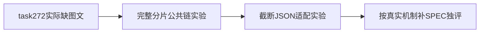

# T1103 联合工具参数机制研究卡

大白话：先查参数有没有被传丢，再决定修传输还是创作方法。原任务保留，当前App可测试。



```research-first-gate/v2
{
  "schema": "research-first-gate/v2",
  "task_id": "T-1099",
  "research_task_id": "T-1103",
  "status": "candidate",
  "problem_statement": "真实Pi已读联合上下文，却反复只交文章，graphic缺失；没有原HTTP字节，无法区分模型漏填与解析截断。",
  "failure_family": "joint-proposal-incomplete-arguments",
  "observed_invariant": "应实际交付同一确认脚本的文章和图文两个完整候选；非法/截断参数不得伪造成已成功交付。",
  "trigger_kinds": [
    "repeated-failure-family",
    "external-capability-unknown"
  ],
  "paused_actions": [
    "further-production-changes",
    "broadened-workaround",
    "repeated-full-system-runs",
    "irreversible-operations"
  ],
  "evidence": {
    "authoritative": [
      {
        "kind": "official-doc",
        "ref": "https://github.com/earendil-works/pi/blob/v0.80.7/packages/ai/README.md",
        "claim": "工具参数流中允许部分对象；须核最终调用。该文档不能证明task272原wire。"
      },
      {
        "kind": "source-code",
        "ref": "ai-worker/src/runtime/pi-provider.ts",
        "claim": "最终toolcall_end把SDK arguments重新JSON.stringify，不是原供应商串。"
      },
      {
        "kind": "approved-spec",
        "ref": "docs/features/t1099-tool-domain-recovery.md",
        "claim": "联合候选及来源/旧任务回放是既有冻结要求。"
      }
    ],
    "local": [
      {
        "kind": "log",
        "path": "docs/features/t1103-pi-joint-argument-diagnosis.md",
        "locator": "当场证据 task272",
        "observation": "真实Pi partial、3次缺参数、零候选；原稿不变。"
      },
      {
        "kind": "code",
        "path": "ai-worker/src/runtime/chat/chat-pi-loop.ts",
        "locator": "streamFn/正式工具dispatch",
        "observation": "Agent只派发ID，真实参数由已结算模型回执恢复；不能只看Agent args={}认定丢参。"
      }
    ],
    "experiments": [
      {
        "question": "完整合法参数分片是否确定性丢末段graphic",
        "command": "见research-observations.json的experiment-1原argv",
        "environment": "本机回环HTTP/PGlite/真实Worker；无用户库或模型供应商",
        "result": "exit0，3 PASS；三根required/properties实发齐全，settled参数逐字，真实proposal成立，旧回放无额外执行",
        "artifact_path": "docs/verification/t1103/research-observations.json",
        "artifact_sha256": "1fb4ccb91afd24fb3df0f3b5f70ee143f48610210bdf2312472b61f335208425"
      },
      {
        "question": "截断JSON与合法缺graphic能否区分",
        "command": "见research-observations.json的experiment-2原argv",
        "environment": "同部署版本Pi 0.80.7与当前provider；5族本机HTTP",
        "result": "exit1，3 PASS/2 FAIL；正常tool_calls和length截断都被补成合法前缀，原finish facts保留；不证明task272原wire",
        "artifact_path": "docs/verification/t1103/research-observations.json",
        "artifact_sha256": "1fb4ccb91afd24fb3df0f3b5f70ee143f48610210bdf2312472b61f335208425"
      }
    ]
  },
  "options": [
    {
      "id": "OPT-TRANSPORT",
      "outcome": "若完整原串经分片后不完整，修机械传输丢字段；若截断原串被修成有效对象，保留原始参数和真实终止事实。",
      "tradeoffs": "需实际区分实验和精确协议审核，不能推定task272一定同因。",
      "scope": "Worker/Pi协议，无创作补字段或放宽来源。",
      "falsified_by": "完整与截断两族皆原串忠实，且实际现场能证明模型从始至终未生成graphic。"
    },
    {
      "id": "OPT-MODEL-METHOD",
      "outcome": "若传输完整，则核模型获知完整schema与调用方法，改善可配置Skill的两稿构造。",
      "tradeoffs": "不能再盲堆提示或编造候选；必须实际供应商完整候选验收。",
      "scope": "已确认联合方法，不改自动视频/采用/权限。",
      "falsified_by": "完整graphic原wire确实生成却在代码中丢失。"
    }
  ],
  "recommendation": "OPT-TRANSPORT",
  "validation": {
    "timebox_minutes": 120,
    "max_experiments": 2,
    "acceptance_criteria": [
      {
        "name": "完整两稿传输忠实",
        "target": "分片与单片相同，真实已结算参数逐字，真实root产ok/proposal",
        "measurement": "隔离真实公共Worker HTTP夹具，完整graphic末段到达",
        "observed": "实验1实际3 PASS；在覆盖输入族内完整参数逐字保留。未冒称实际供应商通过。",
        "verify_key": "t1103_fragmented_joint_preservation",
        "evidence_path": "docs/verification/t1103/research-observations.json",
        "evidence_sha256": "1fb4ccb91afd24fb3df0f3b5f70ee143f48610210bdf2312472b61f335208425"
      },
      {
        "name": "截断参数保持真实",
        "target": "原串/终止事实不被变成完整合法较小对象",
        "measurement": "固定SDK和真实provider适配器接收原不完整JSON及真实length",
        "observed": "实验2实际3 PASS/2 FAIL，截断保真指标未满足；原RED保留，尚无生产修复。",
        "verify_key": "t1103_incomplete_arguments_fidelity",
        "evidence_path": "docs/verification/t1103/research-observations.json",
        "evidence_sha256": "1fb4ccb91afd24fb3df0f3b5f70ee143f48610210bdf2312472b61f335208425"
      }
    ],
    "resume_criteria": "两次实验已用尽；原保真指标仍FAIL，卡不得validated。进入精确兼容修复设计/独評队列，先核旧可安全repair成功输入；不新增第三实验或真实模型任务。"
  },
  "decision_impacts": [
    "none"
  ],
  "decision_ids": []
}
```

任务状态遵循用户AGENTS规定，仅用taskctl block T1099，T1103在研究；未让research-gate直接改状态，也未伪造research_open或已validated。研究四类行为边界照常执行。本卡不代任务、Gate或实现通过。第一实验私有脚本与准备SHA在本机t1103；尚未执行。


## 当场实验结论（2026-10-09）

完整分片链3 PASS，截断参数5例为3 PASS/2 FAIL，所有原断言及失败日志保留。现已证明SDK宽容解析会遮蔽原始不完整串，未证明真实task272因截断而缺图文。未新增第三实验，不将card写成validated；不直接全局换strict parser或新增fail-closed门。T1099仍阻断在真实候选，T1103继续精确兼容设计；T1104是独立的安装诊断缺口修复，不改AI生产代码。
