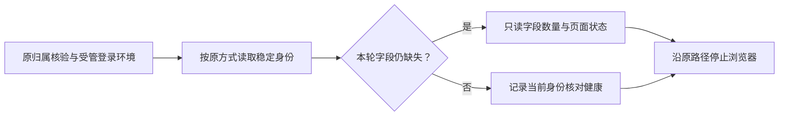

# T1110 · 追加一次身份字段定位的待确认方案

当前两次实验已经用尽。第二次实际运行保留了启动时的旧仪器闭包，修后磁盘候选没有进入执行；本轮定位到 `identityFields/IDENTITY_MISSING`，仍不知道页面为何没有提供合格身份。原任务、研究 OPEN、两次额度、原失败及 0 报表全部保留。

本文件是具体待确认的例外方案，不是新任务、第三阶段或已执行证据。实施方向仍是原 SPEC 的两微信平台本人数据接入。

候选仪器见 [固定字段探针](evidence/t1110-identity/proposed-identity-shape-probe.ts)。它只输出数字和“是/否”，用来区分页面是否离开普通账号首页、是否有明确登录提示、身份元素是否缺失或重复、剪贴字段是否对应，以及可见 Shadow 区域是否有相同元素。不会输出账号 ID、昵称、Cookie、URL、页面正文或截图，不用这些诊断值改变登录判断或绑定身份。

若用户明确允许增加一次：

- 计作同一问题族的第 3 次，不删旧实验、不重置额度、不更名开新族。只允许一个新研究 intent，经真实 `platforms.collections.start`、原账号组/账号、原 nativeCollector 和正常 profile authority 进入；没有第二次提交或自动重试。
- 先确认当前原测试宿主已停止，再冷启动可丢弃研究宿主；在启动前固定所有源码 SHA。启动后不改源，记录新 PID 与实际仪器版本标记，避免旧 bundle 闭包被当成新版本。
- 沿原 `readIdentity` 读取；仅视频号的 `IDENTITY_MISSING` 后增加一次最多 120000ms 的只读形状观察，使用原信号和原 deadline 剩余时间，不续期。观察失败只记固定 unavailable，随后仍抛原错误；成功身份仅记健康并在下载之前主动研究停止。
- 候选集成点尚未应用：在实际 witness 的 `identityFields` 观察 catch 内，仅视频号且原错误是 typed `WechatBrowserSourceError/IDENTITY_MISSING` 时调用；传入实际 `WechatOperationControls`，不能用外层可选 controls 代替。诊断 race 返回不表示物理停止，仍只由原 onStopped 给收据。
- 原 collection62、公众号绑定83不重发。复用原产品自己的隔离 profile，不操作 Ego、不复制或清除凭据、不新建 QR、不下载/解析/提交报表，也不写绑定身份。允许这一明确研究 intent 自身的正常租约、心跳、失败、停止审计；受管浏览器仍可更新自己的会话文件。
- 原生任务原始期限仍为 30 分钟；公开请求至少 120000ms；宿主启动 480000ms。两次研究累计时间仍在原 120 分钟窗口内，不因额外授权重新计时。结束后保真实收据并停止诊断宿主、恢复原测试服务。
- 用户额外授权只允许这一次取证，不自动确认产品通过或接受验收风险。现有工具的 `max_experiments<=2` 限制仍如实记录；不改流程代码、篡改卡的实验数或伪造官方 resume。生产恢复仍须真实项目验证与独立闭合，工具不能表达例外时须明确登记兼容路径及实际失败。

已有授权覆盖实施方向和扫码，未明确回答本次额外实验上限例外。依据 product-to-code-orchestrator 的研究门“卡内最多两次的最小区分性实验”和“两次实验仍无结论时……进入决策队列”，现在先停在可审阅方案；向用户确认一次额外取证是本次对例外边界的处理，并非该技能逐字要求再次确认实施方向。

状态：待用户确认；候选仅静态准备，未编译、测试、启动或访问平台；不能称 PASS/GREEN/CLOSE。

独立审查见 [证据与方案复核](evidence/t1110-identity/exp2-final-and-extra-probe-review.md)。最终候选 SHA256 为 `24015bcca66136d8061623a3ac8281852d6ff086724ad430b36f47fde2037691`，无剩余必修静态问题；集成与执行仍待上述授权。审查不代签运行、机制闭合或产品验收。
