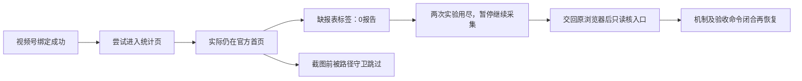
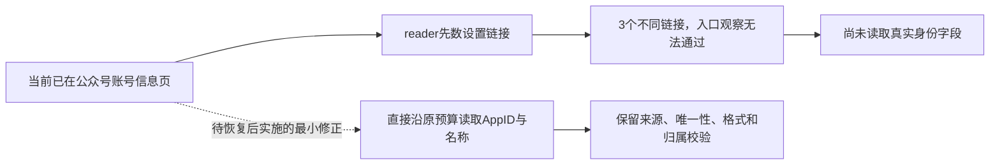
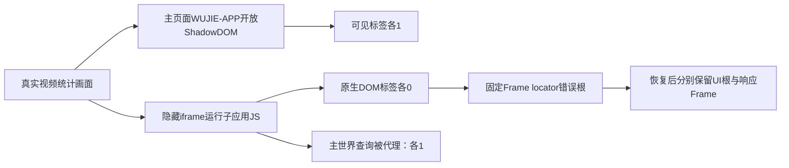

# T-1110 · 视频号统计页可见标签缺口研究卡

> 任务状态只看 BACKLOG；本卡是 BUILD 内的证据分支，research_task_id沿用原T-1110，不建立第二任务权。2026-10-10开始，最多120分钟/2次区分实验。

```research-first-gate/v2
{
  "schema": "research-first-gate/v2",
  "task_id": "T-1110",
  "research_task_id": "T-1110",
  "status": "validated",
  "problem_statement": "原产品profile连续采集0报告，两原生实验定位历史拒绝时仍在官方首页，但该导航原因未知。用户交回原space20后，经实际菜单已进入视频统计页；同一页原生沙箱iframe标签0、主Page可见Wujie ShadowRoot标签1，结合无界与Playwright源码确认当前固定Frame locator选错DOM根。研究恢复只准该机械修复和原验收，不抹去历史首页未知或代签产品profile。",
  "failure_family": "wechat-statistics-visible-section",
  "observed_invariant": "已核对当前稳定身份后，必须进入同官方账号的实际可见统计页、等真实表格窗口更新，才能下载和提交原生报表。原始失败不得伪装登录过期或采集成功。",
  "trigger_kinds": [
    "repeated-failure-family",
    "high-cost-feedback-loop",
    "unsuccessful-intervention-churn"
  ],
  "paused_actions": [
    "further-production-changes",
    "broadened-workaround",
    "repeated-full-system-runs",
    "irreversible-operations"
  ],
  "evidence": {
    "authoritative": [
      {
        "kind": "approved-spec",
        "ref": "docs/features/t1110-wechat-browser-collection.md",
        "claim": "第4/5节及AC-1110-01/02/03要求实际稳定身份、可见表格、原生导出与公共写回；普通导出失败不等于登录过期。"
      },
      {
        "kind": "source-code",
        "ref": "ai-worker/src/runtime/platform/wechat-dom-witness.ts",
        "claim": "reportWitness.prepare按实际同源iframe、唯一可见精确标签观察；当前错误发生在此处，尚未进入日期和下载。"
      },
      {
        "kind": "source-code",
        "ref": "ai-worker/src/runtime/platform/wechat-browser-source.ts",
        "claim": "私图仅显式配置、已核身份视频号prepare typed缺标签时启用；同当前path与loggedOut=false、同原signal/deadline，普通截图失败保留原业务错误。"
      },
      {
        "kind": "official-doc",
        "ref": "https://wujie-micro.github.io/doc/guide/",
        "claim": "正常无界子应用JS在iframe、DOM在主容器webcomponent，iframe document查询代理到webcomponent，支持原生0/代理1差别。"
      },
      {
        "kind": "official-doc",
        "ref": "https://playwright.dev/docs/locators#locate-in-shadow-dom",
        "claim": "默认locator穿透当前根的open Shadow DOM；当前本机bundle的utility frame查询不跳父Page。"
      }
    ],
    "local": [
      {
        "kind": "runtime",
        "path": "docs/verification/t1110/section-failure-20261010.json",
        "locator": "attempt/diagnostic/privateImage",
        "observation": "真实attempt54 failed、0页；五字段0/0/false/complete/162，私有目录PNG/part均0；跳过原因未知。"
      },
      {
        "kind": "log",
        "path": "docs/verification/t1110/product-live-status-20261009.json",
        "locator": "attempts/officialAttempts",
        "observation": "保留全部原失败；视频号已绑定，公众号新task56未收到本次扫码回复而失败，不能代签已登录。"
      },
      {
        "kind": "runtime",
        "path": "docs/research/2026-10-09-channels-native-export.md",
        "locator": "实际操作与本机文件/日期和页面数据的实际校验",
        "observation": "原研究Page原生导出三份CSV成功；属于独立研究环境，不作产品凭据迁移或当前采集证明。"
      },
      {
        "kind": "runtime",
        "path": "docs/verification/t1110/section-research-cleanup-20261010.json",
        "locator": "privateImageDirectories/sharedProductionSource/candidateNextProcessCount",
        "observation": "两次研究候选已停止，已知Next/受管Chrome均0；三处经所有权与0700核验的空私图目录已删除；生产69源码/测试/composition摘要未变，候选未合入。"
      },
      {
        "kind": "runtime",
        "path": "docs/verification/t1110/handback-20261010.json",
        "locator": "official/settingsPage;video/quickLogin",
        "observation": "公众号当前设置页实际3个不同href，index/index/function，reader先要求唯一构成当前反例；发表页1入口。原视频页恢复后显示本人快捷登录，点击返回但120000ms身份观察超时。无新产品任务/导出，旧56和产品0报告未重新回读。"
      },
      {
        "kind": "runtime",
        "path": "docs/verification/t1110/wujie-scope-20261010.json",
        "locator": "space20/p6/value.shadowCounts/frames.nativeCounts/proxyCounts",
        "observation": "实际CDP只读观测官方post统计页：唯一可见open Wujie，三标签各1；同源micro沙箱display:none，原生三标签0、代理三标签1。此项不是Playwright locator.count或产品采集。"
      },
      {
        "kind": "source-code",
        "path": "docs/verification/t1110/wujie-scope-independent-review-20261010.md",
        "locator": "本机 Playwright 查询链/当前反例能证明什么",
        "observation": "独立读本机1.60 bundle与官方机制，确认internal:text/visible默认utility frame document；只穿当前根open shadow。保历史EXP2首页原因未知。"
      }
    ],
    "experiments": [
      {
        "id": "EXP-1",
        "question": "首个prepare typed失败为何未保存私图：路径/登录探针/截图/保存/本地预算？",
        "command": "functions.exec/exec_command实际node --input-type=module heredoc：公开platforms.collections.start [chunk2787e4]；单在途public get；public cancel [chunk464f43]；候选下载前stop点摘要见artifact",
        "environment": "同原隔离产品PGlite/profile权，由单一可丢弃候选Next承载；原生产69源未改，无fixture/凭据复制",
        "result": "当前官方origin/本次固定path的前或后校验不符，未证明是哪一项及拒绝时点。不是截图或保存函数失败；不能声称截图未执行或Cookie掉线。 实际任务cancelled/0，自然stop确认尚缺。",
        "artifact_path": "docs/verification/t1110/section-exp1-result.json",
        "artifact_sha256": "af4786a97ecf132c6d00d2848f9e378c88aa96286aec760c03a335b17e9e99a6"
      },
      {
        "id": "EXP-2",
        "question": "同一实际路径拒绝快照：官方origin、报表pathname、页类、精确固定hash与截图前后时点哪项？",
        "command": "functions.exec/exec_command实际node --input-type=module heredoc：公开platforms.collections.start一次；单在途public get/list；自然terminal reread [chunkcaa621]，候选所有权SIGTERM [chunk026545] 与OS/空私图目录清理 [chunk798822]",
        "environment": "同原隔离产品PGlite/profile authority，经原公开持久任务与正常checkout；单一可丢弃候选，默认关闭私图的显式研究配置；无fixture、Cookie复制或原任务重发",
        "result": "officialOriginMatch=true，reportPathMatch=false，pathCategory=homepage，hashReportPathMatch=false，snapshotPoint=beforeCapture；一次快照，自然failed/EXPORT_FAILED/0。此次未执行截图，未下载或保存报告；不证明为何落首页或登录失效。",
        "artifact_path": "docs/verification/t1110/section-exp2-result.json",
        "artifact_sha256": "9f00dbc0a846e2ccb8acacf4da7f0059a132d488570bac9b2afcfc18b11e8bb5"
      }
    ]
  },
  "options": [
    {
      "id": "OPT-1",
      "outcome": "继续等待隐藏sandbox iframe原生DOM长出报表标签，或重复原生失败取证。",
      "tradeoffs": "已被当前原生0/代理1/可见Shadow1证据淘汰；两次原生研究额度用尽。",
      "scope": "不再实施，不增加原生实验。",
      "falsified_by": "当前官方post页Wujie open Shadow中的三标签各1、沙箱原生DOM各0和官方代理机制。"
    },
    {
      "id": "OPT-2",
      "outcome": "在同原任务的实现中把可见UI locator与子应用runtime/响应Frame分开：用唯一实际可见主Page Wujie根操作标签、日期及下载；仍核官方sandbox来源、真实身份、日期、总数和响应归属。",
      "tradeoffs": "当前scope机制已闭合；旧EXP2首页原因未知，恢复后原公共链仍需实测，失败保原ID/终态而非新研究循环。",
      "scope": "纯DOM机械协议修复，不改用户结果/契约/归属/安全/发布/成本；实iframe降级形态需原可见根校验，不能强显示hidden frame或任取第一项。",
      "falsified_by": "真实主Page/Frame关联不唯一、closed shadow、日期或响应归属不能验证时明确失败；不得扩大路径、清Cookie或猜接口来完成。"
    }
  ],
  "recommendation": "OPT-2",
  "validation": {
    "timebox_minutes": 120,
    "max_experiments": 2,
    "acceptance_criteria": [
      {
        "name": "查明当前首个失败机制",
        "target": "至少一个候选被实际证据淘汰，并取得可重复的页面机制解释",
        "measurement": "原space20/p6当前页仅CDP native/proxy/Shadow同快照计数，加官方机制与本机查询链；配置机制命令实际运行。",
        "observed": "当前错误scope机制明确，淘汰隐藏iframe原生DOM代表真实数据画面解释；实际菜单进入post页已证。EXP2落首页原因仍unknown，产品五报表待验。机制命令实际exit0（c5eba1），不签locator行为或native采集。 补证87db32确认iframe代理返回的三标签节点实际属于同唯一可见ShadowRoot；parent原生Node.getRootNode及ShadowRoot.contains均匹配，原node.getRootNode受无界代理不能作根身份证明。",
        "verify_key": "t1110_wechat_section_mechanism",
        "evidence_path": "docs/verification/t1110/wujie-scope-20261010.json",
        "evidence_sha256": "2434de0b72ca39275cc9d370668cbdefa2eb2edda7a0bc954552390dfe629bc7"
      },
      {
        "name": "保留真实任务和边界",
        "target": "原failed0不重写；不清Cookie、不新QR、不放宽身份、路径、窗口、租约或父期限",
        "measurement": "原实验工件和失败快照内容断言、生产四文件与原69实际Git字节比较、只读脚本动作白名单与当前OPEN lineage；明确历史DB快照时点。",
        "observed": "边界命令实际exit0（a813fe）。原两实验/原54失败0/历史reports0完整保留，生产四文件字节与69一致，当前只读脚本只操作原space20/p6的Runtime DOM读；未重新读取产品DB或签当前Cookie/正式stop收据。",
        "verify_key": "t1110_wechat_section_boundary",
        "evidence_path": "docs/verification/t1110/section-research-cleanup-20261010.json",
        "evidence_sha256": "47c687f85238a3c29658143e2bb6a9dd5ddaa94e91f36fc46ca4d21953d5ffec"
      }
    ],
    "resume_criteria": "当前DOM根机制及边界现场命令已闭合；项目自有full-card完整检查与独立CLOSE评审、原state-lock输入再核后真实actor event-only research_resume，不写BACKLOG，再唯一taskctl resume。恢复不代表原产品/UI验收完成，不重置两实验额度或新建族。"
  },
  "decision_impacts": [
    "none"
  ],
  "decision_ids": [],
  "experiment_plan": [
    {
      "id": "EXP-1",
      "state": "executed-cancelled-after-diagnostic",
      "question": "原typed首份prepare失败为何没保存私图：path/login/probe/capture/save/local-budget？",
      "selectedOption": "OPT-1",
      "sharedProductionUnchanged": true,
      "candidateSha256": "ded9ba42304cbd8f4c617a74e00a794b1870ff76958e6f31cef2163a4c03f0fd",
      "instrumentedSha256": "4937c08b3a94b6a0a1abf9dd2b0f94edf2d6a95b650e6ac42159cdee0042a84d",
      "ownedPort": "原隔离产品公开collections.start→backend持久任务→worker受管profile；原服务停止后单一可丢弃候选服务承载",
      "stoppingPoint": "首次prepare返回前沿原失败；返回成功则RESEARCH_PREPARE_READY_STOP，任何download/submit前停止",
      "maxRuns": 1,
      "publicIntent": "单独newclientRequestId预存，不重发原54、不启动QR或五报表",
      "outcomeRule": "真实typed失败附fixed enum；意外prepare成功即发固定ready marker并throw；任何下载/业务提交前停止，均不称采集通过"
    },
    {
      "id": "EXP-2",
      "state": "executed-natural-failure",
      "question": "当前path拒绝时，origin和report path哪项不符？是前还是后校验？只分类同一时刻的固定页类/hash匹配。",
      "selectedOption": "OPT-2",
      "maxRuns": 1,
      "sharedProductionUnchanged": true,
      "ownedPort": "温和停原候选并核OS退出后，仍经原public task/backend hostRecovery/受管profile正常checkout；拒绝即结束，不抢锁",
      "stoppingPoint": "同原首份prepare失败；成功仍ready marker+throw下载前结束；原samePath真实拒绝时同一page.url快照，只一次fixed bool/enum",
      "outputAllowlist": [
        "officialOriginMatch",
        "reportPathMatch",
        "pathCategory: homepage|report|login|other|unknown",
        "hashReportPathMatch: 精确固定route",
        "snapshotPoint: beforeCapture|afterCapture"
      ],
      "privateGuard": "不改截图origin/path/login guard，不输出raw URL/path/query/hash/body/身份/Cookie，不用force/新QR/研究profile",
      "publicIntent": "本次唯一新clientRequestId预存，不重发EXP1/原54，领取失败或停止不明即结束",
      "instrumentedSha256": "4c0343030348f5aa350c6ded4043827c8e8787b2dbb1e0cc0c13a39b0355cd30",
      "artifact_path": "docs/verification/t1110/section-exp2-result.json",
      "artifact_sha256": "9f00dbc0a846e2ccb8acacf4da7f0059a132d488570bac9b2afcfc18b11e8bb5"
    }
  ]
}
```

实际状态（2026-10-10本地时间）：视频号已绑定，公众号仍未完成产品绑定；当前产品原生报告0份。EXP-1取消、EXP-2自然失败，两次实验已用尽。已定位落在官方首页；未定位跳转原因，研究门仍OPEN、卡仍researching。原浏览器空间20仍由用户控制，等待交回后只读取证。



流程兼容：用户AGENTS要求状态转换只经taskctl。先实际taskctl block，再以明确真实actor登记OPEN事件，官方observe在已有OPEN分支只记录真实观测，不写状态。未调用手改状态、未伪造research-gate actor、未将audit当作validated或PASS；resume同样必须保留唯一状态写入口，不自动绕过用户规则。

2026-10-10续接只读证据：用户答复“继续”后，实际takeOver原空间20，公众号p1普通账号信息页可读单一稳定身份且原SHA匹配，不能代签产品绑定。视频号原用户来源标签页p6的evaluate安全超时，execution stopped未确认；原页reload沿120000ms也实际超时。公众号p3菜单计数改用Runtime 120000/request 150000的CDP只读读取，仍RequestTimeout且没有结果；未证明链接歧义或原56根因。详见docs/verification/t1110/readonly-continuation-20261010.json及oa-entry-source-review-20261010.md。两个原生实验额度不变，未创建第三次采集/QR/空间；生产未改，卡仍researching，等待人工恢复原浏览器页面。

2026-10-10用户答复“已经交还了”后的实际补证：原空间20已takeOver。公众号p3发表页读到唯一设置入口，但p1当前账号信息页实际有3个不同完整设置URL，三个可见菜单的action分别为index/index/function，同时AppID标签数量为1。当前reader无条件先要求设置URL唯一，故p1构成当前入口阶段的确定反例；仅筛index仍有2个URL，不解决问题。最小方案是当前已在官方settingpage时直接沿原字段预算观察真实AppID/名称，其他页保持原入口链。此方案经静态独立核对，尚未改生产或执行必要TDD；不倒签旧产品56原因、绑定或研究PASS。事实见[交回后的记录](../verification/t1110/handback-20261010.json)，边界与必要TDD见[独立核对](../verification/t1110/oa-current-page-review-20261010.md)。



视频号p6首次CDP读取仍超时，截图返回Internal error；在同一原标签页普通goto官方首页后页面恢复响应。正文包含“数据中心”不等于可见已登录菜单：现场可见框架是qrconnect，截图与语义快照显示本人的“微信快捷登录”入口。这轮仅沿原登录授权进入该入口，不创建产品扫码或原生采集任务；当前原产品Cookie是否有效未重新读取，不能由研究页状态判断。研究门仍OPEN、两次原生实验额度不变；为什么原产品导航落首页仍待验。

快捷登录后实际结果：点击调用返回、无同步dialog或popup；原身份元素可见等待120000ms超时。新语义快照仍是本人微信快捷登录入口，不签助手已登录或Cookie失效。需交回原窗口，请用户手动完成这一步后继续核菜单。没有重试点击、产品扫码或原生导出。


2026-10-10新只读机制闭合：用户手动登录后原space20/p6已经进入本人后台（身份摘要与原稳定ID一致，ef9887）；实际点击数据中心/视频数据（db7bac/5c755f），正确120000ms waitForURL完成（1a9ffe）。5c755f的waitUntil未知参数TypeError原样保留，不能算等待PASS。当前统计页可见WUJIE-APP里三标签各1；对应iframe的原生document三标签均0、代理document各1（c51212）。原生0/代理1差别与无界官方机制、本机Playwright内置utility locator查询链一致。

现场只读验证脚本曾因Ego日志输出stderr而没捕获结果，实际断言失败记录758563/91f693/77fbf4/b7036d，不冒称通过；后按实际stderr接收修正，c5eba1返回exit0；边界命令a813fe返回exit0。这些只读测量不下载/扫码/新建task或空间，不计为第三native实验。历史EXP2落首页原因仍UNKNOWN，原产品最后公开回读仍2026-10-09T17:23:42Z的0报告。卡validated仅表示当前机械选择已获证据与实际只读检查，恢复前仍需完整检查、独立CLOSE评审及taskctl状态入口。



独立验证器的输入冻结和错误脱敏反例由collection_audit在/tmp实际复现；已补生产四文件及本地authoritative路径冻结、两个精确只读命令、固定异常提示和固定path类别。原沙箱body或元素方法受代理，81c71f/2f954c的普通getRootNode不等于真实所属根；0c1055及87db32的parent原生Node方法和ShadowRoot.contains确认实际三标签同根。此补证仍只读原Page，不是第三native实验。
