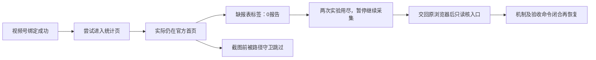
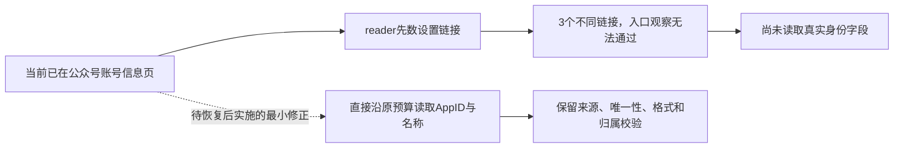

# T-1110 · 视频号统计页可见标签缺口研究卡

> 任务状态只看 BACKLOG；本卡是 BUILD 内的证据分支，research_task_id沿用原T-1110，不建立第二任务权。2026-10-10开始，最多120分钟/2次区分实验。

```research-first-gate/v2
{
  "schema": "research-first-gate/v2",
  "task_id": "T-1110",
  "research_task_id": "T-1110",
  "status": "researching",
  "problem_statement": "研究环境曾原生导出成功，产品独立profile已真实绑定视频号，但连续实际采集0报告。两次窄实验已定位：目标统计页标签缺失时仍在官方首页，私图在截图前被路径守卫跳过；为何导航落到首页及可复验的安全进入方式仍未知。",
  "failure_family": "wechat-statistics-visible-section",
  "observed_invariant": "已核对当前稳定身份后，必须进入同官方账号的实际可见统计页、等真实表格窗口更新，才能下载和提交原生报表。原始失败不得伪装登录过期或采集成功。",
  "trigger_kinds": [
    "repeated-failure-family",
    "high-cost-feedback-loop",
    "unsuccessful-intervention-churn"
  ],
  "paused_actions": [
    "further-production-changes",
    "broadened-workaround",
    "repeated-full-system-runs",
    "irreversible-operations"
  ],
  "evidence": {
    "authoritative": [
      {
        "kind": "approved-spec",
        "ref": "docs/features/t1110-wechat-browser-collection.md",
        "claim": "第4/5节及AC-1110-01/02/03要求实际稳定身份、可见表格、原生导出与公共写回；普通导出失败不等于登录过期。"
      },
      {
        "kind": "source-code",
        "ref": "ai-worker/src/runtime/platform/wechat-dom-witness.ts",
        "claim": "reportWitness.prepare按实际同源iframe、唯一可见精确标签观察；当前错误发生在此处，尚未进入日期和下载。"
      },
      {
        "kind": "source-code",
        "ref": "ai-worker/src/runtime/platform/wechat-browser-source.ts",
        "claim": "私图仅显式配置、已核身份视频号prepare typed缺标签时启用；同当前path与loggedOut=false、同原signal/deadline，普通截图失败保留原业务错误。"
      }
    ],
    "local": [
      {
        "kind": "runtime",
        "path": "docs/verification/t1110/section-failure-20261010.json",
        "locator": "attempt/diagnostic/privateImage",
        "observation": "真实attempt54 failed、0页；五字段0/0/false/complete/162，私有目录PNG/part均0；跳过原因未知。"
      },
      {
        "kind": "log",
        "path": "docs/verification/t1110/product-live-status-20261009.json",
        "locator": "attempts/officialAttempts",
        "observation": "保留全部原失败；视频号已绑定，公众号新task56未收到本次扫码回复而失败，不能代签已登录。"
      },
      {
        "kind": "runtime",
        "path": "docs/research/2026-10-09-channels-native-export.md",
        "locator": "实际操作与本机文件/日期和页面数据的实际校验",
        "observation": "原研究Page原生导出三份CSV成功；属于独立研究环境，不作产品凭据迁移或当前采集证明。"
      },
      {
        "kind": "runtime",
        "path": "docs/verification/t1110/section-research-cleanup-20261010.json",
        "locator": "privateImageDirectories/sharedProductionSource/candidateNextProcessCount",
        "observation": "两次研究候选已停止，已知Next/受管Chrome均0；三处经所有权与0700核验的空私图目录已删除；生产69源码/测试/composition摘要未变，候选未合入。"
      },
      {
        "kind": "runtime",
        "path": "docs/verification/t1110/handback-20261010.json",
        "locator": "official/settingsPage;video/quickLogin",
        "observation": "公众号当前设置页实际3个不同href，index/index/function，reader先要求唯一构成当前反例；发表页1入口。原视频页恢复后显示本人快捷登录，点击返回但120000ms身份观察超时。无新产品任务/导出，旧56和产品0报告未重新回读。"
      }
    ],
    "experiments": [
      {
        "id": "EXP-1",
        "question": "首个prepare typed失败为何未保存私图：路径/登录探针/截图/保存/本地预算？",
        "command": "functions.exec/exec_command实际node --input-type=module heredoc：公开platforms.collections.start [chunk2787e4]；单在途public get；public cancel [chunk464f43]；候选下载前stop点摘要见artifact",
        "environment": "同原隔离产品PGlite/profile权，由单一可丢弃候选Next承载；原生产69源未改，无fixture/凭据复制",
        "result": "当前官方origin/本次固定path的前或后校验不符，未证明是哪一项及拒绝时点。不是截图或保存函数失败；不能声称截图未执行或Cookie掉线。 实际任务cancelled/0，自然stop确认尚缺。",
        "artifact_path": "docs/verification/t1110/section-exp1-result.json",
        "artifact_sha256": "af4786a97ecf132c6d00d2848f9e378c88aa96286aec760c03a335b17e9e99a6"
      },
      {
        "id": "EXP-2",
        "question": "同一实际路径拒绝快照：官方origin、报表pathname、页类、精确固定hash与截图前后时点哪项？",
        "command": "functions.exec/exec_command实际node --input-type=module heredoc：公开platforms.collections.start一次；单在途public get/list；自然terminal reread [chunkcaa621]，候选所有权SIGTERM [chunk026545] 与OS/空私图目录清理 [chunk798822]",
        "environment": "同原隔离产品PGlite/profile authority，经原公开持久任务与正常checkout；单一可丢弃候选，默认关闭私图的显式研究配置；无fixture、Cookie复制或原任务重发",
        "result": "officialOriginMatch=true，reportPathMatch=false，pathCategory=homepage，hashReportPathMatch=false，snapshotPoint=beforeCapture；一次快照，自然failed/EXPORT_FAILED/0。此次未执行截图，未下载或保存报告；不证明为何落首页或登录失效。",
        "artifact_path": "docs/verification/t1110/section-exp2-result.json",
        "artifact_sha256": "9f00dbc0a846e2ccb8acacf4da7f0059a132d488570bac9b2afcfc18b11e8bb5"
      }
    ]
  },
  "options": [
    {
      "id": "OPT-1",
      "outcome": "在可丢弃候选中只运行一次原首份日报失败路径，新增固定内部取证状态，区分currentpath/login/probe/capture/save/local-budget；取得实际图后才能判页面原因。",
      "tradeoffs": "最多一次同原产品所有权的窄运行，可能仍只定位诊断跳过，不能直接修复页面。",
      "scope": "只研究候选与内部有限枚举；默认关闭，不扩大路径、权限、公共DTO、Cookie或报表范围。",
      "falsified_by": "当场状态仍缺失/不可区分，或不能保持原失败、父取消/期限和单任务权。"
    },
    {
      "id": "OPT-2",
      "outcome": "若现有只读源/配置证据已能证明机制，则依据证据做一个机械对照，不增加原生导出运行。",
      "tradeoffs": "无用户页面控制时不能以研究页现状代签产品profile；静态推断不足就保持阻塞。",
      "scope": "同一已授权profile、原任务链的读证；第二实验仅围绕第一结果，不能变全报表/新QR/新浏览器。",
      "falsified_by": "候选解释与当场页面/原任务证据不一致，或需要放宽原身份、登录、日期或归属保护。"
    }
  ],
  "recommendation": "OPT-2；两次区分实验已用尽，保持researching与原任务暂停。仅等待用户交回原浏览器空间后只读核对实际菜单入口，不进行第三次原生采集实验。",
  "validation": {
    "timebox_minutes": 120,
    "max_experiments": 2,
    "acceptance_criteria": [
      {
        "name": "查明当前首个失败机制",
        "target": "至少一个候选被实际证据淘汰，并取得可重复的页面机制解释",
        "measurement": "窄实验固定状态/私图或只读机械证据，记录artifact+SHA和现场验收命令",
        "observed": "部分定位：EXP-2证明同一失败快照为官方首页，截图前路径拒绝，淘汰此轮截图或保存故障解释；为何导航到首页、可复验的安全进入机制和现场verify_key命令仍缺失，不满足恢复条件。",
        "verify_key": "t1110_wechat_section_mechanism",
        "evidence_path": "docs/verification/t1110/section-exp2-result.json",
        "evidence_sha256": "9f00dbc0a846e2ccb8acacf4da7f0059a132d488570bac9b2afcfc18b11e8bb5"
      },
      {
        "name": "保留真实任务和边界",
        "target": "原failed0不重写；不清Cookie、不新QR、不放宽身份、路径、窗口、租约或父期限",
        "measurement": "研究candidate差异与真实attempt/内部状态/停止证据",
        "observed": "实际原54仍failed/0、公众号56 failed/null、reports.list 0；生产69源码未变，候选未合入；EXP-1明确取消而非自然失败，EXP-2正常checkout后自然failed；临时候选服务和空私图目录已清理。现场verify_key未配置或执行，不代签研究验收。",
        "verify_key": "t1110_wechat_section_boundary",
        "evidence_path": "docs/verification/t1110/section-research-cleanup-20261010.json",
        "evidence_sha256": "47c687f85238a3c29658143e2bb6a9dd5ddaa94e91f36fc46ca4d21953d5ffec"
      }
    ],
    "resume_criteria": "两项证据和现场research_verify_commands均闭合、研究卡validated后才能关闭研究门并走原审核/TDD/UI门；两次实验或120分钟仍未知则停止扩题、保持待验，不宣称产品已跑通。"
  },
  "decision_impacts": [
    "none"
  ],
  "decision_ids": [],
  "experiment_plan": [
    {
      "id": "EXP-1",
      "state": "executed-cancelled-after-diagnostic",
      "question": "原typed首份prepare失败为何没保存私图：path/login/probe/capture/save/local-budget？",
      "selectedOption": "OPT-1",
      "sharedProductionUnchanged": true,
      "candidateSha256": "ded9ba42304cbd8f4c617a74e00a794b1870ff76958e6f31cef2163a4c03f0fd",
      "instrumentedSha256": "4937c08b3a94b6a0a1abf9dd2b0f94edf2d6a95b650e6ac42159cdee0042a84d",
      "ownedPort": "原隔离产品公开collections.start→backend持久任务→worker受管profile；原服务停止后单一可丢弃候选服务承载",
      "stoppingPoint": "首次prepare返回前沿原失败；返回成功则RESEARCH_PREPARE_READY_STOP，任何download/submit前停止",
      "maxRuns": 1,
      "publicIntent": "单独newclientRequestId预存，不重发原54、不启动QR或五报表",
      "outcomeRule": "真实typed失败附fixed enum；意外prepare成功即发固定ready marker并throw；任何下载/业务提交前停止，均不称采集通过"
    },
    {
      "id": "EXP-2",
      "state": "executed-natural-failure",
      "question": "当前path拒绝时，origin和report path哪项不符？是前还是后校验？只分类同一时刻的固定页类/hash匹配。",
      "selectedOption": "OPT-2",
      "maxRuns": 1,
      "sharedProductionUnchanged": true,
      "ownedPort": "温和停原候选并核OS退出后，仍经原public task/backend hostRecovery/受管profile正常checkout；拒绝即结束，不抢锁",
      "stoppingPoint": "同原首份prepare失败；成功仍ready marker+throw下载前结束；原samePath真实拒绝时同一page.url快照，只一次fixed bool/enum",
      "outputAllowlist": [
        "officialOriginMatch",
        "reportPathMatch",
        "pathCategory: homepage|report|login|other|unknown",
        "hashReportPathMatch: 精确固定route",
        "snapshotPoint: beforeCapture|afterCapture"
      ],
      "privateGuard": "不改截图origin/path/login guard，不输出raw URL/path/query/hash/body/身份/Cookie，不用force/新QR/研究profile",
      "publicIntent": "本次唯一新clientRequestId预存，不重发EXP1/原54，领取失败或停止不明即结束",
      "instrumentedSha256": "4c0343030348f5aa350c6ded4043827c8e8787b2dbb1e0cc0c13a39b0355cd30",
      "artifact_path": "docs/verification/t1110/section-exp2-result.json",
      "artifact_sha256": "9f00dbc0a846e2ccb8acacf4da7f0059a132d488570bac9b2afcfc18b11e8bb5"
    }
  ]
}
```

实际状态（2026-10-10本地时间）：视频号已绑定，公众号仍未完成产品绑定；当前产品原生报告0份。EXP-1取消、EXP-2自然失败，两次实验已用尽。已定位落在官方首页；未定位跳转原因，研究门仍OPEN、卡仍researching。原浏览器空间20仍由用户控制，等待交回后只读取证。



流程兼容：用户AGENTS要求状态转换只经taskctl。先实际taskctl block，再以明确真实actor登记OPEN事件，官方observe在已有OPEN分支只记录真实观测，不写状态。未调用手改状态、未伪造research-gate actor、未将audit当作validated或PASS；resume同样必须保留唯一状态写入口，不自动绕过用户规则。

2026-10-10续接只读证据：用户答复“继续”后，实际takeOver原空间20，公众号p1普通账号信息页可读单一稳定身份且原SHA匹配，不能代签产品绑定。视频号原用户来源标签页p6的evaluate安全超时，execution stopped未确认；原页reload沿120000ms也实际超时。公众号p3菜单计数改用Runtime 120000/request 150000的CDP只读读取，仍RequestTimeout且没有结果；未证明链接歧义或原56根因。详见docs/verification/t1110/readonly-continuation-20261010.json及oa-entry-source-review-20261010.md。两个原生实验额度不变，未创建第三次采集/QR/空间；生产未改，卡仍researching，等待人工恢复原浏览器页面。

2026-10-10用户答复“已经交还了”后的实际补证：原空间20已takeOver。公众号p3发表页读到唯一设置入口，但p1当前账号信息页实际有3个不同完整设置URL，三个可见菜单的action分别为index/index/function，同时AppID标签数量为1。当前reader无条件先要求设置URL唯一，故p1构成当前入口阶段的确定反例；仅筛index仍有2个URL，不解决问题。最小方案是当前已在官方settingpage时直接沿原字段预算观察真实AppID/名称，其他页保持原入口链。此方案经静态独立核对，尚未改生产或执行必要TDD；不倒签旧产品56原因、绑定或研究PASS。事实见[交回后的记录](../verification/t1110/handback-20261010.json)，边界与必要TDD见[独立核对](../verification/t1110/oa-current-page-review-20261010.md)。



视频号p6首次CDP读取仍超时，截图返回Internal error；在同一原标签页普通goto官方首页后页面恢复响应。正文包含“数据中心”不等于可见已登录菜单：现场可见框架是qrconnect，截图与语义快照显示本人的“微信快捷登录”入口。这轮仅沿原登录授权进入该入口，不创建产品扫码或原生采集任务；当前原产品Cookie是否有效未重新读取，不能由研究页状态判断。研究门仍OPEN、两次原生实验额度不变；为什么原产品导航落首页仍待验。

快捷登录后实际结果：点击调用返回、无同步dialog或popup；原身份元素可见等待120000ms超时。新语义快照仍是本人微信快捷登录入口，不签助手已登录或Cookie失效。需交回原窗口，请用户手动完成这一步后继续核菜单。没有重试点击、产品扫码或原生导出。
