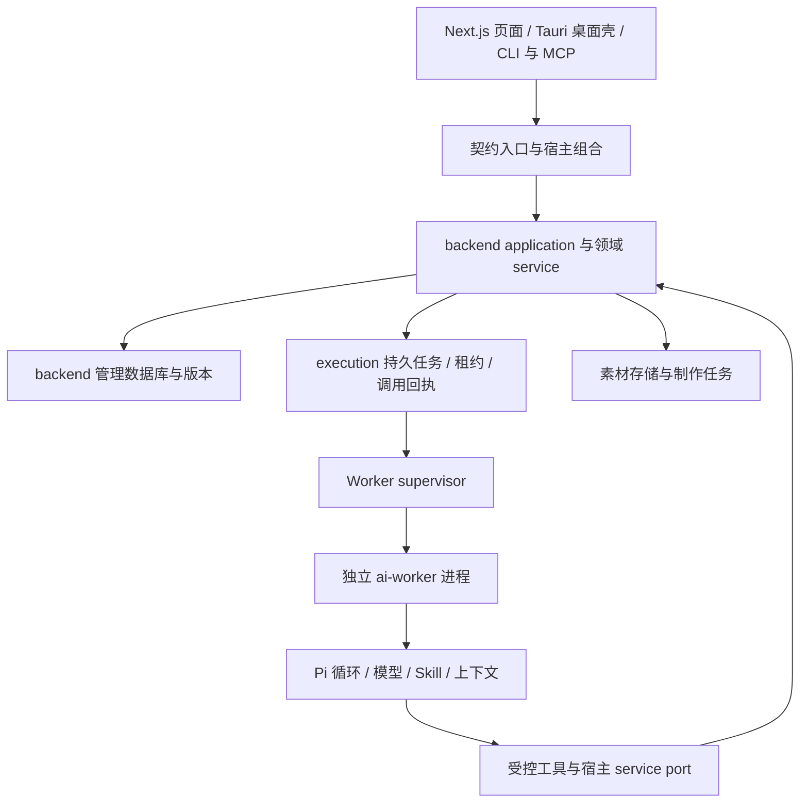

# T-946 Agent 架构对照与工程分工

## 范围与证据

用户希望了解当前架构，对比本地 NomiFun，得到 Agent、目录与工程分工建议。本轮只读产品源码，输出建议，不迁移目录、不改产品代码、不调用真实模型、不改用户数据。

核对版本：CreatorOS `35eb28c1`；NomiFun `e27bd5de`。两者均读取当前工作树，版本号不代表工作树完全无修改。已有对照报告只作线索，本轮重新核对关键源码。

结论：保留 TypeScript monorepo、Pi 和现有业务资产；重点收敛运行时边界、统一入口、数据安全和业务验收。不要为了学习 NomiFun 把系统改写为 Rust、复制其全部 crate，或立即增加第二引擎和多智能体调度。

## 当前实际架构



- `contract/`：Zod 输入输出、业务操作和 Worker IPC 合同。
- `frontend/`：Next.js UI，以及历史遗留宿主装配；`frontend/src-tauri/` 是 Rust 桌面外壳。不能把 frontend 目录全部理解为浏览器代码。
- `backend/src/modules/`：账号、定位、项目、候选、素材、雷达、制作、发布等领域服务；`backend/src/application/` 组合跨领域用例。
- `backend/src/modules/execution/`：持久执行权、租约、调用账本、恢复、Worker 监督。`execution_tasks` 和 `ai_tasks` 分别承担执行权与业务结果投影，建议保留角色区别，避免两个状态源竞争。
- `ai-worker/`：Pi、模型调用、聊天与结构化节点、后台工作；通过 IPC service ports 回到 backend，不直接写领域库。
- `mcp-server/` 与 CLI：外部操作入口，应与页面调用同一业务能力。
- `orchestrator/`：开发流程、任务和工程检查，不能作为产品用户任务的运行时队列。

当前问题的证据：

1. `frontend/src/server/persistence-client.ts` 6014 行，混合大量业务 service、数据库初始化与 Worker 装配。行数本身不是缺陷，但这些职责集中使启动和变更影响范围难控制。
2. 本轮 boundary-scan 返回 7 条违规（基线 5）：6 条 SDK 边界、1 条跨模块 repository。两条超基线来自 `live-chat-session.ts`。这证明边界尚未清零，不证明浏览器运行了整个模型引擎；需要区分 UI 协议依赖和真正的网络调用。
3. `chat-pi-loop.ts` 已接上下文窗口策略与恢复；窗口预算仍为 240000 字符，不是按每个模型 tokenizer 精确计算。
4. `chat-assembly.ts` 已接 `skill.read/history.read/tool.result.read`；不能沿用早期“完全没有按需 Skill”的结论。
5. T-934/T-935 等验收仍有欠账，不能把某一个入口成功推定为页面、CLI、恢复入口都一致。
6. T-917 记录测试调用存储迁移后清理了真实媒体；刚发生的 T-945 是原视频缺失。两者有相关线索，尚未逐文件证明因果，数据恢复也未完成。

## NomiFun 对照

| 维度 | NomiFun 当前可见机制 | CreatorOS 的取舍 |
|---|---|---|
| 应用装配 | `nomifun-app` 组合 host、service、router | 将宿主组合从 frontend 大文件抽出；业务仍留 backend |
| Agent 接入 | `nomifun-ai-agent` 管 factory、manager、session、runtime handle；有 Pi 和 Codex adapter | 保留一个明确的 Agent 接口和当前 Pi 实现，先不增加引擎 |
| 能力入口 | Gateway 将授权的 MCP 工具注册进引擎 | 统一业务工具契约与执行适配；内部 IPC 可以保留，无须全改 MCP |
| 工作方法 | factory/support 将技能挂载到引擎目录，按需读 SKILL.md | 现有可编辑 Skill 和冻结快照继续使用；磁盘内置默认与账号覆盖须有明确优先级 |
| 持续执行 | 会话生命周期、工具进度、长度截断续跑；并非无限自动成功 | 单一任务恢复、可取消、回执重放；将运行结束与业务完成分开 |
| 工具长结果 | Pi sidecar 结果适配器，进度回调可续延等待 | 继续用已有分页结果读取，补真实长任务验收 |
| 模块组织 | 领域 crate + app host + runtime bridge | 学职责边界，不复制 crate 数量或语言；模块也不必各自部署成服务 |

对方文档存在历史数量和引擎描述差异，本轮以 factory/manager 的代码为准。不根据截图或架构判断哪一方模型更聪明，也没有完成同模型效果对比。

## 建议的运行原则

一个主编导 Agent 理解目标、挑选 Skill、选择工具、根据回执调整计划。找对标、写稿、改写、剪辑策略先作为同一 Agent 的方法，只有可以独立验收且确实能并行的子任务才派发独立 Agent。工程开发分工不等于产品运行时要启动同样数量的 Agent。

Agent 自主决定研究和创作步骤；下载、转码、渲染、文件校验由可恢复的确定性作业执行。当前授权范围内的动作无需反复确认；采纳候选、发布和删除由 backend 按具体操作权限落实。Skill 不能通过文字绕过权限，也不应该重复实现数据库或供应商调用。

一次任务固定记录：原始目标、账号/项目、模型与 Skill 版本、输入版本、子调用 ID、结果/错误、产物引用、恢复点。已确定失败可按原因退避；结果未知的外部副作用先查询原请求，不盲重发；无进展、等待输入和取消分别处理。不要把模型 stop、工具 HTTP 200 或生成卡片当成目标达成。

上下文分四类：当前用户目标；服务读取的当前项目真相；可分页的任务历史/证据；有出处的长期偏好/复盘经验。执行写操作前仍重读当前版本；历史冻结上下文不能覆盖新稿。先用目录与按需读取，再按模型窗口管理压缩；压缩必须保留约束、未完步骤和证据指针。

## 建议目录（目标示意，不是已执行搬迁）

```text
apps/
  desktop/                 # 从 frontend/src-tauri 迁入：窗口、启动、安装更新
  web/                     # 从 frontend 迁入：页面与交互，薄传输入口
  host/                    # 宿主装配、配置、资源生命周期；复用 backend 服务
  agent-worker/            # Worker 启动入口，不含第二套业务服务
  cli/                     # 命令行适配
  mcp-server/              # MCP 适配
packages/
  contract/                # 操作、事件、工具与 IPC schema
  backend/
    application/           # 跨领域用例组合
    modules/               # 现有业务领域，service/repository/transport
    execution/             # 唯一任务账本、租约、恢复与 supervisor
  agent-runtime/
    engine/pi/             # 唯一引擎实现
    context/               # 上下文、压缩、证据续读
    skills/                # 目录、加载、版本冻结
    tools/                 # 工具适配，调用 service port
    delivery/              # 交付自检接口，区分机械校验与语义质量
  media-runtime/           # 渲染、ASR、本地资源与子进程适配
  storage/                 # 文件写入、校验、引用解析、迁移、回收
skills/                    # 内置方法默认版本；不是第二套账号配置真相
  benchmark-research/
  script-writing/
  script-rewrite/
  video-direction/
evals/                     # 固定输入、基准输出、盲评规则、回归结果
  cases/
  rubrics/
  runners/
infra/                     # 双平台打包、安装验证与运行依赖
orchestrator/              # 开发流程工件
```

各 app/package 是代码职责，不默认等于独立网络服务。backend 是领域数据唯一写入者，storage 只负责文件机制且由 backend 维护业务关联。开发开始可先在现有路径内理清接口；目录移动随后按消费者迁移，禁止同时复制出两套 runtime、工具或状态源。

用户文件另有一套物理目录：`media/` 放长期素材，`workspaces/<taskId>/` 放可回收任务中间物，`cache/` 放可重建数据，`exports/` 放已交付成片，日志另放。测试必须从构造入口注入独立临时根，缺配置直接拒绝测试启动，不回退真实用户路径。清理只能清自己创建并登记的临时资源。素材记录需能校验文件是否存在，迁移要可恢复、可校验，不能先删原目录再赌新目录可用。

## 工程分工与验收

| 工程职责 | 主要负责 | 必须交出的证据 |
|---|---|---|
| 产品/编导方法 | 内容类型、Skill、对标与稿件质量标准 | 同输入盲评；流量/信任/获客目标与表达形式分开 |
| Agent Runtime | Pi、上下文、工具协议、模型兼容 | 多步任务、截断续接、工具失败、取消与恢复回归 |
| 后端/任务 | 用例、版本、权限、任务账本和幂等 | 页面/CLI 相同输入得到相同业务结果；无重复副作用 |
| 媒体/存储 | 原视频、素材关联、ASR、渲染、文件生命周期 | 旧成功案例、缺文件诊断、重启恢复、成片可播放 |
| 客户端 | 编辑与采纳、真实进度、失败恢复入口 | 刷新/切页不丢任务，显示状态与后端一致 |
| 集成/质量/发布 | 契约、整链验收、隔离环境、双平台包 | 干净安装实际跑通，测试触达真实媒体根被阻止 |

这是六种责任，不要求六个人。小团队可以兼岗，但每个契约和目录只设一个主责任人；跨层改动由一个集成人最终验证。开发 Agent 并行时按互不冲突目录和契约分工，不能各自实现一份队列/工具/错误状态。

验收案例至少覆盖：有来源的对标清单；不同内容目的的同主题稿件；只改选中段且事实不漂移；长任务重启恢复；素材缺失可诊断；上一版可成功视频继续成功。对比模型时固定模型/档位、输入、Skill、工具可用性，再分别衡量成功率、事实错误、人工介入、耗时和成本，避免把模型变化误记为架构收益。

## 实施依赖与本轮限制

推荐从统一公共用例与宿主装配边界入手，继而集中 runtime 接口与文件生命周期，最后以旧案例和安装包端到端验证；这是依赖顺序，不是缩减用户确认范围。业务模块和历史数据保留，逐个调用链切换，避免全量重写。真正实施前须有具体迁移 SPEC 和独立评审。本报告是建议，不宣称新架构已落地。

本轮只做代码/文档审计及 boundary-scan，无产品行为修改，未运行模型 A/B 或渲染。任务包编译因缺 task binding 未通过，因此未派发子代理；不把并行评审记录为通过。既有全局工程对账欠债仍由 T-916 跟踪。

## 主要出处

- CreatorOS：`pnpm-workspace.yaml`、`orchestrator/SYSTEM_ARCHITECTURE.md`、`frontend/src/server/persistence-client.ts`。
- CreatorOS：`backend/src/modules/execution/worker-supervisor.ts`、`ai-worker/src/execution/chat-worker-run.ts`、`ai-worker/src/runtime/chat/chat-pi-loop.ts`、`backend/src/modules/ai-runtime/chat-assembly.ts`。
- CreatorOS：`docs/verification/t932-runtime-alignment.md`、`docs/research/evidence/t915/2026-09-06-media-test-incident.md`。
- NomiFun：`crates/backend/nomifun-ai-agent/src/factory/{pi,codex,support}.rs`、`crates/backend/nomifun-ai-agent/src/manager/pi/agent.rs`、`apps/pi-sidecar/src/nomifun-gateway.ts`、`docs/architecture/backend-crates.md`。
- 外部原则交叉核对：[Anthropic：Building effective agents](https://www.anthropic.com/engineering/building-effective-agents)。其区分固定工作流与模型自主工具循环，建议按实际需要增加复杂度；这支持本报告保留确定性媒体作业、按需使用 Agent 的取舍，不构成两产品效果比较证据。
