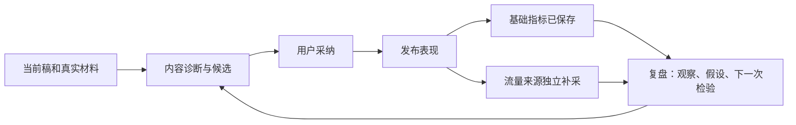
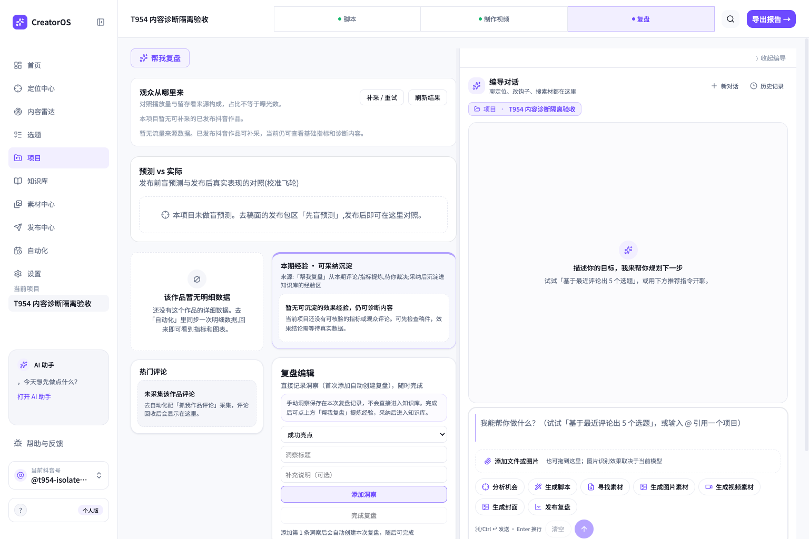
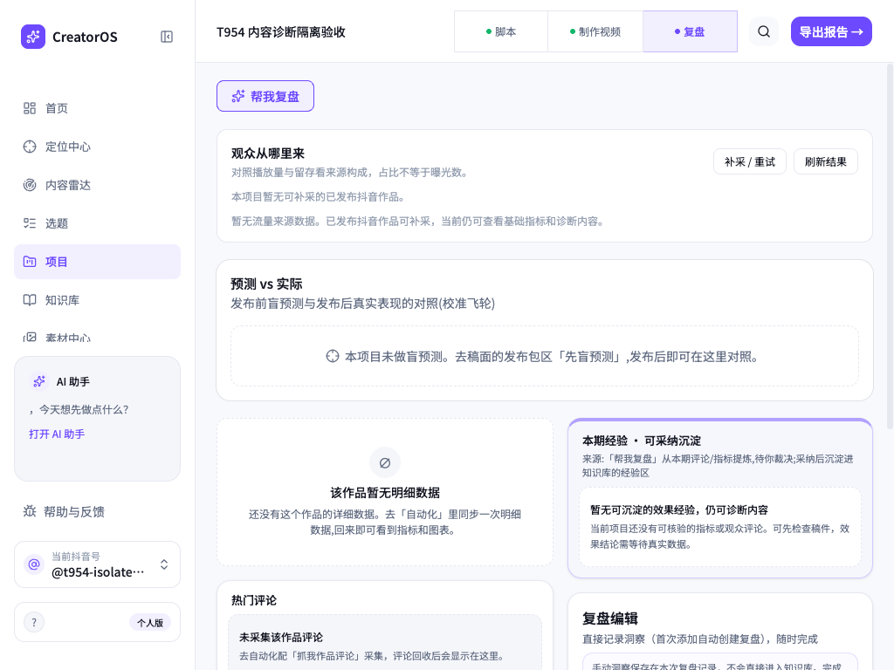

# T-954 实施与验证记录

2026-09-11，基于 `f292a947` 实施。所有数据库测试使用隔离内存库或 Playwright 新建临时目录，没有迁移或修改用户真实库、媒体、登录会话。未打包或安装。

## 具体交付

选题卡显示受众处境、观看收益与证据，稿面提供三个内容诊断入口。保存失败不发送旧稿，保存成功后绑定真实稿件版本；自由诊断不被旧 URL 的 `script.patch` 劫持。既有 Pi loop、可配置方法、局部候选采纳仍为执行主干。

本人作品的推荐页等流量来源单独补采、存储、展示并进入复盘输入；缺值不是零，统计窗口未知就明示未知。20 条一批交还执行权，逐条持久断点；千条作品不会因为普通三次尝试预算耗尽而无法继续。等待登录、暂停与恢复沿原任务。跨日并发复用与持久唤醒补偿已接入。

复盘区分观察、假设和下条实验，允许没有可沉淀经验。聊天和持久执行均接受空经验的有效报告；用户采纳时验证项目归属并保存依据、适用条件。

## 已发生的验证

| 检查 | 结果与边界 |
|---|---|
| 稿面动作、选题卡、富文本/结构编辑、聊天发送与报告卡六文件 | 88 例 PASS；保存拒绝、版本引用、重复发送及自由诊断均覆盖 |
| 复盘经验区、流量面板、复盘按钮 | 13 例 PASS；补采后轮询、旧请求隔离、失败重试、无指标内容入口 |
| 流量 DOM adapter | 3 例 PASS；真实录制的六行来源、登录错误、取消、上下文跳转 |
| parser + 真实内存队列 | 7 例 PASS；1005 条分页/分批、中断恢复、首批失败累计、归属、已修正平台 ID、旧成功数据保留 |
| 原调度执行绑定 | 19 例 PASS；含 self.traffic、第五批登录恢复、批间暂停、重建执行服务后沿原 task/run 完成 |
| 队列唤醒与调度并发 | 45 例 PASS；跨日、并发触发、结束瞬间入队、失败/暂停不擅自重启 |
| 复盘 reader 到两类 prepare | 4 例 PASS；真实 trafficService 回读，真零/未知/口径、可选失败保留基础指标，无指标但有稿可诊断 |
| 复盘持久生成与经验采纳 | 本次新增空经验报告、项目隔离和去重测试 PASS；更宽执行文件保留两个旧 topic.enrich 失败 |
| 真实页面 smoke | 系统 Chrome 临时 profile，原 Playwright 隔离库；真实建账号/项目，补采 endpoint 返回 0/null 任务，按钮向聊天提交正确项目及复盘请求，1024 宽度无横向溢出。模型请求由测试截停，没有声称模型生成 PASS |
| 真实抖音页面 | Ego 授权会话只读访问作品 7683770599029640448，流量分析→展开更多；推荐 95.7%、关注 2%、消息 1%、朋友 0.5%、主页 0.4%、其他 0.3%；见 traffic-observation.json。单作品读 DOM，不代表私有 API 或真实千条全量已验证 |

本次实际红测包括：迁移多语句缺少断点、超过四批后批间暂停被拒、旧平台 ID 更正仍失败、聊天准备仍无指标硬拒。修复后各对应测试通过；没有为历史缺失的红测补造记录。

## 全局既有问题与未验证项

- 前端、contract、ai-worker 类型检查通过。后端保留 13 条历史测试类型错误，无本次文件新增类型错误。
- boundary 7 条（扫描基线外 2 条为未改动 live-chat-session SDK 导入）、semantic-boundary 的旧 video-decisions-runner 缺 material.match，归 T-916。
- 更宽 contract 测试仍有原 chat-worker、assets fixture 与旧 registry 未登记路由失败。本次两个 endpoint 已登记，sourceKind 和 CLI policy 聚焦 9 例通过。
- 旧 analytics-review-page 21 例因 next/link mock 缺 useLinkStatus 失败，真实路由 smoke 通过；不靠改掉断言掩盖旧 fixture 问题。
- 本次 pmem sync 已执行；全局 reconcile 实测仍为 233 errors / 0 warnings，与既有基线一致，归 T-916。没有记录全绿。
- 本次不执行真实模型 A/B 或专家保留样本盲评，不声称文案能力已经效果验收；真实千条账号、安装包仍未验收。T-954 保持进行中。

## 真实界面

