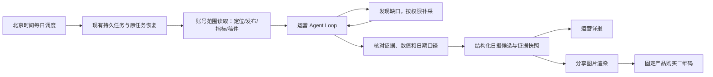

# CreatorOS 运营日报：真实数据原型

本轮是用户要求的“先看页面效果”，尚未把日报功能接入正式应用或创建每日任务。原型以北京时间 2026-09-12 为报告日，使用 CreatorOS CLI 读取的真实账号、发布、指标和定位数据。

## 打开与导出

当前预览： http://127.0.0.1:7879/

如果服务已停止，在仓库根目录运行：

```bash
python3 -m http.server 7879 --bind 127.0.0.1 --directory docs/research/t960-daily-report
```

请用 HTTP 预览，不直接以 file:// 打开。页面支持运营详报/分享战报切换、章节跳转、原作品链接、结构化 JSON 下载和本地高清 PNG 导出；没有自动上传或发布。

- `index.html`：运营详报与分享图预览。
- `report-data.json`：冻结数据、来源状态、定位对照与三项结构化实验建议。
- `share.svg`：分享图矢量母版。
- `CreatorOS-运营战报-20260912.png`：实际点击页面导出的 2160 × 3280 PNG。
- `preview.png`：浏览器实际页面截图。

## 产品判断

可以在现有工程中实现，日报应该成为运营 Agent 的定期产物。核心不是自动列出昨天的数字，而是判断账号当前阶段与内容任务，并把事实、解释、下一次实验区分开。

日报入口可落在现有工作台/复盘附近，点击进入按日期归档的运营详报。第一页给当天运营判断，再看定位和内容组合、作品证据、流量与业务行动、下一次实验。公开战报采用精简字段，不直接截取包含内部缺口、评论或账户 ID 的整页。

运营结构：

1. **账号经营目标**：当前已采纳定位、近期新方向候选、本阶段是触达、信任还是获客。流量型/获客型是业务目标，晒过程/教知识/讲故事/说观点是表达类型，二者分开。没有逐字稿时不硬分类型。
2. **内容组合**：看近7/30天主题、形态和系列连续性；单条低播放不等于定位失败，也不把全部作品都要求成广告。
3. **数据观察**：区分昨日新发队列、昨日所有作品增量、制作与生成产物三种口径，按发布时间/完成时间而不是导入时间筛选。视频和图文分别比较，优先相同发布龄窗口。
4. **证据分析**：原稿、实际发布版本、逐字稿、流量来源、评论、留存与有效业务动作一起看；缺项显式为空。
5. **运营决定**：保留什么、暂停什么、下一条只改哪个变量、如何观察结果，结论允许暂不判断。

## 复用现有工程的接入设计（待确认）

当前工程已有 `backend/src/application/scheduling/automation.ts`、`backend/src/modules/ai-runtime/scheduled-collection-scheduler.ts` 和唯一持久任务执行链。日报应在它们上面增加能力，避免再造一个调度器或任务数据库。



需要新增的主要能力：日报数据聚合及快照、可配置运营分析 Skill 与 Agent loop、日报归档/页面/分享渲染。模型只做判断并产候选，backend 校验账号、时间窗口、来源版本、类型和幂等；正式报告与导出应消费同一结构化快照，避免数字和建议不同步。本原型是单次冻结内容，尚无自动更新与多日生成服务。

自动化的日界和观察口径需一致。建议每天北京时间 09:00 为昨日生成一次初报，缺少24小时窗口的数据标为观察中；后续补采只追加报告修订，不覆盖原来的判断。当天无发布也有日报：观察旧作品增量、制作进度与待办，不造“昨日爆款”。该时间为方案建议，未配置任何真实定时任务。

桌面应用关闭时无法保证本机按点执行；本机方案应启动后补跑并显示实际生成时间。全天候按点生成需服务器执行环境以及相应账号授权。流量明细失败不阻断基础日报，失败步骤独立恢复；未知模型回执核对同一个执行，不能换任务盲目重试。日报可自动形成分析候选，修改定位、改稿、发布和投流仍是另一项明确用户动作。

分享图底部二维码固定为用户确认的 `https://buy.aitongban.cloud/`。需要追踪分享归因时可以另行设计去标识化渠道参数，不能把用户账号、作品或内部报告数据塞进二维码。

## 本次数据与分析边界

CLI 返回唯一授权账号月明水清深；完整项目返回80个，分页存在重复，已按真实 ID 去重。北京时间9/12已发布队列1条，近7天6件作品（5视频、1长图文）。

- 昨日作品：`project-ed64285a-63` / `pub-ed64285a-78` / 抖音 `7684489206084685090`。
- 发布：9/12 11:42:54，北京时间。
- 指标快照：`ms-ed64285a-218`，9/13 12:50:17采集，约发布25小时后累计。
- 997播放、33赞、2评、0藏、0分享、0涨粉、主页访问9；2秒跳出52.48%、5秒留存19.08%、完播0.62%、平均观看4.5秒。
- 2秒留存47.52%为算术派生，赞播比3.31%；不推算精确观看人数或独立用户转化率。
- 逐字稿没有取得。发布文案不是逐字稿，不凭它断言视频实际开头。
- 流量来源返回登录档案占用失败；评论只有数量，正文返回空；有效咨询与成交未接入。以上都没有伪造为0或假饼图。
- 缺跨自然日的完整快照，不能算昨日账号增量。制作侧没有本轮验收，不把今天导入的昨天作品称作昨天制作完成。
- 近期作品累计曝光窗口不同，仅作背景表，不按其当前播放判谁的结构更好。长图文的0秒观看字段不参与视频分析。

方法来自薛辉 Skill 的脚本任务路由与单变量实验；研究参考 `moonlit-creator/works/competitive-analysis/2026-09-12-多对标账号与商业路径续推.md` 和 `2026-09-12-多对标全视频结构与内容承接蒸馏.md`。新方向是未采纳候选，不覆盖系统9/9已保存定位；没有沿用已撤回的单一路径建议。

分析由本轮 Agent 基于真实快照形成，并经独立只读核查；不声称应用内日报模型链已经实现。原始CLI回执保留在 `/tmp/t960/`，结构化精选证据随本原型保存。

## 本次验证

- 实际浏览器打开及tab/导航、JSON导出、PNG按钮下载通过。
- PNG实测2160×3280；独立二维码解码为 `https://buy.aitongban.cloud/`。
- 1440px桌面与390px移动视口均无页面横向溢出；表格在窄屏内独立滚动。
- 6行历史作品日期均已转为北京时间，UTC9/9的公司AI作品展示为9/10。
- 独立只读评审未发现必须修复的事实问题。页面和PNG实际查看无文本或二维码裁切。
- 只增加本地设计工件，未修改生产代码、用户定位、稿件或真实定时任务。

工程流程：`progress done T-960:design` 通过；pmem sync 已运行；全局 reconcile 仍为原有 233 项漂移，保留 T-916，本次未修改生产代码，不将全局状态写成通过。

## T-961 产品风格与入口预览

新增 home.html 首页入口预览，复用现有产品颜色、字体、圆角与首页卡片布局。日报清理方法归属、逐字稿解释与技术话术。真实浏览器验证首页进入日报、分享切换及 PNG 下载；390px 首页与日报无横向溢出；新版图片二维码解码为 https://buy.aitongban.cloud/。产品首页与每日任务尚未正式接入，原始数据未改。
