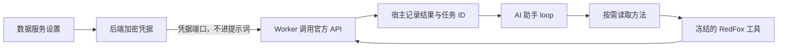

# RedFox 与运营复盘：T-962

日期按北京时间。RedFox 是独立数据服务：设置中单独保存 API Key，官方和自定义文本模型共享同一工具。Agent 按当前问题读取方法，不强制每次联网或加载全部 Skill。

## 官方核验与实现选择

- [RedFox Skills](https://redfox.hk/skills)：官方提供热点、作品和账号研究等技能。网页说明只作目录，不将营销描述当成功保证。
- [客户端源码](https://github.com/redfox-data/redfox-python-sdk/blob/main/redfox/client.py)：官方鉴权头是 `REDFOX_API_KEY`，成功码为 2000。使用固定官方 URL；查询仅对暂态错误有界退避，付费提交未知不重提。
- [抖音端点](https://github.com/redfox-data/redfox-python-sdk/blob/main/redfox/endpoints/douyin.py)：本次接搜索、账号分页、详情、提文案提交与结果查询；分页 offset 与 page 分开处理。尚未验证付费账号的完整响应状态枚举，返回原始状态，不能猜数字含义。
- [热点端点](https://github.com/redfox-data/redfox-python-sdk/blob/main/redfox/endpoints/hotspot.py)：本次用聚合热点接口，时间范围按北京时间且限 30 天。

付费文案按用户与精确 URL 做原子提交占位。未知提交保留记录；明确失败允许修正密钥后再试；成功则复用原 taskId。结果查询核验用户与原密钥指纹。轮换密钥不能假装获得原任务访问权，也不能自动另付费提交。原始错误不回显，密钥和临时签名地址过滤后才允许进结果。

## 从运营角度复盘

方法已注册为 `method.operations.review`，现有 `method.review` 指向它。依次回答定位、选题任务、观看情况、关系与商业信号、下一次实验。用户界面不展示方法作者或内部流程说明。

- [YouTube 生命周期比较](https://support.google.com/youtube/answer/16766491?hl=en)：相同发布年龄更适合比较；产品保留快照，用首 24 小时、7 天、28 天的同龄数据，避免用累计总量直接排胜负。
- [YouTube 留存说明](https://support.google.com/youtube/answer/9314415?hl=en)：相近时长、来源与受众分组有助理解留存。没有原稿不能猜具体流失段落，图文不能套视频完播。
- [YouTube 观众策略](https://support.google.com/youtube/answer/10246996?hl=en-GB)：拓新与持续回访应分别观察；关注、主页访问、咨询和成交不是同一指标。
- [TikTok 单变量实验](https://ads.tiktok.com/resources/help/article/split-testing-variables?lang=en)：借鉴单变量原则，建议注明目标、对照、窗口与复盘时间；自然发布观察不能冒充随机实验因果。

报告输出：运营结论→事实证据→解释假设→下一步实验→待补数据。上述是本产品设计综合，不宣称所有平台使用同一算法。

## 验证范围

聚焦测试覆盖加密/隔离/删除、付费提交并发幂等与失败恢复、真实工具冻结、方法注册、固定端点鉴权和防泄露、组件读写，以及真实子进程 Worker 的模型 loop。

集成测试使用本地模型协议服务和测试专用入口：仅拦截 `https://redfox.hk`，验证 HTTP 鉴权、详情→提交→原 taskId 查询，检查凭据不在模型请求及调用账本。官方/自定义模型为两种命名的协议 fixture，不是真实模型账户验收。本次未读取真实 API Key，未调用付费接口，不声称线上全量接口可用。

实现先于首批局部测试；实际红测抓出了 migration journal、工具错误信封、参数根 schema、客户端 DTO 接线问题后修复。不存在“全程先写红测”的证据，不补造。

## 主线程接线

`persistence-client.ts` 由主线程合并：创建 `createIntegrationCredentials(db, masterKey)`，注入 `createSettingsTransport` 第二参数；ChatRuntime 暴露 `resolveRedfoxCredential`，值委托 credentials.resolve。后端生产组合已向 Worker dispatcher 传递这个端口。独立数据服务页签渲染 `RedfoxConfiguration`，不要放进官方/自定义模型条件分支。
