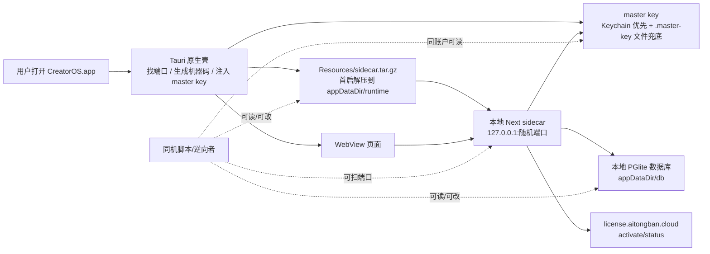

# CreatorOS 桌面版白盒安全与逆向评估报告

日期: 2026-07-07  
范围: 当前仓库 + 本机已打包/已安装 CreatorOS 桌面版,重点看 Tauri 壳、Next sidecar、本地授权、打包产物、updater、本地 RPC 与密钥落盘。

## 0. 一句话结论

CreatorOS 当前已经做了几件正确的事:模型 key 和激活码使用 AES-256-GCM 加密落库,sidecar JS 大面积混淆,端口只监听 `127.0.0.1`,模型配置列表不回显原始 API key。

但如果目标是“别人拿到安装包后不容易破解/逆向”,当前防线仍偏弱。原因很现实:核心业务和授权逻辑仍在客户端 sidecar 的 Next/Node JS 里;授权服务响应没有签名;本地 RPC 没有 per-launch 令牌;已解压 runtime 不做完整性校验;当前 macOS 包还是 adhoc 签名、未公证、updater 公钥未配置。

我的判断:

- 防普通用户误操作/随手翻文件:中等。
- 防会一点 JS/Node 的逆向者:偏弱。
- 防专业逆向/同机恶意进程:弱。
- 防服务端泄密:还可以,没有看到把真实 API key 通过普通模型列表接口返回。

## 1. 大白话架构图



## 2. 已验证事实

### 2.1 打包形态

- `frontend/src-tauri/target/release/bundle/macos/CreatorOS.app` 存在。
- app 内资源只有:
  - `Contents/MacOS/CreatorOS`
  - `Contents/MacOS/creatoros-server`
  - `Contents/Resources/sidecar.tar.gz`
  - `Contents/Resources/icon.icns`
- `sidecar.tar.gz` 约 335MB,包含 `.next/server`、`node_modules`、`backend/drizzle`、`libnode.127.dylib` 等。

### 2.2 代码签名状态

`codesign -dv --verbose=4` 显示:

- `Signature=adhoc`
- `TeamIdentifier=not set`
- `Sealed Resources=none`
- release manifest 显示 `signed:false`、`notarized:false`

结论:当前产物不是正式 Developer ID 签名/公证包,资源篡改成本低,也解释了此前 Keychain 不稳定导致必须落 `.master-key` 文件兜底。

### 2.3 混淆状态

已解压 runtime 下 `.next/server` 共有 315 个 JS 文件,其中 313 个带 `/* creatoros-obfuscated */`,混淆流水线确实生效。

但是在混淆文件中仍能直接搜索到这些关键字符串:

- `license.aitongban.cloud`
- `/api/license/status`
- `/api/license/activate`
- `creatoros-dev-fallback-master-key-v1`
- `CREATOROS_MASTER_KEY`
- `activation_state`
- `enc:v1:`

结论:混淆能让代码难读,但没有隐藏授权模型、接口路径、存储表名和关键环境变量。懂 Node/Next 的人能较快定位授权链路。

### 2.4 本地 master key / DB 落盘

本机路径:

- `~/Library/Application Support/cloud.aitongban.creatoros/.master-key`
- `~/Library/Application Support/cloud.aitongban.creatoros/db`
- `~/Library/Application Support/cloud.aitongban.creatoros/runtime/0.1.0/sidecar`

权限:

- `.master-key`: `rw-------`
- `db`: `rwxr-x---`
- appDataDir: `rwxr-xr-x`

结论:跨系统用户基本挡住了,但同一 macOS 用户下的任何进程可以读 `.master-key`、DB 和已解压 runtime。也就是说,本地加密主要防“离线拷 DB 文件但没 key”的场景,不防同账户恶意进程。

### 2.5 本地 RPC 无 cookie 可读

CreatorOS sidecar 当前监听 `127.0.0.1:55569`。我做了只读验证:

```bash
curl -H 'Content-Type: application/json' \
  -X POST http://127.0.0.1:55569/api/v1/dispatch \
  --data '{"id":"settings.get","input":{}}'
```

返回 `200 OK`,可读到本机用户信息。

另一个只读验证:

```bash
curl -H 'Content-Type: application/json' \
  -X POST http://127.0.0.1:55569/api/v1/dispatch \
  --data '{"id":"settings.models.list","input":{}}'
```

返回 `200 OK`,可读模型配置列表。好消息是接口只返回 `hasSecret`,没有返回原始 API key。

再用伪造 Origin 验证:

```bash
curl -H 'Origin: https://evil.example' \
  -H 'Content-Type: text/plain' \
  -X POST http://127.0.0.1:55569/api/v1/dispatch \
  --data '{"id":"settings.get","input":{}}'
```

仍返回 `200 OK`。

结论:

- 同机脚本/恶意进程可以直接调本地 RPC。
- 浏览器跨源 `application/json` 会被预检/CORS 限制读取响应,但 `text/plain` 简单请求可以被服务端处理,所以存在 CSRF 式“触发副作用”的风险。
- 根因是 T-046 的单机免登录:无 cookie 时 `resolveRequestContext()` 自动落到本机主用户。

### 2.6 授权响应没有密码学签名

代码和文档都明确承认:客户端只校 `success + valid` 布尔值,服务端响应没有 `signature/sig/token`。

影响:

- 改 hosts / 改环境变量 / patch JS / 中间人代理 / 假授权服务,理论上都能伪造 `{success:true, valid:true}`。
- 这不是“实现 bug”,而是当前授权架构的安全上限。

### 2.7 updater 当前不可作为安全边界

`tauri.conf.json` 当前:

- `plugins.updater.pubkey` 是空字符串。
- endpoint 仍是 `https://github.com/OWNER/REPO/releases/latest/download/latest.json` 占位。
- release 脚本本身有私钥缺失 fail-fast,但当前实际 app 配置没有可用公钥/真实 endpoint。

结论:当前 updater 尚未形成“只接受你签名更新”的安全链。

## 3. 风险清单

### R1. 授权可被客户端侧绕过

等级:高

攻击思路:

- 解包 app,找到 `sidecar.tar.gz`。
- 解压后搜索 `license.aitongban.cloud`、`activation_state`、`valid` 等字符串。
- patch 授权判断、替换授权服务地址,或伪造授权服务响应。
- 因授权响应没有签名,客户端无法判断响应是否真的来自你的授权系统。

影响:

- 激活码门可以被绕过。
- 到期/吊销也可被 patch 掉。

建议:

- activation-manager 增加 Ed25519/JWS 授权结果签名。
- 客户端内置公钥验签,验证字段至少包含 `projectKey`、`codeHash`、`machineId`、`licenseMode`、`expiresAt`、`issuedAt`、`nonce/jti`。
- 本地只存服务端签过的 license token,启动时先验 token 签名和机器码,再在线复校。
- 生产环境不要允许 `CREATOROS_LICENSE_BASE_URL` 被普通环境变量覆盖,或至少只接受内置 allowlist 域名。

### R2. 本地 RPC 无 per-launch 授权令牌

等级:高

证据:

- 无 cookie 直接 POST `/api/v1/dispatch` 可读 `settings.get`、`settings.models.list`。
- 伪造 `Origin` 不被拒绝。

影响:

- 同机任意进程可读/改用户数据。
- 可调 mutation op,如改设置、写 prompt override、建项目、删/归档内容、触发采集/AI 任务等。
- 跨源网页不能读响应,但可能触发部分副作用请求。

建议:

- Tauri 启动时生成随机 `localRpcToken`。
- sidecar 所有 `/api/v1/dispatch`、`/api/chat`、`/api/knowledge/*`、`/api/v1/blob/*`、`/api/v1/local/reveal` 都要求令牌。
- WebView 侧通过 Tauri command/preload 拿令牌,请求时加 `X-CreatorOS-Local-Token`。
- 或 Rust 首次打开窗口前向 sidecar 注入一次 httpOnly 同源 cookie,sidecar 要求该 cookie。
- 对 mutation 额外要求 `Origin`/`Sec-Fetch-Site` 为 same-origin 或无 Origin 的 trusted native 请求。
- 保留单机免登录体验,但不要等于“无凭证 RPC”。

### R3. 已解压 runtime 没有完整性校验

等级:高

现状:

- `sidecar.tar.gz` 首启解压到 `appDataDir/runtime/<version>/sidecar`。
- 后续如果 marker 存在且 tarball size stamp 匹配,直接复用。
- 运行的是 appDataDir 里的 JS 文件。

影响:

- 攻击者改一次已解压 runtime,下次启动仍复用。
- 这比改 `.app` 资源还容易,因为 appDataDir 本来就是用户可写目录。

建议:

- 生成 `sidecar-manifest.json`:记录每个关键 JS 文件 hash,manifest 由 release 私钥签名。
- Rust 启动 sidecar 前验证 manifest 签名 + 文件 hash。
- 不通过则清 runtime,从 bundle tarball 重解压;重解压后再验。
- bundle tarball 本身也要 hash 校验,hash 编译进 Rust 或放在已签名资源内。
- 真实代码签名后,不要接受被篡改的 app resources。

### R4. 当前 macOS 包未正式签名/公证

等级:高

证据:

- `Signature=adhoc`
- `TeamIdentifier=not set`
- `Sealed Resources=none`
- manifest: `signed:false`, `notarized:false`

影响:

- 用户安装体验差。
- app 资源篡改不可被系统可靠拦截。
- Keychain 无稳定签名身份,导致 master key 必须落文件兜底,进一步削弱本地密钥安全。

建议:

- 申请/配置 Apple Developer ID。
- `tauri.conf.json` 填真实 `macOS.signingIdentity`。
- 完成 notarization。
- CI/release 阶段强制 `codesign --verify --deep --strict` 和 `spctl -a -vvv -t exec` 通过。
- 生产包禁止 `signed:false`、`notarized:false` 出现在 release manifest。

### R5. master key 文件兜底削弱静态加密

等级:中高

现状:

- `.master-key` 为 `600`,这很好。
- 但它与 DB 同在同一用户 appDataDir。

影响:

- 同一系统用户下,恶意脚本可同时读 DB 和 master key。
- 加密无法保护“当前登录用户账户内的恶意进程”。

建议:

- 签名稳定后,生产版默认只用 OS Keychain/Credential Manager。
- `.master-key` 作为 dev/未签名兜底,生产版可禁用或只在用户明确同意时启用。
- appDataDir 权限改成 `700`,`machine-id` 改成 `600`。
- 把“密钥源 degraded=true”暴露到设置页/诊断页,生产打包时如果 degraded 则报警或 fail-fast。

### R6. updater 未配置公钥和真实 endpoint

等级:中高

影响:

- 当前没有形成可信更新链。
- 如果后续误配 HTTP/假 endpoint/空 pubkey,更新可能不可用或失去防篡改价值。

建议:

- 立即生成生产 updater keypair。
- `tauri.conf.json` 写入生产 pubkey。
- endpoint 改为 `https://creatoros.aitongban.cloud/updates/latest.json` 这类真实 HTTPS 地址。
- 私钥只放 CI secret 或离线 release 机。
- release 后验证 `.app.tar.gz.sig`、`latest.json`、Tauri updater 均通过。

### R7. CSP 为 null,一旦 XSS 会放大成本地控制面

等级:中

现状:

- `tauri.conf.json` 里 `app.security.csp = null`。
- 本地 Next 页面有大量交互和富文本/Markdown/AI 输出场景。

影响:

- 如果某个页面出现 XSS,攻击脚本可在同源内完整调用本地 RPC。

建议:

- 给 Next 响应加安全 headers:至少 `Content-Security-Policy`、`X-Content-Type-Options`、`Referrer-Policy`。
- CSP 优先做到 `script-src 'self'` + nonce/hash,尽量不要 `unsafe-eval`。
- AI/Markdown 渲染继续禁 HTML 或严格 sanitize。

### R8. prompt/AI 编排仍随客户端分发

等级:中

现状:

- T-163 已把 AI 逻辑从前端 UI 下沉,但在桌面交付形态里,backend/ai-runtime 仍在本地 sidecar 里。
- 打包体能搜索到 `ai-worker`、prompt/template 相关产物。

影响:

- 如果 prompt/编排是核心护城河,客户端分发无法保密。
- 混淆只能提高阅读成本,不能提供真正机密性。

建议:

- 真正核心的 prompt/策略/评分规则放远程服务。
- 本地只保留通用 UI、缓存、用户可编辑 prompt。
- 远程 prompt bundle 签名能防篡改,但不能防读取;防读取只能不发到客户端。

## 4. “能不能被别人逆向?”

能。

分层判断:

| 攻击者 | 当前难度 | 说明 |
|---|---:|---|
| 普通用户 | 中 | 看到 `.app` 不一定会解 `sidecar.tar.gz`,混淆也会劝退。 |
| 会 JS/Node 的开发者 | 低-中 | 解 tarball、grep 字符串、定位 Next chunks、patch 授权判断并不难。 |
| 专业逆向者 | 低 | JS/Node 客户端逻辑天然可还原;当前无强签名、无 runtime 完整性、无本地 RPC token。 |
| 同机恶意软件 | 低 | 可扫本地端口、读 appDataDir、读 `.master-key`、读/改 runtime 和 DB。 |

关键点:混淆不是加密。只要授权逻辑和护城河逻辑在客户端,最终都能被读/patch。能做的是提高破解成本、阻止自动化批量盗版、把高价值逻辑移到服务端。

## 5. 建议整改顺序

### 立刻做,发正式包前必须补

1. 配置真实代码签名和公证,禁止 adhoc 产物对外发。
2. 配置 updater pubkey + 真实 HTTPS endpoint,跑通签名更新链。
3. 给本地 RPC 加 per-launch token,所有 API 要求 token。
4. 对 `/api/v1/dispatch` 等 API 做 Origin/Sec-Fetch-Site 检查,至少保护 mutation。
5. appDataDir 改 `700`,`.master-key`/`machine-id` 改 `600`。

### 一周内做,明显提高破解成本

1. activation-manager 加 Ed25519/JWS 授权结果签名。
2. 客户端验签并存 signed license token。
3. 已解压 runtime 加 manifest 签名 + hash 完整性校验。
4. 生产桌面版禁用 `dev-fallback` master key;若降级则阻止启动或要求重新签名安装。
5. `CREATOROS_LICENSE_PROJECT_KEY` 从 `test` 改成生产 projectKey。

### 后续增强

1. 将真正有商业价值的 prompt/评分/编排迁到远程服务。
2. 对本地 DB 关键表增加应用层签名/防回滚字段,比如 license state、lastOnlineCheckAt。
3. 加安全回归测试:
   - 无 token 调 `/api/v1/dispatch` 必须 401/403。
   - 伪造 Origin 的 mutation 必须拒绝。
   - release 包 `codesign/spctl` 必须通过。
   - updater pubkey 不可为空。
   - runtime manifest 被篡改必须拒绝启动或重解压。

## 6. 验收清单

正式对外发包前,建议每次 release 都跑:

```bash
# 1. 代码签名/公证
codesign --verify --deep --strict --verbose=2 path/to/CreatorOS.app
spctl -a -vvv -t exec path/to/CreatorOS.app

# 2. updater 配置不得为空/占位
node -e "const c=require('./frontend/src-tauri/tauri.conf.json'); if(!c.plugins.updater.pubkey) process.exit(1)"

# 3. 本地 RPC 无 token 不得成功
curl -i -X POST http://127.0.0.1:<port>/api/v1/dispatch \
  -H 'Content-Type: application/json' \
  --data '{"id":"settings.get","input":{}}'

# 4. sidecar runtime 篡改检测
# 手动改一个已解压 chunk,重启应重解压或拒绝启动。
```

## 7. 最终评级

当前版本安全成熟度: **C+**

原因:

- 已有基础安全意识:加密落库、混淆、只监听 localhost、敏感 key 不直接回显。
- 但关键商业防线还缺:正式签名、公证、授权响应验签、本地 RPC token、runtime 完整性。

如果完成“立刻做”和“一周内做”的项目,可以到 **B+/A-**:不能承诺防专业破解,但足以挡大多数低成本盗版、脚本化篡改和普通逆向。
