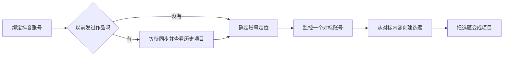

# SPEC — 新手引导改为创作成果路径（T-637）

> 状态：用户已确认 · 2026-07-31 重新派生 · 取代 T-161/T-348 的“模型配置 + 自动化初始化”引导。

## 1. 大白话结论

新用户不需要理解模型槽位、定时任务或自动化架构。引导只告诉他下一件能产生结果的事：先绑定账号，看已有作品，定好方向，再跟对标、做选题、建项目。自动采集仍在后台运行，但不再成为用户必须“完成”的一步。



## 2. 用户问题

- 设置页“重新打开新手引导”只清除隐藏标记；旧步骤都完成时，首页又立即自动隐藏，表现为按钮无反应。
- 旧引导把“配置文本模型”和“后台自动化初始化”暴露成主线，用户需要理解内部实现才能继续。
- 旧“首个项目”只看项目总数，历史作品导入生成的项目会冒充用户新建项目，进度会假完成。

## 3. 确认后的流程与完成真值

1. **绑定抖音账号**：`douyin.status.loggedIn=true`。
2. **确认账号情况**：用户选择新号或已有作品；若已经读到导入作品，自动识别为已有作品。
3. **查看历史项目（仅已有作品账号）**：必须同时满足已有 `source=imported` 项目、用户点过“查看并确认”。确认按当前账号 ID 隔离保存。
4. **确定账号定位**：定位中心存在当前母版。
5. **添加对标监控**：内容雷达存在 `creator_profile + monitorEnabled + active` 来源。
6. **从对标内容创建选题**：内容雷达存在 `topicState=converted` 内容。
7. **把选题变成项目**：至少存在一个 `source=manual|topic` 项目；`source=imported` 不计入。

新号跳过第 3 步，显示编号重新连续排列。任何读失败都显示未完成，不假打勾。

## 4. 重新打开交互

- 设置页点击后立即写入 `force-open`，清除 `hidden`，并广播同页事件；首页已经挂载时也会即时展开。
- 随后回到首页。即使所有步骤已完成，卡片仍展示，并明确提示“引导已重新打开”。
- 用户再次点“不再显示”时，同时清除 `force-open`，恢复正常自动隐藏规则。

## 5. 边界

- 不新增后端表、公开 API 或第二套自动化；自动采集继续由现有基础设施负责。
- 不把模型配置、自动化任务、内部任务编号展示给新用户。
- 历史项目确认只是账号级本地引导状态，不改变项目数据和采集状态。
- AI 不在引导中直接写库；定位、选题、项目仍走现有用户确认链。

## 6. 验收

- AC-ONB-01：已完成旧引导的用户点击“重新打开”后，首页卡片仍真实可见。
- AC-ONB-02：引导文案和入口中不存在模型配置、自动化任务。
- AC-ONB-03：已有作品账号未导入/未确认历史项目时，定位保持锁定；确认后解锁。
- AC-ONB-04：新号跳过历史项目，步骤编号连续。
- AC-ONB-05：定位、对标监控、对标选题、项目按真实数据逐级完成。
- AC-ONB-06：只有导入项目时，“把选题变成项目”不得完成。
- AC-ONB-07：常规与最小窗口下文案、按钮、步骤状态完整可见，无内部 ID。

## 7. frontend-journey-contract/v2

```frontend-journey-contract
{
  "schema": "frontend-journey-contract/v2",
  "task_id": "T-637",
  "copy_guard": { "forbid_internal_ids": true },
  "required_checks": [
    { "id": "AC-ONB-REOPEN", "test_id": "E2E-ONB-01" },
    { "id": "AC-ONB-FLOW", "test_id": "E2E-ONB-02" },
    { "id": "AC-ONB-EXISTING", "test_id": "E2E-ONB-03" },
    { "id": "AC-ONB-FRESH", "test_id": "E2E-ONB-04" },
    { "id": "AC-ONB-COPY", "test_id": "E2E-ONB-05" }
  ],
  "required_conditions": ["complete", "hidden", "reopen", "existing", "fresh", "back", "refresh"],
  "watched_paths": [
    "frontend/src/features/onboarding",
    "frontend/src/features/settings/settings-interactive-region.tsx"
  ],
  "viewports": [
    { "width": 1440, "height": 900 },
    { "width": 1024, "height": 720 }
  ],
  "coherence_groups": []
}
```
