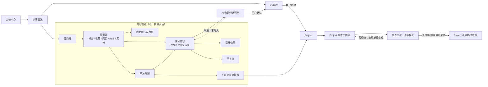

# 内容雷达：对标监控与信源重构产品规格

> Task: `T-482`
> 日期：2026-07-23
> 规格类型：完整目标产品，不按 V0.1/V0.2/V0.3 降级切片

## Artifact metadata

- Stage: `1-plan`
- Status: `passed`
- Source inputs:
  - 用户 2026-07-23 原始构想：在「定位」和「选题」之间增加对标监控；按分类→博主→作品浏览公开作品、封面、逐字稿与互动数据；收藏夹作为默认分类；可结合定位转为自己的选题。
  - 用户 2026-07-23 追认：当前黑马、网页信源的实际验证与入库逻辑都不清楚，要求彻查并重构。
  - 用户 2026-07-23 产品口径确认：评论只取公开数量且允许诚实降级；逐字稿只能由用户手动发起并异步排队；首批支持抖音、通用网页、RSS，登录墙需引导登录；雷达只产选题，稿件生成/改写在 Project 创建后进行，高相似候选不得采纳为正式稿件。
  - 用户 2026-07-23 指定“抖音热点宝”可作为关键词黑马来源；只读实机验证确认其低粉爆款榜、关键词筛选、作品详情和结构化接口可用。
  - 用户 2026-07-23 明确认可采用热点宝的最终方案：热点宝只作为登录态下的策展榜单数据源，逐字稿仍由用户手动异步触发，雷达只产选题、Project 内再生成或改写稿件。
  - 用户 2026-07-23 追加确认：任何来自他人的对标、收藏、黑马/爆款等外部视频选题都必须保留可点击的视频原链接；只有标题不得直接转选题，必须先由用户手动完成逐字稿，再对逐字稿做结构拆解后生成选题候选；被采用的逐字稿版本作为不可变来源证据贯穿选题与 Project，具体稿件生成/改写仍只在 Project 创建后发生。
  - 用户 2026-07-23 追加“复制抖音分享链接单条建档”：用户粘贴单条分享链接并选择分类，系统解析真实作品与作者；已有博主复用其节点并归入所选分类，未有则自动创建博主节点；重复链接幂等去重，只建档，不自动转写。
  - 用户 2026-07-24 追加确认“自动化一定要收敛”：内容雷达不得保留独立调度循环，必须复用全局自动化调度、持久任务和运行记录；来源页保留来源级策略，自动化页仅展示账号级聚合任务。
  - T-517 调度 Delta：[`2026-07-24-content-radar-unified-automation-design.md`](2026-07-24-content-radar-unified-automation-design.md)；独立评审通过前不得进入调度架构实现。
  - 现有实现与历史实机日志，见「现网事实 / 仓内已有实现」。
  - 只读实机 RAT：[`docs/research/2026-07-23-content-radar-rat.md`](../../research/2026-07-23-content-radar-rat.md)。
  - 独立评审：[`2026-07-23-content-radar-restructure-design.review.md`](2026-07-23-content-radar-restructure-design.review.md)。
- Decision IDs:
  - `DEC-CR-001`：一级导航命名为「内容雷达」，位于「定位中心」与「选题」之间；页内核心能力叫「对标监控」。
  - `DEC-CR-002`：外部作品属于内容情报，不属于 Project；内容雷达 AI 只产选题候选，用户确认后才写入选题池。Project 通过已确认选题另行创建，不在雷达中生成。
  - `DEC-CR-003`：对标博主、我的收藏、网页/RSS、黑马关键词统一为同一内容情报域，不再由选题页弹窗分别管理。
  - `DEC-CR-004`：运行健康以真实同步运行记录为准；“0 条”与“失败”必须严格区分。
  - `DEC-CR-005`：目标数据口径是“平台当前可访问的公开内容”，不承诺已删除、私密或平台拒绝返回的内容。
  - `DEC-CR-006`：稿件生成和改写只发生在 Project 内；高相似性候选不得采纳为 Project 的正式稿件版本，必须编辑或重新生成至风险降级，不能用“我已知风险”绕过。
  - `DEC-CR-007`：逐字稿只允许用户单条或批量手动发起，全部走持久异步队列；来源同步绝不自动排入转写。
  - `DEC-CR-008`：评论仅采集公开数量；取不到时记 `null/未知` 和质量原因，允许作品元数据同步继续，绝不以 0 冒充。
  - `DEC-CR-009`：首批支持抖音、通用网页与 RSS；网页/RSS 命中登录墙时引导用户打开登录会话，登录后重新测试，不保存明文凭据。
  - `DEC-CR-010`：关键词黑马改用抖音热点宝“低粉爆款”榜单，不再使用已证伪的抖音原始搜索接口；复用抖音按账号隔离的受控浏览器 profile 登录态和官方页面生成的签名，不写死签名、不把原始 Cookie/签名复制进 adapter、情报表、任务检查点或日志。热点宝只提供候选集，是否命中仍由仓内 `detectDarkhorse` 的确定性 48 小时三档规则判定；官方 rank/score 只作来源证据。该来源是策展榜单，不承诺全站穷举。
  - `DEC-CR-014`：外部视频必须保留可点击的 canonical 视频链接；标题/摘要不能直接转为选题。只有用户手动转写完成后，系统才能基于被锁定的逐字稿版本执行结构拆解并生成选题候选。选题与 Project 只引用该不可变逐字稿证据，不把原文复制为选题正文或 Project 正式稿件；具体稿件生成/改写仍只发生在 Project 内。
  - `DEC-CR-015`：抖音分享链接提供单条建档入口。建档必须解析 stable item/author identity 与 canonical 视频 URL；作者节点全账号唯一、可关联多个分类，重复分享链接或同一作品的不同短链只返回既有 item。新建作者节点默认不持续监控，且该入口绝不自动创建逐字稿任务。
  - `DEC-CR-016`：自动化触发必须收敛到全局 `scheduled_jobs/job_runs/triggerScheduledJob` 单一链路。内容雷达每账号只映射一条聚合自动化任务，由其扫描该账号已到期来源；业务模块不得自建 `setInterval`、cron、启动扫描器或第二套运行记录。来源级启停、周期与明细留在内容雷达，账号级总开关与聚合记录留在自动化页。
  - `DEC-CR-017`：逐字稿除手动发起 ASR 外，允许用户给当前作品上传已有文本稿。客户端只读取 UTF-8 的 `.txt/.md/.srt/.vtt`，将清理后的正文通过 typed operation 写入当前作品既有逐字稿真相，不保存原文件、不新增文件存储；已完成或已进入选题/Project 证据链的逐字稿禁止覆盖。
- Manifest status: `passed`；原产品方案已获用户确认，`RAT-CR-003` 与 `DEC-CR-010` 独立 delta review 均已通过；新增 `DEC-CR-016` 已获用户确认，作为 T-517 delta 须独立评审通过后方可改动调度架构。
- Supersedes:
  - 取代 `T-031`、`T-212`、`T-235b/c/e` 中“对标库已经由选题页信号源弹窗充分覆盖”的产品判断。
  - `T-300` 的“热门选题采集 0 条”由本任务统一收口，不能再把 0 条当作可接受的模糊结果。

## Problem statement

现在的“信号源”不是一个可以日常使用的内容情报产品，而是四段彼此割裂的后台能力：

1. 对标博主：表单要求用户理解 `sec_uid`，虽然占位文案写“粘贴主页链接”，实际把输入原样存成 `externalAccountId`；采集默认只翻约 5 页，而且只保存每个博主最多 10 条被算法判为爆款的作品，用户无法浏览博主完整公开作品库。
2. 黑马：没有独立信源、独立任务和结果页，附着在对标采集任务后运行；验证码和请求异常会变成空数组，最终显示“本轮无黑马”，无法区分真无结果还是采集失败。
3. 网页/RSS：只保存 URL 配置；真正抽取出的热点信号不入库，没有历史、没有来源快照、没有单源测试、没有最后成功时间，也无法证明某次出题是否真的用了这个网页。
4. 收藏夹：只登记文件夹并把少量条目自动推进选题候选，收藏作品不对用户开放浏览；缺少封面、公开指标、发布时间及作品详情。

共同后果是：用户看见“已启用”“任务成功”或“0 条”，但无法回答“抓了什么、何时抓的、为什么没抓到、这条选题来自哪里”。这违反项目的“严禁假按钮”“诚实置 0”和“AI 只产候选”原则。

本重构的目标不是把四个旧 tab 搬到新页面，而是建立一个真正可观察、可归类、可追溯、可转化的内容情报工作区。

## Target users and jobs

### 目标用户

- 主要使用者：以个人或小团队方式经营短视频账号的内容创作者。
- 决策者/付费者：同一创作者本人，关注是否能持续降低找选题、拆内容、改写脚本的时间成本。
- 核心 JTBD：
  - “我看到值得长期观察的博主时，粘贴主页就能建立可持续更新的作品库。”
  - “我想知道最近什么内容在增长，不想只看一次性的静态点赞数。”
  - “我收藏或看到一条好内容后，能看完整证据，再结合自己的定位转成自己的选题；需要写稿时，再进入 Project 创作。”
  - “采集失败时，我要知道是没登录、验证码、网页结构变化、模型未配置，还是真的没有新内容。”

### 非目标用户

- 需要私密数据、商业数据接口或绕过平台风控的大型 MCN 数据团队：本产品只处理用户有权访问的公开页面及本人明确授权的收藏夹。
- 需要批量复制他人稿件的搬运账号：系统必须保留来源与相似性提醒，只支持结构借鉴和基于自身定位的再创作。
- 需要多平台企业级舆情监控的机构：本任务交付抖音公开作品、网页/RSS 与本人收藏的完整产品；架构可扩展，但不虚构尚未验证的平台适配。

## Core user scenarios

### `SCN-CR-001` 添加并监控对标博主

用户粘贴抖音主页链接，系统先解析并展示昵称、头像、主页和可见作品概况；用户确认后选择分类与监控频率。首次同步抓取平台当前可访问的公开作品，后续增量同步。

Independent Test：使用一个公开且有 20 条以上作品的主页，用户只输入主页 URL；确认后能看到正确博主身份、作品列表、封面、发布时间、公开指标和明确的同步进度。

### `SCN-CR-002` 浏览、归类与检查外部作品

用户在左侧树浏览“分类→博主→作品”，中间筛选/排序作品，右侧查看封面、原链接、当前数据、历史增量、同步状态及逐字稿状态；用户手动转写完成后才展示完整逐字稿。

Independent Test：不触发任何 AI，用户也能从分类进入一条作品，验证其原链接、发布时间和指标；未转写时显示“未转写”，用户手动发起并等待异步任务完成后才能看到逐字稿及其来源。

### `SCN-CR-003` 把收藏夹作为自己的情报入口

系统提供“我的收藏”系统根分类；用户授权并选择抖音收藏夹后，其条目以与对标作品一致的作品卡和详情展示，而不是直接塞进选题池。

Independent Test：选择一个已有视频的收藏夹后，条目可浏览、可转写、可追溯到收藏夹；未点确认前不创建任何选题。

### `SCN-CR-004` 监控网页与 RSS

用户输入 URL 后先“测试并预览”：系统返回识别类型、页面标题、可抽取条目、是否需要登录及错误原因。确认监控后，每次抓取产生持久化信号与来源快照。

Independent Test：一个 RSS 和一个动态网页分别通过测试；成功时能在内容雷达看到持久化条目和原始来源，失败时能看到结构化错误而不是空列表。另用一个需要登录的 Feed/网页验证“打开登录→登录→重新测试”闭环。

### `SCN-CR-005` 发现低粉高表现黑马

系统把黑马关键词作为可编辑的监控源，定位关键词只提供初始建议。每次运行展示热点宝榜单返回数、本地三档规则命中数、过滤原因、数据完整性及验证码/风控状态。

Independent Test：固定测试数据能复现每档判定；实机 canary 命中验证码时运行状态必须是“受阻/需处理”，不能记为成功 0 条。

### `SCN-CR-006` 转为自己的选题

用户从外部视频情报点击“转为我的选题”时，系统先检查可点击视频原链接和已完成的手动逐字稿；缺任一项都不能仅凭标题生成选题。证据齐全后，系统锁定逐字稿版本，先拆出钩子、叙事/论证步骤、核心主张、可借鉴的结构模式与事实风险，再结合当前账号定位生成选题卡预览，列出借鉴点、差异化角度和来源。用户确认后才进入选题池。

Independent Test：只有标题或逐字稿仍在排队时，“转为我的选题”被明确阻止并引导手动转写；转写完成后才可生成结构拆解和候选。取消预览不新增候选；确认后只新增一条选题，并能从选题卡点击原视频、反查逐字稿版本和拆解结果。

### `SCN-CR-007` 从已确认选题进入 Project 后创作稿件

用户先在内容雷达确认选题，再通过现有“创建 Project”流程建立自己的 Project；系统把来源内容、可点击原视频、来源快照、选题时的结构拆解和对应不可变逐字稿版本作为创作参考带入 Project。逐字稿是证据，不是待覆盖的 Project 正式稿件。稿件生成或改写只在 Project 的脚本工作区发起，产生可编辑候选版本，并显示改写策略、事实核验、来源和相似性风险。

Independent Test：内容雷达确认选题时不产生稿件或 Project；Project 建立后自动带入与选题一致的来源 URL、逐字稿版本、拆解结果和来源快照，之后才能发起生成/改写。取消候选不新增正式稿件版本；高相似候选不能被采纳，降级后采纳的版本能反查来源快照、逐字稿哈希与定位版本。

### `SCN-CR-008` 诊断同步

用户可在源或作品上看到最近一次运行、成功/新增/更新/跳过/失败数、错误类别、下一步建议，并可安全重试。

Independent Test：分别注入未登录、验证码、HTTP 403、页面无内容、模型未配置和真 0 条，UI 呈现六种不同结果。

### `SCN-CR-009` 用抖音分享链接单条建档

用户复制一条抖音分享链接，选择分类后提交。系统跟随安全重定向解析真实作品 ID、作者稳定身份与 canonical 视频 URL：作者已存在时复用同一博主节点并补齐所选分类关系，未存在时创建不自动监控的新博主节点；新建作品档案初始为“未转写”，命中既有作品时保留其真实逐字稿状态。

Independent Test：同一作品分别使用短分享链接与 canonical URL 导入两次，只产生一个 item、一个作者源和幂等的来源观察；两次均返回可点击原视频。首次导入不会产生 transcript execution task；只有用户随后手动点击转写才入队。

## Value & viability

### 1. PR-FAQ

CreatorOS 发布「内容雷达」，为需要持续找题和拆内容的短视频创作者提供一个从定位到选题之间的内容情报工作区。过去，用户把博主链接、网页、收藏夹和黑马关键词分散在多个入口，任务显示成功也无法证明抓到了什么。现在，用户只需粘贴主页或网页，就能建立可分类、可增量同步、可查看运行证据的内容库。每条内容都保留来源、公开数据、按需逐字稿和同步状态，并能结合账号定位生成可确认的选题。选题确认后再进入 Project，稿件生成与改写只在 Project 内进行。产品不会把他人作品伪装成自己的项目，也不会把验证码或接口失败说成“0 条”。这使“看到好内容→形成自己的选题→创建 Project→创作稿件”成为一条可复盘的闭环。

FAQ：

1. 为什么不继续用抖音收藏、浏览器书签和 Excel？这些工具能保存链接，但不能持续补充作品、保存指标快照、统一逐字稿，也不能把来源与自己的定位和选题结果串起来；代价是首次同步与平台登录仍需要一次信任建立。
2. 为什么不直接让 AI 每天自动生成选题？自动生成缺少用户可见证据，且现有链路已经证明“成功/0 条”可能掩盖失败。内容雷达先把信源与证据做实，再由用户决定采纳。
3. 会不会变成抄袭工具？不会。内容雷达只帮助形成自己的选题；Project 内生成或改写稿件时，原文、来源和相似性风险持续可见，高相似候选不能采纳为正式稿件。
4. 能保证抓到博主全部作品吗？只能保证尽力同步平台当前公开且当前会话可访问的作品；删除、私密、风控拦截或平台不返回的内容会明确显示为不可达，绝不宣称“全量成功”。
5. 迁移成本是什么？旧对标源、旧对标作品、收藏夹登记/条目、网页/RSS 配置需要一次幂等迁移；用户原数据不丢，旧入口在迁移校验通过后退役。

### 2. 替代品与切换

| 现状方案 | 哪里不行 | 切换触发器 | 切换成本 |
| --- | --- | --- | --- |
| 抖音关注/收藏夹 | 能收藏但无法跨博主分类分析、保存历史指标或结合定位改写 | 收藏内容多到找不到，或想复盘某博主最近增长 | 需登录并选择收藏夹 |
| 浏览器书签/Notion/Excel | 静态记录，封面/指标/逐字稿靠手工搬运 | 每周手工整理耗时，数据很快过期 | 首次导入与学习分类 |
| 数据平台 | 指标丰富但创作闭环弱，逐字稿与本账号定位未必连通 | 已在平台看到爆款，但仍需手工改成自己的选题 | 订阅费和双系统切换 |
| 继续使用现有“信号源”弹窗 | 入口隐蔽、结果不可浏览、失败不可诊断 | 再次出现“0 条”却无法判断原因 | 旧数据迁移；无需重新登记 |
| 忍着不解决 | 切换成本为零，但持续靠记忆和临时搜索 | 连续错过热点、选题重复或找稿耗时明显 | 需要建立新的日常习惯 |

### 3. 被否决的产品形态

| 被否决的形态 | 否决理由 | 翻案信号 |
| --- | --- | --- |
| 仅把四个信号源 tab 搬成独立页面 | 仍然没有统一内容真值、运行证据和作品浏览，解决的是入口不是产品 | 若用户只需要配置中心、不需要内容库与转化 |
| 把每条外部作品自动创建为 Project | 污染自己的生产项目，违反来源隔离和 AI 确认门 | 不翻案；这是产品身份与数据边界 |
| 完全自动把抓到内容写入选题池 | 会放大噪声和抄袭风险，也掩盖哪些数据实际被采用 | 只有在长期数据证明某源采纳率稳定且用户逐源明确授权时，才考虑“自动生成候选”，仍不得自动创建 Project |
| 只做第三方数据平台跳转 | 无法保存逐字稿、内部定位和来源关系，核心闭环断裂 | 若平台规则使任何稳定采集都不可持续 |

### 4. 五大风险

| 风险 | 判断 + 证据 | 最便宜的检验方式 | 若错的代价 |
| --- | --- | --- | --- |
| 价值 | 高价值但取决于“浏览情报→采纳选题”的真实频率。用户主动提出完整工作流，现有 T-300 又证明“不透明 0 条”已经造成痛点 | 用真实旧数据做可点击原型，完成一次“来源→选题”任务并记录时间 | 做成又一个没人打开的数据仓 |
| 可用性 | 现有 `sec_uid` 与环境变量要求已经超出普通用户能力 | 主页 URL 单输入测试；黑马关键词全部在 UI 管理 | 添加源失败，首次价值无法到达 |
| 可行性 | 核心读链已有，但全量续传、网页结构变化、指标历史和任务恢复是实质难点 | 抖音主页、动态网页、RSS 各做一次只读 canary；见 `HARD-001~006` | 页面完成但数据链不可用 |
| 商业 | 个人工具值得投入的前提是每周实质减少找题/拆稿时间 | 上线后 14 天统计采用次数和节省时间访谈 | 维护外部采集的成本高于使用价值 |
| 依赖 | 高风险：依赖抖音页面/API、登录态、验证码、网页结构、ASR 与模型 | 把失败分类和 canary 纳入发布门；所有外部适配器可替换 | 上游一改版即“成功 0 条”并失去信任 |

RAT 已执行，详见 [`2026-07-23-content-radar-rat.md`](../../research/2026-07-23-content-radar-rat.md)：7 条 canary 现已全部通过。旧抖音原始搜索仍会把验证码/空响应伪装成 0，因此明确弃用；替代路径抖音热点宝已在真实登录会话中返回 21 条“AI写作”低粉爆款和稳定 JSON 结构。规格仍保持 blocked，仅因为该来源替换需要独立 delta review，不再因为黑马读取不可行。

### 5. 采纳门槛

| 核心旅程 | 首次价值需要几步 | 前置依赖 | 失败时用户看到什么 |
| --- | --- | --- | --- |
| 添加对标博主 | 3：粘贴→核对身份→确认同步 | 抖音登录态、公开主页 | 未登录/主页无效/风控/不可访问分别提示 |
| 添加网页/RSS | 3：粘贴→测试预览→确认监控 | URL；登录站点另需网站会话 | HTTP、登录墙、空正文、抽取失败分别提示 |
| 我的收藏 | 3：授权→选择文件夹→确认 | 本人抖音登录态 | 找不到文件夹、权限、风控分别提示 |
| 转为自己的选题 | 4：打开原视频核对→手动转写→结构拆解预览→确认 | 可点击原视频、已完成逐字稿、当前账号定位与来源快照 | 缺链接时禁止转选题；未转写时引导手动排队；本步骤不生成稿件 |
| Project 内创作稿件 | 3：创建 Project→发起生成/改写→采纳候选 | 已确认选题及其逐字稿版本/拆解/来源引用；文本模型 | 来源证据缺失、模型未配或高相似时有明确下一步 |

### 6. 商业假设

内容雷达通过把每周手工找题、复制链接、按需转写和整理证据的多工具流程收进 CreatorOS，提升用户持续使用定位→选题→Project 的频率。成本大头是外部采集维护、用户手动发起的逐字稿算力和 Project 内文本模型。可证伪假设：上线 14 天后，已添加至少一个监控源的活跃账号中，低于 25% 完成过一次“情报内容→确认选题”，则说明统一情报库没有产生足够创作价值，必须回到 PLAN 重审，而不是继续扩平台。

### 7. Pre-mortem

| # | 死因 | spec 级应对 |
| --- | --- | --- |
| 1 | 抖音接口变化或验证码让采集长期返回空 | 结构化错误、适配器边界、实机 canary 与 false-success=0 发布门 |
| 2 | 用户手动批量转写仍可能成本过高或长时间不结束 | 元数据同步不自动转写；用户发起后进入持久队列，支持暂停、续传、取消和成本预估 |
| 3 | 数据很多但用户不转化，变成收藏坟场 | 首页默认展示新增/增长/待处理；每条内容提供基于定位的两个明确动作并统计采纳 |
| 4 | 迁移后新旧两套数据长期并存，出现不同数字 | 一次幂等迁移、校验报告、消费者切换完成后退役旧写路径；禁止永久双写 |
| 5 | 改写过于接近原稿，引发抄袭风险 | 来源常显、相似性提醒、差异化约束、用户确认门 |

### 8. Appetite

按一个中大型完整重构投入，允许用并行工作包组织实现，但不以“先做假列表、以后再补真实采集”缩减质量。若完整目标超过可接受投入，应由用户显式删除场景，而不是静默把难题留到“后续”。

## Functional requirements

- `FR-CR-001` 一级入口：侧栏新增「内容雷达」，固定处于「定位中心」与「选题」之间；旧选题页“信号源”弹窗在迁移完成后退役。价值：删除后用户仍找不到这套能力。
- `FR-CR-002` 分类树：支持系统分类“我的收藏”、用户自定义分类、分类下博主/信源及其内容；分类支持新建、重命名、移动和排序。删除分类默认只解除归类，不静默删除采集数据。价值：删除后无法按自己的研究主题组织情报。
- `FR-CR-003` 主页识别：用户只需输入博主主页 URL，系统解析稳定身份并展示昵称、头像、主页、粉丝数与可见作品概况，用户确认后落源。价值：删除后普通用户仍需理解 `sec_uid`。
- `FR-CR-004` 对标同步：首次回填与后续增量同步平台当前可访问的公开作品；使用游标/检查点续传、幂等去重、失败重试，显示覆盖口径与停止原因。价值：删除后只有一次性或截断的数据。
- `FR-CR-005` 作品元数据：保存并展示原链接、标题/描述、作者、封面、发布时间、时长、点赞/评论/收藏/转发等平台当前可返回的公开计数及捕获时间。来自他人的对标博主作品、收藏作品、黑马/爆款等任意外部视频必须有可点击的 canonical 视频链接；无法解析有效链接的候选只记入 run 诊断，不得进入可转选题的内容列表。评论正文不抓；评论数或其他指标取不到时记 `null/未知 + qualityReason`，指标子步骤可降级但不得伪造成 0。价值：删除后用户无法判断内容和表现，也无法回到原视频核对证据。
- `FR-CR-006` 指标历史：每次同步追加指标快照，支持当前值、相邻增量与趋势排序；不得只覆盖最新值。价值：删除后“正在增长”与“历史大爆款”无法区分。
- `FR-CR-007` 手动逐字稿队列：作品支持用户单条或批量选择后手动点击转写；元数据同步绝不自动排队，来源也没有自动转写策略。所有请求进入持久异步队列，可暂停、续传、取消、重试并展示排队位置、来源、成本/时长预估和失败原因。图集/无音轨明确为 skipped。价值：删除后用户无法按需查看完整内容或稳定处理长任务。
- `FR-CR-008` 我的收藏：收藏夹作为系统根分类，用户选择本人收藏夹后同步条目；条目使用统一作品详情，不自动写选题。价值：删除后用户最自然的人工筛选入口仍在系统外。
- `FR-CR-009` 网页/RSS 监控：添加前必须测试预览；保存页面/Feed 配置、实际抽取条目、原 URL、捕获时间、内容摘要/证据、快照哈希、重复关系和运行状态。备注/监控说明必须真正进入抽取规则。遇登录墙时显示“打开登录”并通过受控浏览器会话完成登录，登录后重新测试；不收集或保存明文账号密码。价值：删除后网页信源仍是无法验证的 URL 开关。
- `FR-CR-010` 黑马监控：黑马关键词是可编辑信源，定位关键词仅作为建议；数据只来自抖音热点宝 `low_follower_breakout`（产品文案“低粉爆款”）官方策展榜单。热点宝响应是候选集，不直接等于命中；领域层必须继续复用并修正仓内 `detectDarkhorse`，以作品发布时间执行固定 48 小时窗口并按 `strong → niche → mid` 优先级确定唯一档位：
  - `strong`：点赞数 ≥1,000，且粉丝数 ≤100,000 或赞粉比 ≥1；
  - `niche`：点赞数 ≥200，且赞粉比 ≥0.5；
  - `mid`：点赞数 ≥500，且粉丝数 ≤30,000；
  - 粉丝数缺失（`null`）或发布时间缺失时不参与任何档位；明确返回 `fans_cnt=0` 代表“已知零粉账号”，其赞粉比记 `null`，只能通过 `strong/mid` 的绝对点赞数+粉丝上限分支命中，不能命中任何赞粉比条件；不再使用 `max(fans, 1)` 或无穷值伪造比值。负年龄或超过 48 小时也排除；
  - 同关键词命中按档位 `strong → niche → mid`、非空赞粉比降序（`null` 最后）、点赞数降序、发布时间降序、`item_id` 升序稳定排序，每次最多保留 5 条。只有命中项创建/更新情报内容；未命中候选只进入 run 计数和过滤原因，不写内容本体；
  - 官方 `score/rank/date_window/sub_type` 原样保存为来源证据和运行诊断，不参与三档公式。适配器选择官方页面当前可用、能覆盖最近 48 小时的最小 `date_window`，领域层仍按 `publish_time` 做最终 48 小时裁剪；官方窗口无法覆盖时该 run 为 `failed/response_shape_changed`，不得静默改用更宽口径。

  每次独立运行展示榜单返回数、三档命中数、榜单类型、官方窗口、过滤原因、作者粉丝数据质量与受阻状态。不得把策展榜单描述成全站搜索。价值：删除后黑马继续是不可诊断的隐藏副作用。
- `FR-CR-011` 内容详情：详情完整展示原始证据、指标、逐字稿状态及手动转写完成后的正文、同步记录、所属分类和所有转化结果；可打开原链接。价值：删除后用户只能看标题，无法做判断。
- `FR-CR-012` 转为我的选题：外部视频必须同时具备可点击 canonical 视频链接和状态为 `done` 的用户手动逐字稿，只有标题、摘要或指标时禁止生成选题。系统锁定本次采用的逐字稿版本与哈希，先生成结构拆解（钩子、叙事/论证步骤、核心主张、可复用结构、事实风险），再结合当前账号定位生成选题卡候选，展示差异化角度与来源。选题池卡片及详情持续展示可点击原视频；仅用户确认后写入选题池，取消零写入，重复确认幂等。价值：删除后只拿一个爆款标题无法形成有意义的结构借鉴，来源也会在跨阶段时丢失。
- `FR-CR-013` Project 内稿件生成与改写：内容雷达确认的选题可进入现有 Project 创建流程，并把 item/source snapshot、canonical 视频 URL、选题 transform、定位版本及其锁定的逐字稿版本/哈希作为 Project 来源引用；只有 Project 已存在后，用户才能在脚本工作区基于定位、来源证据、结构拆解及该逐字稿生成或改写纯口播稿候选。逐字稿原文保持不可变来源证据，不直接成为选题正文、Project 草稿或正式稿件。候选包含改写策略、事实核验、来源和相似性风险；采纳后才成为 Project 正式稿件版本。价值：删除后选题与后续创作证据断裂，或错误地把稿件功能塞进选题阶段。
- `FR-CR-014` 运行与诊断：每个源展示最近真实运行、下一次计划、成功/新增/更新/跳过/失败数、结构化错误与建议；支持重试。健康状态读取实际 run，不读取未维护的计划字段。价值：删除后“成功 0 条”继续误导。
- `FR-CR-015` 监控开关：创建源时由用户明确选择“立即同步并持续监控”或“仅保存”；不要求再去自动化页面开启隐藏 job。价值：删除后用户以为已登记就会自动运行。
- `FR-CR-016` 迁移：旧 `benchmark_sources/works`、`favorites_folders/items`、`trend_sources` 和黑马记录幂等迁入新域，生成可核对的迁移报告；未通过计数与抽样校验前不删除旧数据。价值：删除后现有用户数据与来源会丢失。
- `FR-CR-017` 来源与删除语义：停用只停采；归档保留历史；永久删除源数据必须单独确认并说明影响；内容转化结果不随源删除而丢失来源快照。价值：删除后用户无法安全管理数据。
- `FR-CR-018` 多账号隔离：分类、源、内容、运行、逐字稿、指标与转化均按 `userId + accountId` 隔离；切号不得串数据。价值：删除后不同账号定位和情报污染。
- `FR-CR-019` 多来源归因：同一作品可同时被对标博主、收藏夹、多个黑马关键词或网页条目发现；系统只合并内容本体，不覆盖来源观察、首次/末次发现时间和所属 run。价值：删除后用户无法解释“为什么看到它”，迁移也会丢关系。
- `FR-CR-020` 持久任务控制：来源同步、用户手动发起的单条/批量转写和 Project 内 AI 稿件任务均支持排队、暂停、继续、取消、安全重试和应用重启恢复；每个动作展示当前步骤、检查点和是否可能产生费用。价值：删除后长任务仍会卡在“后台生成”或重启即丢。
- `FR-CR-021` 抖音分享链接单条建档：内容雷达提供“粘贴分享链接”入口，用户选择分类后提交；系统安全解析短链/长链对应的真实作品与作者稳定身份，保存 canonical 视频 URL、封面、标题、公开指标及来源快照。作者已存在时复用同一博主节点并确保其关联所选分类，未存在时自动创建默认 `monitorEnabled=false` 的博主节点；同一 `awemeId` 的不同分享文本/短链幂等合并为一个 item。建档只写 item/source/分类关系/observation/snapshot，不自动创建转写任务，逐字稿仍须用户单独手动异步发起。价值：删除后用户看到单条好视频时只能先登记整个主页或把链接放回系统外。
- `FR-CR-022` 人工上传逐字稿：作品尚无已完成逐字稿且没有正在执行的转写任务时，详情页在“手动转写”旁提供“上传逐字稿”。首批支持 UTF-8 `.txt/.md/.srt/.vtt`；客户端以真实 `File.size` 拒绝超过 2 MiB 的所选文件，清理 BOM、字幕序号与时间轴后正文必须非空。客户端只把格式、原始文件名和规范化正文交给 typed operation；backend 无法也不声称反推原文件大小，而是重新校验格式、正文、当前作品归属，并按 UTF-8 字节数拒绝超过 2 MiB 或超过 500,000 字符的规范化正文，再原子写入既有 `ItemTranscript` 为 `done/source=manual` 后立即返回同一资源。空文件、乱码、任一可执行上限超限、格式不支持、逐字稿已完成、转写排队/执行中或跨账号请求均不得产生部分写入。上传不建立对象存储、不保留原文件、不创建转写任务；成功后可沿现有逐字稿拆解与选题生成链继续。价值：用户已有字幕或人工整理稿时无需再次消耗 ASR，也不必把逐字稿留在系统外。

## Non-functional requirements

- `NFR-CR-001` 诚实状态：外部读取结果必须为 `succeeded_with_items`、`succeeded_no_change`、`blocked`、`failed`、`partial` 等明确状态；禁止捕获异常后用成功 0 条代替。自动化 false-success 率为 0。
- `NFR-CR-002` 可恢复性：所有超过 2 秒的采集、转写和 AI 操作使用持久任务；应用重启后可继续或安全重试，不重复创建内容。
- `NFR-CR-003` 性能：首批 20 条元数据在正常网络下 30 秒内可见；其余后台续传。列表 1,000 条内容下常用筛选/分页交互 P95 小于 500ms（不含网络同步）。
- `NFR-CR-004` 平台克制：遵守统一限流、退避和并发闸；验证码只报告和暂停，不绕过；只读用户有权访问的数据。
- `NFR-CR-005` 数据质量：稳定外部 ID 幂等；重复内容率低于 1%；未知粉丝/指标存空值并展示“未知”，不置 0。
- `NFR-CR-006` 可支持性：源运行、外部适配器步骤、AI 抽取/改写任务、模型配置摘要、输入快照哈希、错误分类和 request/run ID 落盘至少保留 30 天。用户隔天反馈时，可从单个 run 复原“读了什么、在哪步失败、是否写入、用了哪个模型”；日志不得含 cookie、token 或完整隐私正文。
- `NFR-CR-007` 可替换性与会话边界：抖音主页、热点宝黑马、收藏夹、网页、RSS 分别实现采集适配器；领域服务不依赖 Playwright 或模型 SDK。抖音主页/收藏/热点宝复用 canonical appData 下按 `userId + accountId` 隔离、可撤销的持久 profile；通用网页复用既有 `browser-sessions` 服务，由该专用服务用 master key 对 storageState 执行 AES-256-GCM 加密后保存，情报/任务/adapter 只持有不透明 `browserSessionRef`，不得把原始 Cookie/签名复制到情报表、任务检查点或日志。用户清除会话或平台会话失效后，计划运行必须转为 `blocked/login_required`，不得自动登录。
- `NFR-CR-008` 来源与版权：内容雷达选题候选、选题池卡片和 Project 内稿件候选均保留可点击源内容 URL、source snapshot、逐字稿版本/哈希、选题 transform、定位版本和生成任务；已被选题/Project 引用的逐字稿版本不可覆盖或原地修改，重新转写只能产生新版本。原始逐字稿不复制成选题正文、Project 正式稿件或知识项，只以来源引用参与拆解和生成。
- `NFR-CR-009` 无双真值：迁移窗口允许只读兼容，但完成时只有内容情报域负责新写入；不得长期双写旧表和新表。
- `NFR-CR-010` 可访问性与键盘：树、列表、详情、弹窗、批量选择均可用键盘操作，焦点清晰；Windows `Ctrl+A` 等标准编辑行为不得被全局快捷键吞掉。
- `NFR-CR-011` 任意 URL 安全：网页/RSS 读取必须沿用并强化 URL guard；拒绝非 HTTP(S)、本机/私网/云元数据地址，逐跳校验重定向与 DNS 解析，限制响应体、超时和重定向次数，防止 SSRF、DNS rebinding 与资源耗尽。
- `NFR-CR-012` 持久任务租约：超过 2 秒的任务必须有持久状态、claim/lease、heartbeat、checkpoint、幂等键、重试预算和启动恢复；进程内 `fire-and-forget` 不能作为完成依据。
- `NFR-CR-013` 相似性安全：Project 内生成/改写稿必须同时执行确定性连续复用检查和语义相似风险评估。高风险时禁止采纳为正式稿件版本；中风险明确警示；事实、专有名词和已标注引用不因单独出现而判抄袭。

## Business flow

### `FLOW-CR-001` 添加主页并首次同步

1. 用户粘贴主页 URL。
2. 系统解析平台和稳定身份，做只读预检。
3. UI 展示博主预览；用户选择分类和监控开关。逐字稿不提供自动策略。
4. 用户确认后创建源和首次同步 run。
5. 首批元数据先显示，其余按检查点续传；只有用户在作品上点击转写后才创建独立异步任务。
6. 完成后展示覆盖数、停止原因和下一次计划。
7. 例外：未登录、无效主页、验证码、不可访问、部分页面失败均进入对应结构化状态。

### `FLOW-CR-002` 网页/RSS 测试与监控

1. 输入 URL 与“想监控什么”。
2. 系统识别 web/RSS，读取一次并返回标题、样例条目、登录要求和解析器。
3. 若命中登录墙，系统标记 `blocked/login_required`，提供“打开登录”；用户在受控浏览器会话完成登录后点击“重新测试”。
4. 用户确认后创建源；样例可作为首次快照入库。
5. 后续运行按内容哈希和原链接去重，新增/更新条目可浏览。
6. 例外：登录墙、HTTP 错误、正文为空、抽取模型未配、结构变化分别可诊断；不要求用户把账号密码填写到 CreatorOS。

### `FLOW-CR-003` 黑马运行

1. 用户从定位关键词建议中勾选或手工添加关键词。
2. 系统通过当前 `userId + accountId` 所属的抖音受控浏览器 profile 打开热点宝；profile 位于 canonical appData 的抖音会话目录，继承现有 OS 用户级目录保护。情报表只保存不透明 `browserSessionRef`，adapter、任务检查点和日志不得读取、复制或记录原始 Cookie/短时签名。未登录或会话失效时标记 `blocked/login_required` 并引导用户扫码登录；用户可在网站登录管理中清除该 profile，清除后所有相关计划运行转为 `blocked/login_required`，系统不自动填密或重建登录。
3. 独立 run 调用官方页面的 `low_follower_breakout`“低粉爆款”榜单关键词筛选，记录榜单类型、官方窗口、返回数、数据完整性；随后使用 `FR-CR-010` 的固定 48 小时三档公式判定，逐条记录命中档位或过滤原因。
4. 命中作品进入内容雷达的“黑马发现”，不自动进选题池；未命中候选只保留运行计数/过滤证据。作品详情和趋势按需补全。
5. 例外：登录失效、验证码/风控、签名生成失败、响应结构变化分别标记 blocked/failed；作者粉丝未知则不执行依赖粉丝量的档位。

### `FLOW-CR-004` 收藏夹同步

1. 用户选择本人收藏夹，而不是手工输入同名字符串。
2. 系统保存稳定文件夹 ID 并首次同步。
3. 条目进入“我的收藏”并使用统一作品详情。
4. 收藏夹不存在/改名时保留旧数据并提示重新关联。

### `FLOW-CR-005` 转为选题

1. 用户在内容详情核对可点击原视频并发起“转为我的选题”。
2. 系统检查 canonical 视频链接、可用来源快照和状态为 `done` 的手动逐字稿；任一缺失时禁止继续，未转写时引导用户发起异步转写，不能用标题/摘要降级生成。
3. 系统固定本次 `transcriptVersionId + transcriptHash`，先拆解逐字稿的钩子、叙事/论证步骤、核心主张、可复用结构和事实风险，再读取当前定位生成候选预览；拆解产物与选题候选写入同一 transform 证据快照。
4. 用户编辑或取消；取消零写入。
5. 用户确认后由 backend service 创建候选，写来源关系；选题卡和详情保留可点击原视频及 transform/逐字稿版本引用。

### `FLOW-CR-006` 从选题创建 Project，并在 Project 内生成/改写稿件

1. 用户在内容雷达确认选题；本步骤只创建选题，不创建 Project 或稿件，选题持续显示原视频链接。
2. 用户从已确认选题进入现有 Project 创建流程；Project 创建后写入 `ProjectIntelligenceReference`，固定关联来源 item、source snapshot、canonical URL、选题 transform、定位版本和该 transform 使用的逐字稿版本/哈希。
3. 用户在 Project 脚本工作区查看来源原视频、不可变逐字稿证据和选题阶段的结构拆解，再手动发起“生成稿件”或“根据建议改写”；不得在 Project 创建前提前生成具体稿件。
4. AI 在持久任务中使用上述固定证据生成纯口播稿候选及改写说明、事实核验和相似性风险；原逐字稿不成为 Project 可编辑稿件。
5. 用户编辑、取消、重新生成或采纳；取消不新增正式稿件版本，高相似候选不能采纳。
6. 风险降级后，用户采纳候选，由 backend service 新增 Project 正式稿件版本；来源作品仍保持外部情报身份。

### `FLOW-CR-007` 同步诊断与重试

1. 用户打开源的运行历史。
2. 查看每个 adapter step 的状态、计数、错误和建议。
3. 对 failed/blocked 运行执行安全重试；已完成步骤按检查点跳过。
4. 重试生成新 run，旧 run 不覆盖，便于比较。

### `FLOW-CR-008` 迁移、切换与回滚

1. 枚举旧域全部读者、写者和任务：benchmark 自动拆解、favorites 自动推进、trend 临时信号、黑马后处理及选题页消费者。
2. 生成只读备份与逐账号基线清单；幂等迁移 source/item/transcript/candidate 及所有可恢复来源关系。
3. 输出计数、孤儿、重复、缺失字段和抽样内容校验报告；不通过则停止切换。
4. 启用旧写路径 fence：旧 UI/API/job 只能读或转发到新 service，benchmark teardown 和 favorites promotion 不得再自动写候选。
5. 切换所有消费者到新域，观察至少一个完整调度周期；新写只进入新域。
6. 回滚时先停新写，按 migration ledger 反向恢复旧可表达数据并重放切换后的受影响操作；新域独有数据导出为保全报告，不静默丢弃。
7. 观察窗通过后退役旧入口、旧写者和旧表；永久删除另设用户可恢复窗口。

### `FLOW-CR-009` 抖音分享链接单条建档

1. 用户粘贴一条抖音分享链接并选择分类，系统创建可见的持久单条建档任务。
2. 任务经抖音受控读取通道解析短链/分享文本，得到真实 `awemeId`、作者稳定身份与 canonical 视频 URL；验证码、作品失效或无法确认身份时明确失败，不拿分享文案里的标题造假建档。
3. service 先按作者稳定身份查找全账号唯一博主源；命中则复用并补齐所选分类 membership，未命中则创建 `monitorEnabled=false` 的博主源和 membership，不因此触发主页全量同步。
4. service 按 `awemeId` 幂等 upsert item，追加分享导入 observation/source snapshot；同一作品的短链、长链或重复提交均返回既有 item，不重复计数。
5. UI 打开新建档作品并显示可点击原视频与“未转写”；本流程结束时 transcript task 增量必须为 0，用户另行点击“转写”后才进入 `FLOW-CR-005` 的前置准备。

### `FLOW-CR-010` 人工上传逐字稿

1. 用户在尚无已完成逐字稿的作品详情点击“上传逐字稿”，选择 `.txt/.md/.srt/.vtt`；取消选择
   不调用任何写 operation。
2. 客户端先按真实 `File.size` 检查扩展名与 2 MiB 上限，以 UTF-8 读取并拒绝解码替代字符；`.srt/.vtt` 清除
   BOM、文件头、字幕序号和时间轴，只保留正文，合并连续空行。
3. 客户端调用 `API-CR-032`；backend 重新校验格式、文件名、正文 UTF-8 字节数、字符数和作品
   归属，并以条件更新只允许 `not_requested/failed/blocked/skipped → done`。backend 不接收
   原文件，也不声称验证原文件大小。
4. `queued/running` 明确提示先等待或取消转写；已有 `done` 且正文相同则返回既有资源，不同则
   拒绝覆盖，避免改变已锁定的选题/Project 来源证据。
5. UI 用响应中的 transcript 立即回显，再通过 `API-CR-016` 刷新读回；“生成选题候选”只在
   真实 `done` 后启用。全流程不保存原文件、不创建 execution task。

## Domain model

- `ENT-CR-001 IntelligenceCollection`
  - 字段：`id, userId, accountId, parentId, name, kind(system|custom), sortOrder, archivedAt`
  - 关系：包含来源或作为展示分组；“我的收藏”“黑马发现”为 system collection。
- `ENT-CR-002 IntelligenceSource`
  - 字段：`id, userId, accountId, collectionId, type(creator_profile|favorites_folder|web|rss|darkhorse_query), platform, displayName, canonicalUrl, externalKey, monitorEnabled, syncPolicy, extractionInstruction, status`
  - 生命周期：`draft → active ↔ paused → archived`；永久删除另走确认。
  - 约束：类型特有字段通过明确 adapter config schema 校验，不接受任意无约束 JSON。
- `ENT-CR-003 IntelligenceItem`
  - 字段：`id, userId, accountId, type(video|article|trend_signal), platform, externalId, canonicalUrl, authorId/name, title, summary, coverUrl/assetId, publishedAt, duration, capturedAt, availability`
  - 唯一锚：`userId + accountId + platform + type + externalId/canonicalUrlHash`；同账号内允许跨源合并，同平台身份冲突或 URL 规范化不确定时不自动合并，进入待处理重复项。
- `ENT-CR-004 ItemMetricSnapshot`
  - 字段：`id, itemId, capturedAt, likeCount, commentCount, collectCount, shareCount, followerCount, qualityFlags`
  - 只追加，不覆盖；缺失为 null。
- `ENT-CR-005 ItemTranscript`
  - 字段：`id, itemId, status, text, contentHash, source(asr|caption|manual), model/provider, language, queuedAt, completedAt, errorCode, supersedesVersionId?`
  - 状态：`not_requested|queued|running|done|skipped|failed|blocked`。
  - 状态为 `done` 后正文与哈希不可变；重新转写创建带 `supersedesVersionId` 的新行，不覆盖已被 transform/Project 引用的版本。选题 transform 必须绑定一个明确 `id + contentHash`。
- `ENT-CR-006 SyncRun`
  - 字段：`id, sourceId, trigger(manual|schedule|initial|retry), status, checkpoint, startedAt, finishedAt, scanned/new/updated/skipped/failed counts, errorCode, errorSummary, nextAction`
  - 关系：一源多 run；run 下有 step/event。
- `ENT-CR-007 SyncRunEvent`
  - 字段：`runId, step, status, occurredAt, itemRef, message, safeDetails`
  - 用于支持性和 partial 成功解释。
- `ENT-CR-008 IntelligenceTransform`
  - 字段：`id, itemId, sourceSnapshotId, transcriptVersionId, transcriptHash, kind(topic), positioningVersionId, aiTaskId, status(candidate|confirmed|cancelled), decompositionSnapshot, outputSnapshot, targetTopicId`
  - `decompositionSnapshot` 至少保存钩子、叙事/论证步骤、核心主张、可复用结构和事实风险；只表达内容雷达的选题候选，confirmed 后由 service 写选题池，不创建 Project 或稿件。
- `ENT-CR-009 ItemSourceObservation`
  - 字段：`id, itemId, sourceId, runId, externalRef, firstSeenAt, lastSeenAt, discoveryContext`
  - 唯一锚：`userId + accountId + itemId + sourceId + externalRef`；同一内容可有多个来源观察，删除一个来源不删除其他观察。
- `ENT-CR-010 SourceSnapshot`
  - 字段：`id, sourceId, runId, itemId?, capturedAt, finalUrl, title, contentHash, safeExtract, storageRef, retentionUntil, privacyClass`
  - 不可变；AI 转化固定绑定当次 snapshot。默认只保留必要证据和哈希，完整正文按来源权限及保留策略删除；删除源时已确认转化保留最小来源证明。
- `ENT-CR-011 ProjectIntelligenceReference`
  - 字段：`id, projectId, topicId, itemId, sourceSnapshotId, canonicalUrl, transformId, positioningVersionId, transcriptVersionId, transcriptHash, createdAt`
  - 在用户从已确认选题创建 Project 后由 backend service 写入；Project 内稿件 AI task 和候选 artifact version 引用该关系。外部 item 不因此变成 Project，原逐字稿也不因此成为 Project 稿件。
- `ENT-CR-012 IntelligenceSourceCollectionMembership`
  - 字段：`id, userId, accountId, sourceId, collectionId, createdAt`
  - 唯一锚：`userId + accountId + sourceId + collectionId`。一个稳定博主源可被多个用户分类引用，不复制博主或作品本体；分享链接导入选择新分类时只新增缺失 membership，不搬走用户已有分类。

### 所有权与写入边界图

## Information architecture

- `IA-CR-001` 侧栏入口「内容雷达」：显示待处理/受阻数量徽标。
- `IA-CR-002` 内容雷达工作区：
  - 左栏：分类树、系统分类、自定义分类、来源层级。
  - 中栏：内容列表/网格，按新增、增长、发布时间、互动量、转写状态、来源筛选。
  - 右栏：选中内容详情与转化动作；可拉宽/收起，记住用户尺寸。
- `IA-CR-003` 添加来源向导：主页、收藏夹、网页/RSS、黑马关键词四种入口；全部先验证再确认。
- `IA-CR-004` 来源详情：身份/配置、同步策略、运行历史、健康与安全删除；不提供自动逐字稿策略。
- `IA-CR-005` 作品详情：证据、指标趋势、逐字稿、来源、转化历史。
- `IA-CR-006` 内容雷达候选预览抽屉：只展示选题卡、定位依据、差异化和来源；稿件候选属于 Project 脚本工作区。
- `IA-CR-007` 自动化页：保留全局任务运维视图，但不是启用内容雷达源的必经入口；可深链到具体 source/run。
- `IA-CR-008` 选题页：只消费已确认候选；保留来源反链，不再承担信源配置。

## Out of scope

- 绕过验证码、付费墙或平台访问控制；“打开登录”只允许用户在自己的受控浏览器会话中正常登录，不自动填密、不破解登录限制。
- 抓取评论正文、私信、私密作品、已删除作品或非用户授权的后台数据；本规格中的“评论”仅指公开评论计数。
- 自动发布、自动私信博主、自动关注/点赞/收藏等外部写操作。
- 逐字复制或隐藏来源的搬运能力。
- 在本任务中承诺除抖音、通用网页和 RSS 之外的具体平台适配；扩展端口保留，但没有真机验收就不显示为可用。

## Complete target product and hard problems

本规格承诺完整目标产品。实施可按工作包并行，但所有难题必须在本任务发布前解决，不能被改名为“后续优化”。

| HARD ID | Blocker / hard part | Involved FR/NFR | Solved in stage | Owning PKG |
| --- | --- | --- | --- | --- |
| `HARD-CR-001` | 主页 URL/单条分享链接到稳定作者与作品身份解析、页面/API 变化与公开作品检查点续传 | `FR-CR-003/004/021`, `NFR-CR-002/004/007` | Contract + Build | `PKG-CR-INGEST` |
| `HARD-CR-002` | 主页、搜索、收藏、网页、RSS 的验证码、登录、空结果和请求失败不得混为 0 条 | `FR-CR-003/004/008/009/010/014`, `NFR-CR-001/006` | Contract + Build + Prelaunch | `PKG-CR-RUNS` |
| `HARD-CR-003` | 统一旧三域数据且不丢失、不长期双写 | `FR-CR-016`, `NFR-CR-009` | Contract + Build | `PKG-CR-MIGRATION` |
| `HARD-CR-004` | 同步、手动转写、Project 内 AI 三类持久任务的租约、续传、取消、重试和启动恢复 | `FR-CR-004/007/013/020`, `NFR-CR-002/004/012` | Contract + Build + Prelaunch | `PKG-CR-TASKS` |
| `HARD-CR-005` | 动态网页的链接/证据保真、登录态、抽取稳定性与任意 URL 安全 | `FR-CR-009`, `NFR-CR-006/007/011` | Contract + Build + Prelaunch | `PKG-CR-WEB` |
| `HARD-CR-006` | 雷达只产选题、Project 内才产稿的阶段边界，以及稿件来源隔离、相似性风险与采纳后写入 | `FR-CR-012/013`, `NFR-CR-008/013` | Contract + Build + Prelaunch | `PKG-CR-TRANSFORM` |
| `HARD-CR-007` | 指标历史规模与列表/趋势查询性能 | `FR-CR-005/006`, `NFR-CR-003/005` | Contract + Build | `PKG-CR-METRICS` |
| `HARD-CR-008` | 跨来源内容合并不丢归因，转化固定绑定不可变证据快照 | `FR-CR-019`, `NFR-CR-008` | Contract + Build | `PKG-CR-PROVENANCE` |

## 现成方案 / OSS 调研

| 能力点 | 候选 | 覆盖度 | 证据 | 采用 / 不采用 + 理由 |
| --- | --- | --- | --- | --- |
| 抖音主页公开作品 | 仓内 `fetchDouyinUserPosts` | partial | `frontend/src/server/ingestion/douyin-cdp.ts:1176-1264`; `codegraph callers fetchDouyinUserPosts` | 复用登录态、限流和解析骨架；重做默认 5 页、检查点、封面和错误契约 |
| 黑马发现 | 抖音热点宝 + 仓内 `detectDarkhorse` | validated/partial | `RAT-CR-003`; `backend/src/modules/benchmark/benchmark.darkhorse.ts:73-115` | 新建热点宝候选适配器，复用浏览器登录会话和统一信封；领域层保留 48 小时三档纯函数并把粉丝数改为 nullable，缺失即排除。官方 rank/score 仅留作证据；旧 `fetchDouyinSearchVideos` 不再作为生产数据源 |
| 网页正文读取 | 仓内 Web Session Pool + Readability 路径 | partial | `frontend/src/server/persistence-client.ts:8144-8164`; `frontend/src/server/ingestion/web-reader.ts` | 复用登录态池和 reader；输出必须保留 final URL、title、链接与快照证据 |
| RSS | 仓内 `parseFeed` | full/partial | `frontend/src/server/persistence-client.ts:8166-8187` | 复用解析；新增持久化与运行记录 |
| 收藏夹 | 仓内收藏夹列表/视频读取 | partial | `frontend/src/server/ingestion/douyin-cdp.ts:2898-2967`; `backend/src/schema/favorites.ts:22-57` | 复用稳定 `collects_id_str` 和采集适配；不再靠同名手输和隐藏条目 |
| 逐字稿 | 仓内 transcribe runner 与对标/收藏落点 | partial | `backend/src/schema/benchmark.ts:55-59`; `backend/src/schema/favorites.ts:46-55` | 复用单条转写原语；只允许用户手动发起，批量请求也进入持久队列，不增加自动策略 |
| 持久任务 | 仓内 scheduled job / job run 与 `ai_task` 状态记录 | partial | `backend/src/modules/ai-runtime/scheduled-collection-scheduler.ts:10-19,173-189`; `backend/src/modules/scheduling/scheduling.repository.ts:366`; `backend/src/modules/ai/ai.service.test.ts:88-115` | 可复用记录与幂等骨架，但当前 dispatcher 仍依赖进程内执行，不能宣称重启恢复；Contract 必须选择 DB-backed claim/lease/heartbeat/startup recovery，并与现有无 Redis 架构保持一致或显式提架构变更 |
| AI 确认门 | 仓内 candidate / ai task / service 写入边界 | full/partial | `orchestrator/SYSTEM_ARCHITECTURE.md`; `backend/src/schema/favorites.ts:50-55` | 必须复用；禁止 AI 直接创建最终 Project/知识实体 |

## 现网事实 / 仓内已有实现

| 断言 | 类型 | 证据 | 结论 |
| --- | --- | --- | --- |
| 对标源和作品已存在，但作品无封面、指标历史，且只存爆款 | 已存在/缺口 | `backend/src/schema/benchmark.ts:18-62`; `backend/src/modules/ai-runtime/benchmark-collector.ts:117-149` | 迁移数据，替换为统一情报模型 |
| 对标主页默认只翻约 5 页 | 已存在 | `frontend/src/server/ingestion/douyin-cdp.ts:1170-1186` | 不满足公开作品库目标 |
| 每个对标源最多存 10 条爆款 | 已存在 | `backend/src/modules/ai-runtime/benchmark-collector.ts:93-127` | 旧链只能做爆款筛选，不能做博主作品库 |
| 对标表单把“主页链接”填入 `sec_uid` 字段 | 已存在 bug | `frontend/src/features/topics/topics-interactive-region.tsx:894-945` | 必须改为 URL 解析+身份确认 |
| 黑马附着在 benchmark job，且关键词来自定位+环境变量 | 已存在 | `frontend/src/server/persistence-client.ts:6152-6209`; `frontend/src/features/topics/topics-supply-region.tsx:688-724` | 升级为独立可编辑 source/run |
| 验证码会返回空数组 | 已存在 bug | `frontend/src/server/ingestion/douyin-cdp.ts:1367-1371,1403-1412` | blocked 不能再伪装 0 条 |
| 页面 fetch 异常被包成对象，解析后仍可为空 | 已存在 bug | `frontend/src/server/ingestion/douyin-cdp.ts:1414-1428` | adapter 必须抛结构化错误 |
| 热点宝低粉爆款榜可按关键词返回结构化作品与详情趋势 | RAT 已通过 | `RAT-CR-003`；列表 `/douhot/v1/material/video_billboard`，详情 `/douhot/v1/item_analysis/{itemId}/...` | 作为黑马新上游；签名由官方页面会话生成，不固化签名或 Cookie |
| 未知粉丝数通过 `max(fans,1)` 计算，可能误判低粉黑马 | 已存在 bug | `backend/src/modules/benchmark/benchmark.darkhorse.ts:86-97`; 搜索解析字段注释 `frontend/src/server/ingestion/douyin-cdp.ts:1290` | 未知必须为 null 且不参与依赖粉丝量的规则 |
| 网页信源只存配置，信号不入库 | 已存在/无实现 | `backend/src/schema/trend-sources.ts:19-30`; `contract/src/operations/trend-source.ts:8-10` 明示“不落库” | 新建持久内容与快照 |
| 网页 reader 的 title/finalUrl 等信息在 host 被丢弃，只传 text | 已存在 bug | `frontend/src/server/persistence-client.ts:8154-8164` | 新契约保留页面证据与链接 |
| 网页源单源失败跳过，全失败返回空 | 已存在 | `backend/src/modules/ai-runtime/trend-source-signals.ts:68-129` | 出题可降级，但 source run 必须记失败 |
| 网页源备注没有进入抽取输入 | 无实现 | `backend/src/modules/ai-runtime/trend-source-signals.ts:43-57,101-104`; 反证搜索 `note` 无消费 | 将备注升级为 extraction instruction 并真实使用 |
| 收藏条目存在，但不对 UI 暴露读契约，缺封面/指标/发布时间 | 已存在/缺口 | `backend/src/schema/favorites.ts:35-57`; `contract/src/operations/favorites-folder.ts:8-10` | 迁入统一作品详情 |
| 收藏夹读取也会把验证码或页面错误折叠为空结果 | 已存在 bug | `frontend/src/server/ingestion/douyin-cdp.ts:2898-2967` | 所有 adapter 共用结构化错误契约，不能只修黑马 |
| benchmark/topic.daily/favorites 默认关闭 | 已存在 | `backend/src/modules/ai-runtime/collection-bootstrap.ts:68-99` | 添加 source 时显式选择监控，不靠隐藏自动化开关 |
| benchmark 拆解在 job 完成后 fire-and-forget | 已存在 bug | `frontend/src/server/persistence-client.ts:6210-6215` | 后处理成为持久步骤或独立 task |
| favorites promotion 会自动创建候选，benchmark teardown 也会继续写候选 | 已存在 bug | `frontend/src/server/persistence-client.ts:6210-6215,6440-6460` | 迁移写 fence 必须显式关闭两条旧写者，AI 只能保留候选预览 |
| 历史实机曾出现“无 enabled 对标源”和黑马三词全 0 | 已发生 | 本机 `sidecar.prev.log` 2026-07-17 16:30 的 `[benchmark]` / `[darkhorse]` 记录；`BACKLOG.md:T-300` | 证明当前状态不可作为已验证完成 |
| 旧任务多处以“单测绿、真机待验”关账 | 已发生 | `BACKLOG-archive.md:T-212a/T-212c/T-216/T-222/T-235b`(2026-07-26 T-529 已合并至 repo 根单份 archive) | 新发布门必须包含真实 canary |

## Assumptions

- `ASM-CR-001`（已确认）：评论仅指公开评论数量，不抓评论正文；取不到允许指标子步骤降级为 `null/未知`，不得填 0。若未来明确要评论文本，需另补隐私、分页、用途与成本规格。
- `ASM-CR-002`：首个完整平台适配为抖音；其他平台只有通过同一真实验收后才显示入口。错误风险：用户其实需要跨平台；触发器：用户指定第二平台及优先级。
- `ASM-CR-003`：“全部作品”指平台当前公开且当前会话可访问的作品。错误风险：用户期待已删/私密历史；触发器：主页可见数与同步可达数出现差异时，在 UI 给出口径。
- `ASM-CR-004`（已确认）：首次同步只自动抓元数据与封面；逐字稿只能由用户单条或批量手动发起，并通过异步持久队列执行，不存在自动转写开关。
- `ASM-CR-005`：完整重构允许一次数据迁移与旧入口退役，不维持永久兼容 UI。错误风险：存在外部脚本依赖旧 contract；触发器：Contract 阶段反向搜索非前端消费者。
- `ASM-CR-006`：内容雷达名称与导航位置按用户已确认的构想落定。
- `ASM-CR-007`（已确认）：Project 可以先由已确认选题创建；高相似性风险阻止的是候选稿采纳为 Project 正式稿件版本，必须编辑或重新生成后再采纳，不允许强行跳过。

### 相似性判定口径

此规则仅在 Project 脚本工作区运行。比较范围是“本次候选稿”对“所有参与生成的来源快照/逐字稿”，不拿标题、事实清单和用户自己的既有稿件单独作侵权结论。规范化时去除空白和标点，但保留句序：

- 低：没有未标注的长段连续复用，结构与表达均明显重写。
- 中：不存在高风险硬命中，但语义评估发现多个段落在顺序、论证和表达上高度接近；显示来源对照与改写建议，允许用户继续编辑。
- 高：任一来源出现未标注的连续 30 个及以上汉字（英文按 20 个连续词）复用，或语义评估命中至少两个“内容、顺序、表达”均高度相同的段落。Project 仍然存在，但“采纳为正式稿件版本”被阻止。

专有名词、数字、公开事实、短口号和明确标注引用不单独触发高风险；但不能通过插入标点或同义词机械替换规避连续复用检查。阈值在 Contract 阶段以中文/英文对照样本校准，任何放宽都需新增决策记录。

## 运行结果判定契约

所有五种 adapter（主页、热点宝黑马、收藏、网页、RSS）必须返回同一信封：`adapterStatus`、`upstreamEvidence`、`items`、`checkpoint`、`errorCode`、`safeDiagnostics`。成功必须满足平台特有的最小证据：

| Adapter | `succeeded_no_change` 的最小成功证据 | 典型 blocked/failed |
| --- | --- | --- |
| 主页 | 身份响应有效，至少完成一页列表请求且解析到合法列表结构 | login_required / captcha / identity_invalid / response_shape_changed |
| 热点宝黑马 | 登录身份有效，`low_follower_breakout` 榜单响应 `code/data/objs` 结构合法、官方窗口可覆盖最近 48 小时，且本地三档判定已对每条候选给出命中或过滤原因；合法空态也必须有有效响应信封 | login_required / captcha / signature_failed / no_valid_response / response_shape_changed |
| 收藏 | 文件夹身份有效，条目请求返回合法列表结构 | login_required / permission_denied / folder_missing / captcha |
| 网页 | 最终 URL 安全、HTTP/浏览器响应有效，正文或明确合法空态可判定 | unsafe_url / login_wall / http_error / empty_body / parse_failed |
| RSS | Feed 响应有效且 channel/feed 结构合法，条目列表可为空 | unsafe_url / login_required / http_error / invalid_feed / response_too_large |

聚合规则：存在失败且仍有有效条目时为 `partial`；全部 source 失败时整个 run 必须 `failed` 或 `blocked`；只有所有被执行 source 都取得最小成功证据且没有新增/更新时才允许 `succeeded_no_change`。

## 迁移状态机与旧写者清单

状态依次为：`inventory → backed_up → migrated → validated → write_fenced → consumers_switched → observing → retired`。每次迁移带 `migrationId`、源表游标、目标实体 ID、校验结果和可逆动作，允许重复执行。必须在 Contract 阶段完成旧消费者/写者反向搜索清单，至少包含：

- benchmark source/work collector、job teardown 自动拆解与候选创建；
- favorites folder/item collector、promotion 与自动候选创建；
- trend source 临时信号消费者和 daily topic generation；
- darkhorse benchmark 后处理、标题前缀健康推断和 candidate writer；
- 选题页信号源弹窗、自动化页 job 配置及所有统计读取。

回滚不能覆盖切换后的新数据：先 freeze 新写，依据 ledger 反向恢复旧域能表达的数据；新域独有的多来源、快照和 run 数据导出为 orphan/保全报告并保留，直到用户或发布负责人确认处置。

## Acceptance criteria

### 产品与界面

- `AC-CR-001`（`FR-CR-001/002`, `IA-CR-001/002`, `NFR-CR-010`）：侧栏位置、三栏工作区、可调整详情宽度均可用；自定义分类可新建、重命名、移动、排序、归档和安全删除，系统分类不可误删；全部可通过键盘操作。
- `AC-CR-002`（`FR-CR-003`, `FLOW-CR-001`）：输入主页 URL 即可完成身份预览；无 `sec_uid` 输入框暴露给普通用户。
- `AC-CR-003`（`FR-CR-005/006/011`, `NFR-CR-005`）：一条视频详情同时显示封面、可点击原视频、发布时间、当前指标、至少两次同步后的增量、逐字稿状态和来源。来自他人的任意外部视频条目缺有效视频链接时不得进入可转选题列表；评论数取不到时显示“未知/平台未返回”，作品仍可浏览且不显示 0。

### 真实采集与状态

- `AC-CR-004`（`FR-CR-004`, `HARD-CR-001`）：真实公开博主主页（20+作品）完成首次回填；应用在中途退出并重启后续传，无重复。
- `AC-CR-005`（`FR-CR-010`, `NFR-CR-001/007`）：fixture 分别证明 `strong`（≥1,000 赞且≤100,000 粉或赞粉比≥1）、`niche`（≥200 赞且赞粉比≥0.5）、`mid`（≥500 赞且≤30,000 粉）、档位优先级、48 小时边界、每词 top 5，以及粉丝/发布时间未知时被排除且过滤原因可查。`fans_cnt=0` fixture 的赞粉比为 `null`，只能命中绝对阈值分支；同档、同赞粉比、同点赞数的 fixture 以发布时间和 `item_id` 得到稳定次序，重复运行结果完全一致。实机热点宝 `low_follower_breakout` 关键词能返回稳定作品 ID、作者粉丝数和表现指标；run 同时给出榜单返回数与本地命中数。登录失效/验证码/签名失败分别显示 blocked/failed，官方 rank/score 变化不改变本地公式。重启应用后有效 profile 能完成一次计划 run；清除 profile 后下一次 run 为 `blocked/login_required`；日志/数据库/检查点扫描不得出现 Cookie 或短时签名。任何异常不得得到 `succeeded_no_change`。
- `AC-CR-006`（`FR-CR-009`）：真实 RSS 与真实动态网页各同步至少一次，条目持久化并保留原 URL/来源快照；应用重启后仍可浏览。登录墙场景显示“打开登录”，用户登录后重新测试可继续，不要求输入或保存明文密码。
- `AC-CR-007`（`FR-CR-008`）：真实收藏夹通过选择器关联，不靠同名输入；条目可浏览且不会自动新增选题。
- `AC-CR-008`（`FR-CR-014`）：未登录、验证码、HTTP 403、空正文、模型未配、真无新增六种场景的 run 状态、错误码和建议均不同。
- `AC-CR-016`（`FR-CR-007/013/020`, `NFR-CR-002/012`）：分别对来源同步、用户手动发起的单条/批量转写和 Project 内 AI 稿件任务执行排队→运行→暂停→继续→取消→重试；杀掉并重启应用后从已持久检查点恢复，任务不丢、不重复写，排队位置和费用预估可见。仅同步来源不会产生任何转写任务。
- `AC-CR-017`（`FR-CR-015`）：创建源时勾选持续监控后，无需去自动化页二次开启；计划任务能触发真实 run，并正确维护最近/下次运行。
- `AC-CR-018`（`NFR-CR-003/004`）：正常网络下首批 20 条元数据 30 秒内可见；1,000 条列表常用查询 P95 <500ms；限流、指数退避、并发上限和重试预算均有测试证据。
- `AC-CR-019`（`NFR-CR-011`）：私网、本机、云元数据、非 HTTP(S)、DNS rebinding、重定向跳入私网、超大响应和超时分别被拒绝；合法网页/RSS 仍可通过。

### AI 与数据边界

- `AC-CR-009`（`FR-CR-012/013`）：只有标题、缺 canonical 视频链接、逐字稿未请求/排队中/失败时，`previewTopic` 均不创建 transform/topic，并明确引导用户补链接或手动转写。转写完成后，预览必须同时返回逐字稿结构拆解和选题候选；取消预览后 topics/projects/artifact versions 行数不变；确认选题只新增一条 topic，不创建 Project 或稿件。Project 创建后，取消稿件候选不新增正式 artifact version；采纳只新增一次，重复提交幂等。
- `AC-CR-010`（`NFR-CR-008`）：外部作品和逐字稿不会创建 imported Project/artifact；选题池中来自对标、收藏、黑马/爆款等外部视频的选题始终有可点击原视频。只有用户从已确认选题主动创建 Project 后才写 `ProjectIntelligenceReference`，且其 `sourceSnapshotId + transformId + transcriptVersionId + transcriptHash` 与选题确认时一致。Project 内采纳的正式稿件版本能反查 source item、原视频 URL、source snapshot、逐字稿版本、结构拆解、定位版本与 aiTask；重新转写不会改写这些历史引用。
- `AC-CR-011`（`FR-CR-016`, `NFR-CR-009`, `FLOW-CR-008`）：迁移前后每账号 source/item/observation/transcript/candidate 计数对账，抽样关联一致；benchmark teardown 与 favorites promotion 等旧写者已被 write fence；新写只进入新域。回滚演练能保全切换后的新域独有数据并输出 orphan 报告。
- `AC-CR-012`（`FR-CR-018`）：两个账号登记相同 URL/博主后数据独立；切号列表、详情、run、转化无交叉。
- `AC-CR-020`（`FR-CR-019`）：同一作品先后由对标、收藏和两个黑马词发现时仅有一个 item、四条 observation；删除任一来源不影响其他关系；转化仍固定指向当时的不可变 source snapshot。
- `AC-CR-021`（`NFR-CR-013`）：连续复用与语义相似两类用例覆盖低/中/高风险；选题阶段仅做逐字稿结构拆解，不生成具体稿件。Project 可先创建，但高风险候选的“采纳为正式稿件”不可执行，编辑或重新生成降级后才可采纳；事实与标注引用不会单独触发误拦截。
- `AC-CR-022`（`FR-CR-017`）：停用、归档、解除分类和永久删除分别产生不同结果；永久删除需二次确认。已确认选题、Project 来源关系和其最小 source snapshot 不随源删除而丢失，未引用且过保留期的正文按策略清理。
- `AC-CR-023`（`NFR-CR-007`）：主页、热点宝黑马、收藏、网页、RSS 五个 adapter 可分别用 contract fixture 替换；领域 service 测试不加载 Playwright、浏览器 session 或模型 SDK，任一 adapter 故障不改变统一领域状态语义。
- `AC-CR-024`（`FR-CR-021`, `FLOW-CR-009`）：短分享链接、canonical URL、含口令分享文本三种输入均经可恢复的 `share_import` task 解析到真实且相同的 `awemeId/authorId/canonicalUrl`；重复导入只保留一个 item/作者源，所选分类 membership 幂等。已有博主不重复创建，未有博主自动创建但 `monitorEnabled=false`；失效作品/验证码/身份不明不建假档。导入只新增 share_import 任务、不新增 transcript task，用户随后手动转写才新增转写任务。
- `AC-CR-025`（`FR-CR-022`, `FLOW-CR-010`）：未转写作品上传合法 `.txt/.md/.srt/.vtt` 后，详情立即读回 `done` 的规范化正文并解锁“生成选题候选”，数据库不出现文件对象或转写任务；刷新、切换作品再返回仍显示同一正文。客户端选择超过 2 MiB 的真实文件时不得调用写 operation；backend 收到空白、含解码替代字符、UTF-8 正文字节数超过 2 MiB、字符数超过 500,000、格式不支持、跨账号、已有 `done` 逐字稿或 `queued/running` 转写的请求时均明确失败且旧状态不变。相同正文的网络重试返回既有资源，不重复写入。普通与最小桌面宽度均能看到“手动转写 / 上传逐字稿”两个真实入口，取消文件选择零写入。

### 可支持性与发布门

- `AC-CR-013`（`NFR-CR-006`）：仅凭一个 run ID 能查明输入源、适配器步骤、计数、错误分类、AI 模型摘要和是否发生领域写入，且日志扫描无 secret。
- `AC-CR-014`：发布前必须保存三条真实 canary 证据：抖音主页、热点宝关键词黑马、动态网页/RSS；“真机待验”不得被标记为完成。
- `AC-CR-015`：旧 T-300 复现路径关闭：0 条时 UI 明确是“扫描成功但无命中”“没有启用源”或具体失败，三者不可共用文案。

### 发布 canary 矩阵

发布门不是“三个入口能点开”，而是以下每格均有可复核 run ID、状态、计数和安全日志：

| Canary | 首次同步 | 第二次增量 | 计划触发 | 中途重启 | blocked 场景 | 成功/真无新增 | 双账号隔离 |
| --- | --- | --- | --- | --- | --- | --- | --- |
| 抖音主页 | 必测 | 必测 | 必测 | 必测 | 验证码或登录 | 必测 | 必测 |
| 热点宝关键词黑马 | 必测 | 必测 | 必测 | 必测 | 登录/验证码/签名/无有效响应 | 必测 | 必测 |
| 本人收藏夹 | 必测 | 必测 | 必测 | 必测 | 登录/权限 | 必测 | 必测 |
| 动态网页 | 必测 | 必测 | 必测 | 必测 | 登录墙/HTTP/安全拦截 | 必测 | 必测 |
| RSS | 必测 | 必测 | 必测 | 必测 | HTTP/非法 Feed/安全拦截 | 必测 | 必测 |
| 逐字稿 | 用户手动单条+批量 | 新作品不得自动排队 | 手动触发入队 | 必测 | 模型/音轨/额度 | done/skipped | 必测 |
| AI 转化 | 雷达选题 + Project 内口播候选 | 重复确认/采纳幂等 | 雷达不产稿、不自动落最终实体 | 必测 | 模型未配/高相似 | 取消零写入 | 必测 |

## Success signals

统计定义：

- “已启用雷达账号”=`accountId` 在观察窗 14 天内至少打开过内容雷达 2 个自然日，并创建过至少一个 enabled source；无论该 source 是否同步成功都进入分母，同一用户的不同账号分别计数。
- “完成雷达转化”=在观察窗内，从 source snapshot 发起并由用户确认创建 topic 的唯一 `confirmed` 事件；重复提交按幂等键只计一次。
- “完成下游创作”作为诊断漏斗另计：确认 topic → 用户创建 Project → Project 内采纳正式稿件版本；不能反向把 Project 稿件算成雷达直接产物。
- “false-success”=上游未取得 adapter 最小成功证据，或任一 source 全失败，却被记录为 `succeeded_*` 的 run。
- 数据缺失不进入分母掩盖问题：若事件表、账号归属或 adapter evidence 缺失，该账号/运行计入“不可判定”护栏并阻断指标宣称，而不是默认为 0 或排除。

| 类型 | 指标 | 阈值 / 检验时点 | 低于阈值触发什么 |
| --- | --- | --- | --- |
| 北极星 | 已启用雷达账号中，完成“情报内容→确认选题”的账号比例 | 上线后第 14 天 ≥25% | 回到 PLAN 访谈和重审信息架构/转化价值，暂停扩平台 |
| 漏斗 | 已确认雷达选题中，后续创建 Project 并采纳至少一个正式稿件版本的比例 | 上线后第 14 天只观测基线，不设虚构阈值 | 若大量停在选题，排查 Project 创建与脚本工作区衔接 |
| 护栏 | enabled source 在创建后 10 分钟内完成首次有效 run 的比例 | 第 7 天 ≥95% | 阻断扩大使用，按 adapter 排查登录、风控、调度和恢复 |
| 护栏 | 首次有效 run 后至少到达 1 条可浏览内容的 source 比例 | 第 7 天按 source type 分别统计；主页/收藏/测试样例源目标 ≥95%，合法空 RSS/网页另计 | 禁止用总转化率掩盖内容到达失败 |
| 护栏 | false-success：实际失败却显示成功/0 条的运行比例 | 首日起必须为 0 | 阻断发布或热修状态契约 |
| 护栏 | 同账号同平台重复情报内容率 | 第 14 天 <1% | 修幂等锚和迁移去重 |
| 护栏 | 采集失败中有结构化错误与下一步建议的比例 | 第 7 天 =100% | 阻断发布 |
| 护栏 | 外部内容未经确认直接创建选题/Project 的次数 | 始终为 0 | 视为架构事故，停止相关自动化 |

## 用户确认记录

用户已于 2026-07-23 确认：

1. 评论只抓公开数量，不抓评论正文；数量取不到允许诚实降级为“未知”。
2. 逐字稿只能由用户手动发起，单条和批量都通过异步持久队列处理，不提供自动转写。
3. 本次承诺平台为抖音、通用网页和 RSS；网页/RSS 需要登录时引导用户打开登录会话。
4. 内容雷达只产选题；Project 创建后才生成或改写稿件。高相似候选不能采纳为正式稿件版本，必须修改或重新生成。
5. 关键词黑马允许改用抖音热点宝；产品展示为“低粉爆款/榜单发现”，不伪装成全站穷举搜索。

产品口径与只读可行性已经确认，`RAT-CR-003` 已通过；热点宝服务边界的独立 delta review 于 2026-07-23 最终 PASS。用户已授权开启落地实现，下一步进入 Contract，完成逐 FR 数据链路、操作、错误、权限、幂等与恢复契约后再进入 Build。
