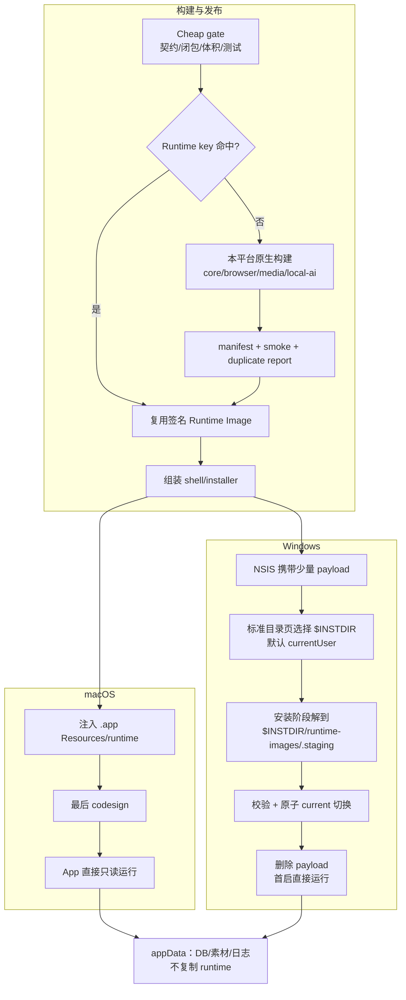
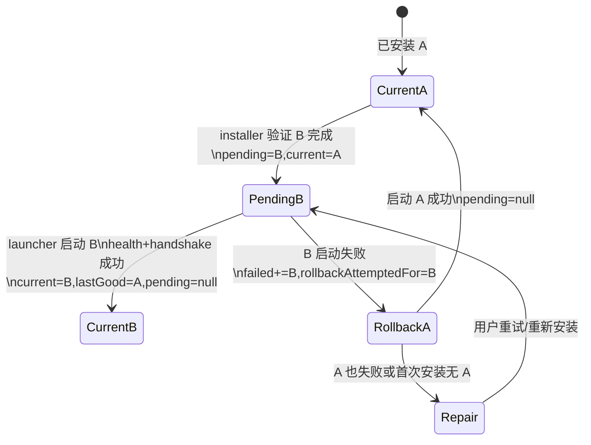

# CreatorOS 跨平台打包、运行时去重与零白屏首启候选架构 + RAT 授权 SPEC（T-487）

> 状态：PLAN / 用户已于 2026-07-24 确认“Runtime 分层缓存 + Windows 安装期物化到
> `$INSTDIR` + 首启零解压”的核心方向，并授权免费 RAT 与本地工程实现；正式付费构建、
> Windows 对外支持和删除首启兜底仍需后续 Gate。
> 日期：2026-07-23
> 任务：T-487；合并 T-454 的剩余范围。
> 前置证据：[T-487 调研](../../research/2026-07-23-desktop-packaging-skills-manager-reference.md)。
> 宪法：`docs/产品定位.md:27-37,296-302,328-336,370-383`。
> 硬边界：本 SPEC 只请求执行不收费的本地/fixture RAT；不授权触发 CreatorOS 正式打包或付费 GitHub Actions。RAT 结果回填、独立复审和用户第二次确认前，本文 Runtime Image/平台安装策略都只是候选，不是已批准架构。

> 2026-07-24 进展：RAT-PKG-01 的本地 production closure 已把文件数从 44,082 降至
> 26,427（-40.05%），可识别重复字节从 183,232,981 降至 21,140,787（-88.46%），两项
> cheap gate 均通过；HyperFrames/Playwright/Xenova+ONNX 局部真加载通过。RAT-PKG-04 已接入
> exact Runtime Image cache workflow，但首次正式 cache-hit 时长仍待以后单次付费构建验证。
> RAT-PKG-02 继续 `BLOCKED(platform)`，所以 Windows 首启零解压尚未宣称完成。证据见
> `docs/research/2026-07-24-t487-runtime-dedup-and-cache-evidence.md`。
>
> 2026-07-24 独立实现复审补记：stock NSIS `POSTINSTALL` 失败无法回滚此前已写入的
> exe/注册表/快捷方式；当前壳的哈希/manifest 也不能验证上一版本 runtime。因此当前实现
> 采用“安装期失败保留 tar、首启兼容修复”的 fail-forward，并只保留 `current`，没有伪造
> `previous/lastGood`。本文 ENT-PKG-04 的签名 last-good 目标不变，仍是 T-487 未关闭 Gate；
> 须通过每 runtime 签名 manifest 或 custom updater RAT 后才能宣称跨版本回退。

## 1. Problem

CreatorOS 的离线桌面能力需要 Next/Node sidecar、Chromium、ffmpeg、ONNX 和原生依赖；当前构建把这棵大运行时反复复制、物化、压缩、再在用户首启时完整展开。

已量化 baseline：

- Windows 最近一次成功 build job 约 53 分 26 秒，`release.mjs` 约 49 分 34 秒；
- macOS 本地 `sidecar.tar.gz` 约 406 MiB，展开约 1.28 GiB；
- tar 52,212 条目，其中 49,816 条在 `node_modules`；
- 用户报告 Windows 首次启动约 30 分钟；
- UI 只显示静态阶段文案，没有真实字节/文件进度；
- Windows 新实现已走 tar，但 build hash、测试和注释仍停留在旧直装契约。

问题不是“文件大”本身，而是用户为真实能力之外的 **重复副本、重复计算、重复展开和不可见等待** 付费。

## 2. Users & scenarios

### USER-PKG-01 创作者

可能使用普通 Windows 10/11 或 macOS 电脑，系统盘空间有限；只关心“装完能开、进度看得懂、失败不会毁数据”，不应理解 pnpm、tar 或 sidecar。

### USER-PKG-02 发布者

构建额度有限，需要在正式 runner 启动前知道依赖闭包、包体预算和平台契约是否正确；单端故障不应陪跑另一端。

### USER-PKG-03 维护者

需要知道每个大文件属于哪个能力、为什么入包、哪个阶段慢、缓存为何失效；不能再靠多轮付费构建猜 Windows junction 或 native ABI。

### 当前非目标用户

- 需要企业级集中部署、域控、SCCM/Intune 策略和多人共享数据目录的组织；
- 需要 Windows ARM64、Linux 或 Mac App Store 分发的用户；
- 希望只安装 20 MiB 壳、使用时再联网下载全部能力的用户。

### 核心场景

- FLOW-PKG-01：Windows 新装，用户选择 runtime/cache 位置，安装器显示真实进度，完成后首次打开 5 秒内可交互。
- FLOW-PKG-02：macOS 拖入 Applications 后首次打开，直接使用 App 内只读 runtime，不展开 1 GiB 副本。
- FLOW-PKG-03：应用升级，先准备并验证新 runtime，成功后原子切换；失败继续使用上一版。
- FLOW-PKG-04：只改 UI/shell，CI 复用相同 Runtime Image，不重新组装 Chromium/Node 依赖。
- FLOW-PKG-05：依赖/ABI/browser revision 变化，cache 必须失效并在本平台原生 runner 重建。
- FLOW-PKG-06：磁盘不足、安装取消、签名/哈希失败时，不留下“安装成功但打不开”的半成品。

## 3. Value & viability

### 3.0 Appetite

探索 appetite 为 **最多四个工程日完成 RAT-PKG-01～05 的 fixture/静态验证与证据回填，不触发 CreatorOS 正式包**；最终实现 appetite 暂记为 **两个工程周完成 Wave 0–4 的全部工程实现、cheap verification 和 fixture/单机验证，另申请最多各一次 Windows x64、macOS arm64 正式付费构建做最终验证**，但只有 blocker RAT 全部得到 verdict 后才冻结。T-487 在 FR-PKG-01～12、AC-PKG-01～11 全部关闭前不得标完成；若用户尚未授权付费 runner，任务保持 blocked，不以“代码已写”代替发布验证。不得通过砍掉离线能力、跳过 clean-machine smoke 或保留首启整包解压来静默赶工。

### 3.1 五类风险

| 风险 | 当前证据 | 最便宜检验 | 若判断错的代价 | 通过条件 |
|---|---|---|---|---|
| Value：用户是否接受“安装期真实进度换取 5 秒首启” | 1 位用户报告约 30 分钟白屏并要求修复，只证明痛点存在 | RAT-PKG-VALUE；fixture 后观察 3 位目标用户或 3 次独立目标环境安装 | 把等待挪到安装阶段但完成率/信任不改善 | 3/3 完成安装并进入主界面；至少 2/3 明确接受该取舍；失败者能说出恢复动作 |
| Usability：安装阶段重活是否可理解 | 当前只有固定“5–10 分钟” | RAT-PKG-02 后用 fixture 观察 3 人完成/取消/重试 | 重活从首启挪到安装，但用户仍以为卡死 | 3/3 能说出进度、目标盘与恢复动作 |
| Feasibility：Windows 安装器能否原子物化 | Tauri 标准 NSIS 已有安装目录页并支持 hooks/custom template，但本仓未验证大 runtime 事务 | 本次只申请 RAT-PKG-02，预计 1–2 天 | stock hook 不足则验证 custom template；两者都失败才回 PLAN | 进度、失败清理、升级、所选 `$INSTDIR` 复用全过 |
| Feasibility：生产依赖能否去重 | 95.4% 条目在 node_modules，当前有动态加载特例 | 本次只申请 RAT-PKG-01，预计 1–2 天 | 缩包导致真机缺模块，属于发布阻断 | 四主链 smoke 全过且文件数下降 ≥30% |
| Business/dependency：CI 缓存与 native runner 是否可用 | 49m34s 全塞在 release.mjs；mac x64 无已验证原生 runner | RAT-PKG-04/05；查询 runner 后做 native fixture | 继续烧额度，或错误宣称 Intel 支持 | shell-only 复用、runtime 输入必失效；每个宣称平台有原生 clean-machine 证据 |

### 3.2 替代方案

| 方案 | 好处 | 代价/触发器 | 决策 |
|---|---|---|---|
| 忍着不解决 | 零改造 | 每次构建继续约 50 分钟，用户首启可到 30 分钟 | 否决 |
| 只换 gzip 为 zstd | 压缩/解压可能更快 | 仍保留整包首启展开、双副本、无阶段缓存 | 否决为完整方案；可作实现细节 RAT |
| Windows/mac 都直接 bundle 5 万文件 | 首启不展开 | Windows NSIS 构建曾因数万小文件卡 20–60+ 分钟 | 否决 |
| 首启在线下载大依赖 | 初始包变小 | 违背离线首装可靠性，网络失败把问题转嫁给用户 | 第一阶段否决 |
| 全部改成 Rust/Vite，照抄 skills-manager | 理论上最小最快 | 重写 CreatorOS 的 Next/API/AI 业务面，风险与收益不匹配 | 否决 |
| Runtime Image + 平台安装策略 | 保留功能，消除首启展开，并能缓存 | 需要 installer/mac bundle RAT | 采用 |

### 3.3 被否决的产品形态

| 形态 | 否决理由 | 可翻案信号 |
|---|---|---|
| 轻量启动器 + 首次联网下载 Chromium/AI runtime | 未配置网络或渠道不可用时核心功能残缺，不符合本地优先可靠性 | 用户明确接受联网安装，且下载支持断点续传、签名与可靠 CDN |
| 仍在首次打开准备，只把转圈做漂亮 | 进度 UI 不能抵消 30 分钟关键路径，违反 P95 ≤5 秒 | 没有；除非宪法性能目标经 DEC 正式修改 |
| 所有用户统一放 C 盘 | 不提供空间预检和位置选择，磁盘满时只能模糊失败 | Runtime Image 实测压缩/展开总占用低于 300 MiB |
| 全部直接铺成数万文件给 NSIS | 已有 20–60+ 分钟构建卡顿证据 | production closure 把 Windows 文件数降到 5,000 以下且 installer fixture ≤5 分钟 |

### 3.4 PR-FAQ

**Q：为什么安装包仍不可能像 skills-manager 一样只有十几 MiB？**
A：CreatorOS 的 Chromium、Node、ONNX、ffmpeg 是真实离线能力，不是打包垃圾。目标是删除重复成本并让每个大 layer 有归属，不伪造 20 MiB 指标。

**Q：是不是要首次启动联网？**
A：不是。第一阶段仍全量离线随包；分层用于缓存、校验、增量更新和进度，不把功能依赖转成运行时下载。

**Q：Windows 为什么仍会用 AppData？**
A：DB/日志等可写数据必须在用户可写位置，但约 1 GiB 的 runtime/cache 在安装时可选择本地盘；界面显示默认路径、需要空间与可用空间。

**Q：升级失败会不会丢项目？**
A：不会。Runtime Image 与用户数据分开；Windows 新 runtime 在 staging 验证、启动成功后才切换，失败继续使用 last-good；macOS 更新替换失败保留原 App，替换后启动失败给上一版安装入口。卸载/清理禁止碰 DB、素材和密钥。

**Q：迁移成本是什么？**
A：需要 production closure、Windows installer hook、mac app 注入/重签和 CI 分层；通过 5 个 fixture RAT 后才允许正式构建，避免用昂贵 CI 试错。

### 3.5 Pre-mortem

假设 T-487 三周后失败，最可能死因：

| 死因 | 可反驳信号 | 防线 |
|---|---|---|
| 裁剪依赖后某条冷门功能缺模块 | 四主链只做启动没做真实调用 | 每 layer owner + 动态加载清单 + clean-machine smoke |
| runtime cache 复用错平台/ABI | manifest OS/arch/Node ABI 不匹配 | key 与运行时启动双重校验 |
| installer 显示完成但 runtime 半成品 | hook exit code/atomic switch 未验证 | staging + manifest verify + current pointer |
| mac 注入 runtime 后签名失效 | codesign 在注入前执行 | 注入后最后签名，CI `codesign --verify --deep --strict` |
| 为缩包砍掉离线 Chromium | 只盯 MiB 指标 | browser layer 仍 required，能力 smoke 作 gate |
| 任务再次演化成“一次正式构建一个猜测” | RAT 未产生工件就启动 release | paid-build gate 必须读取 RAT verdict |

### 3.6 Success signals

- 北极星：干净机器从点击 CreatorOS 图标到主界面可交互 P95 ≤5 秒。
- 护栏：四主链 clean-machine smoke 通过率 100%，不能用体积换功能。
- 成本：Runtime Image cache 命中的单平台正式任务 ≤20 分钟。
- 磁盘：安装完成后不保留 Runtime Image 的大压缩 payload 副本。
- 质量：Windows/mac 平台契约静态测试无漂移，任何资源策略变化必须同改 config/build/runtime/test。
- 检验时点：每个 PR cheap gate；每次 runtime artifact；每次正式 release；发布前各平台一台干净机。

### 3.7 采纳门槛

| 决策点 | 进入条件 | 不满足时 |
|---|---|---|
| 用户确认本 SPEC | 只授权 RAT-PKG-01～05，不等于确认候选架构 | 不执行 RAT，不写实现 |
| 最终架构确认 | blocker RAT 结果已回填、候选架构按证据修订、独立审核非 FAIL | 不进入 Wave 0–4 |
| 进入 Runtime Image 实现 | Wave 0 漂移关闭、inventory 可重现 | 不触发 runtime 构建 |
| 采用 Windows installer hook | RAT-PKG-02 全部通过 | 回 PLAN 评估自定义 template/installer |
| 删除旧首启解压路径 | 对应平台 clean-machine 安装/升级/回滚通过 | 保留旧版发布，不发布新架构 |
| 触发正式付费构建 | cheap gates、RAT、用户单次授权全部存在 | 不启动 runner |

首次价值步骤从“下载→安装→首次解压→启动”减少为“下载→安装（可见进度）→启动”；Windows 安装器把路径和空间决策放在写入前，macOS 保持拖入 Applications 的既有习惯。

## 4. Scope

### 4.1 In scope

- Runtime Image manifest 与 layer 边界；
- production dependency closure 去重；
- Windows 安装期一次物化、真实进度、路径选择与失败恢复；
- macOS App 内只读 runtime 直跑；
- 构建阶段拆分、缓存、单平台选择与付费前 cheap gate；
- 包体/重复文件/文件数/阶段耗时预算；
- macOS arm64、Windows x64；
- macOS x64 的支持判定 gate；
- 修复现有 Windows tar/hash/test 契约漂移；
- T-454 合并与台账收口。

Windows x64 在本任务中是 **实现与证据补齐目标，不是当前已支持的公开发布平台**。沿用既有 [DEC-W 条件提案](2026-07-17-license-hardening-and-dual-platform-design.md#10-宪法修正案-dec-w产品范围变更需-gate-批准)：在 Windows clean-machine 四主链、安装/升级/回滚和本 SPEC 全部退出条件达成前，`docs/产品定位.md:61-64,445-455` 的“不得宣称支持/不承诺正式分发”继续有效。用户确认本 SPEC 时还需明确确认 **DEC-PKG-01：继续实施 Windows 证据补齐，但只在所有退出条件达成后再更新宪法并进入正式发布**。

### 4.2 Out of scope

- 把 CreatorOS 改写成纯 Rust/Vite；
- 删除 Chromium、ffmpeg、ONNX 等现有离线能力；
- Linux 正式分发；
- 在线按需下载 runtime；
- 改授权/反逆向策略；
- 本 SPEC 阶段触发任何正式打包。

### 4.3 Assumptions

- ASM-PKG-01：Chromium、ffmpeg、ONNX 等离线能力继续是正式包需求；若产品决定改为在线按需下载，必须另开产品变更 SPEC。
- ASM-PKG-02：Windows 正式目标为 Windows 10/11 x64、本地固定 NTFS 盘；网络盘/可移动盘不在支持范围。
- ASM-PKG-03：macOS arm64 是当前正式目标；x64 只有 HARD-PKG-05 通过后加入。
- ASM-PKG-04：Runtime Image 只读，业务数据只写 canonical appData/dataRoot；任何需要写 package directory 的依赖必须改到 cache/data port。
- ASM-PKG-05：Tauri 标准 NSIS 目录页 + installer hook 是首选扩展面，不绑定 hook 一定能满足真实进度/回滚；hook 不足先验证 custom template，再失败才回 PLAN，不以首启解压兜底。
- ASM-PKG-06：Windows 10/11 x64 是证据补齐目标；WebView2 缺失时如何处理尚未获用户确认，禁止默认写成“完全离线已满足”。

## 5. Candidate architecture（待 RAT，未批准）

### 5.1 候选目标图



### 5.2 领域对象

#### ENT-PKG-01 RuntimeManifest

```ts
type RuntimeManifest = {
  schemaVersion: 1;
  runtimeId: string;
  appVersion: string;
  platform: "darwin" | "win32";
  arch: "arm64" | "x64";
  nodeAbi: string;
  createdFrom: {
    gitSha: string;
    appSourceSha256: string;
    lockfileSha256: string;
    nextConfigSha256: string;
    packagerSha256: string;
    normalizedClosureSha256: string;
    dynamicDependencyRegistrySha256: string;
    chromiumRevision: string;
  };
  layers: RuntimeLayer[];
  entrypoints: {
    sidecar: string;
    health: string;
  };
};
```

#### ENT-PKG-02 RuntimeLayer

```ts
type RuntimeLayer = {
  id: "app-code" | "node-runtime" | "browser" | "media" | "local-ai";
  requiredAtStartup: boolean;
  sha256: string;
  compressedBytes: number;
  expandedBytes: number;
  fileCount: number;
  payload: string;
  owners: string[];
  smoke: string[];
};
```

#### ENT-PKG-03 RuntimeInstallation

```ts
type RuntimeInstallation = {
  runtimeId: string;
  root: string;
  state: "staging" | "ready" | "failed" | "previous";
  verifiedAt: string | null;
  lastErrorClass: string | null;
};
```

#### ENT-PKG-04 RuntimeRegistry（Windows）

```ts
type RuntimeRegistry = {
  schemaVersion: 1;
  generation: number;
  current: string | null;
  lastGood: string | null;
  pending: string | null;
  failed: Array<{
    runtimeId: string;
    errorClass: string;
    failedAt: string;
  }>;
  rollbackAttemptedFor: string | null;
  updatedAt: string;
};
```

存储与并发契约：

- 首选文件固定为 `<installDir>/runtime-images/runtime-registry.json`，锁为 `<installDir>/runtime-images/.runtime-install.lock`；只有 RAT 证伪该布局时才改用独立 `<runtimeRoot>`；
- installer 与 launcher 修改 registry 前必须取得同一 OS 进程锁；锁持有者崩溃后可由新进程回收；
- 写入 `runtime-registry.json.tmp-<pid>`，flush + fsync 后在同目录 atomic replace；`generation` 每次提交 +1；
- runtime 目录只能是 `<runtimeBase>/<runtimeId>` 或 `<runtimeBase>/.staging/<runtimeId>`，首选 `runtimeBase=<installDir>/runtime-images`；
- registry 中任何 id 都必须通过 manifest/path containment，不能接受外部绝对路径。

状态机：



断电恢复：

- 只有 `.staging`、registry 无 `pending`：删 staging；
- `pending=B` 且 B 完整：launcher 继续一次 B 验证；
- `pending=B` 但 B 不完整：登记 failed，回到 current/lastGood；
- `rollbackAttemptedFor=B` 后同一 B 不再自动重试；
- B 成为 current 后 A 必须继续作为 lastGood 保留；只有后续 C 成功、B 接任 lastGood 后才允许清理 A；
- 清理不变量：任何被 `current`、`pending` 或 `lastGood` 引用的 runtime 目录都禁止删除；TEST-PKG-STATE-07 注入清理任务验证该不变量。

macOS 不使用该 registry：runtime 与签名 `.app` 是同一发布单元。失败恢复定义：

| 失败点 | 检测 | 上一版本来源 | 用户动作 | 验收 |
|---|---|---|---|---|
| 下载/签名验证失败 | 替换前校验 | 当前已安装 `.app` | 关闭错误/重试 | 当前 App 未变化，离线仍能打开 |
| 替换过程失败 | updater 原子替换结果 | 当前 `.app` | 重试/打开日志 | 原 App 保留；用户数据不变 |
| 替换成功但新版本首次启动失败 | 独立 updater helper 等待 health/handshake 超时 | **替换前已落本机并验签的上一版 `.app.tar.gz`** | helper 离线恢复上一版并再次验签；若本地 rollback artifact 不存在则拒绝开始更新 | 断网状态自动恢复上一版，项目/素材 hash 不变 |

macOS 候选更新契约：

- updater 开始替换前必须确保本机已有当前版本的签名 rollback archive；没有则在旧 App 仍可用时下载并验签，失败就不更新；
- rollback archive 只在更新事务期间保留，放 `<appData>/updater/rollback/<version>/`，新 App 首次 health+handshake 成功后删除；
- 独立 updater helper 负责替换和 watchdog，不能依赖可能已坏的新 App UI；
- rollback archive 是临时更新副本，不计入稳定安装后的 NFR-PKG-08；事务终态必须为 0；
- RAT-PKG-03 必须覆盖“替换成功→断网→新 App health 失败→离线恢复旧 App”。

### 5.3 物理层边界与缓存语义

| 层 | 内容 | 典型失效输入 | UI 改动是否失效 |
|---|---|---|---|
| shell | Tauri/Rust launcher、installer UI/hooks | Rust/Cargo/Tauri/installer | 否 |
| app-code | `server.js`、`.next/server`、`.next/static`、backend app/migrations、字节码/混淆产物 | app source、Next build config、obfuscation inputs | **是** |
| node-runtime | Node launcher、规范化 production `node_modules` closure、native `.node` | lockfile、Node ABI、closure manifest、dynamic registry | 仅 closure 变化时 |
| browser | Chromium + Playwright bridge | browser revision/bridge | 否 |
| media | ffmpeg/ffprobe | binary/version/fetch script | 否 |
| local-ai | ONNX/Xenova/native models runtime | lockfile/native ABI/registry | 仅 closure 变化时 |

整个 `runtimeId` 在 app-code 变化时会变化；优化目标不是让 UI 改动保持整个 Runtime Image digest 不变，而是让 `node-runtime/browser/media/local-ai` 的内容 digest 和 artifact 可复用，只重建 app-code 和最终 manifest/installer。

规范化闭包：

1. Next build 产出 trace；
2. 合并版本化 `dynamic-dependency-registry`；
3. 生成排序、路径归一、去构建机前缀的 `normalized-closure.json`；
4. 其 SHA-256 进入 manifest 和 node/local-ai layer key；
5. source 新增动态依赖但未登记时，closure contract test 必须失败，不允许复用旧 layer。

### 5.4 路径契约

| 数据 | macOS | Windows |
|---|---|---|
| shell | `/Applications/CreatorOS.app` | 用户选择的 install dir，默认 `%LOCALAPPDATA%\\Programs\\CreatorOS` |
| runtime | `.app/Contents/Resources/runtime/<id>` | 首选跟随用户选择的 install dir：`$INSTDIR\\runtime-images\\<id>` |
| DB/密钥/日志 | canonical appData | canonical appData |
| 大缓存 | canonical appData/cache，可迁移 | canonical cacheRoot；其迁移不与安装器 runtime 事务混写 |

约束：

- install dir/runtimeBase 只接受本地固定磁盘的绝对路径；
- 禁止网络盘、UNC、可移动盘作为默认；
- 任何路径写入前 canonicalize/containment；
- 安装/升级/卸载不得递归删除 appData 根，只能删 manifest 登记的 runtime/cache 子树；
- Windows current pointer 只能指向同一 runtimeBase 内已验证的 runtimeId；
- normal uninstall 删除 runtime-images，但默认不得删除 DB、素材、日志、密钥；只有用户明确勾选清除用户数据时才走独立确认语义。

## 6. Functional requirements

### 6.0 FR 价值注

| 抽查 FR | 若删除，用户失去什么 |
|---|---|
| FR-PKG-03 | Windows 用户仍会遇到黑箱等待、系统盘不足和半安装状态 |
| FR-PKG-04/05 | 首次打开仍需完整解压，核心“零白屏首启”价值消失 |
| FR-PKG-07/08 | 每次 UI 改动仍重建大 runtime，付费构建成本不降 |
| FR-PKG-09 | 包体重复与回归重新变成肉眼猜测，无法守住优化结果 |
| FR-PKG-12 | 为缩包牺牲真实采集/转录/渲染能力，方案失去产品价值 |

### FR-PKG-01 Runtime 清单

每个正式 Runtime Image 必须生成 ENT-PKG-01/02 清单；任何大于 10 MiB 的文件或 layer 必须能追溯到 owner 和 smoke。

### FR-PKG-02 生产闭包

打包器只允许三类文件进入 runtime：

1. Next Output File Tracing 声明；
2. 明确登记的动态加载补丁；
3. browser/media/local-ai layer 声明。

禁止无 owner 的整棵依赖 anchor。Windows Image 内不得有指向 workspace、pnpm store 或 runner 盘符的 symlink/junction。

### FR-PKG-03 Windows 安装体验

安装器必须：

- 优先复用 Tauri 标准目录页展示 install dir，让 shell 与 runtime 一起选择其他本地固定磁盘；
- 在写入前展示所选 install dir、runtime 展开后需要空间和可用空间；
- 以 staging 目录准备；
- 至少每 1 秒更新真实 bytes 或 files；
- 显示已用时间与当前 layer；
- 支持取消；
- 校验成功后原子切换；
- 删除安装目录中的大 payload；
- 失败显示错误分类、日志位置、重试/更换位置/保留旧版动作。

stock NSIS + hooks 若不能满足进度/取消/升级保留 `lastGood`，必须先进入 custom template RAT；只有 RAT 证明 `$INSTDIR/runtime-images` 不可行，才允许增加独立 runtimeRoot 与第二套选盘 UI。

### FR-PKG-04 macOS 首启

macOS 正式 App 必须从签名后的 `.app/Contents/Resources/runtime/<id>` 只读启动；首启不得把完整 runtime 复制或解压进 appData。

### FR-PKG-05 应用启动

主窗口必须先出现；启动关键路径只允许：

- 读取 manifest/current；
- O(1) 必需入口存在性校验；
- 启动 core sidecar；
- health/handshake。

旧 runtime 清理、迁移、缓存预热、更新检查全部后台运行。每段记录 `runtimeId/platform/arch/elapsedMs/result`。

### FR-PKG-06 升级与回滚

Windows 升级按 ENT-PKG-04 先准备新 runtime，验证后写 `pending`；启动成功才提交 `current`，启动失败自动回到 `lastGood` 一次并显示恢复结果。失败版本保留诊断，不反复自动重试。macOS 按签名 App archive 原子替换，替换失败保留原 App；替换后失败提供上一版安装入口。用户数据不参与 runtime/App 回滚。

### FR-PKG-07 CI 分层

工作流拆为：

1. cheap-preflight；
2. runtime-image；
3. shell-installer；
4. clean-machine-smoke；
5. publish。

`workflow_dispatch.only` 保留并扩为明确 platform/arch。普通代码提交不得自动触发付费正式包；tag/人工触发才进入 2–5。

### FR-PKG-08 Cache 正确性

Runtime key 必须包含：

- OS/arch；
- pnpm lockfile；
- Node version/ABI；
- Next config 与 tracing root；
- app source digest（仅 app-code layer）；
- 实际 `normalized-closure.json` digest；
- `dynamic-dependency-registry` digest；
- build-sidecar/obfuscate/bytecode/legal scripts；
- browser revision；
- native layer inputs；
- security manifest format。

shell-only 源码变化不得让 heavy layers 失效；app source 变化必须让 app-code layer 失效；closure/registry 变化必须让 node-runtime/local-ai layer 失效；上述其他对应输入变化必须精确失效。

### FR-PKG-09 包体门

每次 runtime-image 输出：

- path/bytes/hash/layer/owner；
- top 50 文件；
- byte-identical duplicate groups；
- 与上一个 release 的增删 diff；
- compressed/expanded/fileCount。

无 DEC 时：

- 压缩包相对 baseline 不得增长 >5%；
- 文件数不得增长 >5%；
- 新增 >10 MiB 文件必须有 owner。

### FR-PKG-10 平台支持

- macOS arm64、Windows x64 是实现目标；
- Windows 在 DEC-PKG-01 退出前仍是“证据补齐中”，不得对外宣称正式支持；
- macOS x64 仅在 x64 原生 Node/native/browser image 于 clean Intel 环境通过后进入正式矩阵；
- 未过 gate 时产品文案不得宣称支持；
- 不允许把 arm64 产物重命名或交叉拼装为 x64。

### FR-PKG-11 契约单一真值

资源策略的 config、build.rs、runtime、workflow validator、tests 必须由同一 `runtime-packaging-contract` 派生或相互断言。Windows tar/hash/test 当前漂移必须在 Wave 0 关闭。

### FR-PKG-12 离线能力不缩水

browser/media/local-ai 默认随正式包交付；扫码、收藏夹、转录、视频渲染、核心 AI 四主链不能因缩包回退为运行时下载或假成功。

## 7. Non-functional requirements

| ID | 要求 |
|---|---|
| NFR-PKG-01 | 干净机点击图标到主界面可交互 P95 ≤5 秒 |
| NFR-PKG-02 | 应用首次启动完整 runtime 解压次数 = 0 |
| NFR-PKG-03 | 安装准备状态更新间隔 ≤1 秒；静态白屏 >1 秒次数 = 0 |
| NFR-PKG-04 | runtime cache 命中的单平台正式 workflow ≤20 分钟 |
| NFR-PKG-05 | runtime image job 任一阶段最长 ≤15 分钟并有独立计时 |
| NFR-PKG-06 | Runtime Image 文件数相对 52,212 baseline 至少下降 30% |
| NFR-PKG-07 | byte-identical duplicate bytes 相对 baseline 至少下降 80% |
| NFR-PKG-08 | 安装完成后安装目录内大 runtime payload 副本数 = 0 |
| NFR-PKG-09 | Windows 磁盘不足、取消、校验失败后 staging 残留 = 0，存在 lastGood 时回退可启动率 = 100%；mac 替换失败原 App 保留率 = 100% |
| NFR-PKG-10 | manifest/hash/path 日志不得包含 secret；构建机绝对路径命中数 = 0 |
| NFR-PKG-11 | 各平台 clean-machine 四主链 smoke 通过率 = 100% |
| NFR-PKG-12 | 构建前后用户数据 hash 不变，后台 CreatorOS 进程增量 = 0 |

## 8. UX / IA

### IA-PKG-01 Windows 安装“存储位置”页

```text
CreatorOS 安装
├─ 应用位置       C:\Users\...\Programs\CreatorOS   [更改]
├─ 运行时与缓存   D:\CreatorOS                      [更改]
├─ 需要空间       1.6 GB
├─ 可用空间       84.2 GB
└─ [返回] [安装]
```

说明：“项目、素材和密钥不会在卸载或运行时升级时被删除；运行时与缓存可重新生成。”

### IA-PKG-02 安装进度页

```text
正在准备 CreatorOS
浏览器能力  68%  ███████████░░░░
842 MB / 1.24 GB · 02:41 · 正在校验

[取消安装]
```

禁止只显示“正在处理，请稍候”。

### IA-PKG-03 恢复页

必须区分：

- 空间不足；
- 文件被占用；
- payload 损坏/签名失败；
- 路径不可写；
- runtime 与本机架构不匹配；
- 上一版仍可用。

动作只展示真实可执行项：重试、更换位置、打开日志、继续使用上一版、退出。

## 9. Failure and compensation

| 故障 | 行为 | 禁止 |
|---|---|---|
| 磁盘不足 | 写前阻止，显示差额与更换位置 | 解到一半才失败 |
| 安装取消 | 删除 staging，保留 current/用户数据 | 留半成品并显示成功 |
| 哈希失败 | 删除新 staging，保留 payload 供诊断或重新安装 | 继续启动未验证 runtime |
| 文件占用 | 保留 last-good，给关闭进程/重试 | 强删运行中目录 |
| Windows 首启 core 启动失败 | 单次回滚 last-good，显示错误类与日志 | 无限重启/无期限转圈 |
| 升级失败 | current 不变 | 先删旧版再准备新版 |
| 清理失败 | 后台下次重试，有大小与路径日志 | 阻塞首屏 |
| mac 签名失败 | CI 阻断发布 | 让用户看到“App 已损坏” |

Windows ENT-PKG-04 每条转移必须有故障注入测试：

- staging 解包中断；
- manifest 校验后、registry 写前崩溃；
- registry tmp 写完、atomic replace 前崩溃；
- `pending` 首次 health 超时；
- B 失败后 A health 成功/失败；
- installer 与 launcher 同时争锁；
- 清理 lastGood 时文件占用。

## 10. 现网事实与现成方案证据

### 10.1 仓内事实

| 断言 | 直接证据 | 设计影响 |
|---|---|---|
| 当前全平台生成 tar | `frontend/scripts/desktop/build-sidecar.mjs:258-266` | 不能再按旧 Windows direct 口径设计 |
| Windows bundle 资源是 tar | `frontend/src-tauri/tauri.windows.conf.json:6-10` | installer 当前只看到单 payload |
| Windows build hash 仍为空 | `frontend/src-tauri/build.rs:35-45` | Wave 0 必须先修完整性漂移 |
| Windows 测试仍断言 direct/no-tar | `frontend/scripts/desktop/windows-runtime-config.test.mjs:10-24` | 测试与生产相反，Wave 0 阻断 |
| 首启同步展开整包 | `frontend/src-tauri/src/lib.rs:761-834,881-916` | 必须移出应用首启关键路径 |
| splash 无真实进度 | `frontend/src-tauri/src/lib.rs:837-850` 只有字符串 eval；`extract_sidecar_tarball:761-834` 无 callback | 不能靠现 splash 达成 FR-PKG-03 |
| CI 全链是单步骤 | `.github/workflows/desktop-release.yml:92-109` | 无阶段缓存/定位，需拆 job |
| Windows 已校验 setup 只带 tar | `.github/workflows/desktop-release.yml:111-130` | 直接铺目录会回归小文件构建问题 |
| Windows `installMode` 为 `both` | `frontend/src-tauri/tauri.windows.conf.json:10-14` | Tauri 官方说明该模式要求管理员权限；需比较 `currentUser`，不能把 UAC 当无成本默认 |
| Windows runtime 无视 `$INSTDIR` | `frontend/src-tauri/src/lib.rs:881-912` 固定 `app_data_dir()/runtime/<version>` | 用户即使在标准目录页选 D 盘，大 runtime 仍回 C 盘；这是本仓设计，不是 Tauri 限制 |
| WebView2 未显式配置 | `tauri.conf.json` / Windows overlay 均无 `webviewInstallMode` | 走 Tauri 默认在线 bootstrapper，与“完全离线”口径不一致 |
| Windows 未做 Authenticode | `certificateThumbprint:null`；workflow 明示 `signed:false` | updater minisign 不能消除 SmartScreen；对外发布必须单独设签名 gate |
| 当前 closure 有动态特例 | `frontend/scripts/desktop/build-sidecar.mjs:118-255` 包外 link 物化/剪枝 | 官方 trace 不能未经 RAT 直接替换 |
| current/last-good registry 无实现 | 反证：`rg -n "RuntimeRegistry|lastGood|rollbackAttemptedFor" frontend/src-tauri frontend/scripts/desktop` 在本 SPEC 前无 runtime registry 命中 | ENT-PKG-04 是新增契约，不假装复用 |

### 10.2 现成方案

| 候选 | 官方/仓内来源 | 采用/弃用 |
|---|---|---|
| Next `output: standalone` / Output File Tracing | [Next output 文档](https://nextjs.org/docs/15/app/api-reference/config/next-config-js/output)；仓内 standalone 复制见 `build-sidecar.mjs` | **采用为基础**；动态加载必须 registry 补齐 |
| `pnpm deploy --prod` isolated deploy | [pnpm deploy](https://pnpm.io/cli/deploy) | **RAT 候选**；只有 Win 零外链 + 四主链过才替换 custom closure |
| Tauri 标准 NSIS 目录页 + hooks/template | [Tauri Windows Installer](https://v2.tauri.app/distribute/windows-installer/) · [官方模板](https://github.com/tauri-apps/tauri/blob/dev/crates/tauri-bundler/src/bundle/windows/nsis/installer.nsi) · [本项目官方核对](../../research/2026-07-23-tauri-windows-packaging-official-practices.md) | **首选 stock 目录页 + hooks 做 RAT**；hooks 不够才自定义 template |
| Tauri WebView2 modes | [WebView2 Installation Options](https://v2.tauri.app/distribute/windows-installer/#webview2-installation-options) | **待 DEC-PKG-04**；不采用 `skip`，在线小包/完全离线需明确取舍 |
| Tauri Windows updater passive mode | [Tauri Updater](https://v2.tauri.app/plugin/updater/#installmode-on-windows) | 当前客户端 updater 未启用；恢复时显式 `passive`，并复测 installer hooks |
| Windows Authenticode | [Tauri Windows Code Signing](https://v2.tauri.app/distribute/sign/windows/) | 内测可诚实未签名；正式对外发布必须签名+timestamp |
| 当前全平台首启 tar | 仓内 `build-sidecar.mjs:258-299` + `lib.rs:761-916` | **弃用为目标架构**；仅保留到对应平台 clean-machine 新链通过 |
| 直接 bundle 数万文件 | T-454 注释 `build-sidecar.mjs:258-263` 与 workflow `:121-130` | **弃用**；Windows 构建成本已证伪 |
| Node SEA/ncc/esbuild | Node/工具候选，无本仓兼容证据；反证搜索未发现生产入口使用 | **不进入 T-487 实现**；独立研究 |

## 11. Hard problems and RAT gates

| HARD | Blocker | 解决阶段 | Owner package/area |
|---|---|---|---|
| HARD-PKG-01 | 无可证明的 production closure 就不能删复制逻辑 | PLAN→Wave 1 | `frontend/scripts/desktop` + Next config |
| HARD-PKG-02 | stock NSIS + hook 不具备原子/进度/回滚就不能删 Win 首启解压；hook 失败需验证 custom template | PLAN→Wave 3 | `frontend/src-tauri/windows` |
| HARD-PKG-03 | App 注入后签名/相对链不成立就不能删 mac 首启解压 | PLAN→Wave 2 | `frontend/src-tauri` + release scripts |
| HARD-PKG-04 | 单二进制兼容未证实 | 独立研究，不阻塞 | desktop research |
| HARD-PKG-05 | 无 x64 原生 runner/真机证据就不得宣称 Intel 支持 | PLAN/Release | CI + release governance |
| HARD-PKG-06 | WebView2 离线口径与 Authenticode 未定，不能宣称 Windows 正式发布体验闭环 | PLAN/Release | Tauri config + release governance |

### RAT 准入表

| RAT | 内容 | 当前状态/证据 | 阻塞性 | 适用平台 | 正式构建依赖 |
|---|---|---|---|---|---|
| RAT-PKG-01 | production closure 对比与四主链 image smoke | `FAIL(local baseline)`；现有 mac runtime 44,082 文件，相对 52,212 baseline 仅下降 15.57%，未达 30%；尚无候选 closure 的四主链 smoke | blocker | mac/Windows | 两端都必过各自原生结果 |
| RAT-PKG-02 | stock NSIS 目录页 + hook/custom template：路径/进度/取消/升级/WebView2/压缩 fixture | `BLOCKED(platform)`；当前 mac 主机无 `makensis`/Wine/PowerShell，且路径/UAC/WebView2/Defender 结论必须来自 Windows 原生环境 | blocker | Windows | Windows 必过 |
| RAT-PKG-03 | mac App 注入/重签/相对链 fixture | `PASS(local fixture)`；ad-hoc strict codesign、只读 runtime、隔离 HOME/CWD、dylib 相对链和 updater zip 保链均通过 | blocker | macOS | mac 必过 |
| RAT-PKG-04 | layer cache 精确失效 fixture | `PASS(local pure fixture)`；8 类单输入变异精确失效所属层，platform/arch/security format 变异全层失效 | blocker | mac/Windows | 两端都必过 |
| RAT-PKG-05 | tar/hash/config/test 漂移静态契约 | `PASS(static gate)`；全平台 config/build-sidecar/build.rs/test 已统一为 tar + 非空构建期 SHA-256 | blocker | mac/Windows | 修复并转 PASS 后两端才可构建 |
| RAT-PKG-VALUE | 安装期可见等待与 5 秒首启取舍验证 | `BLOCKED(upstream)`；须先有 RAT-PKG-02 可演示安装 fixture | blocker（最终架构签核） | 目标用户/环境 | 最终架构确认前必过；不依赖正式付费包 |
| Research-PKG-SEA | SEA/ncc/esbuild 兼容研究 | `not-run`；不在本 task appetite | non-blocker | 未来 | 不属于 T-487 正式构建准入 |
| Gate-PKG-INTEL | x64 native runtime + Intel clean-machine | `not-run`；当前无已验证 native runner/真机结果 | conditional blocker | macOS x64 | 仅宣称/构建 mac x64 时必过 |

准入布尔表达式：

- macOS arm64 正式构建：`RAT-01(mac) && RAT-03 && RAT-04(mac) && RAT-05 && 用户单次授权`；
- Windows x64 正式构建：`RAT-01(win) && RAT-02 && RAT-04(win) && RAT-05 && DEC-PKG-01/02/03/04已确认 && 用户单次授权`；
- macOS x64 正式构建：macOS arm64 条件的 x64 原生等价结果 `&& Gate-PKG-INTEL && 用户单次授权`。

### 11.1 Exploration Wave -1 本地证据（2026-07-23）

- RAT-PKG-01 baseline：
  - `find frontend/src-tauri/sidecar -type f | wc -l` → `44,082`；
  - 固定 baseline `52,212`，下降 `15.57%`，低于 NFR-PKG-06 的 `30%`；
  - 当前 image 仍有 `404` 个 symlink，且尚未生成版本化 `dynamic-dependency-registry` 与候选 closure 四主链 smoke，故 verdict 为 FAIL，不把“能打 tar”冒充 production closure 已成立。
- RAT-PKG-02 环境探测：`command -v makensis`、`command -v wine`、`command -v pwsh` 均为空。NSIS 的 `$INSTDIR`、UAC、WebView2、Defender、升级/取消恢复属于平台行为，不接受 mac 静态模拟替代 Windows 证据。
- RAT-PKG-03：`node frontend/scripts/desktop/rat-macos-runtime-image.mjs` → PASS。fixture 顺序为 runtime 注入→最终 `codesign`→strict verify→updater zip 往返→只读 App→独立 HOME/TMPDIR 且 cwd=`/` 启动；输出 `42`，相对 dylib symlink 未逃出 image。
- RAT-PKG-04：`pnpm --dir frontend exec vitest run scripts/desktop/runtime-layer-keys.test.mjs` → 10/10 PASS。shell-only、app source、closure/registry/lockfile、browser、media、local-ai 逐项变异均只失效预期层；platform/arch/security manifest format 变异使全层失效。
- RAT-PKG-05：
  - RED：旧 `windows-runtime-config.test.mjs` 仍断言 Windows direct/no-tar，与生产 config 和 `shouldPackSidecarTarball()` 相反；
  - GREEN：同一 gate 现断言 shared/Windows config、打包入口与 Rust SHA-256 均为全平台 tar，3/3 PASS；
  - `cargo check --manifest-path frontend/src-tauri/Cargo.toml` PASS（只有既有 dead-code warnings）。

当前裁决：不得进入 Wave 0。RAT-PKG-01 需要真实候选 production closure，RAT-PKG-02 需要 Windows 原生 fixture；RAT-PKG-VALUE 依赖 RAT-PKG-02 演示物。候选架构继续保持未批准。

### HARD-PKG-01 生产依赖闭包

候选：current custom materialization、Next trace + 明确补丁、`pnpm deploy --prod`。
RAT-PKG-01 在现有产物/fixture 上比较，不打正式安装包。

通过：

- Windows 零外部 junction/symlink；
- mac 相对 symlink 全在 image 内；
- 四主链 smoke 全过；
- 文件数下降 ≥30%；
- 没有未归属 >10 MiB 文件。

### HARD-PKG-02 Windows installer hook

RAT-PKG-02 用 100–500 MiB fixture 验：

- 真实进度；
- Tauri 标准目录页选择 D 盘后，runtime 真正落 `$INSTDIR/runtime-images`，不再回 `%APPDATA%`；
- `$INSTDIR/runtime-images` 与独立 runtimeRoot 的更新/回滚复杂度对比，前者通过则不造第二套路径 UI；
- `currentUser` 与当前 `both` 的 UAC、路径、升级差异；
- `zlib` 与 `none` 的构建时间、包体、安装时间和峰值磁盘；
- WebView2 已安装/缺失在线/缺失离线三种环境；
- 空间不足；
- 取消清理；
- 安装/升级/卸载；
- payload 删除；
- current/last-good；
- Defender 开启与文件占用注入；
- updater `/UPDATE` passive 模式恢复原路径。

stock NSIS + hook 若只在真实进度/事务恢复上失败，则先验证自定义 NSIS template；两者都失败才回 PLAN，不回退到首启白屏。

### HARD-PKG-03 mac App 直跑

RAT-PKG-03 用带 dylib/symlink 的最小 runtime fixture：

- 注入 App；
- 最后 codesign；
- 隔离环境启动；
- resource 相对路径解析；
- app updater artifact 保链。

### HARD-PKG-04 单二进制可行性

Node SEA/ncc/esbuild 只做独立研究，不阻塞 T-487。没有 Next 动态路由 + `.jsc` + native addon 全链证据，不得进入实现。

### HARD-PKG-05 macOS Intel

只有取得 x64 原生 runner/设备并完成 native clean-machine smoke 才支持。若 GitHub 托管能力不可用，记录 DEC：自托管 Intel Mac 或明确不支持；不得交叉编译假绿。

## 12. Implementation waves

### Exploration Wave -1：当前仅申请此范围

- 执行 RAT-PKG-01～04 fixture；
- 把 RAT-PKG-05 的已观察 FAIL 做成可执行静态 gate，并在不打正式包的条件下修到 PASS；
- 用可演示 fixture 执行 RAT-PKG-VALUE；
- 将结果、命令、artifact、verdict 回填 §11；
- 按证据修改/否决候选架构；
- 重新独立审核并请求最终架构确认。

退出：所有目标平台 blocker RAT 有明确 PASS/FAIL；未退出前禁止进入 Wave 0。

### Wave 0：把 RAT 结论生产化并建立观测

- 把已通过的 runtime packaging contract 接入正式构建入口；
- `release.mjs` 每阶段计时；
- runtime inventory/duplicate report；
- paid-build preflight gate；
- 不改用户安装模型。

退出：FR-PKG-09/11 静态 gate 通过；无正式构建。

### Wave 1：Runtime Image closure

- 实现 manifest/layers；
- 完成 RAT-PKG-01；
- runtime cache key；
- 四主链在 image 目录直接 smoke。

退出：HARD-PKG-01 通过。

### Wave 2：macOS 直跑

- 完成 RAT-PKG-03；
- App 注入、最后签名、直接启动；
- 移除 mac 首启完整解压路径。

退出：干净 arm64 mac 安装/首启/升级/断网/重启通过。

### Wave 3：Windows 安装期物化

- 完成 RAT-PKG-02；
- storage page/progress/recovery；
- staging/current/last-good；
- 删除 payload；
- 首启直接运行。

退出：干净 Windows x64 完整验收通过。

### Wave 4：CI 与发布

- cheap/runtime/shell/smoke/publish 分 job；
- cache correctness；
- 单端默认；
- size/time budget gate；
- T-454 收口。

退出：在用户明确授权后，各平台各跑一次正式构建；未授权不得触发。

## 13. Verification matrix

| Gate | mac arm64 | Windows x64 | mac x64 |
|---|---|---|---|
| Contract/static | 必过 | 必过 | 必过 |
| Runtime closure | 原生构建 | 原生构建 | 原生构建才算 |
| Clean install | 真机 | 真机 | Intel 真机 |
| First launch ≤5s | 真机计时 | 真机计时 | Intel 真机 |
| Offline four-chain | 必过 | 必过 | 支持前必过 |
| Upgrade failure recovery | §5.2 三类失败必过 | ENT-PKG-04 rollback 必过 | 支持前必过 |
| Disk full/cancel | N/A/fixture | fixture + 真机 | N/A/fixture |
| Signature | codesign strict | 内测包诚实标 unsigned；正式对外发布必须 Authenticode + timestamp，且 updater signature 独立验证 | codesign strict |

四主链定义：

1. 收藏夹/扫码采集启动 Chromium；
2. 音频转录命中本地/已配置路径；
3. 视频渲染命中 Chromium + ffmpeg/ffprobe；
4. AI 请求与本地数据启动成功。

## 14. Acceptance criteria

- AC-PKG-01：NFR-PKG-01～12 全部有自动或真机证据。
- AC-PKG-02：Windows 首次打开日志中没有 `extract_sidecar_tarball` 全量展开。
- AC-PKG-03：mac appData 中不存在完整 runtime 副本。
- AC-PKG-04：安装完成后 `$INSTDIR/resources` 不保留大 payload。
- AC-PKG-05：修改普通 UI 文件，app-code/runtimeId digest 改变，但未变化的 node-runtime/browser/media/local-ai digest 与 artifact 被复用；修改 lockfile/closure/browser revision 时对应 heavy layer digest 改变。
- AC-PKG-06：Windows image 零构建机绝对路径、零外部 junction/symlink。
- AC-PKG-07：Windows 失败/取消测试保留 last-good；mac 更新替换失败保留原 App；两端用户数据 hash 均不变。
- AC-PKG-08：包体报告能把 100% >10 MiB 文件映射到 layer/owner。
- AC-PKG-09：T-454 台账标“合并至 T-487”，不保留并行实现口径。
- AC-PKG-10：没有用户明确授权，不产生付费正式构建 run。
- AC-PKG-11：Windows 对外发布物同时通过 Authenticode 与 timestamp 校验；未签名包只能作为明确标注的内部测试产物，updater minisign 不得冒充 OS 签名。

## 15. Traceability

| Requirement | Contract/implementation target | Verification |
|---|---|---|
| FR-PKG-01/09 | runtime manifest + inventory command | manifest schema/size diff tests |
| FR-PKG-02/12 | closure compiler + layer registry | four-chain smoke |
| FR-PKG-03 | NSIS hook/template | RAT-PKG-02 + Win clean machine |
| FR-PKG-04 | mac post-bundle injection | RAT-PKG-03 + codesign |
| FR-PKG-05/06 | Rust shell bootstrap/current pointer | startup/rollback tests |
| FR-PKG-07/08 | desktop-release jobs/cache key | cache mutation fixtures |
| FR-PKG-10 | release matrix/support copy | native arch smoke |
| FR-PKG-11 | shared packaging contract | drift test |

### 15.1 NFR/IA/故障测试映射

| ID | 实现/测量点 | 测试 ID 与口径 | 证据 artifact | AC |
|---|---|---|---|---|
| NFR-PKG-01 | shell `main-interactive` marker | TEST-PKG-PERF-01；每平台干净机冷启动 30 次，点击/进程起点→marker，取 nearest-rank P95 | `startup-timings-<os>.json` | AC-PKG-01 |
| NFR-PKG-02 | launcher/extractor call ledger | TEST-PKG-START-01；全新安装首次启动，完整 runtime extract 调用数 | `first-launch-fs-trace.json` | AC-PKG-02/03 |
| NFR-PKG-03 | installer progress events + 屏幕录像 | TEST-PKG-UX-01；事件最大间隔、首个非白帧时间 | `installer-progress.json` + video | AC-PKG-01 |
| NFR-PKG-04/05 | GitHub job/step timestamps | TEST-PKG-CI-01；cache-hit 单端 run，计算 job 与最长 step | `ci-timing-summary.json` | AC-PKG-01 |
| NFR-PKG-06/07 | normalized inventory | TEST-PKG-SIZE-01；固定 baseline 52,212 条，按 SHA-256+bytes 聚合重复 | `runtime-inventory-diff.json` | AC-PKG-05/08 |
| NFR-PKG-08 | 安装后目录扫描 | TEST-PKG-DISK-01；`$INSTDIR/resources` 大 payload（≥10MiB）计数 | `post-install-disk.json` | AC-PKG-04 |
| NFR-PKG-09 | ENT-PKG-04/mac §5.2 | TEST-PKG-FAULT-01～08；每个注入点各 3 次；含 mac 断网离线恢复 | `failure-recovery-matrix.json` | AC-PKG-07 |
| NFR-PKG-10 | path/secret scanner | TEST-PKG-SEC-01；构建机绝对根与 secret patterns 零命中 | `runtime-scan.sarif` | AC-PKG-06/08 |
| NFR-PKG-11 | 四主链 | TEST-PKG-SMOKE-01～04；每平台 clean-machine 各 1 轮 | `clean-machine-smoke-<os>.json` | AC-PKG-01 |
| NFR-PKG-12 | 数据 hash + process snapshot | TEST-PKG-RO-01；build 前后 canonical data hash/进程 diff | `build-readonly.json` | AC-PKG-07 |
| IA-PKG-01 | 首选 Tauri 标准 NSIS directory page；只有 RAT 证伪才增独立 storage page | TEST-PKG-IA-01；默认/C盘不足/D盘/非法 UNC 四组 | screenshot + accessibility tree | AC-PKG-01 |
| IA-PKG-02 | progress/cancel page | TEST-PKG-IA-02；取消后 staging=0、current 不变 | screenshot + registry snapshot | AC-PKG-07 |
| IA-PKG-03 | recovery page | TEST-PKG-IA-03；六类错误各映射唯一可执行动作 | screenshot + action log | AC-PKG-07 |
| ENT-PKG-04 | registry state machine | TEST-PKG-STATE-01～07；对应 §9 七个故障注入转移 | before/after registry fixtures | AC-PKG-07 |

P95 的“可交互”固定为原生壳记录首个主页面完成 hydration、主导航 button 可 focus/click 的 `main-interactive` 事件；不得用“窗口已创建”代替。重复 bytes baseline 由 path/size/SHA-256 inventory 生成，硬链接按内容一次、目录路径重复另列。

## 16. Current decision request（只授权探索，不签最终架构）

本轮只请求用户确认：

1. 允许执行 RAT-PKG-01～05 与 RAT-PKG-VALUE 的本地静态/fixture 实验并把结果写回本文；这些实验不出 CreatorOS 正式安装包、不使用付费 GitHub Actions；
2. 允许继续评估 DEC-PKG-01：Windows 作为证据补齐候选目标，但当前仍不得宣称正式支持；
3. 允许把 Tauri 官方核对得到的四个方向作为 RAT 的待决项，而不是现在直接拍板：
   - `DEC-PKG-02`：优先验证 runtime 跟随 `$INSTDIR`，只有证伪才做独立 runtimeRoot；
   - `DEC-PKG-03`：比较并决定消费版用 `currentUser` 还是继续 `both`；
   - `DEC-PKG-04`：决定 WebView2 缺失时联网补齐，还是承担离线 installer 包体；
   - `DEC-PKG-05`：Windows 对外发布前接入 Authenticode；未接入时只发明确标注的内部未签名包；
4. RAT 完成后，根据结果修改或否决 §5 候选架构，重新独立审核，再向用户请求最终架构确认。

用户未确认 RAT 探索前，任务保持 PLAN，不写产品实现、不触发构建。当前确认不能被解释为同意 Runtime Image、NSIS installer 策略、mac 直跑、Windows 正式发布或任何付费 run。
