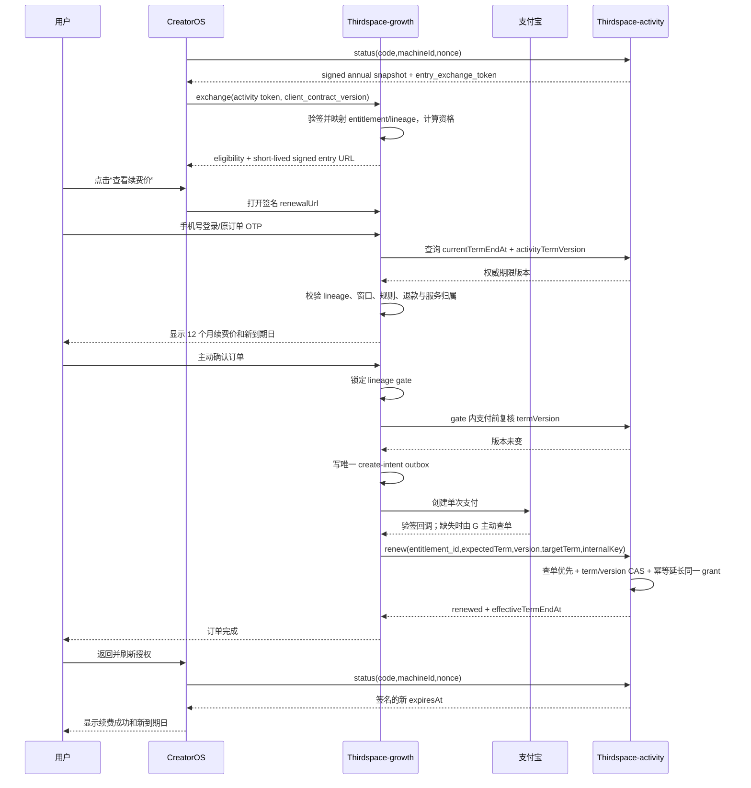

# T-506 CreatorOS 年卡与次年低价续费接入评估

> 状态：PLAN 通过（独立复审 `CONCERNS` 已处理）；下一阶段为 CONTRACT  
> 日期：2026-07-24  
> 规模：M/L 级跨系统商业化变更  
> 范围：CreatorOS × Thirdspace-growth × Thirdspace-activity  
> 宪法：`docs/产品定位.md`  
> 任务：`T-506`

## 1. 结论先行

这个功能**可行，而且已有可复用的订单、支付、授权和续费领域地基，不应在 CreatorOS 里
重做支付或续费系统**。

推荐的唯一职责划分是：

- **Thirdspace-growth**：订单、支付宝支付、续费资格、续费价格、渠道归属、退款和佣金的唯一真相。
- **Thirdspace-activity**：授权生成、查询、同一权益延期、撤销本次延期、设备绑定与签名状态的唯一真相。
- **CreatorOS**：展示本机授权状态、跳转购买/续费中心、支付后刷新签名授权结果；不计算优惠、不判断订单成功、不直连支付。

当前还不能直接上线接线。三处真实缺口是：

1. growth 的年度续费领域正在 `T-051` 实现，聚焦测试现为 `7 passed`，但真实
   `ActivationManagerFulfillmentAdapter` 的 `renew / lookup_renewal / revoke_renewal`
   仍全部抛出 `ACTIVATION_MANAGER_RENEWAL_CONTRACT_DISABLED`。
2. Thirdspace-activity 已完成订单级幂等发权、精准查询和软撤权，但没有“把同一授权从
   2027-08-01 延长到 2028-08-01”的续期/查续期/撤期契约。
3. CreatorOS 目前把一切 `expiresAt != null` 的授权都归为 `trial`，设置页只有一个
   `purchaseUrl` 外链；这与正式“年卡”语义、续费成功后的即时刷新、距到期提醒不一致。

因此，本任务的判断是：**方向正确、复用价值高、接入复杂度中高；先补齐跨系统契约和真实
provider 能力，再做 CreatorOS 薄接线。**

### 1.1 宪法与“变现中心”边界

用户在 2026-07-24 明确提出“系统只支持年卡，次年低价续费，并接入已经在 growth 做好的
系统”。`DEC-REN-001` 据此确认商业方向，并同步到产品宪法 `R-IDENTITY`。

用户随后明确补充：价格由其在 growth 后台配置，当前没有正式付费用户，只有正在使用的内测
激活码；本任务只负责把 growth 已有能力接入 CreatorOS，不以当前 published rule 或具体金额
作为开发前置，也不做不存在的付费存量迁移（`DEC-REN-003`）。

这不改变宪法“CreatorOS 不做变现中心”的红线：

- CreatorOS 不创建商品、价格、订单、支付、退款、佣金或结算事实；
- CreatorOS 只提供签名购买/续费跳转、授权状态和受控刷新；
- 一切商业规则与资金事实归 growth，一切授权期限事实归 activity；
- 任何要求 CreatorOS 本地计算低价或判断支付成功的实现都违反本 DEC。

## 2. Problem

CreatorOS 当前已经能激活 TIME 型授权并显示到期时间，但用户无法在产品内完成以下闭环：

- 知道正式购买获得的是年卡，并与继续有效的内测激活码明确区分；
- 在到期前看到明确的续费入口和服务期限；
- 以服务器判定的续费资格获得次年优惠价；
- 支付后延长**同一份权益**，而不是换一张无法追溯的新码；
- 刷新 CreatorOS 后看到新的到期时间；
- 退款、重复回调、支付成功但回调丢失时，订单与授权仍保持一致。

如果只把设置页按钮改成 growth 链接，支付成功后仍没有真实延期能力，会形成“收了钱但授权
没续上”的高风险假按钮，违反宪法的“诚实而非热闹”和“真实数据优先”。

## 3. Users

### 3.1 目标用户

- 新购买 CreatorOS 年卡的终端客户；
- 已有 CreatorOS 年卡、进入续费窗口的客户；
- 通过官方或 growth 中合资格直接服务代理购买/续费的客户；
- 处理支付、退款、授权异常和对账的运营人员。

### 3.2 非目标用户

- 需要按月、按季、按量或自动代扣套餐的客户；
- 要求多个上级按关系树逐级分续费收益的代理；
- 试图凭机器码、截图或客户端参数直接取得续费优惠的人；
- 希望把内测激活码自动转换成正式年卡或取得续费优惠的人。

## 4. Core scenarios

### SCN-REN-01 新购年卡

客户从 CreatorOS 激活页或官网进入 growth 商品页，购买固定 12 个自然月的 CreatorOS
权益。growth 确认支付后创建 Entitlement，并由 Thirdspace-activity 幂等生成“尚未起算”的
授权。默认产品口径是首年从客户第一次成功激活时开始：activity 在该原子事务内按
`Asia/Shanghai` 自然月算法写入权威 `term_start_at`、`term_end_at` 和 `term_version=1`，
再由 growth 查询/接收事件后建立 lineage 投影；growth 不得在发码时用自己的时钟预填期限。
客户在 CreatorOS 输入激活码完成本机绑定；本 SPEC 不把尚未定义的桌面 deep link 当成主路径。
现有内测激活码保持原有效期、校验和放行语义，不进入 growth 订单 lineage，也不自动获得续费
资格。

### SCN-REN-02 到期前低价续费

客户在续费窗口内从 CreatorOS 设置页进入 growth 续费中心。身份、订单归属、价格和资格全部
由 growth 既有系统判定；CreatorOS 只打开运行时下发的签名入口，不实现手机号 OTP、报价或
订单认领。客户主动确认并单次支付；成功后 Thirdspace-activity 把同一权益从当前到期日
向后增加 12 个自然月。

### SCN-REN-03 支付结果未知

支付宝回调丢失、重复或乱序时，growth 通过验签回调加主动查单收敛到唯一支付事实。订单在
支付事实未确定前不得发权；相同支付、履约和续期请求重放不得重复收款或重复延期。

### SCN-REN-04 退款与撤期

退款资格、资金退款和续费链顺序继续由 growth 既有系统决定。本任务只补 activity provider
侧的当前链尾撤期：growth 传稳定 operation key、expected term/version 和
`restore_term_end_at`；activity 只在当前期限确为该链尾时原子恢复，重复调用复用原结果。
非链尾、版本冲突或未知结果必须拒绝，growth 进入其既有异常/对账状态，不允许人工改期限。

### SCN-REN-05 到期或逾期

在到期后 30 天内，客户仍可按固定续费价从原到期日连续延长。超过 30 天后自动续费资格
关闭，不得继续使用续费价；客户只能按固定首购价购买一张新的 12 个月年卡，形成新的
entitlement/lineage。人工流程只处理异常和对账，不得人工覆盖价格或延长期限。CreatorOS
只展示 growth/activity 返回的真实状态，不在本机猜测资格。

## 5. Value & viability

### 5.1 PR-FAQ

**发布说明**

CreatorOS 正式销售采用固定年卡：首次购买获得 12 个自然月使用权，符合资格的年卡客户可在
growth 续费中心以明确的续费价再延长 12 个月。每次续费都由客户主动确认，不默认勾选，
不自动扣款；支付、退款和授权延期都有可查询记录。当前内测激活码继续原样使用，不自动
迁移或收费。

**FAQ 1：为什么不在 CreatorOS 里直接接支付宝？**

CreatorOS 是本地优先桌面创作软件，不应成为订单、支付和退款系统。growth 已拥有支付、
订单、退款、佣金和续费规则，Thirdspace-activity 已是授权服务。把支付塞进本地应用会
复制资金状态机、增加密钥和回调攻击面，还会让多渠道订单难以对账。

**FAQ 2：为什么续费价不能写死在客户端？**

续费资格和价格必须与订单、退款、渠道、规则生效时间绑定。客户端常量可被篡改，也会在
调价后显示过期价格。CreatorOS 最多展示“查看续费价”；最终价格只由 growth 的已发布规则
计算并写入订单快照。

**FAQ 3：为什么现在可以先接入，而不先确定生产价格？**

当前没有正式付费用户，价格由业务负责人稍后在 growth 后台发布；CreatorOS 接入的是动态
能力和入口，不复制金额。因此技术接入不需要等待某个具体价格，但正式开售前 growth 必须
存在有效商品与续费规则。首批真实用户的转化用于校准价格，不反过来把客户端接入绑定到
某个测试金额。

**FAQ 4：能否直接续发一张新激活码？**

不推荐。新码无法可靠证明与原客户、原期限和原退款的关系，也会产生设备占码、重复权益和
客服换码。正确做法是以稳定 `entitlement_id`/grant 延长同一 lineage。

**FAQ 5：为什么不做自动续费？**

用户当前只要求“支持续费”，growth 现有产品裁决也是 manual renewal。自动扣款会新增代扣
授权、扣款前提醒、随时取消、失败宽限和价格变更通知等完整义务；中国现行网络交易规则也
要求显著提醒与便捷取消。当前主动单次支付更匹配需求和风险 appetite。

### 5.2 替代品与切换

| 方案 | 用户成本 | 系统成本 | 触发切换的具体信号 | 判定 |
|---|---:|---:|---|---|
| 忍着不解决：到期后找客服买新码 | 高；中断、换码、无法核对优惠 | 低，但客服与争议持续增长 | 首批到期客户出现错价、重复码或权益断档 | 否决 |
| CreatorOS 内自建订单/支付 | 表面低 | 极高；复制支付、退款、对账、安全 | growth 无法提供稳定 API 且被明确废弃 | 否决 |
| growth 收款后人工去 activity 延期 | 高；等待客服 | 中；不可重放、易错 | 真实订单少于 5 单且只做临时内部演示 | 否决进入正式产品 |
| growth + activity + CreatorOS 三层接入 | 低；一次登录、一次支付 | 中高；需跨系统契约 | 当前已有 growth 续费领域和 activity 授权地基 | 采用 |
| 迁移 Keygen/Lago/其他订阅 SaaS | 中；账户/数据迁移 | 高；外部锁定 | 自建服务连续两个发布周期达不到 SLO 或维护成本失控 | 暂不采用 |

### 5.3 被否决的产品形态

| 形态 | 否决理由 | 翻案信号 |
|---|---|---|
| 默认勾选自动续费/免密代扣 | 超出当前需求；新增支付授权、提醒、取消和合规责任 | 用户明确要求自动扣款，且支付 provider、法务和完整取消旅程就绪 |
| 续费成功后发一张新码 | 无权益谱系；容易重复授权、占设备和退款错撤 | Thirdspace-activity 无法在合理成本内支持同一 grant 延期，且用户明确接受换码摩擦 |
| 客户端输入“续费优惠码”决定低价 | 可伪造、不可审计、价格易漂移 | 不翻案；优惠资格必须服务端判定 |
| 把内测激活码自动迁成年卡 | 内测码没有正式订单/付款 lineage，自动迁移会伪造交易归属 | 仅在未来另有明确迁移政策与可审计映射时单独评估 |

### 5.4 五大风险与 RAT

| 风险 | 当前证据 | 检验方式 | 若错代价 | 结论 |
|---|---|---|---|---|
| 价值：低价是否足以提高连续年度续费 | 用户确认价格由 growth 后台配置；当前无正式付费用户，无法形成有代表性的续费样本 | 首批 20 个正式年卡进入续费窗口后复盘，完成续费 ≥40%；不足则调 growth 价格/表达，不改客户端协议 | 高 | **用户接受无前置样本的商业风险；不阻断技术接入** |
| 可用性：growth 是否已有完整续费 | growth `T-051` 已完成内部 BUILD，现有领域/页面/测试可复用；生产组合仍由 growth 自己把关 | 本任务只做 provider/客户端契约测试与跨仓集成，不复制 growth 交易实现 | 高 | 接入成立；growth 内部发布 Gate 不转移到 CreatorOS |
| 依赖：activity 能否延期/撤期 | 仓内只有 fulfill/query/revoke；renew 搜索零实现 | 增量契约 + provider contract vectors + 真实部署调用 | 致命 | RAT 已证伪“现在能直接接” |
| 安全：客户端能否伪造低价/重复延期 | growth 已有服务端规则和幂等设计；真实 adapter 仍 disabled | 同目标期限并发、回调/请求各重放 10 次 | 致命 | 必须保持三层 fail-closed |
| 合规/资金：支付退款是否能收敛 | 支付宝沙箱支付/查单/退款/重放已有本地证据；真实回调/生产签约未完成 | 正式商户、回调验签、主动查单、退款 E2E | 致命 | 不阻塞本地开发，阻断生产发布 |

已完成的便宜致命 RAT：

- `Thirdspace-growth/.venv/bin/python -m pytest -q tests/v2/test_renewal_flow.py tests/v2/test_renewal_transport.py`
  得到 `7 passed`，证明领域骨架存在。
- `server/integrations/fulfillments/activation_manager.py:32-41` 明确证明真实续期 adapter
  仍关闭。
- Thirdspace-activity 全仓续期能力搜索为空，证明不能把首购 fulfill/revoke 冒充续期。

用户确认的商业验证处置：

- 当前无正式付费用户，内测激活码也不是付费年卡样本，不能拿来伪造续费意愿证据；
- 价格由 growth 运行时规则拥有，CreatorOS 不保存、不展示硬编码金额；
- 用户明确授权先完成技术接入，首批正式年卡进入续费窗口后按 §5.6 复盘；这是已记录的商业
  accepted-risk，不是技术实现的隐性延期。

### 5.5 采纳门槛

| 门槛 | 可接受值 |
|---|---|
| 首次价值步骤 | 已激活客户最多：设置→续费中心→登录/OTP→确认订单→支付，共 5 个用户动作 |
| 重复延期 | 同一目标期限、同一订单、同一退款，各重放 10 次仍只产生一次资金/期限变化 |
| 支付后生效 | 支付确定成功后，95% 订单 2 分钟内在 CreatorOS 刷新出新到期日；其余进入可见异常 |
| 错价 | 0；订单价格必须来自不可变 RenewalRuleVersion/Quote 快照 |
| 权益断档 | 到期前成功续费不得丢失剩余天数；从原 term end 连续增加 12 个自然月 |
| 人工改库 | 0；异常只能通过受审计的恢复动作处理 |

### 5.6 Success signals

- **北极星**：首批 20 个进入续费窗口的真实 CreatorOS 年卡中，完成有效续费不少于 8 个。
- **护栏**：错价、重复扣款、重复延期、错撤期限、续费归属/金额争议均为 0。
- **检验时点**：首批 20 个真实权益完成窗口后复盘；任一资金或期限护栏命中即暂停新的
  RenewalRuleVersion 和年卡 offering，先完成对账。

### 5.7 Pre-mortem

| 假设项目失败的死因 | 可反驳信号 | SPEC 级应对 |
|---|---|---|
| growth 看起来有续费页，但 AM 没有真实延期，收款后卡死 | provider contract vectors 和真实 AM E2E 全绿 | activity 能力未通过时 offering 三层保持 disabled |
| growth 身份/订单归属不可用，用户进入续费中心却找不到权益 | provider 契约和跨仓 E2E 能以正式测试订单查到唯一 lineage | CreatorOS 不自行认领；显示 growth 返回的明确失败和支持入口 |
| 次年价格太高或规则频繁变，用户不续 | 展示→支付完成 ≥40%，且客服无集中异议 | 价格版本化；最终金额在支付前显著确认 |
| 到期前续费从付款日重新算，用户损失剩余天数 | 任意提前续费均以旧 `term_end_at` 为新 term start | provider 接口必须接收并校验目标绝对期限 |
| 内测激活码被误标成年卡或被强制收费 | 内测码回归始终保持原 mode、到期日和放行策略 | 只有带正式 growth entitlement/annual mode 的授权才展示年卡续费 |

### 5.8 Appetite

安全的完整接入包括 CreatorOS 年卡语义/动态入口/刷新、activity 同 grant 续期契约、growth
provider 接线、lineage 级唯一可支付门和跨仓测试，估算 **13–23 developer-days**。若用户
坚持不改 growth 支付并发门，则只能完成非收款接线，购买/续费 offering 必须保持 disabled，
不能宣称新功能已接通。正式商户签约、法务财税、价格配置和部署窗口不计开发日。

## 6. Functional requirements

- **FR-REN-01 年卡单一可售形态**：CreatorOS 新销售只发布固定 12 个自然月的官方
  offering；COUNT、TRIAL、PERPETUAL 可以为内部测试/存量兼容保留，但不得出现在新购目录。
  首年默认从第一次成功激活起算；未激活授权没有 `term_start_at/term_end_at`，不能提前进入
  续费窗口。activity 的 `provisionAnnual` 返回
  `lifecycle=pending_activation, term_start_at=null, term_end_at=null, term_version=0,
  term_months=12, timezone=Asia/Shanghai`；`activateAnnual` 才在第一次幂等激活事务中计算并
  返回绝对期限与 `term_version=1`，后续重放返回同一结果。growth 不再以
  `expiresDays/validDays` 或发码时间作为权威期限。｜删掉会继续出现用户无法判断该买哪种卡，
  且发码与激活时间差会让两个系统的到期日分叉。
- **FR-REN-02 服务端续费资格**：优惠资格由 growth 依据 lineage owner、offering、授权状态、
  退款/撤权、续费窗口和规则版本判定；CreatorOS 参数不构成资格证据。到期后第 31 天起
  续费资格关闭，只能按固定首购价创建新的年卡 entitlement/lineage；人工异常处理不得覆盖
  价格或延长期限。｜删掉会被伪造低价或无限延长优惠窗口。
- **FR-REN-03 版本化固定价格**：CreatorOS production offering 的首购价与
  `RenewalRuleVersion` 的续费价分别保存为不可变整数分，订单创建时快照。该 offering 强制
  `guide_price_cents=max_price_cents=initial_price_cents`，续费规则强制
  `guide_price_cents=max_price_cents=renewal_price_cents`，且 production 发布必须满足
  `0 < renewal_price_cents < initial_price_cents`；官方、代理和 quote 的客户成交价相同，
  渠道佣金不改变客户价格。客户端不提交最终价格，用户稍后在 growth 后台发布具体数值。
  ｜删掉会产生多种成交价、错价或无法回放历史订单。
- **FR-REN-04 连续期限**：首次激活的 `term_start_at/term_end_at` 只由 activity 在第一次
  激活事务内按 12 个自然月计算并返回 `term_version`，growth 只投影返回值，绝不在发码时
  预填首购期限。续费的 `target_term_end_at` 只由 growth 以 activity 当前权威
  `term_end_at` 为起点、按 RenewalRuleVersion 的 `Asia/Shanghai` 自然月算法计算：先把
  绝对 UTC 期限转成规则时区，保留本地时分秒增加 12 个月，目标月没有原日期时钳位到月末，
  再转回 UTC。activity 不重算续费月份，只校验 request digest，并以
  `expected_current_term_end_at + activity_term_version` 原子 CAS 接受/拒绝目标绝对期限。
  首购和续费都不从付款日重算，也不修改历史 term。
  ｜删掉会吞掉用户已付时长或产生闰日漂移。
- **FR-REN-05 manual renewal**：每次续费都创建新订单并由客户主动确认单次支付；不保存代扣
  授权，不自动扣款。｜删掉会扩大支付与合规范围。
- **FR-REN-06 幂等延期**：growth 以其现有稳定 `internal_key` 调 activity provider；
  activity 先查同 key，存在即复用，不存在才以
  `expected_current_term_end_at + activity_term_version` 原子 CAS 到目标绝对期限。
  版本或期限不匹配返回 `TERM_VERSION_CONFLICT`，provider 不自动覆盖；同一调用重放只延期
  一次。CreatorOS 不参与订单、支付槽位或冲突退款决策。｜删掉会在回调重放时重复延期。
- **FR-REN-07 撤期适配**：growth 继续拥有其既有退款与续费链状态机；本任务只要求 activity
  provider 能以稳定 key 查询并撤销 growth 指定的当前链尾增量，且仅在当前
  term/version 匹配时恢复到 `restore_term_end_at`。发起已履约续费退款前，growth 必须先按
  §6.1 用同一 `LineageRenewalGate` 占用该 lineage；撤期、退款和新续费不能并发。非链尾、
  版本冲突或未知结果必须拒绝并由 growth 进入既有异常/对账状态，CreatorOS 只显示权威结果。
  ｜删掉会退款后仍可使用、误撤既有期限或让撤期与新续费交叉。
- **FR-REN-08 CreatorOS 续费入口**：设置页按真实年卡状态展示到期日、距到期天数、续费状态和
  “查看续费价”。CreatorOS 先向 activity 刷新签名状态并取得 audience 为 growth 的短时
  `entry_exchange_token`，再调用 growth 的 entry-capability exchange；growth 验证 activity
  签名并以 entitlement/lineage 权威状态返回
  `eligible|not_yet|expired_new_purchase|blocked|unavailable` 与短时签名入口。只有
  `eligible + 有效入口` 显示续费提醒；`expired_new_purchase` 显示“购买新年卡”，
  `not_yet` 只显示到期日，`blocked/unavailable` 显示不可续费或重试。`beta/perpetual` 不会
  获得 exchange token；任何失败均不以本机时钟猜测资格。
  ｜删掉用户找不到可信入口或看到错误催费。
- **FR-REN-09 支付后刷新**：从 growth 返回 CreatorOS 后触发一次受控在线 status；收到签名
  新 `expiresAt` 才显示“续费成功”。超时显示“付款已收到，授权同步中”并提供重试/订单查询，
  不假成功。｜删掉会出现已付款仍显示旧日期。
- **FR-REN-10 跨系统对账**：growth paid/renewed/refunded、activity grant term/revoked 和
  CreatorOS signed snapshot 以 stable IDs 可核对；差异开异常，不人工改成功。｜删掉会积累
  无法发现的资金/权益差异。
- **FR-REN-11 内测/既有授权隔离**：当前内测激活码及既有 perpetual grant 继续按原
  mode、有效期和放行语义使用；只有带正式 growth entitlement/annual 标识的新授权进入年卡
  续费旅程，不做自动迁移。｜删掉会把测试资格伪装成正式付款权益或追溯收费。
- **FR-REN-12 渠道与代理复用**：CreatorOS 不另建代理归属；官方/代理续费沿用 growth 已确认
  的客户选择、24 个月/最多两次保护和单一直接续费佣金规则。｜删掉会产生两套冲突账本。
- **FR-REN-13 身份边界复用**：正式订单的 `customer_id`、entitlement owner、手机号验证、
  订单恢复与冲突仲裁全部复用 growth 既有实现。CreatorOS 只携带服务端签发的入口/引用，
  不提交 customer、手机号、价格或 owner 声明；内测码没有 growth entitlement 时不出现
  续费入口。activity 为 annual 授权签发的 `entry_exchange_token` 只含
  `iss/aud/exp/jti/entitlement_id/grant_id/term_version/license_kind/machine_hash`，有效期
  不超过 5 分钟且不含激活码或 PII。growth exchange 验签、校验 audience/expiry/jti 和
  entitlement↔lineage 映射后，返回不超过 10 分钟的 opaque
  `RenewalEntryCapability`；其 audience 只允许 growth Web 入口，重放仍必须经过 growth 的
  owner 登录/OTP，不能凭 token 付款、改价或认领 owner。CreatorOS 不持久化两个 token，
  每次打开或手动刷新重新交换，状态变化/过期后旧入口失效。｜删掉会让客户端或内测码越权
  取得正式续费资格。
- **FR-REN-14 lineage 级唯一可支付续费门**：growth 为每个 lineage 持久化唯一
  `LineageRenewalGate`，不以 term version 分行；任何仍可能收款的旧 payment intent 都会
  阻断新版本建单。只有 gate 当前绑定的 `(order_id, expected_activity_term_version)` 可以
  创建 payment intent。gate 只使用
  `released|reserved|intent_created|payment_unknown|captured|fulfillment_pending|
  reversal_reserved|reversal_pending|refund_pending|frozen`；除 `released` 外全部是 lineage
  级阻塞态，即使 activity
  term_version 已变化也不能创建第二个 intent。`fulfilled/refunded/closed` 是绑定订单和
  payment/refund 的历史结果，不是 gate 终态；只有 §6.1 的确定性证据满足时，gate 才在同一
  数据库事务中清空当前绑定并回到 `released`。所有更新使用行锁/CAS 与 outbox，进程重启从
  持久状态继续，不能靠内存锁或仅靠超时释放。每次 activity renew/revoke 还必须携带 growth
  在持有该 gate 时签发的一次性短时 `GateOperationAuthorization`，activity 校验 lineage、
  order、gate version、action 与 internal key digest 后才改期限；因此绕过 gate 直接调用
  activity 也会失败。｜删掉会出现两个订单都收款、只有一个延期。
- **FR-REN-15 新购入口能力**：未激活用户不依赖 annual grant。CreatorOS 以
  `app_id/build/channel/client_contract_version/nonce` 调 activity 的公开、限流
  `getPurchaseEntryProof`；activity 返回不超过 5 分钟、`aud=growth-purchase-exchange` 的
  签名 `purchase_exchange_token`，不含用户、价格或授权声明。CreatorOS 将其交给 growth
  purchase-capability exchange；growth 验签、校验 audience/expiry/jti、允许的
  `app_id/channel/client_contract_version>=2` 与 production offering gate 后，返回不超过
  10 分钟的 opaque `AnnualPurchaseEntryCapability`。该能力只能打开 growth 新购页，创建订单
  前仍需 growth 登录/客户确认；不能凭 token 传价、付款或认领 owner。offering disabled、
  token 无效或旧客户端时服务端拒绝，CreatorOS 显示“当前不可购买/重试”，不回退硬编码 URL。
  ｜删掉会让未激活用户无路购买，或让客户端静态链接绕过服务端启用门。

### 6.1 `LineageRenewalGate` 状态转换表

表中的“同事务副作用”与 gate CAS 同属一个 growth 数据库事务；对支付宝和 activity 的网络
调用都由稳定幂等键的 outbox 执行，调用前后均可重启恢复。任何没有落入表中且无法取得确定
外部证据的情况都转入或保持 `frozen`，不得人工直接改成 `released`。

| 当前状态 | 事件 | 守卫/确定证据 | 同事务副作用 | 下一状态 | 重启恢复 |
|---|---|---|---|---|---|
| `released` | reserve order | lineage 无其他阻塞证据；activity term/version 与报价快照一致 | 绑定 order/version，递增 `gate_version` | `reserved` | 读取绑定订单继续；不会靠 TTL 放行 |
| `reserved` | reservation abort / 建 intent 前失败 | 尚未写 payment outbox，且 provider 稳定 merchant key 从未提交 | 订单记 closed，清空绑定 | `released` | 事务回滚或按订单/outbox 反查 |
| `reserved` | enqueue create intent | gate 行仍绑定同 order/version；再次读取 activity 权威 term/version 与报价完全一致；所有期限变更只能先取得本 gate | 写唯一 create-intent outbox | `reserved` | outbox 重放同 key；复核失败且尚未提交 provider 时关闭订单并释放 |
| `reserved` | create intent 确定成功 | provider 返回确定 intent ref | 保存 intent ref 与查询键 | `intent_created` | 主动查单，不重复造 intent |
| `reserved` | create intent 超时/结果未知 | 请求可能已到 provider | 保存 merchant key 与未知原因 | `payment_unknown` | 只按同 key 查单/关闭，绝不新建 |
| `intent_created` | 支付成功通知或查单 paid | 验签且金额、商户单号、order 一致 | payment 记 captured，写 fulfillment outbox | `captured` | 查单复核后继续 |
| `intent_created` | 用户取消/订单过期 | close intent 成功，且随后主动查单为 `CLOSED/NOT_FOUND` 等不可再支付终态 | payment/order 记 closed，清空绑定 | `released` | close/query outbox 重放；任一步未知则不释放 |
| `intent_created` | 查询/关闭未知 | 无法证明不可支付 | 记录查询游标与原因 | `payment_unknown` | 定时查单；仍未知保持阻塞 |
| `payment_unknown` | 查单 paid | 验签、金额与订单一致 | payment 记 captured，写 fulfillment outbox | `captured` | 继续履约 |
| `payment_unknown` | 关闭且查单确定不可支付 | provider 明确不可再支付 | payment/order 记 closed，清空绑定 | `released` | 证据落库后才释放 |
| `payment_unknown` | 仍未知 | 无确定终态 | 更新最后查询时间/错误 | `payment_unknown` | 永不按超时自动释放 |
| `captured` | 投递履约 | capture 已持久化且 fulfillment outbox 唯一 | 标记履约尝试 | `fulfillment_pending` | lookup-first 后重放 |
| `fulfillment_pending` | activity renew 成功 | lookup/renew 返回目标 term/version，且再次读取 activity 与结果一致 | order 记 fulfilled、保存 operation/ref、新 term 投影，清空 gate 绑定 | `released` | 先 lookup activity；成功证据落库后释放 |
| `fulfillment_pending` | 可重试超时/5xx | 无冲突且结果未知 | 保存错误/退避，不退款、不释放 | `fulfillment_pending` | lookup-first 后重试 |
| `fulfillment_pending` | `TERM_VERSION_CONFLICT` 或确定不可履约 | capture 已确定、不能授予目标期限 | 创建唯一全额 refund + refund outbox | `refund_pending` | 同 refund key 查退/重放 |
| `released` | 发起已履约续费退款/撤期 | 目标是 activity 当前链尾；growth order/payment 可退款；重新读取 term/version 匹配 | 绑定原 renewal order、refund operation 与 expected term/version，`operation_kind=reversal` | `reversal_reserved` | 从绑定订单和 activity lookup 继续 |
| `reversal_reserved` | enqueue activity revoke | gate 仍绑定同一链尾；再次读取 activity term/version 一致 | 写唯一 revoke outbox | `reversal_pending` | activity lookup-first 后重放 |
| `reversal_pending` | activity revoke 成功 | lookup 返回 restore term/version 且回读一致 | 写唯一资金 refund outbox | `refund_pending` | 同 revoke/refund key 查后续 |
| `reversal_pending` | revoke 超时/未知 | 无确定结果 | 保存查询游标，不退款、不释放 | `reversal_pending` | activity lookup-first |
| `reversal_pending` | 非链尾/版本冲突或确定不可撤 | 无法安全恢复期限 | 记录差异和审计证据 | `frozen` | 对账；禁止新续费 |
| `refund_pending` | query refund 全额成功 | provider 明确全额退款成功，且其他旧/current intent 均为不可支付终态 | order 记 refunded、清空绑定 | `released` | query-refund 成功证据落库后释放 |
| `refund_pending` | 退款失败/未知 | 未证明全额退款成功 | 保存错误与查询游标 | `refund_pending` | 同 refund key 查退/重试，保持阻塞 |
| 任意非 `released` | 数据矛盾、金额/归属不符或未知旧 intent | 自动流程不能安全归类 | 记录 `frozen_reason` 与审计事件，停止新 intent | `frozen` | 对账任务按 provider/activity 权威查询恢复 |
| `released` 或任意绑定状态 | 非当前旧 order 迟到 capture | 旧支付确已成功；可能已有新 order、撤期或退款绑定 | 原子冻结 lineage，为旧 payment 创建唯一全额退款；若当前 intent 未支付则关闭并查单 | `frozen` | 所有相关 intent/refund/term operation 查清前不得释放 |
| `frozen` | 对账恢复 | 审计证据能唯一证明应继续的 current operation 状态 | 只允许转入与证据对应的 `payment_unknown/captured/fulfillment_pending/reversal_pending/refund_pending`；若所有 intent 不可支付、期限操作已确定且异常 capture 已全额退款，才清空绑定 | 对应阻塞态或 `released` | 重跑同一 reconciliation key；禁止人工跳过外部证据 |

所有会改变 activity term/version 的生产调用（renew 与 revoke）都必须先锁定同一 gate；锁顺序
固定为 `LineageRenewalGate → RenewalOrder/Refund rows → outbox`，网络调用不持有数据库锁。
activity 的 production ServicePrincipal 只授予 growth 这条受 gate 约束的调用链，管理异常
不能绕过它直接改期限。由此，`reserved` 后的支付前权威复核通过后，其他撤期或续期无法在
create-intent outbox 之间插入；复核失败且 provider 尚未收到请求时才能安全释放。

## 7. Non-functional requirements

- **NFR-REN-01 金额**：全部金额使用整数分，比例使用整数 bps，不使用浮点。
- **NFR-REN-02 幂等**：支付、回调、查单、renew、lookup、revoke 和状态刷新各重放 10 次，
  资金和期限结果与执行 1 次一致。
- **NFR-REN-03 安全**：growth→activity 使用最小 scope 的 ServicePrincipal，project allowlist
  只含 CreatorOS；URL、日志和 CreatorOS 本地 UI 不泄露完整激活码、支付密钥或 renewal token。
  activity production 还必须满足：卡密 HMAC digest 查询 + DB 外密钥的 AES-256-GCM 密文恢复、
  public API 持久化限流/请求上限、可信代理边界、签名能力 fail-closed、production dependency
  audit 无 high/critical。任一不满足时 annual capability 与 growth offering 保持 disabled。
- **NFR-REN-04 本地优先**：CreatorOS 的创作数据不上传 growth/activity；跨系统只传订单、
  客户认证摘要、entitlement/grant 引用、期限和渠道所需最小数据。
- **NFR-REN-05 可恢复**：任何外部结果未知都进入可查、可重试状态；进程重启后继续，不依赖
  内存任务。
- **NFR-REN-06 状态诚实**：未支付、支付未知、履约中、续期失败、退款中和撤期异常均有独立
  文案，不合并成“续费失败”或“续费成功”。
- **NFR-REN-07 性能**：支付确定成功后，activity 续期 P95 ≤30 秒；CreatorOS 手动刷新一次
  P95 ≤5 秒返回权威或明确 pending。
- **NFR-REN-08 期限一致性**：growth 的 `current_term_end_at` 只是带
  `activity_term_version` 的可重建投影；报价/建单前必须读 activity 权威值。每天对账发现
  漂移即冻结该 lineage 新续费并开 issue，禁止以 growth 投影回写 activity。
- **NFR-REN-09 无障碍**：激活页和设置页新增的购买/续费、刷新和异常入口满足 WCAG 2.2 AA；
  使用真实 link/button，完整键盘可达，外跳有可读名称，pending/success/error 通过
  `aria-live` 或等价语义播报，相关页面 axe `critical/serious=0`。
- **NFR-REN-10 可观测性**：跨系统操作贯穿脱敏 `correlation_id/request_id`、`order_id`、
  payment/refund ref、provider `internal_key`、`entitlement_id`、grant operation ID 和
  `term_version`。日志不得记录激活码、OTP、支付密钥或完整 token；从 CreatorOS 状态、growth
  订单或 activity operation 任一点都能反查同一条接入链。
- **NFR-REN-11 时间边界**：所有期限持久化为 UTC instant，授权有效区间为
  `[term_start_at, term_end_at)`；activity 以其服务端时钟决定授权是否有效。growth 以自身
  受监控的服务端/数据库时钟判续费资格，并按 RenewalRuleVersion `Asia/Shanghai` 计算
  `window_start_at=term_end_at-30 calendar days` 与
  `window_close_at=term_end_at+30 calendar days`，资格区间含两端
  `[window_start_at, window_close_at]`。CreatorOS 只用 activity 签名 `server_time` 展示状态，
  不以本机墙钟裁定资格。
- **NFR-REN-12 协议兼容与启停**：activity、growth、CreatorOS 的年度契约带显式
  `contract_version/capabilities`。新增数据库字段先 nullable/向后兼容再回填；旧接口在所有
  pending 资金与期限操作收敛前不得删除。任一能力探测、迁移、对账 worker 或签名字段不满足时，
  production offering 必须 fail-closed，不允许靠 UI 隐藏代替服务端禁用。

## 8. Business flow

### FLOW-REN-01 新购

CreatorOS 路径：

`CreatorOS → activity getPurchaseEntryProof(app/build/channel/nonce)
→ growth exchange proof（校验 production offering gate）→ 浏览器消费短时新购入口
→ growth 登录/确认 → 创建 initial order → 支付宝单次支付 → growth payment finalization
→ activity provisionAnnual(entitlement_id, termMonths=12, timezone=Asia/Shanghai,
lifecycle=pending_activation, termStart=null, termEnd=null, termVersion=0)
→ 返回 grant/code → CreatorOS activate(machineId) → activity 原子写入绝对
termStart/termEnd/termVersion=1 → growth 查询/事件投影 lineage
→ activity 签名 status → CreatorOS 显示年卡到期日`

官网路径：

`growth 官网 → production offering gate → 登录/确认 → 创建 initial order`，之后与上述支付、
发权和激活链相同；官网不伪造 CreatorOS proof，也不能绕过 offering gate。

### FLOW-REN-02 续费

### FLOW-REN-03 退款撤期

`growth 锁定同一 LineageRenewalGate 并确认当前链尾可撤 → activity
revoke_renewal(internalKey,expectedTermVersion,restoreTermEndAt)
→ activity lookup 确认 → growth 以同 gate 完成资金退款/佣金/lineage 投影并释放
→ CreatorOS 下次 status 取得恢复后的 expiresAt`。

非链尾、期限版本冲突、provider 未知或迟到支付均由 growth 既有异常状态承接；activity
只返回确定结果或冲突，不自行补偿资金，CreatorOS 不显示假成功。

## 9. Domain model

| ID | 属主 | 核心字段 | 说明 |
|---|---|---|---|
| `ENT-REN-01 RenewalRuleVersion` | growth | offering_id, term_months=12, renewal_price_cents, guide_price_cents=max_price_cents, window, effective range | 固定续费价/期限规则不可变快照 |
| `ENT-REN-02 SubscriptionLineage` | growth | customer_id, root_entitlement_id, current_term_end_at_projection, activity_term_version, protection | 订单与续费资格谱系；期限字段仅为可重建投影 |
| `ENT-REN-03 RenewalOrderSnapshot` | growth | order_id, entitlement_id, predecessor_order_id, expected_activity_term_version, target_term, price, rule, attribution | 每次续费一张新订单；订单不是支付槽位本身 |
| `ENT-REN-04 LicenseGrantTerm` | activity | grant_id, externalGrantId=entitlement_id, term_start_at?, current_term_end_at?, term_version, lifecycle | provision 为 `pending_activation/null/null/0`；首次 activate 原子变为绝对期限/version 1；renew/revoke 均以 term_version CAS |
| `ENT-REN-05 GrantRenewalOperation` | activity | sourceSystem, internal_key, predecessor_operation_id, action, expected/target term, request_digest, result_ref, status | renew/query/revoke 的幂等审计和严格逆序撤期链 |
| `ENT-REN-06 SignedLicenseSnapshot` | CreatorOS 本机 | schema_version, code ciphertext, machine_id, license_kind=`beta\|annual\|perpetual\|count`, entitlement_id?, grant_id?, expires_at, term_version?, signed server time, revoked | 字段均在 activity 签名响应内；仅本机展示和门控缓存，不是订单真相。旧快照缺 `license_kind` 时按现行 trial/perpetual 兼容，绝不推断为 annual |
| `ENT-REN-07 RenewalEntryCapability` | activity→growth→CreatorOS | activity `entry_exchange_token`；growth capability_id, entitlement_id, lineage_id, state, audience, expires_at | activity 只证明 annual grant/term，growth 才计算资格并签发短时 Web 入口；owner 登录/OTP 仍是付款前置，CreatorOS 不创建身份声明 |
| `ENT-REN-08 RenewalPaymentState` | growth | order_id, payment/refund refs, status, exception | growth 既有资金真相；本任务只读取结果，不修改模型 |
| `ENT-REN-09 RenewalRefundState` | growth | order_id, renewal operation refs, status, exception | growth 既有退款/撤期协调状态；activity 只实现 provider 端操作 |
| `ENT-REN-10 CreatorOSAnnualOfferingPrice` | growth | offering_id, initial_price_cents, guide_price_cents=max_price_cents, effective range, status | 固定首购价不可变版本；具体金额由用户在 growth 后台配置 |
| `ENT-REN-11 LineageRenewalGate` | growth | lineage_id PK, operation_kind, expected_activity_term_version, order_id, state, provider_intent/payment/refund/reversal refs, gate_version, frozen_reason | 每个 lineage 永远一行；续费与撤期共用互斥，所有可能收款或改期限状态跨 term version 阻塞，持久化查单/查期/查退后释放 |
| `ENT-REN-12 AnnualPurchaseEntryCapability` | activity→growth→CreatorOS | purchase_exchange_token；growth capability_id, app_id, channel, client_contract_version, audience, expires_at | 无授权用户的短时新购入口；不含用户/价格/owner，growth offering gate 是唯一启用真相 |

数据归属红线：

- growth 不写 activity 数据库；
- activity 不保存 Payment、Refund、CommissionEntry；
- CreatorOS 不写 growth/activity 业务库；
- activity 的 `externalGrantId` 固定映射 growth `entitlement_id`，不能用 order_id 或激活码原文替代。

## 10. IA

| ID | 页面/区域 | 必须展示 | 禁止 |
|---|---|---|---|
| `IA-REN-01` CreatorOS 激活页 | “CreatorOS 年卡·12 个月”、服务端短时新购入口、已有码激活；入口不可用时显示真实错误/重试 | 永久卡新购、COUNT 套餐、假价格、硬编码购买 URL |
| `IA-REN-02` CreatorOS 设置→授权状态 | 当前到期日、距到期、查看续费价、同步状态 | 客户端自行判优惠、直接显示支付成功 |
| `IA-REN-03` growth 续费中心 | 资格、当前/新到期日、续费价、退款摘要、服务代理、主动确认 | 默认自动续费、客户端传价 |
| `IA-REN-04` growth 订单结果页 | paid/fulfillment_pending/renewed/exception 的真实状态和查询入口 | 把 paid 冒充 renewed |
| `IA-REN-05` growth/activity 管理异常 | 订单、payment、entitlement、grant operation 和差异摘要 | 完整激活码、密钥、人工改成功 |

所有 CreatorOS 入口必须键盘可达；外跳链接明确告知将打开 growth；刷新后的 pending/success/
error 使用可读状态播报，不靠颜色作为唯一信息。

## 11. 现成方案 / OSS 调研

| 候选 | 采用/弃用 |
|---|---|
| Thirdspace-growth 现有 `FR-043/FLOW-020/API-145..156` | **整体复用**。规则、谱系、报价、身份、建单、支付、退款与页面均由 growth 自身负责；T-506 不重做其业务模型，只补真实 activity provider 接线和跨仓契约测试 |
| Thirdspace-activity 现有 order fulfillment | **采用并扩展**。复用 fulfill/query/revoke 的 grant 与 operation 模型，增加期限型 renew/query/revoke_renewal，不能另造第二套授权服务 |
| 支付宝网页应用收款 | **采用**。官方文档要求异步通知与主动交易查询共同确认支付；退款重试保持同一 `out_request_no` |
| 支付宝/其他自动订阅产品 | **不采用**。当前是 manual renewal，不需要保存代扣授权 |
| Keygen license resources | 仅作续期/撤权契约参考，不迁移运行时；现有 Thirdspace 数据、客户端验签和渠道能力迁移成本更高 |
| Lago 等订阅计费 | 当前不引入；本产品只有一个固定年卡且 growth 已有规则/订单/账本，部署额外计费系统没有净收益 |

官方参考：

- [支付宝产品概览：网页收款、异步通知与交易查询](https://aipay.alipay.com/docs/overview.html)
- [支付宝异步通知说明](https://aipay.alipay.com/docs/ai-web-app-payment-qianyi/api-list/async-notify-verify.html)
- [支付宝退款接口](https://aipay.alipay.com/docs/mobile-app-pay/ai-app-pay/alipay-trade-refund.html)
- [市场监管总局《网络交易监督管理办法》](https://www.samr.gov.cn/zw/zfxxgk/fdzdgknr/fgs/art/2025/art_4b47c79b8d994a42bba4835997688faa.html)

## 12. 现网事实 / 仓内已有实现

| 断言 | 证据 | 结论 |
|---|---|---|
| CreatorOS 本地表只支持单机一行 TIME/到期时间 | `backend/src/schema/activation.ts:13-39` | 可显示到期，但没有订单/续费谱系 |
| CreatorOS Rust 以 `expiresAt` 是否为空把授权分为 trial/perpetual | `frontend/src-tauri/src/license.rs:208-224` | 正式年卡语义需独立 mode/policy，不能继续叫 trial |
| CreatorOS 已有签名渠道 `purchaseUrl` | `frontend/src/features/settings/settings-interactive-region.tsx:1058-1274` | 可复用安全链接链，但需区分 buy/renew 或由 growth 落地页判定 |
| growth 年度规则、谱系、报价和建单有生产代码 | `Thirdspace-growth/server/application/renewal_service.py:150-293,385-518,583-832,870-1098`；`server/modules/renewal/models.py:22-209`；`migrations/versions/0008_t051_renewal_foundation.py:22-365` | 可复用，不按文档存在冒充完成 |
| growth 有目标期限占位、订单 predecessor、provider lookup-first 和单笔撤期骨架 | `Thirdspace-growth/server/application/renewal_service.py:1013-1061,1114-1499`；`migrations/versions/0008_t051_renewal_foundation.py:95-103`；`tests/v2/test_renewal_flow.py:220-416` | 本任务复用其业务流程，只把 provider 契约绑定 activity term version |
| growth 有支付/查单/退款状态机和审计地基 | `Thirdspace-growth/server/application/payment_service.py:113-566,754-1149`；`server/modules/audit/models.py:1-122` | 复用资金幂等、退款与审计，不另造支付系统 |
| growth 已有迟到/重复 capture 自动退款地基 | `Thirdspace-growth/server/application/payment_service.py:669-752,754-948,993-1048`；`tests/v2/test_payment_processing.py:182-217` | 归 growth 自己维护；T-506 不复制资金状态机 |
| growth 有可消费 claim 和续费 owner-claim 骨架 | `Thirdspace-growth/server/modules/identity/models.py:11-88`；`server/application/partner_service.py:288-455`；`server/application/renewal_service.py:43-145` | 归 growth 自己维护；CreatorOS 不新增手机号/owner 逻辑 |
| growth 真实 activity adapter 仍禁用 | `Thirdspace-growth/server/integrations/fulfillments/activation_manager.py:32-41` | 生产接入阻断 |
| activity 已有订单级发权/查询/软撤权 | `../Thirdspace-activity/src/lib/order-fulfillment-service.ts:294,477,539`；`../Thirdspace-activity/prisma/schema.prisma:157`；`../Thirdspace-activity/tests/order-fulfillment-route.test.ts:25,59,71` | 可作为增量续期地基 |
| activity 首购仍以 `expiresDays/validDays` 相对激活计时，无 term version | `../Thirdspace-activity/src/lib/order-fulfillment-service.ts:32-42,251-265,294-415`；`../Thirdspace-activity/prisma/schema.prisma:33-50,157-185`；`Thirdspace-growth/server/ports/fulfillment.py:7-15` | 首购也必须升级为绝对期限契约；否则发码时的 growth 投影与真实激活到期日会分叉 |
| activity 没有续期领域/API | 仓根反证：`rg -n "renewal|renewOrderGrant|renew_order|revoke_renewal|lookup_renewal|targetTermEndAt|termEndAt" ../Thirdspace-activity/src ../Thirdspace-activity/prisma ../Thirdspace-activity/tests` 返回 0；覆盖 route/service/schema/migration/tests | 必须先补契约与实现 |

## 13. Complete target product and hard problems

本 SPEC 承诺接入闭环：CreatorOS 年卡状态和动态入口、growth 既有交易/续费旅程、
activity 同一权益延期/撤期、支付返回后的权威刷新、异常诚实回显和内测码隔离。不能用
“只有按钮但没有延期”“支付后发新码”或“客服手工延期”冒充完成；也不把 growth 已有业务
系统复制进本任务。

| HARD ID | 难点 | 解决位置 | Owning PKG |
|---|---|---|---|
| `HARD-REN-01` activity 首次激活起算的绝对期限、同一 grant 延期/查询/逆序撤期与 term version | CONTRACT + activity BUILD | `PKG-REN-ACTIVITY` |
| `HARD-REN-02` growth 唯一可支付槽位、现有续费 provider 与 activity term version 接线，未知结果保持 fail-closed | CONTRACT/BUILD | `PKG-REN-GROWTH` |
| `HARD-REN-03` CreatorOS 年卡/内测/永久三种语义兼容和 signed status 回显 | CreatorOS CONTRACT/BUILD | `PKG-REN-CLIENT` |
| `HARD-REN-04` 真实支付宝、activity 部署与跨仓 E2E | SHIP | `PKG-REN-E2E` |
| `HARD-REN-05` 内测码与正式年卡的语义隔离，不把无订单码接入续费 | CreatorOS CONTRACT/BUILD | `PKG-REN-CLIENT` |
| `HARD-REN-06` growth 既有退款/撤期调用与 activity 期限回滚契约对齐 | provider contract test + activity BUILD | `PKG-REN-ACTIVITY` |

依赖顺序只描述工程约束，不是交付切片：

`activity 契约 → growth adapter → CreatorOS 接线 → 真实跨仓 E2E`。所有工作包完成前
`T-506` 不得标完成。

### 13.1 三系统交错部署、启用与回滚契约

| 组件/版本 | 部署兼容要求 | 能力证据 | 允许行为 |
|---|---|---|---|
| activity 新 schema + 旧服务 | 新字段 nullable，旧 fulfill/activate/beta/perpetual 路径不读新字段 | migration 已完成但 capability 未发布 | 旧路径继续；annual offering 禁用 |
| activity 新服务 | 双读旧 grant；provision annual 写 pending/null/null/0，首次激活写绝对期限/version 1；签名响应 `schema_version=2`，并提供公开限流 purchase proof 与 annual renewal proof | `annual_terms_v1`、`renewal_provider_v1`、`signed_license_v2`、`purchase_entry_proof_v1` health capability 与真实 contract vectors 全绿 | 接受 growth provider；向无授权客户端提供 purchase proof，向 annual 客户端提供 renewal proof；内测码仍走旧语义 |
| growth 新 schema + 旧服务 | `LineageRenewalGate`/outbox 迁移先落库，不改变旧订单 | migration/约束检查完成 | 不开放 annual offering |
| growth 新服务 | adapter 启动时及周期性探测 activity capabilities；gate/reconciliation worker、purchase/renewal capability exchange 必须健康 | activity 四项 capability、gate 唯一约束、交换验签、支付查单/退款、provider contract tests 全绿 | 仅服务端 capability gate 通过时签发新购/续费入口并创建 annual/renewal payment intent |
| CreatorOS 旧版 | 不理解 `license_kind=annual` 时只按既有有限期兼容展示，不取得正式购买/续费签名入口 | client contract `<2` | 已激活授权继续可用；不能新购/续费，不猜 annual |
| CreatorOS 新版 | 解析并验签 `schema_version=2`、`license_kind`、term/version 与 growth 入口 | `client_contract_version>=2` | 仅展示服务端签发的 buy/renew 能力 |

三层 feature gate 属主：

1. activity 拥有 provider capability gate；迁移、权限、签名 v2 或 renew/query/revoke 任一不全即关闭。
2. growth 拥有唯一 production offering gate；只有 activity capability、lineage gate、
   reconciliation worker、支付查单/退款与 provider contract vectors 同时为绿才开启。
3. CreatorOS 只消费 activity/growth 的签名能力，不拥有放开收款的本地开关；入口缺失即诚实隐藏。

启用顺序是 activity 向后兼容部署 → growth schema/worker/adapter 部署并保持 offering off →
CreatorOS 新版部署 → 沙箱跨仓 E2E → growth 开 production offering。回滚时可随时隐藏 CreatorOS
入口并关闭“创建新 intent”，但只要存在
`intent_created/payment_unknown/captured/fulfillment_pending/reversal_reserved/
reversal_pending/refund_pending/frozen`，growth 的
查单、履约、退款和 reconciliation worker 以及 activity provider 端点就必须继续运行，直到
gate 全部回到 `released`；禁止回滚数据库字段或删除旧契约来“清空”在途资金。

## 14. Out of scope

- 月卡、季卡、按量、席位和套餐升降级；
- 自动扣款、免密代扣和默认勾选自动续费；
- 重写 growth 的代理/佣金/结算系统；
- 迁移到第三方 licensing/billing SaaS；
- 将 CreatorOS 创作内容上传到 growth 或 activity；
- 对已承诺永久授权做强制收费迁移。
- 在 CreatorOS 内创建或编辑商品、首购价、续费价、订单、支付、退款、客户身份或代理规则。
- 把当前内测激活码迁移为正式付费年卡，或为不存在的正式付费存量补历史订单。

## 15. 已确认产品决策与剩余证据

### 已采用默认假设

- 新销售只售 12 个自然月年卡；存量 perpetual 保留。
- 续费是 manual renewal，不自动扣款。
- 提前续费从原到期日续接，不损失剩余时长。
- 官方/代理归属复用 growth 的 24 个月/最多两次保护与客户选择规则。
- 默认窗口为到期前 30 天至到期后 30 天；由 RenewalRuleVersion 显式保存。
- growth 负责基于 activity 权威期限执行 `Asia/Shanghai` 自然月算法；activity 用 term version
  CAS 执行，不接受旧投影覆盖。
- 正式订单 owner 与恢复流程按 growth 既有契约处理；CreatorOS 不为内测码补 legacy claim。

### 用户已确认的三个产品口径（2026-07-24）

1. **价格语义**：首购价为固定确定值，续费价为另一固定确定值；第二年以及之后所有连续
   续费年度均按续费价，不在第三年恢复首购价。
2. **起算与存量**：首年从第一次成功激活起算 12 个自然月；当前只有内测激活码、没有正式
   付费用户，内测码继续按原语义使用，不迁移、不收费。
3. **逾期**：到期前 30 天至到期后 30 天可按续费价从原期限连续延长；到期后第 31 天起
   不得使用续费价，只能按固定首购价购买新的年卡 entitlement/lineage。人工流程只处理
   异常，不覆盖价格或期限。

### 用户追加裁决（2026-07-24）

- 首购价、续费价和规则发布由用户在 growth 后台完成；CreatorOS 不等待、复制或校验当前
  published rule，运行时只消费 growth/activity 下发的签名能力和入口。
- 当前没有正式付费用户，不做付费存量迁移、历史订单回填或 legacy 认领；正在测试的内测
  激活码保持原样。
- 用户明确授权按上述范围直接完成新功能接入。无前置价格样本的商业验证记为 accepted-risk，
  不阻断 CONTRACT/BUILD；正式开售时的 growth 规则配置属于运行配置，不属于本任务代码。

### 用户已完成资金并发范围裁决（DEC-REN-004）

独立复审证明 activity CAS 只能防“多续一年”，不能防“两个 payment intent 都收款”。
用户于 2026-07-24 明确认可推荐方案：

- T-506 纳入 `FR-REN-14/ENT-REN-11/TEST-REN-17` 的 growth lineage 级资金并发门；
- 按完整可收款接入实施，接受完整估算 13–23 developer-days；
- 不采用“只接客户端/provider 且 offering 保持 disabled”的备选方案。

这次确认解决了 PLAN 的最后一个范围 blocker；最终独立复审通过后进入 CONTRACT。

## 16. Acceptance criteria

1. **TEST-REN-01**：新购目录只有 CreatorOS 12 个月年卡，内测码/既有授权仍按原语义可用且
   不出现正式续费入口；`provisionAnnual` 必须返回
   `pending_activation/null/null/term_version=0`，延迟 30 天期间不得进入续费窗口；首次
   `activateAnnual` 才从真实激活时刻计算 12 个自然月并返回 version 1，重放返回原绝对期限，
   growth 只投影该值。月末、闰日、首购重放和激活后立即续费不产生两个到期日。
2. **TEST-REN-02**：未登录、非 owner、已退款/撤权、窗口外或无 published rule 的请求不能
   取得续费价；到期后第 31 天只能以固定首购价创建新的 entitlement/lineage。CreatorOS
   offering 的 `guide=max=initial`，renewal rule 的 `guide=max=renewal`；官方、代理、quote
   跨渠道报价与订单快照均为同一客户价格，且发布 `renewal>=initial` 或任一非正价格会被
   服务端拒绝；历史规则回放不漂移。窗口资格在
   `window_start_at-1ms/at`、`term_end_at-1ms/at`、`window_close_at/at+1ms` 分别为
   `false/true`、`true/true`、`true/false`；授权本身在 `term_end_at-1ms/at` 为
   `active/expired`。
3. **TEST-REN-03**：提前续费的新期限从旧 `term_end_at` 连续增加 12 个自然月。
   1 月 31 日、闰年 2 月 29 日、普通月日期、边界前后 1ms 和连续三次续费均按
   `Asia/Shanghai` 月末钳位算法得到唯一结果。
4. **TEST-REN-04**：相同 activity renew provider 请求重放 10 次只延长一次；两个不同
   internal key 同时基于同一 expected term/version 请求不同目标期限时只有一个 CAS 成功，
   另一个返回 `TERM_VERSION_CONFLICT`，不得多送一年。growth 的订单/支付幂等继续由其现有
   测试和发布 Gate 负责。
5. **TEST-REN-05**：支付成功但 provider 未确认时显示 pending，不显示续费成功。
6. **TEST-REN-06**：provider 成功后超时，growth 先 lookup，不能盲目再次延期。
7. **TEST-REN-07**：A、B 两次顺序续费后，activity 只接受当前链尾 B 的撤期；直接撤 A、
   expected term/version 不匹配或乱序调用均拒绝且不改变期限。B 的 revoke/lookup 各重放
   10 次仍只恢复一次；资金、佣金和多段退款编排继续由 growth 既有测试负责。
8. **TEST-REN-08**：CreatorOS 只有在 activity 签名 status 返回新 `expiresAt` 后显示“续费成功”。
9. **TEST-REN-09**：断网、回调丢失、activity 不可用、重启和重复点击均有可恢复路径。
10. **TEST-REN-10**：growth、activity、CreatorOS 无跨库写入；日志/URL 不含完整激活码或支付密钥。
11. **TEST-REN-11**：官方与代理续费均沿 growth 单一账本，任何上级没有逐级续费收益。
12. **TEST-REN-12**：使用 growth 测试 offering/rule 和支付沙箱、真实 activity 测试部署及
    打包 CreatorOS 完成一次端到端续费；不要求预先发布生产价格。
13. **TEST-REN-13**：term version 漂移、同 lineage 并发 provider 请求和旧 growth 投影都
    返回冲突，不少续、不多续、不自动覆盖；growth 将冲突投影为其既有可见异常/对账状态，
    CreatorOS 不把 payment/fulfillment pending 显示成续费成功。
14. **TEST-REN-14**：CreatorOS 不提交 customer/手机号/价格/owner 声明；无 growth
    entitlement 的内测码拿不到 activity exchange token。覆盖 token audience/expiry/jti/
    签名/entitlement 映射错误、重放和篡改；growth 不返回 PII/价格，短时入口重放仍必须通过
    owner 登录/OTP，不能凭 token 付款或认领 owner。
15. **TEST-REN-15**：激活页/设置页新增购买、续费、刷新与异常入口全键盘可达；外跳有可读
    名称，状态变化可被辅助技术感知，相关页面 axe `critical/serious=0`。
16. **TEST-REN-16**：同一测试订单从 CreatorOS 状态、growth 订单和 activity operation 三个
    起点均能用脱敏 correlation/stable IDs 反查 request→payment/refund→provider→grant term
    全链；日志扫描不含激活码、OTP、支付密钥或完整 token。
17. **TEST-REN-17**：两个不同 order/internal key 同时基于同一 lineage/term version 报价、
    建单和创建 payment intent，lineage gate 保证至多一个进入可支付态；再覆盖“旧版本 intent
    仍可支付 → activity term version 因撤期/恢复变化 → 新版本尝试建单 → 旧单迟到 capture
    → 进程重启”。所有可能收款态跨 term version 继续阻断；任何意外第二笔已付款最终都稳定
    退款并可对账，绝不只依赖 activity CAS。
18. **TEST-REN-18**：逐行覆盖 §6.1 gate 状态表：reservation/intent 创建失败与超时、关闭
    intent 后查单、`payment_unknown`、迟到 capture、履约成功/超时/冲突、退款成功/失败/未知、
    `frozen` 对账恢复。额外覆盖“退款占门与新建单并发”“reserve 后撤期使版本变化、intent 前
    复核失败”“撤期与旧 intent 迟到 capture 并发”。每条出边包含数据库约束测试、两个请求
    并发测试，以及网络副作用前/后的进程崩溃注入；任何支付、退款或期限结果未知时都不能创建
    第二个 payment intent。
19. **TEST-REN-19**：按 §13.1 矩阵验证 activity/growth/CreatorOS 新旧版本交错部署。缺任一
    capability、worker、迁移或签名版本时，服务端拒绝创建 production annual/renewal intent；
    旧 CreatorOS 不出现正式入口。制造 captured/payment_unknown/fulfillment_pending 后关闭
    新销售并回滚客户端，查单/履约/退款仍持续到 gate 全部 `released`。
20. **TEST-REN-20**：activity annual snapshot → growth capability exchange 返回
    `eligible + 有效签名入口` 才显示续费提醒；`expired_new_purchase` 显示购买新年卡，
    `not_yet` 不提醒，`blocked/unavailable`、入口缺失和状态读取失败分别显示不可续费或错误
    重试。beta/perpetual 无 exchange token，且任何状态都不会以本机时钟改变资格。
21. **TEST-REN-21**：无授权 CreatorOS 通过
    `getPurchaseEntryProof → growth purchase-capability exchange` 取得短时新购入口；覆盖
    offering disabled、旧 `client_contract_version`、错误 app/channel/audience/expiry/jti、
    token 篡改与重放。所有拒绝均不能创建订单/payment intent，客户端不回退静态 URL；有效
    capability 也必须完成 growth 登录/客户确认，且客户端不能提交或覆盖价格。
22. **TEST-REN-22**：新购/续费 URL fragment 由 growth Web boot loader 在任何 telemetry、
    第三方脚本或资源预取前读取并立即 `history.replaceState` 清除，再通过 same-origin POST
    单次交换为 HttpOnly/Secure/SameSite session。覆盖过期、篡改、kind 错配、同 session
    重试、跨 session 重放、Referer 与 access/analytics/error log 扫描；任何失败都不能创建
    Customer、Order 或 Payment。
23. **TEST-REN-23**：activity 安全 release gate：production dependency audit
    high/critical=0；数据库/备份不含卡密明文，缺 DB 外密钥不能恢复；admin list/export/
    audit/error/log 无完整卡密；public API 的超长 body、错误 content-type、随机猜码、伪造
    XFF、限流绕过均稳定拒绝；签名私钥缺失/错误时 readiness=false 且服务不返回可被正式
    客户端接受的响应。最后用独立渗透测试覆盖认证绕过、CSRF、重放、并发和客户端篡改边界。

## 17. 工作量评估

| 工作包 | 主要内容 | 估算 |
|---|---|---:|
| `PKG-REN-ACTIVITY` | 首次激活绝对期限、续期/查询/撤期、term version、签名响应、权限 | 4–7 developer-days |
| `PKG-REN-GROWTH` | 复用 T-051，补唯一可支付槽位、真实 activity adapter、能力开关与 provider contract test | 4–7 developer-days |
| `PKG-REN-CLIENT` | 年卡/内测语义、动态 buy/renew 入口、提醒、支付后受控刷新、文案与测试 | 3–5 developer-days |
| `PKG-REN-E2E` | 正式测试订单的首购激活、续费、撤期、断网/重放与打包客户端回显 | 2–4 developer-days |
| `PKG-REN-ACTIVITY-SECURITY` | 卡密密文迁移、依赖升级、public 限流、签名 fail-closed、安全头与渗透 Gate | 3–6 developer-days |
| **合计** | 不重做 growth 身份/价格/交易后台，不迁移付费存量；包含正式商用卡密安全 Gate | **16–29 developer-days** |

外部前置不计开发日：支付宝生产主体/产品签约、法务财税确认、Thirdspace-activity 生产部署
备份与密钥、真实测试年卡。

## 18. PLAN Gate 自检

- Problem / Users / scenarios：已完成。
- Value & viability / PR-FAQ / 替代品 / 被否决形态 / 风险 / RAT / 采纳门槛 /
  pre-mortem / appetite：已完成。
- FR/NFR 带稳定 ID 和价值注：已完成。
- FLOW / ENT / IA：已完成。
- 现成方案与仓内事实：已完成，关键断言带 file:line 或反证搜索。
- HARD 表：已完成。
- 未决占位标记：0；第 15 节三个产品选择已经确认，剩余项均为可验证 Gate 证据。
- 用户确认：已于 2026-07-24 确认第 15 节全部口径，并选择完整可收款接入；growth
  `LineageRenewalGate` 属于 T-506 的必做安全边界。
- 独立 SPEC 评审：用户裁决后的三轮终态为 `CONCERNS`、无 blocker；全部 findings 已逐条接受
  并写入 SPEC。按三轮上限不再刷审，PLAN 以 `CONCERNS(已处理)` 通过，结论见
  `2026-07-24-annual-renewal-growth-integration.review.md`。
