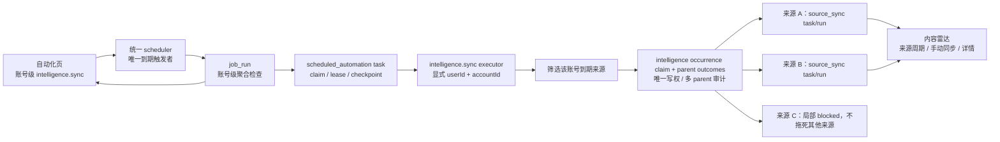

# T-517 内容雷达统一自动化调度 Delta SPEC

> `task: T-517`
>
> `stage: 1-plan`
>
> `status: USER_CONFIRMED — 方案 A 已由 DEC-AUTO-001 确认；三轮复审遗留 R2-01 已经人工裁决`
>
> `date: 2026-07-24`
>
> `owner: product-to-code-orchestrator`
>
> `upstream: 2026-07-23-content-radar-restructure-design.md`
>
> `downstream: T-516 只能复用本 SPEC 的统一调度底座，不得另起 timer`

## 0. 本文解决什么

内容雷达已经有“每个来源手动/每日同步”和持久化 `source_sync` 任务，但 T-514 又在组合根里启动了独立 `setInterval`，跨全部账号扫描到期来源。系统另一边早已有 `scheduled_jobs/job_runs` 和每分钟统一 scheduler。两套到期触发会形成两份开关、两份运行记录和两种离线恢复语义。

本 Delta 将自动同步收口为：

- 每个 `(userId, accountId)` 恰好一个系统托管的 `intelligence.sync` 自动化作业；
- 自动化页只管理该账号的全局开关、立即检查和聚合运行记录；
- 内容雷达继续管理每个来源的周期、手动同步、来源运行详情与局部受阻；
- 只有统一 scheduler 能判定“哪个自动化作业到期”，内容雷达不再启动 timer、cron 或启动扫描；
- 本地应用退出期间不假装运行；重启后由同一个 scheduler 只补一次，随后由账号级聚合作业扫描所有逾期来源；
- T-516 后续只注册 `context.health` 执行器并复用同一调度、幂等、补跑与运行投影底座。



## 1. 任务真相与裁决

### 1.1 已确认的产品裁决

`DEC-CR-016` 已确认：

1. 自动化页只有一个账号级 `intelligence.sync` 聚合作业，不按来源复制卡片。
2. 自动化页拥有全局启停、立即运行、聚合历史；内容雷达拥有来源级周期、手动同步和来源运行详情。
3. 自动检查周期固定为每 15 分钟一次基础设施检查，来源自己的同步周期仍以来源策略为准。
4. 本地应用退出时不会运行，重启后要补过期工作。
5. 一个来源受阻不得阻断同账号其他来源。
6. `intelligence.sync` 与现有 `scheduled_jobs/job_runs` 统一，不保留 T-514 的平行 `setInterval`。

### 1.2 本次阶段

本任务改变了调度所有权、账号归属、幂等键、运行投影和迁移边界，属于 `1-plan` 的架构/数据 Delta，不是可直接进入自由编码的小改。独立 SPEC 评审通过后，才允许：

1. 更新 `orchestrator/ARTIFACT_MANIFEST.yaml` 与需求追踪；
2. 进入 CONTRACT，修改枚举、DTO、operation 与数据库契约；
3. 再按 TDD 进入 BUILD。

本文不把当前实现写成目标完成态，也不产生历史红测或真机证据。

## 2. 当前实现事实（AS-IS）

| 事实 | 真实代码证据 | 与目标的差距 |
|---|---|---|
| 调度 contract 只有六种 collection kind | `contract/src/primitives.ts:179-186` 只有 `self.metrics/comments/self.detail/benchmark/topic.daily/favorites` | 没有 `intelligence.sync` |
| `scheduled_job` 已带账号，`job_run` wire/DB 没有显式账号 | `contract/src/resources/scheduling.ts:20-39,61-77`；`backend/src/schema/scheduling.ts` | 聚合运行查询仍依赖父 job，不能满足每层显式 `userId/accountId` |
| 计划 tick 有数据库幂等锚 | `triggerScheduledJob` 把 `scheduledFor` 写入 run；DB 有 `(job_id, scheduled_for)` 部分唯一 | “立即运行”没有稳定触发键；AI task 的日键不等于 15 分钟周期 |
| 触发器硬接 `ai.createTask` 和 scheduled collection runner | `backend/src/modules/ai-runtime/scheduled-collection-scheduler.ts:113-212` | 不是可注册的通用确定性执行器，T-516 无法干净复用 |
| 统一 scheduler 只有未来分钟匹配 | `startScheduler/tick` 在 `backend/src/modules/ai-runtime/scheduled-collection-scheduler.ts:276-341` | 重启时不会重放错过的 scheduled job tick |
| scheduler 只枚举 canonical user | `frontend/src/server/persistence-client.ts:7449-7456`；scheduling system list 仍按该 user | 第二个 user 的到期作业可能静默漏跑 |
| 调度 DTO 有 `lastRunAt/nextRunAt` | `contract/src/resources/scheduling.ts:35-36` | 当前创建时为 `null`，现有触发路径没有可靠维护，自动化页可能显示空/旧值 |
| 来源同步已有持久任务和租约恢复 | `intelligence.service.ts` 创建 `execution_tasks(kind=source_sync)`；`source-sync-runner.ts` 从库中 claim/recover | 这是真实的“已排队任务恢复”，不能误写成“scheduled job 错过 tick 已恢复” |
| 持久 execution task 仍物理挂在 intelligence contract/schema | `contract/src/resources/intelligence.ts:65-83`；`backend/src/schema/intelligence.ts:129-151` | 若 T-516 直接复用会反向依赖内容情报域，需抽为 shared execution 所有权 |
| T-514 新增了平行 timer | `frontend/src/server/persistence-client.ts:5677-5718` 启动扫描并 `setInterval` | 违反统一到期触发硬边界 |
| T-514 到期扫描不接收账号上下文 | `intelligence.service.ts:2206-2264` 先跨全库筛选，再从每行拼上下文 | 普通账号级自动化不能以全库扫描代替显式 scope |
| 来源运行已有来源级真相 | `intelligence_sync_runs` 有 `sourceId/executionTaskId/trigger/status/counts/errors` | 缺少与账号级 `job_run` 的稳定关联和计划到期锚 |
| 来源策略当前是自由 JSON，日周期会漂移 | contract 的 `syncPolicy` 是 `record`；当前 `nextDailyRunAt(now)` 在排队/完成路径重算 | 不能稳定解释“哪次计划到期”，完成时间会把周期越推越晚 |

因此，T-484 中“已有 restart recovery”只能解释为僵尸 run/task 清理和已入库来源任务恢复，不能证明“错过的 cron tick 会补跑”；T-517 必须补齐后一层。

## 3. 用户、价值与范围

### 3.1 核心用户故事

- 作为管理多个抖音号的本地创作者，我希望切到一个账号后只看到一个“内容雷达自动同步”作业，不需要理解每个来源背后的 timer。
- 作为内容雷达用户，我希望仍能为每个来源选择手动或每日，并单独查看失败、登录受阻和同步结果。
- 作为本地应用用户，我希望关机期间系统诚实地不运行；重新打开后只补该补的，不制造一串历史空跑。
- 作为排障用户，我希望自动化页能说明本次检查了多少来源、排队多少、去重多少、多少局部受阻，并能跳到对应来源运行。

### 3.2 目标

1. 单一到期触发真相：生产代码只有统一 scheduler 可以判定自动化作业到期。
2. 单一账号级自动化：每个账号恰好一个 `intelligence.sync`。
3. 双层职责清楚：自动化看聚合，内容雷达看来源。
4. 账号隔离、计划幂等、离线补跑和局部受阻可以自动证明。
5. 为 T-516 留出通用、非 collection 专属的执行器注册点。

### 3.3 不做

- 不做云端常驻调度；应用退出时不执行。
- 不把每个来源变成 `scheduled_job`。
- 不在自动化页复制来源周期编辑器或来源详情。
- 不把 15 分钟检查频率当成每个来源的采集频率。
- 不在本任务实现 T-516 的上下文健康业务。
- 不保留关闭但“以后可能用”的内容雷达 timer。
- 不重写全部既有采集作业；只做兼容、通用分发 seam 与内容雷达收口。

### 3.4 PR-FAQ

**问：为什么不是每个来源一个自动化作业？**

答：来源是用户在内容雷达里管理的业务对象，数量与周期会频繁变化；自动化作业是账号级基础设施入口。每来源一作业会把同一设置复制到两个页面，并把来源删除、归档、受阻变成调度表清理问题。

**问：为什么固定每 15 分钟检查，而不是固定每天采？**

答：15 分钟只决定“何时检查有没有到期来源”。来源仍可为手动或每日，真正到期由来源的 `nextRunAt` 与稳定周期锚决定。

**问：退出一夜后会补 96 次检查吗？**

答：不会。统一 scheduler 为错过的账号级作业只产一个 recovery run；该 run 一次扫描全部逾期来源。每个来源也只补一个到期锚，并把下次时间快进到未来。

**问：一个来源登录失效会怎样？**

答：该来源保持 blocked 并显示处理动作；聚合检查把它计入 `sourcesBlocked`，继续排队其他来源。

### 3.5 备选方案

| 方案 | 结论 | 原因 |
|---|---|---|
| 保留 T-514 `setInterval`，只在 UI 隐藏 | 拒绝 | 两份调度真相仍存在，重启、幂等、运行记录无法统一 |
| 每来源一个 `scheduled_job` | 拒绝 | 自动化页与内容雷达重复管理，来源生命周期泄漏到调度基础设施 |
| 只用启动扫描，不设账号级 job | 拒绝 | 自动化页没有真实开关/运行账，在线期间也没有统一检查 |
| 把来源详情都塞进 `job_run` | 拒绝 | 复制 `intelligence_sync_runs`，产生第二份来源运行真相 |
| 账号级聚合作业 + 来源级持久任务 | 采用 | 聚合与来源职责清楚，复用现有持久任务与统一自动化账 |

## 4. 领域与所有权

### 4.1 运行层级

| 层级 | 真相实体 | 所有者 | 回答的问题 |
|---|---|---|---|
| 自动化定义 | `scheduled_jobs` | scheduling | 这个账号是否允许自动检查，下一次何时检查 |
| 聚合触发 | `job_runs` | scheduling | 某次账号级检查是否执行、扫描/排队/受阻多少 |
| 聚合执行任务 | `execution_tasks(kind=scheduled_automation)` | execution | 聚合 run 是否已持久交给可 claim/lease/recover 的 runner |
| 来源 occurrence 写权 | `intelligence_occurrence_claims` | intelligence | 同一来源 occurrence 由哪个 parent/producer 唯一拥有写权 |
| 来源扇出审计账 | `intelligence_job_run_source_outcomes` | intelligence | 每个 parent 对候选来源作了什么互斥裁决；可有多个 parent 审计同一 occurrence |
| 来源策略 | `intelligence_sources` | intelligence | 这个来源是否监控、周期是什么、何时到期 |
| 来源任务 | `execution_tasks(kind=source_sync)` | execution，经 intelligence service port 写 | 具体来源同步是否持久排队、租约、重试 |
| 来源运行 | `intelligence_sync_runs` | intelligence | 具体来源同步过程、结果、错误和受阻原因 |

`job_run` 不是来源运行的替代物；`intelligence_sync_run` 也不是账号级自动化运行的替代物。

### 4.2 账号归属

所有入口和持久记录都必须显式携带：

```ts
type RequiredAccountScope = {
  userId: string;
  accountId: string;
};
```

规则：

1. scheduler 可以用系统调用上下文列出作业，但触发某个 job 前必须从 job 行派生并校验其 `userId/accountId`，不能沿用 canonical user 的空 account。
2. `intelligence.sync` executor 只接收已验证的 `RequiredAccountScope`。
3. 到期来源查询必须同时限定 `userId` 和 `accountId`；禁止先扫全库再从结果行拼 scope。
4. `job_runs` 增加并持久化 `accountId NOT NULL`，旧数据从父 job 回填；contract 同步暴露。
5. `intelligence_sync_runs`、`execution_tasks` 继续显式 stamp 同一 owner tuple。
6. 任一 owner tuple 不一致时整次操作失败，不降级到其他账号或 `null`。
7. 数据库为父子 owner 建复合约束：
   - `scheduled_jobs` 唯一 `(id,userId,accountId)`，`job_runs(jobId,userId,accountId)` 复合 FK 指向它；
   - `execution_tasks` 唯一 `(id,userId,accountId)`，`job_runs(executionTaskId,userId,accountId)` 使用可延迟复合 FK 指向它；
   - `intelligence_sources` 唯一 `(id,userId,accountId)`；
   - `intelligence_sync_runs(sourceId,userId,accountId)` 以 intelligence 域内复合 FK 指向 source；`automationJobRunId` 与 tuple 经 scheduling service port 校验后作外部关联，不建跨域 repository/FK；
   - `intelligence_occurrence_claims/outcomes` 对 source 和可空 source run 使用 intelligence 域内的同 tuple 复合 FK；
   - outcome 的 `jobRunId` 是经 scheduling service port 验证过 owner tuple 的外部关联 ID，不从 intelligence repository 建 FK 或 import scheduling repository。
8. 所有 by-id read/update/delete SQL 同时带 `userId/accountId`；禁止“先 ownership 查一次，随后按裸 id 更新”。

## 5. 功能需求

### FR-CR-AUTO-001 每账号唯一聚合作业

- 对每个 active account，系统确保恰好一个：
  - `sourceKind = "intelligence.sync"`
  - `schedule = "*/15 * * * *"`
  - `target = { kind: "intelligence.sync" }`
  - `userId/accountId` 为该账号 owner
- 数据库唯一约束必须覆盖 `(userId, accountId, sourceKind)` 中的 `intelligence.sync`。
- 该作业带明确 system-managed metadata：`managedBy=system`、`systemKey=intelligence.sync`、`desiredEnabled`、`suspendedReason`。用户只能修改 `desiredEnabled`、立即运行和查看记录，不能编辑 cron、prompt、target、tool grants 或删除。
- 没有来源时仍保留作业；运行显示真实 `sourcesScanned=0`，不虚构新增。
- 账号创建/首次激活在账号事务的 durable outbox 中 ensure job；outbox 未消费成功前账号不能被标成“自动化已就绪”。
- 账号归档：保留 `desiredEnabled`，原子写 `enabled=false,nextRunAt=null,suspendedReason=account_inactive`，已 handoff 的任务按原 owner 走到终态。
- 账号恢复：幂等 ensure 后按 `desiredEnabled` 恢复；应开启时置一个立即 due anchor，由统一 scheduler claim。
- 账号永久删除：先 fence/disable job，再按账号删除与保留政策处理；`job_run/outcome` 在保留期内不因 UI 隐藏被孤儿化。

### FR-CR-AUTO-002 唯一到期触发者

- 生产环境只有 `startScheduler/tick/recoverDueJobs` 所属统一 scheduler 可以判定 `scheduled_job` 到期。
- 内容雷达模块、组合根、route、worker 不得存在业务 `setInterval`、第二 cron、启动 due-source scanner。
- 来源队列的 lease recovery/drain 属于“已入库任务执行”，可以保留，但不得自行发现新的到期来源。
- scheduler 不得沿用单一 canonical user。唯一系统模型是受控 `ActiveAccountSchedulerIterator`：由 accounts service 的 system-only read port 分页返回 active `{userId,accountId}`，scheduler 对每个 scope 调 account-scoped `listDueJobs`。
- iterator、账号状态或 ownership 读取失败时 fail closed：该 scope 不创建 run、不推进 job 时钟，并写安全 diagnostic + 有界退避；禁止当前 `getAccountStatus` 异常后放行。
- 系统迭代本身只读；每个 job 的 claim 仍必须带 iterator 返回的 tuple，并要求 job 行 tuple 完全相等。

### FR-CR-AUTO-003 通用持久分发与执行器注册

触发器从“写死 scheduled collection + 内存 fire-and-forget”改为按 `sourceKind` 注册持久分发 handler：

```ts
type ScheduledJobHandler = {
  enqueue(input: {
    ctx: RequiredAccountScope & RequestContext;
    job: ScheduledJob;
    jobRunId: string;
    trigger: "schedule" | "recovery" | "manual";
    scheduledFor: string | null;
    triggerKey: string;
  }): Promise<{
    executionTaskId: string;
    aiTaskId: string | null;
    deduped: boolean;
  }>;
};
```

- `triggerScheduledJob` 只有在 `job_run` 和持久工作项均成功创建/命中幂等后才返回；不得用未 await 的 Promise 作为 handoff 证据。
- 新建 `job_run` 与 enqueue `execution_task` 必须在同一数据库 Unit of Work 内提交；若模块端口不能共享事务，就使用同库 transactional outbox，禁止留下“有 run、无工作项”的提交窗口。
- **所有** scheduled kind（包括现有 collection）都先通过 shared execution service 创建
  `execution_tasks(kind=scheduled_automation, ownerType=job_run, ownerId=jobRunId)`；payload 只含稳定 ID、kind、触发锚，不复制领域正文。
- `scheduled_automation` runner 通过 DB claim/lease/heartbeat/retry/startup recovery 取得工作，再按 `sourceKind` 调确定性 executor；executor 经 backend service port 做业务读写。
- 现有 collection adapter 必须重构为可 `await`、可按 parent checkpoint 重入的 executor；允许创建/复用 child `ai_task` 供步骤展示，但父 task 不能在 `void dispatch` 后完成。父 task 只有在 child durable ID 已关联且 child 达到真实终态，或 collector 自身真实终态已提交后才能 finalize。
- `job_run.executionTaskId` 对所有新 run 均非空；`aiTaskId` 只是可空 child 关联，不能替代 parent lease/recovery。
- 注册表缺 handler 时仍由通用 parent task claim：runner 把 parent task 与 job run 终结为 `HANDLER_NOT_REGISTERED/failed`，并保留同一 `jobRunId/triggerKey`。因此不存在“failed run 却没有 executionTaskId”的例外。
- parent retry 永远复用同一 `jobRunId/triggerKey/executionTaskId`；collection 领域写必须使用 `jobRunId + collector stable item key` 或既有更强幂等键，重入不能重复导入、重复扣费或重复写快照。
- T-516 后续只能注册 `context.health` handler/executor 与账号级 job，并使用同一个 `scheduled_automation` runner；不得复制 scheduler、恢复器或运行账。

`job_run` 状态增加 `queued`：持久 handoff 成功后为 `queued`，worker claim 后为 `running`，再进入终态。进程在二者之间退出时，启动恢复从 `execution_tasks` 继续，不依赖同一次进程内回调。

父子执行状态机：

```text
job due/manual
  → [一个 UoW] job_run(queued) + execution_task(queued) + job clock CAS
  → runner claim(parent lease)
  → job_run(running)
  → executor/optional durable child
  → checkpoint + heartbeat，崩溃后原 parent 续跑
  → executor outcome 提交
  → [一个 UoW] execution_task terminal + job_run terminal + summary
```

杀进程点必须覆盖 child handoff 前、child ID 已写后、child 终态后但 parent finalize 前；重启只能继续原 parent/run，不能只把僵尸标 failed。

### FR-CR-AUTO-004 账号级到期来源扫描

`intelligence.sync` 调用的 service port 必须形如：

```ts
enqueueDueSourceRuns(
  ctx: RequiredAccountScope & RequestContext,
  input: {
    automationJobRunId: string;
    dueBefore: string;
    limit: number;
    cursor?: string;
  },
): Promise<AccountSourceEnqueueSummary>
```

- 查询条件至少包括同一 `userId/accountId`、`status=active`、`syncPolicy.mode=daily`、`nextRunAt <= dueBefore`；兼容期的 `monitorEnabled` 必须与 policy 一致，否则记录一致性错误而不是猜测。
- 分页直到本账号本次应处理来源完成；不能用全局 `limit=50` 静默饿死后续账号/来源。
- 扫描只创建/取得持久 `source_sync` task/run，不在 scheduler 回调里执行站点采集。

扇出必须先物化稳定候选，再由 intelligence 域取得 occurrence 写权：

1. parent checkpoint 固定 `scanCutoff=dueBefore`、`phase=snapshot`、`highWater=null`。
2. application coordinator 用 scheduling service port 验证 parent `jobRunId/userId/accountId` 后，调用 intelligence fan-out service；intelligence repository 用一个短事务执行 set-based `INSERT ... SELECT`，把当时满足 `nextRunAt<=scanCutoff` 的本账号来源一次性物化为该 parent 的 pending audit outcomes，并保存 `sourceVersion/policyHash`。scheduling repository 不读取来源表。
3. 物化提交后 parent checkpoint 切到 `phase=dispatch`。coordinator 只通过 intelligence service 分页其稳定 outcome 表，顺序固定 `(scheduledDueAt ASC,sourceId ASC)`；high-water 使用上一页 outcome 原始 tuple。
4. 处理 pending outcome 时，intelligence service 先原子 create/get 全局 occurrence claim，唯一键为 `(userId,accountId,sourceId,occurrenceKey)`：
   - claim winner 成为唯一 `owningJobRunId/owningProducerKey`；
   - loser parent 不创建 source task/run，在自己的 audit outcome 写 `deduped`、`reasonCode=occurrence_owned` 并关联 winner claim；
   - claim 已 `aborted` 且从未产生 child 时，只允许一个 contender 通过版本 CAS 接管；普通 crash/lease recovery 始终复用原 owner，不发生漂移；
   - claim 一旦关联 source task/run，永不转移 owner。
5. winner 在 intelligence/application shared UoW 中：
   - 按 tuple 锁定/revalidate source 与 occurrence claim；
   - 经 execution service port create/get 唯一 `source_sync execution_task`；
   - create/get 唯一 `intelligence_sync_run`；
   - 以 `WHERE next_run_at=scheduledDueAt` CAS 快进下一 occurrence；
   - 更新 claim 的 child IDs/state；
   - 把本 parent outcome 从 pending 写 `enqueued` 并关联 claim/run/task。
6. 全部 audit outcomes 终态后进入 `phase=finalize`。intelligence service 从自己的 outcomes group-by 重建 typed summary；application coordinator 把该 summary 交 scheduling service 幂等 finalize parent job run。崩溃后重复 summarize/finalize 得到同一结果。

parent checkpoint 的最小 schema：

```ts
type IntelligenceFanoutCheckpoint = {
  version: 1;
  scanCutoff: string;
  phase: "snapshot" | "dispatch" | "finalize";
  highWater: { scheduledDueAt: string; sourceId: string } | null;
  snapshotComplete: boolean;
};
```

intelligence 域的全局 occurrence claim：

```ts
type IntelligenceOccurrenceClaim = {
  id: string;
  userId: string;
  accountId: string;
  sourceId: string;
  occurrenceKey: string;
  scheduledDueAt: string;
  owningJobRunId: string;
  owningProducerKey: string;
  claimVersion: number;
  state: "claimed" | "enqueued" | "terminal" | "aborted";
  sourceRunId: string | null;
  executionTaskId: string | null;
  createdAt: string;
  updatedAt: string;
};
```

唯一 `(userId,accountId,sourceId,occurrenceKey)`。所有会对同一内容雷达来源写 task/run 的 producer，包括 cutover 期 legacy producer，都必须经 intelligence service 取得 claim；不能各自在 scheduling/collector 内先查后写。

intelligence 域的 per-parent audit outcome：

```ts
type IntelligenceJobRunSourceOutcome = {
  id: string;
  userId: string;
  accountId: string;
  jobRunId: string;
  sourceId: string;
  occurrenceClaimId: string | null;
  occurrenceKey: string;
  scheduledDueAt: string;
  sourceVersion: number;
  policyHash: string;
  outcome:
    | "pending"
    | "enqueued"
    | "deduped"
    | "blocked"
    | "skipped"
    | "failed_to_enqueue";
  reasonCode: string | null;
  evidenceSourceRunId: string | null;
  sourceRunId: string | null;
  executionTaskId: string | null;
  attemptCount: number;
  lastErrorCode: string | null;
  nextAttemptAt: string | null;
  retryExhaustedAt: string | null;
  createdAt: string;
  updatedAt: string;
};
```

audit outcome 唯一 `(jobRunId,sourceId,occurrenceKey)`；不同 parent 可各有一条审计 outcome，但只有一个全局 owning claim，且最多一个 source task/run。历史 blocked 必须在本轮新建 `blocked` outcome 并以 `evidenceSourceRunId` 指向旧 blocked run。

### FR-CR-AUTO-004A 来源级 enqueue 重试与终结

错误分为三类：

| 类别 | 示例 | 来源预算 | 终态 |
|---|---|---:|---|
| `source_retryable` | 单来源 serialization/deadlock、暂时 task 冲突 | 3 次；5s/30s/120s | 耗尽后 `failed_to_enqueue` |
| `source_permanent` | 来源配置在 revalidate 后确定非法、adapter 不支持 | 1 次 | 立即 `failed_to_enqueue` |
| `parent_critical` | 数据库整体不可用、schema/FK 损坏、owner mismatch、outcome ledger 不可写 | 使用 parent execution 预算 | 整个 parent `failed`，不得降级为 partial |

来源业务 UoW 失败时先全部回滚。随后 intelligence repository 用独立最小事务锁定 `(outcomeId,expected=pending)`：

1. 增加 `attemptCount`，写安全 `lastErrorCode`；
2. 可重试且未耗尽：写 `nextAttemptAt`，保持 pending；parent runner 释放 lease/重新排队到最早 nextAttemptAt，继续处理其他可运行 outcome；
3. permanent 或预算耗尽：原子写 `pending→failed_to_enqueue`、`retryExhaustedAt`，并在 source 仍指向本 occurrence 时把其 `nextRunAt` 快进到下一 occurrence，避免永久卡死；
4. 若最小终结事务也因 parent-critical 错误失败，parent 整体 failed，不能伪造来源级终态。

当所有 outcomes 已终态，存在一个或多个 `failed_to_enqueue` 时 summary `completion=partial`，parent job run 为 `partial`；即使所有 due 来源都来源级失败，只要 snapshot/outcome 账完整仍是 partial。owner mismatch、全局 DB/ledger 故障始终使 parent failed。

kill/retry 必须覆盖业务 UoW 回滚后、attempt metadata 提交前后、预算耗尽终结前后、parent lease 重排前后与 summary finalize 前后。

worker 只调用 application coordinator 暴露的 scheduling/execution/intelligence service ports；coordinator 不拥有表，任何模块都不得 import 另一业务域 repository。

### FR-CR-AUTO-005 来源周期真相

来源周期使用可验证的 typed union，取代自由 JSON：

```ts
type SourceSyncPolicy =
  | { mode: "manual" }
  | {
      mode: "daily";
      timezone: string;       // IANA timezone
      anchorTimeLocal: string; // HH:mm
      scheduleRevision: number;
      ruleVersion: "daily-v1";
    };
```

- `manual`：`monitorEnabled=false`、`nextRunAt=null`。
- `daily`：`monitorEnabled=true`，`nextRunAt` 是由时区和 `anchorTimeLocal` 算出的下一次 UTC 到期时间。
- `syncPolicy.mode` 是计划真相；`monitorEnabled` 在兼容期只是由 mode 派生的读投影，不能再被独立写入。到期查询以 typed policy 为准，并用一致性 Gate 保证 projection 不漂移。
- 新建 daily 来源必须由来源页确定 `timezone + anchorTimeLocal`；不得用任务完成时刻暗中生成周期。
- 更改策略时由 intelligence service 原子重算 `nextRunAt`。
- 计划同步以读取时的 `scheduledDueAt = source.nextRunAt` 为稳定锚。
- 只有在对应 `source_sync` task/run 已持久创建或命中幂等后，才能把 `nextRunAt` 快进到严格晚于 `dueBefore` 的下一周期。
- 完成 run 不再次按完成时间平移 `nextRunAt`，避免周期漂移和双重推进。

时间算法统一使用仓内 `SchedulingClock`，其实现固定为 Temporal 标准语义（Node 未原生提供时使用锁版 `@js-temporal/polyfill`）；禁止用宿主 local `Date`、当前 offset 或“完成时间 + 24h”计算。

一次 daily occurrence 的稳定身份是：

```text
daily-v1:<scheduleRevision>:<IANA timezone>:<YYYY-MM-DD>:<HH:mm>
```

`scheduledDueAt` 只是该 occurrence 按规则派生出的 UTC instant；幂等同时持久 `occurrenceKey`，不能只靠可能被重新计算的字符串。

`daily-v1` 的 DST/时区裁决：

- 春季不存在的本地时刻：Temporal `disambiguation="later"`，移动到 gap 后对应的首个合法 instant；同一本地日期仍只产生一次。
- 秋季重复的本地时刻：Temporal `disambiguation="earlier"`，固定选第一次；第二次不再产生 occurrence。
- 宿主系统时区变化：零影响，只使用 policy 内 IANA timezone。
- 用户修改账号/来源时区或锚点：service 原子递增 `scheduleRevision`，已物化/已入队 occurrence 保留旧 key 和 UTC，不重写历史；新 revision 从修改提交时刻之后的首个 occurrence 开始。
- 迁移时账号时区缺失、非法或不是 IANA 名称：阻断该账号自动化 cutover，要求用户确认；不得猜宿主时区或静默使用 UTC。手动同步仍可用。

### FR-CR-AUTO-006 手动来源同步

- 内容雷达的“立即同步”继续直接创建来源级持久 task/run，`trigger=manual`。
- 手动运行使用前端生成并由 contract 传入的 `idempotencyKey`，双击/重试不能重复。
- 手动运行不改变 daily 的稳定周期锚，也不移动自动 `nextRunAt`。
- 手动成功可以解除该来源的 blocked 状态；是否恢复自动周期由同一来源策略决定。

### FR-CR-AUTO-007 聚合运行投影

`intelligence.sync` 的 `job_run` 记录以下 typed summary：

```ts
type IntelligenceSyncJobRunSummary = {
  kind: "intelligence.sync";
  completion: "succeeded" | "partial";
  sourcesScanned: number; // snapshot 物化的候选数
  sourcesDue: number;
  sourcesSkipped: number;
  sourcesEnqueued: number;
  sourcesDeduped: number;
  sourcesBlocked: number;
  sourcesFailedToEnqueue: number;
  hasWarnings: boolean;
};
```

- `job_runs` 增加 nullable `resultSummary`，旧 run 保持 `null`。
- `sourcesSkipped` 只包括 snapshot 后 revalidate 时已不再符合本次 occurrence 的来源，reason 必须是 `policy_changed|source_paused|source_archived|occurrence_superseded` 之一；`already_running` 属于 `deduped`，owner mismatch 属于安全失败而非 skipped。
- `sourcesDeduped` 包括本 parent 输掉全局 occurrence claim（`occurrence_owned`）或命中同 claim 已存在 child；它只表示本 parent 未重复写，不代表全局没有执行。
- `sourcesDue` 是 snapshot 候选中完成 revalidate、确属该 occurrence 的数量；blocked 仍是 due，不从 due 中扣掉。
- 每个计划来源 run 增加：
  - `automationJobRunId: string | null`
  - `scheduledDueAt: string | null`
- 自动化运行详情通过 intelligence operation 分页查询 `intelligence_job_run_source_outcomes`，再按其稳定关联取 source run；blocked/skipped/failed-to-enqueue 即使没有新 source run 也必须可见。
- 不复制来源步骤、条目明细或完整错误栈到 `job_run`。
- 统计缺失必须显示 0/未知，不能推断成功。

两条守恒同时成立：

```text
sourcesScanned = sourcesDue + sourcesSkipped

sourcesDue =
  sourcesEnqueued
  + sourcesDeduped
  + sourcesBlocked
  + sourcesFailedToEnqueue
```

任一 outcome 不能跨 bucket 重复计数。summary 由 outcome ledger 聚合；守恒失败时 parent 不得 finalize 为成功。

### FR-CR-AUTO-008 状态语义与局部受阻

调度运行状态增加 `partial`：

| 情形 | 聚合 `job_run` | 来源 run |
|---|---|---|
| 已持久 handoff、尚未被 runner claim | `queued` | 尚无来源 run |
| 扫描完成，没有排队错误；可含 0 到期或 blocked 来源 | `succeeded` | 各自保持真实状态 |
| 部分来源无法持久排队，其他来源已成功/去重 | `partial` | 失败来源有明确错误/无假 run |
| 无法查询来源、无法持久化关键 summary 等整次基础设施失败 | `failed` | 已创建的来源 run 不回滚伪装 |
| 某来源登录/验证码受阻 | 聚合仍可 `succeeded`，summary 计入 `sourcesBlocked` | 该来源 `blocked` |

局部 blocked 不传播为账号全局关闭；用户在内容雷达处理该来源。全局启停只由 `scheduled_job.enabled` 表示。

### FR-CR-AUTO-009 离线补跑

- `scheduled_jobs.nextRunAt` 成为真实持久字段，由 scheduling service 维护。
- 每分钟 cron 只是唤醒器；due truth 是持久 `nextRunAt<=now`，不再以“当前分钟是否恰好匹配 cron”作为唯一判断。
- 创建/启用作业时计算下一次计划；正常计划触发后推进到下一计划。
- 应用启动时，统一 scheduler 在注册未来 cron 前执行 `recoverDueJobs(now)`。
- 对 `enabled=true && nextRunAt<=now` 的每个 job，只创建一个 recovery run，触发锚使用持久的 missed `nextRunAt`。
- recovery 成功取得/创建 run 后，把 job 的 `nextRunAt` 快进到未来；不逐个重放退出期间错过的 15 分钟 tick。
- `intelligence.sync` recovery 再按 FR-CR-AUTO-005 为每个逾期来源最多补一个稳定到期锚。
- 退出期间 UI 明示“CreatorOS 关闭时不会运行；下次打开会补过期同步”。

### FR-CR-AUTO-010 触发幂等

`job_runs` 增加 `triggerKey`，数据库唯一 `(jobId, triggerKey)`：

- schedule：`scheduled:<scheduledFor>`
- recovery：仍使用原 missed tick 的 `scheduled:<scheduledFor>`；和迟到的正常 tick 撞同一键
- manual：`manual:<clientIdempotencyKey>`
- 旧 run 回填 `legacy:<runId>`

同键并发必须返回既有 `jobRunId`，不能把唯一冲突当普通失败。`scheduledFor` 保留用于可读计划时间；AI task 日键不得再承担 15 分钟调度幂等。

来源计划幂等由两层共同保证：

1. `execution_tasks` 的账号级 idempotency；
2. `intelligence_sync_runs` 对非空 `(sourceId, occurrenceKey)` 的唯一约束；`scheduledDueAt` 是 occurrence 的可读 UTC 投影。

### FR-CR-AUTO-011 全局启停

- 自动化页关闭 `intelligence.sync`：仅停止新的自动到期检查，不取消已持久排队/运行中的来源任务，不影响来源手动同步。
- 内容雷达保留每来源策略，但显示“账号自动同步已关闭”；不能伪装该来源仍会定时运行。
- 重新启用时把账号级 job 置为立即可恢复；统一 scheduler 产一个 recovery run，而不是内容雷达直接扫描。

### FR-CR-AUTO-012 调度时间字段

- scheduling service/repository 是 `scheduled_job.lastRunAt/nextRunAt` 唯一 writer；UI、executor、run completion 和 intelligence service 均不得写。
- `scheduled_job.lastRunAt` = 最近一次 job run + durable parent task handoff **提交时间**，包含 schedule/recovery/run-now；不是 worker started 或完成时间。UI 文案改为“上次触发”，完成时间从 run 读取。
- `scheduled_job.nextRunAt` = 下一次计划检查时间；run-now 不改变它。
- disabled job 的 `nextRunAt=null`；重新启用由 scheduling service 写入一个当前分钟的 enable occurrence，交统一 scheduler claim。
- 时间以 UTC 持久化；UI 按用户时区展示。

唯一 claim 原语：

```ts
claimDueJob(input: {
  ctx: RequiredAccountScope;
  jobId: string;
  expectedNextRunAt: string;
  now: string;
}): Promise<{ jobRunId: string; executionTaskId: string; deduped: boolean }>;
```

`triggerScheduledJob` 保留为唯一应用层 facade：schedule/recovery 分支只能调用 `claimDueJob`；run-now 分支调用同一 UoW 的 manual claim 变体，但不改 `nextRunAt`。其他模块不得绕过 facade 直接建 run/task。

它在一个数据库事务中：

1. 以 `(id,userId,accountId,enabled=true,nextRunAt=expectedNextRunAt)` 锁定/CAS job，并重新验证 active account；
2. 计算该 expected anchor 的 `triggerKey`；
3. create/get 同 triggerKey 的 `job_run` 与 `scheduled_automation execution_task`；
4. 把 `lastRunAt` 以单调 `max(existing,handoffCommittedAt)` 更新；
5. 只在 `nextRunAt` 仍等于 expected anchor 时，把它快进到严格晚于 `now` 的下一 cron occurrence；
6. 一起提交。任一步失败全部回滚。

事件语义：

| 事件 | `lastRunAt` | `nextRunAt` | run/task |
|---|---|---|---|
| handoff 事务未提交 | 不变 | 不变，原锚仍 due | 无部分提交 |
| handoff 提交 | 写 commit time | CAS 快进一次 | 同一 run/task queued |
| 命中既有 triggerKey，job 仍在原锚 | 不倒退 | CAS 快进 | 返回既有 run/task |
| 命中既有 triggerKey，job 已快进 | 不变 | 不变 | 返回既有 run/task |
| executor 后续 failed/blocked | 不倒退 | 不倒退 | 原 parent 按预算 retry，终态诚实记录 |
| summary/finalize 提交失败 | 不倒退 | 不倒退 | parent 保持 running，lease retry finalize |
| handler 未注册 | handoff 已提交 | 正常快进 | 通用 runner 终结 failed |
| claim 前账号 inactive/owner 读取失败 | 不变 | 不变或由账号归档事务置 null | 不建 run；diagnostic + backoff |
| disabled | 不变 | scheduling service 置 null | 已 handoff task 不取消 |
| re-enable | 不变，直到 handoff | 置当前 enable anchor | 后续统一 claim |
| run-now handoff | 单调更新 | 不变 | manual triggerKey 的 run/task |

并发 scheduler/recovery 不能分别“先建 run、后裸写 nextRunAt”；repository 必须用 expected anchor CAS，并有两个 claim 者、迟到 claim、run-now 交错的并发测试。

## 6. IA Delta

### 6.1 自动化页

`intelligence.sync` 卡片固定展示：

- 名称：内容雷达自动同步；
- 账号；
- 状态：已开启/已关闭；
- 说明：每 15 分钟检查到期来源，CreatorOS 关闭时不运行；
- 上次检查、下次检查；
- 最近一次 summary；
- 操作：启停、立即检查、查看聚合运行详情、前往内容雷达。

禁止展示：

- 可编辑 cron/prompt/target/tool grants；
- 每个来源的周期编辑器；
- 把“检查成功”写成“全部来源同步成功”。
- `intelligence.sync` 不进入通用“新建任务”模板、sourceKind 下拉或 edit modal；卡片按 `managedBy=system/systemKey` 的专用分支渲染。
- 页面只查询当前账号的唯一卡；切号必须关闭旧账号详情抽屉、取消旧 run polling、清空旧缓存，并以新 tuple 重新校验深链，失败则显示无权/不存在，不能回退展示旧数据。

### 6.2 内容雷达

来源卡/详情继续展示：

- 手动或每日策略及本地时间；
- 上次同步、下次到期；
- 手动同步；
- 来源 runs；
- blocked 原因与处理动作；
- 账号全局自动同步关闭 banner，以及去自动化页开启的真实链接。

来源运行详情深链必须返回当前账号；切号后不能继续读旧账号 run。

### 6.3 空、失败与诚实状态

| 场景 | 自动化页 | 内容雷达 |
|---|---|---|
| 0 来源 | summary 真实 0 | 建来源空态 |
| 0 到期 | “已检查，0 个到期” | 不创建假 source run |
| 应用离线 | 说明不在后台运行 | 显示可能过期，重启后补跑 |
| 一个来源 blocked | 聚合成功 + blocked 数 | 来源级处理入口 |
| 聚合 partial | 成功/失败条数及重试 | 已排队来源不被重复 |
| 全局关闭 | 卡片关闭、无下次检查 | banner；手动同步仍可用 |

## 7. Contract Delta

独立评审通过后，CONTRACT 阶段至少修改：

1. `ScheduledJobSourceKind` 增加 `"intelligence.sync"`；为 T-516 预留通过同一注册机制新增 kind 的方式，但本任务不先添加未实现的 `"context.health"`。
2. `JobRunStatus` 增加 `"queued"` 和 `"partial"`。
3. `JobRunResource` 增加：
   - `accountId`
   - `scheduledFor`
   - `triggerKey`
   - `executionTaskId`
   - `resultSummary`
4. `ScheduledJobResource` 增加 `managedBy/systemKey/desiredEnabled/suspendedReason`；system job 的 update schema 只接受 `desiredEnabled`，不与通用 edit request 共用宽字段。
5. shared scheduling contract 的 `resultSummary` 只定义领域无关 envelope：`{schemaVersion,kind,completion,counters:[{key,value}]}`，不 import intelligence 类型；intelligence contract 独立拥有 FR-CR-AUTO-007 typed summary（含 `sourcesSkipped`），application coordinator 校验后映射到 envelope。未知/旧记录允许 `null`，不能用自由正文 JSON 冒充 summary。
6. `ScheduledJobs.runNow` 请求增加 `idempotencyKey`，响应继续返回 `{jobRunId, executionTaskId, aiTaskId?, deduped}`。
7. `ScheduledJobResource.accountId` 对 active account job 收紧为非空；forward-only 兼容边界见 §8.1。
8. 来源 `syncPolicy` 改为 FR-CR-AUTO-005 typed union，source/run/outcome 同时暴露 immutable `occurrenceKey`。
9. `IntelligenceSyncRunResource` 增加 `automationJobRunId`、`occurrenceKey` 和 `scheduledDueAt`。
10. intelligence contract 新增 typed `IntelligenceOccurrenceClaim`（内部 service port）与 `IntelligenceJobRunSourceOutcomeResource`（当前账号分页 operation）；scheduling contract 不 import 这些来源模型。
11. 列表/详情 operation 必须使用显式账号 ownership；自动化聚合详情不返回跨账号记录。
12. 对 system-managed `intelligence.sync` 的 update/delete 字段做 contract/service 双层拒绝；只有专用 desired-enabled operation 合法。
13. shared execution contract 增加 `kind=scheduled_automation`、`ownerType=job_run`；payload/checkpoint 用 discriminated schema 校验，禁止自由 JSON 把其他账号 ID 带入。
14. 现有 execution task DTO 从 `intelligence` contract 物理抽到 shared `execution` contract；保留兼容 re-export，但 T-516 不得依赖 intelligence 资源文件。

CONTRACT 评审必须同步修正现有内容雷达 contract 中“建来源即有 scheduled definition”等尚未由代码证明的文字，不能用本 Delta 把愿景标成当前事实。

## 8. 数据迁移与切换

### 8.1 兼容承诺与 forward-only 边界

> `USER_CONFIRMED — DEC-AUTO-001`
>
> 用户于 2026-07-29 确认方案 A：升级后采用 forward-only，默认以同版本 hotfix 或更高版本
> roll-forward 修复；快照只作带保全与显式确认的人工灾备，不提供静默数据库降级。

**方案 A（已确认）：forward-only + roll-forward / 同版本 hotfix**

- expand 后进入 forward-only；故障优先由同版本 hotfix 或更高版本 roll-forward 修复，不提供 binary-only downgrade。
- preflight snapshot 只作**人工灾备**，应用不得自动恢复、不得静默覆盖当前库。
- 人工灾备恢复前必须：停止写入；另存当前库安全副本；展示 snapshot 时间与“该时刻之后所有业务写入都会从恢复库中消失”的明确警告；要求用户显式确认。
- 恢复失败时保留当前库、安全副本与 snapshot 三者，不得只剩一个半写文件。
- 该方案的正常 RPO 为 0（只 roll-forward）；只有用户主动选择灾备恢复时，RPO 才是 snapshot 时刻至恢复时的全部写入。

选择 A 的理由是调度 schema/status 已发生真实前向变化，以同版本修复保持当前数据，比自动回到旧库更符合本地数据主权；该裁决已记录在 `DEC-AUTO-001`。

**方案 B（未采用）：投入额外兼容工程，支持保留当前数据降级**

- 在 enforce 前另做完整降级兼容设计，使 N-1 能安全读写或隔离新 kind/status/字段，并保留升级后数据；不能只靠 nullable 列。
- 必须覆盖旧 reader projection、新 writer dual-write、未知 kind/status 隔离、execution/outcome 保留、再次升级对账和真实 N-1 rehearsal。
- 若用户选择 B，本 SPEC 需回到 PLAN 补兼容 Delta 并重新独立评审；当前 forward-only 矩阵不得直接用于 CONTRACT。

以下矩阵和状态机描述已经由 `DEC-AUTO-001` 确认的方案 A。

下表的 create/list/get/update 覆盖 `scheduled_jobs`、`job_runs`、`execution_tasks` 三类资源；run-now/read-history 覆盖完整调度旅程，不只测一张表。

| 应用 / 数据库 | create job/run | list/get/history | update/run-now | 裁决 |
|---|---:|---:|---:|---|
| N-1 / 旧库 | 支持 | 支持 | 支持 | 基线 |
| N-1 / expand 库、尚无新 kind/status 数据 | 支持；兼容 trigger 从父 job 派生 run account | 支持；只出现旧 enum | 支持 | 必须做真实 rehearsal |
| N-1 / enforce 后新库 | 不支持 | 不支持 | 不支持 | **禁止启动，不是 rollback 路径** |
| T-517 bridge/new / 旧库 | 先迁移，不在旧 schema 上执行业务 | — | — | fail closed |
| T-517 bridge/new / expand 库 | 双读/双写 | 支持 | 支持 | backfill/verify |
| T-517 new / enforce 后新库 | 支持 | 支持 | 支持 | 目标态 |

同一任务内的迁移状态机：

1. **backup/preflight**：停止业务写，生成可恢复的完整本地数据库快照、schema epoch、文件 hash 与恢复演练记录。
2. **expand**：
   - 新列先 nullable；
   - `job_runs` 的兼容 `BEFORE INSERT` trigger 在 N-1 writer 未写 account 时，从已锁定父 job 派生 owner；父 job 不存在或 tuple 冲突则拒绝；
   - 新 binary 双写新列、双读旧/新形状；
   - 此阶段不得创建 `intelligence.sync` 或写 `queued/partial` 等旧 contract 不认识的行。
3. **backfill/verify**：回填 owner/trigger/task/outcome，核对总数、NULL、孤儿、复合 owner、enum parse；任何差异阻断。
4. **enforce/cutover**：写 schema compatibility epoch，收紧 `NOT NULL`/复合 FK/唯一约束，并开始写新 kind/status。此提交是 forward-only 边界。
5. **contract cleanup**：只在 forward-only 标记和恢复证据已落盘后移除兼容读；兼容数据库 trigger 可保留一个发布周期，但不能被当成允许旧 reader 的承诺。

降级 Gate 分两类：

- expand rehearsal：真实 N-1 二进制 + expand 数据库必须通过三类资源的 create/list/get/update，以及 run-now/read-history；此时不能已有 `intelligence.sync`、`scheduled_automation`、`queued/partial` 新 enum 行。
- enforce 后恢复 rehearsal：先证明 updater/launcher 不提供“旧二进制 + 新库”的二进制单独回滚，再恢复 preflight 整库快照，启动 N-1 并通过同一组操作。若快照恢复或操作失败，发布阻断。

在用户确认方案 A 前，不得把“整库快照恢复”写进发布承诺或自动化恢复流程；若确认 A，仍只能作为带安全副本与显式数据损失提示的人工灾备。

### 8.2 Expand schema

1. `scheduled_jobs` 增加 system-managed metadata，并为 `(user_id,account_id,system_key)` 建条件唯一。
2. `job_runs` 增加 `account_id`、`trigger_key`、`execution_task_id`、`result_summary`：
   - expand 时 nullable；回填验证后 `account_id/trigger_key/execution_task_id` 对新 run 收紧；
   - 旧 run 的 execution task 由迁移创建兼容 parent 或显式标为 legacy，不伪造历史执行证据；
   - `trigger_key` 按计划锚或 `legacy:<id>` 回填后唯一 `(job_id,trigger_key)`。
3. shared execution kind/owner type 增加 `scheduled_automation/job_run`，所有新 scheduled run 必须有 parent task。
4. 在 intelligence schema/repository 新增 `intelligence_occurrence_claims`（全局 occurrence 唯一）与 `intelligence_job_run_source_outcomes`（per-parent 审计）及 §4.2 域内复合 owner FK。
5. `intelligence_sync_runs` 增加 `automation_job_run_id`、`occurrence_key`、`scheduled_due_at`，并对非空 `(source_id,occurrence_key)` 建唯一索引。
6. 把 `execution_tasks` schema/DTO 代码所有权从 intelligence 抽到 shared execution；数据库表名和数据不迁移，旧 import 只作 bridge re-export。
7. enforce 时才允许 `intelligence.sync` 与新 job-run status；所有 enum/contract parse fixtures 先通过。
8. 不 drop 旧列、旧 job、旧 run 或历史证据。

### 8.3 来源策略回填

- `monitorEnabled=false`：回填 `{mode:"manual"}`，`nextRunAt=null`。
- `monitorEnabled=true` 且账号有已确认有效 IANA timezone、现有 `nextRunAt` 合法：按该 timezone 反解本地日期/时分，生成 `daily-v1/scheduleRevision=1`，保留同一 UTC occurrence。
- `monitorEnabled=true` 但时间缺失：在已确认 timezone 下创建 revision 1，并令首个 occurrence 为 now 后最近合法锚。
- timezone 缺失/非法：记录 migration blocker，该账号不得启用新 job；不得猜宿主时区或 UTC。
- 迁移报告记录总数、手动数、每日数、时区 blocker、非法时间、owner mismatch；blocker 只能经用户确认或数据修复关闭。

### 8.4 聚合作业回填

- 对每个 active account 幂等 ensure 一个 disabled `intelligence.sync`，带 system metadata。
- 重复行先报告并按最新有效配置合并；历史 run 重指向保留 job 后才可归档重复 job。
- 固定 schedule/target，不从旧来源数量生成 N 个 job。
- 只有该账号 §8.5 cutover ledger 达到 `legacy_fenced` 才能启用。

### 8.5 每账号 producer fence 与无双跑切换

新增 `automation_cutovers` 持久 ledger，最小字段为：

```text
userId, accountId, migrationId,
state = prepared | legacy_fenced | new_enabled | verified | rollback_fenced | rolled_back,
overlappingLegacyJobIds[],
legacyJobsDisabledAt, newJobEnabledAt, verifiedAt,
createdAt, updatedAt
```

每账号先用 migration mapping 判断哪些 `benchmark/favorites` job 已被新内容雷达来源接管；未覆盖的 legacy job 明确列为 non-overlap，不得凭 kind 一刀切。

dry-run 必须比较三组 producer 的候选与写入目标：

1. T-514 `enqueueDueSourceRuns`；
2. 统一 scheduler 中 legacy `benchmark/favorites` jobs；
3. 新 `intelligence.sync` due scan。

切换状态机：

1. `prepared`：新 job disabled；dry-run、来源迁移、timezone、owner 与 mapping 全通过。
2. 新 binary 已移除全局 T-514 timer/启动扫描后，对账号启动事务：
   - 写 per-account producer fence，使 legacy collector/service port 对已接管来源 fail closed；
   - 禁用 ledger 中所有 overlap legacy jobs；
   - 状态写 `legacy_fenced`。
3. 同一事务或可恢复的下一步 CAS 启用唯一 `intelligence.sync`，写 `new_enabled`。如果崩溃在两步之间，只会安全停跑，不会并跑；恢复器从 ledger 继续。
4. 统一 scheduler 触发首个 recovery；验证 owner、occurrence、outcome 守恒后写 `verified`。
5. 其他 non-overlap legacy jobs 保持原状；历史 run 永不删除。

启用新 job 的硬前置是“所有 overlap producer 已 fenced/disabled”，不是事后检查。数据库/服务 Gate 还要模拟两个 producer 同时争抢同一 `(sourceId,occurrenceKey)`，只能一个取得写权。

### 8.6 回滚

**同版本运营回滚**：

1. 先把 cutover ledger 写 `rollback_fenced` 并 disable 新 job；
2. 等已 handoff parent 到终态或明确取消；
3. 仅按 ledger 恢复确有必要且 contract 仍受支持的 overlap legacy jobs；
4. 写 `rolled_back`。全程不恢复 T-514 timer，也不同时开启新旧 producer。

**应用版本降级**：

- 当前为 `USER_CONFIRMED`；enforce 仍须通过本节全部 preflight、备份与真实 rehearsal Gate。
- 若确认 A：禁止二进制单独降级，优先同版本 hotfix/roll-forward；snapshot 只按 §8.1 人工灾备流程使用，绝不自动覆盖当前库。
- 若确认 B：先完成另行评审的兼容 Delta，才能定义保留当前数据的降级步骤。
- 无论哪案，都不能把尚未确认/演练的恢复路径显示为可用按钮。

## 9. 非功能要求

### NFR-CR-AUTO-001 账号隔离

双用户、双账号、同名来源、同一时刻到期时，查询、task、run、summary 和深链交叉泄漏均为 0。

### NFR-CR-AUTO-002 并发幂等

两个 scheduler tick、启动 recovery 与迟到 tick、双击立即运行并发时，同一 `triggerKey` 只产生一个 `job_run`；同一 `(userId,accountId,sourceId,occurrenceKey)` 只有一个 owning claim、最多一个来源 run/task，但允许多个 parent 各写一条互斥审计 outcome。

### NFR-CR-AUTO-003 可恢复

应用在聚合 run 创建后、worker claim 前、snapshot 分页中、来源 UoW 任一写前后、summary/finalize 前后崩溃，重启后靠 parent lease/checkpoint、outcome ledger 与稳定 occurrence 继续，不重复来源任务、不把漏排队显示成功。进程内 fire-and-forget 不算可恢复证据。

### NFR-CR-AUTO-004 性能与公平

- due snapshot 用单个短 `INSERT ... SELECT` 事务物化；dispatch 在稳定 outcome 表分页，每批默认不超过 50，并持久 high-water。
- 账号之间失败隔离；一个大账号不能让其他账号永久饿死。
- scheduler 回调只负责触发与持久排队，不同步执行站点采集。

### NFR-CR-AUTO-005 可观测性

日志/运行记录能串联 `requestId/userId/accountId/jobId/jobRunId/sourceId/sourceRunId/outcomeId/executionTaskId/triggerKey/occurrenceKey/scheduledDueAt/cutoverMigrationId`；日志进入 sink 前脱敏。

### NFR-CR-AUTO-006 本地诚实

不得宣称云端常驻、准点 SLA 或应用退出期间已运行。没有真实运行就显示 0、空或过期。

### NFR-CR-AUTO-007 物理边界

- scheduling 只拥有 job 定义、到期触发和聚合 run；
- execution 只拥有聚合/来源持久任务的 enqueue、claim、lease、checkpoint 与重试，不拥有业务到期判断；
- intelligence 按 `DEC-CR-013` 拥有 source、occurrence claim、per-parent audit outcome、snapshot 物化、source run 与领域幂等；不把这些表/DTO 放进 scheduling；
- application coordinator 不拥有 repository，只按顺序调用 scheduling/execution/intelligence service ports，并负责把 intelligence typed summary 映射为 scheduling generic envelope；
- scheduling 不 import intelligence schema/repository/resource；intelligence 也不 import scheduling repository，`jobRunId` 只经 service port 校验和关联；
- worker/runtime 不直连 intelligence 数据表；
- frontend 组合根只装配端口，不承载到期业务扫描；
- AI 不是本作业的必要执行路径，也不直接写库。
- T-516 只依赖 shared scheduling/execution contract 与自己的 executor，零 intelligence schema/resource/service 依赖。

## 10. 验收与测试

### 10.1 核心验收

| ID | 验收 |
|---|---|
| AC-CR-AUTO-001 | 新旧 active account 均恰好一个 `intelligence.sync`，重复 ensure 不新增 |
| AC-CR-AUTO-002 | 自动化页只能启停/立即检查/看记录；固定字段无假编辑按钮 |
| AC-CR-AUTO-003 | 一个账号三来源（到期、未到期、blocked）只排队到期来源，blocked 计数且不阻塞 |
| AC-CR-AUTO-004 | 两账号同一时刻到期，任何 task/run/summary/详情都不串号 |
| AC-CR-AUTO-005 | 退出超过一天后重启：每账号一个 recovery run，每个逾期来源最多一个补跑，无 15 分钟 burst |
| AC-CR-AUTO-006 | 正常 tick、recovery、run-now 并发命中稳定键并返回既有 run；run 创建后进程退出可从持久 execution task 继续 |
| AC-CR-AUTO-007 | daily 来源按原计划锚推进，不随完成时间漂移；manual 不被自动扫描 |
| AC-CR-AUTO-008 | 聚合 partial 显示具体成功/失败数；0 到期显示真实 0 |
| AC-CR-AUTO-009 | 全局关闭后不再自动发现 due source，手动同步仍真实工作；重开只由统一 scheduler 恢复 |
| AC-CR-AUTO-010 | T-514 业务 timer、环境变量、启动 due scan 全部消失；来源队列恢复仍可消费已入库任务 |
| AC-CR-AUTO-011 | 一个虚拟非 collection executor 可通过同一 registry、triggerKey、recovery、run projection 测试，证明 T-516 可复用而无需第二 timer |
| AC-CR-AUTO-012 | `DEC-AUTO-001` 已确认方案 A；expand 兼容与 enforce 后人工灾备恢复 Gate 必须有真实 rehearsal，否则发布阻断 |
| AC-CR-AUTO-013 | 非 canonical user 的到期账号也执行；复用相似 ID/idempotency key 时复合 owner FK 与 tuple SQL 零串号 |
| AC-CR-AUTO-014 | 扇出各 crash point 重启后复用原 parent/outcome；两个 parent 同 occurrence 只有一个 owning claim/child，loser outcome=deduped，两边 summary 守恒 |
| AC-CR-AUTO-015 | overlap timer/benchmark/favorites/new job 的 producer fence 与 intelligence claim 证明任一账号最多一个 owning producer/source run |
| AC-CR-AUTO-016 | spring-forward、fall-back、时区修改和宿主时区修改均产生稳定唯一 occurrence |
| AC-CR-AUTO-017 | 账号创建/归档/恢复/切号正确 ensure、suspend、恢复作业并清理旧详情轮询 |

### 10.2 自动测试矩阵

1. **Contract tests**
   - enum、`queued/partial`、含 skipped/completion 的 typed summary、typed source policy/outcome/checkpoint；
   - run-now idempotency request；
   - 所有新 job run 的 `executionTaskId` 必填；`aiTaskId` 只作可空 child；
   - system-managed 更新拒绝；
   - `accountId` 非空与跨账号负测。
2. **Repository/migration tests**
   - scheduling 的 job/run/task 复合 owner FK；intelligence 的 source/claim/outcome/source-run 域内复合 FK、全局 claim 唯一与 by-id tuple 条件；
   - backfill 计数与 owner mismatch 阻断；
   - N-1 + expand DB 的 create/list/get/update/run-now/history；
   - 用户选择 A 后：enforce 后旧 binary 启动被禁止、roll-forward/hotfix、人工灾备先保全当前库且无自动覆盖；选择 B 后执行另行确认的兼容 rehearsal；
   - 新 enum/status 的 forward-only parse 与旧 run/source 兼容读。
3. **Scheduler unit tests**
   - active-account iterator 覆盖两 user/两 account，某 scope 失败 fail closed；
   - 正常 15 分钟 due 与持久 `nextRunAt` missed due；
   - startup 单次 catch-up；
   - recovery 与 tick 同键；
   - parent/child handoff 前后 kill、lease 过期、原 run/task 续跑；
   - disabled、invalid kind、未注册 executor 的通用 failed parent；
   - `claimDueJob` 双 claimant、迟到 claimant、run-now 交错 CAS；
   - 事件表中 handoff/finalize/failed/blocked/skip 的 `lastRunAt/nextRunAt`。
4. **Intelligence service tests**
   - 显式 account scope；
   - 原子 source→outcome snapshot 与 `(scheduledDueAt,sourceId)` outcome 分页/high-water 恢复公平；
   - task 前、task 后 run 前、run 后 nextRunAt 前、nextRunAt 后 outcome 前、summary 前、summary 后 finish 前 kill；
   - 两个 `jobRunId`/两个 producer 并发同 occurrence：唯一 claim winner、loser deduped、两个 audit outcomes、summary 双守恒，重启后 owner 不漂移；
   - pending outcome 续跑、blocked historical evidence、skipped 每个 reason；
   - permanent validation、持续 source-row DB conflict 的 attempt/backoff/exhaustion 与 `failed_to_enqueue/partial`；
   - source UoW rollback 后、attempt transaction 前后、terminal transaction 前后、parent requeue/finalize 前后的 kill；
   - owner mismatch、全局 DB/ledger 不可用整次 failed，不产生伪 partial；
   - 双守恒 group-by 重建；
   - daily occurrence 快进、无完成时间漂移；
   - Temporal spring-forward/fall-back、timezone revision、宿主时区无关、重启前后 occurrence 相同。
5. **Integration/E2E**
   - 自动化聚合页到内容雷达来源详情深链；
   - 全局关闭 banner、手动同步；
   - 双 user/双账号切换，关闭抽屉、取消旧 polling、深链重新 ownership；
   - 本地退出/重启真实恢复；
   - 账号 create/archive/restore lifecycle；
   - 页面显示 0/partial/blocked/skipped，不显示假成功；
   - per-account cutover ledger 的安全停跑恢复、无 overlap producer 并发。
6. **Boundary/orphan**
   - 新表/列进入 schema、migration、repository、service、contract、UI 追踪；
   - 无 runtime/worker 直写 intelligence 表；
   - scheduling package/import graph 中零 intelligence schema/repository/resource；intelligence 中零 scheduling repository；
   - application coordinator 只有 service ports，无 repository；
   - 无失联 operation、假按钮和孤儿迁移。
   - T-516 只 import shared scheduling/execution，零 intelligence 反向依赖。

### 10.3 硬 Gate：唯一业务到期触发

Gate 必须扫描生产装配和业务模块，而不是只测行为：

```text
允许：
- 统一 scheduler 内唯一 node-cron 轮询
- 已持久任务的 queue drain / lease recovery / stale-run maintenance
- UI 读侧 polling

禁止：
- CREATOROS_INTELLIGENCE_SCHEDULER_INTERVAL_MS
- intelligenceTimer
- intelligence 业务 setInterval / 第二 cron
- 组合根启动 enqueueDueSourceRuns
- 除 intelligence.sync executor 外的 enqueueDueSourceRuns 调用
- 任一 content/context 业务模块自行判断 scheduled_job 到期
```

allowlist 必须按“职责 + 文件 + 调用点”精确维护；不能把整个 `setInterval` 目录排除。任何新增业务 timer、cron、启动 scanner 都使 Gate 失败。

### 10.4 迁移、恢复与 producer Gate

发布证据必须同时包含：

1. `DEC-AUTO-001` 已确认方案 A；若该 DEC 被推翻则重新阻断；
2. 两案共同：N-1 + expand 数据库六操作 rehearsal；
3. 若 A：roll-forward/hotfix rehearsal、禁止 binary-only downgrade 断言、人工灾备当前库安全副本/警告/确认/失败保全演练；不得自动 restore；
4. 若 B：经另行评审的兼容 reader/writer/projection/再次升级 rehearsal；
5. 每账号 cutover ledger 从 prepared 到 verified 的故障注入，所有中间态仅安全停跑；
6. T-514 timer、overlap benchmark/favorites 和新 `intelligence.sync` 三 producer 对账；
7. 同一来源 occurrence 的跨 producer 并发负测只产生一个 owning claim 和至多一个 source task/run；每个 parent audit outcome 均存在且 winner/loser bucket 守恒；
8. 新库 NULL/FK/owner/守恒/orphan 均为 0。

任一项缺证据都保持发布阻断；不能用“迁移是 additive”一句话替代 rehearsal。

## 11. 风险、预演与观测

| 风险 | 前兆 | 防线 |
|---|---|---|
| 新旧触发双跑 | 同来源同 occurrence 出现两 run | per-account cutover ledger + producer fence + 数据库唯一 |
| 全库扫描串号/漏 user | summary 数量包含其他账号或非 canonical user 永不运行 | active-account iterator；复合 FK；tuple SQL；双 user 负测 |
| 重启补跑爆发 | 同账号瞬间出现大量 15 分钟 job_run | scheduler 只补一个 missed anchor；来源按周期快进 |
| daily 周期漂移/DST 重复 | `nextRunAt` 随完成时间后移或秋季一天两 run | Temporal `daily-v1` occurrence；revision；CAS 推进 |
| blocked 传播为全局失败 | 一个登录失效使账号其他来源停止 | 来源级状态；summary 计数；无全局 auto-disable |
| 聚合成功掩盖漏排队 | snapshot/outcome/summary 计数不一致 | durable outcome ledger + 双守恒；否则不 finalize |
| 通用 registry 仍暗绑 AI | 新 kind 必须伪造 ai_task | `aiTaskId` nullable；确定性 executor 直接受调度 port 管理 |
| job_run 已建但内存 dispatch 丢失 | 重启后 run 永久 running、没有工作项 | 同事务/可补偿地持久 handoff；shared execution lease/recovery；禁止 fire-and-forget 作证据 |
| 来源已推进但 summary 漏记 | 重启后来源不再 due、聚合少一条 | snapshot-first；source task/run/next CAS/outcome 同 UoW；summary 重建 |
| 未经用户裁决进入 enforce | 发布默认接受未知数据保留边界 | `USER_DECISION_REQUIRED` Gate；A/B 形成 DEC 前阻断 |
| 自动 snapshot restore 覆盖当前库 | 升级后写入静默消失 | 方案 A 也只允许人工灾备；先保全当前库、明确 RPO 警告与确认 |
| 大账号饿死后续账号 | 每次只处理前 50 个来源 | 账号级分页/持久游标；公平调度测试 |

双守恒：

```text
sourcesScanned = sourcesDue + sourcesSkipped

sourcesDue =
  sourcesEnqueued
  + sourcesDeduped
  + sourcesBlocked
  + sourcesFailedToEnqueue
```

任一守恒不满足时不得把聚合 run 写成 `succeeded/partial` 终态。

### 11.1 工作量边界

本任务 appetite 为一个跨层重大任务，但范围只到“统一调度底座 + 内容雷达收口 + 双层 IA + 迁移/Gate”。若发现必须重写全部历史 collection runner、云端常驻或 T-516 业务，应登记后续任务，不能在 T-517 扩张。

### 11.2 发布观测

切换后至少记录并人工核对：

- active accounts 数与 `intelligence.sync` job 数；
- active users/accounts iterator 覆盖数与 scope 枚举失败数；
- 每账号唯一约束冲突数；
- scheduler recovery run 数；
- summary 守恒失败数；
- source planned idempotency 命中数；
- pending outcome 年龄、skipped/blocked/partial/failed 数与双守恒失败数；
- cutover ledger 各状态数量与 overlap producer 命中数；
- schema epoch、snapshot/restore rehearsal artifact；
- 旧内容雷达 timer 调用数必须为 0；
- 跨账号 ownership mismatch 必须为 0。

## 12. 追踪矩阵

| 需求 | Contract / Data | 主要测试 | Gate |
|---|---|---|---|
| FR-CR-AUTO-001/011 | system metadata、账号 lifecycle、唯一、desired enabled | ensure、归档/恢复、切号 UI | G-DATA/G-UX |
| FR-CR-AUTO-002 | active-account iterator、account-scoped due list | 非 canonical user、fail-closed | G-DATA/G-RELIABILITY |
| FR-CR-AUTO-003 | parent execution task、claim/lease/checkpoint、child outcome | kill points、lease recovery、未注册 kind | G-RELIABILITY |
| FR-CR-AUTO-004/004A | intelligence occurrence claim、parent outcomes、retry metadata | 跨 parent claim、fan-out/terminal crash、双 user/tuple | G-DATA/G-RELIABILITY |
| FR-CR-AUTO-005/006 | typed policy、Temporal occurrence、manual | DST、timezone revision、手动 | G-DATA |
| FR-CR-AUTO-007/008 | skipped/summary/partial、outcome/source run link | 双守恒、局部受阻、重建 | G-RELIABILITY/G-UX |
| FR-CR-AUTO-009/010/012 | claimDueJob CAS、triggerKey、last/next | restart、双 claimant、事件表 | G-RELIABILITY/G-DATA |
| §8.1 | schema epoch、expand/backfill/enforce、snapshot | N-1 expand 与整库恢复 rehearsal | G-DATA/G-DESKTOP |
| §8.5/8.6 | cutover ledger、producer fence | 三 producer dry-run、crash/rollback | G-RELIABILITY/G-DATA |
| NFR-CR-AUTO-007 | service port / module boundary | boundary、orphan | G-ENGINEERING |
| T-516 复用约束 | generic non-collection executor seam | virtual executor contract test | G-RELIABILITY |

## 13. 独立评审清单

评审者必须重点挑战：

1. 是否仍有任何第二个业务到期触发路径被“queue recovery/maintenance”名义掩盖；
2. `job_run` 聚合与 `intelligence_sync_run` 来源详情是否保持单一真相而非复制；
3. 所有 scan/write/read 是否显式按 `userId/accountId` 限定；
4. recovery、迟到 tick、run-now、来源计划并发是否都有数据库层幂等；
5. `nextRunAt` 是否只有一个推进者，是否会随完成时间漂移；
6. blocked 与 enqueue error 的状态是否诚实、守恒；
7. 迁移切换是否真的没有双跑窗口；
8. T-516 是否能只注册 handler/executor/job，并复用 `scheduled_automation` 持久 runner，而不用创建 timer、cron、启动 scanner 或第二 run history；
9. 自动化页与内容雷达是否没有假按钮和重复设置；
10. expand 阶段 N-1 兼容与 enforce 后 forward-only 边界是否可真实 rehearsal；
11. fan-out 是否能从 outcome/checkpoint 原样恢复，而不是扫描当前 source 猜历史；
12. active-account iterator 是否真的覆盖非 canonical user，所有父子关联是否有 tuple 约束；
13. producer fence 与 DST occurrence 是否覆盖所有中间态；
14. 本文是否把任何尚未发生的测试、迁移或真机证据误写成 PASS。

评审通过前，本 SPEC 不授权修改生产代码。

## 14. 首轮 FAIL findings disposition

下表只说明本文如何修订，不代表 finding 已被作者关闭；是否闭合由下一轮独立 reviewer 裁决。

| Finding | Disposition | 主 SPEC 修订位置 |
|---|---|---|
| `B-01` rollback 与 NOT NULL/新 enum 不兼容 | 技术上拆成 expand 兼容与 enforce 边界，删除“旧版可忽略新列”承诺；第二轮指出数据保留属于用户裁决，现转入 `R2-01/USER_DECISION_REQUIRED`，作者未选案 | §8.1、§8.2、§8.6、§10.4、AC-012 |
| `M-01` ai_task + void dispatch 不可恢复 | 所有 scheduled kind 统一先建 `scheduled_automation` parent task；collection 改为 awaitable/reentrant executor，child 终态前 parent 不完成；未注册 handler 也由通用 parent 终结 | FR-CR-AUTO-003、NFR-003、Scheduler tests |
| `M-02` 来源扇出无 durable checkpoint | 定义 snapshot/dispatch/finalize checkpoint、稳定 `(scheduledDueAt,sourceId)` high-water、typed outcome ledger，以及 source task/run/next CAS/outcome 同 UoW；summary 只从 ledger 重建 | FR-CR-AUTO-004、AC-014、Intelligence tests |
| `M-03` 跨 user 枚举与 owner 约束不闭合 | 选定 system-only active-account iterator，逐 tuple list/claim；失败 fail closed；补 job/run/task/source/outcome 复合 FK 与所有 by-id tuple SQL | FR-CR-AUTO-002、§4.2、AC-013 |
| `M-04` last/next 无单写者 CAS | scheduling 成为唯一 writer；定义 `claimDueJob(expectedNextRunAt)` 单事务、事件表、handoff/failed/blocked/disabled/run-now 语义及并发 CAS 测试 | FR-CR-AUTO-009/012、Scheduler tests |
| `M-05` summary 缺 skipped/稳定关联 | summary 增加 `sourcesSkipped`；定义互斥 bucket、双守恒；blocked/skipped/failed 都写 typed outcome，可关联历史 blocked evidence | FR-CR-AUTO-004/007、§11 双守恒 |
| `M-06` legacy benchmark/favorites 双跑窗口 | 新增 per-account `automation_cutovers` ledger 与 producer fence；dry-run 比较 timer、legacy jobs、新 job；启用新 job 前必须先 fence 全部 overlap producer；rollback 反向 fence | §8.4～§8.6、AC-015、§10.4 |
| `M-07` timezone/DST occurrence 不稳定 | 固定 Temporal `daily-v1` 算法；spring-forward 选 later、fall-back 选 earlier；定义 revision、历史不可改、缺失 timezone 阻断及 DST 测试 | FR-CR-AUTO-005、§8.3、AC-016 |
| `m-01` lifecycle/自动化页分支不具体 | 补账号创建/激活/归档/恢复/删除语义、system metadata、专用卡片与从通用模板排除；切号关闭抽屉/轮询并重新验权 | FR-CR-AUTO-001、IA §6.1、AC-017 |

## 15. 第二轮 CONCERNS disposition

下表同样不是作者自评关闭；`R2-01` 明确保留为用户确认点。

| Finding | Disposition | 主 SPEC 修订位置 |
|---|---|---|
| `R2-01` forward-only 数据保留边界 | **`RESOLVED_BY_USER`**。用户于 2026-07-29 选择 A：forward-only + roll-forward/hotfix，snapshot 仅人工灾备且先保全当前库；裁决记录为 `DEC-AUTO-001` | §8.1、§8.6、§10.4、AC-012 |
| `R2-02` per-parent outcome 与全局 occurrence 唯一冲突 | intelligence 新增全局唯一 occurrence claim；per-parent audit outcome 允许多条，winner 唯一拥有 child 写权，loser 写 deduped；NFR/Gate 改为一个 owning claim + 至多一个 source task/run | FR-CR-AUTO-004、NFR-002、AC-014/015、§10.4 |
| `R2-03` failed_to_enqueue 不可达 | outcome 增加 attempt/retry metadata；定义 source retryable/permanent/parent-critical、来源预算、独立原子终结事务、partial/fail 裁决及 kill/retry tests | FR-CR-AUTO-004A、Intelligence tests |
| `R2-04` outcome 数据属主冲突 | 保持 `DEC-CR-013`：claim/outcome/snapshot/source run 均归 intelligence；scheduling 仅 parent job/run/execution；application coordinator 只经 service ports，无跨域 repository import；T-516 零 intelligence 依赖 | §4.1/4.2、Contract Delta、NFR-007、Boundary tests |
