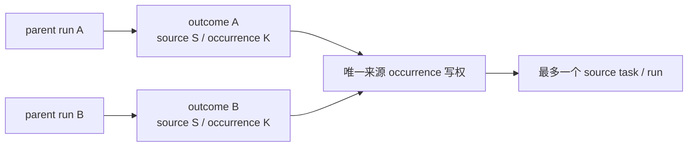

# T-517 内容雷达统一自动化调度 Delta SPEC 独立评审

> 评审日期：2026-07-24  
> 评审对象：`docs/superpowers/specs/2026-07-24-content-radar-unified-automation-design.md`  
> 评审角色：独立 PRODUCT SPEC reviewer（非作者）  
> `review_mode: homogeneous`  
> WARNING：本次为新上下文同模型独立评审，不是异构模型评审；按 orchestrator 规则属于较弱 review gate，不能冒充 cross-model PASS。

## 结论

**Verdict：FAIL**

- blocker：1
- major：7
- minor：1
- 可以保留的方向：每账号单一聚合作业、来源级策略留在内容雷达、`scheduled_automation` 共享持久执行底座、T-516 禁止反向依赖 intelligence、禁止第二 timer。
- 不能进入 CONTRACT 的原因：当前回滚方案与拟议 `NOT NULL`/新枚举迁移不兼容，旧版本在新数据库上不能继续创建或读取调度记录；同时，来源扇出恢复、跨用户调度枚举、时间字段推进、summary 守恒和旧采集 job 切换还没有闭合到可执行状态机。

本 verdict 不否定 `DEC-CR-016` 的产品方向。作者必须先逐项回应并修订 blocker/major，再重新独立评审；不能把 findings 留给 CONTRACT 临场裁决。

## Blocker

### B-01 回滚声明与 additive migration 实际不兼容，旧版本会在新数据库上失败

**类别**：migration / rollback / compatibility

**证据**

- SPEC 要把 `job_runs.account_id` 回填后设为 `NOT NULL`：目标 SPEC `:429-433`。
- SPEC 同时声称“旧版本可忽略新列”，并允许关闭新 job 后回滚应用版本：目标 SPEC `:476-480`。
- 当前旧版本 `createRun()` 的 insert 没有写 `account_id`：`backend/src/modules/scheduling/scheduling.repository.ts:357-375`。
- 当前旧 contract 只接受六种 `ScheduledJobSourceKind` 和四种 `JobRunStatus`：`contract/src/primitives.ts:179-196`；新增 `intelligence.sync`、`queued`、`partial` 后，旧读端也可能在解析列表/历史时失败。
- 当前旧 `JobRunResource` 不认识 `accountId/triggerKey/executionTaskId/resultSummary`：`contract/src/resources/scheduling.ts:61-77`。

因此，“新 schema 已生效 → 回滚到旧二进制”不是 additive-compatible：旧写者插入 `job_run` 会撞 `account_id NOT NULL`；旧读者还可能因新 source kind/status 拒绝整页数据。仅在降级前关闭新 job 不能修复旧 writer 与新 schema 的不兼容。

**必须修改**

1. 在 SPEC 中给出明确的 N-1 读写兼容矩阵，至少覆盖旧版本对 `scheduled_job`、`job_run`、`execution_tasks` 的 create/list/get/update。
2. 把迁移写成同一任务内的 expand → dual-compatible write/read → backfill/verify → enforce 流程；工程步骤不是产品范围切片。
3. 在旧 writer 仍可能运行时，不能直接依赖无默认值的 `account_id NOT NULL`。必须选择并写死一种兼容策略，例如数据库触发器从父 job 派生、先 nullable 后双写并在版本切断后收紧，或明确声明数据库不可降级并由用户接受无应用回滚风险。
4. 定义旧 reader 如何隔离/兼容新 `sourceKind/status`，不能只说“旧版本忽略新列”。
5. 增加真实 rollback rehearsal Gate：旧版本二进制 + 新迁移数据库至少完成 create/list/run-now/read-history；失败则发布阻断。

## Major

### M-01 现有 collection 的“持久 ai_task 交接”并不等于可恢复 handoff

**类别**：reliability / crash recovery

**证据**

- SPEC 允许旧 collection handler 继续把持久 `ai_task` 交给原 runner，同时要求先取得“可恢复 task ID”：目标 SPEC `:216-226`。
- 当前真实路径是 `createTask → createRun → deps.dispatch()`，dispatch 返回 `void`，进程可在 run 建成后丢执行：`backend/src/modules/ai-runtime/scheduled-collection-scheduler.ts:170-212`。
- 当前代码明确把全部 `scheduled.*` 归类为“进程重启即死”的 in-process runner；启动后只是把僵尸标失败，不会恢复执行：`backend/src/modules/ai-runtime/scheduled-collection-scheduler.ts:441-475`。
- 当前组合根仍把 runner 挂进进程内 fire-and-forget 串行链：`frontend/src/server/persistence-client.ts:7423-7447`。

持久化一个 `ai_task` ID 不能自动获得 claim/lease/checkpoint/startup recovery。当前文字既要求通用可靠 handoff，又保留不可恢复的旧执行模型，形成合同矛盾。

**必须修改**

1. 所有 scheduled kind（包括兼容 collection）必须先进入同一个可 claim/lease/recover 的 `scheduled_automation` execution task；或者先证明并实现 `ai_task` 自身等价的 DB queue/lease/recovery。
2. 明确 execution task 何时完成：不能在仅调用 `void dispatch` 后标成功；必须等待可恢复执行器终态，或把下游 durable child task ID 持久关联后再结束父任务。
3. 规定崩溃后重试如何复用原 `jobRunId/triggerKey`，以及旧 collector 的领域写幂等如何防止重复。
4. 修正“未注册 kind 必须创建 failed run”与“`executionTaskId/aiTaskId` 不得都为空”的冲突：定义未注册时是原子拒绝无 run、创建通用 failed execution task，还是允许明确的 failed-run 例外。
5. 测试必须包含进程在 child handoff 前后被杀、重启后继续执行，而不只是把僵尸标 failed。

### M-02 来源扇出没有可重建的 durable checkpoint，崩溃后 summary 可能漏记或重算漂移

**类别**：reliability / idempotency / projection

**证据**

- SPEC 只规定账号扫描 port 带可选 cursor，并要求分页完成或持久游标：目标 SPEC `:228-246`、`:492-500`。
- SPEC 规定 source task/run durable 后推进 `source.nextRunAt`：目标 SPEC `:262-269`。
- SPEC 要求崩在“扫描中、部分来源入队后或推进 nextRunAt 前”都能恢复，但没有定义 checkpoint 内容、排序锚、恢复读模型或 summary 重建算法：目标 SPEC `:492-494`。
- 当前真实 `startRun()` 是先 enqueue execution task、再另一次 insert source run，不在同一事务；两者之间已有 crash window：`backend/src/modules/intelligence/intelligence.service.ts:1320-1399`。
- 当前真实完成路径又会按完成时间第二次推进 `nextRunAt`：`backend/src/modules/intelligence/intelligence.service.ts:3520-3529`；SPEC 虽要求删除这一路，但未定义新的原子写边界。

若进程在“source run/task 已建且 nextRunAt 已推进、聚合 checkpoint/summary 未写”时退出，恢复扫描会因为来源已不再 due 而跳过它；若重新全量扫描，账号数据或 blocked 状态又可能已变化，summary 不能可靠重建。

**必须修改**

1. 定义稳定分页顺序与快照边界，例如 `(scheduledDueAt, sourceId)` 高水位；cursor 不能依赖会被本轮修改的 `nextRunAt`。
2. 定义每个来源 outcome 的 durable ledger/checkpoint，并让 `jobRunId + sourceId + scheduledDueAt` 幂等；不得只在内存累加 summary。
3. `source_sync task + source run + automationJobRunId/scheduledDueAt + source.nextRunAt CAS` 必须在同一事务，或有可证明的 outbox/补偿协议。
4. 重启时 summary 必须从持久 outcome/source-run 关联重建，而不是重新猜本轮扫描结果。
5. 补逐 crash point 测试：task 前、task 后 run 前、run 后 nextRunAt 前、nextRunAt 后 checkpoint 前、summary 前、summary 后 finish 前。

### M-03 双账号规则写得较强，但跨用户 scheduler 枚举和关联资源 owner 约束没有闭合

**类别**：ownership / tenancy

**证据**

- SPEC 承诺“每个 active account”有 job，并验收“双用户、双账号”零泄漏：目标 SPEC `:178-187`、`:484-490`。
- 当前系统 scheduler 使用 canonical user ctx：`frontend/src/server/persistence-client.ts:7449-7456`。
- 当前所谓 system list 只跨该 user 的账号，不跨 user：`backend/src/modules/scheduling/scheduling.repository.ts:207-226`、`backend/src/modules/scheduling/scheduling.service.ts:173-176`。
- SPEC 要求 `job_runs/intelligence_sync_runs/execution_tasks` stamp 同 owner tuple：目标 SPEC `:170-174`；但 schema delta 只列新增列/索引，没有定义 parent-child owner 一致性的数据库约束或原子校验：目标 SPEC `:426-438`。

双账号负测不能证明第二个 user 会被调度；全局 daemon 若继续使用 canonical user，只会静默漏掉其他 user。另一方面，仅在每张表各自 stamp tuple，不能防止 `jobRunId/sourceId/executionTaskId` 指向另一 tuple 的行。

**必须修改**

1. 选择并写死系统枚举模型：受控的 active account iterator，或逐 user scheduler context；不得沿用单一 canonical user 作为“双用户已覆盖”的实现。
2. 系统枚举返回的每个 job 必须携带并验证 `userId + accountId`，任一账号状态/ownership 读取失败要 fail closed 并留下 failed/diagnostic，不得像当前 `getAccountStatus` 查失败后放行（`backend/src/modules/ai-runtime/scheduled-collection-scheduler.ts:135-150`）。
3. 为 `job_run → scheduled_job`、`execution_task(owner=job_run) → job_run`、`intelligence_sync_run → automation job_run/source` 写出 owner 一致性策略：复合 FK、带 tuple 的唯一/FK，或同事务锁定父行并以 tuple 条件写入。
4. 所有 by-id update/read 条件必须同时带 tuple；不能只依赖先查一次再按裸 id 更新。
5. 测试增加“两 user 复用同 accountId/sourceId-like/idempotencyKey”以及非 canonical user 到期执行。

### M-04 `nextRunAt/lastRunAt` 缺少单写者 CAS 状态机，失败时推进语义不明确

**类别**：scheduler semantics / missed tick

**证据**

- SPEC 说创建/启用、正常触发、recovery 会维护/推进 `nextRunAt`：目标 SPEC `:317-325`。
- SPEC 又定义 `lastRunAt` 为成功取得触发记录的实际开始时间、run-now 不动 `nextRunAt`：目标 SPEC `:349-354`。
- 但没有定义 handoff transaction 失败、未注册 handler、execution 最终失败、summary 持久化失败、唯一冲突命中既有 run 时两个字段各如何变化。
- 当前字段创建后一直为 null，当前 service wire update 也不暴露内部 time patch：`backend/src/modules/scheduling/scheduling.repository.ts:272-291`、`backend/src/modules/scheduling/scheduling.service.ts:183-192`。
- 当前 tick 仍只按当前分钟 cron match，不读/claim `nextRunAt`：`backend/src/modules/ai-runtime/scheduled-collection-scheduler.ts:318-340`。

如果两个 scheduler/recovery 并发，唯一 `triggerKey` 最多防重复 run，却不能单独防止 `nextRunAt` 被推进两次或被旧值覆盖。失败语义不写死，会造成每分钟重试风暴、永久跳过或 last/next 显示假成功。

**必须修改**

1. 指定 scheduling 是 `scheduled_job.lastRunAt/nextRunAt` 唯一 writer；UI、executor、run completion 不得写。
2. 定义 `claimDueJob(jobId, expectedNextRunAt, now)` 一类原子 CAS/锁语义，把“取得/命中 trigger run + durable work handoff + 推进 job 时钟”放入明确事务边界。
3. 写出事件表：
   - handoff 未提交：不推进，原锚继续 due；
   - handoff 已提交：推进一次，即使 executor 后续失败也不倒退，由 execution retry 负责；
   - 命中既有 triggerKey：只在 job 仍停留于该 expected anchor 时 CAS 快进；
   - 未注册 kind、summary 失败、disabled/enable、run-now 分别如何处理。
4. 明确 `lastRunAt` 是 handoff committed time、worker started time 还是聚合 executor started time；当前“实际开始”与“成功取得触发记录”是两个不同事件。
5. 增加并发 CAS repository test，而不只测最终唯一 run 数。

### M-05 summary 没有 scanned/skipped 的完整守恒，blocked/失败来源也没有稳定的来源级关联

**类别**：observability / honest state

**证据**

- summary 有 `sourcesScanned/sourcesDue/sourcesEnqueued/sourcesDeduped/sourcesBlocked/sourcesFailedToEnqueue`，没有 `sourcesSkipped`：目标 SPEC `:278-293`。
- 唯一守恒式只覆盖 `sourcesDue`，没有定义 `sourcesScanned` 与 due/not-due/policy-invalid/owner-mismatch 的关系：目标 SPEC `:595-619`。
- 来源详情只靠 `intelligence_sync_runs.automationJobRunId` 关联：目标 SPEC `:295-301`。
- 但 blocked 或 failed-to-enqueue 可以“不创建假 run”：目标 SPEC `:303-315`。此时仅靠 source run 无法回答本次聚合究竟阻塞/跳过了哪个来源，也无法在 crash 后重建 summary。

“扫描数、入队数、受阻数、跳过数”是任务要求的聚合账；当前字段和关联模型不能形成逐来源互斥分类，也无法证明汇总没有重叠计数。

**必须修改**

1. 增加 `sourcesSkipped`（必要时拆 `notDue/policyInvalid/alreadyRunning`），并为每个计数写出互斥定义。
2. 写出两条守恒：
   - `sourcesScanned = sourcesDue + sourcesSkipped`（若 query 只取 due，则把 `sourcesScanned` 改成不误导的 `sourcesDueEvaluated`）；
   - `sourcesDue = enqueued + deduped + blocked + failedToEnqueue`。
3. 明确 blocked 的定义：是本次预检得到、还是沿用历史 blocked run；历史状态不得伪装成本次新 run。
4. 对没有 source run 的 blocked/skipped/failed-to-enqueue 建立最小持久 `job_run_source_outcome`/execution checkpoint ledger，至少含 tuple、jobRunId、sourceId、scheduledDueAt、outcome、safe error code；不能把详情藏在自由 JSON。
5. summary 必须由 durable outcomes 聚合，详情分页也从同一来源读取；补每个 bucket 和崩溃重算测试。

### M-06 切换只关闭 T-514 timer，没有把旧 `benchmark/favorites` job 纳入同一原子 write fence，仍可能双跑

**类别**：cutover / double scheduling

**证据**

- 新切换顺序要求删 timer 后启用 `intelligence.sync`：目标 SPEC `:453-465`。
- 旧 `benchmark/favorites` 的处理另放在条件性小节，未纳入同一 per-account cutover 状态机：目标 SPEC `:467-474`。
- 当前统一 scheduler 的真实 collection kind 集合包含 `benchmark`、`favorites`：`backend/src/modules/scheduling/scheduling.repository.ts:25-36`。
- 当前 T-514 timer 确实会启动扫描并在每分钟继续跑：`frontend/src/server/persistence-client.ts:5677-5717`；现有统一 scheduler 也同时启动：同文件 `:7691-7728`。

移除 `intelligenceTimer` 只能消除一条新域触发路径。若某账号的旧 benchmark/favorites job 仍 enabled，而新 `intelligence.sync` 已启用，两套作业仍可能对同一逻辑来源/外部站点执行，尤其在内容雷达迁移 write fence 尚未完成时。

**必须修改**

1. 定义 per-account cutover ledger/state 与单一 write fence，至少包含 `legacy_jobs_disabled_at/new_job_enabled_at/migration_id`。
2. 启用 `intelligence.sync` 的前置条件必须是：该账号已接管的旧 job 已 disabled 或经证据证明不覆盖新来源；不能只写“若仍有则之后处理”。
3. 在一个数据库事务或可恢复状态机中完成“fence 旧 producer → 禁用重叠旧 job → 启用新 job”；崩溃后只能处于安全停跑或可继续状态，不能并跑。
4. dry-run 对账应比较旧 timer、旧 collection jobs、新 due scan 三组 producer，而不只比较 T-514 due scanner。
5. rollback 必须先 fence 新 producer，再按 ledger 恢复必要旧 job；增加同一 `(sourceId, scheduledDueAt)` 不同 producer 并发负测。

### M-07 daily 本地锚没有 DST/时区变更裁决，`scheduledDueAt` 还不是跨重启稳定的“计划 occurrence”

**类别**：time / idempotency

**证据**

- typed policy 引入 IANA timezone 与 `anchorTimeLocal`：目标 SPEC `:248-269`。
- 迁移从现有 `nextRunAt` 反推账号时区本地时分：目标 SPEC `:440-445`。
- 但没有定义夏令时春季不存在时刻、秋季重复时刻、账号时区修改、系统时区修改、迁移时账号无有效时区时的裁决。
- 当前真实代码按“完成时间 + 24h”生成下一次：`backend/src/modules/intelligence/intelligence.service.ts:505-510`、`:3520-3529`，说明这次改造必须有明确替代算法，不能只靠字段形状。

同一个“每天 02:30”在 DST 切换日可能不存在或出现两次；若算法依赖宿主时区/当前 offset，重启或升级后会生成不同 `scheduledDueAt`，破坏 `(sourceId, scheduledDueAt)` 幂等。

**必须修改**

1. 在 SPEC 写死 timezone 解析库/算法的可观察规则，不允许使用宿主 local `Date` 隐式计算。
2. 明确 nonexistent local time、ambiguous local time、timezone 修改的选择策略，并保持历史 `scheduledDueAt` 不重写。
3. 为计划 occurrence 定义稳定语义（例如 local date + anchor + timezone/rule version，再派生 UTC），幂等键不能受完成时间或宿主时区影响。
4. 迁移遇缺失/非法账号时区必须阻断或使用已确认的显式默认，不能猜。
5. 增加 spring-forward、fall-back、跨时区修改、重启前后相同 occurrence 的 contract/repository tests。

## Minor

### m-01 system-managed job 的账号生命周期 ensure 触发点和自动化页过滤规则还不够具体

**类别**：IA / lifecycle

**证据**

- SPEC 要求每个 active account 恰好一条 job，即使零来源也保留：目标 SPEC `:178-187`。
- 迁移只描述对存量 active account 回填：目标 SPEC `:447-451`。
- 自动化页禁止编辑内部字段：目标 SPEC `:356-374`。
- 当前自动化页是通用 create/edit UI，会展示 schedule/sourceKind 编辑能力：`frontend/src/features/automations/automations-island.tsx:907-918`、`:1100-1237`。

**必须修改**

1. 补 active account 创建、激活、归档、恢复、删除时的 ensure/disable/历史保留语义。
2. 明确 `intelligence.sync` 不出现在通用“新建任务”模板/下拉，卡片由 system-managed metadata 分支渲染；列表只显示当前账号唯一卡。
3. 补切号后关闭旧详情抽屉、取消旧轮询、深链重新校验的 E2E。

## 已核验通过的设计点

以下方向本轮没有发现需要推翻的问题，但仍受上述 blocker/major 的修订影响：

1. **双层 IA 正确**：自动化页只展示账号聚合，来源策略、手动同步和来源 run 留在内容雷达；目标 SPEC `:356-398` 没有把每个来源泄漏成自动化卡片。
2. **T-516 依赖方向正确**：T-517 明确抽出 shared execution contract、禁止 T-516 依赖 intelligence，并要求 virtual non-collection executor 测试：目标 SPEC `:404-420`、`:510-518`、`:524-536`。T-516 自身也明确只复用统一 scheduling、禁止第二 timer：`docs/superpowers/specs/2026-07-24-copilot-context-health-and-freshness.md:305-314`、`:546-558`。
3. **稳定 triggerKey 方向正确**：schedule/recovery 共用 missed tick，manual 使用 client idempotency key：目标 SPEC `:327-341`。问题在于它尚未与 job 时钟 CAS 和 fan-out checkpoint 合成完整状态机。
4. **唯一到期触发 Gate 方向正确**：目标 SPEC `:574-593` 区分了业务 due discovery 与 queue drain/lease recovery/UI polling，且要求调用点级 allowlist。
5. **未伪造完成证据**：SPEC 保持 draft，测试、迁移和真机运行均写成未来 Gate，没有把未发生证据标为 PASS。

## 重新评审入口条件

重新提交独立评审前，至少要看到：

1. B-01 的 N-1 兼容/rollback 状态机与真实 rehearsal Gate；
2. M-01/M-02 的 durable parent-child handoff、fan-out outcome ledger、crash-point recovery；
3. M-03 的跨 user 系统枚举与 parent-child owner 一致性；
4. M-04 的 `nextRunAt/lastRunAt` 单写者 CAS 事件表；
5. M-05 的 scanned/due/skipped/outcome 双守恒与来源关联；
6. M-06 的 per-account 旧 producer fence/cutover/rollback；
7. M-07 的 DST/时区 occurrence 规则；
8. 更新后的 Contract/Data/Test 追踪矩阵逐项覆盖以上状态机。

在这些项修订并重新评审前，T-517 不应进入 CONTRACT，更不能修改生产调度代码。

---

## 第二轮独立复审（修订后）

> 复审日期：2026-07-24  
> 复审对象：同一 SPEC 的修订版（含 §14 首轮 findings disposition）  
> `review_mode: homogeneous`  
> WARNING：仍是新上下文同模型独立复审，不是异构模型评审；按 orchestrator 规则属于较弱 review gate。

### 第二轮结论

**Verdict：CONCERNS**

- blocker：0
- major：4
- minor：0
- 首轮结论没有被改写：第一轮仍是 `FAIL`；本节是对修订稿的新 verdict。
- 方向不需要推翻：统一 scheduler、持久 parent task、稳定扇出账、跨 user 账号枚举、job 时钟 CAS、双守恒、producer fence 和 Temporal occurrence 的主线均成立。
- 当前不能直接记为 `CONCERNS（已处理）`：下面 4 项尚未得到作者 disposition，其中一项还需要用户明确裁决 forward-only 恢复的数据损失边界。

### 首轮 findings 复核

| 首轮 finding | 第二轮复核 |
|---|---|
| `B-01` rollback / migration | **技术矛盾已消除，但用户裁决未闭合**：修订稿不再让 N-1 打开 enforce 后新库，补了 expand 兼容矩阵、schema epoch、整库快照恢复和 rehearsal；但恢复 preflight 快照会丢弃升级后写入的数据，这个发布/数据保留边界未包含在现有 `DEC-CR-016` 用户确认中，转为 `R2-01` major。 |
| `M-01` durable handoff | **闭合**：所有 scheduled kind 都先进入 `scheduled_automation` parent task；collection adapter 必须 await/reentrant，父任务等 child 真实终态，未注册 handler 也有 parent task 和可恢复终结路径。 |
| `M-02` fan-out checkpoint | **主缺口闭合**：snapshot-first、稳定 high-water、typed outcome ledger、来源 UoW 和 summary 重建均已定义；但永久 enqueue 失败缺少可到达的终态，转为 `R2-03`。 |
| `M-03` 跨 user / owner tuple | **闭合**：选定 `ActiveAccountSchedulerIterator`，逐 tuple claim、fail closed，并给出父子复合 FK 与 tuple SQL 规则和负测。 |
| `M-04` job 时钟 | **闭合**：scheduling 单写者、`claimDueJob(expectedNextRunAt)`、同事务 handoff/CAS、事件表和并发测试均已补齐。 |
| `M-05` summary / skipped | **主缺口闭合**：补 `sourcesSkipped`、互斥 bucket、双守恒与无 source run 的 durable outcome；但 outcome 的全局 occurrence 语义与表唯一键冲突，转为 `R2-02`。 |
| `M-06` overlap producer | **大部闭合**：per-account cutover ledger、legacy producer fence、先 fence 后 enable、反向 rollback 与三 producer 对账均已定义；跨 producer Gate 仍依赖 `R2-02` 的 occurrence 写权裁决。 |
| `M-07` DST / timezone | **闭合**：Temporal 锁版实现、spring-forward `later`、fall-back `earlier`、revision、宿主时区无关和非法时区 blocker 均已写死。 |
| `m-01` lifecycle / IA | **闭合**：system metadata、账号 create/archive/restore/delete、专用卡片、通用模板排除和切号清理均有要求与验收。 |

### R2-01：forward-only 恢复会丢升级后数据，但该发布标准尚无用户确认

**严重度**：major  
**类别**：migration / value-viability / decision

**证据**

- 修订稿明确 enforce 后禁止 binary-only downgrade，只能恢复升级前的 preflight 整库快照再启动 N-1：目标 SPEC `:603-635`、`:708-713`。
- 若用户在升级后已经产生新 run、outcome 或其他业务写入，恢复 preflight 快照会一并丢弃这些升级后数据；当前文字只描述技术可恢复，没有定义可接受 RPO、用户提示或导出/保全口径。
- 现有用户确认只覆盖“自动化一定要收敛”及其调度/IA 边界：`docs/tasks/T484.md:1177-1218`。`orchestrator/DECISION_LOG.md:652-682` 也只有 `DEC-CR-001..015`，没有记录用户接受“enforce 后降级必须回到升级前整库状态”的发布与数据保留变化。
- 项目规则要求发布标准和数据归属变化记录用户确认与 DEC；作者不能用 §14 disposition 代替用户裁决。

**必须修改**

1. 把 forward-only epoch、整库恢复会丢弃哪些升级后写入、何时允许触发、用户可见提示和可接受 RPO 写成明确裁决。
2. 取得用户确认并写入真实 DEC；若用户不接受数据回退，则改为兼容性更强的降级方案或同版本修复，不得默认替用户选择。
3. 发布 Gate 除 hash/rehearsal 外，要证明恢复动作不会静默覆盖用户当前库，并明确 snapshot 的保留、完整性与失败回退路径。

### R2-02：per-parent outcome 唯一键与“同 occurrence 只有一个 outcome”互相冲突

**严重度**：major  
**类别**：idempotency / contract consistency

**证据**

- outcome 唯一键是 `(jobRunId, sourceId, occurrenceKey)`：目标 SPEC `:308-337`。两个不同 `jobRunId` 可以合法各写一行同一来源 occurrence。
- NFR 却要求同一 `(sourceId, occurrenceKey)` 只产生一个来源 `run/task/outcome`：目标 SPEC `:721-723`；producer Gate 同样要求跨 producer 只产生一个 `outcome/source run`：`:843-852`。
- 这不是纯文字问题。相邻两个 15 分钟 parent run 可以在前一个尚未 dispatch 时，都把同一 daily occurrence 物化进自己的 snapshot。按 per-parent ledger，后一 parent 应留下 `deduped` 或 `occurrence_superseded` outcome 才能满足自己的 summary 守恒，因此“全局只有一个 outcome”本来就不可能同时成立。

**必须修改**

1. 区分“每个 parent 的审计 outcome”与“来源 occurrence 的唯一写权”。推荐增加全局唯一 `(userId,accountId,sourceId,occurrenceKey)` 的 occurrence claim/owner，或证明现有 source task/run 唯一键就是唯一写权。
2. 若保留 per-parent outcome，明确 loser parent 必须写 `deduped/skipped` outcome；把 NFR/Gate 改为“一个 owning claim + 最多一个 source task/run，可以有多个 parent 审计 outcome”。
3. 增加两个不同 `jobRunId`、两个 producer、同一 occurrence 的并发测试，验证 winner、loser bucket、两边 summary 守恒和恢复后 owner 不漂移。

### R2-03：`failed_to_enqueue` 没有可到达的终态，`partial` 可能永远无法 finalize

**严重度**：major  
**类别**：reliability / state machine

**证据**

- `failed_to_enqueue` 被定义为 outcome 终态，且所有 outcome 终态后 parent 才能 finalize：目标 SPEC `:308-337`、`:391-432`。
- 来源 UoW 任一步失败时，修订稿要求整份事务回滚，outcome 留在 `pending` 或记录“可重试错误”，然后 parent retry：目标 SPEC `:287-294`。
- 但最小 outcome schema 没有 `attemptCount/lastErrorCode/nextAttemptAt/retryExhaustedAt`；正文也没定义可重试/永久错误分类、来源级预算，以及在哪个独立事务把耗尽预算的 `pending` 原子转成 `failed_to_enqueue`。
- 现有事件表只说 parent 按预算 retry、最终诚实失败：目标 SPEC `:511-525`。照此实现，永久失败要么让 outcome 永远 pending，要么耗尽 parent 预算后整次 `failed`；都到不了“其他来源成功、该来源 failed_to_enqueue、聚合 partial”的验收语义（`:438-443`、`:766`、`:804`）。

**必须修改**

1. 定义来源级 enqueue error 分类、重试预算和持久 retry metadata。
2. 定义预算耗尽后用于 `pending → failed_to_enqueue` 的原子终结事务；即使原业务 UoW 回滚，也必须能安全落最小错误证据。
3. 写死 parent 在部分 outcome 耗尽预算时如何继续处理其他行、重建 summary 并 finalize 为 `partial`；关键基础设施/owner mismatch 仍应整次 `failed`，不能混为普通来源失败。
4. 增加永久校验错误、持续数据库冲突、终结事务前后 kill 和 parent lease 重试测试。

### R2-04：来源业务 outcome 的数据属主与物理边界自相矛盾

**严重度**：major  
**类别**：architecture / ownership

**证据**

- 运行层级表把含 `sourceId/sourceVersion/policyHash/evidenceSourceRunId` 的 `job_run_source_outcomes` 交给 scheduling 所有，并让 intelligence 经端口写：目标 SPEC `:146-156`、`:308-334`。
- 同一 SPEC 的硬边界却规定 scheduling **只**拥有 job 定义、到期触发和聚合 run，T-516 不能通过 scheduling 间接依赖 intelligence schema/resource/service：目标 SPEC `:743-751`。
- outcome 又对 `intelligence_sources/intelligence_sync_runs` 建复合 FK，并要求 set-based `INSERT ... SELECT` 从来源表物化：目标 SPEC `:179-185`、`:282-294`。若表/repository/typed resource 物理放在 scheduling，scheduling 就实际拥有并查询 intelligence 专属模型；若物理放在 intelligence，§4.1 的 owner 和 Contract Delta 又写错。
- `DEC-CR-013` 已确认 intelligence service 负责来源、run 聚合与领域幂等：`orchestrator/DECISION_LOG.md:673-682`。修订稿不能在没有新数据归属裁决时把来源级审计账静默移给 scheduling。

**必须修改**

1. 选择唯一物理属主并写到 schema/repository/service/contract：要么 outcome 是 intelligence 的业务扇出账，只通过 scheduling 的 `jobRunId` 关联；要么把它抽象成真正不含 intelligence 字段的 shared execution child-outcome。
2. 给 snapshot 的 set-based 跨表事务写出不违反“模块间只经 service port”的 application coordinator/UoW 边界；不能让 scheduling repository 直接 import intelligence repository。
3. 更新 NFR、Contract Delta、boundary test 与 T-516 import test，使文字、物理依赖和门卫结果一致；若改变既有数据属主，先补 DEC 与用户确认。

### 第二轮裁决

本轮确认首轮最危险的 rollback 技术矛盾和七条核心状态机缺口已经被认真修订，没有残留 blocker，因此 verdict 从首轮 `FAIL` 变为 `CONCERNS`。但这不是可直接开工的 `CONCERNS（已处理）`：

1. 作者需逐条接受或有证据驳回 `R2-01..04`；
2. `R2-01` 与任何数据属主变化需用户裁决并记 DEC；
3. 修订后至少做一次 delta 独立复核；
4. 在 verdict 被正式处理并由用户裁决前，T-517 仍停留在 PLAN，不应修改生产调度代码。

---

## 第三轮最终 delta 复核（STOP）

> 复核日期：2026-07-24  
> 复核范围：只核验 `R2-02/R2-03/R2-04` 的回修与 `R2-01` 的留置真实性，不扩展新 finding  
> `review_mode: homogeneous`  
> WARNING：仍是同模型新上下文弱门；本轮达到三轮 STOP，之后不再通过重复评审“洗”成 PASS。

### 最终结论

**Verdict：CONCERNS**

- blocker：0
- major：1（`R2-01 USER_DECISION_REQUIRED`）
- minor：0
- `R2-02/R2-03/R2-04`：闭合。
- 是否只剩用户裁决：**是**。
- 本 verdict 不改写前两轮历史：Round 1 仍是 `FAIL`，Round 2 仍是 `CONCERNS`。

### 限定范围核验

| Finding | 最终核验 | 证据 |
|---|---|---|
| `R2-02` per-parent outcome 与全局 occurrence 唯一冲突 | **闭合** | SPEC `:284-336` 新增 intelligence 域全局 occurrence claim，唯一 `(userId,accountId,sourceId,occurrenceKey)`；winner 独占 child 写权，loser 在自己的 per-parent outcome 写 `deduped/occurrence_owned`。`:338-372` 明确 audit outcome 仍按 parent 唯一、允许多个 parent 审计同一 occurrence。NFR、AC、测试与 producer Gate 均已同步改成“一个 owning claim + 至多一个 source task/run + 多 parent outcome”：`:800`、`:851-852`、`:883`、`:938`。 |
| `R2-03 failed_to_enqueue` 不可达 | **闭合** | SPEC `:338-369` 增加 `attemptCount/lastErrorCode/nextAttemptAt/retryExhaustedAt`；`:374-393` 定义 source-retryable/source-permanent/parent-critical、来源预算、业务 UoW 回滚后的独立最小终结事务、`pending→failed_to_enqueue`、partial/failed 裁决及 kill points；测试矩阵覆盖永久错误、耗尽、终结事务和 parent requeue：`:885-887`。 |
| `R2-04` outcome 数据属主冲突 | **闭合** | §4.1/4.2 把 occurrence claim、audit outcome、snapshot 和 source run 统一归 intelligence，`jobRunId` 只经 scheduling service port 校验，不建跨域 repository/FK：`:148-186`。Contract Delta 使用 scheduling generic summary envelope，intelligence 独立拥有 typed claim/outcome：`:645-650`。NFR 与 boundary tests 明确 coordinator 只编排 service ports、两域零 repository 反向 import、T-516 零 intelligence 依赖：`:820-830`、`:899-905`。这保持了既有 `DEC-CR-013`，没有静默改变数据属主。 |
| `R2-01` forward-only 数据保留边界 | **诚实保留，未闭合** | 文件头标为 `USER_DECISION_REQUIRED`；§8.1 明说现有 `DEC-CR-016` 未授权降级数据损失，A/B 都未确认，用户决定前阻断 enforce/cutover：`:7`、`:660-682`。AC、回滚和发布 Gate 重复执行该阻断：`:785-790`、`:849`、`:932-935`。仓内 `orchestrator/DECISION_LOG.md` 没有新增 A/B 裁决；作者没有把推荐方案 A 冒充成用户 DEC。 |

### STOP 后裁决

第三轮后不再继续发起同工件第四轮复审：

1. 当前 PLAN 的唯一未决项是用户选择 §8.1 的 A 或 B。
2. 若用户选择 A，可把真实确认写入 DEC，并由主 agent/human adjudication 将本轮 `CONCERNS` 处理为 `CONCERNS（已处理）`；不得把 reviewer 原 verdict 改成 PASS。
3. 若用户选择 B，当前 SPEC 已明确要求回到 PLAN 补新的兼容 Delta；那是新审核工件，不是对本工件继续洗第四轮。
4. 用户裁决前仍禁止进入 enforce/cutover 或修改生产调度代码；本轮没有伪造测试、迁移、DEC 或真机 PASS。
