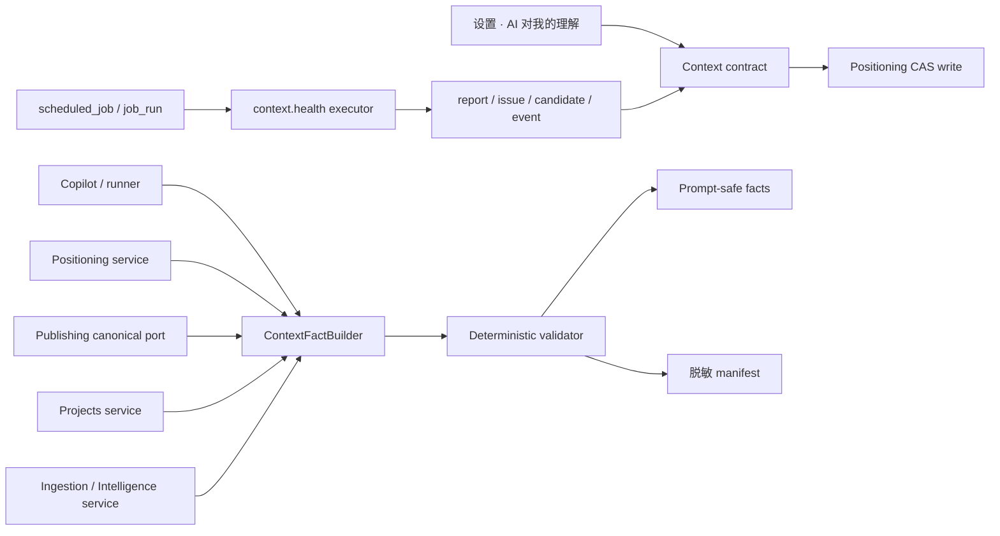
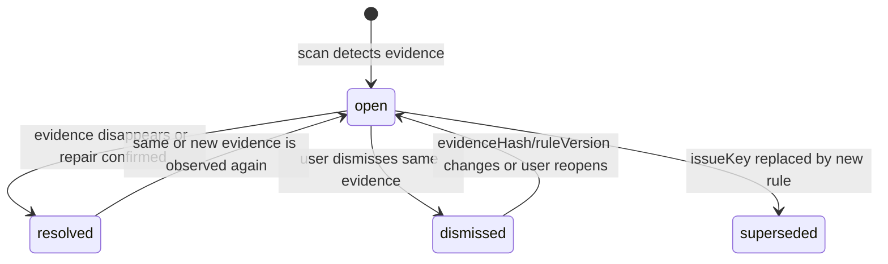
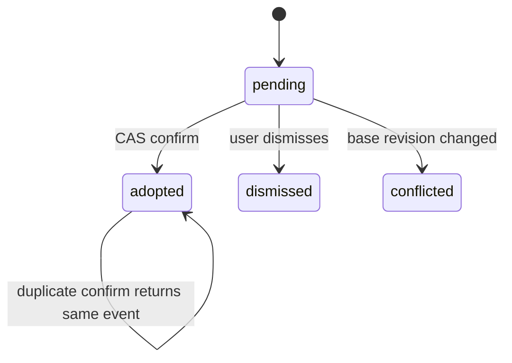

# CreatorOS Copilot 上下文健康与事实新鲜度 SERVICE CONTRACT（T-516）

> Stage：2-CONTRACT  
> 状态：`contract-rework-required`（Round 3 仍有 blocker；Gate 12/15b FAIL，确认②未发生）  
> 日期：2026-07-24  
> 上游：`docs/superpowers/specs/2026-07-24-copilot-context-health-and-freshness.md`（PLAN passed）  
> 决策：`DEC-CTX-001..004`（已确认）；`DEC-CTX-005`（拟议，尚未获确认②）  
> 范围：`FR-CTX-01..14`、`NFR-CTX-01..11`、`FLOW-CTX-01..04`、`ENT-CTX-01..07`、`IA-CTX-01..02`  
> 物理边界：`contract/` 只放 Zod wire contract；`backend/` 持有 context/publishing/positioning/scheduling 业务与数据库；`ai-worker/` 只消费 prompt-safe facts 或生成候选，不直连数据库；`frontend/` 只读、发命令，不承载治理真值。

## 1. 一句话结论

这不是再造一套“AI 记忆库”，而是在模型调用前放一个确定性事实闸门，并把需要隔天查看、确认或撤销的治理结果写入现有 canonical DB。



## 2. 可行性裁决与关键取舍

### 2.1 采用

1. 复用 `scheduled_job`、`job_run`、现有每分钟 scheduler；为 `job_run` 补齐
   `user_id + account_id` 联合归属，并使用 `(user_id,account_id,job_id,scheduled_for)` 唯一闸。
2. 调度定义增加通用 `jobKind`，首个非采集执行器为 `context.health`；原 `sourceKind` 继续服务采集，不作为健康检查的产品语义。
3. 基础扫描只使用 `job_run` 作为执行真相，不创建 `ai_task`。只有用户显式点击语义修复时才创建
   `ai_task(taskType="context.repair.generate")`；两者不共享状态机。
4. `ContextFact` 每轮重建；只有 report、issue、candidate、event、manifest 持久化。
5. canonical publication 由 Publishing 暴露窄读 port，Context 不跨 repository 拼表。
6. profile 增加单调递增 `revision`；repair confirm/undo 必须携带 expected revision。

### 2.2 不采用

- 不新增 `setInterval`、第二套 run history、localStorage 结果真值或通用记忆表。
- 不把 `context.health` 塞进“收藏/采集来源”枚举后继续走采集器文案。
- 不引入 RFC 6902 通用 JSON Patch；只允许本契约列出的字段级命令。
- 不以 project lifecycle 推断是否发布，不用 LLM 比较自由文本是否冲突。

### 2.3 调度兼容方案

`scheduled_job` wire/schema 改为 `jobKind` 判别 union：

```ts
type ScheduledJobDefinition =
  | {
      jobKind: "collection";
      sourceKind: "self.metrics"|"comments"|"self.detail"|"benchmark"|"topic.daily"|"favorites";
      target: Record<string, unknown>;
      toolGrants: unknown[];
      recipe: Record<string, unknown> | null;
      timezone: string;
      ruleVersion: null;
    }
  | {
      jobKind: "context.health";
      sourceKind: null;
      target: null;
      toolGrants: [];
      recipe: null;
      timezone: string;
      ruleVersion: string;
};
```

- 旧 `scheduling.*` collection 写 operation 在兼容窗口允许请求缺省 `jobKind`，服务端只能在该旧
  operation 内确定性补为 `collection`；context health 新 operation 缺 `jobKind` 一律
  `VALIDATION_ERROR`。所有读响应从第一版起总是返回显式 `jobKind`。
- 存量行迁移为 `jobKind="collection"`，保留 `sourceKind`、target、recipe 和既有执行行为。
- `context.health` 不伪造 `sourceKind`；DB 把存量 `source_kind/target/tool_grants` 改为允许 null，并加
  `CHECK` 保证两个 union 分支的必填/禁填组合。
- scheduler 在匹配 cron 时消费 job.timezone；若 IANA 时区无效，拒绝保存，不允许静默回 UTC。
- `job_run` 继续作为唯一运行历史；`context_health_report.run_id` 1:1 关联，不再建另一张 run 表。

## 3. 资源契约

### 3.1 公共枚举

```ts
type TruthStatus =
  | "verified" | "missing" | "unknown"
  | "stale" | "conflict" | "quarantined";

type IssueStatus = "open" | "resolved" | "dismissed" | "superseded";
type CandidateStatus = "pending" | "adopted" | "dismissed" | "conflicted";
type EvidenceStatus = "confirmed" | "needs_review" | "conflict" | "unknown";
type HealthRunStatus = "running" | "succeeded" | "failed";
type RepairAction = "confirm" | "edit_then_confirm" | "dismiss";
type Cadence =
  | { kind: "daily"; localTime: string }
  | { kind: "weekly"; weekday: 0|1|2|3|4|5|6; localTime: string }
  | { kind: "custom"; cron: string };
```

`localTime` 为 `HH:mm`；`custom.cron` 是 5 段 cron。所有频率写入先校验 cron 和 IANA timezone，再编译到 scheduled job。

### 3.2 `ContextFactResource`

```ts
{
  factKey:
    | "positioning.stableProfile"
    | "positioning.capabilities"
    | "positioning.downstreamRules"
    | "positioning.currentStatement"
    | "publication.summary"
    | "project.stageSummary"
    | "project.openTaskSummary"
    | "ingestion.sourceHealth"
    | "profile.legacyStatusNote";
  accountId: string;
  displayValue: string | null;       // 已脱敏、可展示；跨号值永不返回
  value: unknown | null;             // 按 factKey 的 tagged schema 解析
  sourceType: "user_input" | "system_internal";
  sourceRefs: Array<{ kind: string; idHash: string }>;
  asOf: string | null;
  freshnessPolicy: { kind: "none" } | { kind: "expected_run_plus"; graceHours: 24 };
  truthStatus: TruthStatus;
  ruleVersion: string;
  promptDisposition: "included" | "omitted";
  reasonCode: string;
}
```

wire 层用 `factKey` 判别的 Zod union，不接受任意 factKey。跨账号来源只返回
`truthStatus="quarantined"`、hash 和 reasonCode，`displayValue/value` 必须为 null。

### 3.3 `ContextHealthSummaryResource`

```ts
{
  accountId: string;
  hasPositioning: boolean;
  positioningSummary: {
    oneLiner: string | null;
    audience: string | null;
    tone: string | null;
    avoid: string | null;
    evidenceStatus: EvidenceStatus;
    reasons: string[];
    sourceRefs: Array<{ kind: string; idHash: string }>;
    updatedAt: string | null;
  };
  schedule: {
    jobId: string | null;
    enabled: boolean;
    cadence: Cadence;
    timezone: string;
    timezoneSource: "user_confirmed" | "desktop_os" | "legacy_utc";
    lastRunAt: string | null;
    lastSuccessfulScanAt: string | null;
    nextRunAt: string | null;
    runningRunId: string | null;
  };
  latestRun: {
    runId: string;
    status: HealthRunStatus;
    errorCode: "RUN_INTERRUPTED" | "SOURCE_UNAVAILABLE" | "INTERNAL_ERROR" | null;
    errorMessage: string | null;
    startedAt: string;
    finishedAt: string | null;
  } | null;
  latestSuccessfulReport: {
    reportId: string;
    runId: string;
    status: "succeeded";
    ruleVersion: string;
    openIssueCount: number;
    checkedFactCount: number;
    startedAt: string;
    finishedAt: string;
  } | null;
  openIssueCount: number;
  recentRepairCount: number;
}
```

设置页把“最近一次执行”和“最近一次成功检查”分开显示。`latestRun` 直接读 `job_run`，因此即使
report transaction 前崩溃或 report 自身写失败，也能显示明确失败和重试入口；
`latestSuccessfulReport` 可继续显示上一次成功摘要，但必须标为“上次成功”，
`lastSuccessfulScanAt` 保持不变，绝不冒充本次成功。

### 3.4 `ContextHealthIssueResource`

```ts
{
  id: string;
  accountId: string;
  issueKey: string;
  category: "positioning" | "publication" | "project" | "ingestion" | "legacy_profile" | "source";
  severity: "info" | "needs_action" | "blocked";
  title: string;
  explanation: string;
  targetRef: { kind: string; idHash: string; field: string | null };
  sourceRefs: Array<{ kind: string; idHash: string; asOf: string | null }>;
  evidenceHash: string;
  ruleVersion: string;
  status: IssueStatus;
  recommendedAction:
    | { kind: "reconfirm_positioning"; href: "/positioning"; returnIssueId: string }
    | { kind: "sync_source"; href: "/intelligence"; sourceId: string }
    | { kind: "relogin"; href: "/settings"; highlight: "douyin-binding" }
    | { kind: "review_repair"; candidateId: string | null }
    | { kind: "retry_scan" }
    | { kind: "open_diagnostics"; href: "/settings"; highlight: "diagnostic-logs"; desktopOnly: true };
  firstSeenAt: string;
  lastSeenAt: string;
  occurrenceCount: number;
  dismissedAt: string | null;
}
```

深链字段是白名单 union，前端不得用任意 URL。`sync_source.sourceId` 必须在当前账号再次验权。

### 3.5 Repair patch、candidate 与 event

```ts
type StableProfileRepairFields = Partial<{
  persona: string; field: string; audience: string; differentiation: string;
  contentScope: string; avoid: string; corePain: string; coreValue: string; tone: string;
  capabilities: string[];
  topicRule: string; scriptRule: string; projectRule: string;
  forbidRule: string; expressionRule: string;
}>;

type RepairPatch =
  | {
      kind: "clear_legacy_status_note";
      target: "creator_profile.facets.statusNote";
      value: "";
    }
  | {
      kind: "replace_stable_profile_fields";
      fields: StableProfileRepairFields;
    }
  | {
      kind: "append_positioning_statement";
      oneLiner: string;
      keywords: [string, string, string];
      productAnchorIds: string[];
      changeReason: string;
    };

type ContextRepairCandidateResource = {
  id: string; issueId: string; accountId: string; evidenceHash: string;
  attempt: number;
  patch: RepairPatch; beforePreview: string; afterPreview: string;
  reason: string; sourceRefs: Array<{ kind: string; idHash: string }>;
  baseRevision: number; status: CandidateStatus;
  createdBy: "deterministic_rule" | "ai";
  aiTaskId: string | null; createdAt: string; dismissedAt: string | null;
};

type RepairSnapshot =
  | { kind: "clear_legacy_status_note"; value: string }
  | { kind: "replace_stable_profile_fields"; fields: StableProfileRepairFields }
  | {
      kind: "append_positioning_statement";
      oneLiner: string; keywords: [string,string,string];
      productAnchorIds: string[]; changeReason: string;
    }
  | { kind: "no_positioning_statement" };

type ContextRepairEventResource = {
  id: string; accountId: string; candidateId: string; issueId: string;
  patch: RepairPatch; before: RepairSnapshot; after: RepairSnapshot;
  actor: "user" | "user_edited"; baseRevision: number; afterRevision: number;
  runId: string | null; undoOf: string | null; undoneBy: string | null; createdAt: string;
};
```

`before/after.kind` 必须与 patch kind 对应；append 的 before 使用
`no_positioning_statement`，after 使用 statement snapshot。字符串 trim 后单字段最多 2,000 字，
数组最多 50 项、单项最多 200 字；只返回该 patch 触及字段，不允许序列化整个 profile。
`before/after` 只在本机 canonical DB 与授权的设置响应中存在；日志、manifest 和遥测不得输出正文。

### 3.6 AI repair generation 与撤销重基线

```ts
type ContextRepairAiResult = {
  schemaVersion: "context-repair/v1";
  issueId: string;
  evidenceHash: string;
  accountIdHash: string;
  baseRevision: number;
  patch: Extract<RepairPatch,
    {kind:"replace_stable_profile_fields"|"append_positioning_statement"}>;
  reason: string;
  sourceRefs: Array<{kind:string; idHash:string}>;
};

type RepairGenerationResource = {
  id: string;
  issueId: string;
  attempt: number;
  requestKey: string;
  status: "queued"|"running"|"ready"|"failed";
  aiTaskId: string | null;
  candidateId: string | null;
  errorCode: string | null;
  errorMessage: string | null;
  updatedAt: string;
};

type UndoRebaseCandidateResource = {
  id: string;
  eventId: string;
  accountId: string;
  originalAfterRevision: number;
  currentRevision: number;
  currentPreview: string;
  proposedRestorePreview: string;
  inversePatch: RepairPatch;
  editableFields: string[]; // 只能是 inversePatch 已触及的字段
  status: "pending"|"adopted"|"expired";
  createdAt: string;
};
```

AI result consumer 在创建 candidate 前重新读取当前 `(userId,accountId)` 的 issue、evidenceHash 与
profile revision。任何一项与 task input 不一致，generation=`failed`、candidate 写入 0；模型不得
自行指定账号或扩大字段白名单。

## 4. 对外操作

所有操作通过现有 `/api/v1/dispatch` contract transport；`ctx.userId` 来自认证会话，
`ctx.accountId` 必须非空并经 Platform Account service 验证属于该 user。客户端不得在 body
伪造 userId/accountId。标准失败 envelope：

```ts
{
  ok: false;
  error: {
    code:
      | "AUTH_REQUIRED" | "ACCOUNT_REQUIRED" | "OWNERSHIP_ERROR"
      | "NOT_FOUND" | "VALIDATION_ERROR" | "CONFLICT"
      | "RUN_IN_PROGRESS" | "SOURCE_UNAVAILABLE"
      | "ARCHIVED_ACCOUNT" | "MODEL_NOT_CONFIGURED"
      | "INVALID_STATE" | "RUN_INTERRUPTED" | "INTERNAL_ERROR";
    message: string;
    retryable: boolean;
    details?: { currentRevision?: number; diffPreview?: string; runId?: string };
  }
}
```

按账号归属的资源不存在或越权时统一返回 `OWNERSHIP_ERROR`，不泄露资源是否属于别号；
`NOT_FOUND` 只用于已经通过联合属主门、但其账号内的非归属型子值不存在（例如已过期的
manifest scope）。

HTTP 映射固定如下：`AUTH_REQUIRED→401`；`ACCOUNT_REQUIRED/VALIDATION_ERROR→400`；
`OWNERSHIP_ERROR/NOT_FOUND→404`；`CONFLICT/INVALID_STATE/RUN_IN_PROGRESS/ARCHIVED_ACCOUNT→409`；
`MODEL_NOT_CONFIGURED/SOURCE_UNAVAILABLE→422`；`RUN_INTERRUPTED/INTERNAL_ERROR→500`。所有失败均
使用上面的同一 envelope，不能返回裸字符串或 200+error。

| API | Operation / HTTP | Request | Response | 权限与错误 | 幂等 / 状态 | Source |
|---|---|---|---|---|---|---|
| `API-CTX-001` | `context.health.get` `GET /context/health` | 无 body | `ContextHealthSummaryResource` | 当前账号；ACCOUNT_REQUIRED/OWNERSHIP/SOURCE_UNAVAILABLE | 纯读；不触发扫描、不启动浏览器探测 | FR-CTX-04/06/07/11 |
| `API-CTX-002` | `context.health.schedule.put` `PUT /context/health/schedule` | `{enabled,cadence,timezone}` | summary.schedule | 当前 active 账号；VALIDATION/ARCHIVED_ACCOUNT | upsert `(userId,accountId,jobKind)`；重复同值不 bump；enabled 允许 false | FR-CTX-05/11/12 |
| `API-CTX-003` | `context.health.runNow` `POST /context/health/run-now` | `{requestKey}` | `{runId,deduped,status:"running"}` | 当前 active 账号；RUN_IN_PROGRESS/ARCHIVED_ACCOUNT | 同 requestKey 或同号 running run 返回既有；不调用 LLM | FR-CTX-05/13 |
| `API-CTX-004` | `context.health.issues.list` `GET /context/health/issues` | query `{status?,limit,offset}` | `{items,total}` | 当前账号；VALIDATION | 纯读，默认只列 open | FR-CTX-06/07/08/11 |
| `API-CTX-005` | `context.health.issues.dismiss` `POST /context/health/issues/:issueId/dismiss` | `{evidenceHash}` | issue | 当前账号；OWNERSHIP_ERROR/CONFLICT | `(userId,accountId,issueId,evidenceHash,"dismiss")` 幂等；open→dismissed | FR-CTX-06/09/10 |
| `API-CTX-006` | `context.health.issues.reopen` `POST /context/health/issues/:issueId/reopen` | `{reason:"user_requested"}` | issue | 当前账号；OWNERSHIP_ERROR/CONFLICT | dismissed→open；open 重复调用返回原行 | FR-CTX-06/09 |
| `API-CTX-007` | `context.repairs.generate` `POST /context/health/issues/:issueId/repair` | `{requestKey}` | `RepairGenerationResource`，确定性规则可直接 ready | 当前账号；OWNERSHIP_ERROR/MODEL_NOT_CONFIGURED/SOURCE_UNAVAILABLE/INVALID_STATE | 所有 candidate 都只在用户显式点击后生成；同 requestKey 返回同 generation；新 requestKey 在无 pending candidate 时创建新 attempt；确定性清理不建 AI task | FR-CTX-08/09/13 |
| `API-CTX-008` | `context.repairs.confirm` `POST /context/repairs/:candidateId/confirm` | `{expectedRevision,editedPatch?}` | `{candidate,event,newRevision,issue}` | 当前 active 账号；VALIDATION/CONFLICT/ARCHIVED_ACCOUNT | pending→adopted；同 candidate 重复确认返回原 event；CAS 失败写入 0 | FR-CTX-09/10/11 |
| `API-CTX-009` | `context.repairs.dismiss` `POST /context/repairs/:candidateId/dismiss` | `{evidenceHash}` | `{candidate,issue}` | 当前账号；OWNERSHIP_ERROR/CONFLICT | pending→dismissed；业务 profile 写入 0；重复返回原结果 | FR-CTX-09/10 |
| `API-CTX-010` | `context.repairs.events.list` `GET /context/repairs/events` | query `{limit,offset}` | `{items,total}` | 当前账号 | 纯读；新到旧 | FR-CTX-04/10/11 |
| `API-CTX-011` | `context.repairs.undo` `POST /context/repairs/events/:eventId/undo` | `{expectedRevision}` | `{mode:"undone",event,newRevision}` 或 `{mode:"needs_reconfirm",undoCandidate}` | 当前 active 账号；OWNERSHIP_ERROR/CONFLICT/ARCHIVED_ACCOUNT/INVALID_STATE | revision 一致直接 append 反向 event；不一致只建重基线候选，不写 profile；重复调用返回同 event/candidate | FR-CTX-10/11 |
| `API-CTX-012` | `context.manifests.get` `GET /context/manifests/:scopeKind/:scopeId` | params `scopeKind=conversation|run` | 脱敏 manifest | 当前账号；NOT_FOUND/OWNERSHIP | 纯读；仅 30 天内 | FR-CTX-03/14 |
| `API-CTX-013` | `context.repairs.undo.confirm` `POST /context/repairs/undo-candidates/:undoCandidateId/confirm` | `{expectedRevision,editedInversePatch?}` | `{event,newRevision,undoCandidate}` | 当前 active 账号；OWNERSHIP_ERROR/VALIDATION/CONFLICT/ARCHIVED_ACCOUNT/INVALID_STATE | pending 且 current revision 一致才写；再次冲突返回新 diff、写入 0；重复成功返回同 event | FR-CTX-10/11 |
| `API-CTX-014` | `context.repairs.generation.get` `GET /context/repair-generations/:generationId` | 无 body | `RepairGenerationResource` | 当前账号；OWNERSHIP_ERROR | 纯读；queued/running/ready/failed 终态可跨刷新读取 | FR-CTX-09/13 |

### 4.1 每个操作的 happy-path 实例

为节省重复字段，示例只展示判别关键字段；正式 Zod vector 使用 §3 的完整 resource。

| API | Request 示例 | Response 示例 |
|---|---|---|
| API-CTX-001 | `GET /context/health` | `{"accountId":"acc-1","openIssueCount":2,"latestRun":{"status":"failed","errorCode":"RUN_INTERRUPTED"},"latestSuccessfulReport":{"status":"succeeded"}}` |
| API-CTX-002 | `{"enabled":true,"cadence":{"kind":"weekly","weekday":1,"localTime":"09:00"},"timezone":"Asia/Shanghai"}` | `{"jobId":"job-1","enabled":true,"nextRunAt":"2026-07-27T01:00:00Z"}` |
| API-CTX-003 | `{"requestKey":"manual:019f..."}` | `{"runId":"run-ctx-01","deduped":false,"status":"running"}` |
| API-CTX-004 | `GET ?status=open&limit=20&offset=0` | `{"items":[{"id":"issue-1","status":"open"}],"total":1}` |
| API-CTX-005 | `{"evidenceHash":"sha256:v1:abc"}` | `{"id":"issue-1","status":"dismissed","dismissedAt":"2026-07-24T17:01:00Z"}` |
| API-CTX-006 | `{"reason":"user_requested"}` | `{"id":"issue-1","status":"open"}` |
| API-CTX-007 | `{"requestKey":"repair:019f..."}` | `{"issueId":"issue-1","status":"queued","aiTaskId":"task-1","candidateId":null}` |
| API-CTX-008 | `{"expectedRevision":7}` | `{"newRevision":8,"candidate":{"status":"adopted"},"issue":{"status":"resolved"}}` |
| API-CTX-009 | `{"evidenceHash":"sha256:v1:abc"}` | `{"candidate":{"status":"dismissed"},"issue":{"status":"dismissed"}}` |
| API-CTX-010 | `GET ?limit=20&offset=0` | `{"items":[{"id":"event-1","afterRevision":8,"undoneBy":null}],"total":1}` |
| API-CTX-011 | `{"expectedRevision":8}` | `{"mode":"needs_reconfirm","undoCandidate":{"id":"undo-1","currentRevision":9,"status":"pending"}}` |
| API-CTX-012 | `GET /context/manifests/conversation/conv-1` | `{"scopeKind":"conversation","entries":[{"factKey":"publication.summary","truthStatus":"verified","disposition":"included"}]}` |
| API-CTX-013 | `{"expectedRevision":9,"editedInversePatch":{"kind":"replace_stable_profile_fields","fields":{"audience":"创业者"}}}` | `{"newRevision":10,"event":{"undoOf":"event-1"},"undoCandidate":{"status":"adopted"}}` |
| API-CTX-014 | `GET /context/repair-generations/gen-1` | `{"id":"gen-1","status":"ready","aiTaskId":"task-1","candidateId":"candidate-1","errorCode":null}` |

### 4.2 Mutation 合法状态、非法状态与重复行为

| API | 合法源状态 | 非法源状态 → 响应 | 重复行为 |
|---|---|---|---|
| 002 schedule.put | active account；job 无/任意 enabled | archived→409 ARCHIVED_ACCOUNT；坏 timezone/cron→400 VALIDATION | 同值返回原 job，不改 updatedAt |
| 003 runNow | active；无本号 running scan | archived→409；已有不同 requestKey running→409 RUN_IN_PROGRESS | 同 requestKey 返回同 run，`deduped=true` |
| 005 issue.dismiss | issue=open；evidenceHash 相同 | resolved/superseded→409 INVALID_STATE；hash 变→409 CONFLICT | dismissed 同 hash 返回原行 |
| 006 issue.reopen | issue=dismissed | resolved/superseded→409 INVALID_STATE | open 返回原行 |
| 007 repair.generate | issue=open；action=review_repair | resolved/superseded/dismissed→409 INVALID_STATE；无模型且需语义→422 | 同 requestKey/evidence 返回同 generation |
| 008 repair.confirm | candidate=pending；issue=open；revision 相同 | adopted/dismissed→409 INVALID_STATE（adopted 同请求走幂等返回）；conflicted 或 revision 变→409 CONFLICT | 已 adopted 返回原 event，不二写 |
| 009 repair.dismiss | candidate=pending；issue=open | adopted/conflicted→409 INVALID_STATE；hash 变→409 CONFLICT | dismissed 返回原 candidate/issue |
| 011 undo | event 未撤销；账号 active | event 已撤销→返回原 undoneBy；账号 archived→409；revision 变不报失败，返回 needs_reconfirm | 同 event/currentRevision 返回同 undoCandidate |
| 013 undo.confirm | undoCandidate=pending；revision 相同 | adopted/expired→409 INVALID_STATE（adopted 同请求幂等返回）；再次 revision 变→409 CONFLICT+新 diff | 已 adopted 返回同反向 event |

issue dismiss 与 candidate dismiss 在同一事务：API-CTX-005 若存在 pending candidate，同步置
candidate=dismissed；API-CTX-009 同步置 issue=dismissed。任何一边写失败整体回滚。

## 5. 内部 service ports

这些是 backend composition seam，不通过前端公开；每个调用仍携带完整 `RequestContext`。

### `PORT-CTX-001 ContextFactBuilder.build`

```ts
build(ctx, { requiredFactKeys, scopeKind, scopeId, mode: "prompt"|"scan" })
  -> { facts: ContextFactResource[]; manifestDraft }
```

- prompt 模式只读 runner 声明所需 facts，不做全量 report 聚合。
- source 成功读空与 source 抛错必须区分为 missing/unknown。
- 不允许 fixture/cache/另号 fallback。

### `PORT-CTX-002 ContextValidator.validate`

纯函数输入 facts + `ruleVersion`，输出 prompt-safe facts、issues 和脱敏 manifest；自动规则只包含
PLAN 列出的账号、canonical publication、字段白名单、完整度和 freshness 规则。自由文本不走
embedding/LLM。

### `PORT-CTX-003 PublishingContextPort.getCanonicalPublicationSummary`

composition root 先创建 transaction-scoped `ReadUnitOfWork`：

```ts
type ReadUnitOfWork = {
  readonly snapshotId: unique symbol;
  readonly tx: DbTransaction; // 只在 backend 内部，不进入 contract wire
};
```

Publishing 的 canonical query service 在一个 `REPEATABLE READ, READ ONLY` 事务内批量读取其 own
publication/revision 数据，并调用同一 UoW 绑定的两个 batch ports：

```ts
ProjectsContextPort.getOwnerFacts(ctx, uow, outputIds: string[])
PlatformAccountContextPort.getIdentityFacts(ctx, uow, accountId, platforms: string[])
```

两个 port 的 repository factory 必须消费 `uow.tx`，不得另开连接；每个 port 每轮最多一次 batch，
禁止逐 publication N+1。事务遇 serialization/connection snapshot failure 时整体重试一次；第二次
失败返回 unknown，不返回第一次的部分计数。返回：

```ts
{ status:"verified"; summary: PublicationSummary; sourceRefs; queryAt }
| { status:"conflict"; reasonCodes:string[]; sourceRefs; queryAt }
| { status:"unknown"; reasonCode:string; queryAt }
```

Context 不接触 publishing/projects/platform-account repositories。500ms 门以 1000 publication、
1000 project 的单事务批量 query explain/benchmark 验证。

### `PORT-CTX-004 PositioningRepairPort.apply`

```ts
apply(ctx, { patch: RepairPatch, expectedRevision, actor, candidateId })
  -> { before, after, baseRevision, afterRevision }
```

- `creator_profiles.revision` 原子 CAS：`WHERE user_id=? AND account_id=? AND revision=?`。
- profile field repair 原子 update 并 revision+1。
- statement repair append 新版本，同时 profile revision+1 作为统一并发锚。
- 写成功后 Context 在同一事务写 repair event 并 resolve issue；任一步失败整体回滚。

`revision` 是整个当前定位聚合的统一并发锚，不是 repair 私有版本号。下列既有写路径必须收敛到
同一个 Positioning write service，并在其业务写入的同一事务 `revision+1`：

1. `positioning.profile.upsert`：persona/field/audience/differentiation/capabilities/facets/
   downstreamRules 任一值真实变化时递增；相同值重放不递增。
2. `positioning.statements.create`：成功 append statement 时递增。
3. `ai.tasks.confirm` 的 `positioning_profile` 分支：profile upsert + statement append 是一个
   聚合事务，只递增一次；部分成功禁止。
4. `PORT-CTX-004` 的 confirm、直接 undo 与重基线 undo：各成功事务递增一次。

repository 不再公开绕过该服务的 profile/statement 生产写方法。候选生成后若任一普通定位页面或
AI 定位确认改变上述聚合，旧 candidate/event 的 expectedRevision 必须返回 `CONFLICT`，profile、
statement 与 repair event 写入均为 0。

### `PORT-CTX-005 ContextRepairResultConsumer.consume`

只消费 `taskType="context.repair.generate"` 的 succeeded AI task。顺序固定：

1. 用 `ContextRepairAiResult` Zod 严格解析 resultData；
2. 从 task input 取得 server-stamped user/account/issue/evidence/baseRevision，不信 resultData 账号；
3. 同一事务重新读取 issue=open、evidenceHash 未变、profile revision 等于 baseRevision；
4. 校验 patch kind/字段白名单/长度与 statement 三关键词；
5. 幂等 insert candidate；更新 generation=ready。任一失败 generation=failed，candidate=0。

设置页通过 API-CTX-014 轮询/刷新后恢复 queued→running→ready/failed；不依赖前端 React state。

generation 终态由持久 `ai_task` 决定并通过现有统一 scheduler 的同一 reconciliation tick 收敛，
不新增 timer：

- task `queued|running`：generation 同步为同名状态；
- task `succeeded` 且 generation 未 ready：幂等重放 `consume`；candidate insert 与
  generation=ready 同事务；
- task `failed`：generation=failed，errorCode=`AI_TASK_FAILED`；
- task `cancelled`：generation=failed，errorCode=`AI_TASK_CANCELLED`；
- task 被现有启动恢复标为 interrupted/不存在：generation=failed，分别为
  `AI_TASK_INTERRUPTED` / `AI_TASK_MISSING`。

启动时和每分钟统一 tick 都扫描“generation 非终态但 task 已终态”的行。即使崩溃发生在 task
succeeded 与 consumer commit 之间，下一轮也会重放；candidate 的
`(user_id,account_id,issue_id,evidence_hash,attempt)` 和 generation 的 requestKey 唯一键保证
至多一次提交。任何非终态超过 AI task 自身 lease 后，必须先由现有 AI task recovery 收终态，
generation 不允许永久 running。

### `PORT-CTX-006 ValidatedModelDispatch`

所有当前模型调用收敛为两个 package gateway：

```ts
prepareInvocation(ctx, {
  consumerId, requiredFactKeys, scopeKind, scopeId, promptInput
}): Promise<ValidatedModelInvocation>; // opaque branded token

dispatchStream(invocation: ValidatedModelInvocation, modelRequest): StreamResult;
dispatchComplete(invocation: ValidatedModelInvocation, modelRequest): Promise<Result>;
```

- backend `ai-runtime` 的 Chat `streamText` 与注入式 `LlmCompleter` 都只可在
  `validated-model-dispatch.ts` 内调用 provider。
- `ai-worker` 的 `agent-runtime/structured-node/vision` 入口必须消费同一 branded
  `ValidatedContextEnvelope`；调用方不能只传任意 string prompt 绕过。
- `consumerId` 注册表至少覆盖：Chat stream、copilot.assist、positioning.generate、
  topic/research/planning/script/material/publish/review/calibration、asset/cover/classify、
  video decisions、知识蒸馏/关联与 ai-worker agent/structured/vision 三类 runtime。
- 每个 consumer 声明 requiredFactKeys；ownership/主定位失败时 `prepareInvocation` 抛错，
  provider 调用计数必须为 0。可选 fact unknown 仅省略该 fact。
- BUILD 增加禁止旁路扫描：除两个 gateway 文件和测试外，`streamText|generateText|
  generateObject|deps.llm(` 的生产调用命中为 0；每个注册 consumer 有 fail-closed contract test。

## 6. 状态机





candidate 是不可变 attempt。dismissed/conflicted attempt 不原地复活；API-CTX-006 重开 issue 时把
`recommendedAction.candidateId` 置 null。用户再次点击 API-CTX-007，服务端基于最新 profile
revision 创建 `attempt=max+1` 的新 candidate（确定性分支）或 generation（AI 分支）。同一
`(userId,accountId,issueId,evidenceHash)` 同时最多一个 pending candidate；若已有 pending，
任何新 requestKey 也返回指向它的 ready generation，不重复收费。旧 attempt 永久保留审计。

```mermaid
stateDiagram-v2
  [*] --> queued: explicit semantic repair
  queued --> running: AI task claimed
  running --> ready: result revalidated + candidate committed
  running --> failed: model/schema/ownership/evidence/revision failure
  queued --> failed: task cancelled/interrupted/missing
  running --> failed: task cancelled/interrupted/missing
  ready --> ready: refresh/poll
  failed --> failed: terminal; new requestKey creates a new generation
```



Undo 重基线：revision 相同的 API-CTX-011 直接产生反向 event；revision 不同则只产生 pending
UndoRebaseCandidate。API-CTX-013 只允许编辑原 inversePatch 已触及字段；确认时再次 CAS。再次冲突
返回最新 current/proposed diff，并把旧 undo candidate=expired、生成一个新 pending candidate，
profile/event 写入 0。

扫描 upsert 规则：

1. 相同 `(userId,accountId,issueKey,evidenceHash,ruleVersion)` 命中 open：只更新 lastSeenAt。
2. 命中 dismissed 且 evidenceHash/ruleVersion 都不变：保持 dismissed。
3. evidenceHash 或 ruleVersion 变化：旧行 superseded，新行 open。
4. 命中 resolved 且同一证据再次真实出现：复用既有行并 reopen，不新建违反唯一约束的行；
   `firstSeenAt` 保留，`lastSeenAt` 更新，occurrenceCount+1。
5. 本轮未再发现的 open issue：resolved；source 读取失败导致的 unknown 只处理该 source 的 issue，
   不误将其他未验证 issue resolved。
6. dismiss issue 时，同事务 dismiss 其 pending candidate；dismiss candidate 时同事务 dismiss issue。
   adopted/conflicted candidate 不被 issue dismiss 反向改写。

## 7. 数据模型与唯一约束

| 表 / 变更 | 关键列 | 约束 / 索引 | 保留 |
|---|---|---|---|
| `scheduled_job` 增量 | `job_kind, timezone, timezone_source, rule_version`；collection/context 判别字段 | unique `(user_id,account_id,id)`；context singleton unique `(user_id,account_id,job_kind) WHERE job_kind='context.health'`；union CHECK | 账号归档仍保留 |
| `job_run` 复用/增量 | 新增 `user_id,account_id`，以及 `trigger_key,process_epoch,retry_of,attempt` | unique `(user_id,account_id,id)`；计划 tick unique `(user_id,account_id,job_id,scheduled_for)`；manual unique `(user_id,account_id,job_id,trigger_key) WHERE trigger_key IS NOT NULL`；每个查询/更新均直接带联合属主门，并以复合外键校验 run 与 parent job 同属一号 | 永久运行历史，按产品后续统一留存策略 |
| `creator_profiles` 增量 | `revision INTEGER NOT NULL DEFAULT 1` | `(user_id,account_id)` 既有唯一；CAS update | 长期 |
| `context_health_reports` | `id,user_id,account_id,run_id,rule_version,status,summary,error_*` | unique `(user_id,account_id,id)`、unique `(user_id,account_id,run_id)`；复合 FK `(user_id,account_id,run_id)→job_run`；latest index | 长期摘要 |
| `context_health_issues` | ENT-CTX-04 字段 + `last_report_id` | unique `(user_id,account_id,id)`、unique `(user_id,account_id,issue_key,evidence_hash,rule_version)`；复合 FK last report；open/dismissed index | 长期，支持处置 |
| `context_repair_candidates` | ENT-CTX-05 字段、`attempt`、JSONB patch | unique `(user_id,account_id,id)`、unique `(user_id,account_id,issue_id,evidence_hash,attempt)`；partial unique 同 issue/evidence 只一条 pending；复合 FK issue | 长期，旧 attempt 不覆盖 |
| `context_repair_generations`（ENT-CTX-05 的生成子资源） | §3.6 generation 字段 + `attempt,ai_task_id` | unique `(user_id,account_id,id)`、unique requestKey、partial unique 同 issue/evidence 只一条 queued/running；复合 FK issue 与 ai_task | 长期，跨刷新恢复 |
| `context_undo_candidates`（ENT-CTX-06 的撤销子资源） | §3.6 重基线字段、JSONB inverse patch | unique `(user_id,account_id,id)`、unique `(user_id,account_id,event_id,current_revision)`；复合 FK event | 长期，支持二次确认 |
| `context_repair_events` | ENT-CTX-06 字段，JSONB before/after/patch | unique `(user_id,account_id,id)`、unique `(user_id,account_id,candidate_id,after_revision)`；复合 FK candidate 与 issue，undoOf/undoneBy 复合自引用；append-only | 长期，支持撤销 |
| `context_manifests` | `scope_kind,scope_id_hash,entries,expires_at` | unique `(user_id,account_id,scope_kind,scope_id_hash,rule_version)` | 30 天 |

所有 repository 构造必须同时绑定 `userId + accountId`；任何 update/delete 的 where 都包含两者。
manifest 过期清理由统一 scheduler 的 context executor 顺带批量删除 `expires_at < now`，不新起 timer。

父表（含 `scheduled_job`、`job_run`、`ai_tasks`）都先具备
`UNIQUE(user_id,account_id,id)`，再建立上述复合外键；不得用只有 `id` 的软关联替代。迁移先统计
parent 缺失或 parent/child 联合属主不一致的行，任一非 0 就阻断并给本地诊断，不自动改账号。

### 7.1 `job_run` 进程崩溃与重启规则

`context.health` 是当前桌面进程内、目标 P95≤2s 的确定性 executor，不做跨进程 lease 假象：

1. 每次 app 启动生成 `processEpoch`；创建 run 时写入。
2. 启动 reconciliation 复用现有 `sweepStaleRuns` 接缝，但对
   `jobKind=context.health && status=running && processEpoch!=current` **不等 30 分钟**：
   - 已存在同 run 的 succeeded report：把 run 补为 succeeded；
   - 不存在 report：把旧 run 标 failed，errorCode=`RUN_INTERRUPTED`，finishedAt=now。
   API-CTX-001 的 `latestRun` 直接回读这个失败 run；即使另有旧成功报告，也只放在
   `latestSuccessfulReport`，两者不互相覆盖。
3. 被中断的 scheduled tick 不再创建第二条同 scheduledFor run；下一个计划 tick正常运行。
   用户点击重试创建新的 manual run，写 `retryOf=oldRunId` 和新的 triggerKey。
4. crash 在 report/issues transaction 前：业务写入 0，boot 标 failed。
   report insert 自身失败同样把 run 标 failed=`INTERNAL_ERROR`，设置从 latestRun 回显。
5. crash 在 report/issues transaction 后、run 终态前：boot 根据 succeeded report 补终态，不重复
   upsert report/issue。
6. 同 requestKey 重试始终返回原 run；新 requestKey 才能创建 retry run。report/issue 的联合唯一
   约束继续阻止扫描重放。

### 7.2 迁移与冷启动

1. profile revision backfill 为 1；不改 profile 正文。
2. 存量 `statusNote` 原样保留，但新 prompt builder 从第一版上线起永不读取正文；首次扫描只生成
   `legacy_status_note` issue，不生成 candidate。用户显式点击“查看建议”后，
   API-CTX-007 以确定性规则创建 ready generation + candidate，AI task 为 0。
3. active 且已有定位的账号，bootstrap 幂等创建默认 weekly job；无定位账号不建 job。
4. 账号归档只停跑，不删 report/issue/event；恢复 active 后按原 enabled/cadence 恢复。
5. scheduling 采用展开→回填→收紧顺序：先加 nullable `job_kind/timezone/rule_version` 与
   `timezone_source`，部署服务端双读；再做数据预检/回填；最后才加 union CHECK、复合外键与
   必填约束。任何一步失败都在同一 migration transaction 回滚，旧 schema/任务仍可读。
6. 存量 scheduled jobs backfill `job_kind=collection` 并保留原行为。因为旧 scheduler 明确按 UTC
   解释，存量任务写 `timezone="Etc/UTC", timezone_source="legacy_utc"`，在设置中可见“沿用旧 UTC
   时区”，不是静默推断。用户下一次保存频率时必须选择/确认 IANA timezone。
7. 新建 context weekly job 只接受有效 IANA timezone：优先用户已确认设置，其次桌面 OS 返回的
   IANA zone；两者均缺失/非法则跳过 bootstrap，设置显示 `TIMEZONE_REQUIRED` 并提供选择入口，
   不创建一个假 UTC job。历史 `scheduled_for` 不重算。
8. `job_run.user_id/account_id` 从其 parent `scheduled_job` 一次性回填并置为 NOT NULL；
   迁移先校验 parent 缺失/属主冲突为 0，再建立复合外键和上述联合唯一索引。任何冲突都阻断迁移，
   不猜测账号归属。
9. 所有 context 父子表的复合外键按 §7 先预检再建立；`ai_tasks` 只新增联合候选唯一键，不改变
   其既有主键和读 API。
10. 兼容窗口内旧 collection 请求缺 `jobKind` 仍成功，响应显式返回 collection；新 context 请求、
    数据库新行和内部 service 一律要求显式判别字段。确认所有打包调用方升级后，后续独立变更才可
    收紧旧 wire；本任务不删除兼容解析。

### 7.3 修复 T-515 的既有作品投影契约

现有 `contextReaders.listProjects` 的作品投影不能再写死 `publishedAt:null`。将其共享 DTO 明确定义为：

```ts
type RecentProjectContextItem = {
  id: string;
  title: string;
  stage: ProjectLifecycle;
  status: string;
  source: "manual" | "imported";
  publishedAt: string | null;
};
```

- `source` 来自 project canonical `source` 列，只允许 manual/imported；读取失败不能猜。
- `publishedAt` 来自当前账号、通过 §5 PORT-CTX-003 eligibility 的 canonical publication：
  同 project 多条合法 publication 取最早真实 publishedAt；没有 publication 或全部日期为空时为 null。
- `null` 只表示“没有可验证日期”，不表示“未发布”；published 状态由 publication summary 独立表达。
- `context.projects` tool 与 positioning.generate works reader 共用这一 service projection，不在
  `frontend/src/server/persistence-client.ts:3053-3075` 各自映射。
- contract test 必须先复现“DB 有 source=imported + publishedAt，wire 却是 manual/null”的旧错，
  再验证双号、removed publication、日期缺失和多 publication 规则。

## 8. 权限、安全与日志

- 客户端响应不返回 userId；账号来自 server request context。
- sourceRefs、targetRef 和 manifest 只存稳定 ID 的带盐 hash；不记录完整 prompt、定位正文、cookie、
  API key、网页正文。
- repair event 的 before/after 属于本地业务数据，不进入日志；支持包默认只导出 manifest。
- `context.repairs.generate` 是唯一允许显式触发语义 AI 的本契约操作；基础 scan/runNow 不读取模型配置。
- archived account 的 get/list 只读允许，schedule/run/confirm/undo 拒绝。
- 所有错误消息为人话；内部 stack 只进本地技术日志并脱敏。

## 9. 策略字段的运行时消费点

| 字段 | 运行时消费者 | 现状 / BUILD 验证 |
|---|---|---|
| `enabled/schedule` | `backend/src/modules/ai-runtime/scheduled-collection-scheduler.ts:318-336` 的统一 scheduler tick | 已有；BUILD 泛化命名但不改唯一 tick |
| `scheduledFor` | `backend/src/modules/ai-runtime/scheduled-collection-scheduler.ts:325-336` + DB partial unique | 已有 |
| `accountId` | `backend/src/modules/ai-runtime/scheduled-collection-scheduler.ts:125-150` | 已有；context 失败时不允许 null 放行 |
| `timezone` | 计划消费者 `backend/src/modules/ai-runtime/scheduled-job-scheduler.ts::tick` | 新增；BUILD gate 必须补真实 file:line，否则不得宣称按用户时区 |
| `ruleVersion` | 计划消费者 `backend/src/modules/context/context-health.service.ts::runScan` | 新增；报告/issue/manifest 均写入 |
| `expectedRevision` | 计划消费者 `backend/src/modules/positioning/positioning.service.ts::applyContextRepair` | 新增；必须落到 SQL CAS，不可只在 service 先读后写 |
| `desktopOnly` | `frontend/src/features/settings/settings-interactive-region.tsx` 诊断入口 | 已有桌面能力；DESIGN/BUILD 绑定时补精确行 |
| `sourceId` | 计划消费者 Intelligence workbench focus parser + backend source ownership gate | 新增；未验权前不得触发同步 |
| `requiredFactKeys` | `PORT-CTX-006 ValidatedModelDispatch.prepareInvocation` | 新增；consumer registry 逐项测试，不允许调用方自行省略 |
| `processEpoch` | context health startup reconciliation + existing `sweepStaleRuns` seam | 新增列；同进程不误扫，旧进程 run 立即收终态 |

新消费者目前标为“计划”是因为本任务尚未获 BUILD 授权；在对应 BUILD 切片验收时必须改成真实
`file:line`，否则该切片 gate fail，字段不能以“已生效”文案上线。

## 9.1 FLOW → operation/port 覆盖

| Flow | 契约链 |
|---|---|
| FLOW-CTX-01 每轮装配 | PORT-CTX-001→002→006；manifest 写入→API-CTX-012 支持读 |
| FLOW-CTX-02 自动/手动扫描 | API-CTX-002/003→job_run→PORT-CTX-001/002→report/issues→API-CTX-001/004 |
| FLOW-CTX-03 处理问题 | API-CTX-004→005/006/007→014→008/009 |
| FLOW-CTX-04 撤销 | API-CTX-010→011；revision 冲突→UndoRebaseCandidate→API-CTX-013 |

## 10. 逐 FR 数据链路可行性

来源类型严格使用 Gate 15b 枚举。仓内 `file:line` 与已确认交互定义都是可验证证据。

| FR | 来源类型 | 可验证证据 | 存储 | 读回显路径 | 冷启动 / 历史窗口 | 判定 |
|---|---|---|---|---|---|---|
| FR-CTX-01 | 用户录入 + 系统内生 | 用户在 `/positioning` 确认稳定定位；`contract/src/resources/positioning.ts:15-50` 定义字段；`statusNote` 停止注入为已确认交互规则 | `creator_profiles/positioning_statements`；动态 facts 不存 | `PORT-CTX-001`→prompt；API-CTX-001 | 存量 statusNote 原样 quarantine；无历史拼接 | feasible |
| FR-CTX-02 | 系统内生 | PRODUCT SPEC 首批 factKey 表；现有 positioning/projects/ingestion operations | 事实每轮重建；manifest 只存 hash/status | PORT-CTX-001、API-CTX-012 | 上线后每轮即时；不回填正文快照 | feasible |
| FR-CTX-03 | 系统内生 | `frontend/src/app/api/chat/route.ts:276-289` 为现有 context 接缝；PLAN deterministic rule table | 不存业务 fact；manifest 30 天 | Copilot/runner 在模型调用前消费 | 上线后所有新请求；历史对话不重写 | feasible |
| FR-CTX-04 | 系统内生 | 现有设置 route `frontend/src/app/(creator)/settings/page.tsx:88-125`；用户确认内嵌账户设置 | reports/issues/events + 现有 positioning | API-CTX-001/004/010 | 无报告时诚实空态 | feasible |
| FR-CTX-05 | 用户录入 + 系统内生 | 用户在设置选择频率/立即检查；既有 scheduling ops 与 scheduler `113-212,318-336` | `scheduled_job/job_run/report` | API-CTX-001/002/003 | active+有定位 bootstrap weekly；历史 tick 不改 | feasible |
| FR-CTX-06 | 系统内生 | issue 状态机与用户已确认静默规则 | reports/issues | API-CTX-001/004；设置轻标记 | 首次成功 scan 后；失败不覆盖上次成功 | feasible |
| FR-CTX-07 | 用户录入 + 系统内生 | 定位确认交互；`backend/src/modules/ai-runtime/signal-quality.ts:156-189` completeness 算法 | 当前 profile/statement；report 记录结论 | API-CTX-001/004 | 只看当前 profile + statement 后 publication 增量 | feasible |
| FR-CTX-08 | 用户录入 | PRODUCT SPEC IA-CTX-02 真实入口与点击定义 | issue.recommendedAction | API-CTX-004 返回 typed deep-link | issue 出现时生成；不自动点击 | feasible |
| FR-CTX-09 | 用户录入 + 系统内生 | 用户点击“查看建议/确认”；既有 AI confirm→positioning service 证据 `backend/src/modules/ai/ai.service.test.ts:467-505` | candidate + profile/statement | API-CTX-007/008/009 | 首次 issue 后；存量 statusNote 可确定性候选 | feasible |
| FR-CTX-10 | 用户录入 + 系统内生 | 用户点击撤销；positioning statement 已 append-only `backend/src/schema/positioning.ts:48-63` | append-only repair events + profile revision | API-CTX-010/011 | 上线后事件可撤销；上线前修改无伪造事件 | feasible |
| FR-CTX-11 | 系统内生 | `backend/src/modules/positioning/positioning.repository.ts:190-252` 已联合账号过滤；本契约所有键强制联合属主 | 所有 context 表 | 所有 API 从 request ctx 限定账号 | 不跨账号 backfill | feasible |
| FR-CTX-12 | 系统内生 | Platform account active/archived 既有服务；旧错 `frontend/src/server/persistence-client.ts:3053-3075`；§7.3 定义 `RecentProjectContextItem.source/publishedAt` | job enabled/历史保留；profile 不静默改；project/publication 保持 canonical | API-CTX-001/002/003/007 + PORT-CTX-001 消费修复后的共享作品投影 | 按迁移 §7.2；旧 run 不改写；新请求即时读真 source/date | feasible |
| FR-CTX-13 | 用户录入 + 系统内生 | runNow 点击定义；`runScheduledCollection` 已证明确定性 runner 可不调模型 `backend/src/modules/ai-runtime/scheduled-collection-runner.ts:170-178` | run/report；显式语义修复才建 AI task | API-CTX-003/007 | 无模型/断网仍扫描本地来源 | feasible |
| FR-CTX-14 | 系统内生 | PRODUCT SPEC manifest 字段；现有 run/conversation IDs | `context_manifests` 30 天 | API-CTX-012 + 本地支持包 | 上线后生成；不伪造历史 manifest | feasible |

时间序列只有调度/manifest：scheduledFor 自新逻辑上线起可验证，不回填历史计划 tick；manifest 仅保留
最近 30 天。其余 FR 不声称提供上线前历史。

## 11. 现网事实 / 仓内已有实现

| 断言 | 类型 | 证据 | 结论 |
|---|---|---|---|
| scheduled job/run 与计划 tick 唯一约束已存在 | 已存在 | `backend/src/schema/scheduling.ts:28-125` | 复用并增量泛化 |
| scheduler 当前仍是采集专用且按 UTC date 匹配 | 已存在 | `backend/src/modules/ai-runtime/scheduled-collection-scheduler.ts:59-81,104-120,318-336` | 不能直接声称已支持 context/timezone |
| positioning profile 已按账号存储但无 revision | 已存在 | `backend/src/schema/positioning.ts:28-45` | 增加 revision/CAS |
| positioning statement append-only | 已存在 | `backend/src/schema/positioning.ts:48-63` | 复用版本链 |
| 设置真实读入口存在 | 已存在 | `frontend/src/app/(creator)/settings/page.tsx:88-125` | 增加 context summary 读，不造新 route |
| canonical context publication port 不存在 | 无实现 | `rg -n "getCanonicalPublicationSummary|PublishingContextPort" backend/src contract/src` 空 | Publishing 新增窄 port |
| context health report/issue/candidate/event/manifest 不存在 | 无实现 | `rg -n "context_health_reports|ContextHealthIssue|ContextRepairEvent" backend/src contract/src` 空 | backend context 模块新建 |
| profile repair CAS/undo 不存在 | 无实现 | `rg -n "applyContextRepair|expectedRevision|undo.*profile" backend/src/modules/positioning contract/src` 空 | 新增窄 service 方法 |

## 11.1 现成方案二次核对

| 能力 | 候选 | 证据 | 裁决 |
|---|---|---|---|
| 周期执行与 run 历史 | 既有 scheduling + `sweepStaleRuns` | `backend/src/modules/ai-runtime/scheduled-collection-scheduler.ts:318-431` | 复用 timer、job/run、启动扫；只泛化 dispatch/schema |
| 长任务 lease/heartbeat | 既有 execution persistent task | `backend/src/modules/execution/persistent-task.service.test.ts:80-145` | 不用于 P95≤2s 的 context scan，避免 job_run+execution 双真相；采用 processEpoch+启动收终态 |
| 跨模块组合读 | 既有 query-services/facade + service port 规则 | `orchestrator/SYSTEM_ARCHITECTURE.md` 的 Query Services / 跨模块 service port | 采用 transaction-scoped UoW+batch port；Context 不跨 repo |
| 字段修复表示 | RFC 6902 JSON Patch | 通用标准，但仓内无依赖且路径面过宽 | 不引入；采用 RepairPatch 判别 union |
| 候选确认 | 既有 `ai.tasks.get/results/confirm` | `contract/src/operations/ai.ts:89-134` | 复用 task 执行/查询，不复用其通用 confirm 写 profile；由 Context result consumer 固化窄 candidate |

## 11.2 HARD 工作台与 BUILD 归属

这些问题可行性均已证明为 feasible；HARD 表保留的是实现难点，不是未找到数据源的停车位。

| HARD | 具体解法 | Owning PKG / BUILD slice | 核验期限 |
|---|---|---|---|
| HARD-CTX-01 | ValidatedModelInvocation 品牌令牌 + raw model-call deny scan | PKG-CTX-01 contract + PKG-CTX-04 ai-runtime | 首个 context BUILD slice 收片前 |
| HARD-CTX-02 | transaction-scoped UoW、batch owner/identity、serialization retry once | PKG-CTX-02 publishing/query-services | canonical summary slice 收片前 |
| HARD-CTX-03 | scheduled job union、timezone、processEpoch boot reconciliation | PKG-CTX-03 scheduling/context executor | automation slice 收片前 |
| HARD-CTX-04 | profile revision SQL CAS、event transaction、UndoRebaseCandidate | PKG-CTX-05 positioning/context repair | repair slice 收片前 |
| HARD-CTX-05 | 所有表/索引/repository 双属主 + 双号并发 vectors | PKG-CTX-01/03/05 | 每个 persistence slice 收片前 |
| HARD-CTX-06 | API-CTX-001 view model + 14 op binding + typed deep-link focus | PKG-CTX-06 settings/frontend | DESIGN binding gate 与 frontend slice 收片前 |
| HARD-CTX-07 | manifest hash/redaction/30d cleanup + support read | PKG-CTX-07 observability | supportability slice 收片前 |

## 12. 兼容性、错误恢复与性能

- wire contract 为 additive；既有 collection scheduling 请求缺 `jobKind` 时仅由旧 operation
  补 `collection`，响应始终显式返回；context 新 operation 不做缺省。数据库按 §7.2
  expand/backfill/validate/constrain，不先上 CHECK 再赌代码同步。
- `creatorProfileResource.revision` 为 additive；旧客户端忽略，新 repair API 强制 expectedRevision。
- `positioning.profile.upsert`、`positioning.statements.create`、定位类 `ai.tasks.confirm` 与 repair
  全部经统一聚合写端递增 revision；旧客户端不需传 revision，但它的真实写入仍会使旧候选冲突。
- prompt builder source 超时后只把对应 fact 置 unknown；ownership/定位主读失败则在模型调用前终止，
  LLM 调用为 0。
- report 写失败使 run=failed；不得只在日志报错后返回 succeeded。
- AI repair generation 由 task→generation reconciliation 收终态；cancel/interrupted/missing 都映射
  为 failed，succeeded-but-unconsumed 会幂等重放，不得永久 queued/running。
- API-CTX-003 响应目标 P95≤1s，只创建任务/run 后返回；全量 scan 后台 P95≤2s。
- prompt 所需 facts 只读取声明子集，装配+校验 P95≤500ms；设置首屏只读持久摘要，不等待扫描。
- 1000 projects + 1000 publications 的 canonical summary 使用数据库聚合、必要索引与单只读快照，
  不在 frontend 或 worker 拉全表拼接。

## 13. 测试映射

| 测试 | 契约验收 |
|---|---|
| TEST-CTX-01、TEST-CTX-02、TEST-CTX-03 | 9 类 fact tagged union、missing/unknown、canonical publication、statusNote quarantine |
| TEST-CTX-04、TEST-CTX-05、TEST-CTX-15 | scheduler singleton、旧 wire/expand-contract 迁移、scheduledFor/requestKey 幂等、timezone、archive/resume、0 LLM；旧成功 report + 最新 run 在 report 前崩溃时分栏回显 |
| TEST-CTX-06、TEST-CTX-07、TEST-CTX-16 | API-CTX-001 设置摘要、静默标记、折叠/空/错态数据 |
| TEST-CTX-08 | recommendedAction union 的 5 类深链及 source/account 复验 |
| TEST-CTX-09、TEST-CTX-10 | generate/status/confirm/dismiss，deterministic 与 explicit AI 两分支，dismiss→reopen→新 attempt；task succeeded 后 consumer commit 前崩溃的重放，以及 cancel/interrupted/missing 终态 |
| TEST-CTX-11 | undo CAS、重基线 candidate、编辑白名单、二次确认/再次冲突、append-only event；普通 profile/statement/AI confirm 写入后旧 repair 必须冲突且写入 0 |
| TEST-CTX-12 | 每张表/每条 API 双 user+双 account 并发隔离；逐条复合 FK 拒绝跨号 parent/child |
| TEST-CTX-13 | 500ms/1s/2s 性能预算与无全表 frontend 拼接 |
| TEST-CTX-14 | manifest 脱敏、30 天过期、无 prompt/key/cookie |

另增 contract tests：每个 `API-CTX-001..014` 的 request/response/error example 通过 Zod；
operation registry 无 ID/path 冲突；每个 typed deep-link 可被 UI router 消费；所有 mutation 的
ownership、repeat behavior 与非法状态均有失败向量。

## 14. CONTRACT Gate 草案

```text
Gate: service-contract
Status: FAIL
Evidence: 本文件 + 已确认 PRODUCT SPEC + DEC-CTX-001..004 +
  2026-07-24-copilot-context-health-and-freshness.contract.review.md Round 1..3
Findings: Round 3 仍有 1 blocker（撤销补丁代数不可逆）+ 4 major；
  cross-audit 因前置独立评审未通过而未启动
Decision: 触发三轮 STOP，上限内未达到确认②条件；退回 CONTRACT 重构，禁止进入 DESIGN/BUILD
```

```text
Gate: contract-completeness
Status: FAIL
Evidence: API-CTX-001..014；逐 FR 可行性 14/14；16/16 TEST ID；
  boundary-scan 无新增违规；orphan-scan T-516 双向链 clean
Findings: 可逆 undo、迁移发布序列、3 条复合 FK、attempt 并发仲裁、
  generation/task 原子创建仍不完整
Decision: 结构数量核对通过不等于契约完整；上述缺口闭合并重新经过独立评审前不得确认②
```
