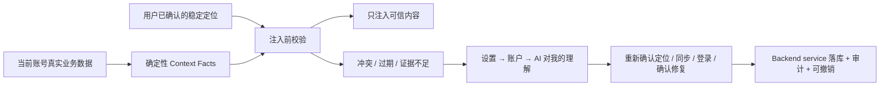

# CreatorOS「AI 对我的理解」与上下文可信度 PRODUCT SPEC（T-516）

> Stage：1-PLAN  
> 状态：`passed`（独立评审三轮均为 CONCERNS；全部可执行 findings 已接受并修订，按 STOP 上限保留原 verdict；用户于 2026-07-24 完成确认①，同意进入 CONTRACT）  
> 日期：2026-07-24  
> 上游：T-515 生产诊断、用户关于低侵入交互与默认周检的连续确认。  
> 诊断：`docs/research/2026-07-24-chat-review-status-diagnosis.md`  
> 决策：`DEC-CTX-001`、`DEC-CTX-002`、`DEC-CTX-003`、`DEC-CTX-004`  
> 宪法：`docs/产品定位.md` 的 P-01、P-02、P-03、P-05、R-POSITIONING、R-COPILOT、R-SETTINGS、R-INGEST。  
> 范围等级：M/L。改变设置页 IA、Copilot 上下文装配、账号级自动化与定位资料修复契约；不新增主导航，不改变本地优先。

## 1. Problem

CreatorOS 的核心价值是“越用越准的编导”，但当前系统会把会变化的账号状态写进长期定位，再把它当作事实反复注入每轮对话。T-515 已证实：

- `creator_profiles.facets.statusNote` 静态保存了“49 条稿子压在 review 没发”；
- `review` 实际是项目生命周期“复盘”，不是“待审核”；
- 当前账号真实已有 80 条已发布历史作品；
- 作品投影丢失 publication 的 `publishedAt`，模型据此生成错误定位；
- ChatBox 每轮继续注入这句过期状态，因此错误会长期复读。

这不是一次提示词写错，而是三个边界混在一起：

1. **长期理解**：定位、受众、风格、禁区等需要用户确认的稳定判断；
2. **动态事实**：作品数量、发布状态、当前任务、最近同步时间等必须实时读取的数据；
3. **AI 推断**：系统根据样本形成、但证据可能不足的判断。

如果继续混存，定时扫描只能不断修补旧错误；如果让 AI 自动改定位，又违反“AI 产候选、人做判断”。目标是建立一条低侵入可信链：



## 2. Target users and jobs

### 2.1 目标用户

- 长期使用 CreatorOS、已积累定位、作品和对话记录的单人创作者；
- 同时运营多个定位不同的抖音号，需要每个账号独立理解的用户；
- 不理解 `review`、prompt、context、置信度等技术术语，但希望编导不要引用旧事实的用户；
- 客服和维护者，需要从脱敏证据判断“系统用了什么、为什么没用某条资料”的用户。

### 2.2 非目标用户

- 希望系统无确认地自动改变账号定位、风格或禁区的用户；这会越过人工确认门。
- 希望在一个页面查看并批量修改所有账号资料的团队管理员；当前产品不是团队 SaaS。
- 希望把整段聊天、网页或模型推理自动沉淀成长记忆的用户；宪法明确不做无差别长期记忆。
- 希望得到一个独立“AI 档案中心”或主导航 Tab 的用户；本能力只服务设置维护，不成为新工作流。

### 2.3 用户工作

1. 我希望 AI 使用当前账号的真实作品和状态，不要重复已经证伪的旧说法。
2. 我希望在设置里看懂 AI 当前如何理解我、依据来自哪里、上次何时检查。
3. 当某项理解证据不足时，我希望系统告诉我该重新确认定位、重新同步还是重新登录，而不是只说“低置信度”。
4. 当 AI 能直接起草修复时，我只需看改前/改后并确认，不必自己寻找字段。
5. 我希望检查默认安静运行，频率可以调整或关闭，不因健康检查增加持续弹窗和意外模型费用。

## 3. Core scenarios

### SC-CTX-01 每轮使用可信上下文

用户打开选题编导。系统按当前 `(userId, accountId)` 读取定位、publication 和项目数据，生成带来源与时间的事实；注入前识别出旧 `statusNote` 属于不应长期保存的动态描述，按字段白名单立即 quarantine，不让模型看到。系统无需解析或证明该自然语言内容与 publication 冲突。

**Independent Test**：构造“profile 说 49 条未发、数据库有 80 条 publication”的账号；装配后的 system prompt 不含“49 条未发”，包含可追溯的 80 条已发布事实，且 `review` 对用户语义为“复盘”。

### SC-CTX-02 默认每周静默检查

账号首次具备定位后，系统幂等确保一条账号级“AI 理解检查”自动化任务，默认按用户时区每周运行。成功且无问题时不弹窗，只更新设置中的“上次检查时间”。

**Independent Test**：同一账号重复启动应用只存在一条 job；周检执行后有唯一 run、无模型调用、无通知弹窗，设置区显示真实终态和时间。

### SC-CTX-03 低证据理解引导具体动作

用户打开设置的“账户”分类，展开“AI 对我的理解”。系统发现定位只有 3/9 项、当前定位未经用户确认，显示“建议重新确认定位”，解释缺少哪些依据并直达定位流程；不显示伪精确的“37% 置信度”。

**Independent Test**：给定缺少当前 statement 的 profile，页面显示“需要重新确认定位”及深链；给定登录过期，显示“重新登录”；给定作品数据过旧，显示“重新同步作品”，三者不混成同一个“去修复”按钮。

### SC-CTX-04 AI 提案、用户确认

系统发现 `statusNote` 是可直接移除的动态描述，生成改前/改后和目标位置：“月明水清深 → 账号定位 → 当前状态”。用户点击“确认更新”后，backend service 写入；点击“调整后更新”可先编辑；“暂不处理”不修改定位资料，只持久化该问题在当前证据版本下的处置状态，避免重复提醒。

**Independent Test**：扫描结束前 profile hash 不变；生成候选后仍不变；只有确认操作使当前账号 profile 变化，并产生 before/after 审计；另一账号零变化。

### SC-CTX-05 撤销一次错误确认

用户确认修复后发现不满意，在设置的最近修改记录中点击撤销。若目标资料之后未再变化，系统创建反向修订恢复；若已经有更新版本，系统展示差异并要求再次确认，绝不覆盖较新的编辑。

**Independent Test**：无并发更新时撤销恢复原值；有后续编辑时返回冲突候选，数据库不被静默覆盖。

## 4. Value & viability

### 4.1 PR-FAQ

**发布说明**

CreatorOS 的设置中新增“AI 对我的理解”区块。它不会建立新的导航页面，而是在当前账号的账户设置里展示 AI 正在使用的稳定定位、判断依据、最近检查时间和需要确认的项目。系统每周默认做一次不调用模型的本地检查，也会在每轮对话前隔离已知错误。需要调整时，AI 准备改法，用户确认后才更新；所有修改可追溯、可撤销。

**FAQ 1：为什么不继续让用户去定位中心手动改？**

用户通常不知道错误存在哪个字段，也不知道一句开场白来自长期定位、作品投影还是模型推断。系统必须承担定位问题和准备改法的成本，只把最终判断留给用户。

**FAQ 2：为什么不做一个独立 Tab，让它更显眼？**

这是维护能力，不是用户每天要走的创作工作流。独立 Tab 会夸大“AI 档案”的产品地位，也可能让用户误以为系统暗中维护另一份人格资料。账户设置才是自然归属。

**FAQ 3：为什么不在对话里立即弹卡修复？**

已知错误会在注入前被隔离，因此不需要用弹窗打断创作。集中在设置处理更低侵入；只有用户主动进入设置时才展开完整说明。

**FAQ 4：每周扫描会不会产生模型费用？**

不会。定时扫描只运行确定性规则和本地数据对账，模型调用数必须为 0。只有用户主动选择“重新确认定位”或“生成修改建议”时，才按现有模型配置创建 AI 候选。

**FAQ 5：停用扫描后是不是又会引用错误？**

不会。每轮注入前的确定性校验始终启用，不能关闭；用户只能关闭低频巡检。巡检负责提前发现与集中整理，不替代主链正确性。

**FAQ 6：这会提高年卡价格或产生额外收费吗？**

不会因本能力新增 CreatorOS 内收费项，也不改变现有年卡/激活权益；CreatorOS 本身仍不承载价格和结算。自动周检、立即检查和每轮确定性校验全部在本机运行且模型调用为 0。只有用户显式点击“重新确认定位/生成 AI 建议”后，才使用用户现有模型配置或既有订阅能力，可能产生的模型侧额度/费用与当前其他 AI 任务相同，执行前沿用既有费用/授权提示，不能暗中调用。

**FAQ 7：升级后旧资料会不会丢？每个账号都要重做定位吗？**

不会静默删除或批量重写。现有 profile、statement 和定位历史原样保留；稳定字段继续使用，`statusNote` 原文也仍留在本地库，只是升级后立即停止进入 prompt。仅非空 `statusNote` 的账号出现一条合并后的清理问题，用户可确认清理、调整后确认或暂不处理；没有该字段的账号零额外操作，不要求重做定位。多账号用户最多按受影响账号各处理一次，未处理也不阻断创作，因为旧动态句已经隔离。降级或撤销修复时仍可从 append-only repair event 查看 before/after；不允许以“保留旧行为”为由重新把已 quarantine 的动态句注入。

### 4.2 替代品与切换

| 现状方案 | 哪里不行 | 切换触发器 | 切换成本 |
|---|---|---|---|
| 忍着不解决 | AI 反复复读旧事实，用户每次纠正但下轮仍出现 | 再次出现“49 条 review 未发”等明确错误 | 零操作成本，持续损耗信任 |
| 用户手动去定位中心找字段 | 用户不知道错误来源和影响范围，容易改错账号或漏改 | 客服告诉用户具体字段 | 学习成本高，且无法修投影根因 |
| 对话里频繁弹纠错卡 | 问题显眼，但打断选题和写稿 | 每次检测到过期项 | 打扰成本高，用户会忽略或关闭 |
| AI 静默自动改资料 | 用户不用操作，但 AI 可能把推断写成事实 | 扫描发现差异 | 信任与数据主权成本不可接受 |
| 设置内低侵入检查 + 确认门 | 主链先隔离错误，集中维护，用户只做判断 | 用户进入设置或看到轻量标记 | 需要建立结构化事实、审计和动作路由 |

### 4.3 被否决的产品形态

| 被否决的形态 | 否决理由 | 翻案信号 |
|---|---|---|
| 一级导航“上下文健康”中心 | 维护能力抢占主工作流，技术名词误导用户 | 产品未来转为团队级 AI 治理平台 |
| 设置左栏新增“AI 理解”Tab | 用户明确要求不做单独 Tab；当前设置已有六类，继续增类会放大信息负担 | 账户 Tab 内容经真实可用性测试证明无法容纳且用户主动要求独立分类 |
| 对话内主动弹出修复卡 | 已知错误可先隔离，无需打断当前创作 | 用户明确要求在 Copilot 中主动治理 |
| 周检自动调用 LLM 并改定位 | 有费用、不可重复、会越过确认门 | 不翻案；只能由用户显式触发模型候选并确认 |

### 4.4 五大风险

| 风险 | 判断 + 证据 | 最便宜检验方式 | 若错的代价 |
|---|---|---|---|
| 价值 | T-515 是真实用户事故：同一句错误长期复读，且实际 80 条 publication 与静态 49 条相反 | 已完成只读数据库与代码链诊断，证据见诊断报告 | 不修会直接破坏“越用越准”的核心承诺 |
| 可用性 | 设置内折叠区比新 Tab/对话弹窗低侵入，但“理解、事实、建议”仍可能混淆 | 用 T-515、缺定位、登录过期三个纸面场景逐项验证标题、依据和动作是否无需技术解释 | 用户看见问题却不知道下一步，功能成为告警墙 |
| 可行性 | 现有 scheduler、job run、定位 confirm、账号隔离与 completeness 可复用；难点是可撤销 profile 修订和非采集 job 分派 | CONTRACT 阶段用 fake ports 证明“一 job 一 run、零 LLM、候选确认、CAS 撤销” | 若强塞 collection runner 或 profile 无版本保护，会制造新串号/覆盖事故 |
| 商业 | 不直接变现，但减少客服排查和错误回答流失；维护成本主要是规则与字段溯源 | 上线后 30 天比较同类“AI 说错账号事实”反馈和平均定位时间 | 规则维护成本高于减少的报障成本 |
| 依赖 | 依赖本地 DB 数据完整度、账号登录和统一 scheduler；抖音或模型不可用时仍应完成本地检查 | 断网、无模型、登录过期三种 fixture 运行周检 | 扫描被外部依赖拖死或把“无法验证”误判成“错误” |

**RAT 结果**

- 价值风险已由 T-515 真实事故验证，不是预测性需求。
- 仓内可行性只读 RAT 已完成：`scheduled_jobs/job_runs/runNow`、账号归属、定位候选确认、append-only statement、定位 completeness 均真实存在；证据见 §10。
- 纸面可用性 RAT：T-515 冲突 → “查看改前/改后”；3/9 定位 → “重新确认定位”；登录过期 → “重新登录”。三条路径均在设置账户区内最多两次点击到达明确动作，不要求用户理解 prompt、枚举或数据库字段。该 RAT 不冒充真实用户可用性测试，BUILD 后仍须真页走查。

### 4.5 采纳门槛

| 核心旅程 | 首次价值需要几步 | 前置依赖 | 失败时用户看到什么 |
|---|---:|---|---|
| 查看 AI 当前理解 | 设置 → 账户 → 展开区块（3 次动作） | 已选择当前账号 | 0 账号时显示“先绑定账号”，不展示其他账号资料 |
| 立即检查 | 展开区块 → 立即检查（1 次动作） | 本地数据库可读 | 明确失败原因与重试；不显示旧报告为最新 |
| 处理陈旧描述 | 查看差异 → 确认更新（2 次动作） | 有 repair candidate | 写入失败保留候选和用户编辑，不显示成功 |
| 重新确认定位 | 点击“重新确认定位”（1 次动作） | 已配置文本模型；无模型仍可手动定位 | 深链到真实定位流程；无模型给设置模型入口 |

### 4.6 商业假设

如果系统在每轮对话前阻止已知错误、并让用户在两次点击内处理定位问题，那么“AI 说错我的账号现状”类反馈会下降，用户会更愿意让真实数据进入飞轮。系统只在本机记录脱敏统计：检查次数、问题分类、是否确认/暂不处理、修复耗时和后续是否再次命中同一冲突；不上传理解内容。若上线 30 天后同类错误反馈不降或设置问题完成率低于 §13 阈值，则回到 PLAN 调整问题分类和动作设计，而不是增加弹窗频率。

### 4.7 Pre-mortem

| # | 六个月后失败的具体死因 | SPEC 级应对 |
|---|---|---|
| 1 | 周检与每轮校验使用不同规则，设置显示健康但对话仍注入旧句 | 单一 validator/Context Fact schema；周检和 prompt 装配复用同一判定函数 |
| 2 | “低置信度”变成模型随口输出的百分数，用户不再相信 | 只展示确定性状态和证据缺口；客观事实永不显示概率 |
| 3 | 自动化另起 timer，与统一 scheduler 双跑、重复任务 | 复用 `scheduled_jobs/job_runs/triggerScheduledJob`；账号+job kind 稳定唯一键 |
| 4 | 用户确认修复后覆盖了另一窗口刚改的新定位 | 修复携带 base revision/CAS；冲突时重新展示差异，不盲写 |
| 5 | 每周扫描暗中调用模型产生费用或因模型未配一直失败 | 自动扫描固定零 LLM；语义重做由用户显式触发 |
| 6 | 设置区变成几十条技术告警，用户不再打开 | 只展示可操作问题，按根因合并；已解决历史折叠，内部枚举不出现在用户文案 |

### 4.8 Appetite

愿意用一个完整任务交付：上下文静态/动态分离、每轮确定性校验、`statusNote` 存量隔离与确认修复、设置账户区块、默认周检与调频、账号隔离、具体动作路由、确认门、审计与撤销、真实日志和端到端验证。不能通过“只加定时器”“只删一条脏数据”“只做设置 UI”缩小范围；也不扩张成通用记忆平台、团队治理台或云端遥测服务。

## 5. Functional requirements

### FR-CTX-01 稳定理解与动态事实分离

长期定位只保存需要人判断且相对稳定的 persona、field、audience、differentiation、contentScope、avoid、corePain、coreValue、tone、downstreamRules 和定位 statement。作品数量、发布状态、项目阶段、当前待办、最近同步时间等动态事实不得由定位 AI 写入或从 profile 注入。

`statusNote` 停止作为 AI 定位输出与 prompt 输入；存量值保留在库中等待用户确认清理，不能在迁移中静默删除。

**价值注**：删除后，定时扫描只能反复修补持续产生的新过期事实。

### FR-CTX-02 账号级 Context Fact Set

每轮按当前 `(userId, accountId)` 从业务 service port 生成结构化事实。每项至少包含：

- `factKey`、用户可读值和机器值；
- `accountId`；
- `sourceType`、`sourceRefs`；
- `asOf`；
- `freshnessPolicy` 与判定结果；
- `truthStatus = verified | missing | unknown | stale | conflict | quarantined`；
- 生成规则版本。

事实集合是可重建读模型，不成为另一份业务真值。

`truthStatus` 的唯一语义如下：

| 状态 | 确定性含义 | Prompt 规则 | UI 规则 | 状态转换 |
|---|---|---|---|---|
| `verified` | 当前账号来源读取成功，值存在，未命中新鲜度或冲突规则 | 按 factKey 的 prompt 规则使用 | 显示值与依据 | 来源变化后重新计算 |
| `missing` | 来源读取成功，但应查的记录确实不存在；不是读取失败 | 仅 factKey 明确允许“诚实为空”时注入空/0/未建立 | 显示缺少什么与建立入口 | 记录出现后转 `verified` |
| `unknown` | 来源读取失败、超时或权限/登录状态导致无法验证 | 一律省略，不用缓存或 fixture 补位 | 显示“暂时无法验证”与重试/登录/诊断 | 来源恢复后重新计算 |
| `stale` | 来源读取成功，但 `asOf` 超过该 factKey 的数值化 freshnessPolicy | 一律省略动态值；稳定定位本身不因时间自动失效 | 显示依据日期与同步动作 | 新成功来源到达后重算 |
| `conflict` | 同账号两个可核验来源按 factKey 的冲突规则得出互斥结论 | 一律隔离 | 显示双方依据与处理动作 | 冲突消除后重算 |
| `quarantined` | 字段类型禁止注入、来源归属不匹配，或属于待治理存量字段 | 一律隔离 | 只在可处理时生成问题，不展示另号内容 | 用户确认清理或规则迁移后结束 |

#### 首批 Context Fact 契约（FR-CTX-02 的字段级展开）

首批交付只包含下表 factKey；未列出的聊天记忆、网页正文、知识摘要和模型推断不得借本任务进入 Context Fact Set。`queryAt` 为本轮 service 成功返回的时间；所有 service/repository 调用必须同时带 `userId + accountId`。

| factKey | 用户语义 / 机器值 | 来源与账号约束 | `asOf` / freshnessPolicy | 冲突与 Prompt 规则 | 验收 |
|---|---|---|---|---|---|
| `positioning.stableProfile` | 9 个核心字段：`persona, field, audience, differentiation, contentScope, avoid, corePain, coreValue, tone`；机器值为字段白名单对象 | `positioning.profile.get` / `creator_profiles`，严格当前账号；现有字段证据 `contract/src/resources/positioning.ts:15-50` | `profile.updatedAt`；稳定资料无时间过期，完整度另按 FR-CTX-07 判断 | 任一字段来自 `statusNote` 或另号即 `quarantined`；`verified` 注入非空字段，`missing` 只注入“定位尚未建立” | TEST-CTX-02/07/12 |
| `positioning.capabilities` | 用户确认的能力标签数组；机器值为 trim、去空、稳定去重后的字符串数组 | `positioning.profile.get` 的 `capabilities`，严格当前账号；字段证据 `contract/src/resources/positioning.ts:41-50` | `profile.updatedAt`；无时间过期 | 仅做类型、账号与空值校验，不做语义 conflict；`verified` 非空数组继续注入，`missing` 省略且不解释为“没有能力” | TEST-CTX-02/12 |
| `positioning.downstreamRules` | 5 个既有硬约束：`topicRule, scriptRule, projectRule, forbidRule, expressionRule` | `positioning.profile.get` / `creator_profiles.downstream_rules`，严格当前账号；字段证据 `contract/src/resources/positioning.ts:25-50` | `profile.updatedAt`；无时间过期 | trim 后非空规则在对应选题/写稿/项目 runner 中继续作为硬约束注入；空规则省略；跨号为 `quarantined`；自由文本差异不自动判 conflict | TEST-CTX-02/07/12 |
| `positioning.currentStatement` | 当前一句话定位、关键词与确认来源；机器值为 current statement id/version/author | `positioning.statements.list` / `positioning_statements`，profile 与 statement 均须当前账号；版本证据 `backend/src/schema/positioning.ts:48-63` | `statement.createdAt`；不因单纯时间转 stale，是否重确认按“180 天且新增 publication ≥10” | 只做结构、账号、版本、作者与 sourceRefs 的确定性检查；自由文本差异不自动判 conflict；仅 `verified` 注入，`missing` 注入“尚未确认定位” | TEST-CTX-07/10/12 |
| `publication.summary` | canonical 历史发布数、当前可见数、最近发布时间、发布时间覆盖率、属主项目来源分布；机器值为 `{historicalPublishedCount, currentlyVisibleCount, latestPublishedAt, publishedAtCoverage, ownerSourceCounts}` | 新增 account-scoped canonical context read port，内部组合 Publishing + Projects + Platform Account service ports；不得直接把 `listPublicationsForUser` 返回行等同于 canonical。现有行级账号门证据 `backend/src/modules/publishing/publishing.repository.ts:307-334`，完整 eligibility 见下文 | `queryAt`；本地 canonical publication 成功对账即当前，不按墙钟判 stale；`latestPublishedAt` 只在 coverage=1 时进入 prompt | canonical publication 证明历史发布，不能被 `project.stage` 否定；全部候选合法才 `verified` 并可注入真实数，成功读到 0 也注入 0；任一 canonical 异常则整项 `conflict` 并不注入部分计数，读端口失败为 `unknown` | TEST-CTX-01/12/13 |
| `project.stageSummary` | 各用户语义阶段数量，`review=复盘`；机器值为共享生命周期枚举计数 | `projects.list` / projects service port，严格当前账号；现有 operation 证据 `contract/src/operations/projects.ts:30-38` | `queryAt`；读取成功即当前 | 与 publication 不做“未发布”推断；仅 `verified` 注入，成功读空注入 0 | TEST-CTX-01/12/13 |
| `project.openTaskSummary` | 当前账号未完成任务数量与最近到期日，不含正文 | `projects.tasks.list` / projects service port，严格当前账号；现有 operation 证据 `contract/src/operations/projects.ts:182-196` | `queryAt`；读取成功即当前 | 只陈述 task 状态，不从 project.stage 推断；仅 `verified` 注入，成功读空注入 0 | TEST-CTX-12/13 |
| `ingestion.sourceHealth` | 各活跃作品来源的最近成功同步、登录/阻塞状态；机器值不含 cookie | `intelligence.workspace.get` 的 account query + `ingestion.douyin.status`；证据 `contract/src/operations/intelligence.ts:77-96`、`contract/src/operations/ingestion.ts:60-76` | `lastSuccessfulRunAt`；自动源超过 `nextExpectedRunAt + 24h` 为 stale；仅手动源不因时间变 stale；从未成功同步为 missing | 登录失败为 `unknown` 并路由重新登录；自动源 stale 路由同步；一律不把 stale/unknown 值注入 prompt | TEST-CTX-03/05/08 |
| `profile.legacyStatusNote` | 存量“当前状态”原文是否存在；机器值只保留存在性与 hash | `positioning.profile.get` 的 `facets.statusNote`，严格当前账号 | `profile.updatedAt`；无 freshness | 非空始终 `quarantined`，正文永不进入 prompt；可生成清理 candidate | TEST-CTX-02/09/14 |

`publication.summary` 的 canonical eligibility 必须在同一只读快照中逐行验证：

1. `publication.userId/accountId` 与请求上下文完全一致；关联 ContentOutput、Project 和 Platform Account 也属于当前账号。任一跨号引用立即 `conflict`，且诊断只记 hash，不回显另号内容。
2. `status ∈ {published, removed}`、规范化后的 `platform` 与 `externalId.trim()` 非空。`draft/scheduled/failed` 不属于发布历史，也不算异常；它们不进入候选集合。
3. 同一规范化 `(platform, externalId)` 只能有一条 publication。重复 anchor 的所有行都排除并使 summary=`conflict`，即使数据库唯一索引因存量损坏未挡住。
4. `currentRevisionId` 非空，且能解析到 `publication_revisions` 中同 `publicationId + userId` 的真实行；导入作品允许 revision 标题为空，但不允许悬空/错属 revision。
5. `contentOutputId` 必须解析到当前账号项目。manual 项目是优先 canonical 属主；active imported 空壳只有在没有 manual 属主/重锚声明时才合法。publication 仍指向 archived imported、output 悬空、同 anchor 同时被 manual/imported 声明，或只读快照发现 re-parent revision 在读取期间变化时，均排除并置 `conflict`；并发变化最多重读一次，仍变化则 `unknown`。
6. `accountReference` 必须与当前 Platform Account 或该账号经验证的 ingestion source identity 相符；确定不符为 `conflict`，身份源暂时不可读为 `unknown`。
7. `historicalPublishedCount` 计合法 `published + removed`；`currentlyVisibleCount` 只计 `published && removedAt=null && hiddenAt=null && platformStatus∈{null,"已通过"}`。`publishedAt=null` 不影响已由 external anchor 证明的历史计数，但不参与 latest，且通过 `publishedAtCoverage=有日期行数/合法历史行数` 诚实表示；coverage<1 时不得生成“最近发布于……”。

这组口径覆盖“先采集后登记、imported→manual re-parent、重复 externalId、错误账号属主和无合法 revision”，并遵循宪法 R-PUBLISH（`docs/产品定位.md:254-260`）。CONTRACT 必须把它定义为 Publishing 暴露的窄读 service port，Context 模块不得跨 repository 拼表。

**价值注**：删除后，系统无法说明一句话来自哪里，也无法确定性比较新旧。

### FR-CTX-03 注入前确定性校验

所有 Copilot/runner 使用账号上下文前必须经过同一 validator：

- 验证 account ownership；
- 使用共享用户语义翻译 lifecycle，`review` 只能解释为“复盘”；
- 仅通过本节 canonical eligibility 的 publication 才认定已发布，不以 project.stage 猜发布状态；
- 已知 conflict/quarantined 项不进入 prompt；
- 来源成功但确无记录显示 missing；读取失败显示 unknown；两者都不用旧值或 fixture 回退；
- 记录本轮采用/隔离的 fact manifest，供诊断。

该校验不可由用户关闭，也不依赖最近一次周检是否成功。

首批零模型冲突只允许以下确定性规则；自由文本不做语义猜测：

| 规则 | 规范化与优先来源 | 输入示例 | 确定输出 |
|---|---|---|---|
| 账号归属 | ID 原样精确比较；请求 `userId+accountId` 为唯一 scope | A 号 fact 的 sourceRef 指向 B 号 | fact=`quarantined`；不回显 B 号值 |
| publication canonical | `platform` 枚举规范化、`externalId.trim()`；canonical publication 高于 project.stage | 两条同 `(douyin, aweme-1)`；或 revision/owner 非法 | `publication.summary=conflict`，计数不注入 |
| 发布与生命周期并存 | publication 与 project lifecycle 是两类独立事实；不从一方强制推出另一方 | canonical pub 已存在，project 仍为 `planning` | 两者分别按各自来源诚实陈述，不自动生成 conflict 或“状态未回写”issue |
| 动态旧字段 | 字段白名单精确判断，不解析自然语言 | `statusNote="49 条 review 未发"`，DB 有 80 条 canonical pub | statusNote=`quarantined`；publication=`verified`；不比较句子真假 |
| 定位完整度 | 仅 FR-CTX-07 的 9 字段 trim 非空计数 | 4/9 字段非空 | positioning evidence=`needs_review`，不是 `conflict` |
| 自由文本语义 | 不做同义词、反义词或 embedding 判断 | statement 写“AI 工程”，field 写“营销” | 周检不判 conflict；只在用户显式触发 AI 分析后产可确认建议 |
| 来源失败 | service 错误/超时与“成功读空”严格分开 | Platform Account service 读失败 | 相关 fact=`unknown`；不回退旧身份 |

因此，“statement 与 stableProfile 明确互斥”的自由文本比较不属于自动扫描规则；`positioning.currentStatement` 只做结构、版本、作者、来源与完整度检查。publication 与 project.stage 也不建立宪法未定义的强制跃迁不变量。未来若扩展任何自动 conflict 规则，必须先增加明确业务规则或 DEC、可复现算法、正反例和规则版本，不能让模型在零费用周检里自由裁决。

**价值注**：删除后，错误可能在两次周检之间继续污染回答。

### FR-CTX-04 设置内嵌“AI 对我的理解”

在现有设置弹窗的“账户”分类中增加折叠区块，不新增左栏 Tab、独立路由或主导航。区块按当前账号展示：

1. 已确认的定位摘要；
2. AI 使用的依据与最近更新时间；
3. 上次检查时间、下次计划时间、运行状态；
4. 待确认项；
5. 最近修改与撤销入口。

默认摘要态只显示状态和待确认数量；展开后才展示详情。0 账号、无定位、检查失败和无问题均有独立空/错状态。

**价值注**：删除后，用户仍不知道 AI 正在依据什么回答。

### FR-CTX-05 账号级自动化检查

复用统一 scheduling 模块，为每个 active 账号幂等维护一条 `context.health` 系统任务：

- 默认每周，按用户时区执行；
- 用户可关闭、选择每日/每周/自定义周期；
- 支持“立即检查”；
- 账号归档时停跑，恢复 active 后按设置恢复；
- 同一 `(userId, accountId, jobKind, scheduledFor)` 只产生一个 run；
- 不创建平行 `setInterval` 或第二套 run history。

设置区是配置和结果的产品归属；本任务不在自动化页新增主卡或新入口。

**价值注**：删除后，用户只能在问题已经污染对话后被动发现。

### FR-CTX-06 静默回显与轻量标记

检查成功且无可处理问题时不弹窗、不发系统通知，只更新检查时间。存在 `open` 待确认项时只在设置入口和账户分类显示一个轻量标记；打开设置后显示问题。resolved/dismissed 项不计入标记，只有其 evidenceHash 或规则版本变化并 reopen 后才重新计入。失败仅在设置区保留“检查失败 + 重试”，不得把旧报告冒充本次成功。

**价值注**：删除后，维护能力会变成持续打断创作的告警中心。

### FR-CTX-07 证据状态而非伪置信度

客观事实不展示概率。AI 推断也不展示模型自报百分数，而按可解释规则形成：

- `confirmed`：当前 statement 由用户确认，且依据未出现冲突；
- `needs_review`：无当前 statement；或 9 项定位核心字段中非空字段少于 5 项；或 AI 推断缺少 sourceRefs；或当前 statement 已超过 180 天且其创建后新增至少 10 条 publication；
- `conflict`：稳定定位与确定性事实发生可证伪冲突；
- `unknown`：必要来源读取失败。

9 个核心字段固定为 `persona, field, audience, differentiation, contentScope, avoid, corePain, coreValue, tone`，与仓内 `buildSignalQualityProfile` 完整度算法一致（`backend/src/modules/ai-runtime/signal-quality.ts:156-189`）。计数前对字符串 `trim()`；空字符串、纯空白、`null/undefined` 均不计，数组和 `statusNote` 不属于 9 项。读取当前 profile 即按当前版本计算，不把历史版本字段拼进来。规则版本写入 manifest/run；5/9、10 条、180 天属于 `ASM-CTX-03` 的首发可校准常量。

UI 必须展示触发原因和依据，不只显示状态颜色。

**价值注**：删除后，“低置信度”仍只是用户无法行动的技术标签。

### FR-CTX-08 按根因路由动作

待确认项必须映射到具体动作：

| 根因 | 主动作 |
|---|---|
| 定位缺失、证据不足或长期未确认 | 重新确认定位 |
| publication/作品样本陈旧 | 重新同步作品 |
| 登录态失效导致无法验证 | 重新登录 |
| 可直接删除/替换的陈旧动态描述 | 查看 AI 建议 |
| 来源读取失败 | 重试检查 / 打开诊断 |

深链必须落到真实可用入口；不能用统一“去修复”按钮替代。

**价值注**：删除后，用户知道有问题却仍要自己猜下一步。

### FR-CTX-09 AI 修复候选与确认门

对可直接修复的长期资料，AI 或确定性规则只生成 account-scoped repair candidate，包含：

- 目标账号、目标资料与字段；
- `before`、`proposedAfter`、理由、sourceRefs、base revision；
- 改后用户可读预览；
- `confirm | edit_then_confirm | dismiss` 操作。

候选生成不改变 profile。确认后只能经 positioning/context backend service 写入；worker/LLM 不直连数据库。用户编辑后的 patch 重新校验目标账号、字段白名单和 base revision。`dismiss` 只把 candidate 与对应 issue 在当前 evidenceHash 下标为 dismissed，保存 `dismissedAt` 与规则版本；不写 profile、statement 或其他业务真值。

**价值注**：删除后，要么用户被迫手改，要么 AI 越权自动改。

### FR-CTX-10 审计、幂等与撤销

每次确认写入 append-only repair event，保存 before/after、actor、candidate/run、`userId + accountId`、时间和 revision。重复确认同一 candidate 不重复写。dismiss 以 `(userId, accountId, issueId, evidenceHash, action)` 幂等，不重复产生处置记录。撤销创建反向修订；若当前 revision 已变化，返回冲突预览并要求重新确认。

**价值注**：删除后，错误确认不可恢复，用户不敢使用 AI 修复。

### FR-CTX-11 多账号完全隔离

job、run、fact、issue、candidate、repair event 和设置查询均以 `(userId, accountId)` 为联合归属；任何查询、唯一键、幂等键和写入条件都不能只带其中一个。切号后只展示该账号；系统扫描不得使用 `accountId=null` 扫全账号并把结果混写。跨号 fact 被视为确定错误，在 prompt 注入前隔离。

**价值注**：删除后，“AI 对我的理解”会把不同账号人设混在一起，直接违背产品定位。

### FR-CTX-12 生命周期与存量治理

- active 账号有定位时幂等确保默认周检；
- 无定位账号不自动创建需要模型的任务，但设置区仍显示“建立定位”；
- 账号归档停跑，数据与历史保留；
- 存量 `statusNote` 先 quarantine，不注入；检查生成清理候选；
- 修复 T-515 的 project/publication 投影，真实传递 `source` 与 `publishedAt`；
- 历史报告按规则版本可识别，规则升级后可重新检查，不重写旧 run。

**价值注**：删除后，新逻辑只能服务新账号，存量用户仍继续复读旧错误。

### FR-CTX-13 零模型费用的自动扫描

定时与“立即检查”的基础扫描只执行确定性本地规则，LLM 调用必须为 0。需要重新生成定位或语义修复时，用户显式点击对应动作后才创建 AI task，并沿用现有模型配置、进度、失败和确认门。

**价值注**：删除后，默认自动化会产生不可预期费用，未配模型账号也无法健康检查。

### FR-CTX-14 可支持性与事实清单

每次对话和扫描记录脱敏 manifest：

- `conversationId/runId`、`userId/accountId` 的不可逆短 hash；
- validator 规则版本；
- factKey、sourceType、asOf、truthStatus；
- 采用、隔离及原因；
- repair candidate/event ID；
- 不记录完整定位正文、prompt、Key、cookie。

用户隔天反馈时，诊断日志至少保留 30 天，可关联“哪条旧事实被使用/隔离”和最终处理动作。

**价值注**：删除后，同类事故仍只能靠猜测模型说了什么。

## 6. Non-functional requirements

| ID | 要求 |
|---|---|
| NFR-CTX-01 | 已判定 `unknown`、`stale`、`conflict`、`quarantined` 或跨账号的事实进入 prompt 次数必须为 0；`missing` 仅按首批 fact 契约显式允许的诚实空/0语义进入。 |
| NFR-CTX-02 | 自动扫描 LLM 调用数必须为 0；断网、无模型时仍能完成本地事实检查。 |
| NFR-CTX-03 | 同一 1000 项目 + 1000 publication + 100 定位/修复历史账号：AI task/run 创建响应 P95 ≤ 1 秒；worker/直接 Chat 的 prompt 所需 fact 装配与校验 P95 ≤ 500ms；从请求进入到本地校验完成并发起首个模型请求 P95 ≤ 1 秒（不含外部模型首 token）；后台全量健康扫描 P95 ≤ 2 秒；设置首屏不等待扫描完成。 |
| NFR-CTX-04 | 所有持久结果按 `(userId, accountId)` 隔离；双号并发扫描、确认和撤销交叉写入为 0。 |
| NFR-CTX-05 | 同一计划 tick、手动双击、应用重启恢复均不重复 run、candidate 或 repair event。 |
| NFR-CTX-06 | 确认写与撤销使用 revision/CAS；检测到并发更新时数据写入为 0，返回可读差异。 |
| NFR-CTX-07 | 扫描成功无弹窗/系统通知；一次 open 问题只产生一个设置轻量标记，resolved/dismissed 后自动消失；evidenceHash 与规则版本均未变化时不得重新打开。 |
| NFR-CTX-08 | 设置区全部键盘可达，折叠区、状态、差异和按钮具备可读 label；颜色不是唯一状态表达。 |
| NFR-CTX-09 | 日志脱敏且本地保存 30 天；不得记录完整 prompt、定位正文、模型密钥、cookie 或网页正文。 |
| NFR-CTX-10 | 规则读取失败、报告持久化失败、修复失败均诚实显示失败，不回退旧报告、fixture 或另一个账号。 |
| NFR-CTX-11 | 周检按用户时区计算；时区修改后重新计算 next run，不改变历史 scheduledFor。 |

## 7. Business flow

### FLOW-CTX-01 每轮上下文装配

**触发**：任一 Copilot/AI runner 需要当前账号上下文。  
**步骤**：AI task/runner 先在 P95 1 秒内创建可恢复 task/run；worker 在第一次模型请求前解析账号 ownership → service ports 读取首批 prompt 所需 facts → validator 分类 → 隔离冲突/过期项 → 输出 prompt-safe context + manifest → 才允许请求模型。直接流式 Chat 也在模型请求前走同一轻量路径，不执行全量健康报告聚合。  
**结果**：模型只见可信、当前账号的资料。  
**异常**：ownership 或定位主读失败时 task/run 在模型调用前失败并保留可读终态，LLM 调用为 0；publication/task 等可选来源失败时对应 fact 为 unknown 并省略，其余可信 facts 可继续；不得使用历史缓存冒充。manifest 关联 task/run，只持久化 factKey、hash、状态和来源引用，不持久化正文快照。

### FLOW-CTX-02 自动/手动健康检查

**触发**：默认周检到点或用户点击立即检查。  
**步骤**：统一 scheduler 触发唯一 run → 调用同一 fact builder/validator → 聚合可操作 issue → 持久化报告和终态 → 设置区读取。  
**结果**：无问题静默更新时间；有问题显示轻量标记。  
**异常**：失败 run 保留错误与重试；不更新 lastSuccessfulScanAt。

### FLOW-CTX-03 处理待确认项

**触发**：用户在设置展开问题。  
**步骤**：查看原因/依据 → 按根因深链，或生成 repair candidate → 预览 before/after → 确认/编辑确认/暂不处理。确认类操作才经 backend service CAS 修改定位并写 repair event；“暂不处理”只写 issue disposition 和 candidate 状态，不写定位资料。  
**结果**：确认成功后 issue 变为 resolved；暂不处理后变为 dismissed，当前证据版本下标记消失。若同一 `issueKey` 的 evidenceHash 变化、规则版本升级或被用户主动恢复提醒，下一次扫描可 reopen；单纯到时不重复提醒。  
**异常**：revision 冲突、越权、模型失败、写入失败均不改变资料。

### FLOW-CTX-04 撤销

**触发**：用户在最近修改中选择撤销。  
**步骤**：读取 repair event → 比较当前 revision 与 event.afterRevision → 一致则创建反向修订 → 不一致则生成冲突预览等待确认。  
**结果**：恢复旧值但保留完整历史。  
**异常**：原账号已归档时只读历史，不执行写入。

## 8. Domain model

| ID | 语义与关键字段 | 关系与生命周期 |
|---|---|---|
| ENT-CTX-01 `ContextFact` | 可重建事实：factKey、value、userId、accountId、sourceRefs、asOf、freshness、truthStatus、ruleVersion | 从业务 service ports 派生；不成为业务真值；每轮重建 |
| ENT-CTX-02 `ContextHealthJob` | 复用 scheduled job：userId、accountId、jobKind=`context.health`、schedule、enabled、timezone | 每 active 账号至多一条；默认 weekly |
| ENT-CTX-03 `ContextHealthRun` | 复用 job run 终态并关联 report：scheduledFor、status、started/finished、ruleVersion、summary | job 1:N run；同计划 tick 唯一 |
| ENT-CTX-04 `ContextHealthIssue` | userId、accountId、issueKey、category、severity、targetRef、sourceRefs、evidenceHash、ruleVersion、status、recommendedAction、first/lastSeenAt、dismissedAt、dismissedEvidenceHash、dismissedRuleVersion | run 发现；open→resolved/dismissed/superseded；同 `(userId, accountId, issueKey, evidenceHash)` 合并；所有读写条件带联合归属；evidenceHash/规则变化可 reopen |
| ENT-CTX-05 `ContextRepairCandidate` | userId、accountId、issueId、evidenceHash、target、before、proposedAfter、reason、sourceRefs、baseRevision、status、dismissedAt | issue 0..1 active candidate；pending→adopted/dismissed/conflicted；同 `(userId, accountId, issueId, evidenceHash)` 只一条 |
| ENT-CTX-06 `ContextRepairEvent` | append-only userId、accountId、before/after、actor、candidateId、base/afterRevision、createdAt、undoOf | candidate 确认后产生；所有 get/list/undo 先验联合归属；同 `(userId, accountId, candidateId, afterRevision)` 幂等；event 可被新 event 撤销 |
| ENT-CTX-07 `ContextManifest` | 某轮实际采用/隔离的 factKey 与原因，不含正文 | conversation/run 1:1；诊断保留 30 天 |

物理表复用或新增在 CONTRACT 阶段裁决，但上述 ownership、状态和唯一性不可缩水。

## 9. Information architecture

### IA-CTX-01 设置 → 账户 → AI 对我的理解

不增加设置左栏 Tab。在现有“账户”面板的账号信息/账号绑定之后放置折叠卡：

```text
AI 对我的理解                         需要确认 2
这里显示当前账号会影响编导回答的定位与依据

上次检查：7 月 24 日 10:00    自动检查：每周 ▾
[立即检查]

已确认的定位
  一句话定位 / 受众 / 风格 / 禁区              [查看定位]

需要你确认（2）
  旧“当前状态”属于动态描述，已停止用于 AI 回答   [查看建议]
  定位依据较旧，新增了 12 条作品               [重新确认定位]

最近修改                                           [展开]
```

无待确认项时只显示“目前没有发现需要处理的问题”，不展示绿色大庆祝状态。技术字段、内部枚举、prompt 原文不直接呈现。

### IA-CTX-02 现有能力深链

| 动作 | 已有真实落点 | 本任务补的最小接线 |
|---|---|---|
| 重新确认定位 | `/positioning` route：`frontend/src/app/(creator)/positioning/page.tsx:21-33`；访谈入口：`frontend/src/features/positioning/generate-positioning-island.tsx:19-35` | 带来源 issue 的返回参数；不自动发送、不自动采纳 |
| 重新同步作品 | `/intelligence` route：`frontend/src/app/(creator)/intelligence/page.tsx:11-53`；真实同步按钮：`frontend/src/features/intelligence/intelligence-workbench.tsx:1193-1204`；启动 operation：`contract/src/operations/intelligence.ts:289-306` | 增加 account-validated `sourceId` 聚焦参数，展开对应来源并高亮现有“同步”；仍由用户点击后启动 |
| 重新登录 | 设置账户卡：`frontend/src/features/settings/settings-interactive-region.tsx:687-817`；真实登录 operation：`contract/src/operations/ingestion.ts:43-76` | 增加 `?highlight=douyin-binding`，聚焦已有账号绑定卡 |
| 检查模型配置 | 现有 `?highlight=text-model` 路由表：`frontend/src/features/settings/settings-interactive-region.tsx:253-265`；真实配置卡：同文件 `2300-2477` | 复用现有深链，不新增按钮语义 |
| 打开诊断 | 诊断卡与真实本机 route：`frontend/src/features/settings/settings-interactive-region.tsx:1517-1563`、`frontend/src/app/api/v1/local/reveal-logs/route.ts:8-46` | 增加 `?highlight=diagnostic-logs`；Web 端保持“桌面端专属”，不得假装可打开 |

所有入口必须真实可用；表中“本任务补的接线”属于 T-516 完整交付并纳入 TEST-CTX-08，不得把尚未支持的 query 当作已实现，也不得先画无法到达的按钮。

## 10. 现成方案 / OSS 调研

| 能力点 | 候选 | 覆盖度 | 证据 | 采用 / 不采用 + 理由 |
|---|---|---|---|---|
| 账号级定时任务 | 仓内 `scheduled_jobs/job_runs/triggerScheduledJob` | partial | `contract/src/resources/scheduling.ts:20-77`; `backend/src/modules/ai-runtime/scheduled-collection-scheduler.ts:113-212` | 采用任务/run/幂等骨架；扩展通用 job dispatch，不另建 timer |
| 用户可读频率 | 仓内 cadence→cron 编译器 | full | `frontend/src/features/automations/cadence.ts:25-68,95-125` | 复用 daily/weekly/custom 人话模型；默认改为 weekly |
| AI 候选确认门 | 仓内 `ai.confirmTask` 与 positioning candidate | partial | `backend/src/modules/ai/ai.service.ts:1027-1077`; `contract/src/operations/ai.ts:128` | 复用“候选→确认→service”边界；repair 需补字段级 patch/CAS/undo |
| 定位版本 | 仓内 append-only positioning statement | partial | `backend/src/schema/positioning.ts:48-63`; `backend/src/modules/positioning/positioning.repository.ts:187-204` | 采用 statement 版本链；profile facets 仍可变，需补修复 event 与并发保护 |
| 定位依据完整度 | 仓内 `SignalQualityProfile.positioning` | partial | `backend/src/modules/ai-runtime/signal-quality.ts:24-57,162-225` | 复用确定性 completeness 思路；不把 completeness 伪装成概率置信度 |
| 设置承载面 | 仓内固定高设置 Dialog 与账户 panel | full | `frontend/src/features/settings/settings-interactive-region.tsx:223-251,340-410` | 复用账户 panel 内折叠卡；明确不增加左栏 Tab |
| 字段级变更表达 | RFC 6902 JSON Patch 思路 | partial | 标准语义：`op/path/value`，但仓内当前无依赖 | 只借鉴可审计 patch 语义；CONTRACT 优先定义窄白名单 DTO，不为少数字段引入通用 patch 依赖 |

## 11. 现网事实 / 仓内已有实现

| 断言 | 类型 | 证据 | 结论 |
|---|---|---|---|
| `statusNote` 是长期 profile facet 且被直接注入 prompt | 已存在 | `contract/src/resources/positioning.ts:15-22`; `backend/src/modules/ai-runtime/creative-context.ts:1195-1203` | 停止生成/注入，存量 quarantine |
| 作品投影把 `publishedAt` 固定为 null | 已存在 | `frontend/src/server/persistence-client.ts:3053-3075` | 必须修为 publication 真值投影 |
| `review` 的用户语义是复盘 | 已存在 | `docs/产品定位.md` §8.2；诊断报告 §2 | validator 使用共享语义，不让模型猜 |
| 定位 profile 已按 `(userId, accountId)` 读写 | 已存在 | `backend/src/modules/positioning/positioning.repository.ts:126-180` | 复用账号隔离；新实体同样严格带号 |
| profile facets 当前原地更新，无版本/CAS | 已存在 | `backend/src/modules/positioning/positioning.repository.ts:163-184` | 撤销不能靠现有表假装完成，需补 revision/event |
| 定位 statement 已 append-only | 已存在 | `backend/src/schema/positioning.ts:19-24,48-63` | 修复一句话定位时创建新版本，不覆盖历史 |
| 设置当前有 6 个左栏 Tab，账户内容在 panel 内堆卡 | 已存在 | `frontend/src/features/settings/settings-interactive-region.tsx:242-251,392-408` | 新能力只加账户内折叠卡 |
| 调度任务已有账号维度、运行历史和立即运行 | 已存在 | `contract/src/resources/scheduling.ts:20-77`; `contract/src/operations/scheduling.ts:79-114` | 复用，不造第二套调度 |
| 自动扫描专用 `context.health` runner 与结果实体 | 无实现 | `rg -n \"context\\.health|ContextHealthIssue|ContextRepairEvent\" backend contract frontend/src` 无命中 | 新建窄 runner/契约/持久结果 |
| 当前没有通用 profile 修复撤销链 | 无实现 | `rg -n \"undo.*profile|profile.*revision|ContextRepairEvent\" backend contract frontend/src` 无命中 | 新建 append-only repair event + CAS |

## 12. Complete target product and hard problems

本 SPEC 承诺完整交付 §5–§9 的目标，不拆成“先扫描、以后再确认/撤销”的缩水版本。

| HARD ID | Blocker / hard part | Involved FR/NFR | Solved in stage | Owning PKG |
|---|---|---|---|---|
| HARD-CTX-01 | 从 profile 中彻底剥离动态事实，同时不静默删除存量 `statusNote` | FR-CTX-01/03/12 | CONTRACT + BUILD | PKG-CTX-CONTEXT |
| HARD-CTX-02 | publication/project 多表投影与共享 lifecycle 语义，避免再把 review 当未发布 | FR-CTX-02/03/12，NFR-CTX-01 | CONTRACT + BUILD | PKG-CTX-FACTS |
| HARD-CTX-03 | 在统一 scheduler 中加入非采集 `context.health`，不强塞旧 collection runner、不建双调度器 | FR-CTX-05/13，NFR-CTX-02/05/11 | CONTRACT + BUILD | PKG-CTX-SCHEDULING |
| HARD-CTX-04 | profile facets 当前可变，需实现字段级 CAS、审计和安全撤销 | FR-CTX-09/10，NFR-CTX-06 | CONTRACT + BUILD | PKG-CTX-REPAIR |
| HARD-CTX-05 | 双账号并发 scan/confirm/undo 全链隔离 | FR-CTX-11，NFR-CTX-04/05 | CONTRACT + BUILD | PKG-CTX-OWNERSHIP |
| HARD-CTX-06 | 设置固定高度 Dialog 中承载摘要、问题、调频、历史而不新增 Tab | FR-CTX-04/06/08，NFR-CTX-07/08 | DESIGN + BUILD | PKG-CTX-SETTINGS |
| HARD-CTX-07 | 周检与每轮注入复用同一规则，但持久报告仍可按规则版本解释 | FR-CTX-03/05/12/14 | CONTRACT + BUILD | PKG-CTX-VALIDATOR |

## 13. Out of scope

- 不做独立主导航、设置左栏新 Tab 或跨账号“AI 档案总览”。
- 不做整段聊天自动长期记忆、通用向量记忆平台或自动 Skill 进化。
- 不做未经确认的定位/偏好/禁区自动写入。
- 不上传定位正文、context manifest 或扫描报告到云端。
- 不把自动化页重做纳入本任务；T-516 只复用其统一调度底座。
- 不在本任务引入团队权限、管理员审批或多人协作。

## 14. Assumptions

| ID | Assumption | 若错误的风险 | 确认/触发 |
|---|---|---|---|
| ASM-CTX-01 | 当前账号设置的“账户”分类可容纳一个默认折叠区块 | 设置纵向负担过重 | DESIGN 真页走查；若 85vh 内核心状态不可见，回 IA 评审，不自行加 Tab |
| ASM-CTX-02 | 默认周检按用户本地时区周一 10:00 可接受 | 用户在不合适时间看到磁盘/CPU活动 | 用户可调频；DESIGN 中明确时区和下次运行 |
| ASM-CTX-03 | 5/9 字段、10 条新 publication、180 天是可解释的初始“需要重确认”规则 | 误报过多或漏报 | 上线 30 天按问题处理率和 dismiss 率回 PLAN 校准；不改为模型自报概率 |
| ASM-CTX-04 | 基础扫描无需 LLM 即可发现绝大多数可信度问题 | 语义冲突漏检 | 用户可显式发起 AI 重定位；已知确定错误仍由规则隔离 |
| ASM-CTX-05 | 诊断日志保留 30 天覆盖多数“隔天/隔周”反馈 | 超过窗口无法追查 | SHIP 前用真实客服反馈周期复核，若不足则显式调整 NFR |

## 15. Acceptance criteria

| TEST ID | 验收 |
|---|---|
| TEST-CTX-01 | T-515 数据 fixture 中，prompt 不含“49 条未发”，包含真实 canonical publication 数与来源；`review` 语义为复盘。另覆盖：先采集后登记仍只计一个 anchor；imported→manual 重锚后只归 manual；重复 externalId、悬空/错属 revision、archived imported 残锚、错误账号属主均使 summary=`conflict`、计数不注入；身份读失败为 `unknown`。 |
| TEST-CTX-02 | 动态字段无法从 positioning.generate 写入长期 profile；存量 `statusNote` 不注入且未静默删除；当前账号的 `capabilities` 与 5 个非空 `downstreamRules` 经 validator 后仍按对应 runner 注入，空值省略、跨号值为 0。 |
| TEST-CTX-03 | 无模型、断网情况下自动/立即检查成功，模型 adapter 调用为 0。 |
| TEST-CTX-04 | 新 active 账号重复 bootstrap 仅一条 weekly job；同 scheduledFor 并发只一 run。 |
| TEST-CTX-05 | 用户调为 daily/custom/disabled 后，next run 与设置回显一致；时区变更只影响未来 tick。 |
| TEST-CTX-06 | 扫描无问题时弹窗/通知数为 0；有问题时只有设置入口轻量标记。 |
| TEST-CTX-07 | 设置没有新增 Tab/route；账户区可展开“AI 对我的理解”，0 账号/无定位/失败/健康四态诚实。 |
| TEST-CTX-08 | 定位缺失、作品陈旧、登录过期分别路由到真实“重新确认定位/重新同步/重新登录”；新增 focus/highlight 参数经过当前账号校验，能到达 IA-CTX-02 列出的真实控件，另号 sourceId 不可聚焦。 |
| TEST-CTX-09 | repair candidate 生成前后 profile hash 不变；确认后才修改业务真值；dismiss 只幂等写 issue/candidate disposition，profile/statement/publication 零写入；证据未变时标记不再出现，evidenceHash/规则变化后可 reopen。 |
| TEST-CTX-10 | edit_then_confirm 校验字段白名单、账号和 base revision；越权/冲突写入为 0。 |
| TEST-CTX-11 | 重复确认幂等；无后续编辑可撤销，有后续编辑时只返回冲突预览。 |
| TEST-CTX-12 | 同一 user 双账号同名 profile、同 tick scan、并发 confirm/undo 交叉读取和写入为 0；两个 user 即使复用相同 accountId/issueId/candidateId/evidenceHash，也因所有资源字段、查询和唯一/幂等键带 `(userId, accountId)` 而零碰撞、零交叉读写。 |
| TEST-CTX-13 | 1000 projects + 1000 publications + 100 history 下分别压测：task/run 创建 P95 ≤ 1 秒；prompt fact builder P95 ≤ 500ms；本地请求到 model-dispatch P95 ≤ 1 秒且 builder 失败时模型调用为 0；全量扫描 P95 ≤ 2 秒；设置 SSR 不等待扫描。 |
| TEST-CTX-14 | manifest 可关联 conversation/run、规则版本、采用/隔离原因，且不含完整正文、prompt、Key/cookie。 |
| TEST-CTX-15 | 应用重启后 running scan 有明确恢复终态；旧报告不冒充本次成功。 |
| TEST-CTX-16 | 键盘、屏幕阅读器和颜色非唯一表达验证通过；固定 85vh 设置弹窗无内容溢出丢失。 |

## 16. Success signals

| 类型 | 指标 | 阈值 / 检验时点 | 低于阈值触发什么 |
|---|---|---|---|
| 北极星 | 可信上下文会话率：每轮所有注入事实都有正确 account/source/asOf，且无已知 conflict/quarantined | 上线即 100%；第 30 天复核 | 任一命中立即停止扩规则，回 PLAN/CONTRACT 修 validator |
| 用户价值 | 检出的可操作问题在 7 天内被确认、完成引导动作或明确暂不处理的比例 | 上线第 30 天 ≥ 70% | 回 PLAN 检查动作是否抽象、入口是否过深 |
| 护栏 | 未经用户确认的长期定位写入 | 始终 0 | 发布阻断，回滚写路径 |
| 护栏 | 成功周检产生的弹窗/系统通知 | 每次 0 | DESIGN/BUILD 回归修复 |
| 护栏 | 自动扫描模型调用 | 每次 0 | 发布阻断，收口 runner |
| 护栏 | 跨账号 fact/issue/candidate/event 泄漏 | 始终 0 | 发布阻断，回数据归属设计 |
| 反向指标 | “暂不处理”占全部问题动作比例 | 第 30 天 ≤ 40% | 检查误报与文案；必要时调整规则阈值而非增加提醒 |

## 17. Gate 与下一步

PLAN 离开条件：

1. `gates/01-product-gate.md` 通过；
2. 跨模型 spec-review 无未处理 blocker/major；
3. 用户确认①；
4. `FR/FLOW/ENT/IA/NFR/TEST/HARD-CTX-*` 登记并进入 traceability；
5. `CHANGE_IMPACT.md` 记录对设置 IA、Copilot context、positioning、scheduling 和测试的失效范围。

下一阶段是 CONTRACT：逐 FR 证明 source → storage → read-back，裁决调度 job kind、health report/issue/candidate/event 的物理复用或新表、CAS/undo 操作和设置 bindings；在契约完整门通过前不进入 DESIGN/BUILD。
