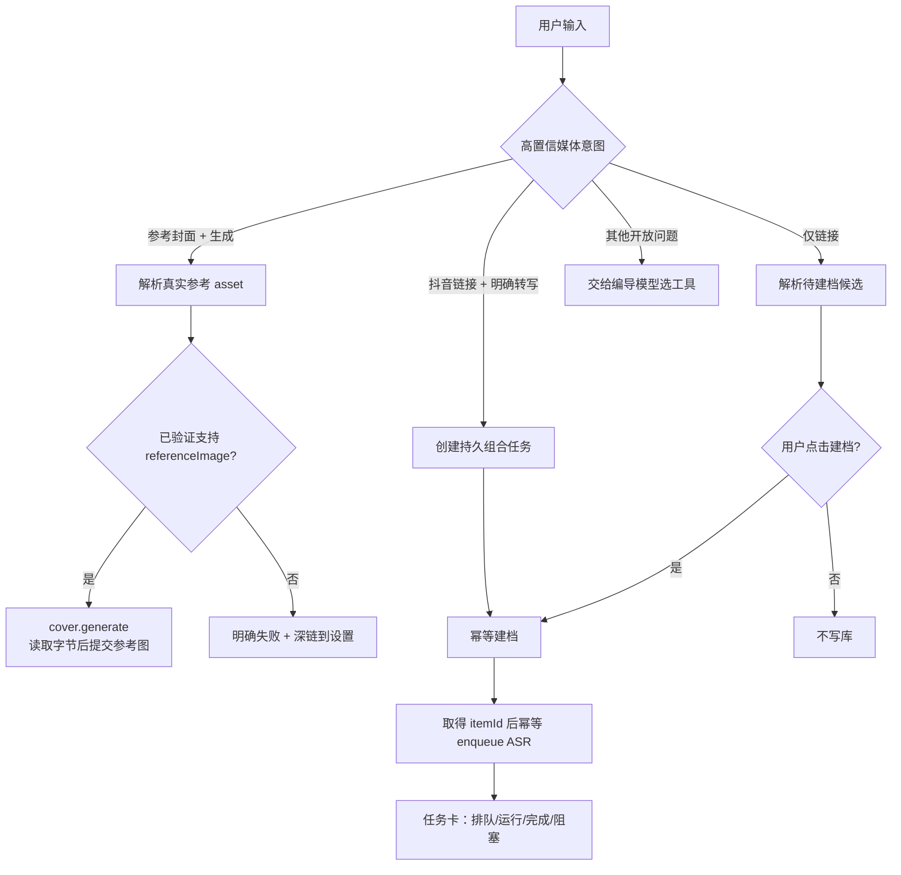
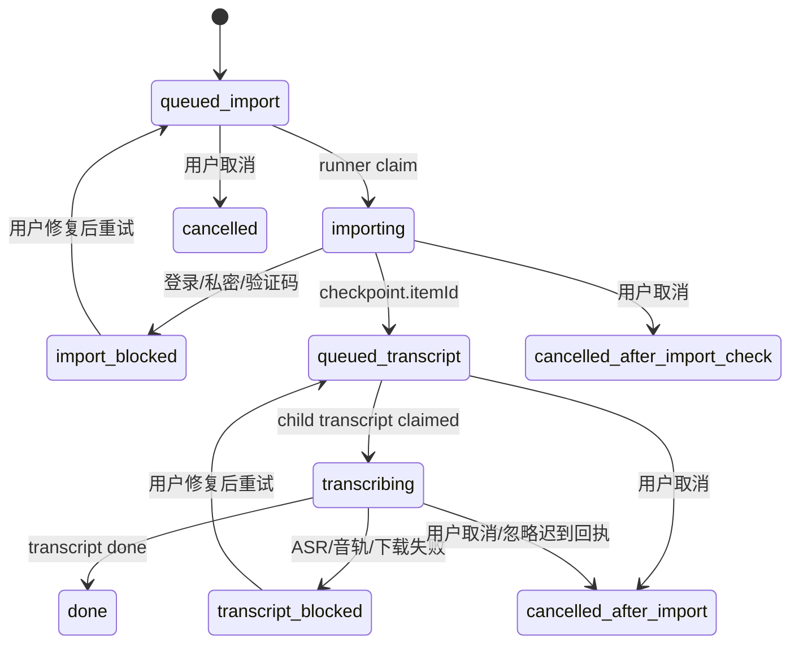

# CreatorOS Copilot 媒体工具编排优化 PRODUCT SPEC（T-510）

> 状态：PLAN 用户已确认（DEC-021），三轮独立评审后仍有 blocker，已退回 PLAN 重做；禁止进入
> CONTRACT/生产代码。阻塞详情见同目录 review 记录。  
> 上游：[T-508 专项诊断](../../research/2026-07-24-copilot-media-tool-routing-diagnosis.md)。  
> 原则：复用既有能力，不用提示词掩盖服务能力缺口；AI 只产候选，持久写入必须来自用户本次明确动作。

## 1. 产品结论与授权边界

推荐采用“**高置信意图由系统路由，开放问题继续由模型判断**”：

- 用户明确要求“以最新/指定封面为参考生成”时，系统负责解析参考资产、能力预检和派发；
- 用户在同一条输入中明确要求“转写/逐字稿/ASR/字幕”并提供抖音链接时，该输入就是本次
  “建档 + 手动异步转写”授权，不追加二次确认；
- 用户在内容雷达点击“识别并建档”或在对话中明确说“保存/建档/收藏这条”时，才持久建档；
- **只粘贴链接**时只解析为待建档候选，不写库、不转写；用户点击“建档”后才由 backend service
  持久化。这与内容雷达现有“输入后点击识别并建档”的明确动作一致；
- 只有缺数据、存在多条歧义或需要付费/降级确认时才向用户提问。



## 2. 现网事实与复用边界

以下是 T-508 已验证事实；没有证据的能力一律按“待建”处理。

| 能力 | 现网证据 | 裁决 |
|---|---|---|
| Copilot 素材上下文只有 id/title/kind | `backend/src/modules/ai-runtime/chat-tools.ts:473-478,3177-3196` | 已有，但不能做视觉分析 |
| `cover.generate(referenceAssetId)` | `backend/src/modules/ai-runtime/chat-tools.ts:1819-1844,2887-2910` | 已有，复用 |
| 对话将 referenceAssetId 透传任务 | `backend/src/modules/ai-runtime/chat-runner.ts:1401-1435` | 已有，复用 |
| user-scoped 图片字节读取 | `frontend/src/server/persistence-client.ts:4477-4482` | 已有，迁入/暴露为 backend service port，不让 frontend 编排业务 |
| cover runner 附加参考图 | `backend/src/modules/ai-runtime/cover-runner.ts:283-325` | 已有，补可审计回执 |
| OpenAI-compatible `/images/edits` | `ai-worker/src/runtime/multimodal-openai-images.ts:108-153` | 已有；仅证明请求形态，不证明任意中转站支持 |
| MiniMax `subject_reference` | `ai-worker/src/runtime/multimodal-minimax.ts:72-99` | 已有；真 Key 能力仍须 T-501 探针 |
| 视觉 adapter | `ai-worker/src/runtime/vision.ts:6`、`ai-worker/src/index.ts:133-134` | 已有底层，`asset.visual.inspect` 待建 |
| 模型配置测试 operation | `contract/src/operations/settings.ts:78-87` | 已有通用连接测试；`referenceImage` 独立探针由 T-501 待建 |
| 分享建档与转写 contract | `contract/src/operations/intelligence.ts:375-405` | 已有两个分离 operation，复用 |
| 分享建档、创建/复用博主和作品 | `backend/src/modules/intelligence/intelligence.service.ts:2577-2813` | 已有；默认不转写 |
| 分享任务 checkpoint/idempotency | `backend/src/modules/intelligence/intelligence.service.ts:2597,2688`、`backend/src/schema/intelligence.ts:122-158` | 已有子任务基础，父组合状态机待建 |
| transcript claim/运行/落结果 | `backend/src/modules/intelligence/transcript-runner.ts:61-158` | 已有，复用 |
| 抖音音频 + 云 ASR/本地 Whisper | `frontend/src/server/persistence-client.ts:6094-6150` | 已有 host 适配；通过 backend port 调用 |
| 内容雷达明确“识别并建档”入口 | `frontend/src/features/intelligence/intelligence-workbench.tsx:1400-1455` | 已有，保持授权语义 |
| 通用持久 AI 任务唯一键 | `backend/src/schema/ai.ts:124-127,153-172` | 已有 `(user_id,idempotency_key)` 约束；组合任务复用 |

仓内“无现成实现”断言的可复现反证（2026-07-24，CodeGraph 索引 1,543 files / 17,333
nodes，状态 up to date）：

| 待建能力 | 查询 | 结果 |
|---|---|---|
| `asset.visual.inspect` 同类工具 | `codegraph query asset.visual.inspect --json`；`rg "asset\\.visual\\.inspect\\|visual\\.inspect\\|composition.*palette.*typography" backend/src frontend/src ai-worker/src contract/src` | CodeGraph `[]`；rg 0 命中。只有底层 `vision.ts` 和封面 brief 字段，不存在用户语义视觉检查工具 |
| `referenceImage` 独立能力探针 | `codegraph query referenceImage --json`；`rg "referenceImage.*verified\\|images/edits.*probe\\|subject_reference.*probe\\|capability.*referenceImage" ...` | CodeGraph `[]`；rg 0 命中。现有 `images/edits`/`subject_reference` 是执行 adapter 与测试，不是配置指纹绑定的能力探针 |
| 父组合状态机 | `codegraph query workflowState --json`、`codegraph query parentTaskId --json`；`rg "parentTaskId\\|deduplicated_to\\|workflow_state\\|lease.*recover\\|parent.child" ...` | 两次 CodeGraph 均 `[]`；业务源码 rg 0 个可复用聚合实现。现有 scheduled sweep 和 ai_task lease 只作为机制先例 |

因此本 SPEC 新增的是三个窄边界：用户语义视觉检查、配置指纹化参考图探针、两步媒体父任务；
底层视觉、生成 adapter、AI task、分享与 transcript runner 全部复用。

### 2.1 现成方案/OSS 调研

| 方案 | 能力与来源 | 采用/弃用 |
|---|---|---|
| 复用现有 `ai_tasks` + intelligence 子任务 | 已有六态、唯一幂等键、claim 与数据库真值；证据见上表 | **采用**。本需求只有固定两步，不引入新运行基础设施 |
| Temporal durable workflow | 官方文档提供持久状态、重试、队列、定时器与崩溃续跑 | 暂不引入。可靠性强，但为两步工作流增加独立服务、部署和 replay 约束，超出桌面 APP 当前边界；当组合工作流达到 10+ 类或跨天人工 signal 时复议 |
| BullMQ Flow | 官方文档支持 parent-child job flow | 暂不引入。需要 Redis；项目已有 Postgres/PGlite 任务真值，双队列会增加一致性与打包成本 |
| XState | 官方文档支持显式状态机/actor | 只借鉴状态图，不引入运行时。它本身不替代当前持久任务、数据库锁和重启扫描 |

调研来源：Temporal 官方 durable execution、BullMQ 官方 Flows、XState 官方文档，访问日期
2026-07-24。进入 CONTRACT 时只固化内部状态机，不新增 Temporal/Redis/XState 依赖。

## 3. 封面优化

### FR-MO-001 参考图解析由系统完成

扩展现有 `cover.generate`：

- `referenceAssetId`：用户明确指定素材；
- `referenceStrategy=latest_published_cover`：backend service 按 `userId + accountId`、发布状态和
  `publishedAt DESC` 解析最新发布作品的真实封面；
- 解析结果包含 `referenceAssetId`、素材名称、缩略图地址、来源作品和归属校验结果；
- 0 条时直接说明拿不到；同一时间多条才请用户选择，禁止模型从 asset 标题猜对应关系。

### FR-MO-002 参考图能力预检

派发前读取 T-501 provider capability registry：

- `textToImage=true` 不代表 `referenceImage=true`；
- 只有 `referenceImage=verified` 才允许派发；`unknown/unsupported/failed` 都不调用生图；
- capability 证据必须绑定
  `{userId, capability, provider, model, normalizedBaseUrl, credentialRevisionHash, probeVersion}` 的
  `configFingerprint`，同时保存 `checkedAt`、`expiresAt=checkedAt+7d` 和脱敏 probe receipt；
- model、provider、baseURL、Key/secretReference 修订或 probeVersion 任一变化时，在同一设置保存事务
  将旧证据置 `unknown`；过 `expiresAt` 也按 `unknown`，必须重新探针；
- 指纹只使用 Key 的不可逆 HMAC/安全存储 revision，不记录 Key 本身；
- 未配置时返回 `/settings?highlight=image-generate` 深链；
- 真实生成沿 T-501 费用确认门；未确认时只生成任务候选，不发网络请求；
- T-501 未交付 `referenceImage` 探针前，T-510 封面路径不得标为可发布。

### FR-MO-003 参考图使用证据

任务记录保存以下可审计阶段：

`resolved → bytes_loaded → attached_to_provider_request → provider_accepted`

- `resolved`：找到了有权限的 asset；
- `bytes_loaded`：读取到非空图片字节并验证 MIME；
- `attached_to_provider_request`：adapter 回执证明参考图片段已进入真实请求；
- `provider_accepted`：provider 返回成功响应。若 provider 没有“确实采用参考图”的独立回执，
  UI 只能写“参考图已随请求提交，服务商未提供使用证明”，**不得写“已使用参考图”**；
- 任一步失败即失败，不静默转纯文生图；
- 任务卡展示缩略图、素材名、模型、上述证据状态、失败原因与“采纳为项目封面”确认门。

结果只承诺“作为参考提交”，不承诺像素级复制构图或字体。

### FR-MO-004 可选视觉分析

只有用户明确问“分析这张封面的构图/配色/字体”时，才调用只读 `asset.visual.inspect`：

```text
output = {
  composition: string,
  palette: [{ hex?: string, label: string }],
  typography: [{ role: string, style: string, confidence: 0..1 }],
  visualElements: string[],
  evidence: { assetId: string, model: string }
}
```

它复用 user-scoped asset bytes 与 vision adapter；单纯图生图不要求额外配置视觉模型。无视觉配置时
明确提示，不从文件名臆测视觉风格。

## 4. 抖音分享链接转写优化

### FR-MO-005 Copilot 组合工具

新增用户语义工具 `douyin.share.transcribe`。模型只提供：

- `shareInput`；
- 可选 `collectionId`，缺省进入“未分类”。

`idempotencyKey` **不暴露给模型填写**，由 backend 派生。工具不直连 Cookie、不直连数据库，
只调用 intelligence/composition service port，并立即返回父任务卡，不等待网络解析或 ASR。

### FR-MO-006 持久组合任务状态机

父任务类型：`copilot.douyin_share_transcribe.v1`；首次响应返回 `parentTaskId`、
`status=queued` 和 `workflowState=queued_import`。

持久层分工：

- `ai_tasks.status` 保持既有六态：`queued/running/awaiting_confirmation/succeeded/failed/cancelled`；
- 新增 backend composition 所属、与 parent task 1:1 的 `copilot_media_workflows`，存
  `workflow_state/checkpoint/import_task_id/transcript_task_id/lease_until/cancel_requested_at`；
- `workflowState` 是业务步骤，不塞进 `ai_tasks.status`。映射为：
  `queued_import→queued`；`importing/queued_transcript/transcribing→running`；
  可修复登录/配置阻塞→`awaiting_confirmation`；不可修复错误→`failed`；
  `done→succeeded`；任意取消终态→`cancelled`；
- 任何 task card 都从同一 service projection 同时读取两者，禁止 frontend 自行拼状态。



唯一行为：

1. request transaction 创建或读回父 `ai_tasks` 行后立即返回；
2. backend runner claim `queued_import`，调用既有 `share_import`；
3. 子任务完成后，在同一 backend transaction 写父 checkpoint：
   `{ normalizedUrl, externalWorkId, creatorId, itemId, importTaskId }`，再置
   `queued_transcript`；
4. runner 幂等调用既有 transcript enqueue，写
   `{ transcriptTaskId }`；不在事务中执行外部网络请求；
5. transcript 子任务终态触发父任务投影更新；没有事件时，启动/定时 recovery scan 根据子任务
   数据库真值修复父状态；
6. APP 被杀后，启动 sweep 重新 claim queued 父任务；对 running 超过 lease 的父任务释放并从
   最后一个 checkpoint 续跑，不重新执行已完成副作用；
7. import 失败和 transcript 失败分别保留 checkpoint，可单步重试，不删除已成功建档的数据。

### FR-MO-007 幂等算法

backend 生成：

```text
provisional = sha256(userId | accountId | opVersion | "douyin" | normalizedShareInput)
canonical   = sha256(userId | accountId | opVersion | "douyin" | externalWorkId)
```

- `normalizedShareInput` 去分享文案噪音、统一 scheme/host、移除追踪参数，不跟随短链前可稳定计算；
- 父任务先以 provisional key 创建；解析出 `externalWorkId` 后，在 checkpoint 保存 canonical key；
- provisional 只防相同输入重试；**任何建档/ASR 副作用前**，backend transaction 必须向新
  `media_operation_bindings` 原子执行
  `INSERT(user_id,account_id,op_version,platform,external_work_id,winner_task_id) ... ON CONFLICT DO NOTHING RETURNING winner_task_id`；
- 唯一约束为 `(user_id,account_id,op_version,platform,external_work_id)`。INSERT 返回行者是唯一
  winner；未返回者在同一事务读出现有 `winner_task_id`，写
  `deduplicated_to=<winnerTaskId>` 后停止，不得再调用 import 或 transcript enqueue；
- `ai_tasks(user_id,idempotency_key)` 继续防单一父任务重复；canonical binding 负责短链/长链及
  两个 provisional 并发归并；
- 同一 externalWorkId 已有 done transcript 时直接投影 done；queued/running 时关联原任务；
- 冲突永远返回原任务 ID 和真实状态，不返回第二个“成功”任务。

### FR-MO-008 授权口径与候选

- 只粘贴链接：调用只读 `douyin.share.preview`，展示标题、博主、封面和“建档”按钮；不写库；
- 点击“建档”或明确说“保存/建档/收藏”：执行既有分享建档，不自动 ASR；
- “转写/逐字稿/提取文字/ASR/字幕” + 抖音链接：视为本次明确授权，创建父组合任务；
- 不能把历史聊天的“想转写”沿用到下一条链接；
- preview 无法解析时如实显示登录/私密/验证码等状态，不创建空壳作品。

### FR-MO-009 聚合任务卡

任务卡按数据库真值展示：

`解析链接 → 已建档 → ASR 排队 → 转写中 → 已完成`

阻塞态区分登录、删除/私密/验证码、图集/无音轨、ASR 未配置/本地模型未就绪、下载失败和上游
转写失败。完成后提供“查看逐字稿”“去内容雷达”“基于逐字稿转选题”，不在聊天正文复述全文。

### FR-MO-011 取消语义

新增 `copilot.douyin.transcriptions.cancel(parentTaskId)`：

- 未完成建档：置 `cancel_requested_at`，best-effort 取消尚未 claim 的 import；若 import 与取消竞态，
  runner 必须先检查取消标记，完成原子 canonical 绑定后停止，不排 ASR；
- 已建档、ASR 未开始：保留用户已授权产生的建档，取消/不创建 transcript，卡片写
  “已建档，转写已取消”；
- ASR 已运行：请求子任务取消；provider 不支持时忽略迟到回执对父状态的推进，卡片提示“已请求停止，
  已产生的费用可能无法撤回”。已落下的 transcript 不自动删除；
- cancelled 是终态；recovery scan 永远不得复活 cancelled 或 `cancel_requested_at` 非空的父任务；
- 取消不等于撤销建档；删除作品继续使用内容雷达既有删除动作与确认门。

## 5. 确定性路由

### FR-MO-010 高置信路由守卫

路由发生在模型工具选择前，保持窄规则：

| 输入证据 | 路由 |
|---|---|
| 抖音域名/分享文本 + 本条明确转写动作，且无否定/假设词 | 强制 `douyin.share.transcribe`，排除 `web.read` |
| 抖音域名/分享文本 + 明确保存/建档动作 | `douyin.share.import`，不自动 ASR |
| 只有抖音链接 | 只读 `douyin.share.preview` |
| “最新/这张/指定封面作为参考” + 生成动作 | 增强后的 `cover.generate` |
| “分析封面风格” | `asset.visual.inspect` |
| 能力询问、否定句、假设句、证据不足或意图冲突 | 不执行副作用；交给模型解释或问一个澄清问题 |

路由记录 `routeReasonCode`、目标工具、是否强制和输入哈希，不记录完整正文。域名必须经 URL parser
验证为 `douyin.com`/子域或 `iesdouyin.com`，不能用字符串包含判断。首轮 RAT 已覆盖 24 条正例、
24 条负例，结果 48/48；详见
[路由 RAT](../../research/2026-07-24-t510-routing-rat.md)。该 RAT 只证明规则可行，不替代实现测试。

## 6. 非功能要求

- `NFR-MO-001`：读取/写入均校验 `userId + accountId`；
- `NFR-MO-002`：任务与副作用使用 backend 派生持久幂等键；
- `NFR-MO-003`：任务卡只读数据库真值，不靠对话记忆；
- `NFR-MO-004`：日志不得包含 Cookie、Key、完整分享正文、完整逐字稿、图片字节或可还原的 URL；
- `NFR-MO-005`：任何降级必须展示，禁止静默纯文生图；
- `NFR-MO-006`：frontend 只消费 contract；组合编排在 backend service；AI runtime 只产参数/候选，
  不直连数据库；
- `NFR-MO-007`：父任务 claim 使用 lease；重启恢复不得重复网络副作用；
- `NFR-MO-008`：路由错误不得触发收费生成、转写或持久建档。

## 7. 验收与追踪

| 需求 | Contract operation（待 CONTRACT 固化） | 责任层 | 验收/测试 |
|---|---|---|---|
| FR-MO-001 | `covers.reference.resolve` | backend | AC-MO-001 / TEST-MO-002 |
| FR-MO-002 | `settings.models.capabilities.get` | backend + ai-worker probe | AC-MO-002 / TEST-MO-003 |
| FR-MO-003 | `covers.tasks.get` evidence | backend + adapter | AC-MO-003 / TEST-MO-003 |
| FR-MO-004 | `assets.visual.inspect` | backend + ai-worker | AC-MO-004 / TEST-MO-007 |
| FR-MO-005 | `copilot.douyin.transcriptions.create/get` | backend composition | AC-MO-005 / TEST-MO-004 |
| FR-MO-006 | parent task + workflow resource | backend composition | AC-MO-007, AC-MO-008 / TEST-MO-004 |
| FR-MO-007 | internal canonical binding + task resource | backend composition | AC-MO-006 / TEST-MO-005 |
| FR-MO-008 | `intelligence.shares.preview/import` | backend | AC-MO-005 / TEST-MO-001, TEST-MO-005 |
| FR-MO-009 | parent task projection | backend + frontend | AC-MO-008 / TEST-MO-006 |
| FR-MO-010 | internal route decision | backend ai-runtime entry | AC-MO-005, AC-MO-009 / TEST-MO-001 |
| FR-MO-011 | `copilot.douyin.transcriptions.cancel` | backend composition | AC-MO-014 / TEST-MO-004, TEST-MO-011 |
| NFR-MO-001 | 所有上述 operation | backend | AC-MO-002, AC-MO-010 / TEST-MO-002, TEST-MO-008 |
| NFR-MO-002 | canonical binding + task resource | backend | AC-MO-006 / TEST-MO-005 |
| NFR-MO-003 | parent task projection | backend + frontend | AC-MO-007 / TEST-MO-004 |
| NFR-MO-004 | 无（日志门卫） | 全层 | AC-MO-011 / TEST-MO-009 |
| NFR-MO-005 | capability/task resource | backend + frontend | AC-MO-002, AC-MO-003, AC-MO-012 / TEST-MO-003 |
| NFR-MO-006 | contract imports/service ports | 全层 | AC-MO-013 / TEST-MO-010 |
| NFR-MO-007 | workflow resource | backend | AC-MO-007, AC-MO-014 / TEST-MO-004, TEST-MO-011 |
| NFR-MO-008 | route/capability guards | backend | AC-MO-005, AC-MO-009, AC-MO-012 / TEST-MO-001, TEST-MO-003 |

验收：

1. `AC-MO-001`：唯一最新封面 + verified referenceImage 时，一回合直接派发，不再问 A/B。
2. `AC-MO-002`：参考图不存在、越权、字节丢失、模型未验证/不支持时，网络生图调用为 0。
3. `AC-MO-003`：任务卡逐阶段显示 reference evidence；无 provider 独立证明时不得显示“已使用”。
4. `AC-MO-004`：视觉分析严格符合四字段 schema，缺配置不臆测。
5. `AC-MO-005`：抖音链接 + 明确转写不会调用 `web.read`；仅链接不写库且 ASR enqueue=0。
6. `AC-MO-006`：同一作品刷新、重试、短链/长链重复提交只保留一个建档和一个 ASR。
7. `AC-MO-007`：在 import 完成前、完成后 ASR 前、ASR 中三个时点杀进程，重启均从 checkpoint 续跑。
8. `AC-MO-008`：登录、私密/验证码、无音轨、ASR 未配置、下载失败显示不同状态和正确深链。
9. `AC-MO-009`：非抖音文章、能力询问、否定/假设句不产生副作用。
10. `AC-MO-010`：跨 user/account 读取 preview、asset、task、transcript 均为拒绝或空。
11. `AC-MO-011`：结构化日志扫描不出现 secret、完整 URL、逐字稿和图片 base64。
12. `AC-MO-012`：参考图失败没有任何 text-to-image 降级调用。
13. `AC-MO-013`：boundary scan 证明 frontend 不导入 backend repo/ai-worker，AI runtime 不直连 PG。
14. `AC-MO-014`：在 import 前、import 后 ASR 前、ASR 中分别取消，父任务不被 recovery 复活；
    已建档数据保留，未开始的 ASR 调用为 0，迟到回执不把父任务改回成功。

测试：

- `TEST-MO-001`：48 条起步并扩到不少于 100 条的路由表驱动正/负/否定/假设测试；
- `TEST-MO-002`：最新封面解析、0/1/同时间多条、user/account 越权负测；
- `TEST-MO-003`：capability probe、config fingerprint/TTL、验证后更换 model/baseURL/Key 失效、
  reference evidence 状态机、费用门和禁止静默降级；
- `TEST-MO-004`：父任务/两个子任务的事务、checkpoint、lease、重启恢复；
- `TEST-MO-005`：provisional/canonical 幂等键、两个 provisional 并发屏障、短长链归并、
  done/queued/running 复用，并断言只有一个 import 和一个 ASR；
- `TEST-MO-006`：两张任务卡 1280×720 APP 视觉、键盘与 E2E；
- `TEST-MO-007`：视觉输出 schema、模型缺失和恶意 assetId；
- `TEST-MO-008`：跨账号 asset/item/task/transcript 的 contract/service 负测；
- `TEST-MO-009`：日志脱敏测试；
- `TEST-MO-010`：`reconcile` boundary/orphan/contract 门卫。
- `TEST-MO-011`：取消与 import/ASR 并发屏障、迟到回执、kill/restart 后不复活。

## 8. Value & viability

### 8.1 五类风险与证据

| 风险 | 当前证据 | 处置与 Gate |
|---|---|---|
| 用户价值 | 用户真实反馈：已配置图生图却被要求再选 A/B；抖音链接被 `web.read` 后拒绝 ASR | 目标是“一次明确请求即进入正确任务”，灰度后观察首回合成功率 |
| 可用性 | sidecar 记录 16:21/16:22 只查素材，16:23 再推动才生成；截图复现多余轮次 | 首回合直接派发率 ≥95%，误执行副作用率=0 |
| 技术可行性 | cover runner 12/12、图片 adapter 17/17、分享+transcript 3/3（30s timeout） | provider 真 Key reference probe 和父任务 kill/restart 测试仍是发布 Gate |
| 商业/运营生存性 | 不新增外部队列服务；复用现有模型与 ASR 费用门 | 每次收费调用前沿用用户配置/确认；重复收费任务率=0 |
| 安全/信任 | 最大风险是只贴链接误建档、误转写和“已使用参考图”虚假声明 | 仅链接只预览；副作用需要本条明确动作；证据文案降到可证明级别 |
| 依赖：T-501 模型配置体验重构 | owner=T-501；当前 SPEC 已要求拆分 `textToImage/referenceImage` 探针，但尚未完成生产交付 | T-501 的 fingerprint、独立 reference probe、配置变更失效测试未 PASS 时，T-510 封面参考生成保持关闭；抖音转写路径可独立交付 |

### 8.2 替代方案

| 方案 | 优点 | 缺点 | 切换触发 |
|---|---|---|---|
| 忍着不解决，继续让用户追问 | 零开发 | 小白用户持续失败，模型差异放大 | 若灰度 14 天同请求追加追问率并未下降 ≥80%，撤回本方案重新比较 |
| 只改 system prompt/tool description | 成本低 | 不能保证弱模型路由，T-508 日志已证明会多问/误走 | 若 ≥100 条 fixture 与 20 次灰度均达到首回合 ≥95%、误副作用=0，且无需强制 guard，则可删系统路由 |
| 暴露两个原子工具，由模型自行串联 | 复用直接 | 中途重启、幂等、任务卡聚合难保证 | 若产品取消重启恢复/聚合任务卡要求，且只保留开发者模式，才切换 |
| 本 SPEC：窄路由 + 持久组合任务 | 行为唯一、可恢复、可验收 | 需新增父状态机和 contract | 当前采用；若实现超出 10 个工作日 appetite 或新增表超过 2 张，回 PLAN 重估而非缩水 |
| Temporal/BullMQ | 工作流能力成熟 | 新服务/Redis/打包与运维过重 | 组合工作流 ≥10 类、跨天人工 signal ≥3 类，或内部恢复缺陷每月 ≥2 起时复议 |

明确否决的形态至少包括：①提示词独担正确性；②模型自由串两个写操作；③只贴链接即后台写库；
④参考图读取失败后静默纯文生图。

### 8.3 致命便宜风险与 RAT

最便宜且致命的风险是“窄路由仍会把否定/能力询问识别为执行请求”。2026-07-24 已用 24 条正例、
24 条负例运行无副作用原型，误报 0、漏报 0。证据见
[T-510 路由 RAT](../../research/2026-07-24-t510-routing-rat.md)。

这只是进入 CONTRACT 的证据，不是发布证据。发布前 fixture 扩至 ≥100：

- 明确转写召回率 ≥95%；
- 否定/假设/能力询问误执行率必须为 0；
- 非抖音链接误路由率必须为 0。

任何误执行 >0 都关闭强制路由，回退“只解释/澄清”，不得以模型兜底继续发副作用。

### 8.4 成功信号

| 信号 | 阈值 | 检验时点 |
|---|---|---|
| 明确封面参考生成首回合进入正确任务 | ≥95%，脚本化 20 例 + 灰度前 20 次 | 合入前、灰度 7 天 |
| 明确抖音转写首回合创建父任务 | ≥95% | 合入前、灰度 7 天 |
| 否定/假设/仅链接产生副作用 | 0 | 每次 CI、灰度每日 |
| 重复建档/重复 ASR/重复收费 | 0 | kill/retry E2E、灰度每日 |
| reference evidence 虚假“已使用” | 0 | adapter contract test、灰度抽样 |
| 用户为同一请求追加“你直接做” | 较 T-508 基线下降 ≥80% | 灰度 14 天 |

### 8.5 Pre-mortem

假设上线后失败，最可能是：

1. 否定句触发收费 ASR：强制路由 kill switch + 0 容忍 fixture；
2. 中转站连接测试通过但不支持 image edits：独立 reference probe，unknown 即不发；
3. 父任务在建档成功后崩溃导致重复作品：canonical key + checkpoint +唯一约束；
4. provider 成功响应但忽略参考图：只展示“已提交/服务商未证明”，不写“已使用”；
5. 登录态隔离导致 preview/import 反复失败：错误态区分 cookie jar/账号，不把失败写成无作品；
6. 日志泄露分享链接或逐字稿：只记哈希/错误码并跑脱敏测试。

### 8.6 PR-FAQ

**Q：为什么不继续优化提示词？**  
A：提示词保留，但高置信副作用必须由可测试路由和 backend 状态机保证。

**Q：只贴一个抖音链接会发生什么？**  
A：只展示待建档候选，不写库；点击“建档”或明确说保存后才落库。

**Q：说“转写这个链接”为什么不再确认？**  
A：本条明确动作已经是手动授权（DEC-021）；系统立即返回可取消/可查看的异步任务卡。取消只能
停止后续工作，已经完成的建档不会被悄悄删除，已发给 provider 的费用也可能无法撤回。

**Q：系统能保证生成图完全复刻旧封面吗？**  
A：不能。系统能证明参考图已解析、读取并随请求提交；provider 没有独立使用证明时会如实标注。

**Q：为什么不用 Temporal/BullMQ？**  
A：当前只有固定两步，现有数据库任务已覆盖幂等和恢复；引入新服务收益小于复杂度。

**Q：隐私和费用如何控制？**  
A：不记录 Cookie/全文/图片字节；只有本条明确动作才转写，真实生成沿现有费用确认门。

**Q：升级后要迁移已有建档或逐字稿吗？用户需要做什么？**  
A：存量内容雷达作品、transcript 和旧 ai_tasks 不回填、不改语义；新父任务只用于上线后的
Copilot 组合调用。数据库新增 `copilot_media_workflows` 与 `media_operation_bindings` 两张表，
通过 additive migration 创建；读取旧任务仍走旧 resource。用户无需迁移或重新登录。若迁移失败，
新入口保持关闭，旧内容雷达建档/手动转写不受影响。

## 9. PLAN 确认点

用户已于 2026-07-24 确认（DEC-021）：

> 同一条输入明确包含“转写/逐字稿/ASR/字幕”等转写意图和抖音分享链接，即视为本次手动转写
> 授权；系统直接先建档、再幂等排入异步 ASR，不追加确认。

独立评审指出“仅链接即建档”未获授权且违反候选采纳原则，本版已收紧为“仅预览，用户点击或明确
建档后才写入”。下一门仍为独立 SPEC 复审；PASS 后才进入 CONTRACT。
