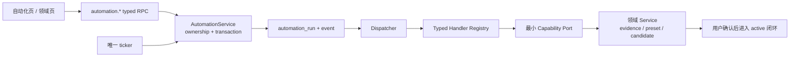

# CreatorOS Automation Kernel SERVICE CONTRACT

> Task: `T-517`
> Stage: `2-contract`
> Status: `blocked`
> Date: `2026-07-24`
> Upstream: [Automation Kernel PRODUCT SPEC](./2026-07-24-creatoros-automation-kernel.md)
> Decisions: `DEC-AUTO-001, DEC-AUTO-002`
> Manifest: `T-517-2-contract = blocked`
> 硬边界：确认②前不得修改生产代码；本文定义完整目标契约，不把实现步骤切成产品版本。
> Review: Round 1 / 2 / 3 `FAIL`；按三轮 STOP 上限退回 CONTRACT 重做，见
> [独立评审](./2026-07-24-creatoros-automation-kernel.contract.review.md)。

## 0. 契约结论

Automation Kernel 只提供一套 typed RPC/port 和一套持久执行真相：



- 用户 UI 只调用 `automation.*`；旧 `scheduledJobs.* / jobRuns.*` 由 compatibility adapter 单写映射。
- ticker、claim、lease、retry、event 和 migration 都由 backend `automation` 模块拥有。
- handler 不拿 repository 或通用 SQL；runtime 根据 manifest + grant + run snapshot 注入最小 typed
  domain operations。
- AI/Agent SDK 仍只在 `worker/ai-runtime`；它只能回传候选/decision/manifest，经 backend port 持久化。
- `source=imported` 是历史作品 evidence projection；转 active/manual 或驱动正式闭环仍走人工确认。

## 1. Consumers、providers 与物理边界

| 角色 | 组件 | 允许依赖 | 禁止 |
| --- | --- | --- | --- |
| Consumer | `frontend` 自动化页、内容雷达、旧采集页 | typed contract client | 直连 DB、启动业务 ticker、拼 handler payload |
| Public provider | `backend/src/modules/automation/automation.transport.ts`（planned） | `AutomationService` | import 领域 repository |
| Kernel owner | `backend/src/modules/automation/*`（planned） | 自己的 repository、clock、registry port | 放进 `frontend/`、强制创建 ai_task |
| Registry | `backend/src/modules/automation/automation-registry.ts`（planned） | 静态 manifest | 数据库脚本、动态用户代码 |
| AI bridge | `backend/src/modules/ai-runtime/*` / worker | typed handler port | worker 直连 PG |
| Domain providers | ingestion/intelligence/projects/artifacts 等 public service ports | 自己的 repository | 跨模块 repository import |
| Compatibility | `backend/src/modules/scheduling/*` adapter | AutomationService | 继续写旧 job/run 表 |

目标代码边界由 `orchestrator/SYSTEM_ARCHITECTURE.md` R1–R4 和新增 automation boundary rule 扫描。

## 2. 通用 wire contract

### 2.1 Envelope

成功：

```ts
type Success<T> = {
  requestId: string;
  data: T;
};
```

失败：

```ts
type Failure = {
  requestId: string;
  error: {
    code: AutomationErrorCode;
    message: string;
    nextAction:
      | "retry"
      | "reauthorize"
      | "reconnect_account"
      | "open_domain"
      | "reconcile"
      | "none";
    confirmationSummary?: ConfirmationSummary;
    details?: Record<string, string | number | boolean | null>;
  };
};
```

`details` 不得包含 payload 正文、cookie、token、authDir、模型 key 或跨账号实体。HTTP/RPC transport
错误与业务错误使用同一 envelope。

### 2.2 Error catalog

```ts
type AutomationErrorCode =
  | "AUTOMATION_VALIDATION_FAILED" | "AUTOMATION_UNAUTHENTICATED"
  | "AUTOMATION_FORBIDDEN" | "AUTOMATION_NOT_FOUND"
  | "AUTOMATION_IDEMPOTENCY_CONFLICT" | "AUTOMATION_STATE_CONFLICT"
  | "AUTOMATION_OVERLAP_SKIPPED" | "AUTOMATION_CONFIRMATION_REQUIRED"
  | "AUTOMATION_GRANT_REQUIRED" | "AUTOMATION_ACCOUNT_UNAVAILABLE"
  | "AUTOMATION_RECONCILIATION_REQUIRED" | "AUTOMATION_RATE_LIMITED"
  | "AUTOMATION_MAINTENANCE" | "AUTOMATION_DEPENDENCY_UNAVAILABLE"
  | "AUTOMATION_INTERNAL";
```

| Code | RPC status | 条件 | Repeat behavior |
| --- | ---: | --- | --- |
| `AUTOMATION_VALIDATION_FAILED` | 400 | schema、cron、timezone、editable field 非法 | 修正后重试 |
| `AUTOMATION_UNAUTHENTICATED` | 401 | 无本机用户 session | 不写库 |
| `AUTOMATION_FORBIDDEN` | 403 | user/account ownership 不匹配或 system-managed 字段越权 | fail closed |
| `AUTOMATION_NOT_FOUND` | 404 | 当前 scope 内 job/run/grant 不存在 | 不泄漏其他账号是否存在 |
| `AUTOMATION_IDEMPOTENCY_CONFLICT` | 409 | 同 command/request key、不同 fingerprint | 返回原 receipt 的安全 object refs 与冲突字段名，不执行 |
| `AUTOMATION_STATE_CONFLICT` | 409 | expectedStatusRevision 过期或非法 from→to | 返回当前 status/revision |
| `AUTOMATION_OVERLAP_SKIPPED` | 409 | 手动操作被 manifest overlap 禁止 | 返回 skipped run |
| `AUTOMATION_CONFIRMATION_REQUIRED` | 412 | 启用、运行或补偿需要本次确认 | 无写入并返回服务端重算的确认摘要 |
| `AUTOMATION_GRANT_REQUIRED` | 412 | 计划级授权缺失/撤销/漂移 | 不 claim，run blocked |
| `AUTOMATION_ACCOUNT_UNAVAILABLE` | 423 | 账号隐藏、未绑定、登录过期 | nextAction=reconnect_account |
| `AUTOMATION_RECONCILIATION_REQUIRED` | 423 | 外部/付费结果未知 | 禁止自动 retry |
| `AUTOMATION_RATE_LIMITED` | 429 | 来源或模型 channel 限流 | safe retryAt |
| `AUTOMATION_MAINTENANCE` | 503 | migration fence 已启用 | 明确“升级中”，不伪成功 |
| `AUTOMATION_DEPENDENCY_UNAVAILABLE` | 503 | handler/domain/provider 不可用 | blocked 或 retry_wait 取决于分类 |
| `AUTOMATION_INTERNAL` | 500 | 未分类内部错误 | 只返回诊断 ID |

### 2.3 Ownership 与调用身份

- 用户 RPC 从可信 `RequestContext` 取得 `userId + accountId`；request body 不允许自报 userId。
- `accountId` 缺失时只允许读取“请选择账号”的引导摘要，任何 job/run/grant 读写均拒绝。
- backend runtime 命令携带不可伪造的 local runtime identity + processEpoch；不作为公开 RPC 注册。
- 所有 repository `WHERE`、unique key、event 与 domain port 同时带 userId/accountId。
- system iterator 只能枚举 active scope，再逐 scope 调相同 service；不得使用 `accountId=null` 扫全库。

## 3. 资源 schema

### 3.1 `AutomationJobResource`

```ts
type AutomationJobResource = {
  id: string;
  accountId: string;
  jobRevision: number;
  handlerKey: string;
  handlerVersion: string;
  title: string;
  description: string;
  managedBy: "system" | "user";
  payloadVersion: number;
  schedule:
    | { kind: "cron"; cron: string; timezone: string }
    | { kind: "interval"; everyMinutes: number; timezone: string }
    | { kind: "manual_only"; timezone: string };
  desiredEnabled: boolean;
  enabled: boolean;
  suspendedReason:
    | "reauthorization_required"
    | "account_unavailable"
    | "dependency_unavailable"
    | null;
  nextRunAt: string | null;
  misfirePolicy: "run_once" | "skip";
  overlapPolicy: "skip" | "queue_one";
  retryPolicy: { maxAttempts: number; backoffMs: number; multiplier: number };
  timeoutMs: number;
  editableFields: string[];
  authorizationSummary: {
    mode: "none" | "grant_at_enable" | "confirm_each_run";
    state: "not_required" | "granted" | "required" | "revoked" | "drifted";
  };
  latestRun: AutomationRunSummary | null;
  createdAt: string;
  updatedAt: string;
};
```

`userId` 只存在于持久层 owner tuple，不进入公开 response；服务端永远从 RequestContext stamp，
避免“有时省略”的双 wire。

Job payload 只在 server 内以 manifest schema 读写；普通列表不回传 secret refs 或内部 target。

### 3.2 `AutomationRunResource`

```ts
type AutomationRunStatus =
  | "awaiting_confirmation"
  | "queued"
  | "retry_wait"
  | "running"
  | "cancel_requested"
  | "succeeded"
  | "failed"
  | "blocked"
  | "cancelled"
  | "skipped"
  | "reconciliation_required";

type AutomationRunSummary = {
  id: string;
  jobId: string | null;
  handlerKey: string;
  triggerKind: "scheduled" | "manual" | "startup_recovery" | "retry";
  status: AutomationRunStatus;
  statusRevision: number;
  scheduledFor: string | null;
  attempt: number;
  progress: { current: number; total: number | null; label: string | null } | null;
  resultSummary: {
    outcome: "changed" | "no_change" | "partial" | "unknown";
    created: number;
    updated: number;
    skipped: number;
    blocked: number;
    domainRefs: Array<{ kind: string; id: string }>;
  } | null;
  safeError: SafeAutomationError | null;
  availableAt: string | null;
  startedAt: string | null;
  finishedAt: string | null;
  createdAt: string;
  updatedAt: string;
};

type AutomationRunResource = AutomationRunSummary & {
  handlerVersion: string;
  definitionRevision: string;
  payloadVersion: number;
  manifestAuthorizationFingerprint: string;
  grant: { id: string; revision: number; mode: string } | null;
  overlapSlot: 0 | 1; // 仅 job-bound queue_one successor 为 1
  events: AutomationRunEventResource[];
  effects: AutomationEffectResource[];
  actions: Array<"cancel" | "retry" | "confirm" | "reauthorize" | "reconcile" | "open_domain">;
};
```

Run API 不回传 payload/config snapshot 本文；客服诊断只可见 fingerprint 和安全摘要。

### 3.3 `AutomationRunEventResource`

```ts
type EventBase = {
  id: string;
  runId: string;
  eventSequence: number;
  attempt: number;
  commandKey: string;
  occurredAt: string;
  beforeStatusRevision: number;
  afterStatusRevision: number;
};

type AutomationRunEventResource =
  | (EventBase & {
      type: "created"; fromStatus: null;
      toStatus: "awaiting_confirmation"|"queued"|"skipped";
      snapshotFingerprint: string; occurrenceFingerprint: string;
    })
  | (EventBase & {
      type: "confirmed"; fromStatus:"awaiting_confirmation"; toStatus:"queued";
      grantId:string; grantRevision:number; occurrenceFingerprint:string;
    })
  | (EventBase & {
      type: "claimed"; fromStatus:"queued"; toStatus:"running";
      processEpoch:string; leaseOwner:string; leaseExpiresAt:string;
    })
  | (EventBase & {
      type: "heartbeat"; fromStatus:"running"|"cancel_requested";
      toStatus:"running"|"cancel_requested"; heartbeatAt:string; leaseExpiresAt:string;
    })
  | (EventBase & {
      type: "checkpointed"; fromStatus:"running"|"cancel_requested";
      toStatus:"running"|"cancel_requested"; checkpointFingerprint:string;
    })
  | (EventBase & {
      type: "effect_reserved"; fromStatus:"running"; toStatus:"running";
      effectId:string; effectSequence:number; operationId:CapabilityOperationId;
      effectFingerprint:string; grantId:string|null; grantRevision:number|null;
      destinationScopeFingerprint:string|null; providerRequestKey:string;
    })
  | (EventBase & {
      type: "effect_committed"; fromStatus:"running"|"cancel_requested";
      toStatus:"running"|"cancel_requested"; effectId:string;
      receiptRef:string; providerRequestId:string|null;
    })
  | (EventBase & {
      type: "retry_scheduled"; fromStatus:"running"; toStatus:"retry_wait";
      availableAt:string; errorClass:HandlerErrorClass; safeError:SafeAutomationError;
    })
  | (EventBase & {
      type: "retry_ready"; fromStatus:"retry_wait"; toStatus:"queued";
      availableAt:string;
    })
  | (EventBase & {
      type:"blocked"; fromStatus:"awaiting_confirmation"|"queued"|"retry_wait";
      toStatus:"blocked"; reasonCode:string;
    })
  | (EventBase & {
      type:"cancelled"; fromStatus:"awaiting_confirmation"|"queued"|"retry_wait";
      toStatus:"cancelled"; reasonCode:string;
    })
  | (EventBase & {
      type:"manual_retry"; fromStatus:"failed"|"blocked"; toStatus:"queued";
      prerequisiteEvidence:string;
    })
  | (EventBase & {
      type: "cancel_requested";
      fromStatus:"running"; toStatus:"cancel_requested"; reasonCode:string;
    })
  | (EventBase & {
      type:"grant_revoked"; fromStatus:"running"|"cancel_requested";
      toStatus:"cancel_requested"|"reconciliation_required";
      reasonCode:string; unresolvedEffectIds:string[];
    })
  | (EventBase & {
      type: "recovered"; fromStatus:"running"|"cancel_requested";
      toStatus:"queued"|"blocked"|"cancelled"|"reconciliation_required";
      priorProcessEpoch:string; priorLeaseOwner:string; checkpointFingerprint:string|null;
      recoveryEvidence:string;
    })
  | (EventBase & {
      type: "reconciled"; fromStatus:"reconciliation_required";
      toStatus:"succeeded"|"failed"|"queued"; evidenceRef:string;
    })
  | (EventBase & {
      type: "finished"; fromStatus:"running"|"cancel_requested";
      toStatus:"succeeded"|"failed"|"blocked"|"cancelled"|"reconciliation_required";
      outcome:"changed"|"no_change"|"partial"|"failed"|"blocked"|"cancelled"|"unknown";
      resultSummaryFingerprint:string|null; safeError:SafeAutomationError|null;
    });
```

这是 contract 的 Zod `discriminatedUnion("type", …)` 真值，不实现为 nullable 大对象。
`eventSequence` 在 run row lock 内单调 +1；`beforeStatusRevision` 必须等于当前 run revision，
变状态事件的 after=before+1，不变状态事件 after=before。repository 的
`validateAttemptTimeline(events)` 在 transaction 提交前和 recovery startup 执行：attempt=0 只允许
created/confirmed/retry_ready 等首次 claim 前生命周期；每个 attempt≥1 恰一 claimed；claimed 前不得
heartbeat/effect/finished；每个 claimed attempt 恰一由 `retry_scheduled`、`recovered`、`finished`
或直接进入 `reconciliation_required` 的 `grant_revoked` 收口。`reconciled` 是已收口 attempt 之后的
人工核对事件，沿用最近 attempt 仅作关联，不算第二次 attempt 收口，也不要求 lease。若
`grant_revoked` 只转 `cancel_requested`，最终仍必须由 `finished` 或 `recovered` 收口。
sequence/revision 无断档；失败即转 `reconciliation_required` 并写诊断，不猜状态。

### 3.4 `AutomationGrantResource`

```ts
type AutomationGrantResource = {
  id: string;
  jobId: string | null;
  runId: string | null;
  handlerKey: string;
  grantRevision: number;
  authorizationMode: "grant_at_enable" | "confirm_each_run";
  domainWriteClass:
    | "operational_record"
    | "verifiable_ingestion"
    | "candidate_only"
    | "confirmed_domain_write";
  effectScopes: Array<"local_read" | "local_write" | "network_read" | "ai_paid" | "external_write">;
  destinationScopes: DestinationScope[];
  operationIds: CapabilityOperationId[];
  manifestAuthorizationFingerprint: string;
  inputSnapshotFingerprint: string;
  occurrenceFingerprint: string | null;
  singleUse: boolean;
  reservedByRunId: string | null;
  reservedAt: string | null;
  firstEffectAt: string | null; // single-use 表示只属于此 run，不表示只能有一个 effect
  grantedAt: string;
  revokedAt: string | null;
  provenance: "source_created" | "job_enabled" | "run_confirmed" | "migration_same_scope";
};
```

### 3.5 `DestinationScope` 与逐 effect ledger

```ts
type DestinationScope =
  | { kind:"local_domain"; domain:string; resourceIds:string[] }
  | {
      kind:"network";
      networkClass:"http"|"browser"|"model"|"external_write";
      scheme:"https"; host:string; port:443; pathPrefixes:string[];
      resourceIds:string[];
      credentialRef:string|null; modelRef:string|null;
      redirect:{ maxHops:0|1|2|3; allowedHosts:string[] };
    };

type AutomationEffectStatus =
  | "reserved" | "committed" | "not_committed" | "unknown";

type AutomationEffectResource = {
  id:string; runId:string; attempt:number; effectSequence:number;
  operationId:CapabilityOperationId; effectClass:
    "local_read"|"local_write"|"network_read"|"ai_paid"|"external_write";
  effectFingerprint:string; destinationScopeFingerprint:string|null;
  grantId:string|null; grantRevision:number|null;
  status:AutomationEffectStatus;
  providerRequestKey:string; providerRequestId:string|null; receiptRef:string|null;
  reservedAt:string; resolvedAt:string|null;
};
```

`automation_effects` unique
`(runId,operationId,effectFingerprint)`，同一页/item 重放返回原 effect/receipt；不同页/item 有不同
fingerprint，允许同一 run 多 effect。跨 attempt 使用同一 key：committed 直接 replay；
not_committed 可重新执行；reserved/unknown 必须先走 broker reconciliation，不能盲重放。

### 3.6 授权、执行与结果 alias（字段级真值）

```ts
type GrantConfirmation = {
  accepted: true;
  confirmationVersion: 1;
  handlerKey: string;
  manifestAuthorizationFingerprint: string;
  inputSnapshotFingerprint: string;
  occurrenceFingerprint: string | null; // plan grant 为 null，single-use 必填
  domainWriteClass: AutomationGrantResource["domainWriteClass"];
  effectScopes: AutomationGrantResource["effectScopes"];
  destinationScopes: DestinationScope[];
  operationIds: CapabilityOperationId[];
  displayDigest: string; // UI 展示文本 canonical JSON 的 SHA-256
};

type ConfirmationSummary = Omit<GrantConfirmation, "accepted"> & {
  title: string;
  plainLanguageEffects: string[];
};

type HandlerManifestDescriptor = Omit<
  AutomationHandlerManifest<unknown, unknown, readonly CapabilityOperationId[]>,
  "payloadSchema" | "configSchema" | "checkpointSchema" | "resultSchema" | "execute"
> & {
  payloadSchemaDigest: string;
  configSchemaDigest: string;
  checkpointSchemaDigest: string;
  resultSchemaDigest: string;
};

type ExecutionEnvelope = {
  runId: string;
  jobId: string | null;
  userId: string; accountId: string;
  attempt: number; processEpoch: string; leaseOwner: string;
  statusRevision: number;
  handlerKey: string; handlerVersion: string; definitionRevision: string;
  manifestAuthorizationFingerprint: string;
  payloadSnapshot: unknown; configSnapshot: unknown;
  inputSnapshotFingerprint: string; occurrenceFingerprint: string;
  grantRef: { id: string; grantRevision: number } | null;
  idempotency: { runKey: string; domainKeyPrefix: string };
};

type SafeAutomationError = {
  code:AutomationErrorCode; message:string;
  nextAction:Failure["error"]["nextAction"];
};

type RuntimeInvocationContext<
  TPayload,
  TConfig,
  TOps extends readonly CapabilityOperationId[]
> = {
  envelope: ExecutionEnvelope & {
    payloadSnapshot: TPayload;
    configSnapshot: TConfig;
  };
  signal: AbortSignal;
  heartbeat(input: {
    expectedStatusRevision: number;
    progress?: AutomationRunSummary["progress"];
    checkpoint?: unknown;
    commandKey: string;
  }): Promise<{statusRevision:number,cancelRequested:boolean}>;
  capabilities: Readonly<Pick<CapabilityMap, TOps[number]>>;
};

type HandlerOutcome = "changed" | "no_change" | "partial";
type HandlerErrorClass =
  | "validation" | "authentication" | "rate_limited" | "transient"
  | "permanent" | "unknown_external_result";
type AutomationHandlerResult = {
  outcome: HandlerOutcome;
  resultSummary: AutomationRunSummary["resultSummary"];
  sideEffectEvidence: Array<{
    operationId: CapabilityOperationId;
    effectFingerprint: string;
    receiptRef: string;
    certainty: "committed" | "not_committed" | "unknown";
  }>;
};
```

`ExecutionEnvelope` 是可持久化/可传递数据，不含函数。API 024 由 composition root 把它组装成
`RuntimeInvocationContext`，后者才含 signal、heartbeat/checkpoint 和 typed capabilities。

### 3.7 Handler manifest 与 snapshot

```ts
type AutomationHandlerManifest<
  TPayload,
  TConfig,
  TOps extends readonly CapabilityOperationId[]
> = {
  key: string;
  handlerVersion: string;
  definitionRevision: string;
  payloadVersion: number;
  payloadSchema: ZodType<TPayload>;
  configSchema: ZodType<TConfig>;
  checkpointSchema: ZodType<unknown>;
  resultSchema: ZodType<AutomationHandlerResult>;
  presentation: { title: string; description: string; domainHref: string | null };
  authorizationMode: "none" | "grant_at_enable" | "confirm_each_run";
  domainWriteClass: AutomationGrantResource["domainWriteClass"];
  effectScopes: AutomationGrantResource["effectScopes"];
  destinationScopes: DestinationScope[];
  operationIds: TOps;
  policies: {
    misfire: "run_once" | "skip";
    overlap: "skip" | "queue_one";
    retry: { maxAttempts: number; backoffMs: number; multiplier: number };
    timeoutMs: number;
    cancellable: boolean;
  };
  domainIdempotency: { strategy: string; keyVersion: number };
  execute(ctx: RuntimeInvocationContext<TPayload, TConfig, TOps>): Promise<AutomationHandlerResult>;
};
```

`manifestAuthorizationFingerprint` 是以上 version/schema digest/authorization/write/effect/destination/
operation/policy/idempotency 字段的 canonical JSON SHA-256。run 保存 normalized typed payload/config
snapshot；secret 只保存 opaque ref，执行时经账号 scope secret provider 解析。

### 3.8 grant reservation、逐副作用 broker 与恢复协议

confirm_each_run 不在 claim 时假装“已经执行”，而采用不可跳过的两段式授权：

1. API 012 把 single-use grant **reservation** 原子绑定到
   `(runId,occurrenceFingerprint,inputSnapshotFingerprint,manifestAuthorizationFingerprint)`。
2. API 018 claim 在同一 transaction 复核 reservation 与 grantRevision；不写 firstEffectAt/effect。
3. handler 不能直接调用浏览器、HTTP、模型 provider、外部 SDK 或领域 port；它们全部是
   `CapabilityMap` 的 typed broker。每次 broker 调用在真实网络/付费/写入**之前**执行
   `reserveEffect(runId,attempt,operationId,normalizedInputFingerprint,destinationScope,
   expectedGrantRevision)`：transaction 内复核 owner/run/occurrence/allowlist/destination/revocation，
   为新 effect 插入 ledger+event，并先生成持久 `providerRequestKey`；若是该 grant 的首个 effect，
   同事务 CAS 写 `firstEffectAt`。
   grant 已由同 run 消费不妨碍该 run 的第二个 effect；被其他 run 使用一律拒绝。
4. 同一次 effect 使用稳定
   `domainIdempotencyKey=SHA256(runId+operationId+normalizedInputFingerprint)`。领域 service 在同一
   事务写领域结果与 effect receipt；network/model broker 在发请求前保存 `providerRequestKey` 与
   request fingerprint，响应后回填 provider 生成的 `providerRequestId` 并提交 receipt；Kernel
   append `effect_committed(receiptRef)`。
5. 若进程死在 reserved 与 committed 之间：纯本地且领域 receipt 可查到时恢复为 committed；
   可证明没有提交时允许同 key 重放；外部写/付费且结果未知时只能
   `reconciliation_required`，禁止自动重试。
6. 后续 attempt 仅当 grant 仍属于同 run/occurrence/fingerprint，且每个已消费 effect 均有
   committed receipt 或可证明未提交时可续跑；否则 fail closed 进入 reconciliation。
7. revoke 与 reserveEffect 竞争同一 grantRevision row lock：先 revoke 则 effect 拒绝；先 reserve
   则撤权将 run 转 cancel_requested 或 reconciliation_required，绝不把已发生效果抹掉。

`authorizationMode=none` 只允许 `operational_record` 且 effectScopes 不含 network/paid/external；
`verifiable_ingestion` 至少需要用户创建/启用来源形成的 plan grant。

## 4. 用户与领域 RPC

以下 operation 都使用 §2 envelope；`Source` 是上游追踪，不代表仅覆盖该 FR。各段的 Request/
Response/Example 是人读摘要；§5.1 strict registry、§15 error map 和 §15.1 完整 fixtures 是冲突时
唯一实现真值。

### `API-AUTO-001 automation.jobs.list`

- Source: `FR-AUTO-01/08/09/10/12`
- Request: `{ cursor?: string, limit?: 1..100, managedBy?: "system"|"user", status?: "enabled"|"disabled"|"suspended" }`
- Response: `{ rows: AutomationJobResource[], nextCursor: string|null, health:{running,blocked,suspended} }`
- Permissions: 当前 RequestContext 账号只读。
- Errors: `OperationErrorMap["API-AUTO-001"]`（§15 wire code/status/shape）。
- State/idempotency: 只读；按 `(updatedAt,id)` 稳定 cursor。
- Example: `{limit:20,status:"suspended"} → {rows:[{id:"job-1",suspendedReason:"reauthorization_required"}]}`。

### `API-AUTO-002 automation.jobs.get`

- Source: `FR-AUTO-01/09/10`
- Request: `{ jobId: string }`
- Response: `{ job: AutomationJobResource, recentRuns: AutomationRunSummary[] }`
- Permissions: job 的 `(userId,accountId)` 必须等于 ctx。
- Errors: `OperationErrorMap["API-AUTO-002"]`（§15）。
- State/idempotency: 只读。
- Example: `{jobId:"job-intel"} → latestRun.status="blocked"`。

### `API-AUTO-003 automation.jobs.create`

- Source: `FR-AUTO-01/04/07/08/15/17`
- Request: `{ handlerKey, payloadVersion, payload, schedule, editableConfig, desiredEnabled, requestKey,
  grantConfirmation?:GrantConfirmation }`
- Response: `{ job:AutomationJobResource, confirmationSummary?:ConfirmationSummary,
  requiresConfirmation:boolean }`
- Permissions: 当前账号；manifest 必须 `managedBy=user` 或公开 create template。
- Errors: `OperationErrorMap["API-AUTO-003"]`（§15）。
- State/idempotency: canonical request fingerprint 覆盖 normalized payload/config/schedule/manifest。
  `authorizationMode=none` 才可无确认启用；`grant_at_enable` 缺 confirmation 时创建
  `desiredEnabled=true,enabled=false,suspendedReason=reauthorization_required`，不得建 grant；
  confirmation 的全部 fingerprint/operation/destination 与 server 计算值精确相等时，才可在同一
  transaction 创建 job+plan grant+receipt 并启用。`confirm_each_run` 只建 job，不在这里建 grant。
- Example: 创建 RSS 来源但未确认时**唯一分支**是成功创建 suspended job，并在 success data 同时返回
  `confirmationSummary`；成功 envelope 的 job 为
  `desiredEnabled=true,enabled=false,authorizationSummary.state="required"`；用户随后携完整
  `GrantConfirmation` 调 005 才启用。API 003 不同时返回 412；只有对既有 job 执行 005 preflight
  才用 `AUTOMATION_CONFIRMATION_REQUIRED`。

### `API-AUTO-004 automation.jobs.update`

- Source: `FR-AUTO-01/05/08/09/15`
- Request: `{ jobId, expectedJobRevision, patch:{ schedule?, editableConfig? }, requestKey }`
- Response: `{ job, authorizationChanged:boolean }`
- Permissions: 只能修改 manifest `editableFields`；system-managed 不可换 handler/payload。
- Errors: `OperationErrorMap["API-AUTO-004"]`（§15）。
- State/idempotency: config/definition fingerprint 变化时，事务内 suspend + block waiting runs；同
  requestKey 同 patch 返回相同结果。
- Example: 每周一 09:00 改为每周三 10:00，nextRunAt 按 job timezone 重算。

### `API-AUTO-005 automation.jobs.setEnabled`

- Source: `FR-AUTO-09/13/15/16`
- Request: `{ jobId, desiredEnabled:boolean, expectedJobRevision, requestKey, grantConfirmation?: GrantConfirmation }`
- Response: `{ job, affectedRunIds:string[] }`
- Permissions: 当前账号；system-managed 可开关但不可删除。
- Errors: `OperationErrorMap["API-AUTO-005"]`（§15；preflight 用 confirmationSummary）。
- State/idempotency: 关闭时同事务写 desired/enabled/nextRunAt 并取消 waiting runs、请求 running 协作
  取消；开启且缺/漂移 grant、又未给 confirmation 时是**无写 preflight**：返回 412，error 内带完整
  server-computed ConfirmationSummary；客户端把该 summary 原样加 accepted=true 重调。开启时验证/
  建立 grant、清 suspension、重算 nextRunAt。重复命令不重复 event。
- Example: `{jobId:"job-daily",desiredEnabled:false}` → `nextRunAt=null`。

### `API-AUTO-006 automation.jobs.archive`

- Source: `FR-AUTO-01/09/16`
- Request: `{ jobId, expectedJobRevision, requestKey }`
- Response: `{ archivedJobId, affectedRunIds }`
- Permissions: 仅 user-managed；system-managed 返回 forbidden。
- Errors: `OperationErrorMap["API-AUTO-006"]`（§15）。
- State/idempotency: 先执行 disable 语义；有 reconciliation run 时禁止归档；重复请求返回 archived。
- Example: 归档用户 RSS job，不删除运行历史。

### `API-AUTO-007 automation.runs.createManual`

- Source: `FR-AUTO-02/07/08/09/12/15`
- Request: `{ jobId?:string, handlerKey?:string, payloadVersion?:number, payload?:unknown, requestKey:string, confirmation?:GrantConfirmation }`
- Response: `{ run:AutomationRunSummary, deduped:boolean, confirmationSummary?:ConfirmationSummary }`
- Permissions: 当前账号；handler 必须允许 manual。
- Errors: `OperationErrorMap["API-AUTO-007"]`（§15）。
- State/idempotency: manualRequestFingerprint 绑定完整 manifest/snapshot/grant。confirm_each_run 无
  confirmation 时创建 awaiting；确认、single-use grant、queued 同事务。
- Example: 同 requestKey 连点两次只返回 `run-manual-1`。

### `API-AUTO-008 automation.runs.list`

- Source: `FR-AUTO-02/08/09`
- Request: `{ cursor?,limit?,jobId?,handlerKey?,status?,from?,to? }`
- Response: `{ rows:AutomationRunSummary[],nextCursor }`
- Permissions: 当前账号只读。
- Errors: `OperationErrorMap["API-AUTO-008"]`（§15）。
- State/idempotency: 只读；按 `(createdAt,id)` 倒序稳定分页。
- Example: `{status:"reconciliation_required"}` 返回待用户核对列表。

### `API-AUTO-009 automation.runs.get`

- Source: `FR-AUTO-02/09/10/16`
- Request: `{ runId }`
- Response: `{ run:AutomationRunResource }`
- Permissions: 当前账号；domainRefs 仍经各领域权限复核。
- Errors: `OperationErrorMap["API-AUTO-009"]`（§15）。
- State/idempotency: 只读；actions 由状态+manifest+grant 实时计算，禁止假按钮。
- Example: cancelled run 的 actions 不含 cancel。

### `API-AUTO-010 automation.runs.cancel`

- Source: `FR-AUTO-02/06/16`
- Request: `{ runId, expectedStatusRevision, commandKey }`
- Response: `{ run:AutomationRunSummary }`
- Permissions: 当前账号；manifest 必须允许，或 run 尚未 claim。
- Errors: `OperationErrorMap["API-AUTO-010"]`（§15）。
- State/idempotency: awaiting/queued/retry_wait→cancelled；running→cancel_requested；状态与 event 同事务；
  重复 commandKey 返回当前 run。
- Example: running transcript 转 `cancel_requested`，不是立即假 cancelled。

### `API-AUTO-011 automation.runs.retry`

- Source: `FR-AUTO-06/07/15/16`
- Request: `{ runId:string, expectedStatusRevision:number, commandKey:string,
  grantConfirmation?:GrantConfirmation }`
- Response: `{ run:AutomationRunSummary }`
- Permissions: 当前账号；failed/blocked/reconciliation resolved 后且 manifest retryable。
- Errors: `OperationErrorMap["API-AUTO-011"]`（§15；preflight 用 confirmationSummary）。
- State/idempotency: 原 run 追加 event，不建第二 run；attempt 只在 API 018 claim 时递增。若 grant
  缺失/漂移且未给 confirmation，执行无写 preflight 并返回 412+ConfirmationSummary；若 handler
  不是可重授权模式则 GRANT_REQUIRED。完整 snapshot/grant 通过后 failed/blocked→queued。
- Example: 登录恢复后重试 blocked source_sync，attempt 2。

### `API-AUTO-012 automation.runs.confirm`

- Source: `FR-AUTO-15/17`
- Request: `{ runId, expectedStatusRevision, occurrenceFingerprint,
  confirmation:GrantConfirmation, commandKey }`
- Response: `{ run, grant:AutomationGrantResource }`
- Permissions: 当前账号本人。
- Errors: `OperationErrorMap["API-AUTO-012"]`（§15）。
- State/idempotency: 仅 awaiting_confirmation；single-use grant 绑定 run/occurrence 与 queued 同事务；
  `GrantConfirmation` 必须逐字段等于 server 返回的 ConfirmationSummary，且
  `occurrenceFingerprint=SHA256(runId + scheduledFor + inputSnapshotFingerprint +
  manifestAuthorizationFingerprint)`。事务内写 grant reservation
  `(reservedByRunId,reservedAt)`、run→queued、event、command receipt；此时 `firstEffectAt` 仍为空。
  同 commandKey+fingerprint replay 同 grant；不同 fingerprint 冲突；其他 run 不可使用。
- Example: 确认本次 external write 后该 run queued，下一次仍 awaiting。

### `API-AUTO-013 automation.runs.reconcile`

- Source: `FR-AUTO-07/15/16`
- Request:
  - 核对结果：`{ runId, expectedStatusRevision, commandKey,
    resolution:"verified_succeeded"|"verified_failed", evidenceRef }`
  - 授权补偿：`{ runId, expectedStatusRevision, commandKey,
    resolution:"authorize_compensation", evidenceRef, compensationConfirmation:GrantConfirmation }`
- Response: `{ run:AutomationRunSummary, grant?:AutomationGrantResource }`
- Permissions: 当前账号；handler 提供 reconciliation adapter。
- Errors: `OperationErrorMap["API-AUTO-013"]`（§15）。
- State/idempotency: 仅 reconciliation_required；核对结果到 succeeded/failed。补偿分支必须由服务端
  重算补偿 operation/destination/occurrence 摘要并与 `compensationConfirmation` 逐字段相等，再在
  同一 transaction 建立 single-use grant、run→queued、event 与 command receipt；缺确认执行无写
  preflight，返回 412+ConfirmationSummary。补偿 effect 仍逐项经过 effect broker，不能用“核对”
  绕过授权。
- Example: provider requestId 查到已扣费成功，转 succeeded，不重放模型。

### `API-AUTO-014 automation.grants.list`

- Source: `FR-AUTO-09/15`
- Request: `{ jobId?:string,includeRevoked?:boolean }`
- Response: `{ rows:AutomationGrantResource[] }`
- Permissions: 当前账号。
- Errors: `OperationErrorMap["API-AUTO-014"]`（§15）。
- State/idempotency: 只读，不回 secret。
- Example: 显示 RSS 只读来源授权和被撤销时间。

### `API-AUTO-015 automation.grants.revoke`

- Source: `FR-AUTO-15/16`
- Request: `{ grantId, expectedGrantRevision, commandKey }`
- Response: `{ grant,blockedRunIds,suspendedJobIds }`
- Permissions: 当前账号本人。
- Errors: `OperationErrorMap["API-AUTO-015"]`（§15）。
- State/idempotency: revoke、grantRevision+1、suspend job、waiting run→blocked、running
  run→cancel_requested 与相应 events 在**同一 transaction**；handler 在下一 checkpoint 观察
  cancel token。已 committed 且有 receipt 的 effect 保留证据，run 协作停止后可 partial/cancelled；
  若存在 reserved/unknown effect 才直接 reconciliation_required。重复撤销由 command receipt
  返回同一 revokedAt。
- Example: 撤销 AI 计划授权后未执行 run 全 blocked。

### `API-AUTO-016 automation.diagnostics.export`

- Source: `FR-AUTO-09`、`NFR-AUTO-06/07`
- Request: `{ from,to,jobId?,runId? }`
- Response: `{ artifactId,fileName,recordCount,sha256 }`
- Permissions: 当前账号；导出到用户选择位置仍经桌面受控文件 port。
- Errors: `OperationErrorMap["API-AUTO-016"]`（§15）。
- State/idempotency: 只读 snapshot；不含正文/secret/跨号数据。
- Example: 导出 runId 的 12 条 event 和安全错误。

## 5. Kernel internal ports

这些 operation 不注册为公网/前端路由，只能由 backend composition root 的 runtime identity 调用。

### `API-AUTO-017 automation.runtime.produceDue`

- Source: `FR-AUTO-03/05/08`
- Request: `{ now,processEpoch,limit }`
- Response: `{ examined:number,created:number,deduped:number,skipped:number,retryPromoted:number,
  nextWakeAt:string|null }`
- Permission: 唯一 ticker runtime。
- Errors: `OperationErrorMap["API-AUTO-017"]`（§15）。
- State/idempotency: transaction 内 occurrence run + event + nextRunAt；unique occurrence；并发 tick 只一条。
- Example: 两个 tick 同时处理 job-1，仅一个 created。

### `API-AUTO-018 automation.runtime.claim`

- Source: `FR-AUTO-02/06/08/15/17`
- Request: `{ now,processEpoch,leaseOwner,limit }`
- Response: `{ runs:ExecutionEnvelope[] }`
- Permission: dispatcher runtime。
- Errors: `OperationErrorMap["API-AUTO-018"]`（§15）。
- State/idempotency: queued CAS→running；逐 run 精确校验 scope、snapshot、manifest、grant、account；
  与 claimed event 同事务。confirm_each_run 的 grant 必须已 reservation 给同 run/occurrence/
  fingerprint；claim 不消耗 grant，因为 claim 后可能在首个副作用前崩溃。**attempt 的唯一递增点**
  就是本 transaction：`attempt=attempt+1`、lease 写入、claimed event 使用新 attempt；其他 API
  不得递增 attempt。
- Example: 两个 dispatcher 只有一个拿到 run-1。

### `API-AUTO-019 automation.runtime.heartbeat`

- Source: `FR-AUTO-02/06/16`
- Request: `{ runId,processEpoch,leaseOwner,expectedStatusRevision,progress?,checkpoint?,commandKey }`
- Response: `{ status,statusRevision,cancelRequested,leaseExpiresAt }`
- Permission: 当前 lease owner。
- Errors: `OperationErrorMap["API-AUTO-019"]`（§15）。
- State/idempotency: heartbeat/checkpoint/event 同事务；返回 cancel token。
- Example: transcript 第 40/100 段 heartbeat 后发现 cancelRequested=true。

### `API-AUTO-020 automation.runtime.finish`

- Source: `FR-AUTO-02/04/06/07/17`
- Request: `{ runId,processEpoch,leaseOwner,expectedStatusRevision,
  outcome:"changed"|"no_change"|"partial"|"failed"|"blocked"|"cancelled",
  resultSummary?:AutomationRunSummary["resultSummary"],
  safeError?:{code:AutomationErrorCode,message:string,nextAction:Failure["error"]["nextAction"]},
  sideEffectEvidence?:AutomationHandlerResult["sideEffectEvidence"],commandKey }`
- Response: `{ run:AutomationRunSummary }`
- Permission: 当前 lease owner，结果必须过 manifest result schema。
- Errors: `OperationErrorMap["API-AUTO-020"]`（§15）。
- State/idempotency: running/cancel_requested→合法终态；未知付费/外部结果强制 reconciliation_required；
  status/attempt/event 同事务。
- Example: source_sync 0 新内容仍 succeeded+no_change。

### `API-AUTO-021 automation.runtime.scheduleRetry`

- Source: `FR-AUTO-06/07/16`
- Request: `{ runId,processEpoch,leaseOwner,expectedStatusRevision,errorClass:HandlerErrorClass,
  availableAt:string,commandKey }`
- Response: `{ run }`
- Permission: 当前 lease owner。
- Errors: `OperationErrorMap["API-AUTO-021"]`（§15）。
- State/idempotency: 只有 retryable 且 attempt<max；running→retry_wait，同 run attempt 不提前增加。
- Example: 429 后 availableAt=provider retry time。

### `API-AUTO-022 automation.runtime.recoverLeases`

- Source: `FR-AUTO-06/13/16`
- Request: `{ now,currentProcessEpoch,limit }`
- Response: `{ recovered,blocked,reconciliationRequired }`
- Permission: startup recovery/runtime。
- Errors: `OperationErrorMap["API-AUTO-022"]`（§15）。
- State/idempotency: 只处理 lease 过期/旧 epoch；按 checkpoint 与 effect class 决定 queued/blocked/
  reconciliation；CAS + event。
- Example: 本地 migration 从最后 batch checkpoint queued。

### `API-AUTO-023 automation.registry.validate`

- Source: `FR-AUTO-04/11/14/17`
- Request: `{ manifests:HandlerManifestDescriptor[] }`
- Response: `{ fingerprintByKey,errors,warnings }`
- Permission: composition root startup only。
- Errors: `OperationErrorMap["API-AUTO-023"]`（§15）。
- State/idempotency: 重复 key、缺 domain idempotency/operation allowlist、未知 capability、长任务不可取消
  均启动失败；只读。
- Example: `script_candidate` 声明 active project write 时 validation failed。

### `API-AUTO-024 automation.runtime.invokeHandler`

- Source: `FR-AUTO-04/11/15/17`
- Request: `{ envelope:ExecutionEnvelope }`；composition root 验证后构造不持久化的
  `RuntimeInvocationContext<TPayload,TConfig,TOps>`（typed snapshots、signal、heartbeat/checkpoint、
  typed broker capabilities）。
- Response: success 只返回 `AutomationHandlerResult`；`SafeAutomationError` 必须映射为 §2
  `Failure`，不能混进成功 union。
- Permission: dispatcher 内部；handlerKey 必须 registry 命中。
- Errors: `OperationErrorMap["API-AUTO-024"]`（§15）。
- State/idempotency: runtime 注入 `intersection(manifest.operationIds,grant.operationIds,
  domainWriteClass allowlist)`；execute 本身不改 run 状态，由 API-AUTO-020/021 收口。
- Example: favorites handler 只拿 `favorites.upsertEvidence`，拿不到 `projects.promote`。

### `API-AUTO-025 automation.compat.scheduledJobs`

- Source: `FR-AUTO-11/13`
- Request: 下表逐项保持 `contract/src/operations/scheduling.ts:15-96` 的现有 Zod request；
  **不存在 delete**。
- Response: 下表逐项保持同文件的现有 Zod response 与 legacy envelope：

| 旧 stable operation ID | Request | Response | 唯一新 API 映射 |
| --- | --- | --- | --- |
| `scheduledJobs.create` | 现有 body `name,prompt,sourceKind,target,schedule,toolGrants` | `scheduledJobResource` | 003；legacy sourceKind→固定 handlerKey |
| `scheduledJobs.list` | 现有 pagination/sourceKind/enabled query | list `scheduledJobResource` | 001 projection |
| `scheduledJobs.get` | `{jobId}` | `scheduledJobResource` | 002 projection |
| `scheduledJobs.update` | `{jobId}` + 现有 patch | `scheduledJobResource` | 004；adapter 读 jobRevision 后 CAS |
| `scheduledJobs.setEnabled` | `{jobId,enabled}` | `scheduledJobResource` | 005；缺授权返回明确 maintenance/grant error |
| `scheduledJobs.runNow` | `{jobId}` | `{jobRunId,aiTaskId,deduped}` | 007；兼容期 `aiTaskId=automationRunId`，不得虚构第二 task |

adapter 算法是 API 025 自己的 backend transaction，不是从公网顺序调用 004/005：

- trusted transport 为每个 legacy mutation 注入 `legacyRequestId`，commandKey =
  `legacy:<operationId>:<legacyRequestId>`；HTTP/dispatch 重放必须保留 requestId，因此 crash 后可 replay。
  新 requestId 保持旧 create/update 语义，不擅自跨用户动作去重。
- create：sourceKind→固定 handler；name→title，prompt/target/toolGrants→manifest
  editableConfig，cron→schedule。若模板需 grant 且没有可证明 migrated same-scope grant，按 API 003
  原子创建 suspended job 并返回 legacy `scheduledJobResource(enabled=false)`；自动化页会展示
  reauthorization_required，用户点击开启时由 API 005 preflight 得到 ConfirmationSummary，不伪 enabled。
- update：name→title；prompt/target/toolGrants→editableConfig；schedule→schedule。若 body 含 enabled，
  在**同一 AutomationService transaction**同时执行 revision/CAS、授权漂移判断、004/005 的状态与
  events；任一字段 invalid/需确认则整笔 0 mutation 返回 error，不能半改配置半失败开关。
- setEnabled：same-scope grant 有效则原子开关；缺/漂移授权返回 412+ConfirmationSummary 和
  `nextAction=reauthorize`，旧 UI 跳新入口，wire 不增加 confirmation 字段。
- runNow：延续现网自然日去重，legacy requestKey =
  `legacy-run-now:<jobId>:<jobTimezoneLocalDate>`；同日同 in-flight/terminal occurrence 返回相同 run；
  不用随机 requestId 破坏旧语义。需要 confirm_each_run 时返回 awaiting run/412 跳确认页。
- list/get 只投影；所有 legacy error 仍走统一 envelope，旧客户端对 412/503 必须显示真实引导。

兼容 Gate 使用以下六条独立 fixture：

```ts
const LEGACY_JOB:LegacyScheduledJobResource={
  id:"job-1",userId:"user-1",accountId:"acct-1",name:"指标",prompt:"",
  sourceKind:"self.metrics",target:{externalSourceId:"src-1"},schedule:"0 9 * * *",
  toolGrants:[],recipe:null,enabled:true,lastRunAt:null,nextRunAt:"2026-07-25T01:00:00Z",
  createdAt:"2026-07-24T00:00:00Z",updatedAt:"2026-07-24T01:00:00Z"
};
```

| legacy op | concrete request | success data | mutation/error fixture |
| --- | --- | --- | --- |
| create | `{body:{name:"指标",prompt:"",sourceKind:"self.metrics",target:{externalSourceId:"src-1"},schedule:"0 9 * * *",toolGrants:[]},legacyRequestId:"lr-1"}` | `LEGACY_JOB` | 无可迁授权→`LEGACY_JOB.enabled=false`，非假成功启用 |
| list | `{query:{page:1,pageSize:20,enabled:true}}` | `[LEGACY_JOB]` + legacy list meta | fence→legacy 503 error envelope |
| get | `{params:{jobId:"job-1"}}` | `LEGACY_JOB` | 跨账号/缺失→legacy 404 |
| update | `{params:{jobId:"job-1"},body:{name:"新名",enabled:false},legacyRequestId:"lr-2"}` | `{...LEGACY_JOB,name:"新名",enabled:false}` | auth drift→0 mutation + 412 summary |
| setEnabled | `{params:{jobId:"job-1"},body:{enabled:true},legacyRequestId:"lr-3"}` | `{...LEGACY_JOB,enabled:true}` | 缺 grant→0 mutation + 412 summary |
| runNow | `{params:{jobId:"job-1"},legacyRequestId:"lr-4"}` | `{jobRunId:"run-1",aiTaskId:"run-1",deduped:false}` | confirm_each_run→awaiting run + 412 summary |

新状态投影：awaiting/queued/retry_wait→旧 `running`；succeeded/skipped(no-change)→`succeeded`；
blocked(account login)→`needs_reconnect`；其他 blocked/failed/cancelled/reconciliation→`failed` 并返回
安全 error。该有损投影只服务旧 UI，新 UI 读完整状态。
- Permission: 复用旧 API ownership，但最终调用 AutomationService。
- Errors: `OperationErrorMap["API-AUTO-025"]`（§15）；ownership→NOT_FOUND、fence→MAINTENANCE、
  授权不足→GRANT/CONFIRMATION_REQUIRED，不得映射成功。
- State/idempotency: adapter 不是 repository writer；所有写进入 AutomationService 与相同 command
  receipt/状态机，旧表不写。API 025 的原子组合与 003/004/005/007 共用 service command，不走两次 RPC。
- Example: 旧 `scheduledJobs.runNow` 返回映射后的 jobRunId=automationRunId。

### `API-AUTO-026 automation.compat.jobRuns`

- Source: `FR-AUTO-02/11/13`
- Request: 保持 `contract/src/operations/scheduling.ts:98-116` 的
  `jobRuns.listByJob({jobId},pagination)` 与 `jobRuns.get({runId})`。
- Response: 两者均返回既有 `jobRunResource`；从 run resultSummary/domain refs 投影。
- Permission: 当前账号。
- Errors: `OperationErrorMap["API-AUTO-026"]`（§15）。
- State/idempotency: 只读投影；不得反写旧表。
- Example: succeeded+no_change 映射 itemsNew=0/itemsUpdated=0，不伪新增。

两条 legacy read fixture：

```ts
const LEGACY_RUN:LegacyJobRunResource={
  id:"run-1",userId:"user-1",jobId:"job-1",aiTaskId:"run-1",
  status:"succeeded",itemsNew:0,itemsUpdated:0,error:null,progress:null,
  startedAt:"2026-07-24T01:00:00Z",finishedAt:"2026-07-24T01:00:02Z"
};
```

- `listByJob({jobId:"job-1"},{page:1,pageSize:20})` → legacy list envelope
  `data:[LEGACY_RUN],meta:{requestId,page:1,pageSize:20,total:1}`；
- `get({runId:"run-1"})` → legacy success envelope `data:LEGACY_RUN,meta:{requestId}`；
- 跨账号与缺失都返回同一个 legacy 404，不泄漏存在性。

### `API-AUTO-027 automation.migration.cutover`

- Source: `FR-AUTO-02/08/11/13/14/15`
- Request:
  `{ generation:string, phase:"install"|"fence"|"drain"|"snapshot"|"migrate"|"reconcile"|"switch"|"enable",
  expectedFenceRevision:number, expectedPhaseRevision:number, commandKey:string }`
- Response:
  `{ generation,phase,status:"pending"|"running"|"succeeded"|"failed",
  fenceRevision:number,phaseRevision:number,
  counts:{legacyJobs:number,legacyRuns:number,executionTasks:number,newJobs:number,newRuns:number,mappings:number},
  hashes:{legacyCanonicalSha256:string,newCanonicalSha256:string,
    legacyGrantEvidenceSha256:string,newGrantCanonicalSha256:string},
  grantReconciliation:{eligible:number,migrated:number,suspended:number,
    scopeFingerprintRevisionStateSha256:string},
  exceptions:Array<{legacyKind:string,legacyId:string,code:string,nextAction:"fix_and_repeat_phase"|"restore_backup"}>,
  nextPhase:"install"|"fence"|"drain"|"snapshot"|"migrate"|"reconcile"|"switch"|"enable"|null }`
- Permission: local migration runner；普通用户/API 不可调用。
- Errors: `OperationErrorMap["API-AUTO-027"]`（§15）。
- State/idempotency: phaseRevision 只允许上表相邻推进；每 phase 与 command receipt 同事务。
  count 是对应 owner scope 的行数；job/run hash 按
  `(userId,accountId,legacyId,handlerKey,status,idempotencyKey)` 排序；grant hash 按
  `(owner,handler,operationIds,destinationScopes,manifestFingerprint,grantRevision,revokedAt,
  suspendedState,provenance)` 排序后的 canonical JSON SHA-256。phase failed 只能修复后用同
  phase/新 commandKey 重跑；
  `switch` 前可从全库备份恢复，不能局部回滚；`switch` 提交后 compatibility writer 已唯一指向
  Kernel，即使 `enable` 前崩溃，重启也从持久 phase=switch 重复调用 enable，绝不解 fence 回旧 writer。
  同 commandKey+fingerprint replay 同 response；不同 fingerprint 冲突。
- Example: grant hash 不一致时 status=failed，Kernel ticker 保持关闭。

```ts
type MigrationCutoverResponse = {
  generation:string; phase:AutomationCutoverState["phase"];
  status:"pending"|"running"|"succeeded"|"failed";
  fenceRevision:number; phaseRevision:number;
  counts:{legacyJobs:number;legacyRuns:number;executionTasks:number;
    newJobs:number;newRuns:number;mappings:number};
  hashes:{legacyCanonicalSha256:string;newCanonicalSha256:string;
    legacyGrantEvidenceSha256:string;newGrantCanonicalSha256:string};
  grantReconciliation:{eligible:number;migrated:number;suspended:number;
    scopeFingerprintRevisionStateSha256:string};
  exceptions:Array<{legacyKind:string;legacyId:string;code:string;
    nextAction:"fix_and_repeat_phase"|"restore_backup"}>;
  nextPhase:AutomationCutoverState["phase"]|null;
};
```

`counts` 均 nonnegative integer，四个 hash 均为 64 位小写 SHA-256 hex，exceptions 默认空数组。

持久控制行唯一 `id="automation-kernel-cutover"`：

```ts
type AutomationCutoverState = {
  id:"automation-kernel-cutover";
  generation:string;
  sourceSchemaVersion:string; targetSchemaVersion:string;
  phase:"install"|"fence"|"drain"|"snapshot"|"migrate"|"reconcile"|"switch"|"enable";
  phaseStatus:"pending"|"running"|"succeeded"|"failed";
  fenceRevision:number; phaseRevision:number;
  writerGeneration:"legacy"|"kernel";
  tickerGeneration:"legacy"|"none"|"kernel";
  legacyWriterFenced:boolean; legacyTickerFenced:boolean;
  kernelTickerEnabled:boolean;
  backupRef:string|null; snapshotHash:string|null;
  lastError:SafeAutomationError|null;
  phaseHistory:Array<{
    phase:string;phaseRevision:number;status:"succeeded"|"failed";
    commandKey:string;countsHash:string;finishedAt:string;
  }>;
  updatedAt:string;
};
```

合法不变量：进入 `snapshot` 前 `backupRef` 可为空；`snapshot` 成功及其后必须
`backupRef!=null && snapshotHash!=null`。writerGeneration=kernel ⇒ legacyWriterFenced=true；
kernelTickerEnabled=true ⇒
writerGeneration=kernel、legacy writer/ticker 均 fenced、reconcile hashes 相等；
phase=switch 后 tickerGeneration 只能 none→kernel，永不回 legacy。

### 5.1 27 项 strict operation type registry

下列是 BUILD 直接转 Zod `.strict()` 的真值；`Id`=非空字符串，`IsoTime`=ISO-8601 UTC，
`PositiveInt`/`NonNegativeInt` 按名称校验，`Limit100`=1..100 默认 20，`RuntimeLimit`=1..1000
默认 100。`ManifestPayload/ManifestConfig/Checkpoint` 在选择 handler 后由其版本化 Zod schema
校验，不能以 unknown 直接执行。所有未列字段拒绝。

```ts
type Id=string; type IsoTime=string; type PositiveInt=number;
type NonNegativeInt=number; type Limit100=number; type RuntimeLimit=number;
type Sha256=string;
type ManifestPayload=unknown; type ManifestConfig=unknown; type Checkpoint=unknown;
type ScheduleInput=AutomationJobResource["schedule"];
type Page<T>={rows:T[];nextCursor:string|null};
type EvidenceRef={kind:string;id:Id;sourceAnchor:string};
type PendingRef={kind:string;id:Id;state:"pending"};
type RegistryIssue={
  severity:"error"|"warning";handlerKey:Id;field:Id;code:Id;message:string
};
type LegacySourceKind="self.metrics"|"comments"|"self.detail"|"benchmark"|"topic.daily"|"favorites";
type LegacyCreateBody={name:string;prompt:string;sourceKind:LegacySourceKind;
  target:Record<string,unknown>;schedule:string;toolGrants:unknown[]};
type LegacyListQuery={page?:PositiveInt;pageSize?:Limit100;sourceKind?:LegacySourceKind;enabled?:boolean};
type LegacyUpdateBody={name?:string;prompt?:string;schedule?:string;
  target?:Record<string,unknown>;toolGrants?:unknown[];enabled?:boolean};
type LegacyScheduledJobResource=z.infer<typeof scheduledJobResource>;
type LegacyJobRunResource=z.infer<typeof jobRunResource>;

interface OperationContractMap {
  "API-AUTO-001": {
    request:{cursor?:string;limit?:Limit100;managedBy?:"system"|"user";status?:"enabled"|"disabled"|"suspended"};
    success:Page<AutomationJobResource>&{health:{running:NonNegativeInt;blocked:NonNegativeInt;suspended:NonNegativeInt}};
  };
  "API-AUTO-002": {request:{jobId:Id};success:{job:AutomationJobResource;recentRuns:AutomationRunSummary[]}};
  "API-AUTO-003": {
    request:{handlerKey:Id;payloadVersion:PositiveInt;payload:ManifestPayload;schedule:ScheduleInput;
      editableConfig:ManifestConfig;desiredEnabled:boolean;requestKey:Id;grantConfirmation?:GrantConfirmation};
    success:{job:AutomationJobResource;confirmationSummary?:ConfirmationSummary;requiresConfirmation:boolean};
  };
  "API-AUTO-004": {
    request:{jobId:Id;expectedJobRevision:NonNegativeInt;
      patch:{title?:string;schedule?:ScheduleInput;editableConfig?:ManifestConfig};requestKey:Id};
    success:{job:AutomationJobResource;authorizationChanged:boolean};
  };
  "API-AUTO-005": {
    request:{jobId:Id;desiredEnabled:boolean;expectedJobRevision:NonNegativeInt;
      requestKey:Id;grantConfirmation?:GrantConfirmation};
    success:{job:AutomationJobResource;affectedRunIds:Id[]};
  };
  "API-AUTO-006": {
    request:{jobId:Id;expectedJobRevision:NonNegativeInt;requestKey:Id};
    success:{archivedJobId:Id;affectedRunIds:Id[]};
  };
  "API-AUTO-007": {
    request:({jobId:Id;handlerKey?:never;payloadVersion?:never;payload?:never}|
      {jobId?:never;handlerKey:Id;payloadVersion:PositiveInt;payload:ManifestPayload})&
      {requestKey:Id;confirmation?:GrantConfirmation};
    success:{run:AutomationRunSummary;deduped:boolean;confirmationSummary?:ConfirmationSummary};
  };
  "API-AUTO-008": {
    request:{cursor?:string;limit?:Limit100;jobId?:Id;handlerKey?:Id;status?:AutomationRunStatus;
      from?:IsoTime;to?:IsoTime};success:Page<AutomationRunSummary>;
  };
  "API-AUTO-009": {request:{runId:Id};success:{run:AutomationRunResource}};
  "API-AUTO-010": {
    request:{runId:Id;expectedStatusRevision:NonNegativeInt;commandKey:Id};
    success:{run:AutomationRunSummary};
  };
  "API-AUTO-011": {
    request:{runId:Id;expectedStatusRevision:NonNegativeInt;commandKey:Id;
      grantConfirmation?:GrantConfirmation};success:{run:AutomationRunSummary};
  };
  "API-AUTO-012": {
    request:{runId:Id;expectedStatusRevision:NonNegativeInt;occurrenceFingerprint:Id;
      confirmation:GrantConfirmation;commandKey:Id};
    success:{run:AutomationRunSummary;grant:AutomationGrantResource};
  };
  "API-AUTO-013": {
    request:
      |{runId:Id;expectedStatusRevision:NonNegativeInt;commandKey:Id;
        resolution:"verified_succeeded"|"verified_failed";evidenceRef:Id}
      |{runId:Id;expectedStatusRevision:NonNegativeInt;commandKey:Id;
        resolution:"authorize_compensation";evidenceRef:Id;
        compensationConfirmation:GrantConfirmation};
    success:{run:AutomationRunSummary;grant?:AutomationGrantResource};
  };
  "API-AUTO-014": {
    request:{jobId?:Id;includeRevoked?:boolean};success:{rows:AutomationGrantResource[]};
  };
  "API-AUTO-015": {
    request:{grantId:Id;expectedGrantRevision:NonNegativeInt;commandKey:Id};
    success:{grant:AutomationGrantResource;blockedRunIds:Id[];suspendedJobIds:Id[]};
  };
  "API-AUTO-016": {
    request:{from:IsoTime;to:IsoTime;jobId?:Id;runId?:Id};
    success:{artifactId:Id;fileName:string;recordCount:NonNegativeInt;sha256:Sha256};
  };
  "API-AUTO-017": {
    request:{now:IsoTime;processEpoch:Id;limit?:RuntimeLimit};
    success:{examined:NonNegativeInt;created:NonNegativeInt;deduped:NonNegativeInt;
      skipped:NonNegativeInt;retryPromoted:NonNegativeInt;nextWakeAt:IsoTime|null};
  };
  "API-AUTO-018": {
    request:{now:IsoTime;processEpoch:Id;leaseOwner:Id;limit?:RuntimeLimit};
    success:{runs:ExecutionEnvelope[]};
  };
  "API-AUTO-019": {
    request:{runId:Id;processEpoch:Id;leaseOwner:Id;expectedStatusRevision:NonNegativeInt;
      progress?:AutomationRunSummary["progress"];checkpoint?:Checkpoint;commandKey:Id};
    success:{status:AutomationRunStatus;statusRevision:NonNegativeInt;
      cancelRequested:boolean;leaseExpiresAt:IsoTime};
  };
  "API-AUTO-020": {
    request:{runId:Id;processEpoch:Id;leaseOwner:Id;expectedStatusRevision:NonNegativeInt;
      outcome:"changed"|"no_change"|"partial"|"failed"|"blocked"|"cancelled";
      resultSummary?:NonNullable<AutomationRunSummary["resultSummary"]>;
      safeError?:SafeAutomationError;sideEffectEvidence?:AutomationHandlerResult["sideEffectEvidence"];
      commandKey:Id};success:{run:AutomationRunSummary};
  };
  "API-AUTO-021": {
    request:{runId:Id;processEpoch:Id;leaseOwner:Id;expectedStatusRevision:NonNegativeInt;
      errorClass:HandlerErrorClass;availableAt:IsoTime;commandKey:Id};
    success:{run:AutomationRunSummary};
  };
  "API-AUTO-022": {
    request:{now:IsoTime;currentProcessEpoch:Id;limit?:RuntimeLimit};
    success:{recovered:NonNegativeInt;blocked:NonNegativeInt;reconciliationRequired:NonNegativeInt};
  };
  "API-AUTO-023": {
    request:{manifests:HandlerManifestDescriptor[]};
    success:{fingerprintByKey:Record<string,string>;errors:RegistryIssue[];warnings:RegistryIssue[]};
  };
  "API-AUTO-024": {
    request:{envelope:ExecutionEnvelope};
    success:AutomationHandlerResult;
  };
  "API-AUTO-025": {
    request:
      |{operationId:"scheduledJobs.create";body:LegacyCreateBody;legacyRequestId:Id}
      |{operationId:"scheduledJobs.list";query:LegacyListQuery}
      |{operationId:"scheduledJobs.get";params:{jobId:Id}}
      |{operationId:"scheduledJobs.update";params:{jobId:Id};body:LegacyUpdateBody;legacyRequestId:Id}
      |{operationId:"scheduledJobs.setEnabled";params:{jobId:Id};body:{enabled:boolean};legacyRequestId:Id}
      |{operationId:"scheduledJobs.runNow";params:{jobId:Id};legacyRequestId:Id};
    success:LegacyScheduledJobResource|LegacyScheduledJobResource[]|
      {jobRunId:Id;aiTaskId:Id;deduped:boolean};
  };
  "API-AUTO-026": {
    request:{operationId:"jobRuns.listByJob";params:{jobId:Id};
      query:{page?:PositiveInt;pageSize?:Limit100}}|
      {operationId:"jobRuns.get";params:{runId:Id}};
    success:LegacyJobRunResource|LegacyJobRunResource[];
  };
  "API-AUTO-027": {
    request:{generation:Id;phase:AutomationCutoverState["phase"];
      expectedFenceRevision:NonNegativeInt;expectedPhaseRevision:NonNegativeInt;commandKey:Id};
    success:MigrationCutoverResponse;
  };
}

interface OperationErrorMap {
  "API-AUTO-001":"AUTOMATION_VALIDATION_FAILED"|"AUTOMATION_UNAUTHENTICATED"|"AUTOMATION_ACCOUNT_UNAVAILABLE";
  "API-AUTO-002":"AUTOMATION_VALIDATION_FAILED"|"AUTOMATION_UNAUTHENTICATED"|"AUTOMATION_NOT_FOUND"|"AUTOMATION_ACCOUNT_UNAVAILABLE";
  "API-AUTO-003":"AUTOMATION_VALIDATION_FAILED"|"AUTOMATION_UNAUTHENTICATED"|"AUTOMATION_FORBIDDEN"|"AUTOMATION_IDEMPOTENCY_CONFLICT"|"AUTOMATION_DEPENDENCY_UNAVAILABLE"|"AUTOMATION_ACCOUNT_UNAVAILABLE";
  "API-AUTO-004":"AUTOMATION_VALIDATION_FAILED"|"AUTOMATION_UNAUTHENTICATED"|"AUTOMATION_FORBIDDEN"|"AUTOMATION_NOT_FOUND"|"AUTOMATION_STATE_CONFLICT"|"AUTOMATION_GRANT_REQUIRED"|"AUTOMATION_IDEMPOTENCY_CONFLICT"|"AUTOMATION_ACCOUNT_UNAVAILABLE";
  "API-AUTO-005":"AUTOMATION_VALIDATION_FAILED"|"AUTOMATION_UNAUTHENTICATED"|"AUTOMATION_NOT_FOUND"|"AUTOMATION_STATE_CONFLICT"|"AUTOMATION_CONFIRMATION_REQUIRED"|"AUTOMATION_GRANT_REQUIRED"|"AUTOMATION_ACCOUNT_UNAVAILABLE"|"AUTOMATION_MAINTENANCE"|"AUTOMATION_IDEMPOTENCY_CONFLICT";
  "API-AUTO-006":"AUTOMATION_VALIDATION_FAILED"|"AUTOMATION_UNAUTHENTICATED"|"AUTOMATION_NOT_FOUND"|"AUTOMATION_FORBIDDEN"|"AUTOMATION_STATE_CONFLICT"|"AUTOMATION_RECONCILIATION_REQUIRED"|"AUTOMATION_IDEMPOTENCY_CONFLICT"|"AUTOMATION_ACCOUNT_UNAVAILABLE";
  "API-AUTO-007":"AUTOMATION_VALIDATION_FAILED"|"AUTOMATION_UNAUTHENTICATED"|"AUTOMATION_NOT_FOUND"|"AUTOMATION_FORBIDDEN"|"AUTOMATION_IDEMPOTENCY_CONFLICT"|"AUTOMATION_OVERLAP_SKIPPED"|"AUTOMATION_GRANT_REQUIRED"|"AUTOMATION_ACCOUNT_UNAVAILABLE";
  "API-AUTO-008":"AUTOMATION_VALIDATION_FAILED"|"AUTOMATION_UNAUTHENTICATED"|"AUTOMATION_ACCOUNT_UNAVAILABLE";
  "API-AUTO-009":"AUTOMATION_VALIDATION_FAILED"|"AUTOMATION_UNAUTHENTICATED"|"AUTOMATION_NOT_FOUND"|"AUTOMATION_ACCOUNT_UNAVAILABLE";
  "API-AUTO-010":"AUTOMATION_VALIDATION_FAILED"|"AUTOMATION_UNAUTHENTICATED"|"AUTOMATION_NOT_FOUND"|"AUTOMATION_STATE_CONFLICT"|"AUTOMATION_RECONCILIATION_REQUIRED"|"AUTOMATION_IDEMPOTENCY_CONFLICT"|"AUTOMATION_ACCOUNT_UNAVAILABLE";
  "API-AUTO-011":"AUTOMATION_VALIDATION_FAILED"|"AUTOMATION_UNAUTHENTICATED"|"AUTOMATION_NOT_FOUND"|"AUTOMATION_STATE_CONFLICT"|"AUTOMATION_GRANT_REQUIRED"|"AUTOMATION_CONFIRMATION_REQUIRED"|"AUTOMATION_IDEMPOTENCY_CONFLICT"|"AUTOMATION_RECONCILIATION_REQUIRED"|"AUTOMATION_ACCOUNT_UNAVAILABLE";
  "API-AUTO-012":"AUTOMATION_VALIDATION_FAILED"|"AUTOMATION_UNAUTHENTICATED"|"AUTOMATION_NOT_FOUND"|"AUTOMATION_STATE_CONFLICT"|"AUTOMATION_IDEMPOTENCY_CONFLICT"|"AUTOMATION_CONFIRMATION_REQUIRED"|"AUTOMATION_ACCOUNT_UNAVAILABLE";
  "API-AUTO-013":"AUTOMATION_VALIDATION_FAILED"|"AUTOMATION_UNAUTHENTICATED"|"AUTOMATION_NOT_FOUND"|"AUTOMATION_STATE_CONFLICT"|"AUTOMATION_FORBIDDEN"|"AUTOMATION_DEPENDENCY_UNAVAILABLE"|"AUTOMATION_IDEMPOTENCY_CONFLICT"|"AUTOMATION_CONFIRMATION_REQUIRED"|"AUTOMATION_GRANT_REQUIRED"|"AUTOMATION_ACCOUNT_UNAVAILABLE";
  "API-AUTO-014":"AUTOMATION_VALIDATION_FAILED"|"AUTOMATION_UNAUTHENTICATED"|"AUTOMATION_ACCOUNT_UNAVAILABLE";
  "API-AUTO-015":"AUTOMATION_VALIDATION_FAILED"|"AUTOMATION_UNAUTHENTICATED"|"AUTOMATION_NOT_FOUND"|"AUTOMATION_STATE_CONFLICT"|"AUTOMATION_IDEMPOTENCY_CONFLICT"|"AUTOMATION_ACCOUNT_UNAVAILABLE";
  "API-AUTO-016":"AUTOMATION_VALIDATION_FAILED"|"AUTOMATION_UNAUTHENTICATED"|"AUTOMATION_NOT_FOUND"|"AUTOMATION_DEPENDENCY_UNAVAILABLE"|"AUTOMATION_ACCOUNT_UNAVAILABLE";
  "API-AUTO-017":"AUTOMATION_VALIDATION_FAILED"|"AUTOMATION_FORBIDDEN"|"AUTOMATION_MAINTENANCE"|"AUTOMATION_INTERNAL";
  "API-AUTO-018":"AUTOMATION_VALIDATION_FAILED"|"AUTOMATION_FORBIDDEN"|"AUTOMATION_MAINTENANCE"|"AUTOMATION_DEPENDENCY_UNAVAILABLE"|"AUTOMATION_GRANT_REQUIRED"|"AUTOMATION_INTERNAL";
  "API-AUTO-019":"AUTOMATION_VALIDATION_FAILED"|"AUTOMATION_FORBIDDEN"|"AUTOMATION_STATE_CONFLICT"|"AUTOMATION_NOT_FOUND"|"AUTOMATION_IDEMPOTENCY_CONFLICT";
  "API-AUTO-020":"AUTOMATION_VALIDATION_FAILED"|"AUTOMATION_FORBIDDEN"|"AUTOMATION_NOT_FOUND"|"AUTOMATION_STATE_CONFLICT"|"AUTOMATION_RECONCILIATION_REQUIRED"|"AUTOMATION_IDEMPOTENCY_CONFLICT";
  "API-AUTO-021":"AUTOMATION_VALIDATION_FAILED"|"AUTOMATION_FORBIDDEN"|"AUTOMATION_NOT_FOUND"|"AUTOMATION_STATE_CONFLICT"|"AUTOMATION_RATE_LIMITED"|"AUTOMATION_RECONCILIATION_REQUIRED"|"AUTOMATION_IDEMPOTENCY_CONFLICT";
  "API-AUTO-022":"AUTOMATION_VALIDATION_FAILED"|"AUTOMATION_FORBIDDEN"|"AUTOMATION_MAINTENANCE"|"AUTOMATION_INTERNAL";
  "API-AUTO-023":"AUTOMATION_VALIDATION_FAILED"|"AUTOMATION_FORBIDDEN"|"AUTOMATION_INTERNAL";
  "API-AUTO-024":"AUTOMATION_VALIDATION_FAILED"|"AUTOMATION_DEPENDENCY_UNAVAILABLE"|"AUTOMATION_GRANT_REQUIRED"|"AUTOMATION_RATE_LIMITED"|"AUTOMATION_FORBIDDEN"|"AUTOMATION_INTERNAL"|"AUTOMATION_RECONCILIATION_REQUIRED";
  "API-AUTO-025":"AUTOMATION_VALIDATION_FAILED"|"AUTOMATION_UNAUTHENTICATED"|"AUTOMATION_NOT_FOUND"|"AUTOMATION_GRANT_REQUIRED"|"AUTOMATION_CONFIRMATION_REQUIRED"|"AUTOMATION_MAINTENANCE"|"AUTOMATION_STATE_CONFLICT"|"AUTOMATION_ACCOUNT_UNAVAILABLE";
  "API-AUTO-026":"AUTOMATION_VALIDATION_FAILED"|"AUTOMATION_UNAUTHENTICATED"|"AUTOMATION_NOT_FOUND"|"AUTOMATION_MAINTENANCE"|"AUTOMATION_ACCOUNT_UNAVAILABLE";
  "API-AUTO-027":"AUTOMATION_VALIDATION_FAILED"|"AUTOMATION_FORBIDDEN"|"AUTOMATION_STATE_CONFLICT"|"AUTOMATION_MAINTENANCE"|"AUTOMATION_INTERNAL"|"AUTOMATION_IDEMPOTENCY_CONFLICT";
}

type OperationError<K extends keyof OperationErrorMap> = OperationErrorMap[K];
```

`LegacyCreateBody/LegacyListQuery/LegacyUpdateBody/LegacyScheduledJobResource/LegacyJobRunResource` 直接 re-export
现有 `contract/src/operations/scheduling.ts` 与 `resources/scheduling.ts` 的 Zod infer，不能复制漂移。
API 025/026 的 strict registry 描述 adapter payload；挂回既有 endpoint 时外层仍严格使用仓内
`successEnvelope/listEnvelope/errorEnvelope`（`{data,meta:{requestId,...pagination}}`），这是 legacy
wire 的一部分。其他 automation.* 新接口使用 §2 envelope。
每个 operation 的完整 error union 是 `OperationError<API-ID>`，其中已显式包含 schema validation、
调用身份与账号前置条件，禁止由 transport 再追加未登记 code；ownership 对对象接口按 NOT_FOUND
fail-closed，compat 025/026 使用其显式 legacy error map。所有 optional 的默认值只以上段明确者为准，
未写默认即保持 undefined；时间区间要求 from≤to，cursor 与其他 filter fingerprint 绑定。

## 6. 权威状态迁移 contract

所有命令使用 `(runId,expectedStatusRevision,commandKey)`；run row CAS、attempt/lease 更新和 event
append 在同一 PGlite transaction。唯一合法转换：

| From | To | Operation | Guard |
| --- | --- | --- | --- |
| create | awaiting_confirmation | 007/017 | confirm_each_run |
| create | queued | 007/017 | none 或有效计划 grant |
| create | skipped | 017 | misfire/overlap 决策 |
| awaiting_confirmation | queued | 012 | single-use grant 原子绑定 |
| awaiting_confirmation/queued/retry_wait | blocked | 015/018/022 | grant/owner/definition/dependency 漂移 |
| awaiting_confirmation/queued/retry_wait | cancelled | 005/010 | disable 或用户取消 |
| queued | running | 018 | lease CAS + 全量复核 |
| running | retry_wait | 021 | retryable、未超限、结果确定未发生 |
| retry_wait | queued | 017 | due promoter；availableAt 到期 + job row lock + 全量复核 |
| running | queued | 022 | lease expired + checkpoint 可安全重入 |
| running | cancel_requested | 005/010/015 | 命令 transaction 直接 CAS；heartbeat 只观察 token |
| running/cancel_requested | reconciliation_required | 015/020/022 | 撤权时已有 effect 或外部/付费结果未知 |
| cancel_requested | cancelled | 022 | lease 过期且 effect ledger 可证明无未知结果 |
| running/cancel_requested | succeeded/failed/blocked/cancelled | 020 | typed 终态证据 |
| failed/blocked | queued | 011 | 人工重试 + 前置修复 |
| reconciliation_required | succeeded/failed/queued | 013 | 人工/领域核对或补偿授权 |

dispatcher 只 claim queued；awaiting/retry_wait/blocked/reconciliation 不可自动执行。

并发优先级由同一 job/run/grant row lock 决定，不靠调用时序猜测：

- disable/revoke 提交在先：produceDue/claim/authorizeEffect 必须拒绝；
- occurrence 创建提交在先：随后 disable 同事务把 waiting run cancelled；
- update definition 提交后，旧 fingerprint run blocked；已 running 仅可到安全 checkpoint 后取消或核对；
- `queue_one` 的 waiting successor 使用部分唯一索引
  `(job_id) WHERE status IN ('awaiting_confirmation','queued','retry_wait') AND overlap_slot=1`。
  API 017 在 job row lock 内 `INSERT ... ON CONFLICT DO NOTHING`，所以全库最多一个 successor。
- retry-ready promoter 只属于 API 017；API 018 从不扫描 retry_wait。
- API 017 对 job-bound retry 先锁 job row 再 CAS run；对 `jobId=null` 的 manual run 只锁 run row，
  按 `(statusRevision,availableAt)` CAS retry_wait→queued。两类都不增加 attempt；下次 API 018 claim
  才原子 +1。jobless manual 不参与 overlap/overlapSlot。

BUILD 必须锁定三类并发 fixture：

| case | 并发动作 | 唯一合法结果 |
| --- | --- | --- |
| scheduled/job-bound | 两个 producer + queue_one active | 一个 occurrence；最多一个 overlapSlot=1 successor |
| manual/job-bound | 两次同 requestKey + 同时 disable | 同 fingerprint 一个 run；disable 提交后不可 claim |
| manual/jobless | retry promoter ×2 + claim ×2 | promoter 单 winner、claim 单 winner、attempt 只 +1 |

## 7. Domain capability allowlist

`operationIds` 在 CONTRACT 冻结，BUILD 只能实现这些窄 port，不可给 handler 通用 service：

```ts
type CapabilityOperationId =
  | "effect.http.request" | "effect.browser.navigate"
  | "effect.model.invoke" | "effect.external.write"
  | "publishing.resolveCanonicalPublication"
  | "ingestion.upsertMetricEvidence" | "ingestion.upsertPublishedWorkEvidence"
  | "projects.ensureImportedProjection" | "publishing.ensureImportedPublication"
  | "ingestion.upsertCommentEvidence" | "intelligence.upsertBenchmarkEvidence"
  | "favorites.upsertEvidence" | "intelligence.enqueueSourceOccurrence"
  | "intelligence.upsertSourceEvidence" | "intelligence.upsertShareImportEvidence"
  | "automation.enqueueTypedChildRun"
  | "candidates.submitPendingEnvelope" | "aiResults.submitPendingScript"
  | "transcripts.upsertSourceTranscriptEvidence"
  | "automation.writeCompatibilityMapping";

type CapabilityFn<I, O> = (input:I) => Promise<O>;
type BrokerResponse = {
  effectId:string; status:"committed"; providerRequestId:string|null;
  receiptRef:string; responseRef:string; // 正文只在受控临时/领域存储，不进 run event
};

interface CapabilityMap {
  "effect.http.request": CapabilityFn<{
    method:"GET"|"HEAD"|"POST"; url:string;
    headersRef:string|null; bodyFingerprint:string|null; destinationScopeIndex:number;
  }, BrokerResponse>;
  "effect.browser.navigate": CapabilityFn<{
    url:string; browserSessionRef:string|null; destinationScopeIndex:number;
  }, BrokerResponse>;
  "effect.model.invoke": CapabilityFn<{
    modelRef:string; inputRef:string; maxOutputTokens:number; destinationScopeIndex:number;
  }, BrokerResponse>;
  "effect.external.write": CapabilityFn<{
    operation:string; requestRef:string; destinationScopeIndex:number;
  }, BrokerResponse>;
  "publishing.resolveCanonicalPublication":
    CapabilityFn<{platform:string;externalId:string},{publicationId:string;outputId:string}|null>;
  "ingestion.upsertMetricEvidence":
    CapabilityFn<{publicationId:string;capturedAt:string;rawMetrics:Record<string,number|null>;sourceAnchor:string},EvidenceRef>;
  "ingestion.upsertPublishedWorkEvidence":
    CapabilityFn<{platform:string;externalId:string;title:string;brief?:string;shareUrl?:string;publishedAt?:string;sourceAnchor:string},EvidenceRef>;
  "projects.ensureImportedProjection":
    CapabilityFn<{platform:string;externalId:string;title:string;brief?:string;shareUrl?:string;publishedAt?:string},
      {projectId:string;outputId:string;source:"imported"}>;
  "publishing.ensureImportedPublication":
    CapabilityFn<{outputId:string;platform:string;externalId:string;url?:string;publishedAt?:string;title:string},{publicationId:string}>;
  "ingestion.upsertCommentEvidence":
    CapabilityFn<{publicationId:string;externalCommentId:string;body:string;authorPublicRef:string;sourceAnchor:string},EvidenceRef>;
  "intelligence.upsertBenchmarkEvidence":
    CapabilityFn<{sourceId:string;externalId:string;publicMetrics:Record<string,number|null>;shareUrl:string;sourceAnchor:string},EvidenceRef>;
  "favorites.upsertEvidence":
    CapabilityFn<{folderId:string;externalId:string;title:string;shareUrl:string;publicMetrics?:Record<string,number|null>;sourceAnchor:string},EvidenceRef>;
  "intelligence.enqueueSourceOccurrence":
    CapabilityFn<{sourceId:string;occurrenceFingerprint:string},{childRunId:string;deduped:boolean}>;
  "intelligence.upsertSourceEvidence":
    CapabilityFn<{sourceId:string;externalRef:string;payload:Record<string,unknown>;sourceAnchor:string},EvidenceRef>;
  "intelligence.upsertShareImportEvidence":
    CapabilityFn<{shareUrl:string;parsedExternalRef:string;sourceAnchor:string},EvidenceRef>;
  "automation.enqueueTypedChildRun":
    CapabilityFn<{handlerKey:"favorites.candidate_projection";evidenceRefs:EvidenceRef[];occurrenceFingerprint:string},
      {childRunId:string;deduped:boolean}>;
  "candidates.submitPendingEnvelope":
    CapabilityFn<{candidateType:string;title:string;angle:string;evidenceRefs:EvidenceRef[]},PendingRef>;
  "aiResults.submitPendingScript":
    CapabilityFn<{skillRef:string;structureKind:string;content:string;evidenceRefs:EvidenceRef[]},PendingRef>;
  "transcripts.upsertSourceTranscriptEvidence":
    CapabilityFn<{originKind:string;originId:string;textHash:string;text:string;sourceAnchor:string},EvidenceRef>;
  "automation.writeCompatibilityMapping":
    CapabilityFn<{generation:string;legacyKind:string;legacyId:string;newKind:string;newId:string;rowHash:string},{mappingId:string}>;
}
```

Registry 声明 `const operationIds = [...] as const satisfies readonly CapabilityOperationId[]`；因此
`RuntimeInvocationContext<...,typeof operationIds>.capabilities` 是 `Pick<CapabilityMap,...>`，
handler 引用未声明 operation 或传错 input 在 TypeScript/Zod 双层失败，不能退化成 unknown map。

| Handler | domainWriteClass | 允许 operation IDs | 自动落库边界 |
| --- | --- | --- | --- |
| self.metrics | verifiable_ingestion | `effect.browser.navigate`, `publishing.resolveCanonicalPublication`, `ingestion.upsertPublishedWorkEvidence`, `projects.ensureImportedProjection`, `publishing.ensureImportedPublication`, `ingestion.upsertMetricEvidence` | 新作品先建 imported evidence projection/publication，再写指标；不转 manual |
| self.detail | verifiable_ingestion | `effect.browser.navigate`, `ingestion.upsertPublishedWorkEvidence`, `projects.ensureImportedProjection`, `publishing.ensureImportedPublication` | 仅 `source=imported` evidence projection；不转 manual |
| comments | verifiable_ingestion | `effect.browser.navigate`, `ingestion.upsertCommentEvidence` | 原始评论/作者公开信息与来源锚 |
| benchmark | verifiable_ingestion | `effect.browser.navigate`, `intelligence.upsertBenchmarkEvidence` | 对标作品证据，不建用户 Project |
| favorites | verifiable_ingestion | `effect.browser.navigate`, `favorites.upsertEvidence`, `automation.enqueueTypedChildRun` | 收藏 evidence；候选供给只创建 candidate-only child run |
| intelligence.sync/source_sync | verifiable_ingestion | `effect.http.request`, `effect.browser.navigate`, `intelligence.enqueueSourceOccurrence`, `intelligence.upsertSourceEvidence` | source/item/run 事实 |
| share_import | verifiable_ingestion | `effect.http.request`, `effect.browser.navigate`, `intelligence.upsertShareImportEvidence` | 用户粘贴的单个 share URL 解析证据；不建 active 项目 |
| topic.daily/topic_preview | candidate_only | `effect.model.invoke`, `candidates.submitPendingEnvelope` | 只写 pending candidate |
| favorites.candidate_projection | candidate_only | `candidates.submitPendingEnvelope` | 只消费 parent evidenceRefs 写 pending candidate |
| script_candidate | candidate_only | `effect.model.invoke`, `aiResults.submitPendingScript` | 只写待采纳结果，不写正式 artifact |
| transcribe | verifiable_ingestion | `effect.http.request`, `effect.model.invoke`, `transcripts.upsertSourceTranscriptEvidence` | 按 origin 落 source 自身或 imported evidence；不生成正式稿 |
| context.health fixture | candidate_only | fixture fake port only | T-516 前不注册生产 handler |
| migration | operational_record | `automation.writeCompatibilityMapping` | 仅迁移账；领域迁移经专用 migration service |

任何后续新增 operationId 都是 contract 变化；若扩到 active/发布/删除，先回 PLAN/DEC 和用户确认。

所有 capability 都接收 server-stamped
`DomainCommandContext={userId,accountId,runId,attempt,operationId,domainIdempotencyKey}`，任何 body
中的 owner 字段均 validation failed。字段级窄 port 如下；`EvidenceRef={kind,id,sourceAnchor}`，
`PendingRef={kind,id,state:"pending"}`：

| operationId | Typed input（除 ctx） | Typed output / errors | 强制状态与幂等约束 | 明确禁止 |
| --- | --- | --- | --- | --- |
| `publishing.resolveCanonicalPublication` | `{platform,externalId}` | `{publicationId,outputId}\|null` / dependency | read-only；owner tuple filter | 跨账号探测 |
| `ingestion.upsertMetricEvidence` | `{publicationId,capturedAt,rawMetrics,sourceAnchor}` | `EvidenceRef` / validation, not-found | `(publicationId,capturedAt,runId)` unique | 改稿件/发布状态 |
| `ingestion.upsertPublishedWorkEvidence` | `{platform,externalId,title,brief?,shareUrl?,publishedAt?,sourceAnchor}` | `EvidenceRef` | `(platform,externalId)` domain key | 写 manual/active |
| `projects.ensureImportedProjection` | `{platform,externalId,title,brief?,shareUrl?,publishedAt?}` | `{projectId,outputId,source:"imported"}` | existing manual 只 merge evidence；new 强制 source=imported | 接受 `source/status` 输入、转 manual |
| `publishing.ensureImportedPublication` | `{outputId,platform,externalId,url?,publishedAt?,title}` | `{publicationId}` | `(platform,externalId)` unique | 发布动作/改 platformStatus |
| `ingestion.upsertCommentEvidence` | `{publicationId,externalCommentId,body,authorPublicRef,sourceAnchor}` | `EvidenceRef` | external comment domain key | 建偏好/学习 |
| `intelligence.upsertBenchmarkEvidence` | `{sourceId,externalId,publicMetrics,shareUrl,sourceAnchor}` | `EvidenceRef` | `(sourceId,externalId)` unique | 建 Project/artifact |
| `favorites.upsertEvidence` | `{folderId,externalId,title,shareUrl,publicMetrics?,sourceAnchor}` | `EvidenceRef` | `(userId,accountId,folderId,externalId)` unique | 跨号 folder、正式稿 |
| `intelligence.enqueueSourceOccurrence` | `{sourceId,occurrenceFingerprint}` | `{childRunId,deduped}` | source owner + occurrence unique | 任意 handlerKey |
| `intelligence.upsertSourceEvidence` | `{sourceId,externalRef,payload,sourceAnchor}` | `EvidenceRef` | `(sourceId,externalRef)` unique | 改 source scope |
| `intelligence.upsertShareImportEvidence` | `{shareUrl,parsedExternalRef,sourceAnchor}` | `EvidenceRef` | `(accountId,normalizedShareUrl)` unique | 自动立项/active |
| `candidates.submitPendingEnvelope` | `{candidateType,title,angle,evidenceRefs}` | `PendingRef` | 强制 state=pending；run key unique | accept/promote |
| `aiResults.submitPendingScript` | `{skillRef,structureKind,content,evidenceRefs}` | `PendingRef` | 强制 pending；skill/account tuple | 正式 artifact/write project |
| `transcripts.upsertSourceTranscriptEvidence` | `{originKind,originId,textHash,text,sourceAnchor}` | `EvidenceRef` | origin domain key；只落 origin 所属表 | 建正式稿/知识 |
| `automation.writeCompatibilityMapping` | `{generation,legacyKind,legacyId,newKind,newId,rowHash}` | `{mappingId}` | generation+legacy unique | 领域数据改写 |

`effect.http.request/effect.browser.navigate/effect.model.invoke/effect.external.write` 的 input/output 以
上方 CapabilityMap 为唯一真值；broker 在调用 provider 前创建 effect reservation，逐请求和逐 redirect
校验 DestinationScope，返回 BrokerResponse。handler 不取得原始 fetch/browser/model client。

表中所有 validation/not-found/dependency 分别使用
`AUTOMATION_VALIDATION_FAILED/AUTOMATION_NOT_FOUND/AUTOMATION_DEPENDENCY_UNAVAILABLE`。
BUILD negative contract tests 必须证明 `candidate→active`、`imported→manual`、跨账号 folder、handler
请求未列 operation、以及伪造 source/status 字段均被拒绝。

代表 handler 的授权和副作用声明同时冻结，不能只靠字符串名推断：

| handlerKey | auth | effects / destinations | output | cancel/retry/reconcile |
| --- | --- | --- | --- | --- |
| `self.metrics` | grant_at_enable | browser+local_write / 当前抖音号主页 | imported+metric EvidenceRef[] | 分页 checkpoint；externalId key；新作品 imported 链；未知 blocked |
| `self.detail` | grant_at_enable | network_read+local_write / 当前号创作者后台 | imported EvidenceRef[] | export page；externalId key；登录失效 blocked |
| `comments` | grant_at_enable | network_read+local_write / 已选本号作品评论 | comment EvidenceRef[] | work/page；commentId key；partial 可续 |
| `benchmark` | grant_at_enable | network_read+local_write / 用户登记公开主页与关键词 | benchmark EvidenceRef[] | source/page；source+externalId；登录未知 blocked |
| `favorites` | grant_at_enable | browser+local_write / **grant 中的 accountId+folderIds** | favorite refs + candidate child refs | folder/page；四元 unique；每批 evidenceRefs 幂等 enqueue `favorites.candidate_projection` |
| `intelligence.sync` | grant_at_enable | 按 source manifest / 用户已创建的 source targets | aggregate+child refs | source child；occurrence key；child 重建 |
| `share_import` | confirm_each_run | network_read+local_write / 本次 normalized share URL | share EvidenceRef | 单 URL；URL hash；解析未知 failed |
| `topic.daily` | grant_at_enable | model+local_write / pending candidate pool | PendingRef[] | model broker requestId；未知费用 reconcile |
| `favorites.candidate_projection` | inherited parent run scope | local_write / pending candidate pool | PendingRef[] | child occurrence + evidence refs；无网络/模型 |
| `script_candidate` | confirm_each_run | model+local_write / pending AI result | PendingRef | model broker requestId；未知费用 reconcile |
| `transcribe` | confirm_each_run | local/ai_paid+local_write / source origin | transcript EvidenceRef | chunk/process tree；origin+hash；云端未知 reconcile |
| `migration` | local internal | local_write / compatibility mapping | mapping refs | batch；generation+hash；hash mismatch stop |

DestinationScope 由 server 从 typed payload/config + provider registry 规范化，UI 不自报：

- 抖音 browser handlers：`scheme=https,port=443,host ∈ {douyin.com,www.douyin.com,
  creator.douyin.com,iesdouyin.com}`，pathPrefixes 来自 handler 固定模板，resourceIds 固定
  account/source/folder/work IDs，credentialRef 固定当前 account browser session；redirect 只允许上述
  host、最多 2 跳。
- intelligence web/RSS：固定用户已确认 URL 的 exact normalized host+port+pathPrefix；DNS 解析和每次
  redirect 都拒绝 loopback、link-local、RFC1918、metadata IP、非 HTTPS、host 混淆与超 scope path；
  无确认不得换 host。
- model：host/credentialRef/modelRef 全由 model registry 解析并进入 snapshot/fingerprint；换 provider、
  endpoint、credential 或 model 都使 grant drift。
- local domain：resourceIds 是 account 下的 source/folder/publication/evidence IDs，不允许 wildcard；
  system iterator 逐 scope 物化，不能传空数组表示“全部”。

effect broker 是唯一授权/预约入口；HTTP/browser/external adapter 由 backend composition 注入，
model adapter 仍物理位于 `worker/ai-runtime`，经 typed port 注入（backend 不 import AI SDK）。
静态 boundary scan 禁止 handler 直接 import 任一 client/SDK。每次 redirect 重新校验 scope并 append
effect 安全诊断。

## 8. 取消、重试与 reconciliation contract

| Handler 组 | Checkpoint/cancel | Retry key | Unknown outcome |
| --- | --- | --- | --- |
| collection handlers | 每页/每 item；关 browser/process tree | source cursor + external ID + snapshot time | login/limit blocked，外部写未知 reconciliation |
| AI candidate handlers | provider request cancel；否则只保留 discarded pending result | provider requestId + result key | usage/费用未知 reconciliation |
| intelligence aggregate | 每来源；停止派发新 child | child occurrence | 从 child run 重建聚合 |
| transcribe | 本地杀进程树；云端保存 requestId | source hash + model/version | 云端状态未知 reconciliation |
| migration | batch transaction 边界 | generation + mapping hash | hash 对账失败停止 cutover |

这些长任务的 manifest 必须 cancellable/retryable；短时原子例外必须证明 P95<1s、无外部副作用，
仍有 timeout 与明确终态。

## 9. 物理数据模型与索引决策

### 9.1 Tables

1. `automation_jobs`：`ENT-AUTO-01` 全字段 + 单调 `jobRevision`；JSON payload/config 经 schema 规范化，secret 仅 ref。
2. `automation_runs`：`ENT-AUTO-02`；既是 durable queue 也是历史；持久 `overlapSlot 0|1`、
   `eventSequence`、`statusRevision`、`attempt`。
3. `automation_run_events`：`ENT-AUTO-07` append-only。
4. `automation_grants`：`ENT-AUTO-06`；单调 `grantRevision`、run reservation/firstEffect/provenance。
5. `automation_effects`：每个 network/model/external/domain effect 的 reservation、request/receipt、
   certainty 与跨 attempt replay 真相。
6. `automation_compatibility_mappings`：`ENT-AUTO-05`；legacy→new row mapping，不承载切换状态。
7. `automation_command_receipts`：所有 mutation/internal command 的 durable idempotency ledger。
8. `automation_cutover_state`：唯一 control row，schema 见 API 027。

command receipt actor 是严格 union：

```ts
type CommandReceiptActor =
  | {kind:"user";userId:string;accountId:string}
  | {kind:"system";systemScope:"automation-kernel";generation:string};
```

unique `(actorFingerprint,operationId,commandKey)`；user actorFingerprint 哈希真实 owner tuple，system
哈希 systemScope+generation，不伪造 user/account。保存 canonical request fingerprint、safe response
envelope、createdAt/retentionRef，并与业务 mutation 同 transaction 写入。

`AutomationAttempt` 不新建第二状态表；attempt 生命周期用 run.attempt + append-only event 表达。
内容雷达 source run 等领域运行表保留结果真相，只引用 automationRunId，不参与通用 claim。

### 9.2 Constraints / indices

- FK/owner：job/run/event/grant/effect/mapping 的领域行持有 userId/accountId，service 写入前断言与
  parent tuple 完全相等；唯一 system cutover control row 无用户 owner，并只由 system actor receipt
  驱动，不能被普通查询枚举。
- scheduled unique：`(userId,accountId,jobId,scheduledFor)` where scheduledFor not null。
- manual unique：`(userId,accountId,handlerKey,requestKey)` where requestKey not null；冲突后比较 fingerprint。
- due index：`(enabled,nextRunAt,id)`；claim index：`(status,availableAt,createdAt,id)`。
- lease index：`(status,leaseExpiresAt)`；history index：`(userId,accountId,createdAt,id)`。
- event unique：`(runId,eventSequence)` 与 `(runId,attempt,commandKey,type)`；所有字段都在 §3.3
  union，重复 command 不追加同语义事件。
- effect unique：`(runId,operationId,effectFingerprint)`；effectSequence 在 run 内单调。
- grant：计划级 current grant 与 single-use grant 使用互斥 partial unique；revoked 不覆盖历史。
- job 用 `jobRevision`、run 用 `statusRevision`、grant 用 `grantRevision`、cutover 用
  `fenceRevision+phaseRevision` CAS；`updatedAt` 只展示，禁止作为并发控制。
- command receipt：相同 key+fingerprint replay 原 safe envelope；相同 key 不同 fingerprint 返回
  `AUTOMATION_IDEMPOTENCY_CONFLICT`；receipt 写入失败则业务 transaction 整体回滚。

## 10. Time、misfire、overlap 与 retention

- 持久时间全部 UTC ISO；job 保存 IANA timezone；cron/interval 只由集中 calculator 计算。
- DST missing hour：推进到该 timezone 下一个合法 instant；repeated hour：同 wall-clock occurrence 只一次。
- `run_once`：离线多次只创建一条 startup_recovery，scheduledFor=最后一个应跑 occurrence；
  `skip`：为恢复检查创建一条 skipped run 并推进未来。
- overlap=skip 创建 skipped child；queue_one 最多一个 waiting successor。
- 默认 run/event 保留 30 天；仍被 domain/audit 引用、reconciliation、migration exception 不 GC。
- GC 是 system handler，也走 Kernel 并只删除符合 retention 的 operational history。

## 11. Compatibility 与 cutover

1. 安装新 schema、adapter、generation/fence，Kernel ticker disabled。
2. fence 旧 enqueue/update/timer；新请求返回 maintenance，不假成功。
3. drain 已 claim 任务；安全 checkpoint。
4. 最终快照把 `execution_tasks` 演进为 run，迁 scheduled job/run，更新 domain refs。
5. 同范围旧采集 enable 记录迁窄 grant；其他授权不足 job suspended。
6. 对账 owner/status/idempotency/count/hash/grant provenance。
7. 原子切 compatibility writer 到 AutomationService，再启唯一 ticker。
8. switch 后只 forward-fix 或全库备份恢复，不重新开放旧 writer。

旧物理表在兼容期只读；drop 条件留到 SHIP，并需导出/迁移报告。

## 12. Policy field → runtime consumer

这是 CONTRACT 的实现约束；planned path 不是“已实现”声明。BUILD 必须把每行变成真实符号并由测试
锁定，缺一行不得完成：

| Policy fields | Planned runtime consumer | Existing seam / BUILD evidence |
| --- | --- | --- |
| timezone/misfire/overlap | `backend/src/modules/automation/schedule-calculator.ts::calculateNextOccurrence` | 旧本地 Date 反证：scheduled scheduler；BUILD DST tests |
| retry/timeout/cancellable | `backend/src/modules/automation/automation-dispatcher.ts::dispatchClaimedRun` | 复用 PersistentTaskService 语义；BUILD process-tree tests |
| statusRevision/lease | `backend/src/modules/automation/automation.repository.ts::claim/transition` | PGlite RAT + existing conditional claim |
| authorizationMode/grant reservation | `backend/src/modules/automation/automation-grant.service.ts::authorizeClaim/reserveEffect` | BUILD grant drift/multi-effect/single-run tests |
| DestinationScope/redirect/effectScopes | `backend/src/modules/automation/effect-broker.ts::reserveAndInvoke`；所有 HTTP/browser/model/external adapter 只由此 composition | BUILD SSRF、redirect host、credential/model drift、provider-before-reserve 负测 |
| domainWriteClass/operationIds | `backend/src/modules/automation/capability-port.ts::createScopedCapabilities` | compile-time Pick + Zod negative write tests |
| payload/config schema | `backend/src/modules/automation/automation-registry.ts::materializeSnapshot` | contract Zod conventions；secret-ref tests |
| owner tuple | `backend/src/modules/automation/automation.service.ts::*` + every domain port | existing RequestContext；double-account tests |
| retention | `backend/src/modules/automation/automation-retention.handler.ts` | BUILD referenced/reconciliation exclusions tests |
| compatibility fence | `backend/src/modules/automation/automation-migration.service.ts::assertWriterGeneration` | BUILD failure-injection tests |

## 13. 每 FR 数据链路可行性

来源类型只使用 Gate 枚举；证据引用是确认②能够审阅的真实来源。

| FR | 来源类型 | 可验证证据 | 存储 | 读回显路径 | 冷启动/历史窗口 | 判定 |
| --- | --- | --- | --- | --- | --- | --- |
| FR-AUTO-01 | 用户录入/系统内生 | 自动化页 create/update 交互；旧 scheduling schema | automation_jobs | API 001/002 | 旧 jobs 迁全量；新 job 即时 | feasible |
| FR-AUTO-02 | 系统内生 | execution_tasks schema/service + PGlite RAT | automation_runs/events | API 008/009/026 | 可解释旧 task/run 全量迁；30 天默认保留 | feasible |
| FR-AUTO-03 | 系统内生 | PGlite RAT 的 transaction/concurrent tick PASS | jobs+runs | API 017 + run list | 启用后分钟级；离线不伪运行 | feasible |
| FR-AUTO-04 | 系统内生 | 静态 registry 交互定义；SYSTEM_ARCHITECTURE service port | code manifest + run snapshot | startup validation/diagnostics | 随版本注册；旧 handler 完整映射 | feasible |
| FR-AUTO-05 | 用户录入/系统内生 | job timezone UI；IANA timezone；PGlite clock fixture | job policies + skipped runs | API 001/009 | 旧 cron 按明确迁移 timezone；无历史重算 | feasible |
| FR-AUTO-06 | 系统内生 | PersistentTaskService claim/lease/recovery tests；PGlite RAT | runs/events | API 009/019/021/022 | 旧 checkpoint/attempt 迁移 | feasible |
| FR-AUTO-07 | 系统内生 | unique/index + manual interaction definition | runs/grants | API 007/009 | 旧可证明 key 迁移；未知 key 留档 | feasible |
| FR-AUTO-08 | 系统内生 | RequestContext 与现有 account-scoped tables | 所有 automation 表 owner tuple | 全部 API | 迁移逐 owner 对账 | feasible |
| FR-AUTO-09 | 用户录入/系统内生 | 自动化页交互定义与真实 run | jobs/runs/events | API 001–016 | 最近 30 天 + 可引用历史 | feasible |
| FR-AUTO-10 | 系统内生 | domain refs 交互定义；现有 intelligence/source runs | resultSummary refs | API 009 → domain API | 领域历史保留原表 | feasible |
| FR-AUTO-11 | 授权第三方/系统内生 | 现有六类 scheduler、intelligence tasks、用户授权来源 | run + 领域 evidence/preset | API 024 + 领域页 | 旧六类/任务全量兼容；第三方只取授权窗口 | feasible |
| FR-AUTO-12 | 用户录入/授权第三方 | 用户创建来源/立即同步交互；intelligence source nextRunAt | aggregate + child runs | API 001/007/009 + 内容雷达 | 每账号聚合；来源历史留领域表 | feasible |
| FR-AUTO-13 | 系统内生 | 旧表/schema/adapter inventory；fence migration interaction | mappings + new tables | API 025–027 | 最终一致快照全量迁 | feasible |
| FR-AUTO-14 | 系统内生 | rg/boundary rule 扫 timer/run 状态机 | reconcile config | Gate report | 每次 reconcile/release | feasible |
| FR-AUTO-15 | 用户录入/系统内生 | enable/run confirm/revoke 交互定义 | grants + run snapshots | API 005/012/014/015 | 同范围旧采集迁 provenance；其余重新授权 | feasible |
| FR-AUTO-16 | 用户录入/系统内生 | cancel/retry/reconcile 交互与现有 checkpoint/control | jobs/runs/events | API 005/010/011/013 | 迁移 waiting/running 状态并按安全规则收口 | feasible |
| FR-AUTO-17 | 用户录入/授权第三方/系统内生 | 用户对预设/闭环边界的确认；P-01/R-INGEST；operation allowlist | evidence/preset/candidate 领域表 | 领域页 + API 009 refs | evidence 依来源窗口；active 仅确认后 | feasible |

没有 FR 的合法来源为空；没有静默降低自动性/历史窗口。技术 HARD 仍由 PRODUCT SPEC
`HARD-AUTO-01..08` 在对应 CONTRACT/BUILD/DESIGN Gate 关闭，不用于掩盖数据源缺失。

### 13.1 授权第三方来源逐 handler 证据

这些读取全部以 job/run owner tuple 为准；浏览器 session 只是加密凭据引用，不能改变数据 owner。

| handler | 第三方目的地与精确授权范围 | 仓内可核验证据 | 窗口 / 冷启动 | 落库与读回 |
| --- | --- | --- | --- | --- |
| self.metrics | `douyin.com` 当前 `accountId` 自己主页；绑定/启用该号来源形成 plan grant | 按号 authDir 与 identity：`frontend/src/server/persistence-client.ts:2562-2612`；collector `:6102-6156` | 公开作品全量翻页；首次全量，之后 externalId/capturedAt 幂等 | ingestion metric evidence → 发布/复盘页 + API 009 ref |
| comments | `douyin.com` 当前号已选 publication 的评论；grant 固定 work IDs/source scope | `frontend/src/server/persistence-client.ts:6157-6400`，明确 `authDirFor(ctx.accountId)` | 每作品分页；仅用户已纳入的作品，评论 ID 幂等 | ingestion comments evidence → 评论/洞察页 |
| self.detail | `creator.douyin.com` 当前号作品明细导出；grant 仅当前 account | `frontend/src/server/persistence-client.ts:6408-6445` | 首次导出现有窗口；后续 externalId 合并，不伪历史 | imported evidence projection → 项目/复盘历史 |
| benchmark | `douyin.com` 用户登记的公开 `sec_uid` 与黑马关键词；DestinationScope 冻结 host/path/source IDs/keywords/session ref | `frontend/src/server/persistence-client.ts:6920-7010` | 每 source 分页、每源限量；空源真实 0 | benchmark evidence → 对标页 |
| favorites | `douyin.com` **当前 accountId + 用户登记 folderIds**；禁止用另一账号的 folder/browser ref | 读取远端夹与视频：`frontend/src/server/persistence-client.ts:7172-7270`；按号 authDir `:7206-7248`；owner 四元幂等 `:7252-7259` | 每夹 ≤50/次；首次从登记夹开始，不扫描未选收藏夹 | favorites evidence → 收藏夹页；candidate 另经 candidate-only port |
| intelligence.sync | source manifest 的 URL/domain/account/browserSessionRef；用户 create/enable source 即授权该 target，不授权同域其他页面 | typed source/browser ref：`contract/src/resources/intelligence.ts:78-161`；现有 source timer seam `frontend/src/server/persistence-client.ts:5677-5718` | source 自己定义 cursor/窗口；无 session 则 blocked，不降级跨域搜索 | source/item evidence → 内容雷达 source/item/run |
| share_import | 本次用户粘贴的 normalized URL；single-use grant 仅该 URL | typed `share_import`：`contract/src/resources/intelligence.ts:78`；抖音 share 解析按号 session `frontend/src/server/persistence-client.ts:5242-5255` | 单 URL，无扩展 crawl | share evidence → 内容雷达 item；不自动立项 |

FR-AUTO-11/12/17 的“授权第三方”可行性只建立在本表明确 scope 内；任何新 domain、folder、账号、
关键词或 URL 扩张都会改变 destination/input fingerprint，现有 grant 立即 drift/suspend，不能静默沿用。

### 13.2 Core FLOW → operation 覆盖

| FLOW | 触发 / 写入 operation | 执行 / 恢复 operation | 读回显 / 兼容 | Orphan |
| --- | --- | --- | --- | --- |
| FLOW-AUTO-01 计划到期 | 017 | 018/019/020/021/023/024 | 001/002/008/009 | none |
| FLOW-AUTO-02 立即运行 | 007/012 | 018/019/020/024 | 008/009；legacy 025/026 | none |
| FLOW-AUTO-03 重试与恢复 | 021/017/011 | 018/022/019/020 | 009/016 | none |
| FLOW-AUTO-04 内容雷达聚合 | 007/017 + `automation.enqueueTypedChildRun` | 018/020/024 + intelligence domain ports | 008/009 + 领域 source/run API | none |
| FLOW-AUTO-05 迁移切换 | 027 | 022/023/027 | 025/026 + cutover report | none |
| FLOW-AUTO-06 授权与撤销 | 003/005/012/015 | 018/024 + effect broker | 002/009/014 | none |
| FLOW-AUTO-07 停用取消重试 | 005/010/011/013/015 | 019/020/022 | 001/002/008/009 | none |

本表只做上游→下游 orphan 检查；operation 的字段级真值仍以 §5.1、§6、§15 为准。领域页读回
已有领域 service contract，不把领域 response 复制进 Kernel。

## 14. 现网事实 / 仓内已有实现

| 断言 | 类型 | 证据 | 结论 |
| --- | --- | --- | --- |
| 旧 job/run 是采集专用 | 已存在 | `backend/src/schema/scheduling.ts:28-69` | compatibility 迁移，不原地泛化 |
| 旧 sourceKind 只有六类 | 已存在 | `contract/src/primitives.ts:179-186` | 新 contract 使用 handlerKey |
| 旧 trigger 固定 ai_task 且 fire-and-forget | 已存在 | `backend/src/modules/ai-runtime/scheduled-collection-scheduler.ts:170-212` | 替换为先持久 run 再 claim |
| 旧 ticker 读进程本地 Date | 已存在 | `backend/src/modules/ai-runtime/scheduled-collection-scheduler.ts:276-341` | 集中 timezone calculator |
| 内容雷达有第二 timer | 已存在 | `frontend/src/server/persistence-client.ts:5677-5718` | cutover 删除，frontend 不再持有业务 ticker |
| execution_tasks 已有 lease/heartbeat/attempt | 已存在 | `backend/src/schema/intelligence.ts:129-151` | 演进为 automation_runs |
| PersistentTaskService 已有 enqueue/claim/recovery | 已存在 | `backend/src/modules/execution/persistent-task.service.ts:267-338,452-536,665-728` | 复用语义与测试 |
| 内容雷达领域 run/event 已存在 | 已存在 | `backend/src/schema/intelligence.ts:153-190` | 保留领域结果，引用 automationRunId |
| ingestion 会幂等创建 imported project/publication | 已存在 | `backend/src/modules/ingestion/ingestion.service.ts:700-779` | 收窄为 source=imported evidence projection |
| automation job/run/grant/event contract | 无实现 | `rg "automation_job|automation_run|AutomationGrant" backend/src contract/src` 无目标实现 | 新建 contract/backend module |
| timezone/misfire/overlap | 无实现 | `rg "misfire|overlapPolicy" backend/src contract/src frontend/src` 无命中 | 新建集中策略 |
| 单一生产业务 ticker | 无实现 | 旧 scheduler 与 frontend timer 同时存在 | migration Gate 收敛 |

## 15. 27 个 operation 的规范化错误与 envelope 例

本节是 §4–§5 中 `Errors/Example` 的字段级展开；简称不得进入实现。所有成功例完整外壳为
`{"requestId":"req-1","data":<下表 success data>}`；关键失败例完整外壳为
`{"requestId":"req-1","error":{"code":<下表 critical code>,"message":"安全文案",
"nextAction":<下表 nextAction>,"details":<下表 safe details>}}`。省略的可选 `details` 等于不存在，
不是 `null`。resource 字段必须按 §3 完整序列化，表中不另复制数十个相同字段。

表内短 token 是下列 TypeScript 常量名，不是 wire shorthand：

```ts
const VALIDATION: AutomationErrorCode = "AUTOMATION_VALIDATION_FAILED";
const UNAUTHENTICATED: AutomationErrorCode = "AUTOMATION_UNAUTHENTICATED";
const FORBIDDEN: AutomationErrorCode = "AUTOMATION_FORBIDDEN";
const NOT_FOUND: AutomationErrorCode = "AUTOMATION_NOT_FOUND";
const IDEMPOTENCY_CONFLICT: AutomationErrorCode = "AUTOMATION_IDEMPOTENCY_CONFLICT";
const STATE_CONFLICT: AutomationErrorCode = "AUTOMATION_STATE_CONFLICT";
const OVERLAP_SKIPPED: AutomationErrorCode = "AUTOMATION_OVERLAP_SKIPPED";
const CONFIRMATION_REQUIRED: AutomationErrorCode = "AUTOMATION_CONFIRMATION_REQUIRED";
const GRANT_REQUIRED: AutomationErrorCode = "AUTOMATION_GRANT_REQUIRED";
const ACCOUNT_UNAVAILABLE: AutomationErrorCode = "AUTOMATION_ACCOUNT_UNAVAILABLE";
const RECONCILIATION_REQUIRED: AutomationErrorCode = "AUTOMATION_RECONCILIATION_REQUIRED";
const RATE_LIMITED: AutomationErrorCode = "AUTOMATION_RATE_LIMITED";
const MAINTENANCE: AutomationErrorCode = "AUTOMATION_MAINTENANCE";
const DEPENDENCY_UNAVAILABLE: AutomationErrorCode = "AUTOMATION_DEPENDENCY_UNAVAILABLE";
const INTERNAL: AutomationErrorCode = "AUTOMATION_INTERNAL";
```

| API | 精确 error union | Success data type / 重复行为 | Critical failure code / nextAction / safe details |
| --- | --- | --- | --- |
| 001 | `OperationErrorMap["API-AUTO-001"]` | `{rows:AutomationJobResource[],nextCursor:string|null,health:{running:number,blocked:number,suspended:number}}`; read replay | ACCOUNT_UNAVAILABLE / reconnect_account / `{accountId}` |
| 002 | `OperationErrorMap["API-AUTO-002"]` | `{job:AutomationJobResource,recentRuns:AutomationRunSummary[]}` | NOT_FOUND / none / `{jobId}` |
| 003 | `OperationErrorMap["API-AUTO-003"]` | `{job,confirmationSummary?:ConfirmationSummary,requiresConfirmation:boolean}`; receipt replay | FORBIDDEN / none / `{handlerKey}` |
| 004 | `OperationErrorMap["API-AUTO-004"]` | `{job,authorizationChanged:boolean}`; receipt replay | STATE_CONFLICT / retry / `{currentJobRevision}` |
| 005 | `OperationErrorMap["API-AUTO-005"]` | `{job,affectedRunIds:string[]}`; receipt replay | CONFIRMATION_REQUIRED / reauthorize / `{jobId}` + confirmationSummary |
| 006 | `OperationErrorMap["API-AUTO-006"]` | `{archivedJobId:string,affectedRunIds:string[]}`; receipt replay | RECONCILIATION_REQUIRED / reconcile / `{runIds}` |
| 007 | `OperationErrorMap["API-AUTO-007"]` | `{run,deduped:boolean,confirmationSummary?:ConfirmationSummary}`; same run | OVERLAP_SKIPPED / none / `{runId}` |
| 008 | `OperationErrorMap["API-AUTO-008"]` | `{rows:AutomationRunSummary[],nextCursor:string|null}` | ACCOUNT_UNAVAILABLE / reconnect_account / `{accountId}` |
| 009 | `OperationErrorMap["API-AUTO-009"]` | `{run:AutomationRunResource}` | NOT_FOUND / none / `{runId}` |
| 010 | `OperationErrorMap["API-AUTO-010"]` | `{run}`; receipt replay | STATE_CONFLICT / retry / `{status,statusRevision}` |
| 011 | `OperationErrorMap["API-AUTO-011"]` | `{run}`; same run/new attempt | CONFIRMATION_REQUIRED / reauthorize / `{runId}` |
| 012 | `OperationErrorMap["API-AUTO-012"]` | `{run,grant}`; same grant | VALIDATION / none / `{mismatchedFields}` |
| 013 | `OperationErrorMap["API-AUTO-013"]` | `{run,grant?}`; receipt replay | CONFIRMATION_REQUIRED / reauthorize / `{runId}` + confirmationSummary |
| 014 | `OperationErrorMap["API-AUTO-014"]` | `{rows:AutomationGrantResource[]}` | ACCOUNT_UNAVAILABLE / reconnect_account / `{accountId}` |
| 015 | `OperationErrorMap["API-AUTO-015"]` | `{grant,blockedRunIds:string[],suspendedJobIds:string[]}` | STATE_CONFLICT / retry / `{grantRevision}` |
| 016 | `OperationErrorMap["API-AUTO-016"]` | `{artifactId:string,fileName:string,recordCount:number,sha256:string}` | DEPENDENCY_UNAVAILABLE / retry / `{diagnosticId}` |
| 017 | `OperationErrorMap["API-AUTO-017"]` | `{examined:number,created:number,deduped:number,skipped:number,retryPromoted:number,nextWakeAt:string|null}`; occurrence unique | MAINTENANCE / none / `{fenceRevision}` |
| 018 | `OperationErrorMap["API-AUTO-018"]` | `{runs:ExecutionEnvelope[]}`; CAS single winner | GRANT_REQUIRED / reauthorize / `{runId,grantRevision}` |
| 019 | `OperationErrorMap["API-AUTO-019"]` | `{status,statusRevision:number,cancelRequested:boolean,leaseExpiresAt:string}` | FORBIDDEN / none / `{runId}` |
| 020 | `OperationErrorMap["API-AUTO-020"]` | `{run}`; receipt replay | RECONCILIATION_REQUIRED / reconcile / `{runId,effectReceiptRef}` |
| 021 | `OperationErrorMap["API-AUTO-021"]` | `{run}` | RECONCILIATION_REQUIRED / reconcile / `{runId}` |
| 022 | `OperationErrorMap["API-AUTO-022"]` | `{recovered:number,blocked:number,reconciliationRequired:number}`; lease CAS | INTERNAL / retry / `{diagnosticId}` |
| 023 | `OperationErrorMap["API-AUTO-023"]` | `{fingerprintByKey:Record<string,string>,errors:RegistryIssue[],warnings:RegistryIssue[]}` | VALIDATION / none / `{handlerKey,field}` |
| 024 | `OperationErrorMap["API-AUTO-024"]` | `AutomationHandlerResult` | GRANT_REQUIRED / reauthorize / `{runId,operationId}` |
| 025 | `OperationErrorMap["API-AUTO-025"]` | 对应 §5 六个 legacy response；mutation 经 receipt | MAINTENANCE / none / `{fenceRevision}` |
| 026 | `OperationErrorMap["API-AUTO-026"]` | 对应 §5 两个 legacy response；read-only | NOT_FOUND / none / `{runId}` |
| 027 | `OperationErrorMap["API-AUTO-027"]` | `MigrationCutoverResponse`; receipt replay | STATE_CONFLICT / none / `{phase,phaseRevision,fenceRevision}` |

表中短名在生成 Zod 时必须展开为 `AUTOMATION_*`。`RegistryIssue` 精确为
`{severity:"error"|"warning",handlerKey:string,field:string,code:string,message:string}`；
`MigrationCutoverResponse` 就是 API 027 已列出的完整 response。每个 operation 的 validation、
调用身份和账号前置条件已经进入 `OperationErrorMap`；transport middleware 必须在 handler 前按该
union 返回，且不产生 receipt/事件/写入。对象 ownership 不匹配仍统一为
`AUTOMATION_NOT_FOUND`，不能用 403 泄漏其他账号对象存在性。

### 15.1 可执行 canonical fixtures 与逐 operation 完整示例

下面不是省略号伪例；公共 resource 只定义一次，27 项完整 request/success/failure envelope 引用这些
已展开 fixture。BUILD 把它们直接转成 contract fixture tests。

```ts
const JOB: AutomationJobResource = {
  id:"job-1",accountId:"acct-1",jobRevision:3,handlerKey:"self.metrics",
  handlerVersion:"1.0.0",title:"每日指标",description:"读取当前抖音号公开作品指标",
  managedBy:"system",payloadVersion:1,
  schedule:{kind:"cron",cron:"0 9 * * *",timezone:"Asia/Shanghai"},
  desiredEnabled:true,enabled:true,suspendedReason:null,nextRunAt:"2026-07-25T01:00:00Z",
  misfirePolicy:"run_once",overlapPolicy:"queue_one",
  retryPolicy:{maxAttempts:3,backoffMs:30000,multiplier:2},timeoutMs:900000,
  editableFields:["schedule"],authorizationSummary:{mode:"grant_at_enable",state:"granted"},
  latestRun:null,createdAt:"2026-07-24T00:00:00Z",updatedAt:"2026-07-24T01:00:00Z"
};
const RUN: AutomationRunSummary = {
  id:"run-1",jobId:"job-1",handlerKey:"self.metrics",triggerKind:"manual",
  status:"succeeded",statusRevision:3,scheduledFor:null,attempt:1,progress:null,
  resultSummary:{outcome:"no_change",created:0,updated:0,skipped:0,blocked:0,domainRefs:[]},
  safeError:null,availableAt:null,startedAt:"2026-07-24T01:00:01Z",
  finishedAt:"2026-07-24T01:00:02Z",createdAt:"2026-07-24T01:00:00Z",
  updatedAt:"2026-07-24T01:00:02Z"
};
const RUN_QUEUED:AutomationRunSummary={
  ...RUN,status:"queued",statusRevision:1,attempt:0,resultSummary:null,safeError:null,
  availableAt:"2026-07-24T01:00:00Z",startedAt:null,finishedAt:null,
  updatedAt:"2026-07-24T01:00:00Z"
};
const RUN_AWAITING:AutomationRunSummary={
  ...RUN_QUEUED,jobId:null,handlerKey:"share_import",status:"awaiting_confirmation"
};
const RUN_RUNNING:AutomationRunSummary={
  ...RUN_QUEUED,status:"running",statusRevision:2,attempt:1,availableAt:null,
  startedAt:"2026-07-24T01:00:01Z",updatedAt:"2026-07-24T01:00:01Z"
};
const RUN_FAILED:AutomationRunSummary={
  ...RUN_RUNNING,status:"failed",statusRevision:3,
  safeError:{code:"AUTOMATION_DEPENDENCY_UNAVAILABLE",message:"来源暂不可用",nextAction:"retry"},
  finishedAt:"2026-07-24T01:00:02Z",updatedAt:"2026-07-24T01:00:02Z"
};
const RUN_RECONCILIATION:AutomationRunSummary={
  ...RUN_RUNNING,status:"reconciliation_required",statusRevision:3,
  safeError:{code:"AUTOMATION_RECONCILIATION_REQUIRED",message:"外部结果待核对",nextAction:"reconcile"},
  finishedAt:"2026-07-24T01:00:02Z",updatedAt:"2026-07-24T01:00:02Z"
};
const RUN_RESOURCE: AutomationRunResource = {
  ...RUN,handlerVersion:"1.0.0",definitionRevision:"def-1",payloadVersion:1,
  manifestAuthorizationFingerprint:"sha256-manifest",
  grant:{id:"grant-1",revision:1,mode:"grant_at_enable"},overlapSlot:0,
  events:[
    {id:"evt-1",runId:"run-1",eventSequence:1,attempt:0,commandKey:"manual-1",
      occurredAt:"2026-07-24T01:00:00Z",beforeStatusRevision:0,afterStatusRevision:1,
      type:"created",fromStatus:null,toStatus:"queued",snapshotFingerprint:"sha256-input",
      occurrenceFingerprint:"sha256-occurrence"},
    {id:"evt-2",runId:"run-1",eventSequence:2,attempt:1,commandKey:"claim-1",
      occurredAt:"2026-07-24T01:00:01Z",beforeStatusRevision:1,afterStatusRevision:2,
      type:"claimed",fromStatus:"queued",toStatus:"running",processEpoch:"epoch-1",
      leaseOwner:"worker-1",leaseExpiresAt:"2026-07-24T01:01:01Z"},
    {id:"evt-3",runId:"run-1",eventSequence:3,attempt:1,commandKey:"finish-1",
      occurredAt:"2026-07-24T01:00:02Z",beforeStatusRevision:2,afterStatusRevision:3,
      type:"finished",fromStatus:"running",toStatus:"succeeded",outcome:"no_change",
      resultSummaryFingerprint:"sha256-result",safeError:null}
  ],
  effects:[],actions:[]
};
const GRANT: AutomationGrantResource = {
  id:"grant-1",jobId:"job-1",runId:null,handlerKey:"self.metrics",grantRevision:1,
  authorizationMode:"grant_at_enable",domainWriteClass:"verifiable_ingestion",
  effectScopes:["network_read","local_write"],
  destinationScopes:[{kind:"network",networkClass:"browser",scheme:"https",
    host:"www.douyin.com",port:443,pathPrefixes:["/user/"],resourceIds:["acct-1"],
    credentialRef:"browser-session:acct-1",modelRef:null,
    redirect:{maxHops:2,allowedHosts:["www.douyin.com","douyin.com"]}}],
  operationIds:["effect.browser.navigate","publishing.resolveCanonicalPublication",
    "ingestion.upsertPublishedWorkEvidence","projects.ensureImportedProjection",
    "publishing.ensureImportedPublication","ingestion.upsertMetricEvidence"],
  manifestAuthorizationFingerprint:"sha256-manifest",inputSnapshotFingerprint:"sha256-input",
  occurrenceFingerprint:null,singleUse:false,reservedByRunId:null,reservedAt:null,firstEffectAt:null,
  grantedAt:"2026-07-24T00:00:00Z",revokedAt:null,provenance:"job_enabled"
};
const CONFIRM: ConfirmationSummary = {
  confirmationVersion:1,handlerKey:"self.metrics",
  manifestAuthorizationFingerprint:"sha256-manifest",inputSnapshotFingerprint:"sha256-input",
  occurrenceFingerprint:null,domainWriteClass:"verifiable_ingestion",
  effectScopes:["network_read","local_write"],destinationScopes:GRANT.destinationScopes,
  operationIds:GRANT.operationIds,displayDigest:"sha256-display",
  title:"允许每日读取当前账号指标",plainLanguageEffects:["访问当前抖音号","写入本地指标证据"]
};
const CONFIRM_RUN: ConfirmationSummary = {
  ...CONFIRM,handlerKey:"share_import",occurrenceFingerprint:"sha256-occurrence",
  destinationScopes:[{kind:"network",networkClass:"http",scheme:"https",
    host:"www.douyin.com",port:443,pathPrefixes:["/video/123"],resourceIds:["share-url-hash"],
    credentialRef:null,modelRef:null,
    redirect:{maxHops:2,allowedHosts:["www.douyin.com","douyin.com"]}}],
  operationIds:["effect.http.request","intelligence.upsertShareImportEvidence"],
  title:"读取本次分享链接",plainLanguageEffects:["仅访问本次链接","写入本地来源证据"]
};
const ENVELOPE: ExecutionEnvelope = {
  runId:"run-1",jobId:"job-1",userId:"user-1",accountId:"acct-1",attempt:1,
  processEpoch:"epoch-1",leaseOwner:"worker-1",statusRevision:2,
  handlerKey:"self.metrics",handlerVersion:"1.0.0",definitionRevision:"def-1",
  manifestAuthorizationFingerprint:"sha256-manifest",payloadSnapshot:{sourceId:"src-1"},
  configSnapshot:{},inputSnapshotFingerprint:"sha256-input",
  occurrenceFingerprint:"sha256-occurrence",grantRef:{id:"grant-1",grantRevision:1},
  idempotency:{runKey:"run-1",domainKeyPrefix:"run-1:"}
};
const E_NOT_FOUND:Failure={requestId:"req-1",error:{code:"AUTOMATION_NOT_FOUND",
  message:"当前账号下未找到对象",nextAction:"none",details:{id:"missing"}}};
const E_STATE:Failure={requestId:"req-1",error:{code:"AUTOMATION_STATE_CONFLICT",
  message:"状态已变化，请刷新",nextAction:"retry",details:{statusRevision:2}}};
const E_CONFIRM:Failure={requestId:"req-1",error:{code:"AUTOMATION_CONFIRMATION_REQUIRED",
  message:"请确认本次授权范围",nextAction:"reauthorize",confirmationSummary:CONFIRM}};
const E_CONFIRM_RUN:Failure={requestId:"req-1",error:{code:"AUTOMATION_CONFIRMATION_REQUIRED",
  message:"请确认本次授权范围",nextAction:"reauthorize",confirmationSummary:CONFIRM_RUN}};
const E_FORBIDDEN:Failure={requestId:"req-1",error:{code:"AUTOMATION_FORBIDDEN",
  message:"当前调用身份无权限",nextAction:"none"}};
const E_ACCOUNT:Failure={requestId:"req-1",error:{code:"AUTOMATION_ACCOUNT_UNAVAILABLE",
  message:"当前账号不可用",nextAction:"reconnect_account",details:{accountId:"acct-1"}}};
const E_MAINT:Failure={requestId:"req-1",error:{code:"AUTOMATION_MAINTENANCE",
  message:"自动化底座升级中",nextAction:"none",details:{fenceRevision:1}}};
```

| API | 完整 request fixture | 完整 success envelope fixture | 关键 failure envelope |
| --- | --- | --- | --- |
| 001 | `{limit:20,status:"enabled"}` | `{requestId:"req-1",data:{rows:[JOB],nextCursor:null,health:{running:0,blocked:0,suspended:0}}}` | `E_ACCOUNT` |
| 002 | `{jobId:"job-1"}` | `{requestId:"req-1",data:{job:JOB,recentRuns:[RUN]}}` | `E_NOT_FOUND` |
| 003 | `{handlerKey:"self.metrics",payloadVersion:1,payload:{sourceId:"src-1"},schedule:JOB.schedule,editableConfig:{},desiredEnabled:true,requestKey:"create-1"}` | `{requestId:"req-1",data:{job:{...JOB,enabled:false,nextRunAt:null,suspendedReason:"reauthorization_required",authorizationSummary:{mode:"grant_at_enable",state:"required"}},confirmationSummary:CONFIRM,requiresConfirmation:true}}` | `E_FORBIDDEN` |
| 004 | `{jobId:"job-1",expectedJobRevision:3,patch:{schedule:JOB.schedule},requestKey:"update-1"}` | `{requestId:"req-1",data:{job:{...JOB,jobRevision:4},authorizationChanged:false}}` | `E_STATE` |
| 005 | `{jobId:"job-1",desiredEnabled:false,expectedJobRevision:3,requestKey:"disable-1"}` | `{requestId:"req-1",data:{job:{...JOB,jobRevision:4,desiredEnabled:false,enabled:false,nextRunAt:null},affectedRunIds:[]}}` | `E_STATE` |
| 006 | `{jobId:"job-1",expectedJobRevision:3,requestKey:"archive-1"}` | `{requestId:"req-1",data:{archivedJobId:"job-1",affectedRunIds:[]}}` | `E_STATE` |
| 007 | `{jobId:"job-1",requestKey:"manual-1"}` | `{requestId:"req-1",data:{run:RUN_QUEUED,deduped:false}}` | `E_FORBIDDEN` |
| 008 | `{limit:20,status:"succeeded"}` | `{requestId:"req-1",data:{rows:[RUN],nextCursor:null}}` | `E_ACCOUNT` |
| 009 | `{runId:"run-1"}` | `{requestId:"req-1",data:{run:RUN_RESOURCE}}` | `E_NOT_FOUND` |
| 010 | `{runId:"run-1",expectedStatusRevision:1,commandKey:"cancel-1"}` | `{requestId:"req-1",data:{run:{...RUN_QUEUED,status:"cancelled",statusRevision:2,availableAt:null,finishedAt:"2026-07-24T01:00:01Z"}}}` | `E_STATE` |
| 011 | `{runId:"run-1",expectedStatusRevision:3,commandKey:"retry-1"}` | `{requestId:"req-1",data:{run:{...RUN_FAILED,status:"queued",statusRevision:4,safeError:null,availableAt:"2026-07-24T01:00:03Z",finishedAt:null}}}` | `E_CONFIRM_RUN` |
| 012 | `{runId:"run-1",expectedStatusRevision:1,occurrenceFingerprint:"sha256-occurrence",confirmation:{...CONFIRM_RUN,accepted:true},commandKey:"confirm-1"}` | `{requestId:"req-1",data:{run:{...RUN_AWAITING,status:"queued",statusRevision:2},grant:{...GRANT,jobId:null,handlerKey:"share_import",runId:"run-1",authorizationMode:"confirm_each_run",destinationScopes:CONFIRM_RUN.destinationScopes,operationIds:CONFIRM_RUN.operationIds,singleUse:true,occurrenceFingerprint:"sha256-occurrence",reservedByRunId:"run-1",reservedAt:"2026-07-24T01:00:00Z",provenance:"run_confirmed"}}}` | `E_STATE` |
| 013 | `{runId:"run-1",expectedStatusRevision:3,commandKey:"reconcile-1",resolution:"verified_succeeded",evidenceRef:"provider:req-1"}` | `{requestId:"req-1",data:{run:{...RUN_RECONCILIATION,status:"succeeded",statusRevision:4,safeError:null,resultSummary:RUN.resultSummary}}}` | `E_FORBIDDEN` |
| 014 | `{jobId:"job-1",includeRevoked:false}` | `{requestId:"req-1",data:{rows:[GRANT]}}` | `E_ACCOUNT` |
| 015 | `{grantId:"grant-1",expectedGrantRevision:1,commandKey:"revoke-1"}` | `{requestId:"req-1",data:{grant:{...GRANT,grantRevision:2,revokedAt:"2026-07-24T02:00:00Z"},blockedRunIds:[],suspendedJobIds:["job-1"]}}` | `E_STATE` |
| 016 | `{from:"2026-07-24T00:00:00Z",to:"2026-07-25T00:00:00Z",runId:"run-1"}` | `{requestId:"req-1",data:{artifactId:"diag-1",fileName:"automation-diag.json",recordCount:3,sha256:"aaaaaaaaaaaaaaaaaaaaaaaaaaaaaaaaaaaaaaaaaaaaaaaaaaaaaaaaaaaaaaaa"}}` | `E_NOT_FOUND` |
| 017 | `{now:"2026-07-24T01:00:00Z",processEpoch:"epoch-1",limit:100}` | `{requestId:"req-1",data:{examined:1,created:1,deduped:0,skipped:0,retryPromoted:0,nextWakeAt:"2026-07-24T01:01:00Z"}}` | `E_MAINT` |
| 018 | `{now:"2026-07-24T01:00:00Z",processEpoch:"epoch-1",leaseOwner:"worker-1",limit:100}` | `{requestId:"req-1",data:{runs:[ENVELOPE]}}` | `E_MAINT` |
| 019 | `{runId:"run-1",processEpoch:"epoch-1",leaseOwner:"worker-1",expectedStatusRevision:2,progress:{current:1,total:2,label:"抓取"},commandKey:"hb-1"}` | `{requestId:"req-1",data:{status:"running",statusRevision:2,cancelRequested:false,leaseExpiresAt:"2026-07-24T01:01:00Z"}}` | `E_STATE` |
| 020 | `{runId:"run-1",processEpoch:"epoch-1",leaseOwner:"worker-1",expectedStatusRevision:2,outcome:"no_change",resultSummary:RUN.resultSummary,sideEffectEvidence:[],commandKey:"finish-1"}` | `{requestId:"req-1",data:{run:RUN}}` | `E_STATE` |
| 021 | `{runId:"run-1",processEpoch:"epoch-1",leaseOwner:"worker-1",expectedStatusRevision:2,errorClass:"rate_limited",availableAt:"2026-07-24T01:05:00Z",commandKey:"retry-schedule-1"}` | `{requestId:"req-1",data:{run:{...RUN_RUNNING,status:"retry_wait",statusRevision:3,availableAt:"2026-07-24T01:05:00Z"}}}` | `E_STATE` |
| 022 | `{now:"2026-07-24T01:05:00Z",currentProcessEpoch:"epoch-2",limit:100}` | `{requestId:"req-1",data:{recovered:1,blocked:0,reconciliationRequired:0}}` | `E_MAINT` |
| 023 | `{manifests:[]}` | `{requestId:"req-1",data:{fingerprintByKey:{},errors:[],warnings:[]}}` | `{requestId:"req-1",error:{code:"AUTOMATION_VALIDATION_FAILED",message:"manifest 非法",nextAction:"none",details:{handlerKey:"bad",field:"operationIds"}}}` |
| 024 | `{envelope:ENVELOPE}` | `{requestId:"req-1",data:{outcome:"no_change",resultSummary:RUN.resultSummary,sideEffectEvidence:[]}}` | `E_FORBIDDEN` |
| 025 | `{operationId:"scheduledJobs.runNow",params:{jobId:"job-1"},legacyRequestId:"legacy-1"}` | `{data:{jobRunId:"run-1",aiTaskId:"run-1",deduped:false},meta:{requestId:"req-1"}}` | `{error:{code:"AUTOMATION_MAINTENANCE",message:"自动化底座升级中",details:{fenceRevision:1}},meta:{requestId:"req-1"}}` |
| 026 | `{operationId:"jobRuns.get",params:{runId:"run-1"}}` | `{data:{id:"run-1",userId:"user-1",jobId:"job-1",aiTaskId:"run-1",status:"succeeded",itemsNew:0,itemsUpdated:0,error:null,progress:null,startedAt:"2026-07-24T01:00:00Z",finishedAt:"2026-07-24T01:00:02Z"},meta:{requestId:"req-1"}}` | `{error:{code:"AUTOMATION_NOT_FOUND",message:"当前账号下未找到对象",details:{runId:"missing"}},meta:{requestId:"req-1"}}` |
| 027 | `{generation:"gen-1",phase:"install",expectedFenceRevision:0,expectedPhaseRevision:0,commandKey:"cutover-1"}` | `{requestId:"req-1",data:{generation:"gen-1",phase:"install",status:"succeeded",fenceRevision:0,phaseRevision:1,counts:{legacyJobs:0,legacyRuns:0,executionTasks:0,newJobs:0,newRuns:0,mappings:0},hashes:{legacyCanonicalSha256:"0000000000000000000000000000000000000000000000000000000000000000",newCanonicalSha256:"0000000000000000000000000000000000000000000000000000000000000000",legacyGrantEvidenceSha256:"0000000000000000000000000000000000000000000000000000000000000000",newGrantCanonicalSha256:"0000000000000000000000000000000000000000000000000000000000000000"},grantReconciliation:{eligible:0,migrated:0,suspended:0,scopeFingerprintRevisionStateSha256:"0000000000000000000000000000000000000000000000000000000000000000"},exceptions:[],nextPhase:"fence"}}` | `E_STATE` |

## 16. CONTRACT hard problems 与验证期限

| HARD | Candidate solution | Owning PKG | Verification deadline |
| --- | --- | --- | --- |
| HARD-AUTO-01 | Drizzle transaction + unique occurrence + CAS claim；把 RAT 变正式 integration | PKG-AUTO-KERNEL | 首个 BUILD slice 完成前 |
| HARD-AUTO-02 | execution_tasks schema evolution + mapping + event backfill，无双写 | PKG-AUTO-MIGRATION | migration BUILD 合并前 |
| HARD-AUTO-03 | generation fence + drain + final snapshot + compatibility single writer | PKG-AUTO-CUTOVER | cutover BUILD 合并前 |
| HARD-AUTO-04 | IANA timezone calculator + DST table fixtures | PKG-AUTO-TIME | schedule BUILD 合并前 |
| HARD-AUTO-05 | manifest auth fingerprint + scoped capability port + reconciliation adapters | PKG-AUTO-HANDLERS | 首个付费/外部 handler 合并前 |
| HARD-AUTO-06 | scoped iterator + tuple constraints + dual-account migration fixture | PKG-AUTO-OWNERSHIP | automation service 合并前 |
| HARD-AUTO-07 | actions 从真实状态/manifest 派生；无假按钮；折叠/异常真页走查 | PKG-AUTO-UX | DESIGN/BUILD Gate |
| HARD-AUTO-08 | boundary scan 禁业务 timer/平行 run writer，例外清单 code-owned | PKG-AUTO-GATE | BUILD complete 前 |

## 17. Contract Gate 当前结论

- Service Contract Gate：`FAIL`（字段级契约仍有 blocker）。
- Contract Completeness Gate：`FAIL`（effect/cutover/legacy/null-owner 等路径未闭合）。
- Independent review：Round 3 `FAIL`（5 blocker、7 major；三轮 STOP）。
- 未决产品问题：0；未决架构/契约问题：12。
- 确认②：`BLOCKED`，不得以 accepted-risk 绕过安全与数据归属 blocker。
- 生产代码：未授权、不得修改。
