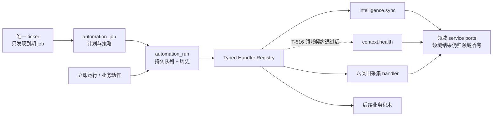
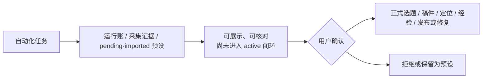
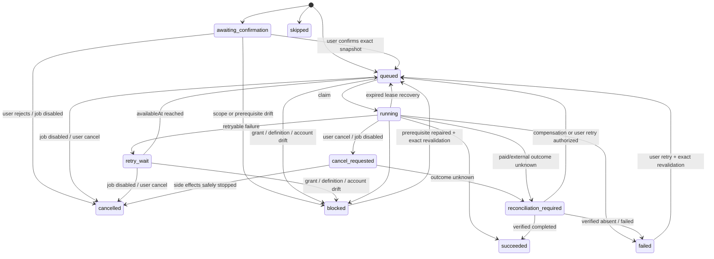

# CreatorOS Automation Kernel 完整替代 PRODUCT SPEC

> Task: `T-517`  
> Stage: `1-plan`  
> Status: `passed（用户确认①）`  
> Scale: `L（系统底座、数据归属与迁移边界变化）`  
> Date: `2026-07-24`  
> Owner: `product-to-code-orchestrator`  
> Source inputs: 用户会话；`DEC-AUTO-001`；T-514/T-516；现网代码核查；[开源方案调研](../../research/2026-07-24-creatoros-automation-kernel-oss-research.md)  
> Replaces: `2026-07-24-content-radar-unified-automation-design.md` 中“把新业务直接扩进旧 scheduled_job/sourceKind”的方案  
> Manifest status: `PLAN passed；进入 CONTRACT；确认②前不得修改生产代码`

## 0. 一句话结论

CreatorOS 要把自动化做成一层内置底座，而不是让内容雷达、收藏采集、上下文健康分别拥有自己的
timer、队列和运行状态。完整目标是：

- `automation_job` 只保存“何时、按什么策略运行哪个 handler”；
- `automation_run` 同时是持久执行队列和用户可见运行历史；
- composition root 只注册 typed handler，不允许数据库脚本或任意用户代码；
- 全仓只有一个 ticker 生产到期 run；
- 现有 `scheduled_job/job_run`、内容雷达 timer 和 `execution_tasks` 收敛到同一真相；
- 应用退出期间诚实地不运行，重启后按策略最多补一次；
- 每一条 job/run 都严格隔离到 `(userId, accountId)`。

大白话版本：底座只负责“到点、排队、防重、重试、恢复、记账”，业务积木负责“到底干什么”。

## 1. Problem statement

现有 `scheduling` 曾为六类定时采集服务，因此它的表、契约、运行状态和触发器都带采集语义。
新增内容雷达后，系统又在 composition root 启动一套 60 秒 timer；同时内容雷达已经实现一套
带 lease/heartbeat/recovery 的 `execution_tasks`。继续按功能补 timer 或扩 `sourceKind` 会造成：

1. **触发真相分裂**：两套 timer 各自判断到期，开关、离线补跑和幂等语义不一致。
2. **执行真相分裂**：`job_run`、`execution_task`、领域 run 各自维护 running/failed，崩溃后无法
   确定哪份才是真的。
3. **业务耦合**：所有新功能都必须伪装成采集源并创建 `ai_task`，即使它是零 LLM 健康检查。
4. **账号风险**：系统扫描、手动触发、后台 claim 若没有统一 ownership 规则，容易漏跑或串号。
5. **可支持性差**：用户只看到“没同步/卡住”，日志却分散在不同 run 表和进程内 fire-and-forget。

这不是“内容雷达再接一个 cron”的局部问题，而是系统底座需要一次完整替换。

## 2. Target users and jobs

### 2.1 目标用户

- **主要使用者**：在 CreatorOS 本地桌面应用中管理一个或多个创作账号的创作者。
- **排障使用者**：需要回答“有没有按时跑、为什么失败、怎么修”的用户本人和客服/研发。
- **内部接入者**：为内容雷达、上下文健康、数据采集、每日选题等业务注册 handler 的开发者。
- **决策者/付费者**：个人版用户本人；本能力不新增独立收费项。

### 2.2 Jobs to be done

- 当应用开着时，我希望该跑的自动任务只跑一次，失败后能按规则恢复。
- 当应用关过一段时间后，我希望系统如实告诉我错过了什么，并只补有意义的一次。
- 当某个任务失败时，我希望看到人话原因和准确入口，而不是只看到“0 条”或永远 running。
- 当我切换账号时，我只看当前账号的计划与历史，另一个账号的配置、payload、结果都不可见。
- 当产品新增一种自动化时，研发只注册一个 handler，不再复制 ticker、重试、run 表和 UI 状态。

### 2.3 非目标用户

- 需要跨机器、7×24 小时云端运行、百万级吞吐的企业工作流平台用户；CreatorOS 当前是本地应用。
- 需要自由编写脚本、搭 DAG、安装第三方插件执行任意代码的自动化玩家；这会越过安全边界。
- 只想把所有后台 Promise 都展示成“自动化”的用户；短暂 UI 请求不应污染可管理的运行历史。

## 3. Core user scenarios

| 场景 | 用户结果 | Independent Test |
| --- | --- | --- |
| `SCN-AUTO-01` 管理计划 | 用户在自动化页查看、启停、调整允许调整的频率，并看到准确下次运行时间 | 用冻结时钟创建两个账号，页面只显示当前账号 job，改频率后 `nextRunAt` 可解释且重启不漂 |
| `SCN-AUTO-02` 到期执行 | 应用运行时，到期 job 只产生一条可追踪 run，并由正确 handler 执行 | 两个并发 tick 争同一 occurrence，只存在一条 run、一个 claim、一个终态 |
| `SCN-AUTO-03` 离线恢复 | 应用退出期间不伪装执行；重启后按 misfire 策略补一次或跳过 | 时钟跨过 10 个 tick 后重启，`run_once` 只补一条 recovery，`skip` 不补并推进下次时间 |
| `SCN-AUTO-04` 手动运行与排障 | 用户点击立即运行，获得真实排队/运行/终态和根因动作 | 相同 requestKey 重试只返回同一 run；失败显示 error code、时间、handler 建议入口 |
| `SCN-AUTO-05` 业务接入 | 内容雷达、上下文健康和旧采集都走同一底座，领域结果仍归各自模块 | 注册 fake handler 与三个代表 handler；证明 Kernel 不 import 领域 repository、不强制建 ai_task |
| `SCN-AUTO-06` 平滑迁移 | 旧计划、开关和可用历史不丢，切换时绝无两个 ticker 同时触发 | 迁移清单/计数/hash 对账，切换测试证明旧 writer 被 fence 后 Kernel 才启用 |
| `SCN-AUTO-07` 无人值守授权 | 用户知道自动任务会出网/写入/产生模型费用，并能撤销；系统不拿旧授权偷跑新配置 | 创建授权后可运行；撤销或改模型/handler 版本后，待执行 run blocked 且不产生副作用 |
| `SCN-AUTO-08` 停用、取消与重试 | 用户能停掉未来计划、取消可取消的运行，并在修好前置条件后安全重试 | disable 后不再生产/claim 新 run；运行中转 `cancel_requested` 并协作停止；重复 retry 不制造第二 run |

## 4. Value & viability

### 4.1 PR-FAQ

**发布日说明**

CreatorOS 现在拥有一套内置 Automation Kernel。过去内容采集、内容雷达和后台任务各自判断“什么时候
该跑”，用户会遇到重复、漏跑、假 running 和不同页面状态不一致。现在系统用一个时钟、一套持久
运行记录和统一恢复规则管理所有自动化；业务能力只作为安全的 handler 积木接入。用户仍在业务页面
管理来源和结果，在自动化页管理全局计划、查看运行历史与修复入口。应用关机时不会假装云端常驻，
重新打开后只补一次有意义的工作。

**FAQ 1：为什么不把现有两个 timer 修修就算了？**

两个 timer 即使各自没有 bug，也无法共同证明“一次计划只跑一次”。每新增一个功能，离线补跑、
账号隔离、重试和排障都会再复制一遍，维护成本会持续上升。

**FAQ 2：为什么不直接安装 pg-boss、BullMQ 或 Temporal？**

它们的成熟语义值得借鉴，但 BullMQ 需要 Redis，Temporal 需要服务端控制面，pg-boss/Graphile
Worker 没有在 PGlite 上直接可用的仓内证据。本地 CreatorOS 只需要小而确定的子集。

**FAQ 3：升级后旧自动化会不会丢？迁移成本是什么？**

旧 job、启停状态和可解释历史必须迁移并对账；旧 API 暂由 compatibility adapter 服务。切换点会
短暂停止触发、完成 fence/对账后启用 Kernel，不要求用户重建计划。旧库能证明用户曾创建/启用同
账号、同来源、同目的地的只读采集计划时，可迁移为同范围的窄采集授权；AI 付费、外部写入、范围
扩大或证据不足时，计划会保留但暂停为“需要重新授权”。系统不会为了“无感升级”伪造高风险授权。
无法安全映射的记录只读保留并明确标记，不能伪造成功迁移。

**FAQ 4：是否新增费用？无人值守任务如何授权？**

Kernel 本身完全本地运行，不新增 CreatorOS 收费项。某个 handler 是否调用模型或第三方服务由该
业务原有规则决定。任何网络、写入或付费副作用都必须声明 effect class；用户创建/启用计划时授予
有版本、有范围、可撤销的执行授权。用户创建/启用采集来源即确认系统持续写入该范围内的证据和
pending/imported 预设；这不是每条数据都弹窗确认，也不等于进入业务闭环。AI/规则生成的选题、
稿件、经验、定位修复等仍只能成为候选，转 active/正式资产或驱动下游前必须由用户确认。每次
claim 前重新校验，授权撤销、配置/handler 版本变化或 effect 未声明都会
进入 blocked，Kernel 不暗中调用模型。要求每次确认的副作用不能无人值守执行。

**FAQ 5：为什么 `automation_run` 既是队列又是历史？**

这样“已经持久交接给执行器”和“用户看见的运行记录”是同一事实，不会再出现 run 显示 running，
真正工作却只存在于内存 Promise 或另一张任务表的情况。

**FAQ 6：能否让用户自己写脚本？**

不能。第一方 handler 必须静态注册、typed payload、经过版本和权限检查。任意脚本、DAG 与插件
执行属于另一种安全模型，不在 CreatorOS 当前产品边界内。

### 4.2 替代品与切换

| 现状方案（含“忍着”） | 哪里不行 | 切换触发器 | 切换成本 |
| --- | --- | --- | --- |
| 忍着不解决 | 每个新业务继续复制 timer/run/recovery，事故只能逐个补丁 | 再出现重复触发、僵尸 running、漏跑或状态不一致 | 零迁移成本；持续损耗可靠性和研发速度 |
| 继续扩旧 `sourceKind` | 快，但所有业务被采集字段、`ai_task` 和采集结果状态绑死 | 接入 `context.health` 等非采集任务时出现语义扭曲 | 较低短期成本，高长期兼容成本 |
| 保留旧 scheduler + 内容雷达 timer | 局部能跑，但有两份到期真相 | 同一来源被两条链同时 enqueue 或启停不一致 | 无迁移；排障与幂等成本不可控 |
| 引入外部队列/工作流产品 | 能力完整，但本地部署、依赖和运维过重 | 真正出现跨机器常驻、高吞吐和长事务工作流 | Redis/服务端/worker 运维与迁移成本高 |
| 内置轻量 Kernel | 覆盖当前需要并复用 PGlite/Drizzle | 当前双调度和 execution task 已证明需要统一 | 一次性 schema、兼容与切换成本 |

### 4.3 被否决的产品形态

| 被否决的形态 | 否决理由 | 翻案信号 |
| --- | --- | --- |
| 把旧采集 scheduler 原地改名为 Automation | 字段、wire、runner 仍是采集语义，只换名不能消除耦合 | 不翻案；只有完整 schema/执行迁移才算底座 |
| 每个业务模块自带 scheduler SDK | 仍会产生多个 ticker 和 run 真相，无法统一 Gate | 产品转为多进程服务且有集中式外部协调器 |
| 直接引入 Temporal/BullMQ/pg-boss 全家桶 | 当前部署和能力需求不匹配，且 PGlite 兼容未证实 | 出现跨机器 7×24、吞吐或多日 workflow 的已确认需求 |
| 给用户开放任意脚本/DAG 编辑器 | 安全、权限、资源隔离和可支持性完全不同 | 产品明确转型为通用自动化平台并单独立项 |
| 永久保留 `automation_run` + `execution_tasks` 两层状态 | 同一执行会有两个 running/attempt/error 真相 | 只有外部 worker 要求独立协议且能证明原子一致性 |

### 4.4 五大风险与 RAT

| 风险 | 判断 + 证据/最强反证 | 最便宜检验方式 | 若错的代价 |
| --- | --- | --- | --- |
| 价值 | 真实代码已有旧 cron 和内容雷达第二 timer；T-207/T-514 已出现僵尸、恢复与补跑需求，不是预测性需求 | **已完成**：只读代码核查与用户明确架构确认 | 致命：继续扩散后每个自动化都不可统一证明 |
| 可用性 | 用户关心“是否运行、何时再跑、怎么修”，不关心 handler/lease；自动化页需隐藏基础设施术语 | BUILD 真页用“正常、登录受阻、离线补跑”三例走查 | 中：底座可靠但用户仍不知道怎么办 |
| 可行性 | 仓内 `execution_tasks` 已有条件 claim、lease、heartbeat、checkpoint、恢复测试；真实 PGlite spike 已证明 occurrence 事务、并发 claim、回滚与 lease recovery 的最小模型成立 | **已完成**：[PGlite RAT](../../research/2026-07-24-automation-kernel-pglite-rat.md) + 既有 PersistentTaskService 6 tests | 致命：若保留双真相，迁移会制造新事故 |
| 商业 | 不直接收费，但减少重复底座开发、客服排障和数据信任损耗 | 上线 30 天比较自动化类报障定位时长和新 handler 接入改动面 | 中：收益不足以覆盖长期底座维护 |
| 依赖 | 依赖 PGlite/Drizzle 事务与桌面进程；真实驱动 RAT 已通过，应用退出期间无法运行是明确产品语义 | **已完成**：PGlite 官方能力调研与真实驱动 RAT；BUILD 仍须把 spike 变成正式 integration test | 高：误把本地应用承诺成云端常驻 |

RAT 结论：所有“若错致命且半天内可检”的 PLAN 假设均已核查。真实 PGlite spike 证明：两个并发
tick 只产一条 occurrence、nextRunAt 只推进一次；事务中模拟崩溃会同时回滚 run 与 nextRunAt；
两个 claim 只有一个 winner；过期 lease 可恢复到 queued。它只证明底层原语可行，不冒充目标实现
已完成；字段级契约、迁移故障注入和正式 integration test 仍登记在 `HARD-AUTO-01/02`。

### 4.5 采纳门槛

| 核心旅程 | 首次价值步骤 | 前置依赖 | 失败时用户看到什么 |
| --- | ---: | --- | --- |
| 查看自动化状态 | 进入自动化页（1 步） | 已有当前账号 | 无账号时引导绑定；不展示其他账号 |
| 立即运行 | 找到卡片 → 立即运行（2 步） | job 已启用或允许手动运行 | 显示排队/去重/阻塞原因，不假成功 |
| 修复失败 | 打开最近运行 → 点击处理动作（2 步） | handler 提供安全 nextAction | 没有动作时显示可复制诊断编号 |
| 调整计划 | 展开卡片 → 选择频率 → 保存（3 步） | user-managed 或 handler 允许调整 | 非法 cron/时区不落库，保留旧配置 |
| 新 handler 接入 | 注册 manifest + service port + tests | typed schema、领域幂等 | 启动自检报未注册/版本不兼容，job 不执行 |

### 4.6 商业假设

如果 CreatorOS 把计划发现、持久执行、恢复和运行回显统一为底座，那么后续自动化接入不再新增
timer/run 表，自动化类故障能在一份 run 中定位。若上线 30 天后仍有新增业务 timer，或同类报障
中超过 20% 仍需跨两种运行记录才能定位，则商业判断失败：停止扩展新 handler，回到 PLAN 修正
底座边界。

### 4.7 Pre-mortem

| # | 六个月后失败的具体死因 | SPEC 级应对 |
| --- | --- | --- |
| 1 | 为赶进度保留旧 cron 和内容雷达 timer，双触发变成“临时永久” | 单 ticker 静态扫描和切换 Gate；旧 writer fence 是完成条件 |
| 2 | `automation_run` 外又永久保留 `execution_tasks`，状态开始漂移 | 目标模型只有一个通用执行实体；兼容层不得成为第二 writer |
| 3 | handler 重试导致重复导入、重复扣费或重复生成候选 | Kernel 只保证 at-least-once；每个 handler 必须声明领域幂等键并过重入测试 |
| 4 | 系统以 UTC/本地时间混算，夏令时或切时区后错跑 | job 持久 timezone + nextRunAt；计算器集中化并用 DST fixture 验证 |
| 5 | 应用关机期间被文案暗示“后台仍会跑” | UI 明示本地语义；startup recovery 独立 trigger kind，不能伪装准时执行 |
| 6 | 内容雷达/上下文健康为了方便直连 Kernel repository | handler 只经 automation runtime port 和领域 service port；boundary Gate 扫跨 repo |
| 7 | 迁移只看总数不看 owner/status，旧多账号记录被错配 | user/account/status/idempotency 分组对账；任一不一致阻断 cutover |

### 4.8 Appetite

愿意用一个重大系统底座任务完成：统一 job/run/registry/ticker、账号隔离、时区与策略、持久
claim/retry/recovery、用户可见运行历史、旧两套调度和 `execution_tasks` 的完整迁移、兼容与
切换 Gate。不能通过“只给旧枚举加两个值”缩小范围；也不扩张到 Redis、云端常驻、任意脚本或 DAG。

## 5. Functional requirements

### `FR-AUTO-01` 单一计划实体

系统用 `automation_job` 表达账号级计划：稳定 handler key、版本化 typed payload、schedule、
timezone、nextRunAt、desiredEnabled/enabled/suspendedReason、misfire/overlap/retry/timeout 和
managedBy。计划不保存业务结果。

**价值注**：删除后，每个业务仍要自建“什么时候跑”的真相。

### `FR-AUTO-02` 单一持久运行实体

`automation_run` 同时承担持久队列和用户可见历史，支持 scheduled/manual/startup_recovery/retry
触发，并用 `awaiting_confirmation/queued/retry_wait/running/cancel_requested/succeeded/failed/
blocked/cancelled/skipped/reconciliation_required` 表达完整状态；attempt、availableAt、claim、
heartbeat、progress、result summary、安全错误和每次状态变化都持久。`jobId` 对纯手动后台动作
可空。misfire/overlap 的“跳过”也必须产生唯一 `skipped` run，不能只写一条易丢日志。

现有 `execution_tasks` 必须迁移/演进为此实体或由单写 compatibility adapter 映射；目标态不得有
第二套通用执行状态机。

**价值注**：删除后，用户看到的 run 与真正执行状态会再次分裂。

### `FR-AUTO-03` 唯一 ticker 与原子 run 生产

生产环境只有一个 Automation ticker 可以发现 `nextRunAt <= now` 的计划。同一数据库事务中创建或
命中 occurrence run，并将 job 的 nextRunAt 推进到未来；dispatcher 只 claim 已提交的 run。

**价值注**：删除后，重复、漏跑和“有记录无执行”无法统一证明。

### `FR-AUTO-04` Typed Handler Registry

handler 以稳定 key、不可静默复用的 `handlerVersion/definitionRevision`、payload schema/version、
默认策略、展示 metadata、effect class、领域写入类别、允许调用的 service operation ID、所需授权
和 execute port 静态注册。Registry 只读装配；数据库不得保存任意代码。运行时只注入 manifest
声明且经 allowlist 的 backend service port，不向 handler 暴露 repository 或通用写库能力。

**价值注**：删除后，新业务仍需修改 scheduler 内部分支并复制基础设施。

### `FR-AUTO-05` 时区、错过与重叠策略

- 所有计划以 job.timezone 计算并持久 nextRunAt，不使用进程隐式本地时区。
- `misfire=run_once`：重启时最多补一条 recovery；`skip`：只推进到未来并记录 skipped reason。
- `overlap=skip`：已有 active/waiting run 时创建唯一 skipped run；`queue_one`：最多保留一个后继。
- DST 缺失/重复小时必须由集中计算器给出确定结果并可测试。

**价值注**：删除后，本地应用离线、切时区和长任务会产生不可解释的重复或漏跑。

### `FR-AUTO-06` 重试、claim 与恢复

run 使用数据库条件更新获得独占 claim，lease/heartbeat/attempt 均持久。可重试错误按 handler
policy 和 backoff 在同一 run 增 attempt；不可重试进入 failed/blocked。进程重启按 process epoch
和过期 lease 恢复，不再只靠“运行超过 30 分钟”猜测。

**价值注**：删除后，崩溃会留下永久 running 或重复 worker。

### `FR-AUTO-07` 幂等与副作用边界

- scheduled occurrence：`(userId,accountId,jobId,scheduledFor)` 唯一；
- manual request：`(userId,accountId,handlerKey,requestKey)` 唯一，同时持久
  `manualRequestFingerprint = hash(jobId?,handlerKey,manifestAuthorizationFingerprint,
  payloadSnapshotFingerprint,configSnapshotFingerprint,grantId?,grantRevision?,
  occurrenceFingerprint?)`；同 key 同
  fingerprint 返回原 run，同 key 不同 fingerprint 返回 409 `IDEMPOTENCY_CONFLICT`，不得误命中；
- retry 复用同一 run，保留 attempt 历史；
- Kernel 承诺 at-least-once，不承诺领域副作用 exactly-once；
- 每个 handler manifest 必须声明 domain idempotency strategy，缺失则不能注册。
- effect class 必须是 `local_read | local_write | network_read | ai_paid | external_write` 的显式集合；
  未声明或执行时发现更高 effect 必须 fail closed。

**价值注**：删除后，重试会重复导入、扣费或创建候选。

### `FR-AUTO-15` 无人值守执行授权

每个 handler 声明 `authorizationMode = none | grant_at_enable | confirm_each_run` 与所需 effect scopes。
用户创建/启用 `grant_at_enable` 计划时必须看到目的、数据范围、网络目的地/模型、可能费用和可撤销
说明，确认后产生账号级 `AutomationGrant`；run 固化 `grantId/grantRevision/handlerVersion/
definitionRevision/payloadVersion/manifestAuthorizationFingerprint/payloadSnapshot/configSnapshot/
effectSnapshot/destinationSnapshot`。snapshot 是经过 schema 规范化的 typed 输入；secret 只保存
opaque ref，不保存明文，确保 job 修改后 run 仍能按当时输入恢复。规范化
`manifestAuthorizationFingerprint` 必须覆盖 handlerVersion、definitionRevision、payloadVersion、
schema digest、domainWriteClass、authorizationMode、effect scopes、destination、operationIds、
domain idempotency、retry/cancel/timeout policy。claim 前必须与未撤销的当前 grant 和 manifest 精确
匹配。撤销、账号隐藏、模型/凭据变更或任一 fingerprint/version 漂移，
都会让尚未执行的 run 转 `blocked` 并给出重新授权入口。`confirm_each_run` 的 scheduled occurrence
只能先进入 `awaiting_confirmation`；其单次 Grant 必须绑定 `runId + occurrenceFingerprint`，
`singleUse=true`。这里的 single-use 表示 Grant 只属于该 run/occurrence，不表示一次 run 只能做一个
分页/item effect。用户确认、Grant 绑定和 run 转 queued 在同一事务完成；claim 以 CAS 校验该 Grant
只属于当前 run 且未撤销；浏览器/HTTP/模型/领域写均经 effect broker，在每个真实副作用前原子
reserve append-only effect ledger，首个 effect 同时写 `firstEffectAt`。同 run 多 effect 各有稳定
fingerprint/receipt，后续 occurrence 不得复用该 Grant。
`external_write` 默认属于该模式，除非另有经过评审的领域 DEC。执行超时后无法确定付费/外部副作用发生时，进入
`reconciliation_required`，停止自动 claim/retry，等待用户或领域 reconciliation 动作。

**价值注**：删除后，无人值守计划可能越过用户确认，暗中出网、写入或产生费用。

### `FR-AUTO-08` 账号严格隔离

所有 job/run、查询、命令、claim payload 和领域调用都带 `userId + accountId`。用户入口必须用当前
账号 scope；system iterator 可枚举 active scope，但每个 job 的 tuple 必须完全相等。账号状态
读取失败时 fail closed，不可降级跨号执行。

**价值注**：删除后，多账号用户可能看到或执行另一个账号的自动化。

### `FR-AUTO-09` 用户管理与诚实状态

自动化页按当前账号展示：

- job 标题、业务说明、开关、允许调整的频率、时区、下次运行；
- 最近一次真实状态和“立即运行”；
- 运行详情：触发类型、排队/开始/完成时间、attempt、进度、结果摘要、错误与 nextAction；
- 本地应用退出期间不会运行的说明。

system-managed job 不可删除或改 handler/payload；user-managed job 只能通过 handler manifest 暴露的
可编辑字段修改。所有按钮必须真实有效。

**价值注**：删除后，底座虽运行，用户仍无法管理或修复。

### `FR-AUTO-10` 领域页面保留业务所有权

自动化页只管 job/run 基础状态。内容雷达继续管理来源周期、登录、来源级运行与作品；上下文健康
继续在设置中管理报告和修复；旧采集继续在对应数据页面解释结果。Kernel 的 result summary 只保留
typed reference 与安全计数，不复制领域真值。

**价值注**：删除后，自动化页会变成包含所有业务细节的第二套产品。

### `FR-AUTO-11` 代表 handler 完整接入

完整目标至少迁入：

1. 六类旧采集：`self.metrics/self.detail/comments/benchmark/topic.daily/favorites`；
2. `intelligence.sync`：每账号一个聚合作业，扫描到期来源并创建领域子 run；
3. 现有 `execution_tasks` 的 `source_sync/share_import/transcribe/topic_preview/script_candidate/migration`
   作为手动或子 run handler，证明通用执行真相已收口。
4. 为后续 T-516 提供 `context.health` 的 typed conformance fixture，证明零 LLM、每周计划、立即运行
   与 blocked nextAction 能被 Kernel contract 表达；但在 T-516 的领域 scanner/report 契约和确认②
   通过前，不注册生产 handler、不创建 job、不显示开关或“立即检查”按钮。

必迁 handler 的取消、重试与 reconciliation 不是可选展示能力：

| Handler 组 | 取消 | 安全重试 | Reconciliation / 终态证据 |
| --- | --- | --- | --- |
| `self.metrics/self.detail/comments/benchmark/favorites` | 每页/每作品 checkpoint 检查 cancel；浏览器/子进程关闭完整进程树 | source cursor + 外部 ID/快照幂等 upsert | sourceRef/asOf/count/hash；登录/限流为 blocked，不盲重试 |
| `topic.daily/topic_preview/script_candidate` | 持久 cancel request；可取消 provider 请求则中止，否则结果只能留 discarded candidate，不得采纳 | 先核对付费调用是否已完成；候选用 stable result key 去重 | usage/provider requestId/result hash；费用未知进 reconciliation_required |
| `intelligence.sync` | 每个来源边界检查 cancel，不再派发新 child run | child occurrence key 去重，聚合可从 child run 重建 | scanned/enqueued/deduped/blocked 计数与 child refs |
| `source_sync/share_import` | 页/条目 checkpoint；浏览器与下载进程树可终止 | source/item idempotency + checkpoint 续跑 | 来源快照、item refs、部分成功清单 |
| `transcribe` | 本地 ASR 杀完整进程树；云端请求记录 cancel/unknown | artifact/source hash 去重；已有 transcript 不重复提交 | process exit/cloud requestId/artifact hash；云端未知进入 reconciliation_required |
| `migration` | 只在事务批次边界取消，不中断已提交原子批次 | generation + checkpoint + mapping hash 恢复 | before/after count/hash、CompatibilityMapping 和失败批次 |

上述均视为长任务，manifest 必须 `cancellable=true,retryable=true`，但“可重试”不等于任何错误都自动
重试；是否自动 retry 仍由错误分类和副作用确定。只有 CONTRACT 证明 P95 小于 1 秒、单事务且没有
外部副作用的 handler 才可 `cancellable=false`，仍必须有 timeout、明确终态和人工恢复动作。

**价值注**：删除后，Kernel 只是新壳，旧双系统仍然存在。

### `FR-AUTO-12` 内容雷达双层交互

每账号只在自动化页显示一个 `intelligence.sync` 聚合作业；内容雷达每个来源仍设置手动/每日并可
直接点击同步。手动来源同步直接创建 Kernel child run，不要求用户跳到自动化页。单个来源 blocked
不拖死其他来源，聚合 run 显示 scanned/enqueued/deduped/blocked 真实计数并链接来源详情。

**价值注**：删除后，来源越多自动化页越膨胀，或用户失去单来源控制。

### `FR-AUTO-13` 一次切换、兼容与迁移

迁移必须覆盖 job、run、execution task、owner、开关、计划、状态、idempotency 和可解释历史：

1. 安装 Kernel schema、迁移 generation/fence 和 compatibility 代码，Kernel ticker 默认关闭；
2. 进入短暂 maintenance：先 fence 所有旧 enqueue/update 入口并停旧 scheduler/内容雷达 timer，新请求
   明确返回“系统升级中，请重试”，不伪成功；
3. 等待已 claim 的旧任务到终态；超时任务按既有 checkpoint/lease 规则安全停在可迁移状态；
4. 在旧 writer 已静止后做最终一致快照：将 `execution_tasks` 演进/迁入 `automation_run`，迁移
   `scheduled_job/job_run` 并更新领域引用或安装单写 compatibility view；
5. 迁移授权时，旧记录中“用户创建/启用了同账号、同来源、同目的地的只读采集计划”可作为
   `verifiable_ingestion` 持续确认的审计证据；迁移器生成窄范围 Grant 并保存 provenance。AI 付费、
   external_write、写入范围扩大或无法证明同范围的旧 job 不得借此升级授权，默认保留
   `desiredEnabled=true`、实际 `enabled=false,suspendedReason=reauthorization_required`，由用户
   确认一次后恢复；
6. 对账 user/account/handler/status/idempotency/count/hash，以及 grant 总数、scope、fingerprint、
   revision、revoked/suspended 状态；任一不一致保持 Kernel 关闭；
7. 原子切换 compatibility API 到新 writer，确认旧 ticker/writer 仍 fenced 后才启 Kernel ticker；
8. 无法迁移的记录只读留档并报告，不能伪成 succeeded。

回退边界：在第 7 步前失败，可丢弃未启用的新目标表并解除旧 fence，旧库仍是唯一真相；第 7 步后
一旦新 writer 接受写入，只允许 forward-fix 或从切换点全库备份恢复，禁止重新开启旧 writer 造成
分叉。故障注入必须覆盖“fence 后迁移失败”“API 已切换但 ticker 启动失败”两点。

**价值注**：删除后，升级可能丢计划、重复触发或长期保留双真相。

### `FR-AUTO-14` 基础设施门卫

reconcile/boundary Gate 必须扫描生产代码中的业务级 `setInterval`、cron、due scanner 和平行通用 run
状态机。新增 timer 必须登记为纯 UI poll/heartbeat 等明确例外；未登记业务 ticker 阻断完成。

**价值注**：删除后，新底座会很快再次被旁路。

### `FR-AUTO-16` 停用、取消与人工重试

- 停用 job 必须在一个事务中写 `enabled=false,nextRunAt=null`；对应
  `awaiting_confirmation/queued/retry_wait` run 转 `cancelled(reason=job_disabled)`，running 转
  `cancel_requested`，dispatcher 不再 claim 该 job 的新 run。
- `cancel_requested` 是协作取消：handler 必须在 heartbeat/checkpoint 检查 token；子进程 handler
  还要终止自己的进程树。确认副作用未发生或已安全收口后转 `cancelled`；无法确认则转
  `reconciliation_required`，不得假装取消成功。
- 重新启用只按当前时区重新计算 `nextRunAt`，不复活旧 cancelled run。撤销 grant 与停用 job 是
  两个动作，UI 必须明确区分。
- 用户只可对 manifest 标记为 retryable 且已修复前置条件的 failed/blocked run 点击重试；重试复用
  原 run 并追加 attempt/event，claim 前重新校验 owner、definition、fingerprint 与 grant。重复取消、
  停用或重试命令均幂等。

**价值注**：删除后，“关掉自动化”和“停掉正在做的事”会被混为一谈，用户也无法安全自救。

### `FR-AUTO-17` 自主执行写入边界

`AutomationGrant` 只授权执行已说明的副作用，不是绕过 `P-01 人工确认门` 的通行证。handler 必须
选择且只能选择一种 `domainWriteClass`：

| 类别 | 无人值守可写内容 | 禁止内容 | 代表 handler |
| --- | --- | --- | --- |
| `operational_record` | automation run/event/checkpoint/诊断等基础设施事实 | 任意领域实体 | Kernel 内部 |
| `verifiable_ingestion` | 用户已委托来源返回的不可变原始证据、来源快照、指标/评论/作品明细及其幂等引用；以及严格 `source=imported`、带 canonical publication/sourceRef/asOf/owner 的历史作品预设投影 | 把 imported 预设转 manual/active；创建正式稿件/经验；发布、删除或对证据做自主结论 | `self.metrics/self.detail/comments/benchmark/favorites/intelligence source_sync` |
| `candidate_only` | 候选、decision 或 manifest，状态只能待用户采纳 | active 领域资产、当前定位、已验证经验、正式稿件/发布物 | `topic.daily/topic_preview/script_candidate/context.health repair` |
| `confirmed_domain_write` | 用户对本次具体动作确认后，由 backend service 写入 | 无逐次确认的 scheduled 写入 | 发布、删除、采纳、应用修复 |

用户创建或启用账号级来源/采集计划，就是对清单内未来 evidence/preset 的持续确认，不要求每条指标、
评论或 imported 历史作品逐次确认。这里对 `P-01` 与 `R-INGEST` 的产品裁决是：平台可验证的采集
证据、运行账和 pending/imported 预设不是 active 业务闭环；只有被采纳、转 active、形成当前定位/
正式选题/稿件/经验、执行发布/删除/修复或被下游当作已确认结论使用时才需要本次人工确认。
Manifest 必须声明具体 operation allowlist；runtime capability port 按
`domainWriteClass + effectScopes + operationIds` 三重取交集，未声明、越级或目标不匹配立即 blocked。
CONTRACT 必须逐个列出代表 handler 的输出类型与 service operation，并用负向测试证明候选无法写
active 资产。若后续产品要放宽这条边界，必须先修改产品宪法并新增独立 DEC，不能只改 grant。

**价值注**：删除后，统一自动化会变成绕过候选确认门的统一后门。

## 6. Non-functional requirements

| ID | 要求 |
| --- | --- |
| `NFR-AUTO-01` | **持久一致性**：job occurrence 生产、nextRunAt 推进和 run 唯一性在同一事务；崩溃点测试不得产生“推进了但无 run”。 |
| `NFR-AUTO-02` | **隔离**：所有用户 API 与 repository 条件均同时限定 userId/accountId；双账号 fixture 必须覆盖读、写、立即运行、claim 和迁移。 |
| `NFR-AUTO-03` | **可恢复**：任意 claim 后杀进程，重启在 lease 到期后的 2 个 ticker 周期内恢复或收终态；不得永久 running。 |
| `NFR-AUTO-04` | **性能**：2,000 jobs / 10,000 retained runs 的本地基线下，due scan P95 < 250ms，当前账号列表 P95 < 300ms；ticker 不阻塞 UI 请求线程。 |
| `NFR-AUTO-05` | **资源有界**：每 job 同时最多一个 active run 和一个 waiting successor；日志/run/event retention 有明确策略，不能无限内存队列。 |
| `NFR-AUTO-06` | **可支持性**：用户隔天报障时，可凭 runId 还原 handler/definition/grant 版本、owner hash、trigger、scheduledFor、fingerprint、attempt、状态时间线、安全错误和 nextAction；本地日志/运行历史保留至少 30 天，敏感 payload 不进日志。 |
| `NFR-AUTO-07` | **安全**：静态 registry、Zod payload、handler allowlist、版本化 AutomationGrant 与 claim 前复核；run snapshot 经 schema 规范化且 secret 只存 opaque ref；不得执行数据库脚本/用户代码；错误详情不得泄露 cookie、token、跨号正文。 |
| `NFR-AUTO-08` | **兼容**：迁移后旧自动化 UI/API 的核心读写和立即运行行为保持可用；兼容期结束条件在 SHIP 决定，不在 BUILD 偷删。 |
| `NFR-AUTO-09` | **时间正确性**：UTC、Asia/Shanghai、America/Los_Angeles 的 DST/切时区 fixture 全绿；UI 时间与持久 nextRunAt 使用同一 timezone。 |
| `NFR-AUTO-10` | **可测试性**：clock、processEpoch、claim、registry、handler ports 可注入；单测不启动真实 ticker，真 PGlite integration 覆盖事务与并发。 |
| `NFR-AUTO-11` | **诚实本地语义**：完全退出期间不宣称已执行；startup recovery 必须单独标识，0 结果不得伪造成“同步成功有内容”。 |
| `NFR-AUTO-12` | **可演进**：payloadVersion 不匹配时 run blocked 并给迁移动作；handler key 一旦持久使用不得静默改义。 |
| `NFR-AUTO-13` | **最小写权限**：handler 运行时只能取得 manifest 声明、grant 覆盖且与 domainWriteClass 相容的 typed service operations；越权测试必须 fail closed，AI/自主判断不得写 active 领域资产。 |

## 7. Business flow

### `FLOW-AUTO-01` 计划到期

触发：唯一 ticker 发现 `nextRunAt <= now`。  
流程：按 owner scope 读取 job → 事务内用 occurrence key 创建 queued/awaiting_confirmation/skipped
run 或命中既有 → 固化脱敏 typed payload/config snapshot 与完整 manifestAuthorizationFingerprint、
effect/destination/grant 快照 → 计算并推进 nextRunAt →
提交 → dispatcher claim → registry 校验 definition、domainWriteClass 与当前 AutomationGrant →
按 operation allowlist 注入最小 service port → heartbeat/progress/event → 终态。  
异常：未知 handler/version/授权 blocked；事务失败不推进；claim 失败由后续 ticker 重试。  
结果：一个 occurrence 对应一条可追踪 run。

### `FLOW-AUTO-02` 立即运行

触发：用户在自动化或领域页面点击真实按钮。  
流程：验证账号、effect 与授权 → 生成/接收 requestKey、typed snapshot 与
manualRequestFingerprint → 创建 queued 或 awaiting_confirmation manual run；逐次确认时，在同一
事务把 single-use Grant 绑定 run/occurrence 并转 queued → 返回真实状态 → 同一 dispatcher 执行。  
异常：同 key 同 fingerprint 重复点击返回同一 run；同 key 不同 fingerprint 返回 409
`IDEMPOTENCY_CONFLICT`；被禁用但允许手动的策略由 manifest 明示，不允许则 409 并解释。  
结果：手动和定时共用执行、错误与历史。

### `FLOW-AUTO-03` 重试与重启恢复

触发：retryable error、lease 过期或 app 重启。  
流程：核对 process epoch/attempt → 可重试则同 run 转 retry_wait、设置下一 availableAt 并追加
event → 到时转 queued 后重新 claim；超过上限 failed。计划错过按 misfire 产生一条 recovery 或
唯一 skipped run 并推进。  
结果：无永久 running，不制造一串历史补跑。

### `FLOW-AUTO-04` 内容雷达聚合

触发：`intelligence.sync` 定时/手动 run。  
流程：严格当前账号扫描到期来源 → 对每个 occurrence 用领域幂等键创建 child run →
分别记录 enqueued/deduped/blocked → 聚合 run 到 succeeded/partial/blocked 的用户语义映射
（底层终态仍使用通用有限状态，结果摘要表达 partial）。  
结果：自动化看聚合，内容雷达看每个来源。

### `FLOW-AUTO-05` 迁移切换

触发：安装包含 Kernel 的升级。  
流程：安装 dormant schema/fence → 先停旧生产者并等待在途任务收口 → 最终一致快照迁移 →
按可审计证据迁移 grant；无充分证据的旧 enabled job 暂停待重新授权 →
逐 owner/status/idempotency/hash/grant scope/fingerprint 对账 → 原子切 compatibility API →
验证唯一 writer/ticker → 启 Kernel → canary。  
异常：第 7 步前失败则 Kernel 保持关闭并可解除旧 fence；新 writer 接受写入后只 forward-fix 或全库
恢复，不重启旧 writer。  
结果：无丢失、无双写、可诊断。

### `FLOW-AUTO-06` 授权建立、复核与撤销

触发：用户创建/启用含网络、写入或付费 effect 的 job，或 handler/config/model 版本变化。  
流程：展示目的、范围、目的地/模型和费用 → 用户确认 → 创建版本化 AutomationGrant →
run 保存 typed payload/config 与完整 manifest/grant/effect/destination 快照 → 计划级 grant 每次
claim 精确复核；逐次 grant 原子绑定当前 run/occurrence；每个真实副作用先进入 effect ledger
预约，再调用 provider/领域 port，同一 run 可有多个分页/item effect，但其他 run 不可复用该 grant。  
异常：撤销/漂移/未知 effect → 待执行 run 转 blocked；`confirm_each_run` 先
awaiting_confirmation；外部结果不确定 → reconciliation_required，不自动 retry。  
结果：无人值守执行没有“永久通行证”，且撤销真实生效。

### `FLOW-AUTO-07` 停用、取消与人工重试

触发：用户关闭计划、取消运行、修复前置条件后点击重试，或系统撤销 grant。  
流程：命令校验 owner 与当前版本 → 停用事务清空 nextRunAt 并取消未 claim run；running 写
cancel_requested → handler 在 checkpoint 协作停止并追加 event → 安全则 cancelled，不确定则
reconciliation_required。人工 retry 在复核 handler/fingerprint/grant 后复用原 run、追加 attempt，
转 queued/retry_wait。重新启用只生成新的未来 occurrence。  
异常：不支持取消/重试时按钮不出现；重复命令命中同一状态；账号、版本或 grant 漂移时 blocked。  
结果：用户知道“以后不再跑”“当前正在停”“已经停下”“结果仍需核对”的区别。

## 8. Domain model

### `ENT-AUTO-01 AutomationJob`

关键字段：`id,userId,accountId,handlerKey,payload,payloadVersion,scheduleKind,cron,timezone,nextRunAt,
desiredEnabled,enabled,suspendedReason?,misfirePolicy,overlapPolicy,retryPolicy,timeoutMs,managedBy,
createdAt,updatedAt`。`desiredEnabled` 记录用户期望；`enabled` 是当前能否生产 run；`suspendedReason`
至少区分 `reauthorization_required/account_unavailable/dependency_unavailable`，不得与用户主动关闭
混为一谈。重授权成功时，在同一事务写 Grant、清 suspendedReason、令
`enabled=desiredEnabled` 并重算 nextRunAt。  
生命周期：created → enabled/disabled/suspended → archived；system-managed 不可删除或换 handler。  
关系：一对多 `AutomationRun`。

### `ENT-AUTO-02 AutomationRun`

关键字段：`id,userId,accountId,jobId?,handlerKey,triggerKind,scheduledFor?,requestKey?,dedupeKey,
occurrenceFingerprint?,manualRequestFingerprint?,handlerVersion,definitionRevision,payloadVersion,
manifestAuthorizationFingerprint,payloadSnapshot,configSnapshot,grantId?,grantRevision?,
effectSnapshot,destinationSnapshot,status,statusRevision,availableAt,attempt,maxAttempts,
processEpoch?,leaseOwner?,leaseExpiresAt?,heartbeatAt?,progress?,resultSummary?,errorCode?,
errorMessage?,retryable?,startedAt?,finishedAt?,createdAt,updatedAt`。  
状态：

`succeeded/failed/blocked/cancelled/skipped/reconciliation_required` 是用户可见终止/停驻结果；
`reconciliation_required` 不可被 dispatcher 自动 claim，只有显式 reconciliation 解决后才能形成
补偿或人工重试。所有状态转换使用 expected `statusRevision` CAS；status/attempt/lease 的变化与对应
`AutomationRunEvent` 必须在同一数据库事务提交，不得出现“状态已变、时间线缺失”。

下表是 CONTRACT 必须逐条编码的权威转换面；图只用于阅读，不能代替 guard：

| From | To | Trigger / guard | Event | 可自动 claim |
| --- | --- | --- | --- | --- |
| create | awaiting_confirmation | confirm_each_run + exact occurrence snapshot | awaiting_confirmation | 否 |
| create | queued | none/grant_at_enable 校验通过 | queued | 是 |
| create | skipped | misfire/overlap 决策 + occurrence unique | skipped | 否 |
| awaiting_confirmation | queued | 用户确认；single-use Grant 绑定和转态同事务 | confirmed | 是 |
| awaiting_confirmation/queued/retry_wait | blocked | owner、account、definition、grant 或依赖漂移 | blocked | 否 |
| awaiting_confirmation/queued/retry_wait | cancelled | 用户取消或 job disabled；expected revision 匹配 | cancelled | 否 |
| queued | running | lease CAS 成功、当前 snapshot/grant 精确匹配 | claimed | 否 |
| running | retry_wait | retryable、attempt 未超限、无未知外部副作用 | retry_scheduled | 否 |
| retry_wait | queued | availableAt 到期且重新校验通过 | retry_ready | 是 |
| running | queued | lease 过期、checkpoint 可安全重入 | lease_recovered | 是 |
| running | cancel_requested | 用户取消/job disabled，handler 支持协作停止 | cancel_requested | 否 |
| running/cancel_requested | reconciliation_required | 付费/外部副作用结果未知 | reconciliation_required | 否 |
| running/cancel_requested | succeeded/failed/blocked/cancelled | handler 给出可证明终态 | 对应 terminal event | 否 |
| failed/blocked | queued | 人工重试、前置已修复、完整 snapshot/grant 重校验 | manual_retry | 是 |
| reconciliation_required | succeeded/failed | 人工/领域查询得到确定外部结果 | reconciled | 否 |
| reconciliation_required | queued | 用户授权补偿或安全重试，生成新 attempt | compensation_retry | 是 |

每条命令均以 `(runId,expectedStatusRevision,commandKey)` 幂等；重复命令返回当前状态，不重复追加语义
相同的事件。dispatcher 只扫描表中“可自动 claim=是”的状态。

### `ENT-AUTO-03 HandlerManifest`

代码内只读资源：`key,handlerVersion,definitionRevision,payloadVersion,inputSchema,
defaultPolicies,presentation,effectClasses,domainWriteClass,authorizationMode,requiredGrantScopes,
operationIds,capabilities,domainIdempotency,cancellable,retryable,execute`。不入数据库脚本，不持有
领域 repository。

### `ENT-AUTO-04 AutomationAttempt`

逻辑子记录，可在 run 的 append-only attempt event/字段中实现，CONTRACT 决定物理形态。至少可还原
attempt、claim 时间、worker/process epoch、heartbeat、错误、结束时间；不得用覆盖写抹掉前次证据。

### `ENT-AUTO-05 CompatibilityMapping`

迁移/兼容账：旧表/旧 ID → 新 job/run ID、owner、校验 hash、迁移状态、错误。只用于迁移审计，
不成为第二执行真相。

### `ENT-AUTO-06 AutomationGrant`

关键字段：`id,userId,accountId,jobId?,runId?,occurrenceFingerprint?,handlerKey,handlerVersion,
definitionRevision,payloadVersion,manifestAuthorizationFingerprint,effectScopes,destination/modelRefs,
payloadFingerprint,configFingerprint,effectSnapshot,destinationSnapshot,operationIds,domainWriteClass,
singleUse,firstEffectAt?,grantedAt,revokedAt?,grantRevision,provenance`。逐 effect 的
`operationId/effectFingerprint/destination/providerRequestId/receipt/certainty` 存 append-only ledger。
run 保存逐字段快照；执行前仍精确
复核当前 grant。`confirm_each_run` 必须 single-use 且绑定 run/occurrence；计划级采集 Grant 必须在
provenance 中保存用户创建/启用来源的审计锚。Grant 不等于领域闭环确认，AI 候选的采纳门保持不变。

### `ENT-AUTO-07 AutomationRunEvent`

append-only 运行事件：`id,runId,userId,accountId,type,eventSequence,beforeStatusRevision,
afterStatusRevision,fromStatus?,toStatus?,attempt,occurredAt` 及按 type 强制的证据字段。至少覆盖
created、awaiting_confirmation、claimed、heartbeat、progress、
retry_scheduled、lease_recovered、cancel_requested、cancelled、skipped、blocked、reconciliation
和所有终态；`safeDetails` 不保存 cookie/token/正文。它承载状态时间线、跳过原因和迁移证据，不成为
第二个可 claim 队列。

## 9. Information architecture

### `IA-AUTO-01 自动化页`

服务 `FLOW-AUTO-01/02/03/06/07`。按当前账号展示：

- 顶部：本地运行说明、全局健康摘要；
- “系统自动化”：已注册且领域能力可执行的内容雷达、系统托管采集等，卡片可折叠；
- “我的自动化”：现有用户创建的模板 job；
- “最近运行”：统一时间线，可按状态/handler 筛选；
- 运行详情抽屉：时间线、结果摘要、错误、人话 nextAction、跳转业务页，以及只有 manifest 真实支持
  时才出现的“取消”“重试”“重新授权”“核对结果”动作；

默认只展开异常和正在运行的卡片，避免 job 增多后页面无限拉长。

### `IA-AUTO-02 领域页面入口`

服务 `FLOW-AUTO-02/04`。内容雷达来源卡、数据采集页保留“立即同步”和领域详情；点击后创建
Kernel run，并可跳统一运行详情。设置中的“AI 对我的理解”只有在 T-516 领域 scanner/report
通过自己的 CONTRACT Gate 后才出现“立即检查”，本任务不得提前画假按钮。

### `IA-AUTO-03 设置与诊断`

只放系统级说明与高级诊断：timezone 来源、运行历史保留、导出安全诊断、Kernel 版本。普通用户不必
理解 claim/lease/process epoch。

## 10. Complete target product and hard problems

本 SPEC 承诺完整替代目标，不做 V0.1/V0.2 切割。下表是实现依赖，不是可删范围。

| HARD ID | Blocker / hard part | Involved FR/NFR | Solved in stage | Owning PKG |
| --- | --- | --- | --- | --- |
| `HARD-AUTO-01` | PGlite/Drizzle 中 occurrence 生产、nextRunAt 推进和 claim 的真实原子/并发语义 | FR-AUTO-03, FR-AUTO-06, FR-AUTO-07, NFR-AUTO-01, NFR-AUTO-10 | CONTRACT + BUILD integration | `PKG-AUTO-KERNEL` |
| `HARD-AUTO-02` | `execution_tasks` 演进为单一 `automation_run`，保留领域引用、lease、event 和历史且不双写 | FR-AUTO-02, FR-AUTO-11, FR-AUTO-13, FR-AUTO-16, NFR-AUTO-03, NFR-AUTO-08 | CONTRACT + BUILD migration | `PKG-AUTO-MIGRATION` |
| `HARD-AUTO-03` | 旧 scheduled job/run 六类迁移与 compatibility API，切换时绝无双 ticker | FR-AUTO-11, FR-AUTO-13, FR-AUTO-14, NFR-AUTO-08 | CONTRACT + BUILD + SHIP canary | `PKG-AUTO-CUTOVER` |
| `HARD-AUTO-04` | timezone/DST/misfire/overlap 的确定算法和 UI 解释 | FR-AUTO-05, NFR-AUTO-09, NFR-AUTO-11 | CONTRACT + BUILD | `PKG-AUTO-TIME` |
| `HARD-AUTO-05` | at-least-once 下每个 handler 的领域幂等、版本化授权、最小写权限与费用/外部副作用 reconciliation | FR-AUTO-04, FR-AUTO-07, FR-AUTO-11, FR-AUTO-15, FR-AUTO-17, NFR-AUTO-07, NFR-AUTO-13 | CONTRACT handler checklist + BUILD | `PKG-AUTO-HANDLERS` |
| `HARD-AUTO-06` | system iterator 与多账号 fail-closed 隔离、迁移 owner 对账 | FR-AUTO-08, FR-AUTO-13, NFR-AUTO-02 | CONTRACT + BUILD security tests | `PKG-AUTO-OWNERSHIP` |
| `HARD-AUTO-07` | 自动化页统一状态但不吞掉领域详情，异常/折叠/取消/重试/nextAction 可用 | FR-AUTO-09, FR-AUTO-10, FR-AUTO-12, FR-AUTO-16, NFR-AUTO-06 | DESIGN + BUILD browser validation | `PKG-AUTO-UX` |
| `HARD-AUTO-08` | 生产 timer/平行 run 状态的静态门卫，区分合法 UI poll 与业务 ticker | FR-AUTO-14 | CONTRACT rule + BUILD reconcile | `PKG-AUTO-GATE` |

## 11. 现成方案 / OSS 调研

| 能力点 | 候选 | 覆盖度 | 证据 | 采用 / 不采用 |
| --- | --- | --- | --- | --- |
| PostgreSQL durable queue | pg-boss | partial | [官方仓库](https://github.com/timgit/pg-boss) | 借事务 enqueue、claim、retry；不直接装，PGlite 兼容未证实 |
| typed task registry / job key | Graphile Worker | partial | [官方文档](https://worker.graphile.org/)、[job key](https://worker.graphile.org/docs/job-key) | 借 task identifier、registry、backfill/job key；不引完整 schema/runtime |
| scheduler/run 分离 | BullMQ Job Schedulers | partial | [官方文档](https://docs.bullmq.io/guide/job-schedulers) | 借 scheduler 生产 run；不引 Redis |
| crash-proof workflow | Temporal / DBOS | partial | [Temporal](https://docs.temporal.io/)、[DBOS](https://docs.dbos.dev/architecture) | 借“先持久后执行”；当前不引服务/工作流控制面 |
| 本地 PostgreSQL 能力 | PGlite | partial | [About](https://pglite.dev/docs/about)、[API](https://pglite.dev/docs/api) | 采用现有 PGlite/Drizzle；真实 integration Gate，不假设完全等同远程 PG |
| 仓内持久任务 | `PersistentTaskService` | strong partial | `backend/src/modules/execution/persistent-task.service.ts:24-136,267-338,452-536,665-728` | 上收/演进为 AutomationRun，不永久保留第二状态机 |
| 仓内旧 scheduler | scheduled collection scheduler | partial | `backend/src/modules/ai-runtime/scheduled-collection-scheduler.ts:251-341` | 复用测试经验与兼容；替换采集耦合/本地时区/fire-and-forget |

## 12. 现网事实 / 仓内已有实现

| 断言 | 类型 | 证据 | 结论 |
| --- | --- | --- | --- |
| 旧 job schema 强制采集字段 | 已存在 | `backend/src/schema/scheduling.ts:28-47` | 不原地冒充通用底座 |
| 旧 contract 只有六类 sourceKind | 已存在 | `contract/src/primitives.ts:179-186` | 旧 API 走兼容映射，新业务用 handler key |
| 旧触发器固定创建 ai_task 并 fire-and-forget | 已存在 | `backend/src/modules/ai-runtime/scheduled-collection-scheduler.ts:170-212` | Kernel 不强制 AI；run 先持久再 claim |
| 旧 ticker 每分钟按进程本地 Date 匹配 cron | 已存在 | `backend/src/modules/ai-runtime/scheduled-collection-scheduler.ts:276-341` | 改为 timezone + nextRunAt 真相 |
| 内容雷达有第二个 60 秒 timer | 已存在 | `frontend/src/server/persistence-client.ts:5677-5718` | cutover 时删除/禁止 |
| execution_tasks 已有 owner、lease、heartbeat、attempt | 已存在 | `backend/src/schema/intelligence.ts:129-151` | 迁移为 AutomationRun 的可复用基础 |
| PersistentTaskService 已有幂等 enqueue 与条件 claim | 已存在 | `backend/src/modules/execution/persistent-task.service.ts:267-338,452-536` | 复用语义和测试，不从零发明 |
| 内容雷达已有 source 领域 run/event | 已存在 | `backend/src/schema/intelligence.ts:153-190` | 保留领域结果真相，只引用 Kernel run |
| 自动化通用 job/run/handler registry | 无实现 | `rg \"automation_job|automation_run|AutomationHandler|handlerRegistry\" backend/src contract/src frontend/src` 无有效命中 | 新建 Kernel contract/module |
| timezone/misfire/overlap 策略 | 无实现 | `rg \"misfire|overlapPolicy\" backend/src contract/src frontend/src` 无命中；旧 ticker 读本地 Date | 新建集中策略 |
| 当前全仓只有一个业务 ticker | 无实现 | 旧 scheduler 与 `persistence-client.ts:5709` 同时存在 | 必须由 Gate 收敛 |

## 13. Out of scope

- Redis、Mongo、Temporal Service、外部云控制面、跨机器 worker 编排。
- 任意用户脚本、第三方可执行插件、DAG/可视化 workflow builder。
- 应用完全退出后仍后台/云端运行的承诺。
- 把所有短时 HTTP/UI Promise 都迁入 AutomationRun；只覆盖需要持久交接、恢复或运行历史的任务。
- 在本任务实现 `context.health` 的领域判断、报告与修复规则；本任务只提供 typed conformance fixture。
  因此 T-516 完成自己的领域契约前，不注册生产 handler、不创建 job、不展示相关开关/按钮。
- 在 Kernel 复制内容雷达来源、上下文报告、AI 候选等领域数据。

## 14. Assumptions

| ID | 假设 | 若错风险 | 确认触发器 |
| --- | --- | --- | --- |
| `ASM-AUTO-01` | 当前本地单实例/单数据库是主要运行形态 | 多实例 claim/leader 语义不足 | 产品确认多窗口不同进程同时写同库或远程 worker |
| `ASM-AUTO-02` | 一分钟 ticker 精度满足现有自动化 | 秒级任务无法支持 | 出现用户确认的秒级业务场景 |
| `ASM-AUTO-03` | 30 天运行历史足够隔天/客服排障 | 长周期问题无证据 | 报障反馈中 >5% 超过 30 天才发现 |
| `ASM-AUTO-04` | handler 可以提供稳定领域幂等键 | at-least-once 产生重复副作用 | 任一代表 handler 无法定义重入策略 |
| `ASM-AUTO-05` | compatibility adapter 能覆盖旧 UI/API，不要求永久保留旧物理表 | 迁移面扩大 | inventory 发现外部消费者直接读旧表 |

## 15. Acceptance criteria

| AC | 对应 ID | 验收 |
| --- | --- | --- |
| `AC-AUTO-01` | FR-AUTO-01, FR-AUTO-02, FR-AUTO-04 | job/run/manifest 三者职责清晰，Kernel 不含采集/上下文领域字段 |
| `AC-AUTO-02` | FR-AUTO-03, FR-AUTO-07, NFR-AUTO-01 | 并发 tick 和重复 manual request 均只产生一条 run；崩溃点无“已推进无 run” |
| `AC-AUTO-03` | FR-AUTO-05, FR-AUTO-06, NFR-AUTO-03, NFR-AUTO-09 | DST、离线 10 tick、lease 过期、重试上限 fixture 全绿 |
| `AC-AUTO-04` | FR-AUTO-08, NFR-AUTO-02 | 双用户双账号读写/claim/迁移无串号，scope 失败 fail closed |
| `AC-AUTO-05` | FR-AUTO-09, FR-AUTO-10, NFR-AUTO-06, NFR-AUTO-11 | 自动化页显示真实时间线/0/错误/nextAction；无假按钮，领域详情不复制 |
| `AC-AUTO-06` | FR-AUTO-11, FR-AUTO-12 | 六类旧采集、intelligence.sync 及现有持久 task kinds 全部有生产 handler/兼容映射；context.health 只有不接生产的 conformance fixture |
| `AC-AUTO-12` | FR-AUTO-15, NFR-AUTO-07 | 付费/出网/写入 handler 的 grant 建立、撤销、配置漂移、claim 前校验与不确定副作用 reconciliation fixture 全绿 |
| `AC-AUTO-07` | FR-AUTO-13, NFR-AUTO-08 | 迁移 owner/status/count/hash 对账通过；旧 writer fence 后才启 ticker；旧 API 核心行为可用 |
| `AC-AUTO-08` | FR-AUTO-14 | 生产代码业务 ticker 扫描只有 Kernel 例外；内容雷达 timer 和旧 scheduler 不再触发 |
| `AC-AUTO-09` | NFR-AUTO-04, NFR-AUTO-05 | 2,000 jobs/10,000 runs 性能阈值与有界 overlap/retention 通过 |
| `AC-AUTO-10` | NFR-AUTO-07, NFR-AUTO-12 | 未注册 handler、payload 版本不符、敏感错误均安全 blocked，不执行任意代码 |
| `AC-AUTO-11` | HARD-AUTO-01..08 | 每个 HARD 均有 CONTRACT/BUILD/DESIGN 证据，不得转 Out of scope |
| `AC-AUTO-13` | FR-AUTO-02, FR-AUTO-16, FLOW-AUTO-07, ENT-AUTO-07 | 权威 transition table 每条 from/to/guard/CAS/event/claimability fixture 全绿；status/attempt/event 同事务；停用、协作取消、reconciliation、人工重试和重复命令不丢事件、不重复执行 |
| `AC-AUTO-14` | FR-AUTO-04, FR-AUTO-11, FR-AUTO-17, NFR-AUTO-13 | 每个代表 handler 有 domainWriteClass/output/operation 与 cancel/retry/reconciliation 矩阵；自动采集只能写 evidence/imported preset，AI/语义输出只能写候选，越权转 active/正式资产的 contract test 被拒绝 |
| `AC-AUTO-15` | FR-AUTO-07, FR-AUTO-15, FR-AUTO-13 | manual requestKey 与包含完整 manifestAuthorizationFingerprint 的 fingerprint 冲突返回 409；run 可从脱敏 typed snapshot 恢复；confirm_each_run grant 绑定 occurrence 且 single-use；迁移不扩权，授权 count/scope/fingerprint/revocation/provenance 对账全绿 |
| `AC-AUTO-16` | FR-AUTO-01, FR-AUTO-13, ENT-AUTO-01 | 主动停用与 reauthorization/dependency suspension 可区分；重授权原子恢复 enabled/nextRunAt；旧同范围采集计划可迁窄 grant，高风险或范围不明计划保持暂停 |

## 16. Success signals

| 类型 | 指标 | 阈值 / 检验时点 | 低于阈值触发什么 |
| --- | --- | --- | --- |
| 北极星 | 应用在线期间，到期 occurrence 在 2 分钟内形成且最终收口为一条可追踪 run 的比例 | 上线后第 14 天，≥99% | 暂停新 handler 接入，回 PLAN/CONTRACT 检查 ticker/claim |
| 护栏 | 重复 scheduled occurrence | 第 1/7/30 天均为 0 | 立即停 Kernel ticker，进入数据事故流程 |
| 护栏 | 跨账号读取/执行 | 永远为 0；每次 release fixture | 阻断发布并审计 owner 条件 |
| 护栏 | 生产业务 ticker / 通用 run 真相数量 | SHIP 时均为 1 | Gate fail，不得以兼容名义上线 |
| 护栏 | startup recovery 每 job 产生的补跑数 | 每次重启 ≤1 | 回滚该 handler misfire 配置 |
| 可支持性 | 自动化报障能否仅凭 runId 定位 | 上线后 30 天，≥90% 无需跨第二状态表 | 回 PLAN 修日志/状态边界 |
| 商业反证 | 新 handler 仍需新增 timer 或通用 run 表 | 上线后 30 天为 0 | 判定底座边界失败，停止扩展 |

## 17. PLAN Gate 当前结论

- 独立评审：历史 `Round 3 FAIL` 已保留；用户已裁决 P-01/R-INGEST 边界，全部 findings 已逐项
  处置，review adjudication 为 `RESOLVED`。
- Product Gate：`PASS`。
  - 章节检查：17 FR、13 NFR、7 FLOW、7 ENT、3 IA、8 HARD、6 FAQ；每个 FR 均有价值注；
  - 待澄清标记检查为 0，全部 55 个 AUTO ID 已登记；
  - PGlite 致命且便宜可验 RAT 已完成；
  - `orphan-scan`：0 error、93 个既有/PLAN pending warning，AUTO 链为合法 PLANNED；
  - 相关文档 `git diff --check` 通过。
- 待澄清标记：0。
- 确认①：`PASS（用户 2026-07-24 明确认可）`。
- 生产代码：未授权、不得修改。
