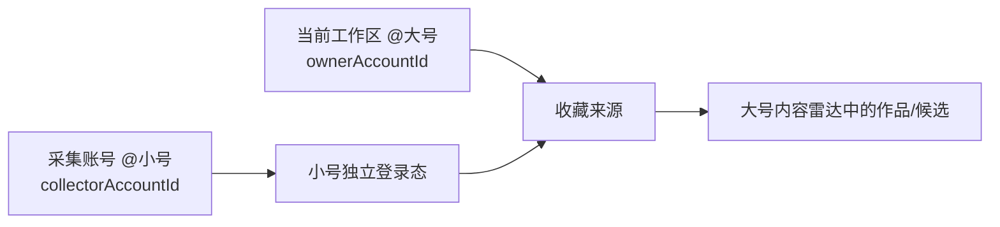

# SPEC：收藏来源可指定采集账号（T-496）

> 日期：2026-07-24  
> 用户范围确认：confirmed（只放开“我的收藏”这一种来源；不做通用跨账号数据流）  
> 独立评审：FAIL（第三轮仍有 blocker，按流程退回 PLAN）  
> 人工最终裁决：pending  
> 上游：[多账号完全隔离](2026-07-15-account-full-isolation-spec.md)、[内容雷达](2026-07-23-content-radar-restructure-design.md)

## 1. 一句话定义

用户停留在大号创作工作区新增“我的收藏”来源时，可以选择本人已绑定的小号作为采集登录态；采到的来源、作品、选题候选仍归当前大号工作区。除收藏来源外，定位、项目、知识、作品、发布、指标、会话和自动化继续完全隔离。

## 2. 用户工作与价值

- 用户用大号发布，用小号关注、点赞和收藏对标内容。
- 当前系统能绑定和切换多个账号，但收藏夹只能读取当前工作区账号。
- 删除本能力后，用户必须频繁切号并手工搬运链接，且小号收藏无法直接服务大号创作。
- 非目标：跨号搬项目、跨号共享知识库、跨号总览、指定账号抓任意来源。

独立验收场景：当前工作区为 `@大号`，添加“我的收藏”，选择 `@小号`，读取小号收藏夹并首次同步；同步结果只在大号内容雷达可见，切到小号工作区不可见。

### 2.1 Value & Viability

| 风险类别 | 当前证据 | 最小检验 | 通过阈值/时点 |
|---|---|---|---|
| 价值 | 用户明确存在“大号发布、小号观察收藏”的工作流 | 5 位双号用户完成一次真实任务 | ≥4/5 无需手工复制链接；Contract 前 |
| 可用性 | 双身份容易误解归属 | 走查“选小号→确认→到大号找结果” | ≥4/5 首次成功，误归属操作为 0；Design gate |
| 可行性 | 已有多号注册册、独立 authDir、收藏 adapter | 双号 fixture + 真机读取 RAT | fixture 100% 隔离且至少一组真机成功；Build 前 |
| 商业/留存 | 能力只服务双号收藏用户，覆盖面未知 | 曝光→创建→首次同步漏斗 | 第 28 天：创建率 ≥20%，创建后首次同步成功率 ≥80% |
| 依赖 | 抖音登录态、收藏页/API 会变化 | 登录过期、验证码、结构变化 canary | 失败均有明确终态，误记 0 条成功为 0；发布前 |
| 隐私/信任 | 用户可能误以为账号资料已合并 | 确认文案理解测试 + 审计抽查 | 5/5 答对“从哪采、存到哪”；越权读取为 0；发布前 |

替代方案与切换触发器：

| 方案 | 用户代价 | 采用/切换触发器 |
|---|---|---|
| 忍着不解决，继续复制链接 | 每条手工、无法批量同步 | 若真实双号用户不足 5 人或创建率 <5%，回退而不扩张委托链 |
| 切到小号采集，再搬到大号 | 还需新增通用跨号搬运 | 拒绝；权限面更大 |
| 通用共享空间 | 可复用全部资料 | 拒绝；未来出现两个以上非收藏场景并重新确认后才评估 |
| 收藏时指定 collector | 一次明确确认，后续自动同步 | 当前采用 |

PR-FAQ：

- **为什么绑定大号还不够？** 用户可能刻意只用小号关注、收藏竞品。
- **为什么不让所有账号资料互通？** 当前只需要读一个收藏夹；扩大到项目、知识和发布会引入
  不必要的越权与误归属。
- **迁移成本是什么？** 旧来源自动视为 owner 自采并 backfill；异常记录阻断并要求重选，不猜账号。
- **多维护一个登录态值得吗？** 只影响选择小号的来源；若第 28 天指标低于上表阈值，停止扩张。

Pre-mortem（可证伪死因）：

1. 30 天内出现任一 collector 内容写入 collector 工作区，说明双 tuple 隔离失败；
2. 超过 20% 创建用户在确认后仍去错误账号找结果，说明交互语义失败；
3. 登录过期恢复成功率低于 70%，用户回到复制链接，说明自动同步价值不成立。

## 3. 产品语义



两个账号的职责不可混用：

| 字段 | 含义 | 决定什么 |
|---|---|---|
| `accountId` | 来源归属工作区，来自当前可信 `RequestContext` | source/run/task/item/transform/候选写入哪个工作区 |
| `collectorAccountId` | 用户选择的、本人已绑定且 active 的抖音号 | 读取哪个 `.auth/douyin/<id>` 登录态 |

默认值：`collectorAccountId = accountId`，保持现有单号行为。这里不是把小号内容“共享”
给大号，而是一次有明确 subject/actor 的采集委托：

- owner tuple：`ctx.accountId = source.accountId = run.accountId = task.accountId = item.accountId`；
- collector tuple：`config.collectorAccountId = browserSessionRef 中的账号 = authDir 中的账号`。

两个 tuple 内必须一致；只有 `favorites_folder` 可以出现 owner 与 collector 不同。

## 4. 契约与数据

### FR-FAV-01 创建时选择账号

仅当来源类型为 `favorites_folder` 时，新增“采集账号”选择框；数据来自 user 级 `platform_accounts.list`，默认当前账号。选择账号后才读取其收藏夹。

### FR-FAV-02 服务端派生登录态

`favorites_folder` config v2 改为：

```ts
{
  type: "favorites_folder";
  configVersion: 2;
  folderId: string;
  collectorAccountId: string;
}
```

该配置持久化在 `intelligence_sources.adapter_config`；客户端不再提交可伪造的
`browserSessionRef`。backend service 验属主后只派生并持久化不含物理路径的 opaque ref：
`douyin-profile:${collectorAccountId}`。真实 `authDirFor(collectorAccountId)` 只在本地采集
adapter 执行时由 runtime port 解析，禁止进入 RPC、领域表或日志；backend 不导入 frontend helper。

旧 v1 记录只可能来自现行“当前号采当前号”路径。迁移顺序：

1. 读取兼容层把缺失 `configVersion/collectorAccountId` 的 v1 记录解释为
   `collectorAccountId = source.accountId`；
2. migration task 先按目标
   `(user_id, account_id, type, favorites:${accountId}:${folderId})` 分组预检；同组多条时以
   最早 `created_at`、再按最小 `id` 选 canonical source，把 membership 去重迁到 canonical。
   历史 run/item/observation 不改 sourceId；重复 source 标 `archived` 并写
   `mergedIntoSourceId` 审计，避免改写历史；
3. 每 100 条一个事务回填 `adapter_config` v2、opaque `browser_session_ref` 和新
   `external_key`；批次幂等键 `favorites-v2:{userId}:{accountId}:{lastSourceId}`。失败时保持
   v1/v2 双读并从 checkpoint 重跑；
4. 预检确认目标键无重复后，在独立迁移事务创建唯一索引；索引失败不收紧 API，旧读路径仍可用；
5. 全量校验 `v1Remaining=0` 且双号隔离测试通过后，API 才停止接受 v1 create input；
6. 旧记录若 `browser_session_ref` 与 owner 不一致，保持原字段并把 source `paused`，
   migration task 记 `blocked / IDENTITY_INVALID`，不得猜 collector。回滚只撤销本批未发布
   的字段回填；已合并历史关联通过审计正向修复，不做破坏性逆迁移。

### FR-FAV-03 来源身份不碰撞

收藏来源的 `externalKey` 固定为
`favorites:${collectorAccountId}:${folderId}`，数据库新增唯一索引
`(user_id, account_id, type, external_key)`；创建使用 `INSERT … ON CONFLICT`
或等价原子 upsert，而不是“先查再插”。同一个大号工作区可以分别添加“大号收藏夹 A”
和“小号收藏夹 A”；相同组合的并发与重试必须幂等复用。

`collectorAccountId` 创建后不可修改。用户要换采集号时，应新建来源并明确选择是否归档旧来源，
禁止把既有运行和历史项目的审计身份原地改写。

### FR-FAV-04 执行时双归属

- `source_sync` task 的 `accountId` 仍是来源归属工作区。
- worker 从已验属主的 source config 读取 `collectorAccountId`，只用于打开登录态。
- adapter envelope 回到 intelligence service 后，所有 source/run/item/snapshot 写入仍由 task 的 `accountId` stamp。
- worker 不得用 `collectorAccountId` 构造写入 context，不得直接写库。

### FR-FAV-05 状态与失败

- 采集账号已归档、被删除、非抖音或不属于当前 user：创建期直接拒绝且不产生 source/run/task；
  运行期按下表收口，不能退回当前账号。
- 采集账号登录过期时 source 进入真实 `paused`，最近一次 run 和 task 进入
  `blocked / LOGIN_REQUIRED`；UI 显示需要重连的具体账号。重连成功后由用户恢复来源并创建
  新 run，不改写旧终态。
- 切换当前工作区不改变已排队任务；任务继续用 source 中固定的两个账号执行。
- 来源卡必须同时显示“采集账号”和“归属工作区”，避免用户误以为已切号。

| 运行期变化 | source | run | task | 自动重试 | 用户恢复 |
|---|---|---|---|---|---|
| 登录过期/验证码 | adapter 返回时 CAS 为 `paused` | `blocked / LOGIN_REQUIRED` 或 `CAPTCHA` | `blocked` | 调度器跳过 paused source | “重新登录 @采集号”→恢复来源→新 run |
| collector 被归档 | start/claim 首次发现时 CAS 为 `paused` | `blocked / IDENTITY_INVALID` | `blocked` | 调度器跳过 paused source | 恢复账号后启用来源，或新建来源 |
| collector 被删除/不再属主 | start/claim 首次发现时 CAS 为 `paused` | `blocked / PERMISSION_DENIED` | `blocked` | 永不自动换号 | 归档旧来源，选择另一账号新建 |
| collector 平台不是 douyin | start/claim 首次发现时 CAS 为 `paused` | `blocked / IDENTITY_INVALID` | `blocked` | 不重试 | 修正账号登记或新建来源 |

不新增账号生命周期事件总线。状态联动发生在两个确定时点：

1. scheduler/manual start 在创建 run/task 前调用
   `IntelligenceSourceService.assertCollectorEligible`；永久失效时由 backend service 原子 CAS
   `source active→paused` 并拒绝创建任务；
2. worker claim 后、adapter 前再次调用同一 service port；若账号已变化，backend service 在
   一个工作单元内 CAS pause source、终结 run/task、写审计，adapter 调用次数为 0。

调度器每次只选择 `source.status=active`；因此首次发现失效后不会继续排队。已进入 `blocked`
的 task 是明确终态，不复用原 task；恢复动作创建带新幂等键的新 run/task。删除/归档与 claim
竞态以账号 version + source version CAS 判定，失败的一方重新读取后执行同一规则。

## 5. UI

“添加真实来源 → 我的收藏”按以下顺序：

1. 选择采集账号，默认当前账号；
2. 点击“读取该账号收藏夹”；
3. 选择收藏夹；
4. 确认提示：`用 @小号采集，内容进入 @大号`；
5. 保存并首次同步。

切换采集账号时，清空上一个账号读到的收藏夹与验证状态，禁止把小号 A 的 `folderId` 配给小号 B。

其他来源类型不出现此选择框。

## 6. 安全与边界

- 创建、预览、执行三处都必须通过 `platformAccountService` 验证 `collectorAccountId` 属于当前 user、platform 为 douyin、状态 active。
- source 的 owner 仍只能来自 `ctx.accountId`，客户端不能指定其他目标工作区。
- 收藏内容进入当前工作区是用户在确认文案中可见的显式动作，符合 PRD P-02“跨账号能力必须显式”。
- Cookie、短时签名和真实 authDir 不进入 API、领域表或普通日志。
- 审计事件必须记录 `ownerAccountId`、`collectorAccountId`、`sourceId/runId/taskId`
  和结果错误码，但不记录凭据；collector 值从已验证的服务端配置复制，不接受 worker 覆盖。

### R-INGEST 窄例外

本 SPEC 经用户确认后，把现行“登录 profile/source/account 一致”细化为：

1. 默认采集继续要求一个一致 tuple；
2. 只有 `favorites_folder` 可使用上述 owner/collector 双 tuple；
3. owner 决定数据归属，collector 只授予读取指定收藏夹的能力；
4. 任一 tuple 内不一致立即阻断；
5. 此例外不扩展到关注、点赞、主页、知识、项目、发布或指标。

## 7. 现网事实与复用

| 能力 | 现有实现 | 证据 | 决定 |
|---|---|---|---|
| 多号绑定/切换 | 已有 | `frontend/src/components/shell/account-switcher.tsx:119-151,318-323` | 复用账号注册册，不新建账号体系 |
| 收藏夹读取 | 已有且锁定当前号 | `frontend/src/server/persistence-client.ts:5507-5527` | 改为显式 collector 验权后读取 |
| 独立登录目录 | 已有 | `frontend/src/server/persistence-client.ts:1535-1536` | 复用 `douyinAuthDirFor` |
| source owner | 已严格按当前号 | `backend/src/modules/intelligence/intelligence.service.ts:1957-1994` | 保持不变 |
| 后台任务归属 | task 自带 account | `backend/src/modules/intelligence/source-sync-runner.ts:152-170` | 保持 owner context，不用 collector 写库 |
| 收藏 adapter | 目前只收 ctx/folderId | `frontend/src/server/intelligence/source-adapter.ts:342-353` | additive 增 collector 参数 |
| source/run/task 状态 | 已有 paused/blocked/error codes | `contract/src/resources/intelligence.ts:13-18,33-50,65-75` | 全部复用，不新增状态枚举 |
| blocked 终结/retry | 已有 | `backend/src/modules/intelligence/intelligence.service.ts:3388-3454`、`backend/src/modules/execution/persistent-task.service.ts:201-224` | 复用；旧 run 保持终态 |
| 重启恢复 | 已有租约恢复 | `backend/src/modules/execution/persistent-task.service.ts:680-725` | queued/running 依旧恢复；blocked 不自动重排 |

不采用通用“跨号数据桥”或新建共享工作区：用户已明确只开放收藏来源，通用桥会扩大越权和串号面。

### 7.1 现成模式调研

| 候选 | 可借鉴部分 | 不采用部分 | 决定 |
|---|---|---|---|
| OAuth 2.0 Token Exchange / RFC 8693 | subject 与 actor 分离，委托链同时保留两种身份 | 不把抖音 Cookie 改造成 OAuth token exchange；平台并无该授权面 | 采用“双身份不可混写”的语义模型 |
| AWS STS SourceIdentity / CloudTrail | source identity 由受信任端设置、会话中不可改、进入审计 | 不引入 AWS、临时云凭据或跨租户 IAM | 采用服务端派生 collector 与不可变审计字段 |
| 通用共享工作区 | 可以天然跨成员/账号消费数据 | 远超用户确认范围，改变全部资源归属和权限模型 | 拒绝 |

参考：[RFC 8693](https://datatracker.ietf.org/doc/rfc8693/)、
[AWS SourceIdentity](https://docs.aws.amazon.com/IAM/latest/UserGuide/id_credentials_temp_control-access_monitor.html)。

## 8. 验收

1. 双号绑定后，当前大号可选择小号并读取小号真实收藏夹。
2. 请求伪造他人/归档账号时返回 ownership/validation error，读取次数为 0。
3. 相同 owner+collector+folder 重试只产生一个 source；不同 collector 的同名/同 ID 收藏夹不碰撞。
4. source/run/task/item 全部归 owner；打开的 authDir 全部归 collector。
5. collector 登录失效时明确 blocked，不回退 owner，不写 0 条成功。
6. 切换工作区或重启后任务归属不变。
7. 双号真机 E2E 覆盖“手动首次同步、定时同步、登录过期、切号不可串读”。
8. v1 存量来源迁移后 collector=owner；异常 session 不猜测账号并进入明确阻塞态。
9. 两个并发 create 请求只产生一个 source；collector 不可原地修改。
10. 第 28 天检查创建率、首次同步成功率、误归属和登录恢复率；任一越权写入立即阻断发布。

## 9. 可追溯矩阵

| FR | Contract/API | Service/持久化 | UI | 测试 |
|---|---|---|---|---|
| FR-FAV-01 | `favorites.folders.list` 增受验 `collectorAccountId`；`intelligence.sources.create` v2 config | `platformAccountService.requireActiveDouyinAccount` | AddSourceDialog 账号→收藏夹联动 | `TEST-FAV-001/002` |
| FR-FAV-02 | `intelligenceSourceConfig` v2，create 禁止 client session ref | server 派生 `browser_session_ref`，adapter_config v2 backfill | 不展示/提交凭据字段 | `TEST-FAV-003/004` |
| FR-FAV-03 | create 幂等响应不变 | externalKey + 四列唯一索引 + 原子 upsert | 重复保存显示已有来源 | `TEST-FAV-005/006` |
| FR-FAV-04 | source execution input 内部 DTO 带 owner/collector | source-sync runner owner ctx；adapter 只用 collector auth | 卡片显示两种账号 | `TEST-FAV-007/008/009` |
| FR-FAV-05 | 复用 run error code 与 execution task terminal status | claim 后二次验权、paused/blocked 状态矩阵 | 重登、恢复、新建来源 CTA | `TEST-FAV-010..014` |

验收 1 覆盖 `TEST-FAV-001/007`；验收 2 覆盖 `002/010`；验收 3 覆盖 `005/006`；
验收 4 覆盖 `007..009`；验收 5 覆盖 `011`；验收 6 覆盖 `012`；
验收 7 覆盖 `013`；验收 8 覆盖 `004/014`；验收 9 覆盖 `006/009`。

## 10. 发布边界

本 SPEC 不授权收藏以外的跨号读取，也不授权把已有来源改挂到另一个 owner。任何扩展都必须重新经过数据归属确认。
