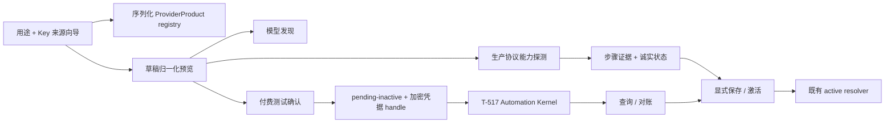

# CreatorOS 模型配置体验重构 SERVICE CONTRACT（T-501）

> Stage：2-CONTRACT  
> 状态：`passed`（Round 1/2/3 FAIL 与原 Round 4 PASS 历史保留；2026-07-25
> additive 修订复评 Round 1/2 FAIL、最终 Round 3 PASS，Gate 12/15b 已内部通过；
> 修订版确认②已由 `DEC-BATCH-20260725-004` 重新取得；PAGE SPEC Round 2 后仅补齐已确认的
> 诊断 DTO 与 005→披露→确认→006 顺序，定向独立复验已 PASS）  
> 日期：2026-07-25  
> 上游：`2026-07-24-model-configuration-experience-redesign.md`（五项产品口径已由 `DEC-BATCH-20260725-001` 确认①）  
> 范围：`FR-MC-01..14`、`NFR-MC-01..07`；`FR-MC-14` 只作为“有证据才显示”的 truthfulness 约束，不承诺新增 adapter  
> 依赖：T-517 Automation Kernel 的 replacement CONTRACT（付费异步测试 HARD 阻塞）；T-516 只要求保留设置深链兼容，不依赖其失败合同  
> 禁止误读：确认②与定向复验均已通过，但任何文档 PASS 都不代表生产代码已实现。
> T-517 runtime readiness
> 未具备前，付费 effect 必须 fail closed、provider call=0，包含 paid effect 的完整 BUILD/integration
> 仍不可宣称完成。

## 1. 一句话结论

用户只需要说清“配置什么、Key 从哪里来”；系统必须先展示它将使用的协议和最终 endpoint，
再用与生产 runtime 相同的路径验证能力。`/models`、HTTP 2xx、鉴权成功或文档声明都不能单独
变成绿色；保存前的免费草稿不落库，付费异步探测只允许先保存 `pending-inactive`，且必须复用
T-517 的唯一 Automation Kernel。



## 2. 五项已确认产品裁决的可测试合同

| 已确认裁决 | 不可变合同 | 可观测验收 |
|---|---|---|
| 用途/Key 来源是默认向导 | 默认请求只接受 `slot + providerProductId + region/productLine + credential + modelId?`；协议、auth 和官方 Base URL 来自 registry，只读展示 | `TEST-MC-01/22`：普通模式无法提交冲突的 product/protocol/base 组合 |
| 编导绿灯验证正文、流式和工具 | `default` 只有同一配置指纹在 24 小时内的 `content + stream + tools` 都通过才为 `ready` | `TEST-MC-05/06`：HTML 200、JSON 空正文、空 SSE、无 tool-call 均不得绿色 |
| Search/RSS/browser 归联网与数据源 | T-501 只移动 IA；继续调用既有真实配置 operation，不复制到模型 registry，不新增占位按钮 | `TEST-MC-15`：模型卡不含三项；新分组动作能调用原 operation |
| 本地 Whisper/云 ASR 显式选择 | `transcribe.audio` 使用 `mode=local_whisper|cloud` 判别 union；本地分支禁 Key，云端必须真实转写 | `TEST-MC-08/09`：仅 `/models` 通过不等于 ASR 可用 |
| 付费图片/视频先未启用且防重复扣费 | 确认后只创建 `pending-inactive`；稳定 attempt group 锁住未知结果；通过且再次显式 commit 才可激活 | `TEST-MC-10/11/24`：未确认零生成调用，重启只查旧 operation，不盲重发 |

## 3. 边界与职责

| 层 | 允许 | 禁止 |
|---|---|---|
| `contract/` | Zod request/response、稳定 operation/error/status 枚举 | SDK、网络探测、数据库访问 |
| `backend/settings` | 用户归属、草稿编排、CAS 保存、测试记录和候选配置持久化、AI runtime port | 把 Key 放进 response/log；跨 repository 偷读 |
| `ai-worker/ai-runtime` | 使用生产 provider factory 执行协议探测，返回无密钥的领域步骤 | 直连 PGlite/PG；决定 UI 绿色或直接激活配置 |
| `frontend/settings` | 消费 registry、展示预览/证据、发显式命令 | 自己补 `/v1`、猜协议、以 localStorage 作为真值、直接 import SDK |
| T-517 Automation Kernel | 付费异步 effect 的 claim、receipt、checkpoint、恢复与 reconcile | 由 T-501 创建第二个 timer/queue/run state machine |

现状可复用点：

- `contract/src/operations/settings.ts` 的 `settings.models.put/list/test` 是兼容 seam；
- `backend/src/modules/settings/settings.repository.ts` 的 `model_configurations` 继续保持 user-scoped；
- `ai-worker/src/runtime/provider-factory.ts` 已有 `anthropic | openai_chat | openai_responses`；
- `frontend/src/server/settings-model-test-wrap.ts` 的弱探测必须迁出前端组合层，不能作为新绿色权威；
- T-516 的 `?highlight=text-model` 深链保留为兼容 alias，解析到 `capability=default`；T-516 自动扫描
  不得因本契约偷偷增加 LLM 探测。

## 4. 公共资源与真值枚举

### 4.1 协议、能力与生命周期

```ts
type ModelProtocol = "anthropic" | "openai_chat" | "openai_responses";

type ConfigurationSlot =
  | "default" | "chat.fallback" | "script.review"
  | "image.generate" | "video.generate" | "transcribe.audio"
  | "knowledge.search.embed" | "asset.classify";

type MeasuredCapability =
  | "editorContent" | "editorStream" | "editorTools"
  | "textToImage" | "referenceImage" | "videoGenerate"
  | "asrTranscription" | "embeddingVector" | "visionInspect";

type ConfigurationLifecycle =
  | "pending-inactive" | "active" | "historical-custom";

type VerificationStatus =
  | "unconfigured" | "draft" | "untested" | "basic-passed" | "partial"
  | "ready" | "stale" | "failed" | "paid-test-not-run"
  | "reconciliation-required";

type AttributionConfidence = "high" | "unknown";
```

`ConfigurationSlot` 是现有 `(user_id, capability)` 唯一键和 resolver 输入，必须保持
`image.generate`、`asset.classify` 等现网字符串；`MeasuredCapability` 是同一配置上的细粒度
证据，不能作为第二份配置槽位保存：

| ConfigurationSlot | MeasuredCapability | 该 slot 的 `ready` 条件 |
|---|---|---|
| `default` | `editorContent`、`editorStream`、`editorTools` | 三项同一配置指纹、同一 profile 且均未过期 |
| `chat.fallback` | `editorContent`、`editorStream`、`editorTools` | 接管主对话时语义不能弱于主编导，三项均未过期 |
| `script.review` | `editorContent` | 审核 runner 的结构化正文探针通过；不伪造未消费的 stream/tools 要求 |
| `image.generate` | `textToImage`、`referenceImage` | 两项分别判定；一项通过不能把另一项变绿 |
| `video.generate` | `videoGenerate` | 对应真实生成证据未过期 |
| `transcribe.audio` | `asrTranscription` | 本地或云端真实短音频转写非空 |
| `knowledge.search.embed` | `embeddingVector` | 向量非空、维数有效 |
| `asset.classify` | `visionInspect` | 内置非用户图片的视觉探针通过 |

`draft` 不是持久 lifecycle。`ready` 必须绑定 `configurationId + slot + configFingerprint +
measuredCapability + probeProfileVersion + testedAt + freshUntil`。一份 `image.generate` active
配置可以分别拥有两份测量证据；它们共享配置和 Key，但状态永不互相继承。`asset.classify ↔
visionInspect` 只是证据投影，存量行不改名。

### 4.2 `ProviderProductResource`

```ts
type ProviderProductResource = {
  id: string;
  providerId: string;
  label: string;
  productLine: string;
  region: string;
  configurationSlots: ConfigurationSlot[];
  measurableCapabilities: MeasuredCapability[];
  protocol: ModelProtocol;
  baseUrlTemplate: string;
  authStyle: "bearer" | "x-api-key";
  keySourceUrl: string;
  docsUrl: string;
  modelDiscoveryProfileId: string | null;
  capabilityFilterProfileId: string;
  probeProfileIds: string[];
  costPolicyId: string;
  verifiedAt: string;
  freshUntil: string;
  stability: "stable" | "experimental" | "hidden";
  evidence: Array<{ kind: "adapter"|"compatibility"|"official-doc"; ref: string }>;
};
```

普通向导只返回 `stability=stable` 且同时具有运行 adapter/兼容协议证据、官方链接、未过期
`verifiedAt` 和所需 probe 的记录。`FR-MC-14` 名单是审计清单，不是静态“已支持”清单。

### 4.3 Base URL 归一化结果

```ts
type EndpointPreviewResource = {
  enteredBaseUrl: string | null;
  storedBaseUrl: string | null;
  canonicalBaseUrl: string | null;
  runtimeEffectiveBaseUrl: string | null;
  compatibilityProjectionVersion: string | null;
  protocol: ModelProtocol;
  protocolSource: "registry" | "user-explicit";
  effectiveEndpoints: Array<{
    endpointId:
      | "discovery" | "content" | "tools" | "transcription" | "embedding"
      | "vision" | "image-generation" | "image-edit-or-reference"
      | "video-submit" | "video-query";
    measuredCapability: MeasuredCapability | null;
    method: "GET" | "POST";
    effectiveUrlRedacted: string;
    requestShape: "json" | "multipart" | "provider-specific";
  }>;
  suggestions: Array<{
    code: "TRIM_WHITESPACE" | "REMOVE_TRAILING_SLASH" | "ADD_V1"
      | "REMOVE_DUPLICATE_V1" | "USE_SERVICE_ROOT";
    candidateBaseUrl: string;
    explanation: string;
  }>;
  requiresConfirmation: boolean;
  warnings: string[];
};
```

确定性规则：

1. 仅自动 trim 首尾空白和移除非根路径尾斜杠；这些变化必须仍在 preview 中可见。
2. 必须是绝对 `https:` URL；仅显式开发/本地实验 profile 可允许 `http://127.0.0.1` 或
   `http://localhost`。禁止 userinfo、fragment；query 仅供应商专用 profile 明确允许。
3. 官方产品使用 registry 的协议/Base URL，普通模式不可改。兼容网关必须由用户显式选择协议，
   不得根据品牌名、2xx 或响应外形偷偷换协议。
4. `/v1` 只能产生候选，用户通过 `acceptedSuggestionCodes` 确认后才进入配置指纹。
5. 已输入 `/chat/completions`、`/responses` 或 `/messages` 时，返回服务根候选并要求确认；
   不得把 operation path 当 Base URL 保存。
6. 归一化后不得出现 `/v1/v1`。协议 endpoint 拼接恰好一次：
   `openai_chat → /chat/completions`、`openai_responses → /responses`、
   `anthropic → /messages`；是否包含 `/v1` 由 product/discovery profile 决定。
7. `/models` 路径来自 `ModelDiscoveryProfile`；没有证据时为 `null`，不能普遍猜 `/models`。
8. 三层地址必须分开：`storedBaseUrl` 是 DB 原值，`canonicalBaseUrl` 是新保存时经用户确认的
   服务根，`runtimeEffectiveBaseUrl` 是 SDK 真正收到的 base。最终 operation URL 只在
   `effectiveEndpoints[]` 展示。新配置指纹包含 canonical base；历史指纹包含 stored base、
   compatibility projection version 和 effective base，保证 projection 改变会使旧证据失效。
9. 历史 Anthropic 行继续复用
   `ai-worker/src/runtime/provider-factory.ts::normalizeAnthropicBaseUrl` 的“缺版本段补 `/v1`”
   projection：只展示 runtime 实际补全，不改 DB。新 commit 只有在用户确认候选后才把 canonical
   base 保存；probe 与生产 runtime 必须调用同一个 effective-base 函数和同构 fixture。
10. official 分支 `enteredBaseUrl=null`；local Whisper 的所有网络 endpoint 为空。图片 OpenAI
    compatibility 分别展示 `image-generation` 与 `image-edit-or-reference`；MiniMax 两项可指向
    同一 `/v1/image_generation`，但 request shape/profile 不同。

### 4.4 模型目录与能力证据

```ts
type ModelCatalogEntryResource = {
  providerProductId: string;
  modelId: string;
  displayName: string;
  source: "dynamic" | "overlay" | "manual";
  visibility: "current" | "stale" | "manual-unverified" | "unavailable";
  declaredCapabilities: MeasuredCapability[];
  measuredCapabilities: Array<{
    slot: ConfigurationSlot;
    measuredCapability: MeasuredCapability;
    status: VerificationStatus;
    configFingerprint: string;
    evidenceKind: "real-probe";
    testedAt: string;
    freshUntil: string;
  }>;
  provenanceUrl: string | null;
  verifiedAt: string | null;
  freshUntil: string | null;
};
```

真值优先级为：精确配置 24 小时真实探测 > 账户动态列表（只证明可见）> 90 天内文档 overlay
（只证明文档声明）> 用户手填（永远未验证）。429、超时和余额不足只能说明本次无法验证，
不能反推能力不支持；只有明确协议 `unsupported` 或完成响应但无所需 tool-call 才能判本配置
不满足工具要求。`textToImage` 和 `referenceImage` 永不互相继承。

### 4.5 草稿、配置与探测结果

```ts
type CredentialInput =
  | { kind: "new-secret"; secret: string }
  | {
      kind: "existing-configuration";
      configurationId: string;
      slot: ConfigurationSlot;
      credentialFingerprintId: string;
      expectedRevision: number;
    };

type ModelDraftInput =
  | {
      mode: "official";
      slot: Exclude<ConfigurationSlot, "transcribe.audio">;
      providerProductId: string;
      modelId: string | null;
      credential: CredentialInput;
      acceptedSuggestionCodes: [];
    }
  | {
      mode: "compatible";
      slot: Exclude<ConfigurationSlot, "transcribe.audio">;
      providerProductId: null;
      protocol: ModelProtocol;
      baseUrl: string;
      modelId: string | null;
      credential: CredentialInput;
      acceptedSuggestionCodes: EndpointSuggestionCode[];
    }
  | {
      mode: "cloud";
      slot: "transcribe.audio";
      providerProductId: string;
      modelId: string | null;
      credential: CredentialInput;
      acceptedSuggestionCodes: [];
    }
  | {
      mode: "local_whisper";
      slot: "transcribe.audio";
      localModel: "tiny" | "base" | "small" | "medium";
      providerProductId?: never;
      protocol?: never;
      baseUrl?: never;
      modelId?: never;
      credential?: never;
      acceptedSuggestionCodes?: never;
    };

type ProbeStepResource = {
  kind: "endpoint"|"auth"|"model"|"content"|"stream"|"tools"
    |"transcribe"|"vision"|"embedding"|"generation";
  status: "passed"|"failed"|"skipped"|"unknown";
  durationMs: number;
  error: ModelConfigErrorResource | null;
  evidenceCode: string | null;
  resourceUsage: Record<string, number> | null;
  endpointId: EndpointPreviewResource["effectiveEndpoints"][number]["endpointId"] | null;
  effectiveUrlRedacted: string | null;
};

type ModelConfigErrorBase = {
  message: string;
  confidence: AttributionConfidence;
  evidenceCode: string | null;
  remediationId: string | null;
  retryable: boolean;
};

type ModelConfigErrorDetails<C extends ModelConfigErrorCode> =
  C extends "MC_COST_CONFIRMATION_REQUIRED" ? {
    kind: "cost-confirmation";
    disclosure: {
      version: string;
      currency: string | null;
      maximum: string;
      estimatedCny: number | null;
    };
  } :
  C extends "MC_DEPENDENCY_NOT_READY" ? {
    kind: "dependency-not-ready";
    capability: "model.capability_probe";
    observedAt: string;
    reasons: KernelReadinessReasonCode[];
  } :
  C extends "MC_REVISION_CONFLICT" ? {
    kind: "revision-conflict";
    resourceType: "configuration" | "candidate" | "run" | "local-whisper-model";
    resourceId: string | null;
    expectedRevision: number | null;
    currentRevision: number;
    refreshOperation:
      | "settings.models.overview.get" | "settings.modelTests.get"
      | "settings.localWhisper.models.list";
  } :
  C extends "MC_QUERY_LOSS_CONFIRMATION_REQUIRED" ? {
    kind: "query-loss-confirmation";
    candidateId: string;
    remoteEffectMayExist: boolean;
    queryCapabilityWillBeLost: true;
    requiredAcknowledgement: "acknowledgeQueryLoss";
  } :
  C extends "MC_ENDPOINT_CONFIRMATION_REQUIRED" ? {
    kind: "endpoint-confirmation";
    suggestions: EndpointPreviewResource["suggestions"];
  } :
  C extends "MC_ATTEMPT_GROUP_LOCKED" ? {
    kind: "attempt-group-locked";
    activeRunId: string;
    activeRunStatus: CapabilityTestRunResource["status"];
  } :
  C extends "MC_IDEMPOTENCY_CONFLICT" ? {
    kind: "idempotency-conflict";
    identifierType: "requestId" | "actionId";
  } :
  C extends "MC_EVIDENCE_EXPIRED_OR_MISMATCH" ? {
    kind: "evidence-refresh-required";
    refreshOperation: "settings.modelDraft.test" | "settings.modelTests.get";
  } :
  C extends "MC_RISK_ACCEPTANCE_REQUIRED" ? {
    kind: "risk-acceptance";
    acceptableErrorCodes: ModelConfigErrorCode[];
  } :
  C extends "MC_SYNC_RESULT_UNKNOWN" ? {
    kind: "sync-result-unknown";
    providerMayHaveReceivedRequest: true;
    automaticRetryAllowed: false;
  } :
  C extends "MC_LOCAL_MODEL_NOT_READY" ? {
    kind: "local-model-not-ready";
    level: LocalWhisperLevel;
    status: LocalWhisperPreparationStatus;
    refreshOperation: "settings.localWhisper.models.list";
    prepareOperation: "settings.localWhisper.models.prepare";
  } :
  C extends "MC_LOCAL_MODEL_TRANSITION_INVALID" ? {
    kind: "local-model-transition-invalid";
    level: LocalWhisperLevel;
    action: "start" | "retry" | "cancel";
    currentStatus: LocalWhisperPreparationStatus;
    allowedActions: Array<"start" | "retry" | "cancel">;
  } :
  C extends "MC_INSUFFICIENT_DISK" ? {
    kind: "insufficient-disk";
    requiredBytes: number;
    availableBytes: number | null;
  } :
  { kind: "none" };

type ModelConfigErrorResource<
  C extends ModelConfigErrorCode = ModelConfigErrorCode
> = C extends ModelConfigErrorCode
  ? ModelConfigErrorBase & {
      code: C;
      details: ModelConfigErrorDetails<C>;
    }
  : never;

type CapabilityTestResultResource = {
  runId: string | null;              // 免费未保存草稿可为 null
  configFingerprint: string;
  configurationId: string | null;
  slot: ConfigurationSlot;
  measuredCapabilities: MeasuredCapability[];
  overallStatus: VerificationStatus;
  steps: ProbeStepResource[];
  testedAt: string;
  freshUntil: string | null;
  cost: {
    class: "free-or-below-auto-ceiling"|"confirmed-paid"|"unknown";
    estimatedCny: number | null;
    actualProviderUsage: Record<string, number> | null;
  };
  canCommitNormally: boolean;
  riskSaveAllowed: boolean;
};
```

四种 `mode` 必须直接实现为 Zod discriminated union；非法交叉字段用 strict object 拒绝，不能
strip 后继续执行。`official/cloud` 的 protocol/base/auth 只从 registry 派生；
`compatible` 才允许用户显式填 protocol/base；`local_whisper` 从 schema 上禁止网络和凭据字段。

`existing-configuration` 不是客户端可任意引用的 secret handle。服务端必须同时校验当前 user、
`configurationId + slot + expectedRevision + credentialFingerprintId`，再从该行读取解密后的
凭据；任一不符统一 404/`MC_REVISION_CONFLICT`，解密失败为 `MC_CREDENTIAL_UNRECOVERABLE`。
允许用户保留同一槽位的已有 Key，同时修改 provider/model/base，但新的配置指纹和所有旧能力
证据立即失效；禁止跨槽位、candidate 或用户复用。任何 preview/result 都只返回
`credentialSource=provided|existing` 和 fingerprint ID，不回传 secret/handle。

免费未保存草稿不写 `model_configurations`、candidate 或 test-run 表；response 只返回当前会话可用
的脱敏结果。用户随后 commit 时携带该结果的短期签名 `evidenceToken`，服务端验证其
`userId + configFingerprint + expiry` 后，在同一保存事务中落测试摘要。失败且未保存的草稿只在
当前页面内存和既有脱敏诊断日志中存在，不成为可查询数据库历史。NFR-MC-04 的 30 天/最近
50 次保留只适用于已保存配置或已授权的付费 run，避免与 AC-MC-04 的“草稿零 DB 写”冲突。

保存前 discovery cache 也是有界进程内 cache，不写 `model_catalog_cache`：key 只含
`providerProductId + credentialFingerprintHmac`，最大 100 条、TTL 最长 24 小时，进程退出即丢。
`API-MC-003/004` 的 request key 只承诺单进程 in-flight 去重，不承诺崩溃后 exactly-once。同步
探测一旦可能已到 provider 而 transport 结果丢失，UI 必须显示“结果未知，可能已产生小额用量”，
禁止自动重试；用户显式再次测试前重新展示可能重复用量。这样保持 AC-MC-04 零 DB 写，不伪造
跨重启 receipt。只有 005→006 的付费异步分支拥有持久 receipt/exactly-once-ish 恢复语义。

## 5. 保存、测试与激活状态机

### 5.1 免费同步能力

```text
ephemeral draft
  -> preview
  -> discover(optional)
  -> test(no DB write)
  -> commit(evidenceToken + exact configFingerprint)
  -> active
```

- 普通路径只有必要步骤通过才能 commit。
- 高级路径可带 `riskAcceptance` 保存失败/部分配置；结果保持 `untested|partial|failed`，不得绿色。
- commit 使用 `expectedRevision` CAS；同 slot 的当前 active 在 commit 成功前不变。
- secret 只写；list/get 响应只有 `secretConfigured: boolean` 和不可逆 `credentialFingerprintId`。

`API-MC-003/004` 的取消不是“关掉按钮就算取消”。typed client 以原 `requestId` 调
`API-MC-017`；backend 的同进程 in-flight registry 将取消信号贯通到 discovery/probe port 和
provider SDK：

- provider 尚未 dispatch：原 003/004 收敛为 `MC_OPERATION_CANCELLED`，draft 保留，004 不签发
  evidenceToken，用户可安全重试；
- provider 已 dispatch 且 SDK 明确确认 abort：同上，但 UI 仍显示“本次已取消”而不是失败；
- 无法证明请求是否已到 provider：004 收敛为 `MC_SYNC_RESULT_UNKNOWN`，017 返回
  `retryPolicy="manual-only"`，禁自动重试；003 是只读发现，可在用户再次显式操作后重试；
- 关闭向导/Settings 不自动调用 017。用户必须点击可见“取消发现/取消测试”，取消后草稿字段与
  secret 仍只留当前页面内存；离开向导才销毁；
- 006 的付费 run 不走 017，也不显示误导性的“取消生成”；只能按 007/008 的 run/reconcile
  状态机处理。

017 的 `actionId` receipt 只存在于与原 request 相同的 in-flight registry 生命周期：同一
`actionId + canonical(target,requestId)` 重放返回第一次的完整 cancellation；同 actionId 不同
payload 返回 `MC_IDEMPOTENCY_CONFLICT`。原请求结束后，结果保留到“进程结束或 24 小时”两者
先到；进程重启后没有旧 receipt/请求，合法新 actionId 返回 `status=not-found`。017 不写
`model_command_receipts`、业务 DB、草稿或历史；格式非法的 requestId/actionId 在触碰 registry
前返回 `MC_DRAFT_INVALID`。

### 5.2 付费异步图片/视频

```text
ephemeral draft
  -> preview + free/basic steps
  -> prepare pending-inactive
  -> show cost/unknown + confirmation
  -> start via T-517
  -> running
  -> passed | failed | unknown-needs-reconciliation
  -> explicit commit/activate only after passed
```

- `API-MC-005` 必须在确认面启用主 CTA **之前**完成；它只创建 `pending-inactive` candidate，
  返回本次权威 `costDisclosure`，provider effect 调用数必须为 0。页面只能原样展示该 response，
  不能从 registry、旧 candidate 或本地估算拼出确认内容；
- 用户看见 005 返回的 disclosure 后才生成一次性 `confirmationNonce` 并调用 006；
  `acceptedCostDisclosureVersion` 必须逐字节等于当前 candidate 的版本。draft、candidate revision
  或 disclosure 版本任一变化都使旧确认失效，必须重新 prepare/展示/确认；服务端不匹配时返回
  `MC_COST_CONFIRMATION_REQUIRED`，provider call=0；
- `attemptGroupKey = HMAC(slot, measuredCapability, providerProductId, canonicalBaseUrl, protocol, modelId,
  probeProfileVersion, credentialFingerprintHmac)`；不含 nonce。
- `idempotencyKey = HMAC(attemptGroupKey, confirmationNonce)`。
- 同一 attempt group 只能有一个未对账 run。新 nonce 不解除锁。
- provider 支持时必须发送 client idempotency key，并持久化远端 operation ID/effect receipt。
- 有 remote ID 的刷新/重启只允许 query；无幂等且提交结果未知时进入
  `unknown-needs-reconciliation`，默认禁止重发。
- 删除未知 candidate 前必须警告“删除后 APP 无法继续查询”；确认删除不等于旧请求未发生，
  审计仍保留无密钥 tombstone。
- 本分支的持久 claim、effect receipt 和 reconciliation 依赖 T-517 replacement CONTRACT 和
  对应生产实现；文档 Gate 通过从来不能单独解锁 provider effect。

### 5.3 机器可判定的 Kernel readiness

```ts
type KernelReadinessReasonCode =
  | "handler-not-registered"
  | "handler-version-mismatch"
  | "effect-broker-schema-missing"
  | "provider-request-key-unsupported"
  | "receipt-port-unavailable"
  | "receipt-three-state-unsupported"
  | "reconcile-port-unavailable"
  | "remote-query-unsupported"
  | "cutover-not-enabled"
  | "legacy-writer-not-fenced"
  | "startup-validation-missing"
  | "handler-conformance-missing";

type KernelCapabilityReadiness = {
  capability: "model.capability_probe";
  ready: boolean;
  handler: {
    registered: boolean;
    handlerVersion: string | null;
    manifestFingerprint: string | null;
  };
  effectBroker: {
    schemaVersion: string | null;
    providerRequestKeySupported: boolean;
  };
  receiptPort: {
    queryVersion: string | null;
    committedUnknownNotCommittedStates: boolean;
  };
  reconcilePort: {
    version: string | null;
    remoteQuerySupported: boolean;
  };
  cutover: {
    phase: "install"|"fence"|"drain"|"snapshot"|"migrate"|"reconcile"|"switch"|"enable";
    writerGeneration: "legacy"|"kernel";
    legacyWriterFenced: boolean;
  };
  conformance: {
    startupValidationId: string | null;
    handlerTestEvidenceId: string | null;
  };
  observedAt: string;
  reasons: KernelReadinessReasonCode[];
};
```

该 handshake 来自 Kernel 运行时只读 capability port，不从 manifest 文档状态、环境变量布尔值或
frontend 推断。`ready=true` 必须同时满足：handler 已按预期版本注册；effect broker 能接受稳定
providerRequestKey；receipt query 能区分 `committed|unknown|not_committed`；reconcile port 可用；
cutover 为 `enable + writerGeneration=kernel + legacyWriterFenced=true`；startup validation 和
handler conformance evidence 均存在。任一字段缺失即 false。

- `API-MC-006` 在**每次**创建 run/effect 前读取 handshake；false 时只返回
  `MC_DEPENDENCY_NOT_READY` 和安全 reasons，provider network 调用数必须为 0。
- `API-MC-007` 始终从 T-501 本地归属表读取既有 run。Kernel 不可用时仍 200，并返回
  `executorReadiness:"unavailable"` 与最后 checkpoint；不得屏蔽历史。
- `API-MC-008` 的 `record-manual-evidence`、`accept-duplicate-charge-risk`、本地 tombstone 审计
  不依赖 Kernel；`query-remote` 和任何会触发 broker/远端写的动作必须先读 handshake，未就绪
  fail closed。
- T-517 CONTRACT PASS 只是 BUILD 的必要前置，不是 runtime feature flag。真正开放 006 还必须有
  T-517 BUILD、迁移/cutover、startup validation、handler conformance 和 fail-closed fixture
  的可核验证据。

## 6. 三协议探测合同

三种协议必须调用生产 provider factory 相同构造路径：

| 协议 | 生产路径 | 正文/流式 | 工具 |
|---|---|---|---|
| `openai_chat` | OpenAI-compatible `chatModel` | 最多 1 请求，输入 ≤128 tokens、输出 ≤16，必须出现非空 text delta | 第 2 请求，1 个无副作用本地工具，输出 ≤32，必须收到合法 tool-call |
| `openai_responses` | OpenAI `responses` | 同上，按 Responses event 解析非空 delta | 同上，按 Responses function-call item 验证 |
| `anthropic` | Anthropic messages | 同上，按 content block delta 解析 | 同上，按 tool-use block 验证 |

每种协议必须具备同构 fixtures：正常非空流、合法工具调用、`text/html` 200、空 SSE/完成但无
delta。协议支持强制工具时使用强制；已登记 thinking/tool-choice 不兼容时允许复用生产 runtime
的 auto + 明确工具指令降级，但最终未收到 tool-call 仍失败。探测不得执行工具后的第三次模型
请求。`ready(default)` 的必要步骤固定为 endpoint、auth、model、content、stream、tools。

ASR 必须调用真实 transcription endpoint 并验证非空文本；Embedding 验证非空向量和维数；
Vision 使用内置非用户图片；图片/视频生成按 §5.2。资源上限完全继承 FR-MC-07，registry 只能
收紧，不能放宽。

### 6.1 能力证据与运行资源

```ts
type MeasuredCapabilityEvidenceV1 = {
  capability: MeasuredCapability;
  status: "verified" | "unknown" | "unsupported" | "failed" | "expired";
  configurationId: string | null;
  slot: ConfigurationSlot;
  configFingerprint: string;
  probeProfileVersion: string;
  checkedAt: string | null;
  expiresAt: string | null;
  receiptId: string | null;
};

/**
 * Canonical shared wire.
 * Defined-In:
 * docs/superpowers/specs/2026-07-24-model-configuration-experience-redesign.contract.md
 * §6.1 / ReferenceCapabilityEvidenceV1
 *
 * T-501 API-MC-010 与 T-510 API-MO-008 只能引用该定义；任何消费合同不得复制或裁字段。
 */
type ReferenceCapabilityEvidenceV1 = {
  capability: "referenceImage";
  status: "verified" | "unknown" | "unsupported" | "failed" | "expired";
  configurationId: string | null;
  slot: "image.generate";
  configFingerprint: string;
  probeProfileVersion: string;
  checkedAt: string | null;
  expiresAt: string | null;
  receiptId: string | null;
};

type CapabilityEvidenceResponseV1 =
  | { evidence: ReferenceCapabilityEvidenceV1 }
  | {
      evidence: MeasuredCapabilityEvidenceV1 & {
        capability: Exclude<MeasuredCapability, "referenceImage">;
      };
    };

type ModelConfigurationResourceV2 = {
  id: string;
  slot: ConfigurationSlot;
  lifecycle: ConfigurationLifecycle;
  revision: number;
  provider: string;
  providerProductId: string | null;
  modelId: string;
  storedBaseUrl: string | null;
  runtimeEffectiveBaseUrl: string | null;
  protocol: ModelProtocol;
  secretConfigured: boolean;
  credentialFingerprintId: string | null;
  configFingerprint: string;
  verification: MeasuredCapabilityEvidenceV1[];
};

type CapabilityTestRunResource = {
  id: string;
  candidateId: string;
  slot: ConfigurationSlot;
  measuredCapability: MeasuredCapability;
  providerProductId: string | null;
  endpointRedacted: NonEmptyRedactedEndpoint;
  protocol: ModelProtocol;
  modelId: string | null;
  status: "queued"|"running"|"passed"|"partial"|"failed"|"cancelled"|
    "expired"|"unknown-needs-reconciliation";
  statusRevision: number;
  configFingerprint: string;
  probeProfileVersion: string;
  remoteOperationIdPresent: boolean;
  reconciliationRequired: boolean;
  executorReadiness: "ready"|"unavailable";
  steps: ProbeStepResource[];
  startedAt: string;
  finishedAt: string | null;
};

type ModelCandidateTombstoneResource = {
  candidateId: string;
  slot: ConfigurationSlot;
  deletedAt: string;
  remoteEffectMayExist: boolean;
  queryCapabilityLost: boolean;
  auditReceiptId: string;
};

type SlotOverviewResource = {
  slot: ConfigurationSlot;
  configuration: ModelConfigurationResourceV2 | null;
  requiredCapabilities: MeasuredCapability[];
  overallStatus: VerificationStatus;
  lastTestedAt: string | null;
  nextAction:
    | "configure" | "test" | "inspect-gap" | "inspect-evidence"
    | "resume-paid-run" | "reconcile";
};

type ModelConfigurationOverviewResource = {
  slots: [
    SlotOverviewResource, SlotOverviewResource, SlotOverviewResource,
    SlotOverviewResource, SlotOverviewResource, SlotOverviewResource,
    SlotOverviewResource, SlotOverviewResource
  ];
  generatedAt: string;
};

type NonEmptyRedactedEndpoint = string & {
  readonly __brand: "NonEmptyRedactedEndpoint";
};
// Runtime schema: z.string().trim().min(1).max(2048)，并拒绝 userinfo、query、fragment、
// control chars 与 credential-like 内容；只接受服务端 canonical redaction serializer 的输出。

type SavedSyncHistoryItemBaseResource = {
  kind: "saved-sync";
  historyId: string;
  configurationId: string;
  slot: ConfigurationSlot;
  measuredCapabilities: MeasuredCapability[];
  configFingerprint: string;
  overallStatus: VerificationStatus;
  steps: ProbeStepResource[];
  testedAt: string;
  freshUntil: string | null;
  retainedUntil: string | null;
};

type SavedSyncHistoryItemResource = SavedSyncHistoryItemBaseResource & (
  | {
      transport: "provider";
      providerProductId: string | null;
      protocol: ModelProtocol;
      modelId: string | null;
      endpointRedacted: NonEmptyRedactedEndpoint;
      localModel: null;
    }
  | {
      transport: "local-whisper";
      providerProductId: null;
      protocol: null;
      endpointRedacted: null;
      localModel: { level: LocalWhisperLevel; modelId: string };
    }
);

type PaidRunHistoryItemResource = {
  kind: "paid-run";
  run: CapabilityTestRunResource;
  configurationId: string | null;
  endpointRedacted: NonEmptyRedactedEndpoint;
  retainedUntil: string | null;
  detailOperation: "settings.modelTests.get";
};

type TestHistoryItemResource =
  | SavedSyncHistoryItemResource
  | PaidRunHistoryItemResource;

type LocalWhisperLevel = "tiny" | "base" | "small" | "medium";
type LocalWhisperPreparationStatus =
  | "not-present" | "checking" | "downloading" | "verifying"
  | "ready" | "failed" | "cancelled";

type LocalWhisperAsyncFailure =
  | { code: "LW_DOWNLOAD_NETWORK_FAILED"; phase: "downloading"; retryable: true }
  | { code: "LW_MANIFEST_SIGNATURE_INVALID"; phase: "checking"; retryable: false }
  | { code: "LW_CHECKSUM_MISMATCH"; phase: "verifying"; retryable: true }
  | { code: "LW_DISK_WRITE_FAILED"; phase: "downloading"|"verifying"; retryable: true }
  | { code: "LW_ATOMIC_PROMOTION_FAILED"; phase: "verifying"; retryable: true }
  | { code: "LW_PREPARATION_INTERRUPTED"; phase: "checking"|"downloading"|"verifying";
      retryable: true };

type LocalWhisperModelResource = {
  level: LocalWhisperLevel;
  modelId: string;
  status: LocalWhisperPreparationStatus;
  revision: number;
  preparationId: string | null;
  expectedDownloadBytes: number | null;
  bytesDownloaded: number | null;
  totalBytes: number | null;
  progressPct: number | null;
  speedEstimate: {
    source: "local-benchmark" | "last-successful-transcription";
    realtimeFactorLower: number;
    realtimeFactorUpper: number;
    measuredAt: string;
  } | null;
  retryAllowed: boolean;
  cancelAllowed: boolean;
  failure: LocalWhisperAsyncFailure | null;
  checkedAt: string;
  updatedAt: string;
};

type LocalWhisperInventoryResource = {
  models: LocalWhisperModelResource[];
  availableDiskBytes: number | null;
  inventoryRevision: number;
};

type InFlightCancellationResource =
  | {
      target: "discover-models" | "sync-probe";
      requestId: RequestId;
      status: "cancel-requested";
      providerDispatch: "not-started" | "started" | "unknown";
      retryPolicy: "safe" | "manual-only";
    }
  | {
      target: "discover-models" | "sync-probe";
      requestId: RequestId;
      status: "already-finished";
      providerDispatch: "not-started" | "started" | "unknown";
      retryPolicy: "safe" | "manual-only";
    }
  | {
      target: "discover-models" | "sync-probe";
      requestId: RequestId;
      status: "not-found";
      providerDispatch: "unknown";
      retryPolicy: "manual-only";
    };

type LocalWhisperPrepareRequest =
  | {
      action: "start";
      level: LocalWhisperLevel;
      expectedRevision: number;
      requestId: RequestId;
    }
  | {
      action: "retry" | "cancel";
      level: LocalWhisperLevel;
      preparationId: string;
      expectedRevision: number;
      requestId: RequestId;
    };
```

`settings.models.capabilities.get` 是 T-501 的唯一单项证据 operation。请求必须同时携带
`slot + capability`；服务端先按上表验证该组合，再从该 slot 当前 active 配置取证，不能只凭
`editorContent` 猜成 `default`。T-510 的 `API-MO-008` 只是
消费侧 trace alias，必须调用同一 endpoint/resource，不能另建 registry 或第二个实现：

```ts
request: { slot: ConfigurationSlot; capability: MeasuredCapability }
response: CapabilityEvidenceResponseV1
```

`API-MC-014` 是设置总览的唯一读模型：response 必须恰好包含上表八个不同 slot，每个 slot
恰好一次。`overallStatus` 由服务端按该 slot 的 `requiredCapabilities`、当前 active 指纹与
freshness 计算；frontend 不再把旧 `settings.models.list` 的 `hasSecret` 猜成 ready。

`saved-sync` 是 `API-MC-004` 成功后随 `API-MC-009` 同事务保存的脱敏证据快照，点击历史项直接
展示 `API-MC-012` 已返回的完整 steps，不调用 `API-MC-007`。`paid-run` 才携带 run，并通过
007 刷新 checkpoint。两类都受“至少 30 天或最近 50 次”策略约束；未保存失败草稿仍无历史。

诊断字段不得由 frontend 从草稿、DOM 或当前配置反推。`saved-sync` 的 provider 分支直接返回
`providerProductId/protocol/modelId/endpointRedacted`；本地 Whisper 分支必须返回
`providerProductId=null`、`protocol=null`，并从 `localModel.modelId` 取得本地模型。付费分支的
四项上下文属于 `CapabilityTestRunResource`，因此 006/007/008/012 在隔天恢复时仍能复制同一份
脱敏诊断；012 外层 `PaidRunHistoryItemResource.endpointRedacted` 必须与
`run.endpointRedacted` 逐字节相同，schema/service 检测不一致时 fail closed，不能选择其一猜测。

本地 Whisper 的模型权重状态是 `ENT-MC-08`（本机运行时资源，不是 `model_configurations`）：

- `expectedDownloadBytes` 只来自随包签名 manifest；没有可信值时为 `null`，UI 写“大小未知”；
- `progressPct` 只在 `totalBytes > 0` 时计算，否则为 `null`，不得用计时器伪造进度；
- `speedEstimate` 只来自本机 benchmark 或最近真实转写；首次为空时显示“首次使用后估算”；
- prepare 使用同缓存根目录，但先写临时目录，校验通过后原子提升为 `ready`。016 是严格判别
  request：`start` 禁带 preparationId，`retry/cancel` 必须带当前 preparationId；
- 合法状态转换只有下表。其他组合返回 `MC_LOCAL_MODEL_TRANSITION_INVALID`，revision 不变：

| action | 唯一合法前态 | 接受后的状态 | 拒绝示例 |
|---|---|---|---|
| `start` | `not-present` | `checking`，创建新 preparationId | ready/failed/cancelled/任一 transient |
| `retry` | `failed` 或 `cancelled` | `checking`，创建新 preparationId | not-present/ready/任一 transient；旧 preparationId |
| `cancel` | `checking`、`downloading` 或 `verifying` | 等本地 worker 终止并落盘后返回 `cancelled` | not-present/ready/failed/cancelled；不匹配 preparationId |

- 进程启动时 015 必须以签名 manifest、最终文件、临时目录和原子 preparation journal 为真相：
  最终文件完整且签名/校验通过收敛为 `ready`；journal 为 transient 且没有合法最终文件时收敛为
  `failed + LW_PREPARATION_INTERRUPTED`，保留旧 preparationId 供 retry；没有 journal/最终文件/
  临时文件时为 `not-present`。`checking/downloading/verifying` 绝不跨重启直接沿用；
- 异步失败只能写 `LocalWhisperAsyncFailure` 的稳定 code/phase/retryable，不能写任意字符串。
  `MC_INSUFFICIENT_DISK` 是启动前同步拒绝，不写 async failure，也不创建 preparation；
- 016 的 request receipt 写在本机 Whisper cache root 的原子 sidecar journal，不写业务 DB 或
  `model_command_receipts`。同 requestId + 同 canonical payload（含 action/level/preparationId/
  expectedRevision）在 30 天内、包括重启后，返回最初完整 response/error；同 requestId + 不同
  payload 返回 `MC_IDEMPOTENCY_CONFLICT`。模型删除时可一并删除已超过 30 天的 receipt；
- 取消只停止本地下载/校验并保留草稿，不声称撤回已经完成的网络字节；磁盘不足在任何下载前失败；
- `API-MC-004 mode=local_whisper` 只在对应模型为 `ready` 后执行内置样本转写；未 ready 返回
  `MC_LOCAL_MODEL_NOT_READY` 并指向 015/016，不再把首次下载隐藏在一次长时间无反馈的测试里。

查询以当前 active `ConfigurationSlot` 为基准重新计算指纹。无 active 配置、证据过期、slot/
fingerprint/profile 不匹配或 receipt 不可读，一律返回 `status="unknown"|"expired"`；
`referenceImage` 只有 `verified` 且未过期、slot=`image.generate`、指纹精确相同才允许 T-510
生成。`capability="referenceImage"` 时 response 必须按上述 canonical
`ReferenceCapabilityEvidenceV1` 解析；其中 `configurationId` 是服务端解析出的当前 active 配置，
无 active 配置时为 `null`，`slot` 恒为 `image.generate`。T-510 只引用 Defined-In，不再声明本地同名类型。

## 7. Operation 清单

### 7.0 CreatorOS transport / `defineEndpoint` 映射

CreatorOS 浏览器侧统一经物理入口
`POST /api/v1/dispatch { id, input:{params,query,body} }` 发送；下表的 `method/path` 是
`contract/src/endpoints.ts::defineEndpoint` 的 canonical operation metadata。它用于 mutation
鉴权、registry 唯一性、typed client 输入布局和未来 transport 兼容，不表示 WebView 可绕过
dispatch 直接访问这些 path。

固定规则：

- `GET` 只使用 `params/query`，`body=none`；
- `POST/DELETE` 的 path 参数不在 body 重复，其余 request 字段全部进入 body；
- dispatch route 从可信 session 推导 `userId/accountId`，任何布局都不接受 owner 字段；
- 所有条目的非 2xx 仍使用 §7.3 strict error envelope 与 HTTP 映射，外层物理 dispatch 的
  HTTP method 永远是 `POST`，不能据此把语义只读 operation 误判为 mutation。

| API | canonical method | canonical path | params | query | body |
|---|---|---|---|---|---|
| `API-MC-001` | GET | `/settings/model-catalog/products` | none | `slot,measuredCapability?,mode,includeExperimental` | none |
| `API-MC-002` | POST | `/settings/model-drafts/preview` | none | none | `draft` |
| `API-MC-003` | POST | `/settings/model-drafts/discover-models` | none | none | `draft,refresh,requestId` |
| `API-MC-004` | POST | `/settings/model-drafts/test` | none | none | `draft,measuredCapabilities,probeProfileId,costConfirmation?,requestId` |
| `API-MC-005` | POST | `/settings/model-candidates` | none | none | `draft,expectedActiveRevision,requestId` |
| `API-MC-006` | POST | `/settings/model-tests/paid` | none | none | `candidateId,measuredCapability,confirmationNonce,acceptedCostDisclosureVersion,requestId` |
| `API-MC-007` | GET | `/settings/model-tests/:runId` | `runId` | none | none |
| `API-MC-008` | POST | `/settings/model-tests/reconcile` | none | none | complete `ReconcileCommand` |
| `API-MC-009` | POST | `/settings/model-configurations/commit` | none | none | complete `CommitModelConfigurationRequest` |
| `API-MC-010` | GET | `/settings/models/capabilities` | none | `slot,capability` | none |
| `API-MC-011` | GET | `/settings/model-guide` | none | `providerProductId?,errorCode?,chapter?` | none |
| `API-MC-012` | GET | `/settings/model-tests` | none | `slot?,measuredCapability?,cursor?,limit` | none |
| `API-MC-013` | DELETE | `/settings/model-candidates/:candidateId` | `candidateId` | none | `acknowledgeQueryLoss,expectedRevision,requestId` |
| `API-MC-014` | GET | `/settings/models/overview` | none | none | none |
| `API-MC-015` | GET | `/settings/local-whisper/models` | none | none | none |
| `API-MC-016` | POST | `/settings/local-whisper/models/prepare` | none | none | complete `LocalWhisperPrepareRequest` |
| `API-MC-017` | POST | `/settings/model-drafts/cancel-in-flight` | none | none | `target,requestId,actionId` |

上述 17 组 `(id,method,path)` 必须在 registry 中唯一。canonical request parser 先按本表装配
`EndpointInput`，再解析 §7.1 的 `OperationContractMap[API].request`；transport schema 失败沿用
contract 的统一 validation envelope，只有 `OperationErrorMap` 明确包含 `MC_DRAFT_INVALID` 的
合法入参业务校验才返回该 code。两类失败都不得 dispatch provider 或写 DB。BUILD 至少提供一项
registry test，逐项断言 ID/method/path/input placement 17/17 完整，并证明
`API-MC-001/007/010/011/012/014/015` 的语义只读 metadata 不会被 dispatch route 当成 mutation。

所有 operation 都要求本机已认证 `userId`；服务端从认证上下文取归属，request 不接受
可覆盖的 owner。跨用户资源统一返回 404。response 永不含 secret、Authorization、prompt、
完整正文或原始 provider response。每个 operation 的 error union 都包含
`MC_CALLER_UNAUTHENTICATED`：本机 session 缺失/失效时返回统一 401 envelope；它与供应商返回
401/403 的 `MC_AUTH_REJECTED_UNKNOWN` 是两个不同信任边界，禁止互相替代。

| ID / operation | Request | Success response | Named errors | 幂等 / 权限 |
|---|---|---|---|---|
| `API-MC-001 settings.modelCatalog.listProducts` | `{slot, measuredCapability?, mode:"official"|"cloud", includeExperimental:boolean}` | `{products:ProviderProductResource[],registryVersion}` | `MC_DRAFT_INVALID, MC_CAPABILITY_UNSUPPORTED` | 只读；本人；同 registryVersion 确定性 |
| `API-MC-002 settings.modelDraft.preview` | `{draft: ModelDraftInput}` | `{preview, resolvedDraftWithoutSecret, configFingerprint}` | `MC_DRAFT_INVALID` 422；`MC_ENDPOINT_CONFIRMATION_REQUIRED` 409 | 只读；secret 只参与不可逆指纹 |
| `API-MC-003 settings.modelDraft.discoverModels` | `{draft,refresh:boolean,requestId:RequestId}` | `{entries:ModelCatalogEntryResource[],fetchedAt,expiresAt,source:"live"|"memory-cache"}` | `MC_DRAFT_INVALID, MC_AUTH_REJECTED_UNKNOWN, MC_RATE_LIMITED, MC_NETWORK_OR_TLS, MC_OPERATION_CANCELLED` | 进程内 in-flight 去重；本人；零 DB 写；017 可按 requestId 取消 |
| `API-MC-004 settings.modelDraft.test` | `{draft,measuredCapabilities:MeasuredCapability[],probeProfileId,costConfirmation?,requestId}` | `{result,evidenceToken,executionSemantics:"in-process-no-auto-retry"}` | probe errors + `MC_COST_CONFIRMATION_REQUIRED, MC_SYNC_RESULT_UNKNOWN, MC_OPERATION_CANCELLED, MC_LOCAL_MODEL_NOT_READY` | 进程内防双击；零 DB 写；017 可取消；dispatch 不明时禁自动重试 |
| `API-MC-005 settings.modelCandidates.prepare` | `{draft, expectedActiveRevision, requestId}` | `{candidateId, lifecycle:"pending-inactive", revision, costDisclosure}` | `MC_SECRET_REQUIRED`、`MC_REVISION_CONFLICT` | 同 requestId 同结果；加密存 secret；不替换 active |
| `API-MC-006 settings.modelTests.startPaid` | `{candidateId,measuredCapability:"textToImage"|"referenceImage"|"videoGenerate",confirmationNonce,acceptedCostDisclosureVersion,requestId}` | `{run:CapabilityTestRunResource,attemptGroupKeyId,kernelReadinessObservedAt}` | `MC_COST_CONFIRMATION_REQUIRED, MC_ATTEMPT_GROUP_LOCKED, MC_DEPENDENCY_NOT_READY, MC_IDEMPOTENCY_CONFLICT` | receipt 持久幂等；本人 candidate；每次 start runtime handshake |
| `API-MC-007 settings.modelTests.get` | `{runId}` | `{run:CapabilityTestRunResource,reconciliationActions:ReconcileActionKind[]}` | `MC_RESOURCE_NOT_FOUND` | 本地只读始终可用；本人；Kernel down 仍 200 |
| `API-MC-008 settings.modelTests.reconcile` | `ReconcileCommand` | `{run:CapabilityTestRunResource,auditReceiptId}` | `MC_RESOURCE_NOT_FOUND, MC_REVISION_CONFLICT, MC_IDEMPOTENCY_CONFLICT, MC_DEPENDENCY_NOT_READY, MC_RECONCILIATION_REQUIRED` | actionId receipt；本人；远端动作才读 readiness |
| `API-MC-009 settings.models.commit` | `{source, candidateId?, draft?, evidenceToken?, activate, riskAcceptance?, expectedRevision, requestId}` | `{configuration, previousActiveId, revision}` | evidence/config mismatch；`MC_RISK_ACCEPTANCE_REQUIRED`；CAS | requestId + CAS；本人；事务性保存/激活 |
| `API-MC-010 settings.models.capabilities.get` | `{slot:ConfigurationSlot,capability:MeasuredCapability}` | `{evidence:MeasuredCapabilityEvidenceV1}` | `MC_DRAFT_INVALID` | 只读；本人 active slot；slot/capability 必须匹配；无证据返回 unknown |
| `API-MC-011 settings.modelGuide.get` | `{providerProductId?,errorCode?,chapter?}` | `{chapter:{id,title,steps:string[]},registryRefs:string[],returnTarget:{highlight,slot}}` | `MC_DRAFT_INVALID, MC_CAPABILITY_UNSUPPORTED` | 只读；registry 派生；白名单 deep link |
| `API-MC-012 settings.modelTests.list` | `{slot?,measuredCapability?,cursor?,limit:1..50}` | `{items:TestHistoryItemResource[],nextCursor,retentionPolicy:{minimumDays:30,minimumRecent:50}}` | `MC_DRAFT_INVALID` | 只读；本人；含 saved-sync 与 paid-run，不含未保存草稿 |
| `API-MC-013 settings.modelCandidates.delete` | `{candidateId,acknowledgeQueryLoss:boolean,expectedRevision,requestId}` | `{tombstone:ModelCandidateTombstoneResource}` | `MC_RESOURCE_NOT_FOUND, MC_QUERY_LOSS_CONFIRMATION_REQUIRED, MC_REVISION_CONFLICT, MC_IDEMPOTENCY_CONFLICT` | receipt 持久幂等；本人；不删除远端 effect 事实 |
| `API-MC-014 settings.models.overview.get` | `{}` | `ModelConfigurationOverviewResource` | 无业务错误 | 只读；本人；八个 slot 各恰好一次 |
| `API-MC-015 settings.localWhisper.models.list` | `{}` | `LocalWhisperInventoryResource` | 无业务错误 | 只读；本机；重启时扫描实际缓存并读回状态 |
| `API-MC-016 settings.localWhisper.models.prepare` | `LocalWhisperPrepareRequest` | `{model:LocalWhisperModelResource}` | `MC_DRAFT_INVALID, MC_LOCAL_MODEL_TRANSITION_INVALID, MC_INSUFFICIENT_DISK, MC_RESOURCE_NOT_FOUND, MC_REVISION_CONFLICT, MC_IDEMPOTENCY_CONFLICT` | cache sidecar receipt + revision；同级别单在途；取消本地下载/校验；零业务 DB 写 |
| `API-MC-017 settings.modelDraft.cancelInFlight` | `{target:"discover-models"|"sync-probe",requestId,actionId}` | `{cancellation:InFlightCancellationResource}` | `MC_DRAFT_INVALID, MC_IDEMPOTENCY_CONFLICT` | 同进程临时 receipt；draft 保留；零 DB；付费 006 不适用 |

### 7.1 严格 operation map、错误 map 与安全品牌类型

```ts
type RequestId = string & { readonly __brand: "RequestId" }; // ^[A-Za-z0-9_-]{16,64}$
type ActionId = string & { readonly __brand: "ActionId" };   // ^[A-Za-z0-9_-]{16,64}$
type ConfirmationNonce = string & { readonly __brand: "ConfirmationNonce" }; // base64url, 16..96
type ConfigFingerprint = string & { readonly __brand: "ConfigFingerprint" }; // server base64url opaque 16..128
type CredentialFingerprintId = string & { readonly __brand: "CredentialFingerprintId" }; // base64url opaque 16..128
type EvidenceToken = string & { readonly __brand: "EvidenceToken" }; // signed v1, <=2048 bytes
type EndpointSuggestionCode =
  | "TRIM_WHITESPACE"|"REMOVE_TRAILING_SLASH"|"ADD_V1"
  | "REMOVE_DUPLICATE_V1"|"USE_SERVICE_ROOT";
type ModelProbeErrorCode =
  | "MC_UNEXPECTED_CONTENT_TYPE"|"MC_EMPTY_CONTENT"|"MC_EMPTY_STREAM"
  | "MC_TOOL_CALL_REQUIRED"|"MC_AUTH_REJECTED_UNKNOWN"
  | "MC_PRODUCT_KEY_MISMATCH"|"MC_PERMISSION_DENIED_EVIDENCED"
  | "MC_MODEL_NOT_FOUND"|"MC_RATE_LIMITED"|"MC_BALANCE_EXHAUSTED"
  | "MC_NETWORK_OR_TLS"|"MC_OPERATION_CANCELLED"|"MC_LOCAL_MODEL_NOT_READY";
type CallerAuthenticationErrorCode = "MC_CALLER_UNAUTHENTICATED";
type ModelConfigErrorCode = OperationErrorMap[keyof OperationErrorMap];

type OperationContractMap = {
  "API-MC-001": {
    request: {slot:ConfigurationSlot;measuredCapability?:MeasuredCapability;
      mode:"official"|"cloud";includeExperimental:boolean};
    success: {products:ProviderProductResource[];registryVersion:string};
  };
  "API-MC-002": {
    request: {draft:ModelDraftInput};
    success: {preview:EndpointPreviewResource;resolvedDraftWithoutSecret:Record<string,unknown>;
      configFingerprint:ConfigFingerprint|null};
  };
  "API-MC-003": {
    request: {draft:ModelDraftInput;refresh:boolean;requestId:RequestId};
    success: {entries:ModelCatalogEntryResource[];fetchedAt:string;expiresAt:string;
      source:"live"|"memory-cache"};
  };
  "API-MC-004": {
    request: {draft:ModelDraftInput;measuredCapabilities:MeasuredCapability[];
      probeProfileId:string;costConfirmation?:SyncProbeCostConfirmation;requestId:RequestId};
    success: {result:CapabilityTestResultResource;evidenceToken:EvidenceToken;
      executionSemantics:"in-process-no-auto-retry"};
  };
  "API-MC-005": {
    request: {draft:ModelDraftInput;expectedActiveRevision:number|null;requestId:RequestId};
    success: {candidateId:string;lifecycle:"pending-inactive";revision:number;
      costDisclosure:{version:string;currency:string|null;maximum:string}};
  };
  "API-MC-006": {
    request: {candidateId:string;measuredCapability:"textToImage"|"referenceImage"|"videoGenerate";
      confirmationNonce:ConfirmationNonce;acceptedCostDisclosureVersion:string;requestId:RequestId};
    success: {run:CapabilityTestRunResource;attemptGroupKeyId:string;
      kernelReadinessObservedAt:string};
  };
  "API-MC-007": {
    request: {runId:string};
    success: {run:CapabilityTestRunResource;reconciliationActions:ReconcileActionKind[]};
  };
  "API-MC-008": {
    request: ReconcileCommand;
    success: {run:CapabilityTestRunResource;auditReceiptId:string};
  };
  "API-MC-009": {
    request: CommitModelConfigurationRequest;
    success: {configuration:ModelConfigurationResourceV2;previousActiveId:string|null;revision:number};
  };
  "API-MC-010": {
    request: {slot:ConfigurationSlot;capability:MeasuredCapability};
    success: CapabilityEvidenceResponseV1;
  };
  "API-MC-011": {
    request: {providerProductId?:string;errorCode?:ModelConfigErrorCode;chapter?:string};
    success: {chapter:{id:string;title:string;steps:string[]};registryRefs:string[];
      returnTarget:{highlight:"model-capability"|"model-guide";slot:ConfigurationSlot|null}};
  };
  "API-MC-012": {
    request: {slot?:ConfigurationSlot;measuredCapability?:MeasuredCapability;
      cursor?:string;limit:number};
    success: {items:TestHistoryItemResource[];nextCursor:string|null;
      retentionPolicy:{minimumDays:30;minimumRecent:50}};
  };
  "API-MC-013": {
    request: {candidateId:string;acknowledgeQueryLoss:boolean;expectedRevision:number;
      requestId:RequestId};
    success: {tombstone:ModelCandidateTombstoneResource};
  };
  "API-MC-014": {
    request: Record<string, never>;
    success: ModelConfigurationOverviewResource;
  };
  "API-MC-015": {
    request: Record<string, never>;
    success: LocalWhisperInventoryResource;
  };
  "API-MC-016": {
    request: LocalWhisperPrepareRequest;
    success: {model:LocalWhisperModelResource};
  };
  "API-MC-017": {
    request: {
      target:"discover-models"|"sync-probe";requestId:RequestId;actionId:ActionId;
    };
    success: {cancellation:InFlightCancellationResource};
  };
};

type OperationErrorMap = {
  "API-MC-001": CallerAuthenticationErrorCode|"MC_DRAFT_INVALID"|"MC_CAPABILITY_UNSUPPORTED";
  "API-MC-002": "MC_DRAFT_INVALID"|"MC_ENDPOINT_CONFIRMATION_REQUIRED"|
    "MC_RESOURCE_NOT_FOUND"|"MC_REVISION_CONFLICT"|"MC_CREDENTIAL_UNRECOVERABLE"|
    CallerAuthenticationErrorCode;
  "API-MC-003": "MC_DRAFT_INVALID"|"MC_AUTH_REJECTED_UNKNOWN"|"MC_RATE_LIMITED"|
    "MC_NETWORK_OR_TLS"|"MC_OPERATION_CANCELLED"|"MC_RESOURCE_NOT_FOUND"|"MC_REVISION_CONFLICT"|
    CallerAuthenticationErrorCode;
  "API-MC-004": ModelProbeErrorCode|"MC_COST_CONFIRMATION_REQUIRED"|
    "MC_SYNC_RESULT_UNKNOWN"|"MC_RESOURCE_NOT_FOUND"|"MC_REVISION_CONFLICT"|
    CallerAuthenticationErrorCode;
  "API-MC-005": "MC_DRAFT_INVALID"|"MC_SECRET_REQUIRED"|"MC_REVISION_CONFLICT"|
    "MC_IDEMPOTENCY_CONFLICT"|"MC_ATTEMPT_GROUP_LOCKED"|CallerAuthenticationErrorCode;
  "API-MC-006": "MC_RESOURCE_NOT_FOUND"|"MC_COST_CONFIRMATION_REQUIRED"|
    "MC_ATTEMPT_GROUP_LOCKED"|"MC_DEPENDENCY_NOT_READY"|"MC_IDEMPOTENCY_CONFLICT"|
    CallerAuthenticationErrorCode;
  "API-MC-007": "MC_RESOURCE_NOT_FOUND"|CallerAuthenticationErrorCode;
  "API-MC-008": "MC_RESOURCE_NOT_FOUND"|"MC_REVISION_CONFLICT"|
    "MC_IDEMPOTENCY_CONFLICT"|"MC_DEPENDENCY_NOT_READY"|"MC_RECONCILIATION_REQUIRED"|
    CallerAuthenticationErrorCode;
  "API-MC-009": "MC_DRAFT_INVALID"|"MC_RESOURCE_NOT_FOUND"|"MC_REVISION_CONFLICT"|
    "MC_IDEMPOTENCY_CONFLICT"|"MC_EVIDENCE_EXPIRED_OR_MISMATCH"|
    "MC_RISK_ACCEPTANCE_REQUIRED"|"MC_ATTEMPT_GROUP_LOCKED"|CallerAuthenticationErrorCode;
  "API-MC-010": "MC_DRAFT_INVALID"|CallerAuthenticationErrorCode;
  "API-MC-011": "MC_DRAFT_INVALID"|"MC_CAPABILITY_UNSUPPORTED"|CallerAuthenticationErrorCode;
  "API-MC-012": "MC_DRAFT_INVALID"|CallerAuthenticationErrorCode;
  "API-MC-013": "MC_RESOURCE_NOT_FOUND"|"MC_QUERY_LOSS_CONFIRMATION_REQUIRED"|
    "MC_REVISION_CONFLICT"|"MC_IDEMPOTENCY_CONFLICT"|CallerAuthenticationErrorCode;
  "API-MC-014": CallerAuthenticationErrorCode;
  "API-MC-015": CallerAuthenticationErrorCode;
  "API-MC-016": "MC_DRAFT_INVALID"|"MC_LOCAL_MODEL_TRANSITION_INVALID"|
    "MC_INSUFFICIENT_DISK"|"MC_RESOURCE_NOT_FOUND"|
    "MC_REVISION_CONFLICT"|"MC_IDEMPOTENCY_CONFLICT"|CallerAuthenticationErrorCode;
  "API-MC-017": "MC_DRAFT_INVALID"|"MC_IDEMPOTENCY_CONFLICT"|CallerAuthenticationErrorCode;
};

type ModelConfigOperationFailure<K extends keyof OperationErrorMap> =
  ModelConfigErrorEnvelope & {
    error: ModelConfigErrorResource<OperationErrorMap[K]>;
  };
```

`ModelConfigErrorResource<C>` 的 conditional type 以裸类型参数 `C` 分发，因此
`ModelConfigErrorResource<OperationErrorMap[K]>` 会为该 operation 的每个 code 生成独立判别分支；
`MC_CALLER_UNAUTHENTICATED` 与所有 `{kind:"none"}` 普通错误不会再被整体收窄成 `never`。

contract type-level lint 必须包含以下断言；任一变为 `false` 都是编译失败：

```ts
const callerUnauthenticatedFailureFixture = {
  error: {
    code: "MC_CALLER_UNAUTHENTICATED",
    message: "本机会话未认证。",
    confidence: "high",
    evidenceCode: "LOCAL_SESSION_MISSING",
    remediationId: "auth.local",
    retryable: false,
    details: { kind: "none" },
  },
  requestId: "req_01J0000000000001" as RequestId,
  endpointRedacted: null,
  protocol: null,
  modelId: null,
} as const satisfies ModelConfigErrorEnvelope;

type AssertTrue<T extends true> = T;
type EveryOperationAcceptsCallerUnauthenticated = {
  [K in keyof OperationErrorMap]:
    typeof callerUnauthenticatedFailureFixture extends ModelConfigOperationFailure<K>
      ? true
      : false;
}[keyof OperationErrorMap] extends true ? true : false;
type EveryMappedCodeHasAResourceBranch = {
  [K in keyof OperationErrorMap]:
    OperationErrorMap[K] extends
      ModelConfigErrorResource<OperationErrorMap[K]>["code"]
      ? true
      : false;
}[keyof OperationErrorMap] extends true ? true : false;

type CallerAuthLint = AssertTrue<EveryOperationAcceptsCallerUnauthenticated>;
type ErrorCodeCoverageLint = AssertTrue<EveryMappedCodeHasAResourceBranch>;
```

作者修订时以 TypeScript 5.9 内存 no-emit 同构探针运行上述分布式形状，结果为：
`PASS: 13/13 caller-auth branches + ordinary + special error branches assignable`。这是修订前
Round 4 的历史可复核输入；本次扩展为 17 个 operation 后必须重新运行，不能沿用该 PASS，
也不替代独立 reviewer 或未来真实 Zod fixture parse Gate。

所有 object schema 为 `.strict()`。`requestId/actionId/nonce` 超长或格式错为
`MC_DRAFT_INVALID`。Evidence token 使用 server-only key 签名，payload 为
`v1,userId,slot,configFingerprint,measuredCapabilities,issuedAt,expiresAt`，TTL 10 分钟，
允许时钟偏差 60 秒；confirmation nonce TTL 15 分钟且只进入服务端 HMAC，不把 secret/fingerprint
放入可枚举幂等 key。同持久 key + 同 canonical request fingerprint 返回原 receipt；同 key +
不同 payload 返回 `MC_IDEMPOTENCY_CONFLICT`。command receipt 至少保留 30 天；未知 effect
相关 receipt 保留到 reconciliation 结束。

### 7.2 逐 operation canonical fixture

为避免自然语言 shorthand，BUILD 的 contract test 必须逐行实例化以下 success 与 key failure：

| API | Canonical success（字段不可省） | Key failure |
|---|---|---|
| 001 | `{products:[],registryVersion:"reg-v1"}` | `{error:{code:"MC_CALLER_UNAUTHENTICATED",message:"本机会话未认证。",confidence:"high",evidenceCode:"LOCAL_SESSION_MISSING",remediationId:"auth.local",retryable:false,details:{kind:"none"}},requestId:"req_01J0000000000001",endpointRedacted:null,protocol:null,modelId:null}` |
| 002 | `{preview:{enteredBaseUrl:null,storedBaseUrl:null,canonicalBaseUrl:"https://api.example/v1",runtimeEffectiveBaseUrl:"https://api.example/v1",compatibilityProjectionVersion:null,protocol:"openai_chat",protocolSource:"registry",effectiveEndpoints:[],suggestions:[],requiresConfirmation:false,warnings:[]},resolvedDraftWithoutSecret:{slot:"default",credentialSource:"provided"},configFingerprint:"cfg_v1_opaque_0001"}` | `{error:{code:"MC_ENDPOINT_CONFIRMATION_REQUIRED",message:"请确认服务根地址修正。",confidence:"high",evidenceCode:"OPERATION_PATH_ENTERED",remediationId:"endpoint.confirm",retryable:false,details:{kind:"endpoint-confirmation",suggestions:[{code:"USE_SERVICE_ROOT",candidateBaseUrl:"https://api.example/v1",explanation:"移除具体 operation path。"}]}},requestId:"req_01J0000000000002",endpointRedacted:"https://api.example/***",protocol:"openai_chat",modelId:"model-1"}` |
| 003 | `{entries:[],fetchedAt:"2026-07-25T00:00:00Z",expiresAt:"2026-07-26T00:00:00Z",source:"live"}` | `{error:{code:"MC_RATE_LIMITED",message:"供应商暂时限流。",confidence:"high",evidenceCode:"HTTP_429",remediationId:"guide.rate-limit",retryable:true,details:{kind:"none"}},requestId:"req_01J0000000000003",endpointRedacted:"https://api.example/***",protocol:"openai_chat",modelId:null}` |
| 004 | `{result:{runId:null,configurationId:null,slot:"default",measuredCapabilities:["editorContent"],configFingerprint:"cfg_v1_opaque",overallStatus:"partial",steps:[],testedAt:"2026-07-25T00:00:00Z",freshUntil:null,cost:{class:"free-or-below-auto-ceiling",estimatedCny:0,actualProviderUsage:{requests:1}},canCommitNormally:false,riskSaveAllowed:true},evidenceToken:"ev1.signed",executionSemantics:"in-process-no-auto-retry"}` | `{error:{code:"MC_COST_CONFIRMATION_REQUIRED",message:"本次测试可能产生费用，请先确认。",confidence:"high",evidenceCode:"COST_GATE",remediationId:"cost.confirm",retryable:false,details:{kind:"cost-confirmation",disclosure:{version:"cost-v1",currency:null,maximum:"unknown",estimatedCny:null}}},requestId:"req_01J0000000000004",endpointRedacted:"https://api.example/***",protocol:"openai_chat",modelId:"model-1"}` |
| 005 | `{candidateId:"cand-1",lifecycle:"pending-inactive",revision:1,costDisclosure:{version:"cost-v1",currency:null,maximum:"unknown"}}` | `{error:{code:"MC_REVISION_CONFLICT",message:"当前配置已变化，请刷新。",confidence:"high",evidenceCode:"CAS_CONFLICT",remediationId:"configuration.refresh",retryable:false,details:{kind:"revision-conflict",resourceType:"configuration",resourceId:"cfg-1",expectedRevision:3,currentRevision:4,refreshOperation:"settings.models.overview.get"}},requestId:"req_01J0000000000005",endpointRedacted:null,protocol:null,modelId:null}` |
| 006 | `{run:{id:"run-1",candidateId:"cand-1",slot:"image.generate",measuredCapability:"referenceImage",providerProductId:"openai-images",endpointRedacted:"https://api.example/***" as NonEmptyRedactedEndpoint,protocol:"openai_chat",modelId:"gpt-image",status:"queued",statusRevision:1,configFingerprint:"cfg_v1_opaque",probeProfileVersion:"probe-v1",remoteOperationIdPresent:false,reconciliationRequired:false,executorReadiness:"ready",steps:[],startedAt:"2026-07-25T00:00:00Z",finishedAt:null},attemptGroupKeyId:"ag-1",kernelReadinessObservedAt:"2026-07-25T00:00:00Z"}` | `{error:{code:"MC_DEPENDENCY_NOT_READY",message:"付费测试运行时尚未就绪。",confidence:"high",evidenceCode:"KERNEL_READINESS_FALSE",remediationId:"dependency.wait",retryable:true,details:{kind:"dependency-not-ready",capability:"model.capability_probe",observedAt:"2026-07-25T00:00:00Z",reasons:["receipt-port-unavailable"]}},requestId:"req_01J0000000000006",endpointRedacted:null,protocol:null,modelId:null}` |
| 007 | `{run:{id:"run-1",candidateId:"cand-1",slot:"image.generate",measuredCapability:"referenceImage",providerProductId:"openai-images",endpointRedacted:"https://api.example/***" as NonEmptyRedactedEndpoint,protocol:"openai_chat",modelId:"gpt-image",status:"unknown-needs-reconciliation",statusRevision:3,configFingerprint:"cfg_v1_opaque",probeProfileVersion:"probe-v1",remoteOperationIdPresent:true,reconciliationRequired:true,executorReadiness:"unavailable",steps:[],startedAt:"2026-07-25T00:00:00Z",finishedAt:null},reconciliationActions:["record-manual-evidence"]}` | `{error:{code:"MC_RESOURCE_NOT_FOUND",message:"测试记录不存在。",confidence:"high",evidenceCode:"OWNERSHIP_OR_MISSING",remediationId:null,retryable:false,details:{kind:"none"}},requestId:"req_01J0000000000007",endpointRedacted:null,protocol:null,modelId:null}` |
| 008 | `{run:{id:"run-1",candidateId:"cand-1",slot:"image.generate",measuredCapability:"referenceImage",providerProductId:"openai-images",endpointRedacted:"https://api.example/***" as NonEmptyRedactedEndpoint,protocol:"openai_chat",modelId:"gpt-image",status:"failed",statusRevision:4,configFingerprint:"cfg_v1_opaque",probeProfileVersion:"probe-v1",remoteOperationIdPresent:true,reconciliationRequired:false,executorReadiness:"unavailable",steps:[],startedAt:"2026-07-25T00:00:00Z",finishedAt:"2026-07-25T00:05:00Z"},auditReceiptId:"audit-1"}` | `{error:{code:"MC_IDEMPOTENCY_CONFLICT",message:"相同 actionId 对应了不同命令。",confidence:"high",evidenceCode:"ACTION_FINGERPRINT_MISMATCH",remediationId:null,retryable:false,details:{kind:"idempotency-conflict",identifierType:"actionId"}},requestId:"req_01J0000000000008",endpointRedacted:null,protocol:null,modelId:null}` |
| 009 | `{configuration:{id:"cfg-1",slot:"image.generate",lifecycle:"active",revision:2,provider:"openai",providerProductId:"openai-images",modelId:"gpt-image",storedBaseUrl:"https://api.openai.com/v1",runtimeEffectiveBaseUrl:"https://api.openai.com/v1",protocol:"openai_chat",secretConfigured:true,credentialFingerprintId:"cred_opaque",configFingerprint:"cfg_v1_opaque",verification:[]},previousActiveId:"cfg-old",revision:2}` | `{error:{code:"MC_EVIDENCE_EXPIRED_OR_MISMATCH",message:"测试证据已过期或配置已变化。",confidence:"high",evidenceCode:"EVIDENCE_FINGERPRINT_MISMATCH",remediationId:"probe.retry",retryable:false,details:{kind:"evidence-refresh-required",refreshOperation:"settings.modelDraft.test"}},requestId:"req_01J0000000000009",endpointRedacted:null,protocol:null,modelId:null}` |
| 010 | `{evidence:{capability:"referenceImage",status:"unknown",configurationId:"cfg-1",slot:"image.generate",configFingerprint:"cfg_v1_opaque",probeProfileVersion:"probe-v1",checkedAt:null,expiresAt:null,receiptId:null}}` | `{error:{code:"MC_CALLER_UNAUTHENTICATED",message:"本机会话未认证。",confidence:"high",evidenceCode:"LOCAL_SESSION_MISSING",remediationId:"auth.local",retryable:false,details:{kind:"none"}},requestId:"req_01J0000000000010",endpointRedacted:null,protocol:null,modelId:null}` |
| 011 | `{chapter:{id:"guide.tools",title:"工具调用",steps:[]},registryRefs:["product-1"],returnTarget:{highlight:"model-capability",slot:"default"}}` | `{error:{code:"MC_CAPABILITY_UNSUPPORTED",message:"当前产品没有该能力证据。",confidence:"high",evidenceCode:"REGISTRY_CAPABILITY_MISSING",remediationId:"guide.product",retryable:false,details:{kind:"none"}},requestId:"req_01J0000000000011",endpointRedacted:null,protocol:null,modelId:null}` |
| 012 | `{items:[{kind:"saved-sync",historyId:"hist-local-1",configurationId:"cfg-asr-1",slot:"transcribe.audio",measuredCapabilities:["asrTranscription"],configFingerprint:"cfg_v1_local_asr",overallStatus:"ready",transport:"local-whisper",providerProductId:null,protocol:null,endpointRedacted:null,localModel:{level:"tiny",modelId:"whisper-tiny"},steps:[],testedAt:"2026-07-25T00:00:00Z",freshUntil:"2026-07-26T00:00:00Z",retainedUntil:"2026-08-24T00:00:00Z"},{kind:"paid-run",run:{id:"run-1",candidateId:"cand-1",slot:"image.generate",measuredCapability:"referenceImage",providerProductId:"openai-images",endpointRedacted:"https://api.example/***" as NonEmptyRedactedEndpoint,protocol:"openai_chat",modelId:"gpt-image",status:"passed",statusRevision:4,configFingerprint:"cfg_v1_image",probeProfileVersion:"probe-v1",remoteOperationIdPresent:true,reconciliationRequired:false,executorReadiness:"ready",steps:[],startedAt:"2026-07-25T00:00:00Z",finishedAt:"2026-07-25T00:01:00Z"},configurationId:"cfg-image-1",endpointRedacted:"https://api.example/***" as NonEmptyRedactedEndpoint,retainedUntil:"2026-08-24T00:00:00Z",detailOperation:"settings.modelTests.get"}],nextCursor:null,retentionPolicy:{minimumDays:30,minimumRecent:50}}` | `{error:{code:"MC_DRAFT_INVALID",message:"cursor 或 limit 非法。",confidence:"high",evidenceCode:"REQUEST_SCHEMA_INVALID",remediationId:null,retryable:false,details:{kind:"none"}},requestId:"req_01J0000000000012",endpointRedacted:null,protocol:null,modelId:null}` |
| 013 | `{tombstone:{candidateId:"cand-1",slot:"image.generate",deletedAt:"2026-07-25T00:00:00Z",remoteEffectMayExist:true,queryCapabilityLost:true,auditReceiptId:"audit-del-1"}}` | `{error:{code:"MC_QUERY_LOSS_CONFIRMATION_REQUIRED",message:"删除后将失去远端查询能力。",confidence:"high",evidenceCode:"REMOTE_EFFECT_MAY_EXIST",remediationId:"candidate.confirm-delete",retryable:false,details:{kind:"query-loss-confirmation",candidateId:"cand-1",remoteEffectMayExist:true,queryCapabilityWillBeLost:true,requiredAcknowledgement:"acknowledgeQueryLoss"}},requestId:"req_01J0000000000013",endpointRedacted:null,protocol:null,modelId:null}` |
| 014 | `{slots:[{slot:"default",configuration:null,requiredCapabilities:["editorContent","editorStream","editorTools"],overallStatus:"unconfigured",lastTestedAt:null,nextAction:"configure"},{slot:"chat.fallback",configuration:null,requiredCapabilities:["editorContent","editorStream","editorTools"],overallStatus:"unconfigured",lastTestedAt:null,nextAction:"configure"},{slot:"script.review",configuration:null,requiredCapabilities:["editorContent"],overallStatus:"unconfigured",lastTestedAt:null,nextAction:"configure"},{slot:"image.generate",configuration:null,requiredCapabilities:["textToImage","referenceImage"],overallStatus:"unconfigured",lastTestedAt:null,nextAction:"configure"},{slot:"video.generate",configuration:null,requiredCapabilities:["videoGenerate"],overallStatus:"unconfigured",lastTestedAt:null,nextAction:"configure"},{slot:"transcribe.audio",configuration:null,requiredCapabilities:["asrTranscription"],overallStatus:"unconfigured",lastTestedAt:null,nextAction:"configure"},{slot:"knowledge.search.embed",configuration:null,requiredCapabilities:["embeddingVector"],overallStatus:"unconfigured",lastTestedAt:null,nextAction:"configure"},{slot:"asset.classify",configuration:null,requiredCapabilities:["visionInspect"],overallStatus:"unconfigured",lastTestedAt:null,nextAction:"configure"}],generatedAt:"2026-07-25T00:00:00Z"}` | `{error:{code:"MC_CALLER_UNAUTHENTICATED",message:"本机会话未认证。",confidence:"high",evidenceCode:"LOCAL_SESSION_MISSING",remediationId:"auth.local",retryable:false,details:{kind:"none"}},requestId:"req_01J0000000000014",endpointRedacted:null,protocol:null,modelId:null}` |
| 015 | `{models:[{level:"tiny",modelId:"whisper-tiny",status:"not-present",revision:0,preparationId:null,expectedDownloadBytes:null,bytesDownloaded:null,totalBytes:null,progressPct:null,speedEstimate:null,retryAllowed:false,cancelAllowed:false,failure:null,checkedAt:"2026-07-25T00:00:00Z",updatedAt:"2026-07-25T00:00:00Z"}],availableDiskBytes:null,inventoryRevision:1}` | `{error:{code:"MC_CALLER_UNAUTHENTICATED",message:"本机会话未认证。",confidence:"high",evidenceCode:"LOCAL_SESSION_MISSING",remediationId:"auth.local",retryable:false,details:{kind:"none"}},requestId:"req_01J0000000000015",endpointRedacted:null,protocol:null,modelId:null}` |
| 016 | `{model:{level:"tiny",modelId:"whisper-tiny",status:"downloading",revision:2,preparationId:"prep-1",expectedDownloadBytes:75000000,bytesDownloaded:1000000,totalBytes:75000000,progressPct:1.33,speedEstimate:null,retryAllowed:false,cancelAllowed:true,failure:null,checkedAt:"2026-07-25T00:00:00Z",updatedAt:"2026-07-25T00:00:00Z"}}` | `{error:{code:"MC_INSUFFICIENT_DISK",message:"磁盘空间不足，尚未开始下载。",confidence:"high",evidenceCode:"LOCAL_DISK_PREFLIGHT",remediationId:"local-whisper.free-space",retryable:false,details:{kind:"insufficient-disk",requiredBytes:150000000,availableBytes:100000000}},requestId:"req_01J0000000000016",endpointRedacted:null,protocol:null,modelId:"whisper-tiny"}` |
| 017 | `{cancellation:{target:"sync-probe",requestId:"req_01J0000000000004",status:"cancel-requested",providerDispatch:"started",retryPolicy:"manual-only"}}` | `{error:{code:"MC_DRAFT_INVALID",message:"requestId 或 actionId 格式非法。",confidence:"high",evidenceCode:"REQUEST_SCHEMA_INVALID",remediationId:null,retryable:false,details:{kind:"none"}},requestId:"req_01J0000000000017",endpointRedacted:null,protocol:null,modelId:null}` |

016 的判别 request 与状态读回还必须逐项 parse 以下 fixture：

```ts
const localWhisperPrepareRequestFixtures = {
  start: {
    action: "start", level: "tiny", expectedRevision: 0,
    requestId: "req_01J0000000001016" as RequestId,
  },
  retry: {
    action: "retry", level: "tiny", preparationId: "prep-interrupted-1",
    expectedRevision: 3, requestId: "req_01J0000000002016" as RequestId,
  },
  cancel: {
    action: "cancel", level: "tiny", preparationId: "prep-active-1",
    expectedRevision: 5, requestId: "req_01J0000000003016" as RequestId,
  },
} as const satisfies Record<"start"|"retry"|"cancel", LocalWhisperPrepareRequest>;

const localWhisperStateFixtures = {
  afterStart: {
    level:"tiny",modelId:"whisper-tiny",status:"checking",revision:1,
    preparationId:"prep-active-1",expectedDownloadBytes:75000000,bytesDownloaded:0,
    totalBytes:75000000,progressPct:0,speedEstimate:null,retryAllowed:false,
    cancelAllowed:true,failure:null,checkedAt:"2026-07-25T00:00:00Z",
    updatedAt:"2026-07-25T00:00:00Z",
  },
  afterCancel: {
    level:"tiny",modelId:"whisper-tiny",status:"cancelled",revision:6,
    preparationId:"prep-active-1",expectedDownloadBytes:75000000,bytesDownloaded:1000000,
    totalBytes:75000000,progressPct:1.33,speedEstimate:null,retryAllowed:true,
    cancelAllowed:false,failure:null,checkedAt:"2026-07-25T00:01:00Z",
    updatedAt:"2026-07-25T00:01:00Z",
  },
  afterRestartInterrupted: {
    level:"tiny",modelId:"whisper-tiny",status:"failed",revision:4,
    preparationId:"prep-interrupted-1",expectedDownloadBytes:75000000,bytesDownloaded:1000000,
    totalBytes:75000000,progressPct:1.33,speedEstimate:null,retryAllowed:true,
    cancelAllowed:false,failure:{code:"LW_PREPARATION_INTERRUPTED",phase:"downloading",retryable:true},
    checkedAt:"2026-07-25T00:02:00Z",updatedAt:"2026-07-25T00:02:00Z",
  },
} as const satisfies Record<string, LocalWhisperModelResource>;
```

负测固定为：start 携带 preparationId、retry/cancel 缺 preparationId 均
`MC_DRAFT_INVALID`；合法 shape 但前态不在转换表返回
`MC_LOCAL_MODEL_TRANSITION_INVALID`；旧 preparationId 返回 `MC_RESOURCE_NOT_FOUND`；
同 requestId 同 payload 必须回原 receipt，同 requestId 异 payload 才
`MC_IDEMPOTENCY_CONFLICT`。015 的 `afterRestartInterrupted` 是重启真值 fixture，不把 transient
伪装成仍在运行。

012 的非本地 endpoint fixture 与负测固定为：

```ts
const providerSavedSyncFixture = {
  kind:"saved-sync",historyId:"hist-provider-1",configurationId:"cfg-text-1",
  slot:"default",measuredCapabilities:["editorContent"],configFingerprint:"cfg_v1_text",
  overallStatus:"partial",transport:"provider",providerProductId:null,
  protocol:"openai_chat",modelId:"model-1",
  endpointRedacted:"https://api.example/***" as NonEmptyRedactedEndpoint,localModel:null,
  steps:[],testedAt:"2026-07-25T00:00:00Z",freshUntil:null,
  retainedUntil:"2026-08-24T00:00:00Z",
} as const satisfies SavedSyncHistoryItemResource;
```

runtime schema 必须拒绝 provider saved-sync 或 paid-run 的 `endpointRedacted:""`、纯空白、
未脱敏 query/userinfo/fragment；只有 `transport:"local-whisper"` 接受且必须使用
`endpointRedacted:null`。

017 的临时幂等 fixture 固定为：第一次
`{target:"sync-probe",requestId:"req_01J0000000000004",actionId:"act_01J0000000000017"}` 返回本表
success；同 actionId/同 target/requestId 重放返回逐字段相同 success；同 actionId 改为
`target:"discover-models"` 返回本表格式的 `MC_IDEMPOTENCY_CONFLICT`；
`actionId:"short"` 返回 017 canonical `MC_DRAFT_INVALID`；进程重启后以新合法 actionId 查询旧
requestId 必须解析以下完整 strict success，且四种路径业务 DB 写入均为 0：

```ts
const restartNotFoundFixture = {
  cancellation: {
    target:"sync-probe",
    requestId:"req_01J0000000000004" as RequestId,
    status:"not-found",
    providerDispatch:"unknown",
    retryPolicy:"manual-only",
  },
} as const satisfies OperationContractMap["API-MC-017"]["success"];
```

contract lint 必须验证 `API-MC-001..017` 在 OperationContractMap、OperationErrorMap、fixture
表、ID registry 和 TEST 绑定中各恰好出现一次；每个 success 必须被对应
`OperationContractMap[K]["success"]` parse，每个 failure 必须被 `ModelConfigOperationFailure<K>`
parse，且 failure code 必须属于 `OperationErrorMap[K]`。fixture 出现省略号、裸 `{code}`、
缺 envelope 字段或未声明 spread 即失败。

所有 branded string fixture 还必须运行其格式/长度 validator；API-MC-002 的 canonical
`ConfigFingerprint` 使用 `cfg_v1_opaque_0001`，作者静态检查结果为
`PASS: 18 chars, ^[A-Za-z0-9_-]{16,128}$`。该检查与上面的 type-level lint 都须由 Round 4
独立复跑，不能以本文记录替代 Gate。

### 7.3 关键 request / response 示例

兼容网关预览：

```json
{
  "operation": "settings.modelDraft.preview",
  "draft": {
    "mode": "compatible",
    "slot": "default",
    "providerProductId": null,
    "protocol": "openai_responses",
    "baseUrl": " https://gateway.example.com/v1/responses ",
    "acceptedSuggestionCodes": [],
    "modelId": "example-model",
    "credential": {"kind":"new-secret","secret":"write-only"}
  }
}
```

```json
{
  "preview": {
    "enteredBaseUrl": " https://gateway.example.com/v1/responses ",
    "storedBaseUrl": null,
    "canonicalBaseUrl": null,
    "runtimeEffectiveBaseUrl": null,
    "compatibilityProjectionVersion": null,
    "protocol": "openai_responses",
    "protocolSource": "user-explicit",
    "effectiveEndpoints": [],
    "suggestions": [{
      "code": "USE_SERVICE_ROOT",
      "candidateBaseUrl": "https://gateway.example.com/v1",
      "explanation": "你输入的是具体操作地址；请确认改用服务根地址。"
    }],
    "requiresConfirmation": true,
    "warnings": []
  },
  "resolvedDraftWithoutSecret": {
    "slot": "default",
    "protocol": "openai_responses",
    "credentialSource": "provided"
  },
  "configFingerprint": null
}
```

步骤结果：

```json
{
    "result": {
    "runId": null,
    "configurationId": null,
    "configFingerprint": "cfgfp_opaque",
    "slot": "default",
    "measuredCapabilities": ["editorContent","editorStream","editorTools"],
    "overallStatus": "partial",
    "steps": [
      {"kind":"endpoint","status":"passed","durationMs":30,"error":null,"evidenceCode":"HTTPS_JSON","resourceUsage":null,"endpointId":"content","effectiveUrlRedacted":"https://gateway.example.com/***"},
      {"kind":"content","status":"passed","durationMs":620,"error":null,"evidenceCode":"NON_EMPTY_DELTA","resourceUsage":{"inputTokens":40,"outputTokens":6},"endpointId":"content","effectiveUrlRedacted":"https://gateway.example.com/***"},
      {"kind":"stream","status":"passed","durationMs":620,"error":null,"evidenceCode":"SSE_NON_EMPTY","resourceUsage":null,"endpointId":"content","effectiveUrlRedacted":"https://gateway.example.com/***"},
      {"kind":"tools","status":"failed","durationMs":810,"evidenceCode":"COMPLETED_WITHOUT_TOOL_CALL","resourceUsage":{"inputTokens":52,"outputTokens":10},"endpointId":"tools","effectiveUrlRedacted":"https://gateway.example.com/***",
       "error":{"code":"MC_TOOL_CALL_REQUIRED","message":"能对话，但没有按要求调用工具，暂不可用于编导。","confidence":"high","evidenceCode":"COMPLETED_WITHOUT_TOOL_CALL","remediationId":"guide.tools","retryable":false,"details":{"kind":"none"}}}
    ],
    "testedAt": "2026-07-25T00:00:00Z",
    "freshUntil": null,
    "cost": {"class":"free-or-below-auto-ceiling","estimatedCny":0.004,"actualProviderUsage":{"requests":2}},
    "canCommitNormally": false,
    "riskSaveAllowed": true
  },
  "evidenceToken": "signed_opaque_short_lived"
}
```

### 7.4 `settings.models.commit` 判别输入

```ts
type CommitModelConfigurationRequest =
  | {
      source: "sync-draft";
      draft: ModelDraftInput;
      candidateId: null;
      evidenceToken: EvidenceToken;
      activate: true;
      riskAcceptance: null | {
        acceptedErrorCodes: ModelConfigErrorCode[];
        acceptedAt: string;
      };
      expectedRevision: number | null;
      requestId: RequestId;
    }
  | {
      source: "paid-candidate";
      draft: null;
      candidateId: string;
      evidenceToken: null;
      activate: true;
      riskAcceptance: null;
      expectedRevision: number;
      requestId: RequestId;
    };
```

`paid-candidate` 只有 terminal `passed`、配置指纹未变化且没有 reconciliation lock 才能激活。
普通模式不接受 riskAcceptance；高级模式只能接受本次结果返回的稳定错误码集合，不能以自由文本
绕过 secret、归属、费用确认、未知重复扣费锁或 revision conflict。

`API-MC-004.costConfirmation` 只适用于仍可在单个受认证请求内完成的文本、ASR、Embedding 或
Vision 同步探测：

```ts
type SyncProbeCostConfirmation = {
  confirmationNonce: ConfirmationNonce;
  acceptedCostDisclosureVersion: string;
};
```

费用为人民币公开单价且估算不超过 0.01 元时可省略；其他币种、过期/未知单价或超过门槛都必须
先返回 `MC_COST_CONFIRMATION_REQUIRED` 与脱敏 disclosure，再携带 confirmation 重试。同一
进程内的 `requestId + confirmationNonce` 只保留一个 in-flight；若进程崩溃或响应丢失，不承诺
跨重启 exactly-once，返回/展示 `MC_SYNC_RESULT_UNKNOWN` 且禁止自动重试。图片/视频真实生成
永远不得走该同步分支，必须走 005→006 的 pending-inactive 状态机。

### 7.5 reconcile 动作

```ts
type ReconcileActionKind =
  | "query-remote" | "record-manual-evidence" | "accept-duplicate-charge-risk";

type ReconcileEvidence = {
  source: "provider-console" | "provider-api";
  referenceRedacted: string; // 1..256；禁止 URL query、token、Key
  observedRemoteStatus: "not-accepted" | "succeeded" | "failed";
};

type ReconcileCommand =
  {
    runId: string;
    actionId: ActionId;
    expectedRevision: number;
  } & (
    | { action: { kind: "query-remote" } }
    | { action: { kind: "record-manual-evidence"; evidence: ReconcileEvidence } }
    | { action: { kind: "accept-duplicate-charge-risk"; statementVersion: string } }
  );
```

只有 provider API 的确定终态或用户提供并确认的后台证据能解除未知锁。任何人工动作写本机审计，
不伪装成自动探测证据；`accept-duplicate-charge-risk` 允许新 attempt，但旧 run 仍保留 unknown。
`actionId` 的 canonical fingerprint 覆盖整个 strict command。相同 actionId/相同 fingerprint
返回原 `auditReceiptId`；相同 actionId/不同 payload 返回 `MC_IDEMPOTENCY_CONFLICT`。receipt
按 §7.1 留存。`query-remote` 需要 Kernel runtime readiness；另外两种本地审计动作在 Kernel
不可用时仍可执行。

## 8. 错误码与 HTTP 映射

| Code | HTTP | 语义 |
|---|---:|---|
| `MC_CALLER_UNAUTHENTICATED` | 401 | CreatorOS 本机调用方 session 缺失或失效；未进入 provider 调用 |
| `MC_DRAFT_INVALID` | 422 | 草稿字段/union 非法 |
| `MC_ENDPOINT_CONFIRMATION_REQUIRED` | 409 | `/v1` 或 operation-root 修正待用户确认 |
| `MC_SECRET_REQUIRED` | 422 | 当前动作必须提供/已有安全凭据 |
| `MC_CREDENTIAL_UNRECOVERABLE` | 409 | 已有/导入凭据无法解密，必须重填 |
| `MC_CAPABILITY_UNSUPPORTED` | 422 | registry/adapter 无该能力证据 |
| `MC_UNEXPECTED_CONTENT_TYPE` | 422 | 如 HTML 200，不是模型响应 |
| `MC_EMPTY_CONTENT` | 422 | JSON/事件完成但正文为空 |
| `MC_EMPTY_STREAM` | 422 | SSE/流完成但无 text delta |
| `MC_TOOL_CALL_REQUIRED` | 422 | 必需工具调用未发生 |
| `MC_AUTH_REJECTED_UNKNOWN` | 401 | 401/403，但原因无法精确归因 |
| `MC_PRODUCT_KEY_MISMATCH` | 422 | 仅 high-confidence 专用证据可用 |
| `MC_PERMISSION_DENIED_EVIDENCED` | 403 | 仅供应商确定错误证据可用 |
| `MC_MODEL_NOT_FOUND` | 422 | 精确模型不存在 |
| `MC_RATE_LIMITED` | 429 | 本次限流，不推断能力不支持 |
| `MC_BALANCE_EXHAUSTED` | 402 | 有确定余额/额度证据 |
| `MC_NETWORK_OR_TLS` | 503 | 网络/TLS 失败 |
| `MC_OPERATION_CANCELLED` | 409 | 用户取消本次发现/同步探测；不产生可保存 evidence |
| `MC_LOCAL_MODEL_NOT_READY` | 409 | 本地 Whisper 模型尚未完成准备，须先读取/执行 015/016 |
| `MC_LOCAL_MODEL_TRANSITION_INVALID` | 409 | 本地模型当前状态不接受 start/retry/cancel；revision 不变 |
| `MC_INSUFFICIENT_DISK` | 507 | 本地模型下载前磁盘预检失败；没有开始下载 |
| `MC_SYNC_RESULT_UNKNOWN` | 409 | 同步请求可能已到 provider 但响应丢失；禁止自动重试 |
| `MC_COST_CONFIRMATION_REQUIRED` | 409 | 费用未知、非人民币或超过自动门 |
| `MC_ATTEMPT_GROUP_LOCKED` | 409 | 同组已有未对账 run |
| `MC_RECONCILIATION_REQUIRED` | 409 | 结果未知，需查询/人工证据 |
| `MC_DEPENDENCY_NOT_READY` | 503 | T-517 runtime handshake 任一 handler/broker/receipt/reconcile/cutover/conformance 条件未就绪 |
| `MC_EVIDENCE_EXPIRED_OR_MISMATCH` | 409 | evidenceToken 过期或配置指纹变化 |
| `MC_RISK_ACCEPTANCE_REQUIRED` | 409 | 高级风险保存缺明确接受项 |
| `MC_REVISION_CONFLICT` | 409 | CAS 冲突，须刷新 |
| `MC_RESOURCE_NOT_FOUND` | 404 | 不存在或不属于当前用户，统一不泄露 |
| `MC_IDEMPOTENCY_CONFLICT` | 409 | 同 request/action ID 携带不同 canonical payload |
| `MC_QUERY_LOSS_CONFIRMATION_REQUIRED` | 409 | 删除将失去远端查询能力，尚未明确确认 |

所有 operation 的非 2xx body 统一为同一个 strict envelope：

```ts
type ModelConfigErrorEnvelope = {
  error: ModelConfigErrorResource;
  requestId: RequestId; // request 未携带时由 server 生成并回传
  endpointRedacted: string | null;
  protocol: ModelProtocol | null;
  modelId: string | null;
};
```

本机认证失败只能用 `MC_CALLER_UNAUTHENTICATED`，`endpointRedacted/protocol/modelId` 均为 null，
provider network 调用数为 0。供应商返回的普通 401/403 才使用
`MC_AUTH_REJECTED_UNKNOWN + confidence=unknown`。只有 registry 登记的供应商
错误码/字段、不会泄露完整 Key 的已验证前缀规则，或产品专用 endpoint 的确定响应，才可使用
产品线不匹配/权限不足并标 `high`。

需要用户恢复、刷新或确认的错误必须命中 `ModelConfigErrorResource` 对应的 discriminated
`details.kind`；其余错误必须显式返回 `{kind:"none"}`，不得通过自由形状 `details` 临时加字段。

## 9. 数据契约、归属与留存

### 9.1 持久资源

| 资源 | 真值/唯一性 | Secret | 留存 |
|---|---|---|---|
| `model_configurations`（既有，additive） | user-scoped；`capability` 原列解释为 ConfigurationSlot；唯一键不改；目标新增 revision/lifecycle | 加密，只写不回 | 用户删除/替换策略不变 |
| `model_configuration_candidates`（新） | user + candidate；`pending-inactive` 不参与 active resolver | credential handle | 终态后按历史策略；未知对账前不自动删 |
| `model_capability_test_runs/steps`（新） | user + historyId；`kind=saved-sync|paid-run`，candidateId 仅 paid-run 必填；attempt group 未对账唯一 | 只存 credential handle/fingerprint HMAC | 至少 30 天或最近 50 次，以较大者 |
| `model_capability_evidence`（新） | user + configurationId + measuredCapability + configFingerprint + probeVersion | 无 Key | 随已保存 run 保留 |
| `model_command_receipts`（新） | user + operation + request/action ID；同 key 异 payload 冲突 | 无 Key | ≥30 天；未知 effect 到对账结束 |
| `local_whisper_model_state`（本机运行时资源） | 本机 cache root + level；启动按签名 manifest 和实际文件重扫 | 无 | 模型删除前保留；失败/取消临时目录可清理 |
| Provider registry（随包） | `registryVersion + productId` | 无 | APP 版本工件 |

本任务不把 user ownership 改成 account ownership，也不借 T-516/T-517 改写数据归属。若未来需要
account-scoped，必须新 SPEC/DEC。所有 repository 查询先带当前 user；跨用户统一 404。

### 9.2 写入事务

- 同步 commit：验证 evidence → CAS active → 写配置/测试摘要 → 写审计，单事务。
- prepare：写 candidate + 加密 secret handle，单事务；不更新 active。
- paid checkpoint：由 T-517 effect receipt/reconciliation 契约驱动 backend service port 写入，
  worker 不直连数据库。
- activation：验证 terminal passed、无锁、指纹一致 → CAS 切换 active，单事务。

诊断记录只保留 APP 版本、capability、product ID、脱敏 endpoint、协议、模型、步骤状态/耗时/
错误分类/时间；不保留 Key、prompt、完整正文或原始响应。

### 9.3 Policy 字段消费表

声明但无人消费的 policy 等于假合同；下表每项都绑定唯一决策点：

| Policy 字段 | 写入/来源 | 消费者与时点 | 失败行为 |
|---|---|---|---|
| `ProviderProduct.protocol/baseUrlTemplate/authStyle` | 随包 registry | target `backend/src/modules/settings/model-registry.service.ts::previewDraft`；运行复用 `ai-worker/src/runtime/provider-factory.ts::modelFor` | registry 不完整则 product hidden，不回退猜测 |
| `modelDiscoveryProfileId/path/responseShape/cacheTtlSeconds` | 随包 registry | target `backend/src/modules/settings/model-discovery.service.ts::discoverModels` | 无 profile 则 discovery endpoint 缺省，允许手填未验证 |
| `capabilityFilterProfileId/rules/unknownModelBehavior` | 随包 registry | target `backend/src/modules/settings/model-catalog.service.ts::mergeCatalog` | 未知模型 show-unverified |
| `probeProfileIds/steps/resourceLimits/deadlineSeconds/retryPolicy` | 随包 registry | target `backend/src/modules/settings/model-probe.service.ts::startSyncProbe` 与 `model.capability_probe` handler | 超出 FR-MC-07 上限拒绝 registry；deadline 收敛终态 |
| `CostPolicy.*` | 随包 registry | target `backend/src/modules/settings/model-cost-gate.ts::evaluateProbeCost` | 非 CNY、过期、缺价一律确认 |
| `verifiedAt/freshUntil/stability/evidence[]` | 随包 registry | target `backend/src/modules/settings/model-registry.service.ts::listVisibleProducts` / `model-guide.service.ts::getChapter` | 过期不标已验证；缺 adapter evidence hidden |
| `stored/canonical/runtimeEffectiveBaseUrl` | 用户/历史配置 + registry | target `backend/src/modules/settings/model-endpoint-policy.ts::resolveEndpointPreview`；Anthropic 复用 `provider-factory.ts::normalizeAnthropicBaseUrl` | projection 无法确定则不测试/不保存 |
| `configFingerprint` | target endpoint policy 对 canonical runtime input 计算 | target `model-probe.service.ts::verifyEvidenceToken`、`model-capability.service.ts::getEvidence` | 任一运行字段变化使 evidence 失效 |
| `expectedRevision` | 005/007/配置读回 | target `settings.repository.ts::commitModelConfiguration/reconcile/deleteCandidate` | 冲突 409 |
| `attemptGroupKey/idempotencyKey` | target `model-paid-probe.service.ts::deriveKeys` | T-517 target `backend/src/modules/automation/effect-broker.ts::submit` / receipt query | 未对账组拒绝新 effect |
| `KernelCapabilityReadiness` | T-517 runtime capability port | target `model-paid-probe.service.ts::assertKernelReady` 每次 006/远端 008 | 任一 readiness 字段 false → provider 调用 0 |
| `freshUntil` | 004/终态 007 | target `model-capability.service.ts::getEvidence` | 过 24h expired/stale |
| `riskAcceptance.acceptedErrorCodes` | 004 结果后用户确认 | target `model-configuration.service.ts::commit` | 自由文本/非本次错误拒绝 |
| `acknowledgeQueryLoss` | 用户删除 candidate | target `model-candidate.service.ts::deleteCandidate` | false 拒绝；true tombstone |
| `LocalWhisperModelResource.revision/progress*` | 签名 manifest + 本机实际 cache | target `local-whisper-model.service.ts::list/prepare`；015/016 | 无可信总量显示未知；磁盘不足不启动；重启重扫 |
| `InFlightCancellationResource.providerDispatch` | 003/004 同进程 request registry | target `model-probe.service.ts::cancelInFlight`；017 | 未 dispatch 可安全重试；started/unknown 仅允许人工重试 |

boundary/contract test 必须扫描上述 policy 只有一个 backend 决策函数；frontend 只展示返回值，
ai-worker 只执行已解析 spec，禁止复制 Base URL、费用或绿色判定。

## 10. 兼容与迁移

1. 存量 `model_configurations` 原值不改、resolver 行为不改；首次展示按证据识别 registry，
   匹配不到为 `historical-custom + untested`。
2. 不自动补 `/v1`、换协议、改模型或伪造历史测试。用户只有在 preview、测试、commit 后才产生新 revision。
3. `settings.models.list` 保持现有 legacy list wire；新设置页必须改用 `API-MC-014` 取得八槽总览，
   不能从 `hasSecret` 猜测状态。Key 继续只写不回。`API-MC-010` 专门读取指定
   `slot + MeasuredCapability` evidence，不再承担配置列表。
4. `settings.models.put` 没有 revision，不能冒充 CAS。兼容窗冻结为
   **unconditional legacy write**：backend 在单事务中锁定 user+slot，若存在
   pending/unknown attempt group 则返回 409；否则写现有行、服务端 bump revision、保留/替换
   secret 的既有语义，并把该 configuration 的全部 evidence 置 expired/unknown。旧客户端不得
   生成 `ready`。未来 additive `expectedRevision?` 存在时才走 CAS；新 T-501 UI 只用 API-MC-009。
5. 旧 `settings.models.test` 可投影已保存配置到 `API-MC-004`，但返回新步骤结果；旧单布尔绿色字段
   标 deprecated，T-501 UI 不再消费。
6. Search/RSS/browser 的底层 operation 和数据归属不变，只移动设置入口。
7. `?highlight=text-model` 保留 alias 到 `?highlight=model-capability&capability=default`。
8. `/api/v1/settings-transfer/models` 与
   `backend/src/modules/settings/settings.service.ts::exportModelConfigs/importModelConfigs` 纳入迁移：
   - export 保持 v1 原 wire/密文形态，不导出 candidate、run、receipt 或 capability evidence；
   - import 每行旧 `capability` 先通过 slot alias 白名单；未知值保留为 historical-custom，
     不伪造 MeasuredCapability；
   - 无 pending/unknown lock 时，导入按 legacy unconditional write 递增 revision，并把 evidence
     全部失效；有锁时该行失败，不覆盖 active/candidate；
   - 跨机器密文不可恢复时仍导入非 secret 字段，但 lifecycle=`historical-custom`、
     secretConfigured=false、verification=unknown，resolver 不把它当可用 active，直到重填 Key；
   - import/export 不复制 `referenceImage` 配置行；该能力始终挂在 `image.generate` evidence。

legacy/new 并发 fixture 固定：同 slot 有 pending unknown 时旧 PUT/import 均 409；无锁时旧 PUT
胜出并 bump revision，新 API-MC-009 的旧 expectedRevision 随后 409；反向顺序时 legacy write
允许覆盖但必须使新 evidence 立即失效。该兼容代价诚实保留到旧客户端使用证据归零。

兼容删除条件必须在 BUILD 计划中给出版本窗口和使用证据；本 CONTRACT 不直接删除旧 operation。

## 11. 测试绑定

| TEST | API / fixture | 合同断言 |
|---|---|---|
| `TEST-MC-01` | 001/002/009 | 用途+来源向导，官方 protocol/base 锁定，三步决策 |
| `TEST-MC-02` | 001/003 | registry、动态/overlay/manual 权威与过期 |
| `TEST-MC-03` | 002/004/009/012 | 免费失败草稿零 DB 写；commit 后精确配置可读，saved-sync 历史含完整脱敏 steps |
| `TEST-MC-04` | 004 + error fixture | 401/403 unknown 与专用 high-confidence 证据分开 |
| `TEST-MC-05` | 004/010 | 诚实状态矩阵；2xx、models、auth 不得 ready |
| `TEST-MC-06` | 004/017 + 三协议 fixtures | 非空流+工具；HTML/空 SSE/无工具失败；取消贯穿 provider signal 且草稿保留 |
| `TEST-MC-07` | 002 | 尾斜杠、`/v1`、operation endpoint、`/v1/v1`；文本/ASR/embedding/vision/image generation/edit/video submit/query；Anthropic 历史三层 base |
| `TEST-MC-08` | 004 | 云 ASR 真实 transcription + 非空文本 |
| `TEST-MC-09` | 004/009/015/016 | local Whisper union 禁 Key；strict start/retry/cancel shape 与合法/拒绝转换；typed async failure；磁盘预检；receipt 同/异 payload；重启 transient 收敛；ready 后真实本地样本 |
| `TEST-MC-10` | 005/006 | 005 零 provider effect；只有原样展示其 disclosure 后才能 006；旧/错 version 调用数 0；pending 不激活 |
| `TEST-MC-11` | 006/007/008/013 | runtime readiness fail-closed、attempt group、重启恢复、receipt/reconcile；delete 本人/越权、known/unknown、ack false/true、CAS、requestId replay、tombstone read-back；删除不等于撤销 effect |
| `TEST-MC-12` | 001/011/004 | registry→教程→endpoint→probe 一致性 |
| `TEST-MC-13` | 011 | 错误码到白名单章节/返回目标深链 |
| `TEST-MC-14` | 009 + legacy PUT/import/export | 历史配置零改写；legacy unconditional revision/evidence invalidation；pending lock；跨机器 secret unrecoverable；slot alias |
| `TEST-MC-15` | 001/010/014 + adapter inventory | overview 恰好返回 8 个唯一 slot；slot/capability 投影、全能力与真实 adapter 对账；数据源入口是真动作 |
| `TEST-MC-16` | dependency/boundary scan | frontend 无 SDK、worker 无 DB、付费只走 Kernel |
| `TEST-MC-17` | 全 response/log snapshots | secret、Authorization、prompt、正文不泄露 |
| `TEST-MC-18` | 006/007/008/012 + retention clock | local saved-sync endpoint/protocol/product=null；provider saved-sync/paid-run 返回完整 product/protocol/model/endpoint 诊断且拒绝空白/错配；三分支均按至少 30 天或最近 50 次留存 |
| `TEST-MC-19` | UI contract | 1280×720 macOS 键盘/文字状态 |
| `TEST-MC-20` | dev compatibility | Windows 仅非承诺逻辑兼容 |
| `TEST-MC-21` | 003/017 | 有界进程内 24h cache、手动刷新、取消；017 normal/replay/restart-not-found strict union；重启丢 cache、stale 不冒充 current |
| `TEST-MC-22` | 001 + inventory | FR-MC-14 每项有独立 stable/experimental/hidden 证据 |
| `TEST-MC-23` | 003/010 | 未知动态模型显示未验证，不伪造能力 |
| `TEST-MC-24` | 004/005/006/010 | 010 必须携带 slot；一份 image.generate 配置的 textToImage/referenceImage 分探针、分费用门、分证据；T-510 wire 指纹/过期/receipt fail closed |

## 12. 完整目标可行性与 HARD 问题

来源类型只允许 `官方API / 用户录入 / 授权第三方 / 系统内生 / 无`；“target”是待 BUILD 的落点，
不能冒充现有证据。

| 上游 | 来源类型 | 可复核现状/证据 | 写入与读回 | cold start / freshness / 失败行为 | 裁决 |
|---|---|---|---|---|---|
| FR-MC-01 | 用户录入 + 系统内生 | `frontend/src/app/(creator)/settings/page.tsx::multimodalRow` 现有 slot；本 CONTRACT §4.1 | target registry；001/014/010 | registry 随包；无配置显示 unconfigured | feasible |
| FR-MC-02 | 用户录入 + 系统内生 | PLAN 可用性 RAT `docs/research/2026-07-24-model-configuration-wizard-usability-rat.md` | 001→002；commit 009 | registry 缺 product 则 hidden | feasible |
| FR-MC-03 | 官方API + 系统内生 | 全审计 `docs/research/2026-07-24-model-configuration-full-audit.md` 的官方链接/verifiedAt；现有 presets 为 partial | target `model-registry.service.ts`；001/011 | 随包 cold start；90 天后 stale/hidden | feasible，逐 product evidence 是 BUILD Gate |
| FR-MC-04 | 官方API + 用户录入 | 审计的各平台 model-list URL；现有 `/models` 弱探针记录于 PLAN §12 | 进程内 cache；003 读；不落 DB | restart cache miss；≤24h；失败允许 manual-unverified | feasible |
| FR-MC-05 | 用户录入 + 系统内生 | `ai-worker/src/runtime/provider-factory.ts::modelFor/normalizeAnthropicBaseUrl` | 002 preview；004 同 policy | cold start 确定性；不确认 endpoint 不 dispatch | feasible |
| FR-MC-06 | 用户录入 + 系统内生 | 当前 `settings.repository.ts::putModel` 是 LWW，证明 target 需 revision | 004 self-contained token→009 transaction | token 10m/skew60s；过期/指纹错 409 | feasible，需 additive revision |
| FR-MC-07 | 授权第三方 + 系统内生 | PLAN RAT `ai-worker/scripts/research/model-stream-tool-rat.mts`；生产 `provider-factory.ts` | 004 或 005..008；012 读 | 24h evidence；provider 不明按 unknown | feasible；付费分支见 FR-MC-11 |
| FR-MC-08 | 授权第三方 | 当前 adapter HTTP 错误路径 + PLAN fixtures；本 CONTRACT §8 | step/run 持久或同步返回；012 | 429/timeout 不推断 unsupported | feasible |
| FR-MC-09 | 系统内生 | `frontend/src/features/settings/model-configuration-manual.tsx` 现有 partial | registry refs；011 | 随 registry version；未知 deep link 422 | feasible |
| FR-MC-10 | 用户录入 + 授权第三方 | `resolve.ts::MultimodalCapability` 现有 `transcribe.audio`；PLAN ASR 审计 | 004/009/015/016；010(asrTranscription) | local 准备显式进度/取消/重启重扫；cloud 真转写失败不绿色 | feasible |
| FR-MC-11 | 用户录入 + 授权第三方 + 系统内生 | T-517 review `creatoros-automation-kernel.contract.review.md` 仍 FAIL；当前无可验证 paid handler readiness | 005 candidate；006..008 run/receipt/reconcile | runtime handshake false 时 provider 调用 0；未知保留到对账 | **HARD blocked：合同与 runtime build evidence 均需通过** |
| FR-MC-12 | 系统内生 | `backend/src/schema/settings.ts::modelConfigurations` 与 `settings.repository.ts::putModel` | 原行不改；target revision/lifecycle；list/009 | cold start 现行 row→historical-custom/untested | feasible |
| FR-MC-13 | 系统内生 | `resolve.ts::MultimodalCapability/CAP_TO_KIND`、settings page slots、provider registries | 001 inventory；014 overview；010 evidence | adapter 无证据则 hidden/unknown | feasible |
| FR-MC-14 | 官方API + 系统内生 | full audit + CC-Switch/New API 交叉审计写在 PLAN review；不把审计名单当支持 | registry 001 | URL+verifiedAt；90 天 stale；缺 adapter hidden | feasible as truthfulness constraint |
| NFR-MC-01 | 系统内生 | 本 CONTRACT `VerificationStatus` + `MeasuredCapabilityEvidenceV1` | 004/007/010/012 | 精确 active fingerprint；24h 后 expired | feasible |
| NFR-MC-02 | 系统内生 | 当前分散 preset/manual/factory 是已记录漂移证据 | target 单 registry；001/002/011 | contract/boundary test 每次 CI | feasible |
| NFR-MC-03 | 用户录入 + 系统内生 | `settings.repository.ts::putModel` 加密/只写；`modelConfigurationResource` hasSecret | encrypted credential；公开 DTO mask | decrypt fail 明确 unrecoverable；日志 snapshot 负测 | feasible |
| NFR-MC-04 | 系统内生 | 当前无 test-run 表（PLAN §12 无实现） | target saved-sync/paid-run + step/evidence；012 | ≥30 天或最近 50；reconcile 不 GC | feasible，需 target schema |
| NFR-MC-05 | 系统内生 + 授权第三方 | PLAN timeout/resource limits；T-517 runtime 尚未闭合 | 003/004 + 017 cancel；007 local read；015/016 local prepare | 15s/30s/24h；本地重启重扫；付费按远端 query | sync/local feasible；paid HARD |
| NFR-MC-06 | 用户录入 + 系统内生 | PLAN 1280×720/macOS 条件 | DESIGN/BUILD UI；无新业务写 | release 真机；Windows 仅非承诺 | feasible，待 UI Gate |
| NFR-MC-07 | 系统内生 | `SYSTEM_ARCHITECTURE.md`、现有 provider factory/DB repo 分层；reconcile boundary scan | target backend ports；worker 仅 spec/result | 每次 reconcile/CI；违规阻断 | feasible |

外部证据快照（均由 full audit 在 2026-07-24 核查；BUILD 仍须逐 registry row 写 URL 与
`verifiedAt`，不能从品牌名推断）：

| 范围 | 官方证据 |
|---|---|
| MiniMax product/text/image/video | `https://platform.minimaxi.com/docs/api-reference/api-overview`、`https://platform.minimaxi.com/docs/guides/text-generation`、`https://platform.minimaxi.com/docs/api-reference/image-generation-i2i`、`https://platform.minimaxi.com/docs/guides/video-generation` |
| Kimi product/base | `https://platform.kimi.com/docs/api/overview`、`https://platform.kimi.com/docs/guide/faq` |
| 通义产品线/Token Plan | `https://help.aliyun.com/zh/model-studio/what-is-model-studio`、`https://help.aliyun.com/zh/model-studio/token-plan-quickstart` |
| StepFun / Gemini compatibility / OpenRouter | `https://platform.stepfun.com/docs/zh/guides/developer/openai`、`https://ai.google.dev/gemini-api/docs/openai`、`https://openrouter.ai/docs/quickstart` |
| ASR | `https://docs.siliconflow.cn/cn/api-reference/audio/create-audio-transcriptions`、`https://console.groq.com/docs/speech-to-text`、`https://platform.openai.com/docs/api-reference/audio` |

这些 URL 证明对应接口/产品边界，不证明用户账户可见模型或实际能力；后两者仍由动态列表和真实
probe 决定。没有同日期官方 CNY 定价证据的 CostPolicy 必须 `currency/estimate=null` 并强制
确认，不能凭接口文档推算“免费/低价”。

| HARD ID | 候选解 | Owner / owning slice | Verification deadline | 必需证据 | 未通过时行为 |
|---|---|---|---|---|---|
| HARD-MC-01 | 复用 provider factory/streamText/tool-choice，三协议同构 fixtures | `PKG-MC-TEST` | 该 slice 首个生产 probe 实现前先锁 TDD red fixture；最迟在 `PKG-MC-TEST` 验收前 | 004 request/success/error schema parse；三协议正常/HTML/空流/无 tool-call fixture；生产 factory 同构调用 trace | `default` 不得 `ready`，commit 只允许明确高级风险保存 |
| HARD-MC-02 | 单一 serializable `ProviderProductResource` descriptor 引用既有 adapter registry | `PKG-MC-REGISTRY` | registry 生成器/页面 consumer 开始实现前；最迟在 `PKG-MC-REGISTRY` 验收前 | 001/011 schema round-trip、adapter inventory 对账、同 registryVersion snapshot | 缺字段/adapter evidence 的 product `hidden`，不得用品牌名补默认 |
| HARD-MC-03 | profile 化 discovery，未知 fail-open 为未验证 | `PKG-MC-CATALOG` | 003 首个 provider profile 接入 TDD 前；最迟在 `PKG-MC-CATALOG` 验收前 | discovery profile schema、24h/100 条 cache clock test、错误/unknown model fixtures | discovery 关闭或显示 `manual-unverified`，不得把 `/models`/2xx 变绿色 |
| HARD-MC-04 | `historical-custom` 零改写 + 显式 commit/CAS | `PKG-MC-MIGRATION` | 首个 additive schema migration 应用前；最迟在 migration/cutover slice 验收前 | 旧库快照 dry-run、legacy/new 并发、import/export、revision/evidence invalidation test | 停止 migration/cutover；存量 resolver/旧行原样保留，不自动改 Base URL/slot/协议 |
| HARD-MC-05 | `pending-inactive` + 费用确认 + 两段激活 | `PKG-MC-PAID-GATE` | 付费测试 UI 或 API-MC-006 接入前；最迟在 `PKG-MC-PAID-GATE` 本地合同验收前 | 005/006/009 状态与费用 fixture、未确认 provider call=0、pending 不参与 active resolver | 付费入口不可用；candidate 可本地保存但不能启动 effect/激活 |
| `HARD-MC-06` | T-517 注册 `model.capability_probe` typed handler；effect receipt、remote ID、reconcile 由唯一 Kernel 提供；T-501 每次 start 验 runtime handshake | `PKG-MC-PAID-GATE` + `T-517` runtime/cutover owner | **任何环境首次 enable API-MC-006 provider effect 前**，且不得晚于付费路径 integration/E2E 验收 | T-517 replacement CONTRACT Gate、BUILD/迁移/cutover证据、handler startup validation/conformance、receipt `committed/unknown/not_committed`、remote reconcile 与 fail-closed tests；运行时 §5.3 handshake 全字段 `ready=true` | API-MC-006 与 008 远端动作返回 503 `MC_DEPENDENCY_NOT_READY`、provider call=0；API-MC-007 和本地审计动作继续可用 |

`HARD-MC-06` 是当前真实阻塞：本文定义了 T-501 fail-closed handshake，但当前仓库没有通过
T-517 runtime evidence，故付费 effect 必须保持关闭。`API-MC-007` 本地读不关闭；008 只有远端
动作关闭。不得用文档 PASS、环境变量、frontend/backend 轮询或第二状态机绕过。

## 13. 独立评审状态与 Gate

### 13.1 修订前历史快照

Round 1/2/3 FAIL 后，修订前作者曾完成：

- 五项用户裁决均绑定 operation、状态、错误和 TEST；
- 当时的 13 个 operation 已补严格 contract/error map、资源 schema、逐项 fixture、permission/idempotency；
- ConfigurationSlot 与 MeasuredCapability、runtime readiness、三层 Base URL、credential reuse、
  legacy/import/export 迁移与数据归属已补齐；
- `TEST-MC-01..24` 已绑定；
- T-516 兼容与 T-517 HARD 依赖已显式记录。
- Round 2 的 shared wire blocker 已改为单一 Defined-In；13 个 operation failure fixture 已统一为
  strict error envelope；`ProviderProductResource`、caller unauthenticated 和 typed recovery
  details 已补；`HARD-MC-01..06` 已补 owner/deadline/evidence/failure behavior。
- Round 3 的普通错误 `never` 收窄已改为按 code 分发的 generic resource，当时 13/13 caller-auth
  type-level assertion 与全部 mapped-code coverage assertion 已补；API-MC-002 fingerprint fixture
  已满足 16..128 base64url 规则。

修订前历史结论：

```text
Independent CONTRACT review Round 1: FAIL（历史保留）
Independent CONTRACT review Round 2: FAIL（历史保留）
Independent CONTRACT review Round 3: FAIL（历史保留）
Independent CONTRACT review Round 4: PASS（仅覆盖 API-MC-001..013 的修订前快照）
Gate 12 / Gate 15b: PASS（历史；已被本次 additive 修订失效）
Confirmation②: CONFIRMED（历史；只确认修订前快照）
```

### 13.2 2026-07-25 additive 修订后的当前状态

PAGE SPEC Round 1 暴露了本地 Whisper 准备、八槽总览、免费同步历史和同步取消四类 wire 缺口。
作者因此新增 `ENT-MC-08`、`API-MC-014..017`，并扩展 API-MC-010/012 与既有 TEST 绑定。
这是服务契约范围变化，原 Round 4 PASS 与确认②不能自动覆盖：

```text
Independent CONTRACT additive Round 1: FAIL（1 blocker / 4 major）
Independent CONTRACT additive Round 2: FAIL（0 blocker / 3 major）
Independent CONTRACT additive Round 3: PASS（0 blocker / 0 major / 0 minor）
Gate 12 service-contract-gate: INTERNAL PASS
Gate 15b contract-completeness-gate: INTERNAL PASS
Confirmation② for revised contract: REQUIRED / NOT YET GRANTED
BUILD: NOT AUTHORIZED
```

最终独立 reviewer 已重点检查：

1. 免费草稿零 DB 写与已保存测试历史留存是否无矛盾；
2. `openai_responses` / `openai_chat` / `anthropic` endpoint 与 stream/tool 事件是否和生产 SDK 一致；
3. 17 个 operation 是否存在漏掉的 owner、CAS、secret 或 idempotency 分支；
4. T-517 replacement 合同能否承载 `HARD-MC-06`，而不新增第二状态机；
5. FR-MC-14 是否严格保持 truthfulness，未被扩大成无 adapter 的“已支持”承诺。

现有 `.contract.review.md` 保留原 Round 1/2/3 FAIL、原 Round 4 历史 PASS、additive
Round 1/2 FAIL、作者 disposition 与 additive Round 3 最终 PASS。合同内部 Gate 已恢复；
只有用户重新完成确认②后才可恢复 PAGE SPEC 复评，当前不得进入视觉确认或 BUILD。
